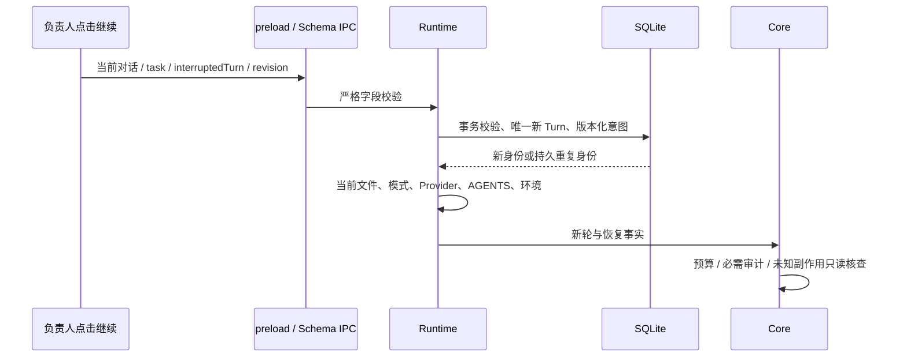

# A9-32 本地实现与第二批继续准备（2026-10-11）

**开发机 F1～F3 修复与规定增量检查 PASS。绑定基线 571ec550… 加 r2 差异，源码集合 SHA-256 d8cf72fbe590e01eab974a176a5ccd9c7f01071cc349c8375c7b2206bd291637。**
真实 Electron、打包、新源 Win10、Win7、独立审核和完整 Alpha 2 检查均 NOT_PERFORMED。
A9-32 保持 APPROVED_FOR_IMPLEMENTATION / A9_32_IMPLEMENTATION_AUTHORIZED。
本报告不签 DEVELOPER_VERIFIED、独立审核、第二批 Win7 或完整 Alpha 2。

## 1. 实际身份与授权

| 对象 | 绑定 |
|---|---|
| 隔离工作树 | `/Users/qlyf/.codex/worktrees/a9-32-explicit-continue/win7-coding-Agent` |
| 分支与 HEAD | `codex/a9-32-explicit-continue@571ec550b5e09611f55557563d0cf2f1a4a40d1b` |
| 产品输入 | A9-30 `c2b6356f…`、A9-31 `8d207ab1…` 均为 HEAD 祖先 |
| 新提交 | NOT_CREATED；本轮是基线加未提交差异 |
| 12 个产品/测试文件集合 SHA-256 | `d8cf72fbe590e01eab974a176a5ccd9c7f01071cc349c8375c7b2206bd291637` |
| 源/消费者逐文件绑定 | `.acceptance/a9-32-developer/source-and-consumer-manifest-r2.json` |
| managed 锁 | `7593e7584305fd76f8ebb7d99adbdcb302a3272ccd616423c2346bd7ff461d3e` |
| 原生 helper 锁内身份 | `2036bf697f16db523c297d150661b43be76458eb718ca24781ebed98ab51e4b7`；本轮未装配或加载 |
| 本地运行时 | macOS / arm64、Node 20.17.0；不是 Electron Node 16 / ABI110 |

原 §6 的授权来源待负责人确认。r1 曾引用原聊天及 Auto Review 复核，本轮不把该来源写成已确认。
本聊天直接请求只批准原隔离树 F1～F3 修复、验证、文档更新及 r2 清单。
原任务 §6 批准表述不扩写。提交与其他下游动作仍未授权。

## 2. 用户可见变化

中断任务卡显示原目标、已记录步骤、修改路径、历史验证及未知副作用。
点击“继续”只创建关联的新 Turn。原 Turn 终态保持。
按钮显示“正在继续”，接原有 Stop。失败保留诊断和新 Turn，可再次主动尝试。
重启、刷新和视图返回不派发请求。旧审批失效，不能用历史助手文本授权。
界面沿用现有 primary 按钮、字体和颜色。
[交互 Demo](../../plans/a9-32-explicit-continue-demo/index.html)是同一卡片渲染函数加桩数据，非验收证据。

去重在首个 await 前提交。重复点击读取已存身份，不追加请求。
事务后崩溃只恢复中断事实；新尝试必须基于新的 interruptedTurn/revision。
正常事件保留清理后，仍存 Turn 的关联元数据保持同一去重身份。
原用户目标缺失时拒绝生成新请求，并显示阻断原因。
正常 owned 后台进程可共存；错属、未知身份或清理失败保持阻断。
旧 edit 未落 tool_end 时，Core 阻止 write。成功读取对应当前文件、已审计 ENOENT 或成功列出精确目录后才允许新提议。
高影响提议继续经过原 Policy，并生成新的目标绑定审批。

## 3. 实际检查与边界

| 检查 | 结果与证据层级 | 原始记录 |
|---|---|---|
| State 准确 §5 合同 | 开发机 PASS，84 项，真实 SQLite / 独立进程退出后重启 | `state-contract-corrected-r2.log` |
| Core 准确 §5 合同 | 开发机 PASS，212 项 | `core-contract-final-r2.log` |
| Shell 准确 §5 合同 | 开发机 PASS，133 项；当前 dist、真实文件/SQLite、本地 HTTP fixture | `shell-contract-final-r2.log` |
| 编译/静态 | 开发机 PASS，先七模块 lint/build，再消费者 | `verify-quick-final-r2.log` |
| 生产页面可见交互 | 6 项 PASS，SURROGATE；本地 Chromium / 桩 preload | `workbench-browser-ui-r3.json`、`workbench-browser-ui-r3.png` |
| 故障反例 | 8 项行为反例均断言失败，源 SHA 恢复核验 PASS | `mutation-results-r4.json`及各原始日志 |
| 文档/差异 | 以本轮最终 `docs-check-fixes-r2.log`、`diff-check-fixes-r2.log` 结果为准 | 同一证据根 |
| 实际 Electron / 包内 native / ABI110 | NOT_PERFORMED | 新包与准确执行阶段尚未授权 |
| 新源 Win10 / Win7 / 门 A/B | NOT_PERFORMED | 无新候选、authority 或正式 run |
| 独立审核 | NOT_PERFORMED | 执行代理没有自签；负责人需指定审核者 |

全部日志与清单位于 `.acceptance/a9-32-developer/`。
当前消费者构建身份在 source-and-consumer manifest 中逐文件记录。
verify:quick 改写了基线中已跟踪的 runner dist。
这些本轮生成字节已保存到 `current-consumer-build-r2/`，跟踪文件返回 HEAD 字节。
这是隔离树内本轮输出的保存，不是清理原工作树。
下一轮运行消费者或装包须先编译依赖，不使用返回后的旧 runner dist。

首轮两个预算断言绑定了错误的结果值/配置入口。
现有预算合同使用 failed；夹具现从实际配置加载 16000 预算。
零 Provider 发送断言保持。原失败日志保留。
初次浏览器入口缺少默认版本，随后使用已安装 Chromium1243；没有下载。
首轮未知副作用故障注入发生 TS 编译失败，不能计行为反例。
有效 r2 注入出现三次 write，与唯一 write 断言冲突。原失败保留。
文档首轮发现重复任务索引，已归并为每项一次。

## 4. 影响与继承

State/Core/Runtime/IPC/preload/UI 直接变化。
原生源码、Runner 源码、依赖和 managed 锁不变。
本轮没有签发新源 INHERITED_EVIDENCE。旧 Win10 原证据保持原 source/run。
native 正确性/双构建/编码可提出继承，仍需逐项核字节、配置和上下游适用性。
继续、共享审计/预算/恢复和新包整体身份必须直接检查。
新包整体 PASS 不能从旧包继承。

## 5. 最短真实 Electron 链路与 A9-33 准备

先审阅并形成干净的准确源码提交，完成独立审核。
现有 managed 生产者要求 `A9_V26_CLEAN_SOURCE_REQUIRED`；本轮不绕过它。
当前生产者仅有 A9-30/31 开发 Profile，没有 A9-32/正式 batch2 Profile。
该缺口属于 A9-33 已列白名单；A9-32 不越界修改发布生产者或 package runtime。
[A9-33 §5](../../tasks/A9_33_BATCH_2_WIN7_ACCEPTANCE.md#5-基于-a9-32-本地差异的具体化准备2026-10-11)补齐阶段断言与闭包。

拟最短链路为普通产品启动 → 后台输出 → Stop → 中断/重启零请求 → 主动继续 → 正常退出。
先核准确 source/ZIP/manifest/锁/driver、普通身份、Session/Integrity/Elevation/Job、空间和生命周期。
通过后再进入 S01–S06/BG/CONT/SAFE/UI 回归。
具体机器、账户、目录、driver hash、最多请求数及退出证据必须在执行批准前实际绑定。
未指定的值保留 UNKNOWN，不借用 ENGINEERING_02 的入口或已消费授权。
WIN7-43 仅暂定。本轮本地匹配 refs 与三个已知候选根未见该号；冻结前重新完整核号。

## 6. 当前最短待裁决动作

请求一次本地提交授权，范围为 `review-bundle-manifest-r2.json` 的准确文件。
只暂存该清单，不使用 git add -A。建议提交题目：`feat(a9): add explicit interrupted task continuation`。
提交前逐 SHA 核对；漂移停止并解释。提交后的准确 SHA 再绑定构建/审核输入。
不推送、合并 main、改 PR #11、装包、写远端、冻结或发布。
负责人指定独立审核者；本执行代理只准备证据。
打包/目标动作等新产物、目标和准确权限形成后，再按原合同提交完整阶段材料。

## 7. 完整 Alpha 2 与保护

第二批通过不能签完整 Alpha 2。覆盖审阅见[覆盖台账 §6](../../plans/A9_BATCH_2_ACCEPTANCE_COVERAGE.md#6-a9-32-本地推进后的完整-alpha-2-边界2026-10-11)。
A9-34 已推迟；恢复后 cleanup-required 无产品处置出口须明列。
A9-17 实机性能、真实 Provider/企业环境、POSIX/PowerShell /Command、≤799px 按原未测状态保留。
原主工作区及 A9-31 工作树没有产品写入。
保护复核见 `initial-boundary-r2.json` 和最终 `protected-boundary-check-r2.json`。
旧候选、首失败、数据库、用户文件、FAIL/UNKNOWN/HALTED 未重绑。
ENGINEERING_02 §138 p17/w16 保持 HALTED，没有新版本、预算、远端派发或修复。

## 8. 独立复核发现与处置（r2）

本节为开发机执行结果，绑定上述源码集合 SHA。它不代替独立审核。

| 项 | 修复与对应测试 | 结果与边界 |
|---|---|---|
| F1 | 已审计 ENOENT；精确目录 list；move 两端一存一缺；权限/其他错误/取消/超时/越界/审计拒绝 | 开发机 PASS；Shell 使用真实文件与 SQLite。去掉 ENOENT 观察后断言失败 |
| F2 | 相对/绝对路径、点段、win32 分隔符/大小写/盘符/UNC；不同目录、越界、POSIX 大小写和字面反斜杠反例 | 开发机 PASS；win32 语义为模拟，Win7 NOT_PERFORMED。去掉归一后断言失败 |
| F3 | 普通与分页对话在继续前/后/重启均保留原目标；旧继续事件过滤；原请求清理后拒绝嵌套；生成提示在 turn_started 审计中可追溯 | 开发机 PASS；真实 SQLite/Runtime 检查。去掉原目标过滤后断言失败 |
| F4 | r1 五项及 F1/F2/F3 三项，共8项重绑最终字节 | 开发机 PASS；每项编译/解析成功、行为断言失败、源码恢复 SHA 相同 |
| F5 | 原任务 §6 的授权来源 | 授权来源待负责人确认；本轮不扩大原批准，不签阶段门 |

完整读取点登记在 `conversation-request-readers-r2.json`。任务继续事件 schemaVersion=1、去重身份、表 schema 与 recoveryRevision 哈希输入未改变。
Core 原生/Provider/依赖路径未改变。ADR-0152 正文保持，追加 ADR-0189 并登记隔离树编号冲突风险。

首失败记录：`state-contract-fixes-r2.log` 是新增夹具方法名错误，不能计行为证据。
`core-contract-fixes-r2.log` 是目录权限反例捕获的标记未清零缺口；已修复并保留 FAIL。
`mutation-unknown-side-effect-gate-build-r2.log` 是无效注入的 TS 编译失败；不计8项反例。
相同输入已通过的检查未扩大。Core 最后路径调整后直接重跑 Core 与 Shell；State 源字节不变，84项记录仍绑定最终 State SHA。

本轮实际 Node20.17.0/macOS，不是 Electron Node16 或 Win7。
412 个消费者构建文件保存到 `current-consumer-build-r2/`。全部消费者检查与反例恢复编译完成后，24 个跟踪 runner dist 返回 HEAD；恢复记录见 `generated-output-preservation-r2.json`。
r1 全部清单、patch、日志与构建保存字节保持。新清单 supersedes 指向 r1 清单 SHA，不改旧结论。
26 文件准确 bytes/SHA 及 r2 patch SHA 见 `review-bundle-manifest-r2.json`；复制用列表见 `sha256-files-r2.txt`。文件集合没有增加。
提交提议只覆盖该26文件，authorization=NOT_GRANTED。所有 remaining 项为 NOT_PERFORMED。
