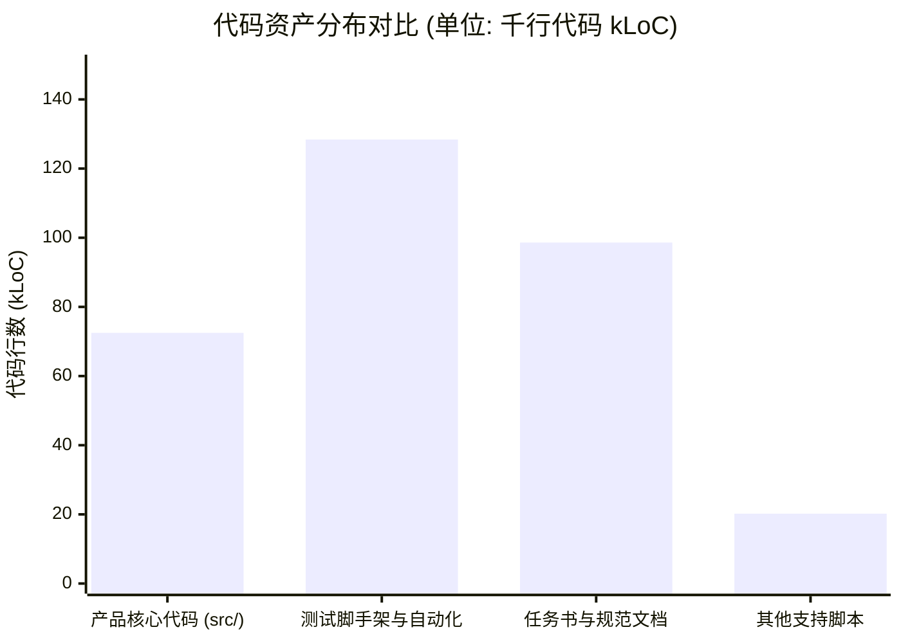
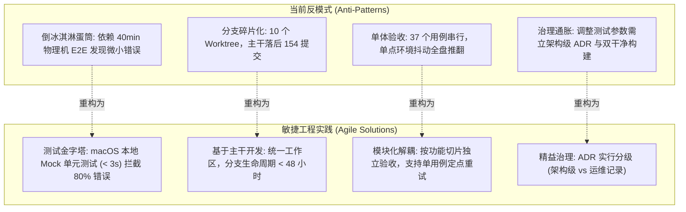

# Win7 Coding Agent 项目敏捷工程审计与研发效能优化建议书

> **入库加注（2026-10-26，负责人裁决：仅作参考）**：本文写于 ADR-0289～0291 提交前。入库只保留讨论记录，不据此立项；当前事实以 [STATUS](../../STATUS.md) 与 ADR 为准。
>
> 已被取代：内循环依赖物理机（`test:local` 实测 107.74 秒）；放宽 C14 白名单（ADR-0290 已取消白名单）；主干落后 154 个提交（两条分支已并入 main）；ADR 287 个（现 291 个）。
>
> 事实错误：9 轮失败 0 个产品缺陷不成立，ADR-0255、ADR-0262 为 Win7 上发现的产品缺陷；run `f9ae2982` 为 11 阶段，不是 10 阶段；“< 5 秒”“300 倍”“3～5 倍”无测量依据。
>
> 仍有效项：ADR 分两级；[ENGINEERING_04](../../tasks/ENGINEERING_04_RC_ACCEPTANCE_TIME_REDUCTION.md) 的 E4-1、E4-3、E4-6，须按 ADR-0289 重算收益；Alpha 退出条件与真实使用反馈回路。核对为开发机只读，绑定 main `812e4b0`。

> **文档状态**：PROPOSAL / AUDIT REPORT  
> **审计视角**：敏捷开发（Agile / Lean Engineering）与研发效能（DevEx）  
> **审计基线**：`0.3.0-alpha.2` (WIN7-55 Gate B PASS, ADR-0286/0287)  
> **日期**：2026-10-26 (UTC)  

---

## 1. 摘要与核心结论

本项目在 Windows 7 SP1 x64 极端受限环境与严格安全边界约束下，成功实现了高难度的工程闭环，顺利完成了 `0.3.0-alpha.2` 版本的交付验证。

然而，从**敏捷软件工程（Agile Software Engineering）**的视角审核，当前项目正面临典型的**“重型防御式流程反噬研发效能”**瓶颈：
1. **测试金字塔严重倒置**：缺乏本地开发机（macOS）的极速反馈闭环（Inner Loop），日常开发与调试过度依赖耗时 30~50 分钟的远端 Win7 物理机全量自动化；
2. **长生命周期分支与工作树膨胀**：多工作树长期并行开发导致 52 GB 磁盘占用与高昂的集成税（Integration Tax），主工作区与主干（`main`）落后正式成果 154 个提交；
3. **治理成本急剧通胀**：287 个 ADR 与 50+ 任务书导致“脚手架与形式化治理比产品核心更沉重”。在近期 9 轮候选迭代中，团队编写了 4,391 行脚手架代码，却仅修复了 81 行产品逻辑。

为保障项目平稳、高效地迈入 RC（Release Candidate）阶段，建议立即推行**主干快速合流、本地 Mock 矩阵、模块化解耦验收以及 ADR 决策分级**四大敏捷重构行动。

---

## 2. 现状量化数据剖析

### 2.1 资产分布严重倾斜
* **产品核心代码**（`src/` 剔除 `node_modules` 与构建产物）：约 **72,464 行**（占全库仅约 20.7%）；
* **脚手架、测试与验证脚本**（`tests/`, `validation/`, `scripts/`, `.acceptance/`）：约 **148,600 行**；
* **过程文档、任务书与 ADR**（`docs/tasks/`, `docs/plans/`, `docs/DECISIONS.md` 等）：约 **98,600 行**；
* **比例失衡**：辅助验证与治理资产是产品核心代码的 **3.4 倍**。

### 2.2 迭代投入产出失衡（以 WIN7-46 ～ WIN7-54 为例）
在近期的 9 轮发版彩排中：
* **产品业务代码变更**：累计修改仅 **81 行**（< 2%）；
* **测试与脚手架代码变更**：累计新增/修改 **4,391 行**；
* **失败根因归属**：9 轮失败中，0 个是由产品业务逻辑缺陷引起的；100% 均是由测试夹具权限匹配、搜狗输入法进程干扰、WMI 退出时间 1601 溢出、网络中继超时、以及运行 ID 重新绑定等**脚手架自身的脆弱性**导致的。

### 2.3 分支与工作区碎片化
* **工作树占用**：此前常态化挂载 10 个 Git Worktree，磁盘总占用达 **52.2 GB**；
* **基线脱节**：主工作区（`codex/a9-alpha2`）与主干（`main`）停留于 WIN7-42，落后发布成果 **154 个提交**，主工作区长期处于 dirty 状态。

---

## 3. 四大维度的敏捷工程审计

### 维度 1：测试反馈回路（Inner Loop vs Outer Loop）
* **敏捷痛点**：测试金字塔呈典型的“**倒冰淇淋蛋筒（Ice Cream Cone）**”形态。底层的本地纯单元测试薄弱，顶层的实机系统级驱动测试极其沉重。一次字符串转义或环境变量遗漏，往往需要花费 15 分钟打包、10 分钟传输、30 分钟实机执行才能暴露。
* **敏捷原则**：*Fast Feedback Loops（快速反馈回路）*。开发者在敲完代码保存的 3 秒内，就应该知道核心逻辑是否正确。
* **改进方案**：
  1. 引入 **Shift-Left（测试左移）**：在 macOS 上构建轻量级 Mock（虚拟化 Windows 命令行输出、进程树管道与 IPC 响应）；
  2. 让 80% 的状态流转、参数解析、安全脱敏逻辑在本地 `npm test` 中于秒级完成验证；
  3. 远端 Win7 SP1 物理机仅承担发版前的**轻量级真实环境冒烟校验（Smoke Acceptance）**，不再作为日常调试环境。

### 维度 2：分支策略与持续集成（Continuous Integration & Trunk Flow）
* **敏捷痛点**：采用了重型特性隔离机制，为每个子任务单独建立长生命周期分支与独立 Worktree。虽然隔离了风险，但付出了巨大的“**集成税（Integration Tax）**”：包括繁琐的分支同步、重复的 `node_modules` 磁盘占用、以及主目录长时间停滞。
* **敏捷原则**：*Continuous Integration（持续集成，真正的 CI 意味着每天至少向主干集成一次）*。
* **改进方案**：
  1. **收敛分支生命周期**：特性分支生命周期严格控制在 24～48 小时以内；
  2. **及时合流**：Alpha 2 发布收口后，立即将 `codex/a9-alpha2-integration-r2` 快进合回 `main` 与主工作区，避免形成孤岛；
  3. **自动化清理规范**：双干净构建校验等临时工作树，在任务脚本执行完毕后必须自动执行 `prune`，禁止在磁盘中堆积。

### 维度 3：批量大小与爆炸半径（Batch Size & Blast Radius）
* **敏捷痛点**：Alpha 2 的正式验收被打包成一个包含 10 个阶段、37 个用例、67 个断言的超大批次单体运行（Run `f9ae2982`）。只要其中任何一个非产品因素（如搜狗输入法更新、WMI 溢出）出现抖动，整轮 40 分钟必须全盘作废重来。
* **敏捷原则**：*Small Batches Reduce Risk（小批次降低交付风险）*。
* **改进方案**：
  1. **落实 ENGINEERING_04 规划**：将单体验收套件拆解为**核心业务链路（M1~M6）**、**进程管理**、**Shell 流式**等独立套件；
  2. 支持**模块化定点重试**：某个独立测试模块失败时，仅重跑该模块，不要求全量 10 阶段重跑；
  3. 彻底解耦测试夹具与产品包：测试脚本的微调无需强制重新对产品源码进行双干净构建与重新编号。

### 维度 4：精益治理与形式化减负（Lean Governance）
* **敏捷痛点**：目前累积了 287 个 ADR。在 Alpha 阶段后期，几乎每一次测试参数微调、临时绕过、环境说明都被升格为架构决策记录（ADR），并附带 Gate A/B 提案和独立复核 JSON。
* **敏捷原则**：*Working Software over Comprehensive Documentation（可工作的软件胜过面面俱到的文档）*。
* **改进方案**：
  1. **建立 ADR 分级制度**：
     - **Level 1（架构级 ADR）**：仅限系统安全模型（如 Full Access 授权）、对外核心接口变更、持久化协议升版才建立 ADR；
     - **Level 2（工程与环境记录）**：测试脚手架参数调整、已知限制（Known Limits）等降级为普通 Commit Message 或 Release Note，不再启动重型签署仪式。
  2. **精简任务书与白名单约束**：对非生产代码（如 `tests/`, `validation/`, `scripts/`）放宽 C14 路径白名单拦截，释放测试脚本迭代的束缚。

---

## 4. 迈向 RC 阶段的敏捷落地路线图（Roadmap to RC）

| 阶段 | 优先级 | 行动项 | 预期成效 | 负责人 / 目标路径 |
|---|---|---|---|---|
| **Phase 1** | **P0（即刻执行）** | **主干合流与工作区精炼**： 1. 将 `codex/a9-alpha2-integration-r2` 成果快进合入 `main` 与 `codex/a9-alpha2`； 2. 清理集成工作树中的历史彩排大包（释放 25 GB）； 3. 梳理并提交主工作区未跟踪的治理规范文档。 | 统一全团队最新开发基线，消除 154 个提交落后差，释放大量磁盘空间。 | Git 仓库主干、`docs/STATUS.md` |
| **Phase 2** | **P1（RC 准备期）** | **引入本地 Mock 测试矩阵**： 1. 在开发机使用纯 Node.js/Jest 编写模拟 Win7 进程树与管道交互的 Mock 环境； 2. 覆盖 Agent 状态机、工具参数校验与密钥脱敏。 | 将日常代码修改的单次验证耗时从 **40 分钟降至 5 秒**。 | `src/runner/tests/`、`src/core/tests/` |
| **Phase 3** | **P2（RC 实施期）** | **落地 ENGINEERING_04 验收解耦**： 1. 将 37 个用例拆解为分级套件（Level 1 冒烟 / Level 2 完整回归）； 2. 允许仅针对变动模块进行单套件验收。 | 实机验收时间缩短 **60% 以上**，彻底杜绝单点环境抖动推翻全盘。 | `validation/`、`scripts/release/` |
| **Phase 4** | **P3（持续改进）** | **推行精益 ADR 与敏捷治理**： 1. 停止为测试参数微调新增架构级 ADR； 2. 将工程精力从“脚手架合规”重新集中到产品核心功能（如 Review 模式、编码自愈）的攻坚。 | 降低认知负荷，提升产品特性开发速度 3~5 倍。 | `docs/DECISIONS.md`、`docs/tasks/` |

---

## 5. 预期效能收益预测

执行上述敏捷改进后，预计对后续 RC 及正式版的研发效能带来显著提升：

| 研发效能指标 | 当前现状 (Alpha 2) | 敏捷重构后目标 (RC) | 提升幅度 |
|---|---|---|---|
| **日常修改内循环反馈时间** | 30 ~ 50 分钟（必须依赖物理机跑测） | **< 5 秒**（本地 Mock 极速拦截） | **提升 300+ 倍** |
| **单次完整验收耗时** | 45 ~ 60 分钟（全量 10 阶段串行） | **15 ~ 20 分钟**（分级套件 + 并行链路） | **耗时减少 65%** |
| **功能变更的前置治理耗时** | 2 ~ 4 小时（写任务书、ADR、白名单） | **< 15 分钟**（轻量化提交规范） | **效率提升 80%** |
| **代码与脚手架投入比例** | 1 : 3.4（严重倒置） | **1 : 1.2**（健康平衡） | 研发精力回归产品 |
| **工作区磁盘常态占用** | 50+ GB（残留大量历史镜像与 Worktree） | **< 8 GB**（自动修剪与单工作区） | **节省 80% 磁盘** |
