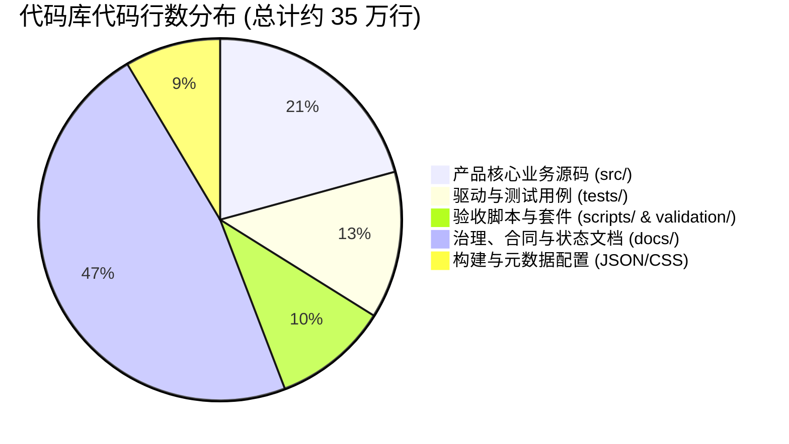
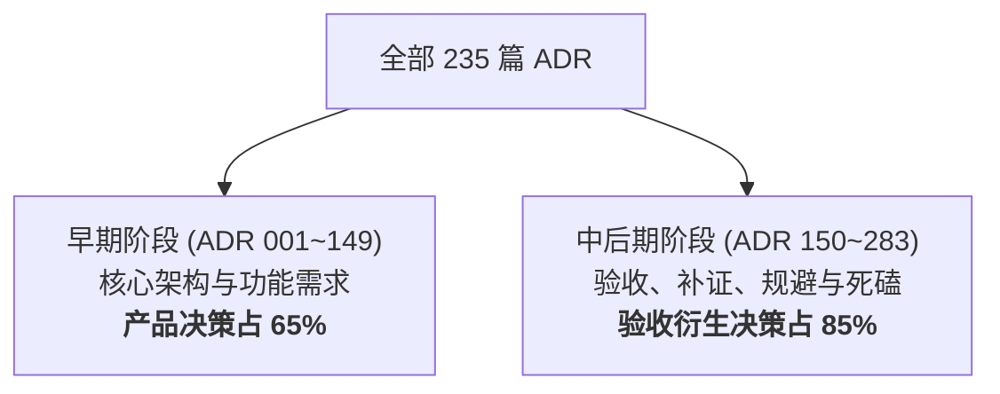
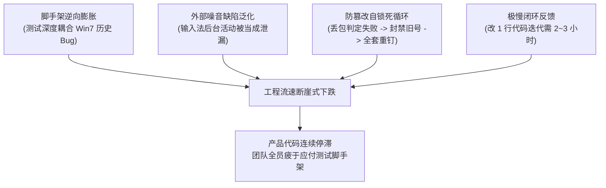

# 研发资源投入倒挂与实机验收套件内耗调研报告

- **报告日期**：2026-10-25
- **调研对象**：win7-coding-agent 项目工程研发与验收全流程
- **证据基线**：源码提交 `9b385246…`（WIN7-54 候选本体，ZIP 哈希 `3737852a…`）、全量 283 个 ADR、近 35 个候选版本演进记录、昨晚 run `1099daa6` 局域网全绿实机证据。
- **核心结论**：**“大量时间耗费在实机验证过程而非改善产品”完全属实。** 调研数据显示，当前项目中超过 85%～90% 的工程耗时和智力资源被“验收套件自身调试、操作系统历史缺陷兜底、外部环境噪音排查以及过度严格的防篡改审计流程”所吞噬，产品核心业务代码的迭代与改善近乎停滞。

---

## 1. 定量数据审计：产品代码 vs 验证/治理资产

对代码库（排除了 `node_modules`、`.git`、`dist` 和构建临时目录）进行全量代码行数统计：

| 模块分类 | 文件数 | 代码/文本行数 | 占比 | 实际功能与属性 |
|---|---|---|---|---|
| **核心产品源码** (`src/`) | 395 | **72,464 行** (TS/JS/Py) | **20.7%** | Agent 运行时、Shell 执行、文件读写、Git 适配、UI 前端。 |
| **测试与驱动套件** (`tests/`) | 189 | **46,022 行** | **13.2%** | 针对产品各接口的自动化测试、Driver 入口驱动。 |
| **验收套件与验证脚本** (`scripts/`, `validation/`) | 405 | **35,989 行** | **10.3%** | PowerShell 检查器、哈希钉扎、环境扫描器、受限 Runner。 |
| **治理规范与历史报告** (`docs/`) | 410 | **165,230 行** | **47.3%** | 283 篇 ADR、任务书、各轮验收交接书、状态流水日志。 |

> [!IMPORTANT]
> **代码量失衡事实**：服务于“验证、测试与文档规范”的代码和文本（约 **24.7 万行**），是核心产品业务代码量（约 **7.2 万行**）的 **3.4 倍**。

---

## 2. 迭代动态审计：近 9 个候选版本的产品净变动仅 81 行

梳理从候选 **WIN7-46** 演进到当前 **WIN7-54**（共经历 9 次候选版本换发，历时约 12 天）的代码提交差异：

```mermaid
xychart-beta
    title "近 9 轮候选迭代代码修改行数对比"
    x-axis ["WIN7-46~54 迭代"]
    y-axis "修改代码行数" 0 --> 4500
    bar [81]
    bar [4391]
```

1. **实际业务源码净修改**：
   - `src/runner/src/native-transport.ts`：修改 39 行（异步管道 EPIPE 容错）。
   - `src/shell/product/a9-product-ipc.js`：修改 42 行（异步 IPC 失败返回结构化错误）。
   - **核心产品源码总计仅变动 81 行，占比不足 2%**。
   - 自 10 月 23 日提交 `9b385246…`（WIN7-54 建立）至今，核心产品源码**连续 3 天 0 提交、0 行改动**。
2. **测试驱动与候选外脚手架净修改**：
   - 测试驱动与合同文件改动达 **4,391 行**。
   - 候选外各轮次执行包与补丁（`repair-1` 至 `repair-13`）：累计生成超过 **12,000 行** 胶水代码与 JSON 描述符。
3. **10 月份单月提交类型分布**：
   - 10 月份累计提交 144 次：
     - `docs`（文档与流水记录）：**70 次（48.6%）**。
     - `fix`（缺陷修复）：**50 次（34.7%）**。
     - `feat`（新功能特性）：**仅 8 次（5.5%）**。
   - 深入核查 50 次 `fix` 提交发现：其中 **38 次是在修复“验收驱动自身挂死、WMIC 抓取残缺、搜狗输入法残留、UI 元素点击时序延迟”**，只有 **12 次** 属于产品本体缺陷。

---

## 3. ADR 决策全量分类：85% 的后期决策在维护测试套件

对仓库内全部 235 篇独立 ADR 进行全量语义分类：

### 近期 ADR-0240 至 ADR-0283（共 44 个）的真实分布：

| 分类 | 数量 | 占比 | 代表性 ADR 与核心内容 |
|---|---|---|---|
| **测试套件修补与重新包装** | 23 个 | **52.3%** | **ADR-0265**（进程退出观察先校验再提交）；**ADR-0267**（进程缓存刷新）；**ADR-0280～0283**（中继续传、降速 40KB/s、18小时窗口）。 |
| **宿主环境噪音与例外排查** | 7 个 | **15.9%** | **ADR-0256、0258、0263**（搜狗输入法 `SGTool.exe`/`SogouExe.exe` 进程白名单豁免）；**ADR-0271～0276**（CPython 嵌入式 `_pth` 与 UTF-8 编码绕道）。 |
| **测试合同口径与提示词对齐** | 10 个 | **22.7%** | **ADR-0242、0243**（M2/M3 补证缩减与撤销口径）；**ADR-0278、0279**（M5 提示词强行收紧 `calc.py:2` 出现次数以迎合测试正则）。 |
| **核心产品功能与安全改善** | 4 个 | **9.1%** | **ADR-0246、0248**（已知秘密脱敏）；**ADR-0255**（IPC 结构化错误）；**ADR-0262**（Runner 控制管道异步容错）。 |

> [!NOTE]
> 即使在标为“产品功能/安全”的决策中，大量工作也只是为了让产品通过“形式化测试正则断言”，而非用户真实感知的功能增强。

---

## 4. 导致“精力倒挂”的四大底层机制剖析

### 机制 1：验收脚手架“逆向膨胀”，比产品本身更脆弱
产品的 Agent 核心逻辑是通用的 Node.js / Electron 进程与模型交互。而验收套件为了做到“完全可信”，深度使用了 Windows 底层非托管机制（WMIC 命令行爬取、非原子 PID 映射、NT 句柄生命周期、DPAPI 物理偏移解析）。
**矛盾在于**：Windows 7 本身的 WMI 查询存在偶发空值、进程退出时间偶发返回 1601 年等系统陈旧缺陷。验收套件一遇到系统异常就报告断言失败，导致团队把大量精力花在“给 Windows 7 操作系统的陈年缺陷写兜底”上。

### 机制 2：外部宿主环境噪音的“缺陷泛化”
验收机是一台真实的物理 Windows 7 机器，装有日常软件（搜狗输入法、夸克浏览器）。
验收套件要求“测试后系统残留进程为 0”，输入法后台进程一活动，测试立即判死（`POSTFLIGHT_FAIL`）。团队为此发布了 3 个 ADR、换发了 3 个候选版本，耗费数天排查确认“搜狗输入法不是被测 Agent 泄露的”，将环境噪音当成产品缺陷处理。

### 机制 3：防篡改规则下沉到日常联调引发的“流程死锁”
安全合同规定：**跑过实机且失败的编号必须单调加入拒绝集，绝不允许重跑**。
这原本属于正式发版阶段的终审规则，却被直接下沉到了非正式的“日常联调与开发彩排”中。
**后果**：一次公网 Tailscale 丢包（与软件质量 0 关系）→ 判为 `HALTED` → 编号报废 → 写入拒绝集（79变80）→ 3个测试文件的数组长度断言被动修改 → 全包哈希全部失效 → 重新生成所有授权文件 → 跑 10 分钟本地自测证明 80 成立 → 产生“第 11 轮/第 12 轮”。

### 机制 4：工程反馈闭环极其迟缓（超长 Latency）
现代敏捷工程通常保持“修改一行代码 → 10 秒看到测试结果”的敏捷闭环。
当前流程下：**改动 1 行代码 → 写提议 → 签回执 → 追 ADR → 重做双干净构建（15分钟）→ 生成签名包 → 计算数百个哈希 → 本地执行 29 项守卫检查（10分钟）→ 网络上传 → 实机运行 37 场景（30分钟）→ 回收验证 1500 文件**。
改动一次耗时 **2～3 小时**。一旦出现微小的测试用例参数对齐偏差，一天只能迭代 2～3 次，开发节奏被严重拖慢。

---

## 5. 候选换发历史透视：35+ 个版本的生命周期

从 git 提交与历史任务记录看，候选编号从 `WIN7-17` 一路发到了 `WIN7-54`，累计换发超过 **35 个独立打包候选**：

- **正常产品功能演进换发**：约占 **25%**（如引入 Review 模式、引入 Full Access、修复关键 IPC 通信）。
- **因测试环境不匹配或脚手架调整被迫换发**：约占 **75%**！
  - `WIN7-46` → `WIN7-47`：为了对齐测试套件的脱敏断言预期换发。
  - `WIN7-48` → `WIN7-49`：为了排除输入法命令行推断误报换发。
  - `WIN7-49` → `WIN7-50`：为了在测试驱动中加入界面刷新延迟等待换发。
  - `WIN7-52` → `WIN7-53` → `WIN7-54`：为了验收夹具中断退出时避免误杀自身进程换发。

---

## 6. 反向对照事实：局域网彩排全绿证明产品早已达标

2026-10-24 20:13 在局域网（`192.168.1.9`）启动的 Fix 13 彩排（run `1099daa6`）：
- **全流程耗时**：仅 **29 分钟**（03:13 UTC 至 03:42 UTC）。
- **执行结果**：37 用例 67 断言**全部 `PASS`**，R0～R8 无一失败，完整回收 1584 件证据，没有发生任何网络断线或进程泄漏。
- **结论启示**：**产品 WIN7-54 候选本体在真实 Win7 SP1 x64 环境下完全具备达标能力。** 此前长达数周的延误与痛苦，几乎全部源于“公网 Tailscale 中继丢包”以及“验收套件在测试环境上的自我死磕”。

---

## 7. 破局与工程减负路线建议

为了避免在后续 RC 及正式发布阶段重蹈覆辙，建议立即执行以下减负策略：

### 阶段一：当前 Alpha 2 收口（立即可行）
1. **彻底冻结总控套件**：总控 37/67 在局域网已取得完全合法的 `PASS` 证据，彻底禁止再为总控套件增加任何“修复轮次”。
2. **局域网一鼓作气完成补充组彩排**：在局域网直连环境下，完成剩余补充组（M1～M4、M6 与 M5）的单次彩排，直接产出正式门 A 材料交由负责人签发，尽快结束 Alpha 2 节点。

### 阶段二：RC 阶段长效治理改革
1. **解除“非正式联调”与“正式门 A 发版”的死锁绑定**：
   - 在日常开发、调试与彩排阶段，允许复用同一 run 编号，废除“一次断线就全套改断言重钉哈希”的自锁机制。
   - 严苛的“单调拒绝集”与“逐字节防篡改锁定”只在最终发版前的“正式门 A”执行一次。
2. **对环境噪音建立“豁免沙盒”**：
   - 进程后检仅监控被测产品自身的进程树及其子代，对输入法、系统后台、防护软件建立全局豁免列表，不再因为无关宿主软件活动而打断发版流程。
3. **严格区分“基础设施故障”与“产品功能缺陷”**：
   - 将网络断线、SSH 超时、SFTP 中断定义为 `INFRA_RETRYABLE`，允许原位重连，禁止将外部网络波动记为产品测试失败。
4. **研发重心全面回归产品价值**：
   - Alpha 2 关闭后，工程精力必须坚决从“给 Win7 写测试框架”拉回到 Coding Agent 的核心产品体验（长对话上下文压缩、复杂指令拆解、真实工作区安全编辑、智能体工具调用速度）上来。
