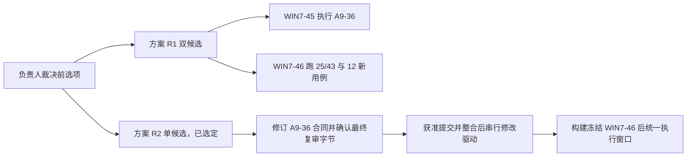

# A9-39 — Alpha 2 最终 Win7 候选与门 A 材料

```text
Status: APPROVED_FOR_IMPLEMENTATION
Task Type: RELEASE_REISSUE_AND_GATE_A_PREPARATION
Target Branch: codex/a9-alpha2-integration-r2
Source Baseline: 4a62b24c550a1062ca4dd6aa72a5f28c7a9ebd56
Target Version: 0.3.0-alpha.2
Candidate: WIN7-54 (development candidate; not frozen; WIN7-53 FAIL retained)
Phase-Gate: A9_39_IMPLEMENTATION_AUTHORIZED
Win7-Validation: NOT_PERFORMED
Decision: ADR-0250, ADR-0251, ADR-0253, ADR-0255, ADR-0256, ADR-0257, ADR-0258, ADR-0259, ADR-0260, ADR-0261, ADR-0262, ADR-0263, ADR-0264, ADR-0265, ADR-0266, ADR-0267, ADR-0268, ADR-0269, ADR-0270, ADR-0271, ADR-0272, ADR-0273, ADR-0274, ADR-0275, ADR-0276, ADR-0277, ADR-0278
Revision: r83 (2026-10-23 UTC; owner approved freeze/gate-A preparation proposal r3; ADR-0278 appended, supplement contract patched; double build/freeze/packages pending)
Phase-2 Baseline: f37811ba912efc10f926c3a249b006f708e4de39
```

## 1. 结论、交付目标与本轮边界

负责人已选择方案 R2，执行代理以 ADR-0251 登记。
A9-36 产品绑定改为 WIN7-46，M6 回退目标仍为 WIN7-42。
Alpha 2 最终候选须包含 A9-37、A9-38；构建和冻结须等待 §6 的前置顺序。
负责人已批准选项 A，本任务为 `APPROVED_FOR_IMPLEMENTATION`。
本轮实施阶段 2：A9-36 已合入 `f37811b…`，追加十二项固定用例并完成开发机检查。
阶段 1 历史记录保留在 §11.1～§11.2；阶段 2 见 §11.3。

负责人 2026-10-16 原话：

> A9-37、A9-38 列入 Alpha 2 范围。请按整合分支准备新 Win7 候选的门 A 材料，并说明与 A9-36 在 WIN7-45 上执行的关系。

获准的完整交付是从整合分支生成新 Win7 候选，完成双构建、逐字节比对、冻结及准确门 A 材料。
WIN7-46 是拟用编号，不是已形成的候选。执行与门 B 另行授权。
任务批准也不代替负责人签发门 A，不直接产生 Alpha 2/RC 结论。

阶段 1 曾只修改 §3 指定的七条实现路径、本文与任务索引。
不提交、不推送、不连接远端或目标机、不构建正式候选。
本轮不写其他工作树，不安装依赖。共享 driver 与 contract-test 已按 ADR-0251 交接给 A9-39。没有派发子代理。

治理依据为 `CLAUDE.md`、`AGENTS.md` §3/C14、全局 `ACCEPTANCE_AND_RELEASE_WORKFLOW.md`。
写作只读引用主工作区 `/Users/qlyf/Developer/win7-coding-Agent/docs/OUTPUT_STYLE.md` 与同目录 `GLOSSARY.md`。
本树未同步这两份文件，本轮不复制治理文件。

以下保留 2026-10-16 的 r2 文档修订记录；r3 执行记录见 §11。
输入为 `outputs/a9-39-draft/independent-review-r1.md`，审核绑定初稿 SHA-256 `2b323191…`。
独立审核 r1 发现 0P0/2P1/5P2；执行代理已核实两条 P1 的源码依据属实。
本次只修订文档判据与裁决记录；逐项处置见 §10，未重跑产品行为。

## 2. 实际基线与事实复核

以下保留初稿的开发机静态核对，绑定 `4a62b24c…`。历史运行只引用原记录，不复跑。
本次修订已重新核对当前分支、HEAD、工作区及审核输入哈希；其余沿用初稿记录。

| 项 | 初稿核对与本次修订记录 |
|---|---|
| 当前工作树 | `/Users/qlyf/.codex/worktrees/a9-alpha2-integration-r2/win7-coding-Agent`，已登记；分支 `codex/a9-alpha2-integration-r2`。初稿入场干净；r2 入场已有三个已修改文档及未跟踪的本文，均保留 |
| 提交链 | `013cf7966c1f5858e2a2c58542d6f9495e88d29e` → `234e3dfbcf25e27e3fafe29162244551eac771ea` → `4a62b24c550a1062ca4dd6aa72a5f28c7a9ebd56`，逐级父提交相符 |
| 当前产品字节 | `src/shell/product/a9-agent-runtime.js` SHA-256 `1809d4a559eb7fd7d35548d0a5412ca91d78a590224a451f478cb9013234924b`，等于 ADR-0249 绑定值 |
| 构建 Profile | `scripts/release/build-a9-product-v3.mjs:34–36` 的 `A9-BATCH2-INPUTS-D013-V26-MANAGED` 硬编码 `candidate: 'WIN7-45'`、`candidateTentative: true`，事实相符 |
| 输入锁与套件说明 | `release/win7-product-v3/a9-batch2-input-lock.json:124` 为 WIN7-45；同目录 `A9_BATCH2_WIN7_VALIDATION.md` 与 `README.md` 写 WIN7-45，事实相符 |
| 套件 JSON 路径差异 | 源目录没有 `release/win7-product-v3/A9_BATCH2_VALIDATION_KIT.json`。该文件由构建脚本 `assembleBatch2Validation/createBatch2ValidationKit` 生成。实际读取的是主工作区 `.acceptance/candidates/WIN7-45/A9_BATCH2_VALIDATION_KIT.json`，SHA-256 `64804b2f…`，source `ba042757…`，25 用例/43 断言 |
| 套件源合同 | `release/win7-product-v3/a9-batch2-fixtures.cjs` 的 `CONTRACT/CASES` 是 JSON 的来源；`candidate`、完成状态也含 WIN7-45。完整性和报告校验器从该合同派生候选号与授权状态 |
| 驱动入包 | 构建脚本第 899 行复制 `src/shell/tests/product/a9-batch2-driver-entry.cjs` 至包内 `validation/a9-batch2-driver.cjs`，事实相符。该路径也是 A9-36 六路径之一 |
| A9-36 当前树 | `/Users/qlyf/.codex/worktrees/a9-36-alpha2-supplement/win7-coding-Agent`，HEAD `013cf796…`，有未提交实现与文档；不能把工作字节当成 HEAD 已包含 |
| A9-36 检查数修正 | 319/319 是 §10 的历史结果；§10.10 最新登记为 321/321。§10.2 已有八轮复审记录，末轮为 0P0/0P1/0P2。本轮只读报告和文件，未重跑其测试或独审 |
| A9-36 当前停止点 | §10.7 记录 r5 两次入口失败；§10.9 记录 r6 在完整性检查处 `A9_36_CANDIDATE_CHANGED`，账本 `HALTED`，没有产品启动或断言结果。§10.10 为 original-fs 修复后的 r7 待签材料，不是可复用的新门 A |
| A9-36 §2 合同 | 产品仍绑定 WIN7-45：source `ba042757a04f428cb3db3ccd10888a7bebe97d3b`、ZIP SHA-256 `ae1d4bb109df68c2f23e08cb4b927f2168f7a1f645969643f35101bf8f9da96e`；普通驱动变化不重发产品。M6 回退目标仍为 WIN7-42，事实相符 |
| WIN7-45 冻结参考 | 已读 `git show b121f14:docs/plans/A9_33_WIN7_45_ACCEPTANCE_HANDOFF.md` §3～§5。a9-33 工作树 `.acceptance/a9-33-rehearsal/w45-formal-preparation/` 有独立构建记录；冻结 `DOUBLE_BUILD.json` 记录 ZIP 逐字节相同与准确载荷 SHA。它们只证明原候选准备 |
| 候选号 | A9-33 §6.57/§6.73 记录 WIN7-44 留给 R 类计划；WIN7-45 已用。主工作区 `.acceptance/candidates/` 当前目录为 WIN7-41、42、43、45，无 WIN7-46；本地 WIN7-46/w46 refs 查询无结果。未联网核远端，冻结前仍须核号 |
| ADR 核号 | 初稿核对 a9-33 最大 0243、a9-36 最大 0245、本分支追加前最大 0249；初稿追加 0250，r2 追加 0251。A9-36 分支已获知不得使用 0246～0251，新 ADR 从 0252 起；整合前再核号 |

A9-36 的只读来源是该树 `docs/tasks/A9_36_ALPHA2_SUPPLEMENTAL_ACCEPTANCE.md` §2、§3、§4.1、§8、§10。
初稿复算其 driver 为 `ddf8f134…`、合同测试为 `4874c42f…`、编排器为 `d87e76cd…`。
这些是观察时点的未提交输入，后续变化须重新绑定。

WIN7-45 已有正式 Win7 运行事实保留原绑定，见[交接书](../plans/A9_33_WIN7_45_ACCEPTANCE_HANDOFF.md)。
不把原 25/43 的直接 PASS 改成 WIN7-46 的 PASS，也不改旧失败或 `HALTED`。
初稿发现的差异是套件 JSON 的源路径，以及 A9-36 的检查数和后续停止记录。

## 3. 已批准的精确允许路径与输入

负责人于 2026-10-16 对“A9-39 是否按选项 A 批准实施”回复原话：

> 批准

选项 A：执行代理先改不与 A9-36 共用的文件。
A9-36 合入整合分支后，再在驱动与合同测试中追加 §5 的 12 个新用例。
之后双干净构建、比对、冻结 WIN7-46，形成门 A 材料。
不包括门 A 执行、目标机、推送与发布。
当前分支须为 `codex/a9-alpha2-integration-r2`，实现只限下表。
不借用 A9-33/36 的批准修改新候选。

阶段 1 的七路径身份同步已完成。阶段 2 在下表十路径白名单内追加 §5 用例。
A9-36 已于 2026-10-17 合入整合分支 `f37811b…`。
共享 driver 与 contract-test 的写者现为 A9-39，原 M1～M6 判定和反例保留。

| 实现路径 | 最小修改责任 |
|---|---|
| `scripts/release/build-a9-product-v3.mjs` | 同步新候选 Profile、任务/套件身份与生成 JSON；保留干净源码门、锁校验和确定性装配 |
| `release/win7-product-v3/a9-batch2-input-lock.json` | 同步候选、Win7 未执行状态与来源；`inputs`、原生合同和批准登记不变 |
| `release/win7-product-v3/a9-batch2-fixtures.cjs` | 同步候选/任务/结果上限；保留原 25/43，追加 §5 的 12 用例、固定夹具和证据合同 |
| `release/win7-product-v3/A9_BATCH2_WIN7_VALIDATION.md` | 新候选身份、直接用例、判据、准确授权字段、阶段/预算与限制 |
| `release/win7-product-v3/README.md` | 新候选和套件入口、构建输入及证据边界 |
| `release/win7-product-v3/RUN_A9_BATCH2_INTEGRITY.cmd` | 只更新候选提示，保留 ASCII/CRLF |
| `release/win7-product-v3/a9-batch2-smoke.cjs` | 为 §5 增加固定驱动模式、隔离配置/工作区、重启与证据回收编排；不接受自由脚本 |
| `src/shell/tests/product/a9-batch2-driver-entry.cjs` | 经真实窗口、preload、Schema IPC 执行新用例；与 A9-36 串行交接，见 §6 |
| `src/shell/tests/product/a9-batch2-contract.test.ts` | 新判定器、零派发反例、旧 25/43 不丢项与新身份检查；承接 A9-36 复审后字节 |
| `scripts/release/test/a9-batch2-package.test.mjs` | 同步现有 WIN7-45/用例数硬编码；验证新候选 JSON、物理闭包和旧候选授权拒绝 |

套件 JSON 的准确产物路径为包根 `A9_BATCH2_VALIDATION_KIT.json`。
它由上述生产者与 fixtures 生成，不在 `release/` 下新增手写副本。
双构建输出中的 JSON 均须比对；冻结副本保持只读。
新增 12 用例后，原集合仍为 25/43；新集合为 37 用例/67 断言，其中新增 24 条。用例实现不预填 Win7 PASS。

上述十路径是 A9-39 的完整实现白名单。
方案 R2 下 A9-36 编排器、请求模块、桌面入口和其验证说明的候选适配，须由修订后的 A9-36 六路径合同承担。
不将它们隐含加入 A9-39；若需第十一路径，先复审任务书再批准。
Core 不在白名单内。A37-04 按现有加载器区分秘密拒绝和解码拒绝，不修改 Core。
文档可更新本任务、两个索引、`docs/DECISIONS.md`、既有 STATUS/STATUS_LOG、交接书和既有覆盖矩阵；不另建平行台账。

### 3.1 不变输入与证据适用性

开发机比较 `ba042757…` 至本轮 HEAD：`native/`、`src/runner/` 与 managed 输入锁没有路径差异。
本树受 Git 跟踪的 24 份依赖清单/锁文件逐件字节比较均未变；构建准入时仍须核对实际安装依赖与输入闭包。
当前 batch2 锁的 `inputs` 与冻结 WIN7-45 锁相同。

| 已锁定输入 | 输入 ZIP SHA-256 前 8 位 | 包内关键字节 SHA-256 前 8 位 |
|---|---|---|
| Electron 22.3.27 / Node 16.17.1 / ABI 110 | `ad723ed7…` | `electron.exe`：`2ed95437…` |
| D-013 v26 managed helper，协议 3 | `25167410…` | `helper.exe`：`2036bf69…` |
| A6 better-sqlite3 8.7.0 / SQLite 3.43.1 | `2cb0cd32…` | `better_sqlite3.node`：`7138aa23…` |

完整值以 `release/win7-product-v3/a9-batch2-input-lock.json` 的 `inputs` 为准。
沿用原生双返回与批准登记，不重建未变化的 native，不改依赖、协议、ABI 或构建参数。
新包仍直接核对其输入、闭包、模块实际加载和上下游调用，不继承旧包整体 PASS。
若发现上述输入或调用合同变化，停止依赖构建，重新分析影响；本任务不授权原生修复。

### 3.2 ADR-0278 增补路径（2026-10-23 UTC）

负责人批准冻结加门 A 准备提案 r3（SHA `5add0194…`），按 ADR-0278 增补下列路径；产品、native、候选 ZIP、`src/` 与其他 `release/` 文件不改。

| 路径 | 范围 |
|---|---|
| `release/win7-product-v3/A9_ALPHA2_SUPPLEMENT_VALIDATION.md` | 只限 ADR-0278 C14 所列七处，补丁 `bc36ff3c…`，修订后 SHA `2c2b3aa0…` |
| `.acceptance/a9-39/w54-gate-a-package/**` | 由 controller-r4 复制：新 run ID、新远端根、正式授权草稿与运输清单 |
| `.acceptance/a9-39/w54-formal-supplement-package/**` | 由 `w48-supplement-package` 正式草稿链复制并改绑 WIN7-54；M5 接入 r5 组件、正式 run 内凭据读取与 9000/3600 秒预算；正式与开发两种模式 |
| `.acceptance/candidates/WIN7-54/**`、`.acceptance/a9-39/builds/w54-build-3`、`w54-build-4`、`.acceptance/a9-39/w54-build-preparation/**` | 双构建补记录与本地冻结；产物须与 `3737852a…` 逐字节相同 |

生成器与检查脚本放在 `outputs/a9-39-w52-package-prep/` 下。

## 4. WIN7-45 原 25 用例、43 断言的影响分析

依据为冻结 Kit `64804b2f…` 的 `required_cases`，并对照本树 fixtures、driver 与两个产品提交。
A9-37 改 checkpoint 的秘密判定；项目说明保留保守外发门。
A9-38 改 Basic 组合登记、Shell 敏感值、实时预览保留长度与单令牌脱敏。
两项均位于 `a9-agent-runtime.js`，不改 UI、Schema、数据库格式或原生组件。

下表“产品路径”表示修改入口或其消费链须直接复验，不表示原断言已失败。
“身份与闭包”表示新候选必须重新绑定。“原样”表示输入和判据可原样复跑，仍须当前候选直接执行。
原 25/43 全部保留；不因追加用例改旧断言，不从本表推导继承权限。

| 用例编号 | 断言数 | A9-37 / A9-38 影响与处理 |
|---|---:|---|
| B2-G0-ENV | 5 | 原样。环境判据未改；直接重新读目标、普通令牌与当前运行时 |
| B2-G1-PACKAGE | 4 | 身份与闭包。新 source/ZIP/锁/Kit/驱动变化；四项全部直接核验 |
| B2-CH-01-START | 2 | 身份与闭包。实际加载新 runtime；不沿用 WIN7-45 首绘与身份报告 |
| B2-CH-02-BACKGROUND | 2 | 产品路径。后台启动的 checkpoint、敏感环境与输出脱敏共路；原判据复跑 |
| B2-CH-03-STOP | 2 | 原样。Stop、所有权、Job 清理合同未改；原数据不含新增凭据形态 |
| B2-CH-04-INTERRUPT-RESTART | 2 | 产品路径。重启恢复区重校验、已知组合恢复与零重放共路；不覆盖新增组合判据 |
| B2-CH-05-CONTINUE | 2 | 产品路径。续跑新轮 checkpoint、秘密门与 Shell 敏感环境共路；原判据复跑 |
| B2-CH-06-NORMAL-EXIT | 2 | 产品路径；退出断言原样复跑。前置后台启动进入轮前基线冻结；退出选择、真实退出与同实例清理未改 |
| B2-S01-LIVE-TICK | 1 | 产品路径。Shell 前 checkpoint 与 A9-38 输出敏感值共路；原时序判据复跑 |
| B2-S02-STREAM-ORDER | 1 | 产品路径。输出流经过新脱敏入口；顺序合同未改，原判据复跑 |
| B2-S03-SQLITE-BEFORE-IPC | 1 | 产品路径。新投影仍须先持久化再显示；原判据复跑 |
| B2-S03T-TERMINAL-AUDIT | 1 | 产品路径。Shell/输出终态经过共享入口；故障注入与硬停判据不变 |
| B2-S04-ENCODING-CROSSCHUNK | 1 | 产品路径。Shell、输出脱敏共路；UTF-8/CRLF 判据不变。此项不是 checkpoint 的 GBK/UTF-16LE 证据 |
| B2-S05-LIMITS-SECRET-BACKPRESSURE | 2 | 产品路径，直接安全重点。A01 的跨 chunk 秘密脱敏与保留长度受 A9-38 影响；A02 的取消/回收判据不变。旧 API key 输入不能证明 Basic 组合 |
| B2-S06-REFRESH-PAGING-RESTART | 1 | 产品路径。新输出投影与重启加载共路；原分页/顺序判据复跑 |
| B2-BG-01-LIMIT-THREE | 1 | 产品路径。每次启动都经 checkpoint 与敏感环境；3/4 上限判据不变 |
| B2-BG-02-OWNERSHIP-CURSOR | 1 | 产品路径。依赖本轮后台启动和脱敏后的输出读取；所有权/游标判据不变 |
| B2-BG-03-STOP-RELEASE-EXIT | 2 | 产品路径。后台启动与新敏感值共路；Stop/release 判据不变。无效 cwd 仍不能证明 KL-12 |
| B2-CONT-01-RESTART-ZERO-REQUEST | 2 | 产品路径。恢复重校验与续跑新轮受影响；原零请求/旧轮不变判据复跑 |
| B2-CONT-03-APPROVAL-UNKNOWN-EFFECTS | 2 | 产品路径。write/edit/delete/Shell 后观察门与 checkpoint 共路；旧批准/归属拒绝判据不变 |
| B2-SAFE-02-AUDIT-HARD-STOP | 1 | 产品路径。共享副作用入口前的 checkpoint 已改；必需审计失败仍硬停 |
| B2-UI-01-CONTINUE-INTERACTION | 1 | 产品路径。继续与 Stop 旅程消费新 runtime；交互判据不变，不据此重做 UI 设计 |
| B2-UI-02-LAYOUTS-DPI | 1 | 原样。布局与页面缩放未改；沿用原视口和可达范围 |
| B2-G3-REPORT-NEGATIVES | 1 | 身份与闭包。准确候选、Kit 与用例集合变更；错 pin/漏证据/改报告/错候选继续拒绝 |
| B2-G4-SECRETS-POSTFLIGHT | 2 | 身份与闭包及安全重点。扫描器未改，须覆盖本 run 新凭据形态及正控；新证据清单和后飞行直接生成 |

合计：产品路径 18 用例/26 断言；身份与闭包 4 用例/9 断言；原样 3 用例/8 断言。
原样三项为 B2-G0-ENV、B2-CH-03-STOP、B2-UI-02-LAYOUTS-DPI。
全部 25/43 均可保留原判据复跑，候选身份必须更新。
没有一项原用例直接证明普通示例的逐字节撤销、项目说明保守门或新增 Basic 组合闭包，故另加 §5。

## 5. A9-37/38 新增 Win7 直接用例

新增 12 用例：A9-37 四项、A9-38 八项，共 24 条断言。
新增模式归入新候选的 p07-safe，原十阶段顺序与原 25/43 保留。
实施时以固定子样本表列出每个变体，不用一次 PASS 代替未执行的变体。
当前集合为 37/67。固定子样本共 251 项，新增模式时长上限合计 10200 秒。
全部驱动模式上限合计 16620 秒，总墙钟上限为 21600 秒。
实际 Win7 耗时为 `UNKNOWN`；准确执行材料仍须核定共同窗口，不沿用旧 7200 秒。

共同入口为冻结包真实 main/preload/Schema IPC/Core/Workspace/Runner 与 SQLite。
用隔离工作区、候选外隔离数据根及合成凭据；新用例使用本机回环固定响应，不调用真实服务。
不得调用私有脱敏函数、Mock、fake safeStorage 或修改产品来替代 Win7 直接证据。
M5 的真实服务仍属于 A9-36；方案 R2 已选定，仍须新门 A 明确批准才纳入同一窗口。

拒绝用例同时核对结构化错误、`tool_start`/Runner 派发事实、外部标记未变化。
不能观察实际派发时记 `UNKNOWN`，不只凭模型回复推定“Shell 0 次”。
每项 JSON 记录 source/ZIP/Kit、run、普通用户身份、输入摘要及实际观察值。
SQLite、事件、Provider 记录和文件清单逐件计算 SHA-256；不在报告明文输出凭据。

| 新用例编号 | 固定输入与通过判据 | 证据形式 |
|---|---|---|
| B2-A37-01 | 工作区含 `Authorization: Bearer YOUR_API_KEY`、源码 `authorization: token`、虚构 URL userinfo；UTF-8/UTF-16LE/GBK 各一组。普通 Shell 实际修改文件；记录 B0、B1、撤销后 B2，要求 B1≠B0、B2=B0，不因启发式阻断 | `a37-01.json`；逐文件长度/SHA、真实 Shell 结束事件、Diff/撤销结果和 checkpoint 归属 |
| B2-A37-02 | 当前 API key、代理密码、自定义头和进程内旧值；原文、标准/URL-safe base64 带/不带 padding、percent 及文件路径分别覆盖。必须 `A9_CHECKPOINT_SECRET_BLOCKED`、零 Shell 派发，不产生含秘密的恢复副本 | `a37-02.json`；逐变体拒绝记录、派发计数、恢复区扫描与文件哈希 |
| B2-A37-03 | 先生成普通恢复基线，再把其中合成值登记为已知秘密；当前与重启加载路径均拒绝不安全恢复。撤销不得静默写回秘密或伪报完整恢复；新秘密重校验生效 | `a37-03.json`；登记前后 checkpoint 索引、恢复区文件清单、错误/诊断、重启后状态与原文件字节 |
| B2-A37-04 | 子样本 A：可加载的 UTF-8 AGENTS.md 项目说明含未登记 Authorization 或 URL userinfo。保守秘密门返回 `secret_blocked`，不得把 checkpoint 放宽套到外发门。子样本 B：UTF-16LE 带 BOM，以及含非 UTF-8 字节的 GBK 文件，分别返回 `decode_error`。两部分均核对回环 Provider 未收到项目说明正文；不修改 Core | `a37-04.json`；分列秘密门与解码拒绝子样本，记录加载状态、Provider 请求体摘要/受控扫描、请求计数与输入文件 SHA |
| B2-A38-01 | 已登记用户名:密码组合，含裸串与 Proxy-Authorization；标准/URL-safe、带/不带 padding、percent 逐项覆盖；UTF-8 与 Latin-1 组合 base64，并以 UTF-8/UTF-16LE/GBK 文件承载。全部 checkpoint 阻断、零 Shell 派发 | `a38-01.json`；编码样本摘要表、错误码、派发计数、恢复区/结果/事件扫描 |
| B2-A38-02 | 同进程清除代理、改用户名、改密码后分别重试。每个曾登记组合继续阻断；新组合登记后同样阻断；不把同密码的未登记用户名宣称已覆盖 | `a38-02.json`；配置变化顺序与摘要、旧/新组合逐项结果、零派发观察 |
| B2-A38-03 | 在公开 Shell 设置写入包含已知组合的环境覆盖；UTF-8/Latin-1 及 URL-safe 形式分别覆盖。新设置拒绝；先写普通设置再登记秘密时旧覆盖被重校验。自动 Shell 选择和真实 Runner 不接收该覆盖 | `a38-03.json`；设置响应、重校验诊断、实际 Shell 身份/Runner 输入的脱敏摘要与零派发证据 |
| B2-A38-04 | 未登记合成令牌采用 Authorization/Proxy-Authorization、大小写、冒号/等号，方案 Basic/NTLM/Negotiate/1Custom/!Custom/_Custom。提示、标题、命令、最终消息均将完整单令牌替换；快照、事件与 SQLite 不留令牌 | `a38-04.json`；按输入/投影表面分行的脱敏结果、快照/事件扫描与 SQLite 查询摘要 |
| B2-A38-05 | 模型流式预览独立子样本：回环 Provider 分块返回已登记 Basic 组合及编码变体，分界落在组合及其编码中间。在第二段到达前读取真实 `liveModelPreview`，核对秘密前缀未提前显示；再核对终态、SQLite 与重启后投影。保留 Shell 独立子样本：分块输出相同组合及变体，核对完整输出、实时快照、事件、SQLite 与重启后投影均无泄漏 | `a38-05.json`；模型与 Shell 子样本分列。记录实际 chunk 的序号/时刻、第二段到达前的真实 `liveModelPreview`、终态与各表面扫描、SQLite 和重启后查询摘要 |
| B2-A38-06 | 未登记 `other:other-pass` 的 Basic 头、文档 `Authorization: Basic dXNlcjpwYXNz`，以及独立裸 `base64(other:other-pass)` 三个子样本只作为工作区文件输入；submitTurn 提示只带固定 ID。回环最终响应另核对保守日志投影，裸 base64 子样本在响应中包装为 Basic 头；响应不作为文件输入证据。Shell 执行、恢复与撤销逐字节相同；日志仍保守脱敏。只证明未登记组合不误拦，不保证其安全识别 | `a38-06.json`；B0/B1/B2、Shell 事件、checkpoint 和投影对照 |
| B2-A38-07 | 同一普通 agent 身份通过真实 safeStorage/DPAPI 保存合成代理配置，退出后重启；当前组合在裸串文件中仍阻断，零 Shell 派发。不得用 fake safeStorage，旧进程已清除的组合不要求跨重启恢复 | `a38-07.json`；保存/退出/重启与密文来源元数据、当前组合拒绝、进程身份/退出记录；不回传 vault |
| B2-A38-08 | 单令牌方案后接空格/制表符的正例；凭据结束后普通下一行保持。另对 Bearer 与 URL userinfo 做回归，凭据仍脱敏。比较精确投影文本，不因多吞普通下一行而通过 | `a38-08.json`；逐输入预期/实际文本、换行边界、快照/事件/SQLite 扫描 |

合成输入文件本来含测试秘密，须在受控输入清单单列；不能将它们混作产品泄漏，也不能排除产品输出目录以掩盖泄漏。
秘密扫描正控包含新增编码形态，扫描结果只记录命中位置类别与摘要。
所有产品输出、恢复区、报告和投影均属于泄漏检查对象。
GBK 直接用例尚未执行，ADR-0249 K5 仍为 `NOT_VERIFIED`；不得因已列用例就关闭。

ADR-0249 K2～K8 限制继续披露：未登记用户名、Digest 多参数、历史日志不回洗、GBK、POSIX 替代证据、带引号/JSON 键、高码位代理凭据。
本任务不修这些产品边界；发现新产品缺陷先保存反例，另按 C14 授权。
KL-12 仍为 P1/NOT_PERFORMED。

## 6. 待裁决：A9-36 与新候选的关系

负责人已选择方案 R2，裁决见 §6.3 与 ADR-0251。
以下保留裁决前的问题、选项表及方案 R1 分析，作为历史记录。
原问题：A9-36 §2 绑定 WIN7-45，而 Alpha 2 最终产品必须含 A9-37/38。
负责人须决定补证在哪个候选上执行，以及哪些旧证据允许准确继承。



| 选项 | 执行范围与合同 | 影响 |
|---|---|---|
| 方案 R1 双候选 | A9-36 按原合同在 WIN7-45 执行。WIN7-46 只跑原 25/43 回归与 §5 的 12 新用例。M6 仍以 WIN7-42 为回退目标 | 不改 A9-36 产品绑定，可独立准备两组材料。需两个准确候选/run/授权闭包；WIN7-45 的 M3 直接事实仍只证明旧产品，最终 Alpha 2 证据对应可能未闭合 |
| 方案 R2 单候选 | 新 ADR 修订 A9-36 §2 为 WIN7-46；完成最终复审、获准提交并合入整合分支，再构建。一次 Win7 窗口覆盖 25/43、M1～M5、M6 与 §5；M6 回退目标仍为 WIN7-42 | 候选一致，M3 与共享安全直接绑定最终产品。候选冻结须等待 A9-36 稳定输入；适配后须重做相关开发机检查、受影响独审和准确门 A 材料 |

### 6.1 方案 R1 的有效性与继承问题（历史分析）

A9-36 的 M3 覆盖 G05/G08/G14：Diff、checkpoint、逐文件/整轮撤销、后台修改、晚写漂移和重启。
A9-37 改其上游秘密判定；A9-38 又改组合、恢复重校验及 Shell 敏感值。
即使 Workspace 文件相同，也不能据此把 WIN7-45 的 M3 PASS 迁为 WIN7-46 直接 PASS。
§5 的 12 用例也不等于 A9-36 M3 全集合。

方案 R1 若仍要求 WIN7-46 的 G08/M3 闭合，须逐项提出准确继承或另行批准补跑受影响 M3。
后者超出“WIN7-46 只跑 25/43 与新用例”的方案 R1 范围，必须明确修订。
继承材料至少绑定组件字节、依赖/参数/配置、上下游行为、原 source/ZIP/run/身份和可核验报告。
由负责人批准其适用范围，标 `INHERITED_EVIDENCE`，不记当前候选直接 PASS。
ADR-0155 仍为 Proposed；现行 batch2 套件不批准任何继承，不能靠 ADR-0250 自动放行。
缺少具体批准时，相关最终候选覆盖保持 `NOT_PERFORMED`，不能签完整 Alpha 2。

### 6.2 方案 R2 的合同、同一写者与时间依赖

ADR-0251 已裁决替换 A9-36 §2 的产品绑定及 M6 正向版本，保留 WIN7-42 回退目标。
A9-36 §8 的 F45 系列夹具/基线、正向模块 SHA 与新候选身份须重新分析并绑定，不能只换显示名称。
其 M2-05、M3-04、隔离与已知限制裁决保持，除非负责人另作具体决定。

driver 和 contract-test 都是共享路径，不能由 A9-36 与 A9-39 同时写。
先由 A9-36 执行者完成其六路径修订与最终复审，固定完整 SHA 并获准提交。
整合执行者将其合入当前整合分支后，再由 A9-39 执行者串行追加 §5。
整合保留 A9-36 原判定与反例，再运行旧 25/43 合同和新用例检查。
不得在 A9-36 未提交工作树取一份中途 driver 直接打包。

最终完整新候选 SHA 只能在构建后形成。
构建前固定的是已复审的源码合同与占位拒绝规则；不把占位哈希签成产品绑定。
构建后再给候选外 A9-36 授权/夹具材料绑定实际 source/ZIP/manifest/Kit，避免为填包哈希反复重建产品。
冻结后不回改包内 driver；若包内字节必须变化，按新候选流程处理。

A9-36 §10.10 已有 321/321 与第八轮复审，方案 R2 不要求无变化重做全部历史审核。
但需先确认最终工作字节，复审候选适配和整合差异，再获准提交/合入。
r6 的完整性失败、`HALTED` 与首失败保留；original-fs 修复仍无 Win7 成功证据，先做实际运行时只读准入。
方案 R2 已选定：不签发、不执行现有 WIN7-45 r7。
r7 原字节保留，其 candidate、run、期限与预算不复用。
须在 WIN7-46 构建、冻结后，重新生成准确门 A 材料。

同一窗口可以有 batch2 与 A9-36 各自账本和子 run；材料须明确共同候选、调度顺序及总预算。
不得把“一个窗口”写成复用一份已消费授权，也不把原 16 请求/7200 秒与 A9-36 预算自动相加后视为获批。
M5 的服务、模型、隔离密文配置及费用上限须由新门 A 单独列明。
方案 R2 的先后依赖会延后冻结，等待批准与目标机窗口的时间不算已完成进度。

### 6.3 负责人裁决与执行边界（2026-10-16）

负责人已选择方案 R2。执行代理以 [ADR-0251](../DECISIONS.md#adr-0251-alpha-2-补证采用方案-r2a9-36-改在-win7-46-执行win7-45-的-a9-36-r7-门-a-不签发) 登记 Accepted 裁决。
负责人对原提问“选方案 R1 还是方案 R2”的回复原话为：

> r2

裁决为 A9-36 改在 WIN7-46 执行，M6 回退目标仍为 WIN7-42。
不签发、不执行现有 WIN7-45 r7；原字节及 r6 `HALTED`、首失败均保留。

1. 由 A9-36 执行者固定最终六路径字节。
2. 完成 A9-36 最终复审。
3. 获负责人批准后提交 A9-36。
4. 将 A9-36 合入 `codex/a9-alpha2-integration-r2`。
5. 之后才由获准的 A9-39 执行者修改共享文件。
6. 构建并冻结 WIN7-46 后重新生成门 A。

第 5 步的共享文件是 `a9-batch2-driver-entry.cjs` 与 `a9-batch2-contract.test.ts`。
一个 Win7 窗口覆盖原 25/43、A9-36 M1～M6 与 A9-37/38 新用例；各自独立账本。
A9-36 分支已获知不得使用 ADR-0246～0251，新 ADR 从 0252 起；整合前再核号。
方案 R2 裁决本身不批准实施；后续选项 A 实施批准见 §3。
本轮不授予提交或目标动作权限。
本裁决不签发门 A/门 B、Win7、Alpha 2/RC。

## 7. 门 A 材料清单

参照 WIN7-45 交接书 `b121f14` 版本 §3～§5，只列字段和依赖，不复用其 SHA、run 或回执。
“可准备”表示已有来源可整理，本轮没有生成授权载荷；“依赖冻结”表示须填准确新字节；“依赖负责人”表示不能由执行代理代签。

| 材料/字段 | 当前状态 | 必需内容 |
|---|---|---|
| 方案 R2 与实现合同 | 方案已裁决；选项 A 已批准，阶段 1 执行见 §11 | ADR-0251、A9-36 合同修订与最终复审、提交/整合授权、本任务实施批准 |
| 候选号核对 | 可准备 | 重新核 refs/登记/目录；保留 WIN7-44 与全部历史候选；占号冲突即停 |
| 源码身份与范围 | 可准备 | 当前完整基线、两个产品提交、最终整合提交、干净状态与精确路径差异；不得以本轮 HEAD 代替未来最终 source |
| 原生/依赖输入 | 可准备 | §3.1 完整锁值、批准登记 commit/SHA、实际输入 ZIP 与 helper/SQLite/Electron 哈希、适用性分析 |
| 双构建记录 | 依赖冻结 | 同一最终 source 的两个独立干净目录；Node/工具版本、实际 argv、依赖链接与输入、起止 UTC、退出码、构建前后干净；共享输入与跨机 UNKNOWN 分开记 |
| 逐字节比对 | 依赖冻结 | 两 ZIP 的大小/SHA 和逐字节一致；条目数量与内容缺失/额外/变化为零；JSON/manifest/Kit 一致，不照抄旧 800 条目 |
| 冻结身份 | 依赖冻结 | candidate/source/version、ZIP 名/大小/SHA、manifest/Kit/锁 SHA、native 批准登记、helper SHA、双构建 SHA、冻结时间、目录权限及 IDENTITY.sha256 的 SHA |
| 冻结外状态 | 依赖冻结 | `FROZEN_CANDIDATE.json`、保护清单和候选外结果根；包内 tentative/NOT_PERFORMED 不在冻结后回改 |
| 固定 run 与目录 | 依赖负责人 | 新 UUID、本地候选外运行根、新远端根准确绝对路径；不得复用 WIN7-45 或 A9-36 旧 run |
| 目标准确身份 | 可准备 | 沿用拟目标 `192.168.1.3` / `dccs-chaizl-PC\agent`；**门 A 前在执行步骤 R1 重新只读核对**。OS build、主机名、SID、活动 console 会话、Medium/非提升/InJob 与普通进程身份均须记录，当前为 UNKNOWN |
| 环境准入与新根 | 可准备 | 执行步骤 R1 只读核空间、运行时、相关进程树/旧任务和新根不存在。门 A 签发后、写入前再确认；任一未知停止依赖动作，不按历史 session 2 或 5 推定当前身份 |
| 执行角色 | 依赖负责人 | 执行代理、未参与执行的独立审核、负责人签门 B；角色和精确范围写进材料 |
| 预算与时间窗 | 依赖负责人 | 正式次数、阶段/请求/服务调用、总墙钟、TTL、费用、上传/下载、有效期和有界重试；用新集合核算，不复用旧授权额度 |
| 准确授权载荷 | 依赖冻结 | 签名载荷必须含 `schema_version: 1`、`formal_input_lock_sha256`、`approval_registry.commit`、`approval_registry.sha256`；并含 kind/status、run、target.machine_name/account_sid、candidate.source_commit/package/manifest/Kit/helper SHA。文件在候选外，机器 APPROVED 字段不构成签发 |
| 授权 SHA 与独立 pin | 依赖负责人 | 负责人确认载荷完整 SHA；另存回执、签发/截止时间与独立 pin，不改已签字节，不以 draft 的 SHA 代替待签载荷 |
| 传输与调度闭包 | 依赖冻结 | 管理员 SSH 仅传输、校验与调度。外部锁/登记/授权与粘合文件逐项大小/SHA；任务 XML 的执行文件、参数、目录、SID、InteractiveToken、LeastPrivilege、期限和触发器回读；工具运行时准入 |
| 执行步骤 R1～R8 | 可准备 | 身份只读复核→新根/权限→准确传输→物理解包闭包→任务回读→最短链/回归/新用例→证据回收→退出与后飞行；本轮仅列计划 |
| 一次性任务收尾 | 依赖负责人 | 执行代理在用后逐项移除本轮准确登记的一次性任务。保留移除回执及后飞行记录，不删除历史任务或证据；须纳入新门 A 的准确范围 |
| 原始证据与保密 | 可准备 | 先保存原始字节，再逐件大小/SHA 对账；秘密扫描正控、真实退出码/时刻、PID+创建时间同实例清理；不回传凭据/vault，不覆盖首失败 |
| 覆盖矩阵与限制 | 可准备 | 在既有矩阵逐项关联 25/43、12 新用例、方案 R2 下 M1～M6；直接/准确继承/未执行分列，KL-12 保持 P1/NOT_PERFORMED |
| 独立审核与门 B 入口 | 依赖负责人 | 正式执行后才核原始结果、审计、生命周期与限制；另行授权审核与门 B，不在门 A 准备阶段签结论 |

本轮未执行上述目标准入，目标机当前状态为 `UNKNOWN`。
执行步骤 R1 的只读核对仍须获准连接目标机；本轮不以此清单扩大网络授权。

## 8. 验证计划、停止条件与未执行边界

执行代理先按依赖顺序编译，再检查实际消费者加载当前输出。阶段 1 的限定检查见 §11。
正式生产者要求干净且已提交的源码；实现完成后须另获准确本地提交授权，才能进入双构建。
本轮禁止提交，不使用 `allowUncommitted`、临时豁免或中途工作字节绕过源码门。
执行与改动相关的 package/contract/脱敏检查、A9-32 §5 复验及项目必需检查。
新验收组件先在 Electron 22/Node 16.17.1 与实际 PowerShell 入口验证所需能力。
original-fs 的物理视图失败不能由开发机模拟 PASS 代替；不在目标机现场修改候选。

新候选最短链为真实启动→普通示例 Shell→字节变更/Diff→撤销→已知秘密拒绝→正常退出。
先通过实际入口，再进入受影响回归与原合同必跑项。
方案 R2 的实际顺序与 A9-36 前置结合后须在准确执行材料固定，不取消其 M4 准入。
新集合的预演需求须在准确执行材料中明确，旧 WIN7-45 预演不能代替新包；本任务实施批准不授权目标预演。

身份、完整性、安全、必需审计或未知生命周期失败，保存首个错误并停止全部依赖步骤。
同类失败连续两轮仍未解释，停止整批重试，先做最小复现和共同原因诊断。
只有同范围、合同允许、实际进程树已结束且没有硬门阻断时，才可用新不可变工具/run 做获准的有界重试。
不得延长等待、减少断言或放宽判据来通过；旧 FAIL/UNKNOWN/HALTED 不复活、不覆盖。

下表保留 r2 文档轮次的检查与边界；阶段 1 当前结果见 §11。

| r2 检查/结论 | 证据层级与状态 |
|---|---|
| 分支、HEAD、父提交、文件与候选登记、原 Kit 25/43、A9-36 合同/记录 | 开发机只读检查，绑定 `4a62b24c…`；不构成行为 PASS |
| `npm run docs:check` | 使用 nvm 绝对路径的 Node 20.17.0；本轮结果见 §9 |
| `git -c core.fsmonitor=false diff --check` | 本轮结果见 §9 |
| 实现修改、构建、双构建、比对、冻结与准确载荷生成 | `NOT_PERFORMED`，本轮未授权 |
| Electron/Win10/Win7 运行，12 新用例、M1～M6、目标只读准入 | `NOT_PERFORMED`，本轮不连接远端或目标机 |
| 门 A/门 B、Win7 最终结论、Alpha 2/RC | `NOT_PERFORMED`，不签发 |
| 提交、推送、发布、其他工作树写入 | `NOT_PERFORMED`，本轮禁止 |

KL-12（真实 helper 启动后 ready 失败清理）仍为 P1/NOT_PERFORMED。
无效 cwd 拒绝不替代该证据；新增用例数量不关闭该项。
本任务的完成标准是可核验的新候选与待负责人签发的准确门 A 材料，不是验收通过。

## 9. 本轮文档检查记录

本节登记 r2 文档检查；产品、构建与目标执行仍按 §8 保持 `NOT_PERFORMED`。
开发机检查绑定 `4a62b24c…` 加本轮四件文档差异，Node 为 `v20.17.0`。

| 命令 | 实际结果 |
|---|---|
| `npm run docs:check` | 退出码 0，`ok: true`，364 文件、53 任务书 |
| `git -c core.fsmonitor=false diff --check` | 退出码 0，无输出 |

Node 使用 `/Users/qlyf/.nvm/versions/node/v20.17.0/bin/node`。
npm 使用同安装目录的 `lib/node_modules/npm/bin/npm-cli.js`，PATH 首项固定为该 Node 的 `bin`。
新任务书的 25 行原用例合计 43 断言，三个分类计数相符，新增用例编号共 12 个且不重复。
以上仅为开发机文档和只读一致性检查，不提升任何候选或验收状态。

## 10. 独立审核 r1 处置

本表登记 r2 对审核输入 `2b323191…` 的七项文档修订。
处置结论限开发机文档；不构成独立复审通过或 Win7 行为证据。

| 审核项 | r2 处置 | 位置与边界 |
|---|---|---|
| P1-1 | A38-05 增加模型流式预览独立子样本。回环 Provider 分块返回 Basic 组合及编码变体；第二段到达前读取真实 `liveModelPreview`，再核对终态、SQLite 与重启后投影。保留 Shell 子样本 | §5；模型与 Shell 分列证据，运行均为 `NOT_PERFORMED` |
| P1-2 | A37-04 拆为可加载 UTF-8 的 `secret_blocked` 与 UTF-16LE 带 BOM、非 UTF-8 字节 GBK 的 `decode_error`。两部分均核对 Provider 未收到正文 | §3、§5；不修改 Core，Core 不在白名单 |
| P2-3 | 补入 `RUN_A9_BATCH2_INTEGRITY.cmd`，只更新候选提示并保留 ASCII/CRLF。允许路径合计改为十条 | §3；本轮未修改该实现文件 |
| P2-4 | CH-06 改为“产品路径；退出断言原样复跑”。逐行复算为产品路径 18/26、身份与闭包 4/9、原样 3/8，合计仍为 25/43 | §4、§9；不改旧断言 |
| P2-5 | 依据负责人原话“r2”登记 ADR-0251。不签发、不执行现有 WIN7-45 r7；保留原字节、r6 `HALTED` 与首失败，旧 candidate/run/期限/预算不复用 | §1、§6；WIN7-46 冻结后重做门 A，本任务状态不变 |
| P2-6 | 签名载荷补 `schema_version`、`formal_input_lock_sha256`、`approval_registry.commit/sha256`；补管理员 SSH 仅传输、校验与调度，以及执行代理用后逐项移除一次性任务 | §7；均须写入后续准确授权，本轮不连接目标机 |
| P2-7 | 候选选项统一写“方案 R1/方案 R2”；执行序列统一写“执行步骤 R1～R8”，单步引用注明“执行步骤” | §1、§3、§5～§8；历史选项表保留 |

## 11. 执行记录

### 11.1 选项 A 批准与阶段 1 范围（2026-10-16）

负责人原话“批准”及选项 A 完整范围见 §3。
Status 为 `APPROVED_FOR_IMPLEMENTATION`，Phase-Gate 为 `A9_39_IMPLEMENTATION_AUTHORIZED`。
本轮不新增 ADR；身份同步沿用 ADR-0250/0251，不改变接口、安全模型、依赖或持久化格式。

开发机入场分支为 `codex/a9-alpha2-integration-r2`，HEAD 为 `4a62b24c…`。
任务书修改前 SHA-256 为 `8719c659…`。
已有修改为 `docs/DECISIONS.md`、`docs/DECISIONS_INDEX.md`、`docs/tasks/README.md` 及未跟踪的本文。
执行代理保留这些输入；两个 DECISIONS 文件不改字节。
治理写作文件只读引用主工作区，未复制到本树。

交付范围为七条实现路径的 WIN7-46 身份同步及本地验证。
`candidateTentative` / `candidate_tentative` 保持 true，冻结前重新核号。
只改打包 Profile、身份夹具和说明；不改产品、native、依赖、原生合同或批准登记。
`inputs` 段按原字节保护，其中 WIN7-45 的历史来源保留。
fixtures 仍为 25 用例/43 断言；§5 的 12 新用例留给阶段 2。

证据写入 `outputs/a9-39-phase1/`，修改前记录为 `baseline.json`。
本轮直接执行 `verify:quick`、package-test、两个 shell 测试、`docs:check` 与 `diff --check`。
先完成七模块编译/静态检查，再运行消费者测试。
package-test 使用现有 TEST_ONLY 合成 PE 与临时仓库；其装配结果仅为开发机 `SURROGATE`。
临时夹具内部提交不变更本工作树 HEAD、索引或分支，不构建正式候选。

适用项为 C14、编码与路径规则、P15 的证据边界及包身份/授权 fail-closed。
无新依赖或系统 API；C15/C16 登记保持原字节。
最短产品链仍为 §8 的启动、Shell、Diff、撤销、秘密拒绝与正常退出，本轮为 `NOT_PERFORMED`。
共享 driver/contract 若因旧身份失败，保留失败用例与原因，不改断言或共享文件。
双干净正式构建、冻结、门 A、Win10/Win7 实机、提交、推送与发布均为 `NOT_PERFORMED`。
KL-12 仍为 P1/NOT_PERFORMED。

### 11.2 阶段 1 开发机结果

本节绑定 HEAD `4a62b24c…` 与本轮七条实现路径的最终字节。
完整 SHA、命令、退出码、原始日志与保留项逐条说明见 `outputs/a9-39-phase1/report.md`。
不据开发机结果签 WIN7-46 或 Alpha 2 结论。

| 检查 | 退出码与结果 |
|---|---|
| `npm run verify:quick` | 0；七模块编译/静态、七项设计门通过 |
| package-test 首轮 | 1；8 PASS/1 FAIL，原始 `package-test.log` 保留 |
| package-test 修正后 | 0；9 PASS/0 FAIL；新身份 JSON 与旧 WIN7-45 授权三种拒绝检查通过 |
| shell 两文件合跑 | 1；283 PASS/1 FAIL，共 284 项 |
| contract-test | 240 PASS/1 FAIL，共 241 项 |
| package-runtime-test | 43 PASS/0 FAIL |

首轮 package-test 的失败位于本轮新增断言。
执行代理误把 manifest/Kit 的 `candidate_tentative` 当作 runtime descriptor 的既有字段。
现有 descriptor schema 1 只携带 candidate；修正断言为明确检查该字段不存在。
断言与测试均保留；不新增产品字段，不改 Schema 或原始 FAIL。
仅因该断言修正复跑 package-test；未无变化重跑七模块或 shell 两文件。

共享 contract 的唯一失败为 `the contract is a closed set with the expected shape`。
第 54 行期望 WIN7-45，实际为 WIN7-46；按阶段边界保留失败，留给阶段 2。
driver 第 1096 行仍硬编码 WIN7-45，影响 `B2-CH-01-START-A01` 的身份判定。
这是静态发现，Electron 驱动本轮为 `NOT_PERFORMED`，不冒充已执行 FAIL。
两个共享文件保持入场 SHA；第 391 行旧授权夹具也留给阶段 2 检查。
Jest 有异步操作未及时停止的提示；进程随后自行结束，实际退出码为 1，未使用 forceExit。

`inputs` 原始片段为 3698 字节，修改前后 SHA-256 均为 `fcd3842a…`。
原生源码、原生合同、批准登记与 managed 锁保持原字节。
CMD 为 955 字节 ASCII，16 个 CRLF，无孤立 CR/LF。
fixtures 从 `LIMITS` 到文件末尾逐字节不变，仍为 25 用例/43 断言。
`verify:quick` 改写的 24 个受跟踪 runner 生成文件已另存证据并恢复入场字节。
恢复记录为 `generated-restore.json`，保护核对为 `preservation.json`。

`rg 'WIN7-45'` 覆盖 §3 全部十路径，共 11 个匹配行。
本轮七路径只余锁内历史来源与旧授权拒绝测试名，共两行。
其余为未改 smoke 的历史头注释、共享文件历史文字及阶段 2 的旧身份检查。
逐行位置、保留理由及补充 `WIN7_45` 检索见上述报告。
文档与差异检查的实际退出码见同目录 `docs-check.command.json` 与 `diff-check.command.json`。
阶段 1 记录不改变 §6 串行交接、冻结前核号、KL-12 或后续门的边界。

### 11.3 阶段 2：十二项固定用例与开发机检查（2026-10-17）

执行代理已完成阶段 2 的本地实现。绑定分支 `codex/a9-alpha2-integration-r2`、入场 HEAD `f37811b…` 加本轮八件文件字节。
入场工作区干净；A9-36 已合入。ADR-0251 的共享文件交接顺序已满足。
A9-39 是本轮 driver 与 contract-test 的唯一写者。本轮没有派发子代理。

负责人 2026-10-16 的选项 A 批准见 §3。本轮继续使用该批准。
范围限十条实现白名单内的必要文件，以及本任务执行记录。
不提交、不推送、不连接远端或目标机、不构建正式候选、不安装依赖、不写其他工作树。
候选 WIN7-46 仍为暂定编号，冻结前重新核号。

| 改动文件 | 变化与影响 |
|---|---|
| `release/win7-product-v3/a9-batch2-fixtures.cjs` | 登记十二用例、固定子样本、24 条新增断言与证据合同；保留原 25/43 |
| `release/win7-product-v3/a9-batch2-smoke.cjs` | p07 固定模式、隔离 profile/workspace/data、相邻重启、进程退出观察与新秘密扫描正控 |
| `src/shell/tests/product/a9-batch2-driver-entry.cjs` | 候选身份由包内 fixtures 派生；经真实窗口、preload、Schema IPC 执行新用例，观察真实 Runner 派发与 SQLite |
| `src/shell/tests/product/a9-batch2-contract.test.ts` | 新判定器正例、十二项错误观测反例、未知/非零派发反例、原集合摘要保护、回环与收尾检查 |
| `scripts/release/test/a9-batch2-package.test.mjs` | 新集合计数为 37/67；旧 WIN7-45 授权拒绝负例保留 |
| `release/win7-product-v3/A9_BATCH2_WIN7_VALIDATION.md` | 用例、阶段、预算、隔离、扫描与未执行边界 |
| `release/win7-product-v3/README.md` | 十二项清单、子样本计数、总集合与预算 |
| 本任务书 | 当前阶段、计数、执行记录与限制 |

新集合为 **37 用例/67 断言**：原 25/43 加十二用例/24 断言。
十二用例共有 **250 个固定子样本**。每个判定器要求准确且无重复的完整样本集合。
原 25 项及其 43 条断言的序列化摘要保持 `d4dea48b…`。
A9-36 M1～M6 判定及反例保留；没有修改其四个独立实现/说明文件。
不改产品、Core、原生组件、依赖、持久化格式、输入锁或批准登记。
适用项为 C14、C15/C16 现有依赖边界、显式编码、P01/P02/P15、必需审计与证据分级。

A37-04 分别判定两项 UTF-8 `secret_blocked` 和两项 `decode_error`。
A38-05 分别覆盖十个模型预览与十个 Shell 子样本。
模型子样本在真实 `liveModelPreview` 读取后才释放回环响应第二段。
A37-03 和 A38-07 的重启必须使用新 PID、相同 SID，并先确认前进程树缺席。
固定输入、输出、恢复区、SQLite、事件与报告均按合同登记和扫描。
A37-03 在登记前生成的准确恢复输入单列，不据此放行新增不安全副本。
首个不满足的观察先写证据并停止本用例，不继续重置标记或覆盖首失败。

原十阶段和 16 请求上限保留。p07 为原 `safe_rules` 加十五个固定模式。
新增模式时长上限合计 10200 秒，p07 合计 10440 秒。
全部驱动模式上限合计 16620 秒，总墙钟上限为 21600 秒。
回环请求上限为 4096，每个请求体上限为 4 MiB；请求消费有效期仍为 900 秒。
这些是资源上限，不是 Win7 实测耗时或已签发预算。
A9-36 的独立账本、M5 真实服务和共同窗口仍须写入准确门 A。

开发机使用 nvm 绝对路径 Node `v20.17.0`。
先执行 `verify:quick`，再由 shell 测试读取本轮构建输出。
证据根为 `outputs/a9-39-phase2/`；完整命令、退出码、SHA、反例逐项结果与保护核对见 `report.md`。

| 检查 | 实际计数与证据 |
|---|---|
| `verify:quick` | 退出码 0；七模块编译/静态检查与七项设计门；`verify-quick.log` |
| batch2 contract 末次 | 退出码 0；414 PASS/0 FAIL/0 SKIP；`contract-release-final.json` 与同名 `.command.json` |
| lifecycle | 78 PASS/0 FAIL；`shell-tests-r1.json` |
| redaction regex | 46 PASS/0 FAIL；`shell-tests-r1.json` |
| Provider persistence | 26 PASS/0 FAIL；`shell-tests-r1.json` |
| package-test | 退出码 0；9 PASS/0 FAIL；`package-release-final.command.json` 与日志；仅 TEST_ONLY 合成 PE/临时仓库的 `SURROGATE` 装配 |
| 三份 CJS 解析、`docs:check`、`diff --check` | 三份解析退出码均为 0；docs 退出码 0，368 文档/54 任务书；diff 退出码 0。CMD 原字节未变，为 ASCII、16 个 CRLF，无孤立 CR/LF |

入场 353 项合同测试保留，新增 61 项。十二项判定器反例均由合成错误观测得到 `FAIL`。
这些结果证明判定器拒绝错误输入，不是十二项 Win7 产品用例的 PASS。
首轮四文件合跑为 545 PASS/3 FAIL；原日志和退出码 1 保留。
三项原因是共用函数参数误改，以及两处旧 p07 测试输入只提供 SAFE-02。
执行代理恢复参数，补齐新集合输入，保留原断言与负例。
后续扩大扫描到 SQLite 原始字节时，一项旧测试仍期望只扫描九件文件。
实际为十一件；执行代理保留原九件断言，并新增两件数据库泄漏命中断言。
该轮 400 PASS/1 FAIL 与退出码 1 同样保留，不改判。

Jest 报告完成后一秒未退出，随后自然结束；没有使用 `--forceExit`。
三个未改产品测试沿用本轮首跑的直接开发机结果，没有无变化复跑。
构建造成的 tracked dist 漂移只按入场副本恢复本轮变化；恢复清单和哈希写入 `dist-restored.json`。

已知限制保持：A9-38 K2～K8，KL-12 的 P1/NOT_PERFORMED，以及 ADR-0155 Proposed 下禁止继承。
GBK 用例已实现，但 Win7 直接执行为 `NOT_PERFORMED`，不关闭 K5。
新驱动的 Electron 22/Node 16.17.1、PowerShell/CMD、真实 DPAPI 与 Win7 运行时准入均为 `NOT_PERFORMED`。
最短真实链仍为启动→普通示例 Shell→字节变更/Diff→撤销→已知秘密拒绝→正常退出，本轮未运行该产品链。
正式双构建、冻结、门 A/门 B、Win10/Win7、Alpha 2/RC、提交、推送与发布均为 `NOT_PERFORMED`。

### 11.4 第 2 阶段审核修复（2026-10-17）

负责人已核实两条 P1 的源码依据，并裁决独立审核的 0P0/2P1/1P2 全部修复。
输入为 `outputs/a9-39-phase2-review/report-codex.md`、`report.md` 及三份复现 JSON。
入场仍为分支 `codex/a9-alpha2-integration-r2`、HEAD `f37811ba912efc10f926c3a249b006f708e4de39`，已有八件未提交改动。
本轮仅在 §3 白名单修改 fixtures、driver、contract-test、两份套件说明与本文；其余两件原改动保持入场字节。
证据根为 `outputs/a9-39-phase2-fix1/`；入场文件、差异、输入 SHA 和命令原始日志均保留。

| 发现 | 修复与开发机红绿证据 |
|---|---|
| P1-1 v3 输出观察 | 从真实 helper stdin 请求绑定 requestId；stdout 按行解析 JSON，只解码匹配的 v3 output_chunk，按各 stream 的 streamOffset 拼接。支持跨 data 事件拆帧与合帧，不改变等待上限。审核两帧正例由 first/second=null 变为 100/200；非 output_chunk 字段明文由错误计时变为 null/null。另测错 request、缺口、跨流与畸形帧 |
| P1-2 必需字段与重启身份 | 十二用例先校验 envelope 的 schema/case/启动时刻与绑定，再逐分支校验必需字段、嵌套证据的存在性与类型，再判定行为；缺清单、摘要、有限时刻或身份均 FAIL。重启行 PID/SID 必须存在，PID 等于 envelope 当前 PID 且异于前序，两个 SID 均绑定 envelope 用户。审核六个误判样本修复前均 PASS、修复后均 FAIL，完整正例保持 PASS；逐字段删除和类型破坏反例通过 |
| P2-3 文件输入边界 | A38-06 提交提示只带固定 ID，三个示例独立写入工作区文件，增加未登记裸 base64(用户名:密码)。最终响应另验证保守日志投影，不把响应当文件输入证据。固定文件和提示参数的三个合同测试通过；§5、两份说明与样本总数同步 |

原 **25 用例/43 断言**序列化 SHA-256 复算仍为 `d4dea48b16626267f2310faabb5dd78b6db6018697417da1775116998649ade2`。
新集合仍为 **37 用例/67 断言**，新增断言仍为 24 条；固定子样本由 250 增为 **251**。
A9-36 M1～M6 仍为 11/13/11/3/6/5，共 49 条断言。
其判定区、采集区、测试前缀及四条独立路径保持原字节，原 evaluate 判定器也与 HEAD 相同；见 `preservation-final.json`。

开发机固定使用 nvm 绝对路径 Node `v20.17.0`；先完成依赖构建，再执行四文件最终消费者检查。

| 检查 | 实际计数 |
|---|---|
| `npm run verify:quick` | 退出码 0；七模块编译/静态检查与七项设计门通过 |
| 修复前定向合同反例 | 25 FAIL/0 PASS，414 未选；`contract-red-r2.json`。首次测试脚手架类型错误未执行用例，另存 `contract-red.json`，不计有效红灯 |
| 最终 batch2 contract | 458 PASS/0 FAIL/0 SKIP，比入场 414 新增 44 项；`shell-tests-built.json` |
| lifecycle / redaction regex / Provider persistence | 78/46/26 PASS，四文件合计 608 PASS/0 FAIL/0 SKIP；`shell-tests-built.json` |
| package-test | 9 PASS/0 FAIL，退出码 0；仅 TEST_ONLY 合成 PE/临时仓库的 `SURROGATE` 装配 |
| 审核复现重放 | 退出码 0；六项错误观测全部拒绝，完整正例全部接受；`review-red-green.json` |

中间定向绿灯首轮为 80 PASS/2 FAIL：一项反例错误地把合法空清单替换为同样的空清单；另一项仍对已包装的 stdin.write 检查 mock。
修正测试输入与原 write 记录引用，保留原断言目的和失败日志 `contract-green-r1.*`，其后四文件合跑 596/596 通过。最终补入十二项 envelope 缺字段/错类型/错 case 反例，再对最终输入复验。
三份 CJS 解析、文档和差异检查的最终退出码见同目录 `syntax-check-final.command.json`、`docs-check-closeout.command.json`、`diff-check-closeout.command.json`。
最终补验前过早恢复 dist，导致 `shell-tests-final.json` 为 605 PASS/3 lifecycle FAIL；该轮加载旧 runner 输出，不计最终消费者通过。
原日志与退出码 1 保留；准确核实并终止该失败测试留下的 PID 24360 子进程，父 Jest 随后退出，没有使用 forceExit；后飞行确认该 PID 已缺席。
重新执行 `verify-quick-final.command.json` 的依赖构建，再按 `consumer-build-inputs.json` 的当前 dist 运行四文件，最终 608/608 PASS、退出码 0。
最终测试结束后，24 件本轮 tracked dist 漂移才恢复入场字节；两次恢复均保存记录，最终见 `dist-restored-final.json`。

本轮没有修改产品源码、原生输入、锁、依赖、批准登记、其他工作树或旧审核证据；没有提交、推送、连接远端或目标机、安装依赖。
最短真实产品链、Electron 22/Node 16.17.1、PowerShell/CMD、真实 DPAPI、Win10/Win7、新候选双构建与冻结、门 A/门 B、Alpha 2/RC 均为 `NOT_PERFORMED`。
开发机合同与协议重放不提升目标平台结论；KL-12、K2～K8 与 ADR-0155 Proposed 的既有限制不变。

### 11.5 第 2 阶段独立复核与本地提交（2026-10-17）

独立审核两轮：首轮 0P0/2P1/1P2（`outputs/a9-39-phase2-review/`），修复后聚焦复核 0P0/0P1/0P2（`outputs/a9-39-phase2-recheck/`）。证据层级为开发机。

负责人 2026-10-17 原话：“批准本地提交 A9-39 第 2 阶段。提交后做双干净构建与比对，并准备 Win7 预演授权材料。不推送。”

执行代理据此本地提交第 2 阶段，随后做双干净构建与比对，并起草 Win7 预演授权材料。预演、冻结、门 A/门 B 与 Win7 实机仍为 `NOT_PERFORMED`。

### 11.6 双干净构建结果与预演 1 授权材料（待签）（2026-10-17）

执行代理已完成开发机材料准备。负责人尚未签发预演授权。
绑定当前分支 `codex/a9-alpha2-integration-r2`、HEAD `dc8cdecb…`；本单入场干净。
授权沿用 §11.5 的负责人原话。本单只写四份状态文档、指定材料目录和输出日志。
没有提交、推送、安装依赖、连接远端、写其他工作树或运行预演。

原双构建记录位于 `.acceptance/a9-39/w46-build-preparation/DOUBLE_BUILD.json`。
两个独立干净构建首次退出码均为 0，构建前后干净。
本单读取原始记录，标为 `INHERITED_EVIDENCE`，不重建或进入构建工作树。
本单直接重算两个 ZIP 及其内 manifest/Kit，并逐字节比较 ZIP。
两份各 101,776,112 字节、801 条目，ZIP `e1e85b67…`、manifest `d3e8de24…`、Kit `7af7892a…`。
Kit 均为 WIN7-46，37 用例/67 断言；输入事实未发现不符。
完整钉和候选外补证工具 SHA 见 `.acceptance/a9-39/w46-rehearsal-1-preparation/INPUT_FACTS.json`。

材料根为 `.acceptance/a9-39/w46-rehearsal-1-preparation/`。
负责人先读其中的 `GATE_REHEARSAL_OWNER_BRIEF.md`；完整步骤见 `REHEARSAL_PLAN.md`。
材料含草案载荷及 SHA、回执模板、原字节锁/登记簿、绑定/预算、传输清单与 SHA256SUMS。
所有授权文件均为草案。尚无负责人回执、最终执行 pin、活动会话或准确截止时间。
目标当前状态与新根存在性均未查询，不填旧 session 2/5。

| 项 | 待签内容 |
|---|---|
| 新 run-id | `ce5b784f-040c-4054-ba4e-6ed1fa5d5de0` |
| 草案载荷 | `release-authority.pending-owner.json`，SHA `4ae9c079…`；完整值见同名 `.sha256` |
| 新远端根 | `C:\A9-W46\run\ce5b784f`，存在性 `UNKNOWN`；R1 存在即停 |
| 目标 | 192.168.1.3 / dccs-chaizl-PC / agent，SID 尾号 1001；正式门 A 前 R1 须重新只读核对 |
| P1，推荐 | p01→p02→p03→p04→p07，27/53，含十二新用例及 251 子样本；5 次阶段请求，18,000 秒，回执起 8 小时；SSH 控制 64，SFTP 上传/下载各 1；真实服务 0 次 |
| P2 | 全量 37/67 加 M1～M5；现有代码强制 M6 前置，须另裁决。10+6 次阶段请求，共同 32,400 秒、回执起 12 小时；SSH 控制 144，SFTP 上传/下载各 2；M5 拟 40 次、费用 ¥5，尚未授权 |
| 角色 | 执行代理执行，负责人签发；预演无需独立复核，必须回收原始证据 |

P1 推荐理由是先检查新包真实启动/退出、流式安全和 A9-37/38。
包内请求前置静态确认支持该部分顺序，不修改阶段合同。
跳过十用例/14 断言保持 `NOT_PERFORMED`，不调用需全量前置的 p09/p10。
仍须按 R7/R8 回收、秘密扫描正控和核对退出，不签 B2-G4 或全量报告 PASS。
P2 的 A9-36 工具不在 ZIP，ADR-0252 要求准确门 A 身份；本单不绕过该门。
补证子 run、M6 夹具、目标准确工具与服务闭包尚未生成，不复用 r5～r7。

待负责人裁决 D1～D5：范围、逐次签发与预算/窗口、是否沿用两次连续成功、活动 console 前置，以及 P2 的 M6/门 A/M5 费用与补证闭包。
建议先选 P1；两次连续成功建议留给最终全量同包，P1 只诊断且不计次数。
这只是推荐，尚未裁决。
草案改为校验器机器状态会产生新 SHA，须负责人确认最终准确字节并另存回执及独立 pin。
当前草案 SHA 不能直接用于执行。到期、超预算或首个意外非 PASS 即停，不自动重试。

开发机 Node 20.17.0 在一次性选择性解压目录加载 ZIP 原校验器。
只在内存暴露原 `verifyAuthority`，不调用产品或原生加载入口。
草案得到 `A9_BATCH2_RELEASE_AUTHORITY_BINDING_INVALID`；状态单项内存投影正控接受。
十四项必需字段逐项缺失、错 pin、P1 前置与禁止不完整 p09/p10 共 24 项静态检查通过。
日志、文档/差异检查、材料哈希自检及保护核对集中在 `outputs/a9-39-rehearsal-auth/`。
这些是开发机材料检查，不是 Electron、DPAPI 或 Win7 行为证据。

本单不改产品、原生、源码锁或构建产物，不创建 `.acceptance/candidates/WIN7-46`。
最短真实产品链、目标预检、预演、冻结、门 A/门 B、Win10/Win7、Alpha 2/RC 均为 `NOT_PERFORMED`。
结果上限为 `REHEARSAL_NOT_ELIGIBLE`；KL-12、K2～K8、旧 FAIL/UNKNOWN/HALTED 与 ADR-0155 Proposed 保留。

### 11.7 预演材料三方审核 r1 与修订（2026-10-17，开发机）

结论：已按派单修订包外材料和门禁，当前仍是待负责人答复及最终 SHA 确认的草案。
本节和材料 r2 取代 §11.6 的当前预算与签发流程；§11.6、r1 三方原始审核和首轮证据按历史原样保留。
任务状态、分支和实现 Gate 不变，不签新候选、门 A/门 B 或正式实机结论。

本单实际基线 `codex/a9-alpha2-integration-r2` / `dc8cdecbaa07008edb931c8e01024878e7ad3d58`。
入场四份已有修改为 STATUS、STATUS_LOG、本文、任务索引，保留并续修；基线记录为 `outputs/a9-39-rehearsal-auth-r2/BASELINE.json`（1,981 件文件哈希）。
输入是 `outputs/a9-39-rehearsal-review-r1/` 的 codex-review、FALSIFY_RESULTS/falsify 和 sonnet-review-summary；本单不另起审核会话/代理。
负责人此前授权“批准本地提交 A9-39 第 2 阶段。提交后做双干净构建与比对，并准备 Win7 预演授权材料。不推送。”
本派单进一步限定只修材料、包外工具、本任务与三个状态入口，证据写 `outputs/a9-39-rehearsal-auth-r2/`；不提交、不推送、不连接目标、不改源码/锁/构建产物、不冻结。
本节登记的 `.acceptance/a9-39/w46-rehearsal-1-preparation/tools/` 仅属本次包外材料，不扩大 §3 的十条产品实现路径。

| 组 | 修订与可观察结果 |
|---|---|
| A 门禁与反例 | 新增无依赖 Node16/20 语法的 `rehearsal-gate.cjs`，presign/activate/consume 三个命令。预算/阶段逐项、数字、时间/运输加和、预演标志、候选字段闭集、A9-33准确目标、十个禁用run和根全部检查；每请求检查真实账本、完整前次PASS结果哈希、首失败即停、普通活动console/环境及共同截止。原校验器不修改 |
| B 签发字节 | 删除回执、BINDING、INPUT_FACTS内预先计算的批准态SHA。先取得本次UTC/截止、D1～D4和会话号，嵌入新载荷后presign/重算SHA；负责人再确认最终完整SHA，独立回执与pin通过activate后才允许R1。只改状态不可放行 |
| C 身份与隔离 | R1～R8逐步区分管理员传输/校验/调度和普通agent一次性任务；实际封装设置APPDATA、LOCALAPPDATA、TEMP、TMP、产品数据根和portable=0。普通进程读自身令牌/session/console/InJob，consume核实际环境/物理路径与无原A8库；请求在普通任务中生成并交原controller，不经管理员createRequest |
| D 预算 | 一ssh进程一控制会话；一sftp进程一传输会话，失败/重连也计。每阶段2个控制ssh，等待在第二个进程内每15秒检查目标状态，不新建SSH轮询。首批送齐XML/固定输入，请求本机生成。P1控制30、SFTP各1，总32；P2控制60、SFTP各2，总64，仍不可执行 |
| E 收尾 | 任一停止仍R7回收/R8后飞行；每阶段完成/失败立即删除本轮准确任务并读回不存在。封装普通身份已证实时，不论controller成功/失败都执行已钉finish只读扫描/清单；超时丢失该路径记未执行，不能新起无预算任务 |
| F 证据上限 | R7本地mark-rehearsal为每件回收结果写外层REHEARSAL_NOT_ELIGIBLE及原始SHA，保留raw不改字节；清单声明包内DIRECT_CURRENT_CANDIDATE不适用于预演，raw不能脱离外层单独作为正式证据 |
| G 简报 | 单一提问“是否同意按P1准备最终签发字节？”，D2～D4默认/备选、D5仅P2；释义、两次连续全量37/67成功/P1不计、P2额外覆盖与风险、目标写入/回滚、不使用Win10、helper正确钉、共享node_modules软链接和锁屏风险均写明 |
| H 文档 | Revision r6，任务索引ADR-0252修为Accepted，当前状态与流水同步本节；重算草案SHA、传输库存及SHA256SUMS |

新草案载荷 SHA-256：`35974dc04974250a2acbb75568807cf56bf78fbcaab469a9f47462d928148d7d`。
run仍为尚未执行的 `ce5b784f-040c-4054-ba4e-6ed1fa5d5de0`，新根 `C:\A9-W46\run\ce5b784f`，不是复用历史已消费run。
批准态载荷只在测试内存中构造，没有写成已批准文件；草案仍含空回执/会话字段，presign与原verifyAuthority均拒绝。
最终SHA在负责人答复前 `UNKNOWN`，当前草案SHA不能作为执行pin。

P1仍为27/53、5请求、0重试、18,000秒（16,200派发截止+1,800清理）、T0起最多8小时。
p01/p02各600、p03 1,380、p04 1,620、p07 10,740秒上限均签入载荷，consume按剩余共同期限逐次检查。
回收8,192文件/512MiB是否足够尚未实测；不够即停并保留现场/缺项，不静默加预算。
P2仍缺新门A、M6裁决、独立补证子run/根/工具/夹具/配置及M5计费闭包；脚本拒绝将P2当作已准备好的方案。

包外身份封装的材料登记（不增加产品依赖、不声明目标已支持）：

| §6七问 | 本次边界 |
|---|---|
| 版本/传递依赖 | `A9_39_REHEARSAL_EXTERNAL_IDENTITY_V1_MATERIAL_ONLY`；当前包Electron22.3.27/Node16.17.1和目标既有PowerShell/.NET；不安装新运行时、库或外部程序 |
| 平台证据 | 只用既有IsProcessInJob/GetCurrentProcess及只读WTSGetActiveConsoleSessionId/WTSQuerySessionInformation(WTSConnectState)/WTSFreeMemory；本机只能静态审查，当前Win7 API/PowerShell实测全部NOT_PERFORMED，不写目标PASS |
| 权限/前置 | 已登录普通agent InteractiveToken/Medium/非提升；拒绝session0/非活动console/API未知；系统组件缺失不修系统 |
| 构建/运行边界 | 封装是候选外测试材料；本单仅Node20开发机纯函数/原ZIP静态检查。目标R1只读锁定powershell/.NET及kernel32/wtsapi32版本、哈希/签名，p01在实际Node16和普通进程做准入；不得跳过未锁定项 |
| 失败/回滚 | 身份/API失败停止产品，InJob未知不改false、不翻转猜测；仍在预算内R7/R8，逐项移除本轮任务，保留全部数据 |
| 来源/许可证/闭包 | 本仓自有包外脚本沿用项目Apache-2.0；Windows DLL/.NET/PowerShell来自目标自带Microsoft系统组件/系统许可，不复制进产品/SBOM。脚本准确SHA在载荷execution_tools与SHA256SUMS；目标系统哈希当前UNKNOWN，执行前按上项取得 |
| 目标用例/证据 | p01已计第1请求，记录SID/session/console/Medium/elevated/InJob和环境；后续普通请求每次复核。实际证据须写本轮新根，目标未准入时不能以macOS或旧Win7结果替代 |

本单直接开发机检查：Node20.17.0 门禁测试 **8组正控、234个反例，共242 PASS/0 FAIL**。
r1中45条detected=false且expectedReject=true的材料缺口，逐条复刻；聚合字段展开为94个反例，全拒。
原verifyAuthority的14项必需字段缺失、草案拒绝和完整正控在新一次性解压的原ZIP字节上复跑。
另覆盖原createRequest/verifyRequest（macOS上Windows路径SURROGATE）、原扫描正控/注入检出、账本结果篡改和外层标记原字节保护。
完整结果为 `outputs/a9-39-rehearsal-auth-r2/FALSIFICATION_R2.json`；命令/日志/保护核对见同目录。
`docs:check`、`diff --check`、SHA256SUMS自检按最终文件执行；失败原始日志保留，不冒充目标证据。

最短真实链仍为p03产品→Shell/Stop→正常退出，本单NOT_PERFORMED；Node16实际运行、PowerShell/API准入、当前Win7、锁屏、预演/冻结/门A/门B/Alpha2/RC均NOT_PERFORMED。
负责人仍需D1～D4、会话号/T0/截止及最终完整SHA确认；仅选P2时需D5。没有新签发或远端动作授权。
KL-12、K2～K8、ADR-0155 Proposed与旧FAIL/UNKNOWN/HALTED保持，不修改任何冻结包、源码、原生输入或历史审核。


### 11.8 预演材料三方审核 r2 与修订（2026-10-17，开发机）

结论：包外材料r3修订与开发机检查完成，仍待负责人D1～D4及最终完整SHA确认；未签发、连接、预演或冻结。
本节取代§11.7的当前材料、预算与签发流程；保留r1/r2三方审核、上次中断输出及历史首失败原字节。
实际分支 `codex/a9-alpha2-integration-r2`，HEAD `dc8cdecbaa07008edb931c8e01024878e7ad3d58`；入场四份已有文档修改保留。
沿用§11.5准备材料授权及本派单更窄范围：只改四文档、指定包外材料和outputs，不提交、不推送、不联网、不触碰其他工作树、不安装依赖、不改源码/锁/构建产物。
当前任务仍为APPROVED_FOR_IMPLEMENTATION，产品十路径实现范围未重新开放。

续做盘点：先读 `outputs/a9-39-rehearsal-auth-r3/codex.log` 尾部及 `revise-gate.py`。
上次已部分改gate、issue-request、mark、PowerShell封装，已写五份XML、ZIP_ENTRIES.tsv及四件管理员/预检材料。
上次未形成report.json，测试仍用旧回执、旧账本及r2输出根；execution_tools、草案SHA、传输清单、SHA256SUMS和文档未同步。
本轮从当前字节继续：保留正确修订，修正哈希自引用、回执模板闭集、done写失败锁存、.NET2集合及XML时限语义比较，补入口测试和说明。
入场快照 `outputs/a9-39-rehearsal-auth-r3b/BASELINE.json` 保存4,796件文件SHA；新日志与逐项证据只写r3b。

| 派单项 | r3处置与证据边界 |
|---|---|
| P1-a 机器名 | authority/observed忽略大小写，request保留observed原始机器名。DCCS-CHAIZL-PC沙箱run及原包verifyRequest接受，OTHER-PC拒绝 |
| P1-b finish | listProcesses(smoke.realExec)。真实issue-request run/finish加载原ZIP模块；仅注入OS exec和Windows文件系统路径，正控接受、exec失败拒绝，属开发机SURROGATE |
| P1-c 材料钉 | BINDING、INPUT_FACTS、ZIP条目表、五份XML和八件执行/管理员脚本共16件签入execution_tools；每件改一字节拒绝。CLI删除--prep覆盖。四根必须在remote_root固定布局并核物理包含；BINDING/FACTS改指向独立草案.sha256，避免循环 |
| P1-d 激活锚 | activate只能成功一次，起点≥confirmation且≤confirmation+300秒；首次activation SHA写activation-anchor.json。consume复核首次锚，绝对共同截止=min(签发截止, confirmation+300+18,000秒)，不从activation可写值计算 |
| P2-e 账本 | 先校验白名单phase、整数index、run、行序/配对/时间，再拼路径。结果绑定kind/run/phase/index及SHA；与requests目录对账，截断/缺失/孤儿/错序及链接拒绝 |
| P2-f 封装 | 参数/环境/Add-Type均进try；失败保存step和脱敏message、done和首个停止标记。issue/controller/finish输出进work\logs并回收；InJob沿用五次交替句柄重试，记录attempts/last_error。PowerShell真实故障注入未执行 |
| P2-g 管理员材料 | 已钉admin-zip.cs展开801条目、拒绝zip-slip/链接/重复并核逐条哈希；admin-materials.ps1任务XML回读比较、准确删除读回、证据树哈希；admin-commands.txt固定ACL文本。均进TRANSFER_MANIFEST，未在目标运行 |
| P2-h 回执 | 所有JSON解析拒绝重复键；回执字段闭集，原话须含批准/同意且不含否定词。简报明确“回执真伪依赖对话记录，脚本不能证明”；可写材料/激活锚整体恶意替换为可信工作区设计边界 |
| P2-i 外层标记 | 输出父目录解析真实路径，不能经链接进入raw；下载限额缺失及空raw拒绝，原始字节不变 |
| P3-j 计划 | 统一每个阶段finally扫描、R7只回收；运输账本路径/UTC步骤/ssh或sftp/序号/退出码及汇总已列；R1双方UTC偏差>60秒即停；长SSH保活30秒/6次。8,192文件/512MiB按派单455/225先例加7,737文件/287MiB余量，非实测保证 |
| P3-k 简报 | 首现释义、拆句、开发机/提交绑定与无近似时长。D4待裁决：一次签发前只读SSH读取agent console/LogonUI/UTC，命令与不做事项已列；结果进入最终签发字节 |

新草案SHA-256：`48e28806f0216c8d5f9a7d0034b5cb77374d5579d0e04d65b68af1e52cdce5cb`。仍含空签发/会话/预检字段，presign必须拒绝，不是执行pin。
P1仍为27/53、5请求、0重试；max_total=18,000秒，清理1,800秒、答复T0起最多8小时。
D4预检单列1次SSH，与R1～R8的30次合计控制31、SFTP各1，总33；失败也计，不自动补连。
首次激活必须在最终SHA确认后300秒内；共同截止只由签发期限和确认UTC加签入预算计算。
最终SHA确认需在预检开发机UTC后600秒内；超时停止，不自动重新预检。D4未批准，本单及准备答复均不能连接目标。
P2仍不可执行，若选择须重新裁决门A/M6/补证闭包/M5费用及包含预检的运输预算。

开发机Node20.17.0：12组正控、310反例，共322 PASS/0 FAIL。相比r2的234反例新增76个，其中本轮r3专项68个，其余为旧数字字段随新增签发字段展开8个。
r1的45条应拒记录仍展开94反例，全拒；r2的22行逐行映射在 `FALSIFICATION_R3.json` 的r3.rows。
1～19行执行反例拒绝；20行InJob瞬时失败和21行PowerShell初始化失败只做静态合同核对，真实故障注入NOT_PERFORMED；22行Node16/Electron22/PS2/Win7实际运行NOT_PERFORMED。
不是22/22实机检出。入口沙箱也不证明Win7身份、API、DPAPI或真实退出。
内存presign/activate/consume正例接受，原ZIP校验器完整正控和草案拒绝均保留；沙箱合成批准态字节只位于outputs内一次性模拟目录，真实材料中没有可执行批准态载荷。
首轮脚手架误将wmic.exe写作wmic，finish正控失败；日志gate-test-r1.log与对应输出保留，修正注入后通过，不改产品或断言。
必需文档、差异、材料SHA自检及全部路径保护核对见 `outputs/a9-39-rehearsal-auth-r3b/report.json`。

16件材料钉与24项传输库存均已重算；activation/首次锚尚未产生，在清单列为NOT_PERFORMED待签项，upload_allowed_now=false。
双包/源码/输入锁/原生/构建记录与历史审核只做字节保护核对，不重建、不改冻结包。双构建执行记录仍为INHERITED_EVIDENCE。
最短真实产品链仍为p03启动→后台输出→Stop→中断/重启零请求→主动继续→正常退出，本轮NOT_PERFORMED。
负责人仍需D1～D4、T0/截止、D4单次预检和最终完整SHA；仅选P2时需D5。
当前Win7/Node16/PowerShell、预演、冻结、门A/门B、Alpha2/RC均NOT_PERFORMED；KL-12、K2～K8、ADR-0155 Proposed及旧FAIL/UNKNOWN/HALTED不变。


#### 11.8.1 签发前只读预检续接修订（2026-10-17，开发机）

本次只修签发前预检材料：删除预检脚本Add-Type，并增加新根存在性检查和完整错误JSON；相关钉、草案、D4与执行包同步。
负责人已明确：先准备准确只读命令清单、预算与停止条件，交负责人逐字确认后才执行。本单没有取得该确认，不连接目标、不读私钥、不执行预检。
沿用同分支/HEAD dc8cdecbaa07008edb931c8e01024878e7ad3d58，保留四文档及全部既有未提交改动；本单不改产品、源码锁、双包或历史报告。

- `presign-preflight.ps1`改用现有qwinsta.exe console的ID列，要求唯一活动agent console行，并用WMI explorer所有者核对。不调用Add-Type/csc/PInvoke、不编译临时文件。
- 只读`Test-Path -LiteralPath 'C:\A9-W46\run\ce5b784f'`写new_root_exists，true时先输出JSON再非零退出；锁屏同理。六个固定输出字段为machine_name、account_sid、active_console_session_id、logonui_present、new_root_exists、target_utc。查询失败保留未知为null，先输出带error的JSON再退出1。
- 新增材料 `.acceptance/a9-39/w46-rehearsal-1-preparation/PREFLIGHT_PACKAGE.md`：准确SSH参数和stdin包装器，1次SSH、120秒、0重试；停止条件、不做事项、开发机证据路径与首失败保护完整列出，须负责人逐字确认。SSH用户dccs-chaizl@192.168.1.3，HostKeyAlias=192.168.1.11；私钥只列路径，没有读取内容。
- 门禁要求签入new_root_exists=false，缺字段/true均拒绝。PREFLIGHT_PACKAGE纳入execution_tools；钉由16增至17，传输库存由24增至25，SHA256SUMS由26增至27。总运输预算仍控制31/SFTP各1/总33，预检已含其中，不增加次数。

新预检脚本SHA-256：`624be591e9e9a5e6db2d237424119d4b2a95847ac412edf6265863357f95e6a5`。
本次新草案SHA-256：`b2a01f56c0a453c6083f3b9dfa2f3a276cd8851a4759ea68245c230e83e65d4f`，取代§11.8当前草案钉；草案仍含空字段，不是执行pin。
Node20.17.0门禁325 PASS/0 FAIL（12正控/313反例，比r3b增加3反例）；原r2的19拒绝/3未执行边界不改判。
新增反例为new_root_exists=true、字段缺失和PREFLIGHT_PACKAGE一字节改动；完整正控保留。
Win7依据采用项目历史query user的agent/console/运行中及ID记录（A9-25交接书:36、A9-33任务书:617），只支持会话核对口径，不是当前qwinsta的运行证明。
当前qwinsta存在性/版本/退出码/列格式/OEM解码、PS2 stdin/JSON/错误路径与WMI权限均NOT_PERFORMED；非零或未知一律停止，不自动改命令或安装组件。
开发机只做门禁、包装器Python语法/材料静态检查、docs:check、diff --check及哈希自检；完整命令、diff与保护结果见 `outputs/a9-39-rehearsal-auth-r3c/REPORT_DETAILS.json`。


#### 11.8.2 预检加固三处（2026-10-17，开发机）

本轮仅按主会话采用的三项加固修订包外材料；同分支/HEAD dc8cdecbaa07008edb931c8e01024878e7ad3d58，保留已有未提交修改，不连接目标、不读取私钥、不新开会话/代理、不提交或推送。

1. 预检脚本UTC的try/catch合为同一物理行。全部脚本体放在单个 `& { ... }` 外层语句，末尾保留空行，其他复合结构均在该块内；查询内容与上轮逐字相同，不新增命令。
2. 包装器先原样保存stdout.raw，再只取最后一个以 `{` 开头的非空行作json.loads。没有该行或最后JSON损坏即失败，不回退早先JSON；其他行只保留、不参与判断。
3. developer_utc输出毫秒精度加Z；以这份实际输出的毫秒时刻计算clock_skew_seconds，向上取整为整数。PREFLIGHT_PACKAGE逐字段列出LOCAL_RESULT.observed、developer_utc、clock_skew_seconds到最终signing.preflight八字段及rehearsal.target_session_id的映射，不重新取时间。

新脚本SHA-256：`3895a64a2b9b50ebbfaac693fc6511315e0c0d0267c839d20445250b4a8cff82`；新草案SHA-256：`9c15a114c0b68058fe5fc7b2c123961d97231761839b1641b3fb0e36eb265d3b`。本节取代上节当前钉，草案仍不可执行。
execution_tools、BINDING/INPUT_FACTS、简报D4、传输清单和SHA256SUMS已同步；17件执行钉、25项库存、27项材料哈希不增项。
Node20.17门禁325 PASS/0 FAIL；包装器纯解析/时间片段14 PASS/0 FAIL；8个有效输出按准确映射经真实presign接受，另2个旧格式反例拒绝，共10 PASS/0 FAIL。
本地检查没有执行SSH包装器或PowerShell；Win7/PS2 stdin实际行为仍NOT_PERFORMED。负责人仍须先逐字确认更新后的PREFLIGHT_PACKAGE准确命令、脚本钉、1次SSH/120秒/0重试与停止条件，才可执行。
完整diff、命令与保护核对写 `outputs/a9-39-rehearsal-auth-r3d/REPORT_DETAILS.json`；其他任务/预算、旧审核/证据及产品/源码锁/双ZIP保持原字节。


#### 11.8.3 预检一可行性与负责人选项A：签发时二次预检、自动出最终字节（2026-10-17）

结论：预检一已执行且过期，固定脚本的Win7 PS2.0 stdin与中文qwinsta可行性已取得；不用于签发字节。负责人原话“A”，选择先答D1～D4，签发时新增一次预检并自动生成最终字节，再在600秒内确认最终SHA。本材料单未连接目标，不把选项A当作尚未给出的D1～D3/T0或新r2包确认。
实际基线仍codex/a9-alpha2-integration-r2 / dc8cdecbaa07008edb931c8e01024878e7ad3d58，入场四份文档和包外材料改动保留。只改授权路径，不提交、推送、装依赖、新开代理/会话、改产品/锁/双包或其他工作树。

| 预检一事实 | 原始结果与完整钉 |
|---|---|
| 执行 | 负责人逐字确认后，2026-10-17T16:11:58.187Z～16:12:09.264Z，11.0854445秒，1 SSH、0重试、退出0、ok=true |
| 观察 | DCCS-CHAIZL-PC，agent SID S-1-5-21-1708701742-428676696-1831205153-1001，console5，logonui_present=false，new_root_exists=false，clock_skew_seconds=3 |
| 脚本/原包 | 脚本3895a64a2b9b50ebbfaac693fc6511315e0c0d0267c839d20445250b4a8cff82；原包7e3d6514388e80c99810fa73214088e515bff5f4016c82e9eeeb4c2a0e012370 |
| 原始证据 | outputs/a9-39-rehearsal-auth-r3c/win7-preflight-once/LOCAL_RESULT.json，SHA36689c6eb61735596b666ac150ab48fb4460870b46a3182cae7f8af96b2be278；stdout.raw SHAba3ab03204349c810f893c6bf1aa4001aaee21a4b6744a07072f8c1620617b61；空stderr SHAe3b0c44298fc1c149afbf4c8996fb92427ae41e4649b934ca495991b7852b855 |
| 适用性 | 原600秒确认截止2026-10-17T16:22:09.264Z，已过期，不写入signing.preflight。只证明当时固定查询成功，不证明产品/Node16/InJob或当前会话、锁屏、新根仍不变 |

P1预算更新为控制SSH32=预检一已消费1+签发时预检二1+R1～R8 30；SFTP上传/下载各1，运输总34。阶段仍5请求/0重试、18,000秒，清理1,800秒；T0起最多8小时及600秒确认规则不变，不追加第三次预检。
BINDING/INPUT_FACTS中first_preflight_feasibility保存原值/哈希并标FEASIBILITY_ONLY_EXPIRED_NOT_FOR_SIGNING；target_session_id/草案预检字段仍为空，不抄console5。

必须重新逐字确认预检包：**是**。原Python包装器把输出固定为once，不能以原字节写twice。已形成PREFLIGHT_PACKAGE r2，包装器仅把证据目录常量改为outputs/a9-39-rehearsal-auth-r3c/win7-preflight-twice，其余字节/SSH参数/查询体不改；不是环境注入或静默替换。
新r2包SHA `7d28b8e314d129d4e29b5936314a1049ed6d18227679a6e76aa46f1e747adeec`，旧包确认失效。改动评估与逐字对照见outputs/a9-39-rehearsal-auth-r4/PACKAGE_CHANGE_ASSESSMENT.json及材料diff。

新增tools/finalize-signing.cjs（SHA `75652b6561d356ab08a8614aea0a7cc8d17369f535bbc9cfa9515da998581a9b`）及测试。调用前填OWNER_SIGNING_INPUT.json，保存D1～D3原文/映射、T0、可选截止和新r2包SHA的批准原文/确认UTC。原话须肯定且明确本包SHA；D1～D3不得与材料默认值矛盾，另选先修材料。默认截止T0+8小时，明确更早截止可用，超出8小时拒绝。
脚本先核execution_tools、SHA256SUMS、草案SHA与负责人输入，新证据目录或signing-final已存在即拒；先以独占目录锁存尝试。随后通过stdin逐字调用本包唯一Python包装器，不替换字节、不重试。
成功后只取第二次原始值填signing.preflight，签入owner_decisions、owner_reply_verbatim及owner_input_sha256；原始完整输入另保存。真实presign通过才写不可覆盖的signing-final/release-authority.json并再次presign。FINALIZATION.json给完整SHA、原样回复句及min(签发截止,第二次developer_utc+600秒)截止；未签signed回执、不activate、不进入R1。
失败写FAILED.json并保留尝试锁，旧可行性结果、超时、时间过期、材料漂移或否定/缺少r2确认均停止，不自动重试。

一条用法命令（本单未运行真实连接）：

```text
/Users/qlyf/.nvm/versions/node/v20.17.0/bin/node .acceptance/a9-39/w46-rehearsal-1-preparation/tools/finalize-signing.cjs --owner-input=.acceptance/a9-39/w46-rehearsal-1-preparation/OWNER_SIGNING_INPUT.json
```

本次草案SHA `82dd5feb40c5c5716eb0c75fc7786b4ffebcbd00dd061902bd35d75bcec3df51`；18件execution_tools钉、26项传输库存、30项材料哈希。草案仍被presign拒绝，不是最终执行pin。
开发机Node20.17：gate327 PASS/0 FAIL；finalize模拟预检38 PASS/0 FAIL，实际SSH0次。含第二次console7正控、旧预检实际快照拒绝、600秒过期拒绝、目录已存在、原文/确认/材料/原始结果哈希及失败锁存；输出围栏原字节比对通过。
必需docs:check、diff --check、SHA256SUMS与保护核对、所有命令/完整SHA见outputs/a9-39-rehearsal-auth-r4/REPORT_DETAILS.json。
预检二、真实最终字节、负责人最终SHA确认、activate、R1～R8、产品Win7、冻结、门A/门B、Alpha2/RC均NOT_PERFORMED；回执真伪依赖对话记录，脚本不能证明。旧FAIL/UNKNOWN/HALTED及KL-12等限制保持。


#### 11.8.4 finalize-signing 审核两项P1与观察修复（2026-10-17）

结论（开发机）：两项P1与观察已修复，绑定HEAD dc8cdecbaa07008edb931c8e01024878e7ad3d58。保留入场修改、预检一原始证据及前轮日志。本轮未连接目标、运行预检包装器、读取私钥、提交、推送或启动代理。只改四份授权文档、包外材料及outputs/a9-39-rehearsal-auth-r5/。

负责人D1～D3与r2包的唯一答复模板如下。它由finalize依据当前建议D值与r2包完整SHA生成并钉在OWNER_REPLY_TEMPLATE.txt；两处owner_reply_verbatim均保存同一句真实原话。仅trim首尾空白后完全相等，不归一全半角或内部标点，不再靠肯定/否定词表推断授权。此精确要求取代§11.8.3的宽泛“原话须肯定”描述，也细化未改字节的r2包答复说明。

```text
D1～D3 按建议，确认预检材料包 r2 SHA 7d28b8e314d129d4e29b5936314a1049ed6d18227679a6e76aa46f1e747adeec
```

D1=P1；D2=P1_BUDGET_R4_TWO_PREFLIGHTS_ACCEPTED（控制SSH32、运输34）；D3=TWO_FULL_37_67_SAME_BYTES_P1_NOT_COUNTED（同包全量37/67连续两次，P1不计）。若不按建议，先生成新模板并经主会话确认，当前版本拒绝这些输入；不从本句推断尚未收到的T0/截止或最终SHA确认。
本地打印命令：`/Users/qlyf/.nvm/versions/node/v20.17.0/bin/node .acceptance/a9-39/w46-rehearsal-1-preparation/tools/finalize-signing.cjs --print-template`。执行用法仍沿用§11.8.3，真实预检二另待负责人逐字答复。

| 审核项 | 处置与直接证据 |
|---|---|
| P1-1 固定模板 | 删除finalize肯定/否定词表，两个原文字段逐字匹配；presign同步相同模板规则。28条negation-probe逐一拒绝，另外28条“否定前缀+完整模板”拒绝，均为SSH桩0次、证据目录不存在 |
| P1-2 输入类拒绝 | rejects逐例断言具体错误码、SSH桩0次、证据目录不存在，共91项输入类反例；默认runWrapper以spawnSync桩调用一次，核python3/-/原始stdin/固定cwd；0围栏和2围栏拒绝。更早负责人截止以min生效 |
| 六个存活变异体 | M1、M12、M24、M25、M23、M26逐个复刻并全部KILLED。M1/M25旧词表已删除，分别复刻为放宽精确比较至后缀匹配、移除精确负责人原文校验；映射与替换前后源码写MUTATION_REPLAY_REPORT.json。其余四个按原防线删除/改写。另M2、M3、M3b、M6b、M17五项补充变异全部被杀；未改源码控制通过 |
| 仓库路径 | 唯一围栏内repo=Path固定字面量须逐字等于finalize从材料位置推出的仓库路径。不符或非字面量在SSH前拒绝；测试只改一次性副本，生产r2包不动 |
| 半成品失败 | 首/次presign以及写authority/FINALIZATION失败均写FAILED.json，列出全部已留存文件为FAILED_NOT_ELIGIBLE，release_authority_usable=false；presign拒绝带失败标记的尝试，保留独占目录且不重试、不删除证据 |

finalize脚本SHA `0533432f0761dcaf1101ec6ce646dafe118b220fc18fa3ee8b3022174b0d52a4`；测试SHA `da8ce75a65ca7ad3e66adc56f69e6b21dd8c2aa1a1969258c57f40df9c826a3a`。
PREFLIGHT_PACKAGE.md保持原字节，SHA仍 `7d28b8e314d129d4e29b5936314a1049ed6d18227679a6e76aa46f1e747adeec`；本轮没有导致材料包确认再次失效。前轮r2包及D1～D3/T0尚未收到的逐字确认仍待负责人提供。
新草案SHA `f20fbab7c36114f55f2d49b893c523785d03a24cc30d51970050e421e98b3b41`；20件执行钉、28项传输库存、31项材料哈希。新增模板与finalize测试均纳入execution_tools。BINDING/INPUT_FACTS、简报D4与SHA256SUMS同步；仍不是执行pin。
Node20.17：finalize119 PASS/0 FAIL（较前轮38项新增81项）；gate333 PASS/0 FAIL（12正控/321反例，较前轮新增6反例）。实际SSH0次，所有外部进程入口在测试中阻断或以桩替代；只能证明开发机脚本行为。
首轮测试因测试对重入错误优先级的预期不符失败，修正为实际先拒绝已存在证据目录，原日志保留。快照脚手架首次调用本机Python缺少hashlib.file_digest，改用分块SHA-256，首失败保留。
完整命令退出码、逐项否定/变异回放、diff、改动SHA及保护核对见outputs/a9-39-rehearsal-auth-r5/REPORT_DETAILS.json。docs:check、diff --check及SHA256SUMS均通过。
真实预检二/最终签发/负责人最终SHA确认/activate/R1～R8/产品Win7/冻结/门A/门B/Alpha2/RC仍NOT_PERFORMED；预算保持控制32/SFTP各1/总34。旧FAIL/UNKNOWN/HALTED及KL-12限制不变。


#### 11.8.5 第二轮签发确认超时作废与负责人选项B（2026-10-17）

结论（开发机）：第二轮签发作废，signing-final四个原文件完整保留；未激活、未执行R1。负责人原话“B”，授权材料改为预检三/7200秒确认/运输总35，不授权本单连接目标。当前基线codex/a9-alpha2-integration-r2 / dc8cdecbaa07008edb931c8e01024878e7ad3d58不变；已有修改与原证据保留，不提交、推送、装依赖、新开代理/会话或写其他工作树。

| 第二轮事实 | 原始记录与处置 |
|---|---|
| 预检二完成 | 2026-10-17T23:28:58.478Z，ok=true、console5、未锁屏、新根不存在、偏差3秒；LOCAL_RESULT SHA127d46ab4d3e775e454bc1689b8943ff6785659368f46616d463d2b3c465bc8a，stdout SHA39b0cc9bdb428cceb07c3d8db08a02e10b8437c7f07a0ad2cea5ebd9873f0f80 |
| 最终载荷与旧截止 | signing-final/release-authority.json，SHA3ed7b9e238e6e35a6d039444db898735f2c495cc2ff908e7476bdc5e626dda02；确认截止2026-10-17T23:38:58.478Z |
| 负责人确认原话 | 批准本次预演最终载荷SHA-256 3ed7b9e238e6e35a6d039444db898735f2c495cc2ff908e7476bdc5e626dda02 |
| 到达与作废 | 派单给出2026-10-18T01:46Z（分钟近似，精确秒数未知），超出旧时限的近似描述为2小时7分。VOID_CONFIRMATION_LATE.json的reason=PREFLIGHT_CONFIRMATION_FRESHNESS，eligible_for_reuse=false；旧SHA明确被presign拒绝，不能用新规则恢复 |

BINDING/INPUT_FACTS登记second_signing_voided与confirmation_policy。首次可行性和第二次实际结果均保留；它们只能说明对应历史时点，不写入第三轮signing.preflight。草案会话号与签发字段仍为空，不预填console5。

1. 预检到最终SHA确认上限由600秒改为7200秒。gate使用7200000毫秒；finalize的结果新鲜度及输出确认截止同步，取min(签发截止,第三次developer_utc+7200秒)。最终确认后R1开始窗口仍300秒，共同执行截止与T0起最多8小时不变。R1写入前机器、SID、console、锁屏、新根与UTC只读复核保持原行原字节，未通过不写入。
2. 控制SSH33=已消费预检一1+预检二1+预检三1+R1～R8 30；SFTP各1，总35。D1=P1与D3同包全量37/67连续两次/P1不计规则不变，D2更新为P1_BUDGET_THREE_PREFLIGHTS_TOTAL35_ACCEPTED，D4为THIRD_PREFLIGHT_PACKAGE_R3_CONFIRMED。不追加第四次或自动重试。
3. 包装器只把固定证据目录twice改为third；SSH argv/120秒/0重试与查询体不改。最终输出仅signing-final-r3（存在即拒），旧signing-final保留归档。新输入建议文件OWNER_SIGNING_INPUT.r3.json；旧D2/旧包答复在SSH前拒绝。

r3包完整SHA `cbe49e9a9db2cf98dca6ee732563943f349c13497feea466d069b831a7bc60bd`，包装器SHA `0cd377bf634e1e296ccc535bc2d5cb31e04f0392d17c976d834f390c468af1c0`；presign-preflight.ps1仍 `3895a64a2b9b50ebbfaac693fc6511315e0c0d0267c839d20445250b4a8cff82`。负责人须在主会话审核r3材料后重新逐字确认：

```text
D1～D3 按建议，确认预检材料包 r3 SHA cbe49e9a9db2cf98dca6ee732563943f349c13497feea466d069b831a7bc60bd
```

两处owner_reply_verbatim保存同句真实原话；仅trim首尾空白后精确相等。另选须先经主会话确认新模板，不把“B”代填为新包确认或新T0。
开发机Node20.17：gate340 PASS/0 FAIL（14正控/326反例）；finalize126 PASS/0 FAIL（93项输入反例，28条否定输入/28条否定前缀）。覆盖7199秒接受/7201秒拒绝，gate另验7200秒接受；finalize核更早签发截止、旧包/旧输入/旧结果拒绝、原签发字节不改及新目录存在即拒。仅模拟文件与桩，SSH0次。
首轮测试发现草案仍保留32/34旧预算，presign报BUDGET:ssh_control_sessions；已补齐草案33/35/三预检后通过，首失败日志保留。21件执行钉/29项传输库存/37项材料哈希（含旧signing-final与旧输入证据），同步BINDING/INPUT_FACTS、简报、计划与四文档。
新草案SHA `97d939bc0177fb24c448625de42437eff5bb28c253276501a1e4036294bb369c`；仍不可执行，不是最终执行pin。完整r2→r3材料diff/逐文件行数、全部命令退出码/改动SHA/保护核对见outputs/a9-39-rehearsal-auth-r6/REPORT_DETAILS.json与DIFFSTAT.json。docs:check、diff --check与SHA256SUMS通过。
r3独立审核及负责人新包逐字确认待主会话安排。真实预检三、第三轮最终字节、负责人最终SHA确认、activate、R1～R8、产品Win7、冻结、门A/门B、Alpha2/RC均NOT_PERFORMED；旧FAIL/UNKNOWN/HALTED及KL-12边界不变。


#### 11.8.6 开发机R0～R8固定总控与桩验证（2026-10-17）

结论（开发机）：新增tools/run-rehearsal.cjs与run-admin.ps1、对应测试，并衔接原门禁/管理员脚本/普通任务，完成可审核的总控材料。本单不连接目标、不执行预检三或总控。基线仍codex/a9-alpha2-integration-r2 / dc8cdecbaa07008edb931c8e01024878e7ad3d58，入场四文档和全部旧材料/证据保留；不提交、推送、装依赖、新开会话/代理或写其他工作树。先例cycle19.sh及glue仅定向只读引用，未写先例树。
负责人已按r3固定句确认，OWNER_SIGNING_INPUT.r3.json的T0=2026-10-18T02:16:49.000Z，SHA 84ae1212c4198fb2d03ac1c9c46569fbf7ca47720fac94b209a201906d592abc，原字节不得改动；PREFLIGHT_PACKAGE.md仍cbe49e9a9db2cf98dca6ee732563943f349c13497feea466d069b831a7bc60bd。BINDING/INPUT_FACTS登记真实包确认及新总控信息，不能代填预检三或负责人最终SHA确认。

总控SHA 892414c0ed0e1a4c8acba827ef69d0cb366aab86f6396284bd36d0168c580385；源文件和测试、PS胶水均纳入execution_tools与传输清单。固定参数为signing-final-r3/release-authority.json和同目录OWNER_RECEIPT.json，无任意命令、根、主机、输出或计划覆盖。运行前核材料钉/SHA256SUMS/精确库存/最终原始字节SHA与回执，核签发绑定的负责人输入SHA与T0。
R0调用同一gate.activate和原ZIP校验器，证据及首次activation锚只写outputs/a9-39-rehearsal-1-run/<run-id>/；已有目录或链接祖先即拒。R1同时核实际开始≤确认后300秒，固定stdin胶水核IP/Win7 build7601 SP1 x64/SID/已签console/锁屏/新根/reparse/UTC/空间及既存任务进程。R2逐字提取admin-commands准确PowerShell区间并执行两条原ACL argv。
R3从草案库存派生最终精确运输清单，只替换最终authority/回执并加入首次activation/anchor与校验表；一次SFTP上传，一次SSH逐件大小/SHA回读，不能修补上传。R4原Expand保持zip-slip/801条目/哈希硬门。
五阶段先本地consumeDispatch核同一签发、激活、时限、阶段和前序账本/结果SHA；它不是普通请求，不伪造SID/Medium/session/InJob。真实身份、请求生成和完整consume仍在原InteractiveToken普通任务内。R5 Register回读，R6 RunWait阻塞、删除任务读回，同SSH取得原始ledger/phase-result；开发机再核kind/run/phase/index/digest/result_sha及目录对账，非PASS不派下一阶段。
R7/R8均有独立finally，首失败不可覆盖、无重试。普通finish只读扫描evidence/log/data并输出data_manifest，任何扫描缺失/正控失败/真实秘密均阻止原始回传；R7一次SFTP精确回收含合成SQLite的安全清单，核大小/SHA/额外文件，mark外层分类不改raw。vault/credentials和data/tmp编译临时文件按准确路径/哈希列不下载项，保留远端。R8只删除本轮尝试注册且XML run/source/ZIP匹配的准确任务，读回进程PID/父链/创建时刻/映像；不猜测杀进程，残留或未知不能记0/PASS。
正常16SSH、SFTP各1；连同3预检共21运输，硬上限仍33控制/SFTP各1/总35，总控控制余额30。每次启动前先写五列运输STARTED行，退出后同序号追加真实退出码或UNKNOWN；argv/timeout/stdin/stdout/stderr/首失败和步骤轨迹均写唯一输出根。共同派发截止后只做≤120秒/次的有界R7/R8，仍不越签发绝对到期；到期/预算耗尽时只记录未执行，不新建连接或滚动延期。
所有SSH/SFTP固定选项含-F /dev/null、BatchMode、IdentitiesOnly、StrictHostKeyChecking、既定known_hosts/HostKeyAlias/私钥路径、ConnectTimeout20、ConnectionAttempts1、ServerAliveInterval30/CountMax6；预检包内旧CountMax3按不可变要求保留。本工具不读私钥。开发机Node20.17与系统/usr/bin/ssh、sftp；新WMI/COM/PS2胶水无新增库，目标实际运行NOT_PERFORMED，不继承旧查询体证明新胶水。

完整用法：

```sh
/Users/qlyf/.nvm/versions/node/v20.17.0/bin/node .acceptance/a9-39/w46-rehearsal-1-preparation/tools/run-rehearsal.cjs --authority=.acceptance/a9-39/w46-rehearsal-1-preparation/signing-final-r3/release-authority.json --receipt=.acceptance/a9-39/w46-rehearsal-1-preparation/signing-final-r3/OWNER_RECEIPT.json
```

开发机Node20.17：总控63 PASS/0 FAIL（完整成功、所有运输首失败、五个本地consume失败、R0失败、预算/时限/哈希/链接/扫描与回收失败、R7失败后R8、首失败不覆盖）；gate344 PASS/0 FAIL；finalize126 PASS/0 FAIL。测试只替换SSH/SFTP边界及复用已验原ZIP解压夹具，真实gate.activate/原校验器、ledger解析/哈希、外层标记均参与；实际SSH/SFTP0次。新PS2胶水解析与Win7执行未获实机证据。
24件执行钉、32项草案库存（运行时加2激活文件及校验表为35项）、41项材料SHA；草案SHA f05a08866ee54ac9e85800528755e102110d9ddcafd8076fcb3e64fa1d492941，仍不可执行，不是最终pin。docs:check、diff --check、SHA256SUMS与finalize --print-template通过。报告/命令/完整diff/改动SHA/保护核对在outputs/a9-39-rehearsal-control-r1/REPORT_DETAILS.json。
新增总控待主会话审核；预检三、第三轮最终字节、负责人最终SHA确认、实际总控/R1～R8、产品Win7/冻结/门A门B/Alpha2RC均NOT_PERFORMED。KL-12及旧FAIL/UNKNOWN/HALTED、预检一/二和作废signing-final四文件保留。


#### 11.8.7 总控三项P1及两项观察修复（2026-10-17）

开发机总控审核修复：成功令牌/TreeHash进入Write-Output管道；SSH仅进程级ExecutionPolicy Bypass；五份任务XML无声明、ASCII/LF，读回按原字段比较并保留原文。R4从120改900秒，按编译、ZIP双读、展开/逐项哈希与路径开销估算，max_total 18000秒不变；不足即停。R1记录两个父目录是否存在，R2记录实际新建父目录及失败原始输出，父ACL不改。

总控SHA 30935b8226ab985a3f70b7ec403bb924457437a1badda411181a835276031389；草案SHA 44fe5c583fbfd62bed0c87684e60e673ee2833a484bf43ecb4a8d4de7a8dc40e（不可执行）。Node20.17总控88/0（新增25项）、gate344/0、finalize126/0，真实SSH/SFTP0次。24执行钉/32草案库存/41材料哈希同步。PREFLIGHT_PACKAGE.md仍cbe49e9a9db2cf98dca6ee732563943f349c13497feea466d069b831a7bc60bd，OWNER_SIGNING_INPUT.r3.json仍84ae1212c4198fb2d03ac1c9c46569fbf7ca47720fac94b209a201906d592abc，T0=2026-10-18T02:16:49.000Z原字节不变。

本轮仅开发机材料，绑定HEAD dc8cdecbaa07008edb931c8e01024878e7ad3d58；未连接目标、未执行预检三或R1～R8、未提交/推送/装依赖/新开代理。新PS2胶水与XML目标执行仍NOT_PERFORMED。旧预检/作废签发/双ZIP及FAIL/UNKNOWN/HALTED原字节保留。总控待主会话复审；证据见outputs/a9-39-rehearsal-control-r2/REPORT_DETAILS.json。

审核来源：runner-sonnet/summary.txt与findings-evidence.txt。先前63项桩测试和审核所列6项变异均未触达PowerShell管道、执行策略和XML注册的真实接口，不以其PASS否定本轮缺陷。

| 裁决 | 开发机处置与验证 |
|---|---|
| P1-1 | admin-materials所有成功令牌、SDDL和TreeHash行用Write-Output；保留Console.Error失败诊断。总控测试扫描实际脚本禁止Console.WriteLine，四种令牌和TreeHash回退的5项变异均被静态合同拒绝 |
| P1-2 | 所有总控SSH固定powershell -NoProfile -NonInteractive -ExecutionPolicy Bypass -Command -，每次SSH桩均断言完整命令。计划和admin-commands同步；不改系统执行策略、不改预检包装器 |
| P1-3 | 五份XML逐件删除UTF-8声明行，仅此一行，保持ASCII/LF。Compare-Task显式拒绝输入声明/非ASCII/LF，调度器读回忽略可选声明后仍比较原安全/动作/设置字段，原始COM XML落证据。依据A9-36 §10.7～§10.8实机失败与修订，不新增本轮实机结论 |
| R4观察 | ZIP101776112字节，801项展开237664600字节；120秒编译+98秒ZIP双读+227秒展开写盘+114秒逐项哈希+121秒路径元数据+220秒余量=900秒。规划速率分别2/1/2 MiB/s，尚未实测。五阶段14940+R4 900+清理1800=17640，剩余360秒共享其他步骤；不能同时用满每个子上限要求续时。R4前须有900+1800秒剩余，底层timeout仍取签发/共同截止最小值；总时长与16200秒派发截止不变 |
| 父目录观察 | R1的a9_w46_exists/run_parent_exists只能为布尔，矛盾状态拒绝；R2仅对缺失的C:\A9-W46和C:\A9-W46\run逐一New-Item，原始R2_PARENT_CREATED与成功/失败created_parent_directories均保留；开发机校验白名单/唯一性/原先不存在并保存R2.json。两条icacls仍仅针对新根，无父ACL、目录删除或恢复动作 |

新增25项：管道合同与5个回退变异、5份XML格式、Compare-Task源码合同、3组父目录状态成功、3组R1状态反例、4组R2记录反例、准确父创建/ACL合同、R4余时不足和绝对截止截断。PS与COM部分是静态合同和桩证据，不是Win7运行证明。

| 新钉 | SHA-256 |
|---|---|
| tools/admin-materials.ps1 | e13f1f810a355df5fdadaa407d8aca4130e3a713409a1e627f73fd8dd611043d |
| tools/run-admin.ps1 | eca875093c4f23894071b4567518001c8f7d14e4b5178ff5fe1ecdb1476af426 |
| tools/run-rehearsal.cjs | 30935b8226ab985a3f70b7ec403bb924457437a1badda411181a835276031389 |
| tools/run-rehearsal.test.cjs | c0a86ea002ab0267fca4d7c60969415b4fb716e209de4e703c6da8c68be02559 |
| tasks/p01-env.xml | c02c86561aff7a4c2dfaf98af7591dcb190d6bc8dd698638bffe21f8e7c92228 |
| tasks/p02-integrity.xml | 8b7a5b763ceef6902fd662f746541d9fd631853eeb75959eab0ebda4c9045020 |
| tasks/p03-chain.xml | 4772ec706583789b77ee57e627e3b188f6b629d61625efa5344362244c357988 |
| tasks/p04-streaming.xml | e7794304bb9c591ed419a62c23f352b7bb872d643fd6087f906a1545bcd236ff |
| tasks/p07-safe.xml | 776610e6269016e04f2f17eedb83041587e61de9ec719543c20451dfe870d58f |

finalize --print-template、docs:check、diff --check与SHA256SUMS结果、完整diff行数及全部改动SHA见本轮报告。真实预检三/新最终签发/负责人最终SHA确认/产品Win7/冻结/门A门B/Alpha2RC仍未执行；KL-12边界不变。


#### 11.8.8 R7 TreeHash无损JSON转义及输出契约修复（2026-10-17）

开发机修复R7 TreeHash的TAB被J替换成问号的问题。J现在先按顺序转义反斜杠、双引号、TAB/CR/LF，再将其余U+0000～001F转为\u00XX；所有PS JSON字符串共用该函数。总控测试从实际PS源码抽取有序替换表，并静态钉住其余控制字符循环；PS桩JSON也使用该规则，避免JSON.stringify绕过生产端编码。

Node20.17：总控132/0（新增44项），gate344/0，finalize126/0，独立44项契约探针通过。R7编码后交真实recoveryPlan可解析并保留两处TAB；旧实现反例明确TREE_ROW；四项TAB/CR/LF/十六进制退化变异被拒。16项PS→JS输出契约逐一登记，其余15项未发现同类问题，清单与源码行见outputs/a9-39-rehearsal-control-r3/PS_JS_CONTRACTS.json及.md。

run-admin.ps1 SHA f963a113cfb694e6623125cda7587d5a56c0b63f5f7e7891e4af9dd523ea1efb；草案SHA 236e5c63f12f25ed9cc6dd4d44d5de6e9942fcdfd1584cb9dbbbae2b66b5d9c7（不可执行）。24项execution_tools、32项草案传输库存与41项SHA256SUMS同步；总控运行脚本/admin-materials/五份XML原字节不改。PREFLIGHT_PACKAGE仍cbe49e9a9db2cf98dca6ee732563943f349c13497feea466d069b831a7bc60bd；OWNER_SIGNING_INPUT.r3.json仍84ae1212c4198fb2d03ac1c9c46569fbf7ca47720fac94b209a201906d592abc，T0=2026-10-18T02:16:49.000Z保持。

本轮绑定codex/a9-alpha2-integration-r2 / dc8cdecbaa07008edb931c8e01024878e7ad3d58，只修材料与契约防护。实际SSH/SFTP0次，未执行预检三/总控/PowerShell/COM/产品Win7/冻结/门A门B，未提交/推送/装依赖/新开会话代理，未写其他工作树。旧预检、作废签发、双ZIP、FAIL/UNKNOWN/HALTED与KL-12保留。新PS在Win7执行仍NOT_PERFORMED；报告、命令、各新SHA及差异见outputs/a9-39-rehearsal-control-r3/REPORT_DETAILS.json。

审核证据为runner-sonnet-r2/tab-finding-evidence.txt。此前132项之前的88项桩测试用JSON.stringify生成PS响应，未覆盖PS生产端J，不能证明输出契约通过。现在保留旧问号编码反例，不改R7三列/扫描/下载判据或运输预算。

J新实现原文（PS2/.NET内置String.Replace，无新依赖；未在目标执行）：

```powershell
  function J($v) {
    if ($null -eq $v) { return 'null' }
    $text = [string]$v
    $text = $text.Replace('\','\\')
    $text = $text.Replace('"','\"')
    $text = $text.Replace("`t",'\t')
    $text = $text.Replace("`r",'\r')
    $text = $text.Replace("`n",'\n')
    for ($code = 0; $code -lt 32; $code++) {
      if ($code -eq 9 -or $code -eq 10 -or $code -eq 13) { continue }
      $text = $text.Replace(([string][char]$code),('\u00' + $code.ToString('X2',[System.Globalization.CultureInfo]::InvariantCulture)))
    }
    return ('"' + $text + '"')
  }
```

输出契约核对范围：C01 Expand令牌；C02 Register令牌/原XML落盘；C03 RunWait完成与删除令牌；C04 R8 DeleteTask令牌；C05 SDDL/原生诊断原始日志；C06 R1 JSON；C07 R3原始TSV；C08 R4/R5最终JSON；C09 R6阶段/目录/Base64快照；C10 R7 TreeHash→J→JSON→TAB三列（本轮修复）；C11 R7扫描报告Base64；C12 R8进程路径/创建时刻JSON；C13错误JSON；C14管理员stderr诊断；C15停止标记落盘JSON（邻接接口）；C16 UTF8编码与JSON物理行边界。精确生产代码、消费者、逐项结论/用例见既有本轮证据清单，不新增目标动作。

新增44项包括全部32控制字符、null/空字符串/字面量转义、R7真实recoveryPlan、旧实现拒绝、额外TAB和路径换行拒绝、单行JSON、B64全256字节与Windows路径、调用点静态合同和4项退化变异。PS2/.NET执行只有静态源码和JS模型证据；最短真实链路仍为经审核授权后普通R7 TreeHash→胶水JSON→开发机recoveryPlan→一次回收，本单明确不执行。

扫描记录脚手架首轮C15锚串误用了单引号，断言失败，未产生扫描结论；修正为源代码实际JSON字面量后扫描通过，原退出1日志保留。代码/契约测试均通过，docs:check、diff --check、SHA256SUMS与finalize --print-template结果见本轮报告；修改白名单及负责人授权边界不变。


#### 11.8.9 预演1实机HALTED与子进程InJob修复草案（2026-10-18 UTC）

预演1实机结论：HALTED / REHEARSAL_NOT_ELIGIBLE，run ce5b784f-040c-4054-ba4e-6ed1fa5d5de0，最终载荷SHA 261219f20431cf1b08048e74837f18883939a0d7c8fcdbce4515ccc520f4efe9。负责人原话“批准本次预演最终载荷SHA-256 261219f20431cf1b08048e74837f18883939a0d7c8fcdbce4515ccc520f4efe9”，回执confirmation_utc=2026-10-18T03:52:29.764Z。执行03:52:35.609Z～03:53:36.965Z；R0～R4与p01的R5通过，R6-p01在03:53:28.871Z首失败。包内controller拒绝TARGET_MISMATCH:in_job：父观察false/attempts1/error0，请求false；controller自身true/attempts2/last_error6。未进入包内consume，包内消费/完成均0，后四阶段未执行。预演1不重跑。

实机已证实本轮入口链的进程级Bypass、R4/R5成功令牌Write-Output、p01无声明XML注册与回读；R4在9.094秒内展开并校验801项（上限900秒）。其余四份XML只有上传SHA核验，注册/运行仍未执行。R7的TreeHash TAB/JSON修复本次成功回收14项/121101字节，R8 tasks_remaining=0且processes=[]。控制SSH8+预检3=11/33，余22；上传1/1、下载1/1均耗尽；运输合计13/35，余SSH不能挪成SFTP或自动重试。

确定的材料根因是测量对象错误：父任务的in_job不能代表新启动controller自身。Start-Process -Wait/重定向包装是Job差异的主要嫌疑，但分配Job的具体API/时序没有实机追踪，机制级根因UNKNOWN。last_error6是控制器首轮失败后保留的诊断，第二轮成功测得true，不是unknown或false。WIN7-45先例是cmd直接启动powershell；其猜bool再翻转的旧逻辑不继承。

选择B：同一powershell.exe、flags及Invoke-Logged/Wait/Hidden/双路重定向先启动候选外controller-injob-probe，记录子PID/父PID、SID/Medium/非提升/session、5次交替句柄查询与UTC。issue-request在createRequest前核父PID还等于真实issuer.ppid、身份/console/30秒新鲜度及query_ok，再使用child.in_job；父观察保留，合并观察单独版本化落盘。unknown/不匹配先停，不猜另一bool；冻结包比较未改。探针与controller仍是两个实例，跨启动竞态及新PS在Win7运行保持UNKNOWN/NOT_PERFORMED，最终controller比较仍是最后一道拒绝门。

修复仅在独立.acceptance/a9-39/w46-rehearsal-2-preparation-draft，预演1完整目录、签发/回执、原始运行证据、旧预检与双ZIP不改。草案新run df9b9b24-1efc-43d5-a1be-4207155604a7、新根C:\A9-W46\run\df9b9b24只是待裁决标识；建议新窗口控制SSH31（新预检1+执行30）、SFTP各1、总33，旧消耗另记。沿用r3的包逐字确认→新预检→最终SHA确认7200秒→R1开始300秒机制，但新包SHA/预算D2/T0/截止均须重新裁决，本单没有生成签发字节或预检包。

开发机Node20.17：定向29/0，修复版请求生成器与原门禁/原ZIP模块文件沙箱346/0（含unknown不生成请求、父false子true实际写true并通过原verifyRequest）。PS仅静态合同，沙箱为SURROGATE，不能记成修复实机PASS。当前HEAD dc8cdecbaa07008edb931c8e01024878e7ad3d58；不连接目标、不执行预检、不提交/推送/装依赖/新开会话代理。证据见outputs/a9-39-rehearsal-injob-r1/REPORT_DETAILS.json、DIAGNOSIS.md及预演2CHANGE_LIST.md。

本轮六项影响记录：交付为历史实机结果登记、最小身份诊断、B方案代码/测试和预演2变更清单；实际基线/dirty四文档已留快照。只影响候选外入口/请求取证，不改产品、原生、锁或ZIP，不要求重建未变包。直接检查为29定向及346文件沙箱、docs/diff；原预演1目标证据按原SHA引用，不改判HALTED。没有新增目标授权。最短真实链路是审核后新根内“同启动探针→请求目标→冻结controller自身比较→p01”，本单未执行。

| 边界 | 处置 |
|---|---|
| 不可变旧执行输入 | w46-rehearsal-1-preparation全部原字节、signing-final-r3/OWNER_RECEIPT与载荷261219f2…、预检三及真实run证据保留。旧模板与T0不迁移 |
| 新源代码 | w46-rehearsal-2-preparation-draft/tools中task/issue-request/新probe及测试；rehearsal-gate原字节只作参考依赖，尚未完成新run/工具闭包/旧run禁止列表重绑。SOURCE_PINS不是authority |
| 未放宽 | 包内controller/verifyRequest和JSON digest均不改；父false子true按实际child取值，不把异常6或未知查询映射false，不采用先例的猜值/翻转重试 |
| 结果 | R0～R5仅说明本轮准备/注册链通过，不是p01或产品能力PASS；包内请求0消费/0完成，P1不算正式门A/门B或全量连续成功 |
| 负责人待裁决 | 是否开独立预演2；接受B与跨实例UNKNOWN；新run/新根；新33运输预算；D1～D3/D2标识、新T0/最早截止；审核新包后逐字确认新SHA，之后才新预检/最终签发 |

原始失败日志、第一次单测相对模块加载缺失与随后测试夹具改target后未重算digest的失败均保留；诊断后分别修正测试加载路径与调用原requestDigest，未修改冻结比较或放宽判据。新修复在目标机未验证，KL-12/旧FAIL/UNKNOWN/HALTED保持。


#### 11.8.10 负责人选项A：预演2完整材料r4（2026-10-18 UTC）

负责人原话“A”已裁决采用方案B生成独立预演2材料；新run `df9b9b24-1efc-43d5-a1be-4207155604a7`，新根 `C:\A9-W46\run\df9b9b24`。材料位于 `.acceptance/a9-39/w46-rehearsal-2-preparation/`，状态“预演2材料已备，待审核与负责人逐字确认”。本单没有连接目标、执行预检、生成最终签发字节、激活或重跑预演1。

独立预算：控制SSH31=新预检1+执行30，SFTP上传1/下载1，运输总33；旧剩余额度不挪用。D1=P1，D2=P1_BUDGET_REHEARSAL2_ONE_PREFLIGHT_TOTAL33_ACCEPTED，D3=TWO_FULL_37_67_SAME_BYTES_P1_NOT_COUNTED（两次连续全量37/67同字节，P1不计次数）。新T0取本次r4答复UTC，截止取min(T0+8小时,负责人更早截止)；确认最终SHA上限7200秒、R1开始窗口300秒不变。旧T0/console/回执不迁移，pending-owner输入保持空缺。

r4预检材料包SHA `694ae189fa1afedca7f604ee36872bdead537a9f1276bbec82bba5a907defd1f`；新只读预检脚本SHA `9c14a5ac1f0f49f4ccca1b41da6f178ff6f8a806cb28ccb0f30b09008b35b266`（仅Test-Path新根绑定）。准确模板：

> D1～D3 按建议，确认预演 2 预检材料包 r4 SHA 694ae189fa1afedca7f604ee36872bdead537a9f1276bbec82bba5a907defd1f

本轮草案SHA `715b44425ecf37132797398f4e83ed0c71a72d504740d024edbb68ed3010d350`，不是最终签发SHA，不能作为执行批准。finalize输出新signing-final-r4/，预检证据新outputs/a9-39-rehearsal-2-auth/win7-preflight-r4/；总控证据新outputs/a9-39-rehearsal-2-run/<run-id>/，均已存在即拒。完整用法见新REHEARSAL_PLAN §2、§4～§6，当前只运行--print-template和本地测试。

闭包26项execution_tools、34项草案运输清单及SHA256SUMS包含同启动方式InJob探针和测试。门禁硬钉1/31/33并硬拒预演1的run与根；单字节探针篡改、同步伪造预算元数据、旧run/根复用均有负例。总控核预检结果哈希锚/签发字段后导入本轮D4计账（序号1），执行SSH从2号开始，最多31号；首失败不覆盖，R7/R8仍独立清理。

保留Bypass、Write-Output成功令牌、无声明ASCII/LF XML、J()无损TAB/JSON、R4 900秒及父目录记录。C:\A9-W46及其run由预演1创建，原R2.json哈希钉住；允许其现存普通目录并检查非reparse，新df9b9b24根必须不存在，ACL仅授新根。文件系统不能单独证明历史归属，依据原R2证据及新的只读复核。新探针/新根Win7实机NOT_PERFORMED，跨启动Job竞态UNKNOWN；冻结包内自身比较保持不变。

开发机Node20.17本轮门禁355/0（16正例、339反例，r2攻击19拒绝/3设计边界）、finalize126/0、总控134/0、InJob36/0；M1/M2/M5内置负例均判FAIL。SHA256SUMS、finalize --print-template、docs:check、diff --check的实际输出与全部文件钉见outputs/a9-39-rehearsal-2-materials-r1/REPORT_DETAILS.json。总控首轮旧夹具与新增outputs预检目录冲突EEXIST，已将软链接用例限定本轮run目录，保留原失败日志，生产路径检查未放宽。

当前分支codex/a9-alpha2-integration-r2、HEAD dc8cdecbaa07008edb931c8e01024878e7ad3d58；实际基线四文档已有修改，已留快照。仅新增候选外材料与证据、同步四文档；不改源码/原生/锁/构建/冻结ZIP，不重建产品。预演1完整目录、签发/回执、原始实机证据、旧预检、修复draft与双ZIP逐项哈希保护。历史HALTED/UNKNOWN保持；本地SURROGATE不等于目标验证、正式Gate或Alpha2 PASS。回执真伪依赖对话记录，脚本不能证明。

最短真实链路仍待审核和r4逐字确认后另行授权：新预检→最终SHA批准→一次激活→R1/R2新根→同启动探针→冻结controller自身比对→p01。当前只准备材料，不从本地测试推导目标权限。待办为审核、负责人逐字确认r4及新T0/更早截止、随后明确预检和最终SHA执行窗口；方案B/run/预算已裁决，无需重复裁决。


#### 11.8.11 预演2首次签发字段错配作废与r5材料（2026-10-18 UTC）

预演2第一次签发永久作废：负责人原话“批准本次预演最终载荷SHA-256 7ff0f5c0d6f54d6ae40d8bd87b052e6931d44097619d11a449f763f100e939a0”，签入回执confirmation_utc=2026-10-18T04:59:19.757Z。总控在本地预检账本绑定处即报RUN_REHEARSAL:PREFLIGHT_LEDGER_BINDING；未activate、未SSH、未创建本地run证据目录或目标根。R1开始窗口于05:04:19.757Z过期，VOID_RUNNER_FIELD_MISMATCH.json登记原SHA/原话/时间/原因，signing-final-r4与预检四原字节保留，不以修复代码复活。

根因已复现：包装器与finalize使用exit_code=0，总控误读不存在的ssh_exit_code；真实LOCAL_RESULT原字节SHA eaa8cfc6f746264eefc9173397e5f51353addcfe06f00b2d5dac990d1253fd8a。执行原绑定表达式返回false，只改这一字段返回true，其余条件均一致。修复总控为exit_code，并抽出verifyPreflightBinding纯检查；13个LOCAL_RESULT字段、6观察字段和8字段签发投影共用developer-json-contract.cjs，封闭字段集合，不接受旧别名。

本轮将真实r4 LOCAL_RESULT、stdout/stderr、authority与FINALIZATION逐字复制到fixtures/preflight-r4作为负例/回归输入。真实原JSON同时通过finalize读取器和总控绑定检查；旧字段变异、13字段/6观察字段逐项缺失、非零/null/字符串退出码与别名反例均拒绝。总控夹具改为调用真实finalize写入签发/FINALIZATION，再消费该产物，真实activate落盘并由五次consumeDispatch读回锚值。相邻JSON的完整字段表、生产者/消费者、往返方式与结论见.acceptance/a9-39/w46-rehearsal-2-preparation/JSON_CONTRACTS.md。

r5下一轮材料已备，待审核与负责人重新逐字确认。run保持df9b9b24-1efc-43d5-a1be-4207155604a7、根保持C:\A9-W46\run\df9b9b24，因为未建任何目标对象。预检证据新outputs/a9-39-rehearsal-2-auth/win7-preflight-r5/，签发新signing-final-r5/，已存在均拒绝。不得复用r4回执/SHA/预检或T0；新T0取r5负责人答复UTC，截止=min(T0+8小时,更早指定截止)，7200秒确认与R1的300秒窗口不变。

预算预检累计2、控制SSH32（已用r4预检1+新增r5预检1+执行30）、SFTP各1、运输总34。此前实际已用仅预检四1，执行SSH/SFTP均0。旧预演1预算不挪用。运输账本导入r4为ssh序号1、新r5为2，执行从3到32号；执行额度保持30且不重试。D2更新为P1_BUDGET_REHEARSAL2_TWO_PREFLIGHTS_TOTAL34_ACCEPTED，D1=P1与D3连续全量37/67同字节/P1不计次数不变。

r5包SHA `d9177956f09a78650194d5e8a5c081a37828cc10c551c219d3d966b03bc3040d`；查询脚本未改，SHA `9c14a5ac1f0f49f4ccca1b41da6f178ff6f8a806cb28ccb0f30b09008b35b266`；草案SHA `79b16639e2b22546c52ce28c9819a07521206e931aa97e4ea0f0bcaea112d0a1`（非最终签发SHA）。负责人新模板：

> D1～D3 按建议，确认预演 2 预检材料包 r5 SHA d9177956f09a78650194d5e8a5c081a37828cc10c551c219d3d966b03bc3040d

28项execution_tools与36项库存运输清单包含共享字段模块与作废记录，SHA256SUMS覆盖57项材料。保留Bypass/Write-Output/无声明ASCII LF XML/J无损转义/R4 900秒/父目录判据，产品/原生/锁/ZIP与Win7脚本不改。开发机Node20.17：gate358/0、finalize126/0、总控164/0、InJob36/0，共684/0；总控新增30项契约验证。首次新增字段提取静态测试漏匹配sha256中的数字而失败，修正正则为[a-z0-9_]后通过；原日志保留，生产字段集合未放宽。

补核包装器SSH前脚本SHA错误的三字段JSON（ok/error/ssh_started）：finalize先按包装器非零退出停止，不进入13字段成功结果解码，不生成最终authority。现有失败锁存用例增加实际Python字面量原字节落盘/保留/不重试分支；两种失败通道均验证，测试总数不变。

本轮基线为codex/a9-alpha2-integration-r2 / HEAD dc8cdecbaa07008edb931c8e01024878e7ad3d58，已有四文档修改已留快照。直接检查为本地JSON/文件沙箱，实际SSHSFTP调用0；r4普通查询成功仅按原时点INHERITED_EVIDENCE引用。r5预检/最终签发/激活/目标执行均NOT_PERFORMED，新探针及跨启动Job竞态仍NOT_PERFORMED/UNKNOWN。最短真实链路是审核r5→负责人新模板确认/授权预检→自动新字节→最终SHA批准→R1，不由本单触发。未连接目标、不提交/推送/安装/新开代理或会话，预演1HALTED和r4VOID不改判。证据及全部文件SHA/命令退出码见outputs/a9-39-rehearsal-2-materials-r2/REPORT_DETAILS.json。


#### 11.8.12 预演2实机HALTED与残留清理回收材料（2026-10-18 UTC）

预演2实机记录（继承原时点证据）：run `df9b9b24-1efc-43d5-a1be-4207155604a7`，最终载荷 SHA `292e6006497af596eab64b0f7407b671ca8827cac69131e374a6185d80601c0d`，负责人最终确认 UTC `2026-10-18T06:06:49.703Z`。`RUN_RESULT.json` 为 HALTED / REHEARSAL_NOT_ELIGIBLE；p01-env、p02-integrity 已提交 PASS。R6-p03-chain 从 `06:09:55.112Z` 至 `06:32:56.989Z` 失败，原输出含 `TASK_DELETED_READBACK_ABSENT` 与 `BOUND_ADMIN_QUERY_OR_ACTION_FAILED`。p03 失败机制尚未诊断，不从已有现场文件推导 PASS，不重跑预演2。

R7 报 `RECOVERY_SCAN_REQUIRED`，尚未下载；R8 tasks_remaining=0，残留 powershell.exe PID 7244、父 7040、创建时间 `20261018140953.566879+480`（06:09:53.566879Z）。现时是否仍存在 UNKNOWN。运输已用控制 SSH 14/32（含两次预检）、上传 1/1、下载 0/1，剩余 SSH 18 和下载 1，不新增预算、不挪用预演1额度。原 RUN_RESULT、账本、stdout、签发/回执及原材料均保留原字节。

负责人原话“a”仅选择先准备准确清理与回收材料、审核后再逐字确认。本轮只新增 `.acceptance/a9-39/w46-rehearsal-2-preparation/cleanup-r1/`，状态“清理回收材料已备，待审核与负责人逐字确认”。C1 用 PS2 WMI 只读核 PID 树、创建时间/映像/命令行、GetOwner/GetOwnerSid、会话5；所有节点为 agent 且不早于本轮开始才允许 C2。根已自行结束则跳过终止。C2 先子后父，仅 C1 证明集合，每次终止前重读 PID+创建时间及身份/命令哈希，每次后读回消失；PID复用、新节点、非agent或残留即停，树外进程不动。

随后 C3 只允许一次普通 agent 扫描任务，C4 无编译 TreeHash，C5 一次 SFTP 下载，外层 mark-rehearsal，C6 只读后飞行。正常新增5次SSH（根已结束4次）和下载1，硬上限6次SSH/下载1，原上传1已耗尽；正常累计19/32控制SSH、1/1上传、1/1下载。新账本按原前缀逐字续写，每次启动前记 UTC/步骤/类别/序号/STARTED，结束记退出码；首失败保存，不自动重试，后飞行仍受身份、截止和预算硬门约束。新证据只写原run下cleanup-r1子目录，已存在即拒，本轮未创建该真实执行目录。

扫描使用已钉包内 scanRun/buildEvidenceManifest API 的候选外适配器，不调用产品/controller、不重跑p03。范围限定 evidence/requests、work/logs、data及固定控制文件副本，总4096文件/64MiB，扫描前后清单不变且阳性/phase2控制均通过。原清单 evidence 为116文件/231490099字节，运行时副本及未扫描路径不下载；每项缺失写 RECOVERY_PLAN。扫描启动前会话或容量不安全，只回收固定无原始日志内容的元数据并标 METADATA_ONLY；启动后失败或秘密检出则不下载，仅后飞行。不是全树备份。新PS2组合/扫描任务/终止在目标均 NOT_PERFORMED；WMI末次重读到Terminate不是原子操作，竞态仍 UNKNOWN。

材料包 SHA `838add4d20c4964b067602e337e102393143ed1135eb880eabdc8c84191b5a39`；总控 SHA `7c2e56b021459bd338df5e7062cc4a76760372a7d67fdf5e74e908423dca2995`。准确SSH/stdin命令、每步SHA、停止条件、不做清单与审批回执格式见 `cleanup-r1/CLEANUP_PACKAGE.md`。负责人新模板：

> 确认执行预演 2 清理与回收，材料包 SHA 838add4d20c4964b067602e337e102393143ed1135eb880eabdc8c84191b5a39

仅 `--print-template` 可在开发机无连接核钉；执行入口固定 `cleanup-recover.cjs --receipt=.acceptance/a9-39/w46-rehearsal-2-preparation/cleanup-r1/OWNER_CLEANUP_RECEIPT.json`。当前只有 pending-owner 模板，未生成已批准清理回执。独立清理窗口≤1800秒，入场至少剩1500秒，且不晚于原绝对签发截止2026-10-18T14:01:47.000Z；不复活产品共同截止11:11:49.703Z。审核/精确确认未到或窗口已过即不连接，过期须另行裁决，不自动延长。

开发机 Node20.17 离线桩/文件沙箱37/0；覆盖已结束、树中非agent、PID复用、终止后残留、各步首失败/只读后飞行、下载预算、原账本/载荷钉、审批/截止、扫描字节变化和受限回收。真实R8/账本夹具逐字复制并往返核对；包内真实扫描API在临时样本中检测秘密。证据、命令退出码、逐文件SHA和保护对比见 `outputs/a9-39-rehearsal-2-cleanup-r1-preparation/REPORT_DETAILS.json`。仅本地材料与桩 PASS，不代表Win7清理、恢复、产品、正式Gate或Alpha2/RC PASS。

本轮基线 codex/a9-alpha2-integration-r2 / HEAD dc8cdecbaa07008edb931c8e01024878e7ad3d58；已有四文档修改已留快照。当前改动不涉及产品/原生/锁/构建/冻结ZIP，未提交、推送、安装依赖、新开会话或代理；目标查询/终止/任务/下载连接均0。原预演1/2 HALTED及首失败不改判。最短真实链路仍需本包审核与负责人逐字确认后，才由另行受领的执行单按固定C1～C6取证和清理。


#### 11.8.13 清理回收审核修订与旧确认失效（2026-10-18 UTC）

清理回收材料审核修订结论限开发机：原包 SHA `838add4d20c4964b067602e337e102393143ed1135eb880eabdc8c84191b5a39` 曾获负责人原话“确认执行预演 2 清理与回收，材料包 SHA 838add4d20c4964b067602e337e102393143ed1135eb880eabdc8c84191b5a39”，但审核未通过。本次新字节不能使用旧确认，旁侧 `VOID_CLEANUP_R1_CONFIRMATION.json` 已登记失效；原确认时间未提供，保留 null/UNKNOWN，不补造时间。旧包全部原字节在 `outputs/a9-39-rehearsal-2-cleanup-r1-r2/before/` 保留。状态为“修订包已备，待重新审核与负责人逐字确认”，未生成已批准的新回执。

P1-1 已补 C2/query-common 每个终止闸门的结构合同：Get-Tree→Validate-Tree→节点数相等→逐节点 Match-Approved→逐PID新WMI记录→Match→截止→唯一 Terminate→读回。根父7040、RootCreated、MinUtc、owner_sid/name/domain/session、未知PID即throw均在真实函数块中断言，生成执行体与模板比对。按实际PS标量比较表达式实现的JS模型覆盖正控先子后父，树外PID、属主、会话、创建时间及初始树不符时Terminate调用0次。模型不是PowerShell执行，不提升目标证据等级。

P1-2 已加未在扫描清单中的 work/logs 文件，必须进 omitted 而不进 items；13:50Z确认、14:20Z到期跨绝对截止的回执须 APPROVAL_WINDOW、零SSH、无执行目录；根parent_pid≠7040须ROOT_BINDING。内置审核变异 M2、M3、M7、M8、M10、M11、M12、M13、M16、M20 共10个全部被相同闸门/行为断言判FAIL；不是依靠材料SHA不符杀变异。

两项澄清已固化。第一，本轮 cleanup-r1-finish-stdout/stderr 及同前缀日志完全排除扫描输入与下载；evidence/requests、work/logs、data 在新建scan-inputs副本中扫描，仍按原路径映射和原文件哈希核对。测试保持写句柄打开，断言这些文件没有被读取、扫描或清单化。C4仅在扫描任务与子进程结束后开始，可以哈希已关闭日志，但不下载。第二，vault/credential/credentials容器不读取、不哈希、不复制或下载；C4仅输出path/exists/omitted_reason，目录不下探。开发机严格拒绝携带bytes/sha256的凭据行，仅在omitted中记录存在。守卫IO与C4条件模型验证凭据内容读取/Hash调用0次。

新材料包 SHA `e1c8d0c13b2eddea09cf0af78a35bd42483a50e3e1ba71627281113364737022`；总控 SHA `c645f96653ff7cbd01a8fea9713d92bdf556c62e5efe74bcb2c9eab83aa6185d`。完整模板：

> 确认执行预演 2 清理与回收，材料包 SHA e1c8d0c13b2eddea09cf0af78a35bd42483a50e3e1ba71627281113364737022

材料包仍位于 `.acceptance/a9-39/w46-rehearsal-2-preparation/cleanup-r1/`。28原材料/800候选文件钉不变；新的脚本/测试/任务XML、旧确认失效记录、CLEANUP_BINDING、SHA256SUMS与模板均已重钉。EncodedCommand长度28147字符，小于32767上限；新增组合Win7实机仍NOT_PERFORMED。预算不变：起点控制14/32、上传1/1、下载0/1；正常新增5SSH（根已自行结束4）、下载1；硬上限6SSH，保留只读后飞行，不重试、不新增运输额度。原绝对签发截止2026-10-18T14:01:47.000Z不延长，跨截止在SSH前拒绝。

开发机Node20.17离线64/0（原37项加27项），全部10个内置变异被判FAIL；docs:check、diff --check、SHA256SUMS与print-template按本轮日志核验。原预演1/2、签发/回执、包与305项保护基线均保持原字节；实际目标SSH/SFTP、终止、注册任务、下载均0，不提交/推送/安装/新开会话或代理。预演2永久HALTED及首失败、当前PID状态UNKNOWN、WMI复核到Terminate非原子竞态均不改判。绑定本分支HEAD dc8cdecbaa07008edb931c8e01024878e7ad3d58；证据与文件SHA见 `outputs/a9-39-rehearsal-2-cleanup-r1-r2/REPORT_DETAILS.json`。最短真实链路仍是重新审核新包→负责人逐字确认新SHA→另行受领执行，不由本单触发。


#### 11.8.14 预演2清理回收完成登记与只读诊断（2026-10-18 UTC）

清理结论为 `CLEANUP_COMPLETE`，证据层级为 **Win7 实机**，本单按原时点 `INHERITED_EVIDENCE` 登记；候选 WIN7-46/source `dc8cdecbaa07008edb931c8e01024878e7ad3d58`，run `df9b9b24-1efc-43d5-a1be-4207155604a7`，外层 `evidence_class=REHEARSAL_NOT_ELIGIBLE`。原运行仍为 HALTED，p03 不是 PASS；不重跑、不签正式门 A/门 B、Alpha 2 或 RC。

负责人原话：

> 确认执行预演 2 清理与回收，材料包 SHA e1c8d0c13b2eddea09cf0af78a35bd42483a50e3e1ba71627281113364737022

`OWNER_CLEANUP_RECEIPT.json` 的确认 UTC 为 `2026-10-18T09:47:00.000Z`，有效到 `10:17:00.000Z`。实际执行 `09:47:05.343Z`～`09:47:34.668Z`，均在回执窗口内。此登记接续 §11.8.13 的准备快照，不复活旧包 `838add4d…` 的失效确认。

原始证据根为 `outputs/a9-39-rehearsal-2-run/df9b9b24-1efc-43d5-a1be-4207155604a7/cleanup-r1/`，下表文件均相对此根：

| 步骤 / 原始文件 | 实际结果 |
|---|---|
| C1 / `TREE_QUERY.json` | 目标 UTC `09:47:04.002Z`；`host_verified=true`，机器 `DCCS-CHAIZL-PC`，绑定残留进程根 `root_exists=false` |
| C2 / `TERMINATION.json` | PID 7244 已自行结束，`outcome=ALREADY_ENDED`、`terminated=[]`；未终止任何进程，C2 跳过 |
| C3 / `SCAN_RESULT.json` | `scan_mode=FULL`、`ok=true`；任务创建和删除读回均 true。FULL 仅指批准的受限扫描范围 |
| C5 / `REHEARSAL_CLASSIFICATION.json`、`RECOVERY_PLAN.json` | 下载 82 文件、2,494,843 字节，已标 `REHEARSAL_NOT_ELIGIBLE`；原包内证据分类不覆盖外层分类 |
| C6 / `POSTFLIGHT.json` | 任务 0、包内相关进程 0；7244 不存在，未发现 PID 复用，未触碰其他实例 |
| 汇总 / `CLEANUP_RESULT.json` | `status=CLEANUP_COMPLETE`、`first_failure=null`、`failures=[]`；`original_run_remains=HALTED`、`product_phase_rerun=false` |
| 运输 / `TRANSPORT_LEDGER.tsv` | 控制 SSH 累计 18/32，本轮 4/6；上传 1/1、下载 1/1，均已耗尽；无重试 |

回收不是全树备份。driver-electron/workspace/observed 等运行时副本未回收；清理 C4 清单已列 `work/p03-chain.done` 和 `evidence/rehearsal-postflight/p03-chain.json`，两者内容未下载。批准包钉住的固定控制文件仅含 p01/p02，不把后出文件存在推导为 p03 PASS。先子后父终止循环本次因 7244 已结束而未执行，Win7 实机验证保持 `NOT_PERFORMED`，WMI 复核到 Terminate 的竞态不改判。

开发机只读诊断写在 `outputs/a9-39-rehearsal-2-diagnosis/DIAGNOSIS.md`，区分等待超时与 GPU fatal；假设、支持/反驳证据及下一步最小实机动作均列明，根因未确定，建议动作全部 `NOT_PERFORMED`。本单只改本文、STATUS/STATUS_LOG 及指定诊断目录；不改原始 cleanup-r1 字节、产品、原生、锁、脚本、候选或 ADR，不连接目标、不提交/推送/安装依赖、不启动新会话或代理。入场四文档修改保留，其中任务索引不在本单白名单内，保持原字节。Node 20.17 文档检查及保护核验见同诊断目录的 `CHECKS.json`、`PROTECTION_CHECK.json`；文档检查不提升产品证据等级。


#### 11.8.15 诊断型预演 3 材料准备（2026-10-18 UTC，开发机）

诊断型预演 3 材料已备，待审核与负责人逐字确认。证据层级为**开发机**；运输桩、PowerShell静态合同和标量条件模型均为 SURROGATE，PS2.0/Win7实机 NOT_PERFORMED。负责人原话“批准选项 A：只在开发机准备诊断型预演 3 的材料，审核通过前不连接目标机。”依据 AMENDMENT 优先的一步确认修订；本单未连接目标或远端，未生成生产已批准回执，不签门 A/门 B、Alpha2/RC，旧预演1/2 HALTED及首失败保留。

实际基线：codex/a9-alpha2-integration-r2，HEAD dc8cdecbaa07008edb931c8e01024878e7ad3d58。入场四文档已有修改，本次只追加本文、STATUS和STATUS_LOG；任务索引保持 SHA 4a4590881c162b8379fda14212ce50566b03ddcca775d6156146f021d903bf3e。改动限候选外总控/管理员脚本/材料与回执生产者/控制和集成测试；单1 payload及其测试、旧cleanup-r1与预演目录不改，不涉及产品、原生、候选、依赖或运行时重建。

材料根 .acceptance/a9-39/w46-diagnostic-3-preparation/。DIAG_PACKAGE.md原UTF-8/LF包SHA bfb0fa10…，DIAG_BINDING.json SHA 017bd15e…；绑定全部新工具/测试、单1全部payload和测试、payload/SHA256SUMS、模板和确定性XML实例、候选ZIP/manifest/electron/83项闭包、旧run拒绝集合及老清理结果。固定run 233079f8-a28e-457a-b688-f8eaff7e289c，新根 C:\A9-W46\run\233079f8，旧deploy只读。仅pending/signed:false，确认/到期均null；模板为“确认执行诊断预演 3，材料包 SHA <完整64位包SHA>”，只trim首尾后逐字相等。

总控固定--print-template或固定回执路径，无PID/根/命令/预算覆盖。D1身份/活动console动态session/无锁/时钟/闭包→D2建根ACL→一次put上传15项payload→D3精确校验/唯一任务→D4工作540秒及绑定救援→D5原扫描API控制/封存/闭包复核→一次get及D7残留读回；管理员脚本全部走stdin，命令行不含新根。新账本初始0，正常SSH6/上传1/下载1，硬SSH8（两次仅救援）；1380+120=1500秒总上限，回执窗口≤3000秒且入口至少剩1800秒。失败后仅救援/D7，硬门/截止仍禁止连接，查询未知不写0；首失败只写一次。回收≤512文件/16MiB、单Chromium日志≤1MiB，秘密阳性不下载，raw分类在外层；生产执行证据根已存在即拒，本单未创建该根。

Node20.17.0全部新增测试235 PASS/0 FAIL；真实材料生产→专用回执→真实总控→SSH/SFTP桩→候选原扫描API→精确下载→外层分类已往返，107个局部变异由独立冻结字面断言拒绝。首轮70/13为桩误用多行JSON，第二轮83/8为新增标量模型不支持括号后的Length，原日志保留；修正不放宽真实判据。命令、完整哈希、文档/差异检查及保护核验见 outputs/a9-39-diagnostic-3-materials/REPORT_DETAILS.json、COMMANDS.json、TESTS_FINAL.tap、PROTECTION_CHECK.json。旧工具/实机清理仅作来源钉和INHERITED_EVIDENCE，未重跑旧固定入口。

本机无powershell/pwsh，实际PS2.0解析/.NET/Win7句柄/cmd引号/Scheduler/Job/GPU/exit-close/WMI终止竞态均NOT_PERFORMED；短命GPU、已加载系统模块与根因保持UNKNOWN。最短真实链路为材料审核→负责人逐字确认当前完整SHA→另行受领执行→D1→唯一任务→封存回收→D7，审核与原话前不连接目标。不提交/推送、不npm install、不启动新会话或代理、不新增ADR。


#### 11.8.16 诊断型预演 3 首次只读尝试与SSH封装修复（2026-10-18 UTC）

首次尝试run 233079f8-a28e-457a-b688-f8eaff7e289c（包bfb0fa10…）停在D1：DIAGNOSTIC:REMOTE_JSON_LINE，D1/D7的SSH退出0但stdout/stderr均为空；SSH2/上传0/下载0。D1/D7均只读，未派发D2及其后写步骤，目标机本次无写入动作；D7未成功返回，目录/任务/残留读回保持UNKNOWN。证据层级为**Win7 实机（只读探测）+ 开发机**。根因仍是假设：powershell -Command -多行块缺少末尾空行；本轮未在目标机验证。

修复总控统一SSH stdin末尾为恰好一个空行，argv及SFTP封装逻辑不变；外层catch新增经J转义的异常类型/脚本行/消息detail（去控制字符、ASCII可打印、其他替换?、最多300字符），原样保存在步骤JSON及FIRST_FAILURE。D*/R*.ps1字节不变，query-common仅新身份三处机械替换；冻结表更新5个实际改变的工具键。

新run `83866402-d068-4e0f-a575-798be0d89149`，根 `C:\A9-W46\run\83866402`，任务 `A9-W46-DIAG3-83866402`；原df9b9b24/ce5b784f拒绝保留，加入233079f8的run及根拒绝，新根仍要求不存在。新包SHA `ce17846e…`，binding SHA `03d6a02e…`；旧回执归档由主会话完成，与不可变执行副本逐字节一致（SHA4a6d51dd…），材料目录无OWNER_DIAG_RECEIPT.json，只保留新run signed:false占位，不复用旧批准。

开发机Node20.17控制/集成265 PASS/0 FAIL，payload251 PASS/0 FAIL且字节不变；新增carrier30项，对照真实cleanup-r1的4份SSH证据，另1份SFTP按传输类别区分。去golden重放8个变异全RED，Z00为263 PASS/0 FAIL，无超时；行为桩/标量模型及静态合同均SURROGATE，PS2.0/Win7实际修复行为NOT_PERFORMED。材料已备，待审核与负责人重新逐字确认新完整SHA；本轮不连接目标/远端、不生成生产已批准回执、不提交/推送/安装依赖/新增ADR，不创建新run执行目录。完整包钉、模板、旧→新golden表和机械替换清单见 `outputs/a9-39-diagnostic-3-materials/fix1/cont3/REPORT.md`、`report.json`。


#### 11.8.17 诊断型预演 3 第二次尝试与 recover-1 材料（2026-10-19 UTC）

本轮仅开发机准备，待审核与负责人逐字确认。授权原话“批准选项 A：只在开发机准备回收材料，审核通过前不连接目标机。”未连接目标/远端、未生成生产批准回执、未提交/推送/安装依赖/新增ADR/启动新会话或代理。PS2/.NET/WMI/排他句柄/Scheduler/目标Node16新组合及当前回收实机全部NOT_PERFORMED；本地桩/静态合同SURROGATE，历史来源INHERITED_EVIDENCE。不签门A/门B/Alpha2/RC，不关闭KL-12/K2～K8。

旧Win7实机run83866402-d068-4e0f-a575-798be0d89149（包ce17846ea143296f10538738488dd049bfb5864f9681d30859c27351b1a48117）于2026-10-19T02:17Z启动。D1约5秒，D2/D2b/D3首次真实通过；console5、ACL回读、payload_exact、task_readback为真，确认前次D1静默来自缺末尾空行。D4等540秒后TASK_WORK_TIMEOUT，rescue_complete/task_deleted为真；D5/D6跳过；D7任务/相关进程/登记残留/登记外实例四项0。SSH5/上传1/下载0，用例结果未下载；旧HALTED、首失败及证据保留。

超时根因UNKNOWN：外层与任务预算同为540秒零余量、Start-Process -Wait阻塞均待回收判断。另发现冻结payload/common.ps1的Initialize及payload/event-log.js仍硬编码旧run233079f8，这是静态不一致，是否触发本次等待仍UNKNOWN；本轮不改冻结payload。源码实际把用例结果写在根的results，控制文件在work，清单按实际路径及各例角色生成；缺失写missing。

实际分支codex/a9-alpha2-integration-r2，HEAD dc8cdecbaa07008edb931c8e01024878e7ad3d58；入场四份文档已有修改，本轮只追加本文、STATUS、STATUS_LOG。任务索引保持SHA 4a4590881c162b8379fda14212ce50566b03ddcca775d6156146f021d903bf3e。只新增候选外recover-1和指定prep输出，冻结诊断目录、cleanup-r1、旧证据、产品/原生/候选/依赖原字节不动，不重建。

回收包SHA f9b11c928f8d0b3e0bfb2f9f638b3c37e0c1ca99d537dfc8df3e16fdabe7bd87；binding SHA 64c95d855086938dd5ea01527a377dd14a0ddad32bcf461a73c865be299875ff。准确模板“确认执行诊断预演 3 回收，材料包 SHA f9b11c928f8d0b3e0bfb2f9f638b3c37e0c1ca99d537dfc8df3e16fdabe7bd87”，仅trim首尾后逐字相等；kind=A9_39_DIAGNOSTIC_RECOVERY_APPROVAL。仅signed:false占位，专用生产者为无CLI纯函数。唯一目标为83866402及其根；未来执行证据目录已存在即拒，本轮未创建。

R-probe/scan/inventory/get/postflight各120/480/180/120/120秒，总硬上限1020秒；正常及硬上限同为SSH4/下载1/上传0/救援0。窗口≤3000秒，入口剩余≥1320秒。残留任务/进程即HALTED，零终止、不删payload任务；扫描仅用准确一次性普通agent任务和新work/recover-1隔离区，注册/删除均读回。候选原scanRun/testOnlySecret阳性及phase2控制须检出、真实发现0；秘密阳性/未知零下载。109个准确路径，512文件/16MiB含32KiB预留，Chromium单件≤1MiB；raw精确集合/大小/SHA，分类在raw外。首失败只写一次，失败后仅尝试受硬门约束的只读后飞行，未知不写0。

Node20.17最终177 PASS/0 FAIL；cleanup-r1真实.stdin/四份argv、三处身份常量和各源→模板逆替换均核原字节。新增PS查询/body不冒充行为等价；六类各3个去字节表变异全KILLED，正控6/0，无超时、无等价或未解释存活体，自身清单重绑，不靠SHA变化杀变异。首两轮长度门失败及逆替换测试字符串语义失败原日志保留；通过精简策略、去未调用旧PID树函数和既有zlib压缩解决，30000字符门不放宽，最终27824字符。最短真实链为审核→负责人逐字确认当前完整SHA→另行受领执行→probe→准确扫描任务→清单→一次下载→后飞行；前两项完成前不连接。完整复用差异、上限、变异、文档和保护检查见outputs/a9-39-diagnostic-3-recovery-prep/REPORT.md和report.json。


#### 11.8.18 诊断预演3第二次事实与payload身份静态根因（2026-10-19 UTC）

结论：第二次实机仍为 HALTED / REHEARSAL_NOT_ELIGIBLE；本单只读原始证据，不改判、不连接目标。run 83866402-d068-4e0f-a575-798be0d89149、包 ce17846ea143296f10538738488dd049bfb5864f9681d30859c27351b1a48117。D1约5秒，D2/D2b/D3首次在Win7真实通过；第一次233079f8的D1静默由SSH stdin缺末尾空行造成，已在第二次证实。D4等待540秒后TASK_WORK_TIMEOUT，rescue_complete/task_deleted=true；D5/D6因旧状态机首失败即停而跳过，下载0，未取得任何用例数据。D7四项0仅为原时点事实，不表示当前目标状态已经重查。

开发机静态根因：冻结payload的common.ps1:38、task-entry.ps1:3、case-controller/e1-wrapper/e2-wrapper/leaf:2、query-worker.ps1:3、event-log.js:4–5及README共9文件固定旧233079f8身份；第二次004-D3-register.stdin解码的真实XML参数为-Root C:\A9-W46\run\83866402、-RunId 83866402-d068-4e0f-a575-798be0d89149。task-entry第3行比较不等会抛ROOT_OR_RUN_MISMATCH，且早于日志初始化；旧D4只等待done，因此静态控制流说明可白等540秒。任务是否真实启动及该异常是否实际发生仍UNKNOWN，不能用源码代替目标日志。换run只改总控、漏改payload及其测试的跨单身份断层已定位，原证据和原首失败全部保留；摘录及准确SHA见outputs/a9-39-diagnostic-3b-prep/EVIDENCE_REVIEW.json。

负责人提供的历史目标状态：83866402根仍在且无任务/进程，233079f8根不存在；两者均禁止作为新目标。本单未连接核对，当前目标PS/Scheduler/进程状态NOT_PERFORMED/UNKNOWN。recovery-1备料放弃执行，保留原字节；不复活任何HALTED或正式验收结论。


#### 11.8.19 诊断预演3b第三次材料准备（2026-10-19 UTC，开发机）

结论：第三次材料已备，待审核与负责人逐字确认。授权原话“批准选项 A：放弃回收，只在开发机准备第三次尝试的材料，审核通过前不连接目标机。”仅复制冻结包到.acceptance/a9-39/w46-diagnostic-3b-preparation/，未修改冻结诊断包、recovery-1、预演目录或旧运行证据。实际分支codex/a9-alpha2-integration-r2、HEAD dc8cdecbaa07008edb931c8e01024878e7ad3d58；入场四文档修改保留，本单只追加本文、STATUS、STATUS_LOG，任务索引SHA仍4a4590881c162b8379fda14212ce50566b03ddcca775d6156146f021d903bf3e。不涉及产品/原生/依赖/候选重建，不新增ADR。

run cc290b82-431d-487c-a4eb-f9ef1171183b；根C:\A9-W46\run\cc290b82；任务A9-W46-DIAG3-cc290b82；未来执行证据仅outputs/a9-39-diagnostic-3b-run/cc290b82-431d-487c-a4eb-f9ef1171183b/，已存在即拒，本单未创建。df9b9b24/ce5b784f/233079f8/83866402的run与根均在字面拒绝集合。全树身份登记、真实总控XML对所有PS/JS入口逐件对照、payload与单1测试逆身份及派生哈希后逐字节等于冻结包；payload用例保持251项。

包SHA 595e42e3bbafb801f748a2da96c2aeb9bd6e4fb5025029bdc22db4bad3ccbd16；binding SHA 39fbfb8ce25e035329c4e6889f0cd4d01d6816128781bcc33bcde6c664b68dfa。模板“确认执行诊断预演 3，材料包 SHA 595e42e3bbafb801f748a2da96c2aeb9bd6e4fb5025029bdc22db4bad3ccbd16”，仅trim首尾后逐字相等；仅pending-owner signed:false，确认/到期/原话为null，未生成生产批准回执。make-diagnostic-receipt.cjs沿用冻结纯函数原字节，无CLI。

D4新增State!=4/无实例/done缺失/已见Running或过10秒/连续2轮的TASK_EXITED_WITHOUT_DONE，失败JSON及ADMIN_FIRST_FAILURE均记整数task_state/task_last_result；540秒和共同截止不变。只有D4返回rescue_complete===true且task_deleted===true才在保留首失败/HALTED下继续D5→D6→D7；缺字段或未完成则仅绑定救援与D7。D5失败没有安全清单时D6为NOT_PERFORMED，D6失败后仍尝试D7，全部动作仍受回执/材料/截止/预算门。D5只局部修复无登记提前退出及固定管理员失败文件漏封存，逐行对照和未执行风险见D5_LINE_REVIEW.md；原扫描控制与绑定终止门不变。

正常SSH6（D1/D2/D3/D4/D5/D7）、上传1/下载1；硬SSH8多2仅绑定救援。120+60+180+60+660+120+120+60+60+60=1500秒，入口剩余至少1800秒，回执窗口至多3000秒；D4用满后1500-(120+60+180+60+660)=420=120(D5)+120(D6)+60(D7)+120(救援预留)，已由真实总控桩逐步消耗各上限并核账本。results/task/FIRST_FAILURE.json、done.json（若有）、各例事件JSONL及登记TSV纳入原类型白名单；work/ADMIN_FIRST_FAILURE.json固定映射sealed/results/admin/ADMIN_FIRST_FAILURE.json并扫描。其余work、profile、runtime和凭据不下载，越界Chromium仅omitted；秘密或扫描失败零下载。

Node20.17控制/集成296 PASS/0 FAIL，payload251 PASS/0 FAIL；去字节表空变异94/0，身份/提前退出/状态机/预算各3项共12项KILLED，两条等价对照各94/0并逐项论证。I01首轮因未重算payload派生清单而HARNESS_ERROR，原日志保留；补齐变异自身清单重算后，空变异94/0、I01由身份断言检出，不计SHA拦截为行为检出。文档/差异/模板/保护检查、golden键旧→新、IDENTITY_CHANGES及复用清单集中在outputs/a9-39-diagnostic-3b-prep/REPORT.md和report.json。

PS2.0/.NET/WMI/Scheduler/实际cmd引号/Job/GPU/exit-close/目标扫描与新组合全部NOT_PERFORMED；桩、PS静态及标量模型均SURROGATE。目标任务真实启动与异常保持UNKNOWN，旧Win7仅INHERITED_EVIDENCE。不连接远端或目标、不提交/推送/npm install、不启动新会话或代理、不生成生产批准回执；不签门A/门B/Alpha2/RC，不关闭KL-12/K2～K8。最短真实链仍为审核→负责人逐字确认新完整SHA→另行受领执行→D1→准确任务→失败亦封存回收→D7，前两项未完成前不连接。


#### 11.8.20 诊断3b F1～F8追加修订与D3静态预检（2026-10-19 UTC，开发机）

结论：F1～F8追加修订及开发机验证已完成，D4两处既有诊断缺口待负责人裁决；未连接目标、不生成批准回执。授权和允许路径沿用§11.8.19，负责人原话“批准选项 A：放弃回收，只在开发机准备第三次尝试的材料，审核通过前不连接目标机。”本轮只修候选外3b包、指定prep输出，并向本文/STATUS/STATUS_LOG追加记录；不改冻结诊断3、recovery-1、预演和旧实机证据，不提交/推送/装依赖/新增ADR/开会话或代理。实际分支codex/a9-alpha2-integration-r2、HEAD dc8cdecbaa07008edb931c8e01024878e7ad3d58；入场四文档已有修改保留，任务索引精确SHA仍4a4590881c162b8379fda14212ce50566b03ddcca775d6156146f021d903bf3e。

|项|追加修订与边界|
|---|---|
|F1|两处J参数的Environment静态成员调用加括号；遍历payload/tools全部PS1审计参数模式并锁定修复后完整字面行，不将return/foreach表达式误判为命令参数。整脚本解析失败仍未以PS2复现，不把推断写成实机事实|
|F2|在selected建立之前，仅完整匹配windir下Framework/Framework64版本目录的csc/cvtres映像、忽略大小写；不进Process-Record/登记，不按后缀或shell/electron扩大排除|
|F3|属主/字段查询失败后按PID+创建时间新鲜复核；非GPU已退出为UNKNOWN_EXITED/short_exit_unknown，GPU沿用UNKNOWN_GPU字节；仍存在则拒绝。两者均严格验行、allowNew=false即停，仅事件证据、不进存活证明/登记/cleanup-proof|
|F4|common新增FileStream Open/Read/ReadWrite或Delete共享位及UTF8 StreamReader行/文本读取，活跃JSONL/登记/claim/响应等改用共享读取。Append-Text Share.Read与读取方兼容；树已退出后的排他Open保留为关闭证明|
|F5|File.Replace/Move发布最多40次、25ms间隔、每轮/重试检查原死线；只重试IOException/Unauthorized，耗尽REPLACE_RETRY_EXHAUSTED。请求/响应读取仅列明I/O异常作为未就绪，其他异常原抛；文件名协议不变|
|F6|第4行起全部初始化/函数声明及task-start写入纳入外层try；done写入独立于common是否加载。done失败设非零与HardStop，task-fatal.txt只写固定ASCII TASK_DONE_WRITE_FAILED，不回显异常；路径不安全时不跟随写入。D4原字节5566853686dcbdf455f6e43b8d3349ac47a46a5b245a4ab70d31529307f46733保持|
|F7|WMI与.NET/原生100ns混合创建时间按绝对差≤100ticks（10微秒）；混合退出/创建顺序同样以100ticks作为相等边界。WMI/WMI、原生/原生、claim原字节仍严格；覆盖99/100/101两方向|
|F8|原D3的任何schtasks/注册前，先精确核15件清单与SHA，再UTF8读取7份PS1并调用PSParser.Tokenize；错误0才注册。失败PAYLOAD_STATIC_CHECK_FAILED、task_registered=false、文件/首错行/完全脱敏消息≤300字符并非零退出；成功static_check.files=7/parse_errors=0，总控强校验。未执行任何payload或Electron，不加载.NET4；JS目标编译UNKNOWN|

run仍cc290b82-431d-487c-a4eb-f9ef1171183b，根C:\A9-W46\run\cc290b82，任务A9-W46-DIAG3-cc290b82；未创建生产执行根。新包SHA 0af442754e1a1a3da7d8bec7947e3591a1e9835e85e92d4653c5141be0c25d6f；binding SHA 9ede3dbe7f7ca32f0c2be42b1a7e39e63e66b8e069c2b2e41f16a8560616d601。模板“确认执行诊断预演 3，材料包 SHA 0af442754e1a1a3da7d8bec7947e3591a1e9835e85e92d4653c5141be0c25d6f”，仅pending-owner signed:false、UTC和原话null。旧595e42e3…材料身份仅作历史，不能确认本轮新字节。make-diagnostic-receipt纯函数原字节保留，无CLI。原payload全量逆身份等字节证明保留在ADDENDUM_BEFORE；本轮功能改动明确列为F1～F8例外，不再声称与旧payload全量等价。11项黄金键变化逐项带F原因，见GOLDEN_CHANGES.addendum.json。

D3静态检查并入原60秒单次SSH；正常SSH6、硬SSH8（2次仅绑定救援）、上传1/下载1均不变，总硬上限1500秒/入口1800秒/窗口3000秒不变，超时即停不延长。新原因码/UNKNOWN前缀/事件、task-fatal文件与JSON字段已跨task-entry/query-worker/D3/D4/D5/D6/scan/contract核对，新增标识进入合同及扫描器白名单，fatal字节实际接受门同时要求ASCII固定原因。

D4只核对、未改字节：try之前剩余参数绑定/固定身份guard或宿主失败、无done且未见Running时，模型名义10.2秒（10秒宽限加连续两轮200ms；COM/调度耗时未知）走TASK_EXITED_WITHOUT_DONE；已见Running后无done为两轮200ms名义量。done写失败非零退出后同路，真实上界仍由原540/共同截止/660秒运输限制，不能把模型10.2秒当实机保证。新try内早期失败写出done但无登记时，等待结束后Read-Registry先抛REGISTRY_UNKNOWN，外层ADMIN_QUERY_OR_ACTION_FAILED再走救援/D7。另一既有缺口是State2/3排队/就绪从未Running、超过10秒仍会被判提前退出。建议负责人分别裁决未运行与退出分类、done但无登记的准确原因保留；本单不擅改D4或新增退出原因码。

Node20.17控制/集成321 PASS/0 FAIL，payload251 PASS/0 FAIL；原单1仍251项但F7断言按新容差修订。F1～F8各6个语义变异，共48/48 KILLED，空变异18/0，0等价/未解释存活/超时，逐条有检出测试名并重绑自身清单，排除golden测试。首轮payload249/2为旧微秒比较断言及UNKNOWN守卫回放锚点，已同步本轮合同；原失败日志保留。F5-04首轮替换重叠的HARNESS_ERROR未计检出，修正harness后空变异及48项完整重放通过。字节表去重/仅保留commands/types及新增完整字面行/外层try边界断言后，最终再次核绑定和相关检查。

所有PS2执行/解析、Win7/.NET/WMI/共享句柄/新D3组合、D5/D6目标行为均NOT_PERFORMED；模型/源码/运输桩SURROGATE。UNKNOWN包括WMI与.NET创建时间微秒一致性、X例快照耗时、PS2载荷实际行为、D5/D6目标行为与JS目标编译；不关闭KL-12/K2～K8，不签门A/门B/Alpha2/RC，旧HALTED及首失败不改判。完整改动旧新SHA、四项审计、跨单元矩阵、测试/变异、保护核对及D4待裁决点见outputs/a9-39-diagnostic-3b-prep/ADDENDUM_REPORT.md与addendum.json。最短真实链仍为审核并裁决→负责人新完整SHA逐字确认→另行受领D1/静态D3/准确任务/封存下载/D7，前两项未完成前不连接。


#### 11.8.21 诊断3b G1～G7管理员侧追加修订二（2026-10-19 UTC，开发机）

结论：G1～G7修订及开发机验证完成，材料待审核与负责人新SHA逐字确认；不构成Win7/正式Gate/Alpha2/RC通过。基线codex/a9-alpha2-integration-r2 / dc8cdecbaa07008edb931c8e01024878e7ad3d58，run仍cc290b82-431d-487c-a4eb-f9ef1171183b，根C:\A9-W46\run\cc290b82、任务A9-W46-DIAG3-cc290b82不变。保留F1～F8全部改动；本轮payload及tests/payload逐文件与F完成版字节相等。授权、白名单和禁止项沿用§11.8.19～20及本轮派单；不改冻结材料、回收包、旧实机证据和任务索引，只追加三文档。任务索引SHA仍4a4590881c162b8379fda14212ce50566b03ddcca775d6156146f021d903bf3e。

|项|已实现及边界|
|---|---|
|G1|D4等待553秒或CommonEnd前105秒；任务上限540 + 收尾余量13 + 救援95，合计不超过D4上限660；553+95+10=658≤660−2。余10秒用于任务删除回读与输出，R2仍45秒，外层两次救援各60秒预留不变；合同/绑定/说明一致|
|G2|Bound-Live与Rescue-Bound先比较WMI创建DateTime；晚于登记且不含运行根为无关PID复用，不计存活；早于拒绝，相等保留完整Match-Approved。含根的复用者仍NEW_NODE_DURING_CLEANUP；新后代核对要求当前父创建时间与登记父相等|
|G3|Terminate异常/非零均重查PID与创建时间；缺席或不同实例视为退出，同实例才TERMINATE_NONZERO。成功后只核创建时间并最多等3秒，不再读取残留命令摘要。Process-Table仅对已登记、创建时间相等、ThreadCount非null且0、原严格对象缺字段的残留项视为退出，其他严格检查不变；过滤项不再被逐行fresh查询重新绑定|
|G4|终止按depth升序、同深度PID升序，监督进程先于叶子；admin-cleanup-proof.tsv写入行与F完成版逐字节相同，仍depth降序，不改变证明格式|
|G5|提前退出增加State!=2，保留非Running/无实例/无done、已见Running或10秒、连续2轮。负责人裁决State3仍按原逻辑失败救援；done存在但无登记保留通用管理员错误、不新增原因码，后续无残留D5/D6保全done与ADMIN_FIRST_FAILURE|
|G6|初始live为0时仍写Once锁与证明，跳过逐行终止，始终执行REGISTERED_REMAINS及Delete-ExactTask；有存活时仍每行完整核对|
|G7|D5 Start-Process -PassThru之后立即读取scanner.Handle，再WMI登记和轮询，保留ExitCode非零拒绝|

新包SHA ad472dc2f98733164c0d5a999a1e94798cfea5b0cffb5de2910bf160971b57a3；binding SHA cf8d093952358413351925e95e5ba9a91362b64561b08f5614dcb027b41d0830。准确模板“确认执行诊断预演 3，材料包 SHA ad472dc2f98733164c0d5a999a1e94798cfea5b0cffb5de2910bf160971b57a3”；只保留pending-owner signed:false，原话/确认/到期null，未生成生产批准回执。6项黄金键变化全部指向G1～G7，20件包内改动旧新SHA见addendum2/FILES.json；旧0af44275…只作为F修订历史，不能确认本轮新字节。

正常SSH6、硬SSH8（额外2次仅绑定救援）、上传1/下载1不变；D3静态检查仍在原60秒单次SSH。120+60+180+60+660+120+120+60=1380，1380+60+60=1500秒，总硬上限1500/入口1800/回执窗口3000不变；D4用满后1500-(120+60+180+60+660)=420=120(D5)+120(D6)+60(D7)+120(外层救援预留)。本轮未连接目标或任何远端，未提交/推送/安装依赖/新增ADR/开会话或代理。

Node20.17控制/集成366 PASS/0 FAIL、payload251 PASS/0 FAIL，共617/0；G专项45/0空变异先绿，再38语义变异全部KILLED（G1/2/3/4/5/6/7分别5/6/7/5/5/5/5），无等价、存活、未解释或超时。基底含cleanup-r1的10件00*.stdin/command.json及两次旧运行57件证据；变异重绑自身清单并不执行golden测试，逐项记录检出测试名，临时目录全部清理。22行跨单元核对覆盖身份/原因/文件/JSON/预算，F新增白名单保留；完整命令、黄金旧新值与未执行边界见outputs/a9-39-diagnostic-3b-prep/addendum2/ADDENDUM2_REPORT.md及addendum2.json。

已知限制不并入：D4内部救援中途失败后rescue.started阻止R1/R2接手，PT780S是否终止整棵树UNKNOWN；D5启动后登记前异常未终止扫描进程，由D7基线发现。所有PS2/.NET/WMI/Scheduler/句柄与Win7运行均NOT_PERFORMED，源码/标量/运输桩仅SURROGATE。UNKNOWN：SSH令牌对agent的Terminate权限、WMI零线程句柄残留、Win7 PID复用顺序、整表WMI耗时、PS2非空GetInstances(0)的@()展开、Run至State4间隙、杀毒results读锁；F轮WMI/.NET创建时间微秒一致性、X例快照耗时、PS2载荷实际行为、D5/D6目标行为和JS目标编译仍UNKNOWN。历史HALTED与首失败不改判，KL-12/K2～K8不关闭；最短真实链仍为审核→负责人准确新完整SHA逐字确认→另行受领执行D1/D3/准确任务/封存下载/D7，前两项未完成前不连接。


#### 11.8.22 诊断3b H1～H9追加修订三与独立存活变异补测（2026-10-19 UTC，开发机）

结论：H1～H9修订及开发机验证完成，材料仍待审核与负责人新完整SHA逐字确认；仅SURROGATE，不构成PS2/Win7、正式Gate、Alpha2或RC通过。基线codex/a9-alpha2-integration-r2 / dc8cdecbaa07008edb931c8e01024878e7ad3d58；本轮从§11.8.21包ad472dc2f98733164c0d5a999a1e94798cfea5b0cffb5de2910bf160971b57a3继续，保留F/G已完成行为，仅按H授权调整相应例外。run仍cc290b82-431d-487c-a4eb-f9ef1171183b，根C:\A9-W46\run\cc290b82、任务A9-W46-DIAG3-cc290b82不变。入场四文档修改保留，本文/STATUS/STATUS_LOG只追加；任务索引SHA仍4a4590881c162b8379fda14212ce50566b03ddcca775d6156146f021d903bf3e，冻结包、回收包和旧实机证据原字节保护。

|项|已实现与证据边界|
|---|---|
|H1|query-worker仅对账本中的准确PID、创建时间逐字相同、ThreadCount非null且0、CommandLine与ExecutablePath均空的残留项跳过selected/rows/UNKNOWN；Terminate-One回读同条件返回BOUND_INSTANCE_GONE，其他原逻辑不变。观察句柄保持到finally，不提前关句柄|
|H2|Handshake读ack与Acknowledge读claim：空串或缺LF均未就绪；前者在原5秒内25ms轮询、后者本轮return；完整错误仍HANDSHAKE_INSTANCE/CLAIM_FORMAT/原身份或创建时间原因。PS及JS写方均核对为LF结尾|
|H3|Reply可选scriptblock默认Assert-WorkerDeadline；ERROR显式空检查，正常OK保留默认，Publish-File仍40次/25ms有界，不改请求响应文件名协议|
|H4|管理员Hash用共享FileStream计算SHA，Read-Registry用Read-AdminLines的UTF8 StreamReader逐行读取；共享位ReadWrite或Delete。D4/R1及R2登记Hash复用；R2快照在R1返回前已Flush/Close且不可覆盖，D5报告在扫描进程退出且成功后才读取，D3载荷在上传结束后只读，三类固定读取保留。共享读取不声明登记快照原子性|
|H5|D5扫描实例恢复原abs(WMI-.NET).TotalMilliseconds小于1，达到1毫秒即SCANNER_INSTANCE_MISMATCH；本比较不使用100tick。原判据已宽于10微秒，保持；ADDENDUM_AUDIT_TICKS.json对应行已更新，其他F7混合100tick和同源严格不变|
|H6|Rescue-Bound的cutoff=min(此刻+RescueSeconds, CommonEnd−10)。§11.8.21三项名义秒数不再作为含前置耗时的端到端保证；当前可核公式为：等待结束时刻 + 前置步骤 + 救援循环 ≤ CommonEnd−10；循环上限由min(95, CommonEnd−10−此刻)保证，R2用45代95。wait553/rescue95/delete_output10及总预算不变；绑定新增精确cutoff常量|
|H7|管理员Process-Table复用worker同字节完整Framework/Framework64版本目录csc/cvtres映像排除，忽略大小写，不按后缀，不排除powershell/cmd/electron。Related、Instances及D7均经此表排除，以免Add-Type临时编译器被算作运行残留|
|H8|Read-SharedLines一元逗号返回数组；Read-Known直接foreach、JSONL直接数组Count；Read-ReadyLines先赋数组后return变量重新枚举行流，请求/响应继续@捕获行流。空/一行/多行分别0/1/2，避免null单次foreach和嵌套数组误计|
|H9|补D3真实渲染detail的ASCII/控制剔除/300界/固定原因白名单，D5精确1ms、救援读回until及cutoff、复用PID含根的两字段否决，以及文件上限512/1048576、Safe原异常类型、Initialized/最终SUMMARY/祖先reparse/done结果/关闭及控制写失败锁存、双属主异常、两次UNKNOWN_EXITED守卫和GPU分类独立断言|

新包SHA c1ee0246f0d33ed1e5a3ed1ea31dcb011d4aeb1a85366ed56e278c00e4120e98；binding SHA 4a265f0b3868befb6798ee250ca8474794902c0d5b208ed5e1cd2cb5512b8fe4。准确模板“确认执行诊断预演 3，材料包 SHA c1ee0246f0d33ed1e5a3ed1ea31dcb011d4aeb1a85366ed56e278c00e4120e98”，仅pending-owner signed:false，原话/确认/到期为null，未生成生产批准回执；专用回执纯函数原字节保留。25件包内修改、8个黄金键旧新SHA全部标H1～H9原因；H轮不新增/删除原因码，D4脚本、原source_pins、证明降序语句及无关载荷字节保留。详见outputs/a9-39-diagnostic-3b-prep/addendum3/FILES.json、GOLDEN_CHANGES.addendum3.json及ADDENDUM3_CROSSCHECK.json的29项核对。

Node20.17控制/集成450 PASS/0 FAIL，payload251 PASS/0 FAIL，共701/0。去字节表空变异Z00 84/0，然后H1～H9分别8/8/5/6/5/6/6/6/22，共72语义缺陷变异全部KILLED；另EQ-H9-01无条件TaskExit=0保持84/0，登记为等价：HardStop为真时末尾or守卫仍exit126，为假时两者均TaskExit0/exit0，done失败仍置HardStop/126。无未解释存活/超时/harness错误；临时目录74个全部清理，基底含cleanup-r1的10件00*.stdin/command.json与两次旧诊断57件原证据，变异重算自身清单和绑定，不以golden检出代替语义断言。首轮H9-03放宽300至301曾存活，原因是输入净化后不足300；补2048字符可打印ASCII输入后独立重试与最终全量重放均检出，原记录保留。

传输正常SSH6、硬SSH8（额外2次仅绑定救援）、上传1/下载1不变；120+60+180+60+660+120+120+60=1380，1380+60+60=1500秒，入口1800/窗口3000秒不变。H修订及D3预检在原脚本/原步骤内，不增连接。目标WMI是否列出已退出但被句柄占用的进程、WQL CreationDate等值过滤在Win7上是否有效、File.Replace在读方持有FileShare.Delete时是否成功、PSParser对词法层之外语法错误的覆盖范围均UNKNOWN；词法合法的J [Environment]::…命令参数语义错误不由PSParser报错保证，仍靠F1形状/字面断言。原F/G的权限、PID/WMI时序、扫描行为、一次性救援失败不能接手、PT780S整树效果及D5登记前异常残留限制均保留。

本机无PS2/Win7，全部PS解析/执行/WMI/.NET/Scheduler/共享句柄/真实D3/D4/D5/D6目标行为NOT_PERFORMED；本轮仅源码、标量模型、真实Node渲染及运输桩SURROGATE。未连接目标/远端，未提交/推送/安装依赖/新增ADR/开会话或代理，不改旧HALTED和首失败，不关闭KL-12/K2～K8，不签正式Gate/Alpha2/RC。完整读取/数组/握手审计、改动旧新SHA、命令计数、72项逐个检出测试名与等价证明、保护结果、UNKNOWN见addendum3/ADDENDUM3_REPORT.md与addendum3.json。最短真实链仍审核→负责人新完整SHA逐字确认→另行受领执行，前两项未完成前不连接。


#### 11.8.23 诊断3b I1窄范围修订四及残留审计（2026-10-19 UTC，开发机）

结论：本单授权I1修复及开发机验证完成；审计另列3类范围外条件P1，仅报告、未修改，待负责人裁决。基线codex/a9-alpha2-integration-r2 / dc8cdecbaa07008edb931c8e01024878e7ad3d58；从H完成版包c1ee0246f0d33ed1e5a3ed1ea31dcb011d4aeb1a85366ed56e278c00e4120e98继续，run cc290b82-431d-487c-a4eb-f9ef1171183b、根C:\A9-W46\run\cc290b82、任务A9-W46-DIAG3-cc290b82不变。保留F/G/H，运行脚本只改query-worker.ps1的Terminate-One；三文档仅追加，任务索引SHA保持4a4590881c162b8379fda14212ce50566b03ddcca775d6156146f021d903bf3e，冻结材料/回收包/旧证据不动。

第一次及第二次按目标PID查询均先处理Count=0返回ALREADY_ENDED，再拒多实例PID_AMBIGUOUS，再对Count=1且Is-KnownResidual($fresh[0], $known[target])返回ALREADY_ENDED，之后才Process-Record/Match-Approved。第二次为空不再抛错；正常路径的最终截止、精确对象匹配和唯一Terminate保持。Is-KnownResidual的PID/账本、原创建时间、ThreadCount非null且0、命令和映像均空条件不变，不提前关闭观察句柄。逆去I1补丁后worker逐字节等于H完成版，materials仅增加I1已知限制说明，其余运行组件原字节保持。

PID_CHANGED_BEFORE_TERMINATE原唯一出口不再存在；修订前已报告合同与扫描器白名单原本均不含该码，因此没有白名单删除动作，二者原字节保留。无新增原因码，仅移除这一失去出口的字面throw原因。ALREADY_ENDED与BOUND_INSTANCE_GONE在task-entry走相同Observe-Exits/最终快照证明流程，但termination_readback.outcome原样保留不同字符串；因此查询前已结束必须ALREADY_ENDED，不能用控制路径相同声称事件语义等价。终止后回读仍BOUND_INSTANCE_GONE。

新包SHA 6c03e2f6dc02e195a8725fc3f084a598380b44b078697763ed88cf5797e2f354；binding SHA a39609985482d1974b3ccad8937902e9bf4ef920c0b28449649ad6e69f4f889e。准确模板“确认执行诊断预演 3，材料包 SHA 6c03e2f6dc02e195a8725fc3f084a598380b44b078697763ed88cf5797e2f354”；仅pending-owner signed:false，原话/确认/到期null，未生成生产批准回执。17件包内变化及2个黄金键（worker和materials）全部以I1说明旧新SHA，纯函数回执生产者原字节不变。原因、返回、文件、JSON的10项交叉核对见ADDENDUM4_CROSSCHECK.json；身份和预算不变：正常SSH6/硬SSH8（额外2次仅绑定救援）/上传1/下载1，120+60+180+60+660+120+120+60=1380，加60+60=1500秒，入口1800、窗口3000秒不变。

Node20.17控制/集成480 PASS/0 FAIL、载荷251 PASS/0 FAIL，共731/0。两次查询分别覆盖空、准确登记残留、线程非零/null、非空命令/映像、不同创建时间、PID不在账本、两实例和正常存活/活实例创建时间漂移。专项30/0空变异先绿，随后21个语义合同变异全部检出（第一次7、第二次9、共享判据5），0存活/等价/超时/harness错误；临时目录22个全部清理。ALREADY换BOUND由事件分类断言检出。基底沿用H轮copy/rebind流程，含cleanup-r1的10件00*.stdin/command.json及旧两次诊断57件证据，重算突变自身清单且不执行golden测试。

ADDENDUM4_AUDIT_RESIDUAL.json逐点列出全部3处Process-Record调用和12处按PID查询（含1处ParentProcessId）。范围外仅报告：A4-O01，Snapshot选取后刚退出且fresh仍列同实例残留，仍按Count非零抛身份未知；A4-O02，管理员Bound-Live后刚变残留的fresh仍完整字段匹配，回读同创建时间残留仍按存在处理；A4-O03，D5已退出成功scanner若仍列为残留，Count非零仍SCANNER_INSTANCE_REMAINS，超时回读同类。相关源码字节保持，不以本轮I1测试通过替代这些路径修复。WMI是否实际列出残留为UNKNOWN，这些均开发机SURROGATE条件走查，不是目标复现。

本机PS2/Win7行为全部NOT_PERFORMED，WQL等值过滤、共享Replace、WMI时序/权限、PSParser语义范围、一次性救援失败与PT780S整树效果等既有UNKNOWN不变。未连接目标/远端、未提交/推送/安装依赖/新增ADR/启动会话或代理、不生成生产批准回执，不改旧HALTED/首失败、正式Gate/Alpha2/RC结论或KL-12/K2～K8。报告、完整旧新SHA、测试/变异/保护结果与仅报告发现见outputs/a9-39-diagnostic-3b-prep/addendum4/ADDENDUM4_REPORT.md及addendum4.json；材料仍待审核和新完整SHA逐字确认，前两项未完成前不连接。


#### 11.8.24 诊断3b J1～J4同族追加修订五（2026-10-19 UTC，开发机）

结论：本单J1～J4修订及开发机验证完成，审计另列3处范围外条件P1，仅报告未修改；材料待审核及负责人裁决，不构成PS2/Win7、正式Gate、Alpha2或RC通过。从I1包6c03e2f6dc02e195a8725fc3f084a598380b44b078697763ed88cf5797e2f354继续，分支codex/a9-alpha2-integration-r2、HEAD dc8cdecbaa07008edb931c8e01024878e7ad3d58；run cc290b82-431d-487c-a4eb-f9ef1171183b、根C:\A9-W46\run\cc290b82、任务A9-W46-DIAG3-cc290b82保持。既有修改保留，运行脚本只改query-worker、query-common、D5-seal；task-entry、common、D3/D4/D7/R1/R2、总控、合同、扫描器及回执纯函数原字节保持。三文档仅追加，任务索引SHA仍4a4590881c162b8379fda14212ce50566b03ddcca775d6156146f021d903bf3e。

J1保留scanner.Handle缓存：HasExited→Refresh→缓存ExitCode→非0仍SCAN_NOT_PASS→Close→用缓存PID作WMI缺席检查；成功/超时终止后两条读回路径均在既有3秒、100毫秒内接受准确创建时间、ThreadCount非null且0、命令/映像都空的单实例残留。多实例与到期保持SCANNER_INSTANCE_REMAINS或SCANNER_REMAINS；登记前、Terminate前身份/属主/后代门不变。J2 Snapshot异常后按PID加创建时间新鲜复查：0项或单个准确残留写UNKNOWN_GPU/UNKNOWN_EXITED，非残留与多实例沿用既有STILL_PRESENT码；不要求账本，UNKNOWN不登记/不证活，task allowNew=false仍抛错。J3管理员Rescue-Bound新鲜查询、Terminate失败重查、成功回读三个检查点识别准确登记残留，分别continue/continue/break；保持PID复用的根相关拒绝、升序终止、零存活短路、末段截止和证明原序。J4 worker的两次清理Snapshot只跳过已登记且creation_date逐字相同的UNKNOWN，不Match、不计存活；账本外或创建时间漂移仍UNKNOWN_NODE_DURING_CLEANUP，目标仍由随后fresh查询返回ALREADY_ENDED。

新包SHA 19baea99e351555fccfd19c9331b09e3bedbea9d975a5f147f6304a2d83fe792；binding SHA 2959d4a47b7cf20043d78b6afd3d79e53bdb67509c1ed579031c29a525b2d7db。准确模板“确认执行诊断预演 3，材料包 SHA 19baea99e351555fccfd19c9331b09e3bedbea9d975a5f147f6304a2d83fe792”；只有pending-owner signed:false，原话/确认/到期null，未生成生产批准回执。22件包内变化及4个黄金键均列旧新SHA与J1～J4原因；逆去补丁后worker、query-common、D5逐字节等于I1完成版。28项原因码/返回值/文件名/JSON字段交叉核对通过，无新增或移除原因码、无新JSON字段/协议。载荷清单、BINDING、SHA256SUMS、模板均重钉。

Node20.17控制/集成570 PASS/0 FAIL、载荷251 PASS/0 FAIL，共821/0。专项90/0空变异先绿，最终75个语义合同变异全部检出（J1=22、J2=10、J3=27、J4=16），每个8处修改检查点至少7个变异，另覆盖共享判据和生命周期；0存活/等价/超时/harness错误。首轮1个“提前额外Close”存活暴露顺序断言只匹配后续Close，已补唯一Close与首次Close晚于退出码判断的断言并从Z00全量重放，首轮记录保留。最终76个临时目录全部清理，每个变异重算自身清单/绑定，不运行golden；沿用追加四基底的cleanup-r1实机10件00*.stdin/command.json与旧诊断57件证据。全部node --test含--test-timeout=60000。

ADDENDUM5_AUDIT_FAMILY.json逐点列出UNKNOWN消费/证明与长期进程对象生命周期及WMI检查，均有文件/行号/源码；只报告A5-O01 task-entry严格清理UNKNOWN门可在J4入口前失败、A5-O02 Bound-Live对cmd准确残留仍完整字段匹配、A5-O03 scanner残留若持续到D7则Process-Table未读admin-scanner登记。范围外没有实现。目标Win7 WMI是否列残留、WQL CreationDate过滤、共享Replace、PS2语义及D5/D6目标行为仍UNKNOWN/NOT_PERFORMED；全部本地模型/静态/运输桩仅SURROGATE，观察句柄仍保留至finally。

不改任何原时间/传输常量：正常SSH6/硬SSH8（额外2次仅绑定救援）、上传1/下载1；120+60+180+60+660+120+120+60=1380，加60+60=1500秒。J1两个3秒读回分支互斥，75+3+42=120；42是D5剩余步骤额度，不代表已验证前置/尾部耗时，WMI阻塞仍由原SSH120秒硬截止约束。未连接目标/远端、未提交/推送/安装依赖/新增ADR/启动会话或代理，不改冻结包、回收包、旧实机证据；生产证据根保持不存在。完整报告见outputs/a9-39-diagnostic-3b-prep/addendum5/ADDENDUM5_REPORT.md及addendum5.json。


#### 11.8.25 诊断3b K1/K2已登记节点统一规则（2026-10-19 UTC，开发机）

结论：本单K1/K2修订和开发机验证完成，A5-O01/O02在授权范围内修复；A5-O03按负责人裁决登记POST_DOWNLOAD已知限制、不并入。材料待审核及新完整SHA逐字确认；本机证据仅SURROGATE，PS2/Win7全部NOT_PERFORMED，不构成正式Gate/Alpha2/RC通过。从追加五包19baea99e351555fccfd19c9331b09e3bedbea9d975a5f147f6304a2d83fe792继续，分支codex/a9-alpha2-integration-r2、HEAD dc8cdecbaa07008edb931c8e01024878e7ad3d58；run cc290b82-431d-487c-a4eb-f9ef1171183b、根C:\A9-W46\run\cc290b82、任务A9-W46-DIAG3-cc290b82保持。只改候选外3b材料/指定prep输出及本文/STATUS/STATUS_LOG追加；保留入场修改，任务索引SHA仍4a4590881c162b8379fda14212ce50566b03ddcca775d6156146f021d903bf3e。

K1 Read-Snapshot：UNKNOWN_GPU/UNKNOWN_EXITED先计算5字段、Registry含PID且创建时间逐字相等的knownUnknown；allowNew=false且不符仍UNKNOWN_NODE_DURING_CLEANUP。准确已登记行仍经过原完整字段/原因校验，再在allowNew=false时continue，不生成事件、不加入rows/Registry/存活集合；allowNew=true原short_gpu_unknown/short_exit_unknown事件及JSON逐字保持。选择false不写事件，以保留原事件计数，独立Observe-Exits仍以原生句柄证明退出。全部5处调用（准入/用例循环true，清理前/清理后/最终false）均经同一规则；Cleanup-Case证明保留历史完整登记行，但只终止alive集合，不将UNKNOWN新行纳入证明。worker J4两处同样以登记PID/原创建时间跳过，worker原字节不改，观察句柄仍到finally关闭。

K2 Process-Table：准确残留识别移至进程名门之前，要求PID已登记、WMI CreationDate与created原字串相同、ThreadCount非null且0、命令/路径均空；cmd/electron/powershell/未知名称同规则过滤。未登记、创建时间不同或任一残留特征不符都不排除；原electron/powershell缺null字段拒绝门保持，cmd/其他非残留仍经原Bound-Live完整身份与G2复用检查。Related/Instances/Bound-Live统一消费Process-Table，未新增admin-scanner登记识别。无新增/删除原因码、事件名、JSON字段；无时间或传输常量变化。原三个运行文件中只改task-entry和query-common的Process-Table；worker、common、D3/D4/D5/D7/R1/R2、总控/合同/扫描器/回执/任务XML16件关键组件原字节保持。

新包SHA 559c723d258391d25ac2ad7e558dc97a7af2275bbd151c929b2d0f27d0d15b4e；binding SHA 28ae28ad7baf7e665ebe9064f5c6289dbf11d81fbb70b64e6fb2a7d75ea9bacb。准确模板“确认执行诊断预演 3，材料包 SHA 559c723d258391d25ac2ad7e558dc97a7af2275bbd151c929b2d0f27d0d15b4e”；仅pending-owner signed:false，原话/确认/到期null，没有生产批准回执。18件包内变化及3个黄金键列旧新SHA，每项原因K1或K2；task逆去局部补丁、query-common还原唯一Process-Table后均与追加五逐字节相等，清单/BINDING/SHA256SUMS/模板重钉。22项原因、返回、事件、文件名和JSON交叉核对见ADDENDUM6_CROSSCHECK.json，逐调用结论见ADDENDUM6_AUDIT_CALLS.json。

Node20.17全部931项通过、0失败：控制/集成680/0、载荷251/0；包括专项110/0。去golden变异Z00先110/0，随后44个全部检出（K1 26、K2 18），0存活/等价/超时/harness错误；45个临时目录清理，每个重算自身清单/绑定，沿用追加五基底及cleanup-r1实机10件00*.stdin/command.json、旧诊断57件证据，不执行golden。所有node --test保持--test-timeout=60000。首轮测试中编辑导致FILE_PIN、旧VM50ms超时及后来field-matrix文件60000ms取消均保留原日志，不计PASS。单例复核通过；最终同一41项矩阵按互补名称集25+16分批，逐项核对不重复/不遗漏；其余控制/集成639项、载荷251项均通过，测试/实现字节和任何超时常量未放宽。

W07只报告A5-O03 / POST_DOWNLOAD：若D5 Close后扫描进程残留跨SSH会话持续到D7，原Process-Table只读payload登记仍可能拒绝；负责人裁决其需要另一个句柄持有者，发生在D6下载之后，仅影响事后检查、不影响已取回数据。按封闭规则保留已知限制，不自动再开一轮。本次列出的只报告项分类TOTAL_LOSS=0、MAIN_PATH_DETERMINISTIC=0、NARROW_WINDOW=0、POST_DOWNLOAD=1，分类不代表全仓/实机无其他问题。Win7 WMI是否列已退出进程、WQL过滤、共享Replace、PS2语义、D5/D6目标行为继续UNKNOWN/NOT_PERFORMED。

预算保持：正常SSH6、硬SSH8（额外2次仅绑定救援）、上传1/下载1；120+60+180+60+660+120+120+60=1380，加60+60=1500秒。K1/K2在原响应/原进程表内分类，不加连接/步骤/新等待；任务540、D4 wait553/rescue95/末段10、CommonEnd减10、入口1800/窗口3000等原字节保持。未连接目标/远端、未提交/推送/安装依赖/新增ADR/启动会话或代理，旧冻结包/回收包/旧证据不动，生产执行证据根仍不存在。报告outputs/a9-39-diagnostic-3b-prep/addendum6/ADDENDUM6_REPORT.md及addendum6.json。


#### 11.8.26 第三次诊断结果与只读回收包 recovery-2 备料（2026-10-19 UTC，开发机）

授权为负责人原话“批准选项 A：先在开发机准备回收包并修复 D4，审核通过前不连接目标机。”本单仅准备recovery-2，D4修复留下一单；原3b材料与recovery-1、旧冻结包及所有运行证据保持原字节，原HALTED不改判。

Win7实机记录仅限候选WIN7-46、包559c723d258391d25ac2ad7e558dc97a7af2275bbd151c929b2d0f27d0d15b4e、run cc290b82-431d-487c-a4eb-f9ef1171183b（根C:\A9-W46\run\cc290b82、任务A9-W46-DIAG3-cc290b82、主机DCCS-CHAIZL-PC、agent SID S-1-5-21-1708701742-428676696-1831205153-1001、console 5）。D1～D3返回成功；D4账本2.735秒后返回ADMIN_QUERY_OR_ACTION_FAILED，detail为System.Management.Automation.RuntimeException:264:REGISTRY_UNKNOWN；R1为NO_REGISTRY_NO_PROCESS，R2.task_deleted=true，D7任务/相关进程/登记实例/登记外实例四项0，下载0。证据入口outputs/a9-39-diagnostic-3b-run/cc290b82-431d-487c-a4eb-f9ef1171183b/。done存在仅由等待break条件静态推得；实际done/SUMMARY/事件/fatal等存在与内容待回收，早死根因UNKNOWN。

新包.acceptance/a9-39/w46-diagnostic-3-recovery-2/：包SHA a153425391a7b4ac77a71a119abf92331c91f1c8b4a3872e309db522c366a9a9，binding SHA 7662fc5a73ffe081366c9049c227162bb0958b50a67f892bdbb11e366b3959a1。唯一回收目标cc290b82；任务后缀RECOVER2-SCAN、隔离区work/recover-2与旧扫描/载荷任务均不同。身份集中单常量，全部源/复用/配方/XML/文档/绑定作跨文件对照；四旧run及所有非目标run/root均拒绝。218项活动钉仅包内121副本与97不可变运行证据，不依赖之后将修改的3b目录；原嵌套历史绑定只作出处，不激活。44个写入调用点均登记，114个有限允许路径；登记缺失在probe/scan/inventory明确missing，不补造、不失败。未列文件拒绝，profile/vault/credential/payload只记存在，Chromium>1MiB omitted，最多512文件、内容16744448字节，原文件不改。

预算沿用SSH4/下载1/上传0/救援0，120+480+180+120+120=1020秒、入口剩余≥1320、回执窗口≤3000。除新隔离扫描区及其单独任务外，不写原结果、不终止、不删除原任务。Node20.17测试208通过/0失败；去字节表Z00 25/0后28个语义变异全检出（身份6、自包含6、白名单10、载体6），不运行golden，每个重算本包清单与绑定。真实cleanup-r1载体为& {加try前定义，第三次D1/D3/D7为& {后立即try；新包采用后者，argv/结尾空行逐项比对，预期差异明列。

当前验证仅SURROGATE，历史载体字节INHERITED_EVIDENCE；PS2解析/WMI/计划任务/EncodedCommand/回收执行全部NOT_PERFORMED。仅待签OWNER_RECOVERY_RECEIPT.pending-owner.json（signed:false，时间/原话null）；确认句“确认执行诊断预演 3 回收，材料包 SHA a153425391a7b4ac77a71a119abf92331c91f1c8b4a3872e309db522c366a9a9”。审核与新SHA逐字确认仍待办，本单无生产批准回执、无目标连接、提交、推送或安装。README SHA保持4a4590881c162b8379fda14212ce50566b03ddcca775d6156146f021d903bf3e。

W07只报告：R2-O01 / TOTAL_LOSS，本次D4等待后Read-Registry缺失必抛且通用失败体无rescue_complete/task_deleted，总控即使R1/R2成功也不进入D5/D6；R2-O02 / NARROW_WINDOW，其他后段文件/WMI/COM异常同样离开下载分支，触发与当时数据量UNKNOWN。下一单修复输入已逐调用列入RECOVERY2_D4_NOTES.md，本单不扩修。报告与审计入口outputs/a9-39-diagnostic-3b-prep/recovery2/RECOVERY2_REPORT.md、recovery2.json（含保护树前后SHA），早死根因与目标现存文件仍UNKNOWN。


#### 11.8.27 诊断3b追加七L1：任务已结束但无登记时保留失败回收链（2026-10-19 UTC，开发机中间状态）

授权为负责人原话“批准选项 A：先在开发机准备回收包并修复 D4，审核通过前不连接目标机。”recovery-2已另单交付，本轮不改；按修复前RECOVERY2_D4_NOTES.md的R2-O01，仅改D4登记缺失分支及原因码同步、测试和材料绑定。源HEAD dc8cdecbaa07008edb931c8e01024878e7ad3d58，分支codex/a9-alpha2-integration-r2，保留入场dirty状态。

第三次Win7实机事实保持原绑定WIN7-46、包559c723d258391d25ac2ad7e558dc97a7af2275bbd151c929b2d0f27d0d15b4e、run cc290b82-431d-487c-a4eb-f9ef1171183b：D1～D3返回成功，D4账本2.735秒后ADMIN_QUERY_OR_ACTION_FAILED/detail System.Management.Automation.RuntimeException:264:REGISTRY_UNKNOWN；R1 NO_REGISTRY_NO_PROCESS、R2任务已删、D7四项0、下载0。原HALTED、首失败及原证据不变，早死原因UNKNOWN。此前追加二“登记缺失走通用错误即可”的判断在本节明确纠正，不改写原历史记录。

L1：等待循环结束且waitFailure为空时，先Safe并检查results/task/process-registry.tsv是否存在。文件不存在则TASK_DONE_WITHOUT_REGISTRY，不读Read-Registry、不评估Bound-Live或LastTaskResult；沿既有失败分支封存ADMIN_FIRST_FAILURE，Related非零则拒绝，否则Delete-ExactTask，再查Related为0才输出rescue_complete:true/task_deleted:true。总控据两项true继续D5/D6/D7，首失败仍D4。登记存在保持原读取/存活/任务结果检查；损坏、读取失败仍通用异常，不虚构救援完成。唯一新原因码已进入D4、合同/扫描器白名单、rpc精确映射及DIAG_PACKAGE说明，无新事件或JSON字段。

新中间包SHA 3f14fa53fc1848cc08efe3d958417111d0c8ea07d6ea702337e356dfcfb9dd40，binding SHA b6ed1709360cb07176da09f8ef1ad4c5e839b0accc226c94ef085f50f04aa79a。DIAG_PACKAGE开头明确“run cc290b82 已在 Win7 实机执行（HALTED），本包为开发机中间状态，换新 run ID 前不得请求确认。”本轮不换run，不请求确认、不执行；OWNER_REPLY_TEMPLATE只作绑定一致性占位，不能用于批准此已用run。旧signed:true回执已逐字节比对实机原件后复制归档outputs/a9-39-diagnostic-3b-prep/archive/attempt-3-receipt/OWNER_DIAG_RECEIPT.json（588字节，SHA fce216afe31aa6a5bdd3d8091f00d99f580875ead2e0749dbb7169f202a19b46），再移除包内原件。包内仅signed:false待签回执，没有生成新批准回执；修复前全包快照仍能verify为559c723d…，recovery-2只读verify仍a1534253…。

直接Node20.17检查：控制/集成709/0、载荷251/0，共960项唯一通过；载荷及tests/payload字节不变，数与追加六一致。新增专项29项覆盖D4每类输出、顺序/闭锁/原因码与真实rpc账本，Z00 29/0后18个去golden语义变异全部检出。沿追加六基底补齐真实扫描API消费者和第三次原证据，每个变异重钉自身清单/绑定，19个最终临时目录清理。初始Z00因缺扫描API无效、文档原因码后缀变异存活及首次多行JSON夹具失败均保留，未计PASS；补齐闭包和精确词元测试后从Z00重跑。归档D4-run.json原字节是多行、真实rpc拒为JSON_STRING后仍R1/R2/D7；另以005-D4-run.stdout.raw原字节精确复现原通用REGISTRY_UNKNOWN及R1/R2/D7，不改解析器。继承调度脚本负向分组实际跑全41，最终仅计完整41项，重复的前25项不累计；未放宽断言/60000ms测试上限。

只读审计9步失败出口、248个可达throw行、188个运行时调用点及渲染完整性门。D5失败或清单不可信仍跳过D6，仅尝试D7，目标数据保留；安全扫描失败不提供未扫描下载回退。只报告A7-O01/A7-O02为NARROW_WINDOW，A7-O03为POST_DOWNLOAD；未发现新的正常路径确定TOTAL_LOSS/MAIN_PATH_DETERMINISTIC证明。D5/D6从未在Win7执行：Electron22/Node16的-e扫描入口及引号、PS2 Process/句柄/退出码、WMI实例和残留、3秒回读、120秒封存吞吐、单批sftp get路径/原始字节/精确集合和中断行为等12项均UNKNOWN/NOT_PERFORMED。完整表在ADDENDUM7_AUDIT_CONTROLFLOW.json/.md，只报告不扩修。

正常SSH6、硬SSH8（额外2次仅救援）、上传1/下载1；120+60+180+60+660+120+120+60+60+60=1500秒，D4 wait553/rescue95/末段10、任务540、共同截止/入口1800/窗口3000等常量和D4等待/救援输出段原字节不变。当前仅SURROGATE；PS2/目标行为NOT_PERFORMED，无目标/远端连接、提交、推送、依赖或ADR。payload、tests/payload、recovery-1/2、旧冻结包、全部运行证据和README前后树哈希保护，三文档仅追加。报告outputs/a9-39-diagnostic-3b-prep/addendum7/ADDENDUM7_REPORT.md、addendum7.json及ADDENDUM7_CROSSCHECK.json；换新run为之后单独步骤。


#### 11.8.28 第三次回收事实、3c异常可见性与第四次材料/recovery-3（2026-10-19 UTC，开发机）

结论：M1～M3开发机备料完成，待审核与负责人对新完整SHA逐字确认；未连接目标、不生成已批准回执，不形成当前Win7/Gate/Alpha2/RC结论。沿用分支codex/a9-alpha2-integration-r2、HEAD dc8cdecbaa07008edb931c8e01024878e7ad3d58及负责人“批准选项 A：先在开发机准备回收包并修复 D4，审核通过前不连接目标机。”授权，原任务/候选/失败证据保持。

Win7实机只读事实：候选WIN7-46、第三次包559c723d258391d25ac2ad7e558dc97a7af2275bbd151c929b2d0f27d0d15b4e、cc290b82原HALTED不改。recovery-2包a153425391a7b4ac77a71a119abf92331c91f1c8b4a3872e309db522c366a9a9已执行RECOVERY_COMPLETE（SSH4/下载1），取回13文件。task-events仅runtime和failure两行，相隔64毫秒；PS5.1.14409.1018、CLR4.0.30319.42000、OS6.1.7601.65536。FIRST_FAILURE/SUMMARY失败INITIALIZATION_OR_IO_FAILED，done为HALTED_CLEANUP_INCOMPLETE，六例NOT_PERFORMED/HARD_GATE_LATCHED；task-start pid8952，无登记和用例目录。具体抛错调用UNKNOWN，不猜测TOKEN_QUERY或改动准入调用。

M1只改task-entry外层catch和Fail-First：外层消息编码优先，再查最内层编码，否则原通用码；仅包装异常或未取得编码时在FIRST_FAILURE及failure事件各附可选detail（最内层类型:脚本行:消息；ASCII替换，消息≤160/整体≤240，行号缺失0）。普通编码输出、SUMMARY和FAILURE_RECORD_WRITE_FAILED降级保持；真实扫描API接受TOKEN_QUERY细节且秘密阳性仍拒绝。其他载荷仅M2机械身份变化，26文件逆身份/局部M1逆补丁证明见报告；其他catch仅报告。

M2单一来源新run 7fd961d6-1612-4937-868d-4737fd030d07，根C:\A9-W46\run\7fd961d6，任务A9-W46-DIAG3-7fd961d6；拒绝集合加入cc290b82及其根。真实渲染8个SSH脚本无旧目标cc290b82，UUID/根/任务名及RECOVER扫描名全树一致性与6项任务名反例均验证。包目录按授权继续w46-diagnostic-3b-preparation，逻辑材料为3c。3c包SHA 245a99c4c2f2090afc6ca883af009189f047fc3831705789ea6fd0c1dc5b5787，binding 9e9a23190932c1b9f5254bf4ccfa5019183f2f240396bff3caf3d7ad379daebe；确认句“确认执行诊断预演 3，材料包 SHA 245a99c4c2f2090afc6ca883af009189f047fc3831705789ea6fd0c1dc5b5787”。仅signed:false待签，原话/时间null。

M3由只读recovery-2改绑准备recovery-3，冻结新3b全部payload/tools并解除活动钉对3b工作树的依赖。唯一扫描任务A9-W46-DIAG3-7fd961d6-RECOVER3-SCAN，唯一写区work/recover-3；原数据只读、未列文件拒绝，44写点/114允许路径，D5 sealed只记存在，seal日志/报告和admin-scanner已覆盖。包SHA 023303adbc68f32334c9f4679567979953d05ffd35680cf0327904d7d25d5cf0，binding 3bde27aed209b3ef16ccca8b423d8ad4c0c54ef03ba8356445d758df48402e05；确认句“确认执行诊断预演 3 回收，材料包 SHA 023303adbc68f32334c9f4679567979953d05ffd35680cf0327904d7d25d5cf0”。仅signed:false待签，不预签回收授权。

Node20.17控制/集成729 PASS/0 FAIL、载荷251/0（数量保持）、recovery-3 218/0（原208+旧cc run/root拒绝2+新增8），共1198唯一项；全部node --test带--test-timeout=60000。Z00诊断23/0、回收33/0先行；M1 14、M2 6、M3 14共34语义变异全部检出，不跑golden，每个重算清单/绑定、临时目录清理。初轮harness头部行数漂移的无效Z00、专用范围原因码断言缺口及旧断言失败均保留，未计PASS。

时间与运输常量不变：诊断120+60+180+60+660+120+120+60+60+60=1500秒，正常SSH6/硬8、上传1/下载1，入口1800、回执窗口3000；回收120+480+180+120+120=1020秒，SSH4/下载1/上传0/救援0，入口1320、窗口3000。D5/D6仍无Win7实机执行，12项风险保持UNKNOWN；新异常封装/PS2/WMF5.1目标语义NOT_PERFORMED，本机模型/桩/静态合同SURROGATE。只报告项均按封闭规则分类，不自行扩大修复。

受保护1851项根/单文件、79807文件前后哈希相同，recovery-1/2、全部运行证据与README原SHA 4a4590881c162b8379fda14212ce50566b03ddcca775d6156146f021d903bf3e不变；三文档只追加，未提交/推送/安装依赖/启动会话或代理。报告outputs/a9-39-diagnostic-3b-prep/addendum8/ADDENDUM8_REPORT.md及addendum8.json，完整搜索逐命中处置、黄金旧新表、回收写目录表、跨文件核对与异常审计同目录。


#### 11.8.29 同包三次实机事实、3e令牌诊断与第五次材料/recovery-4（2026-10-19 UTC，开发机）

结论：追加十N1～N4开发机备料完成，待审核与负责人对新完整SHA逐字确认；未连接目标/远端，不生成已批准回执，不形成当前Win7/Gate/Alpha2/RC结论。分支codex/a9-alpha2-integration-r2、HEAD dc8cdecbaa07008edb931c8e01024878e7ad3d58；沿用负责人逐字确认旧运行并要求继续推进的授权，旧失败及证据不改判。

Win7实机只读事实：候选WIN7-46，同包245a99c4c2f2090afc6ca883af009189f047fc3831705789ea6fd0c1dc5b5787、同run 7fd961d6-1612-4937-868d-4737fd030d07：2026-10-19T14:24Z D1 AGENT_NOT_CONSOLE，15:03Z D1 LOGONUI_PRESENT，15:20Z完整执行D1～D7（运行仍HALTED/REHEARSAL_NOT_ELIGIBLE）。最后一次SSH6均normal、上传1/下载1/救援0；D4 TASK_DONE_WITHOUT_REGISTRY，rescue_complete/task_deleted均true，State3/LastTaskResult126；D5核对83运行文件、阳性对照检出/发现0，D6取回11任务文件+1管理员文件，D7全0。追加七D4及D5/D6/D7首次走通小文件失败路径，完整用例/大目录/更多文件仍UNKNOWN。

任务事件仅runtime和failure，相隔89毫秒；PS5.1.14409.1018、CLR4.0.30319.42000、OS6.1.7601.65536。失败TOKEN_QUERY，detail为System.Exception:240:TOKEN_QUERY，FIRST_FAILURE同样有detail；SUMMARY失败TOKEN_QUERY，done HALTED_CLEANUP_INCOMPLETE，六例NOT_PERFORMED/HARD_GATE_LATCHED，task-start pid4988。这证明M1详情可见；第240行三次TokenInt中哪个kind失败、Win32错误码均UNKNOWN。第三次cc运行同位置仅推断，不猜原因、不改准入条件。

N1仅增加诊断：TokenInt在失败API后立即取LastError，编码TOKEN_OPEN_E<err>或TOKEN_QUERY_K<kind>_E<err>；新增不抛查询/解析异常的TokenProbe，按25/20/18写token_probe的kind/ok/err/need/value。既有FIRST_FAILURE/failure detail与FAILURE_RECORD_WRITE_FAILED降级保持，不新增文件。原三次TokenInt、准入阈值/条件/顺序及Self-Job之后字节不变（逆身份/局部N1逆补丁证明）。真实已钉D5扫描API合成样例接受新事件/编码/细节，真实秘密阳性仍拒绝。其他catch、API疑点只报告。

N2/N3换为未使用run 74d45a59-7743-431c-bb00-3ddf473f9e92、根C:\A9-W46\run\74d45a59、任务A9-W46-DIAG3-74d45a59，原五拒绝项保持并加入7fd961d6 run/根；全树逐命中登记，渲染及解码执行载体旧目标命中0。3e包SHA c38d566d8ed6d229b98134d873ba208b5e5248c61dc5b09a6faa3d30fb9c4551，binding 9e2e08c9c7cdd00bfadf8a6cefdad71b1aa99f8fa8d5ef22516f3c111e5dfa81；确认句“确认执行诊断预演 3，材料包 SHA c38d566d8ed6d229b98134d873ba208b5e5248c61dc5b09a6faa3d30fb9c4551”。仅signed:false待签，原话/时间null。

N4由只读recovery-3重做recovery-4，自包含冻结新载荷/tools，唯一扫描任务A9-W46-DIAG3-74d45a59-RECOVER4-SCAN、唯一写区work/recover-4；44写点、114允许文件与2排除模式，路径集合116项与recovery-3一致，token_probe无新增文件。包SHA 82d01bab48a093fe9b19a5644c0cae4d514c7749088a9f0b37296301d810e22b，binding ad96f7ba36dd33a67b427d141c0bb9406f55980da45f1289c0b89c9d4fb35905；确认句“确认执行诊断预演 3 回收，材料包 SHA 82d01bab48a093fe9b19a5644c0cae4d514c7749088a9f0b37296301d810e22b”。仅signed:false，原数据只读，未知文件拒绝，缺失仅missing，保留完整用例下载未知风险的回收兜底。

Node20.17控制/集成769 PASS/0 FAIL、载荷251/0、recovery-4 225/0，共1245唯一项。Z00诊断49/0、回收38/0先行；30语义变异29检出、1等价（临时赋值立即被原TokenInt覆盖，49项语义测试绿并单列证明），不跑golden，每个重算自身清单/绑定，临时目录清理。初轮反例末位碰巧相同、回收配方层数/逆表断言维护失败和无效Z00全部保留，不计PASS。PS2/5.1新增行为、P/Invoke和完整用例目标行为NOT_PERFORMED；本机模型/桩/静态合同均SURROGATE。

预算不变：诊断120+60+180+60+660+120+120+60+60+60=1500秒，正常SSH6/硬8、上传1/下载1，入口1800、回执窗口3000；回收120+480+180+120+120=1020秒，SSH4/下载1/上传0/救援0，入口1320/窗口3000。旧小文件失败路径实机事实不替代新包目标证据。受保护1856根/单文件、81173文件前后清单/哈希相等；README原SHA 4a4590881c162b8379fda14212ce50566b03ddcca775d6156146f021d903bf3e不变。追加九弃用不作基底；archive及追加七/八/九均只读。报告outputs/a9-39-diagnostic-3b-prep/addendum10/ADDENDUM10_REPORT.md、addendum10.json；PS语义、跨单元核对、API/catch只报告项和黄金表同目录。未提交/推送/安装依赖/启动新会话或代理。


#### 11.8.30 第五次尝试首次SSH停止事实与3f目标地址改绑（2026-10-20 UTC，开发机）

结论：追加十一N1～N4仅目标地址备料完成，待审核与负责人对新完整SHA逐字确认；未连接目标（含ping/ssh/sftp/网络探测）、不生成已批准回执，不形成当前Win7/Gate/Alpha2/RC结论。分支codex/a9-alpha2-integration-r2、HEAD dc8cdecbaa07008edb931c8e01024878e7ad3d58，沿用负责人“本轮只在开发机备料”授权。

Win7实机尝试事实（WIN7-46，REHEARSAL_NOT_ELIGIBLE）：第5次尝试首次执行2026-10-20T00:40Z，旧3e包c38d566d8ed6d229b98134d873ba208b5e5248c61dc5b09a6faa3d30fb9c4551、run74d45a59-7743-431c-bb00-3ddf473f9e92在D1 SSH无法连接192.168.1.3停止；D1 stderr为Operation timed out，D7为Host is down。结果HALTED，SSH2均normal、上传0/下载0/救援0，没有命令到达目标。负责人已归档attempt-6-receipt及attempt-6-d1-transport-halt，本轮只读核对原字节；不改历史首失败或回执。D2未执行，新根/任务不存在仅推断，下一次D1的NEW_ROOT_EXISTS/TASK_EXISTS仍须核实；本机原输出根已不存在，不创建它。本轮依负责人要求保留同run、根、任务，原回执不复用。

负责人2026-10-20告知Win7 IP为192.168.1.5，未作网络验证。诊断包及recovery-4的HOST改为包内字面dccs-chaizl@192.168.1.5；HostKeyAlias=192.168.1.11、StrictHostKeyChecking=yes、known_hosts路径及私钥路径原样保持。独立字面SSH/SFTP测试同步，未改成派生期望/环境变量/命令行配置。3f包SHA d611bd8bc1ca67f6587aa88a10880c5dcd8ca99ae33dd1f76c627ccfb9a3d3b8，binding 5c00c21f9de0af9efb1f4e3af7240140bb45c72cd425927ad4ee046506c7867b；确认句“确认执行诊断预演 3，材料包 SHA d611bd8bc1ca67f6587aa88a10880c5dcd8ca99ae33dd1f76c627ccfb9a3d3b8”。目录只保留signed:false待签文件，原话/时间null。

recovery-4包SHA 8e01803bb0866c3ae3392850a1cacea2d08135b6114e639ae4849376457a288e，binding 09bfeb2ab138021dad9f0f77ecc1ef0486ed66c095b1fc1bd0804f1a7897686c；确认句“确认执行诊断预演 3 回收，材料包 SHA 8e01803bb0866c3ae3392850a1cacea2d08135b6114e639ae4849376457a288e”。重新冻结当前诊断包34份载荷/tools/绑定/文档副本；frozen/history逐字节不变。历史argv只在测试比较时归一化主机段，文档准确写为“除目标地址外一致”；用户名、固定主机键别名及其余参数仍逐项比较。114允许文件、扫描区work/recover-4、准入/只读/身份/预算不变；仅signed:false待签。

开工两个包全部文件逐SHA见ADDENDUM11_BEFORE.json。载荷目录（含PAYLOAD_FILES.tsv与SHA256SUMS）全文件前后相等，清单SHA6a0fb3aa426d636ab2a5fbaf2944c655dd3d8479589918a3f521ee48e57a3dc4。逆地址测试逐一核对全部既有非派生文件：除精确登记的N1状态、N3历史比较/测试输出目录兼容补丁及派生表外，逆地址即原SHA；新N2测试/夹具另列，不豁免整份功能源码。载荷/身份/准入/时间常量不动，真实controller配桩生成15组argv（12 SSH+3 SFTP），旧IP执行位置0，新HOST15处各一；PS/XML不含目标IP。

Node20.17控制/集成779 PASS/0 FAIL、载荷251/0、recovery-4 235/0，共1265项。Z00两包各10/0先行，22语义变异全部检出、不运行golden、逐个重算清单/绑定并清理临时目录；覆盖旧/.4/.15/错用户、显示/字面/半新半旧、冻结漏更/历史误改、固定别名与逆测试失效。黄金变更5项仅N1/N3。全部为SURROGATE，新地址可达性/实际主机键/新包目标行为NOT_PERFORMED；不把网络配置通知当实测。

预算保持：诊断120+60+180+60+660+120+120+60+60+60=1500秒，正常SSH6/硬8、上传1/下载1，入口≥1800秒，回执窗口≤3000秒；回收120+480+180+120+120=1020秒，SSH4/下载1/上传0/救援0，入口≥1320秒。受保护1857根/单文件、81496普通文件及符号链接前后相同；负责人提供10个目录完整树哈希按find/sort/shasum算法全部匹配。README原SHA4a4590881c162b8379fda14212ce50566b03ddcca775d6156146f021d903bf3e保持。三文档只追加，无提交/推送/依赖/新会话或代理。本树无OUTPUT_STYLE.md，沿用既有W01～W12样式。报告outputs/a9-39-diagnostic-3b-prep/addendum11/ADDENDUM11_REPORT.md与addendum11.json；地址集中化仅估计改动面/利弊，不实现。


#### 11.8.31 第五次3f实机令牌长度缺陷与3g下一轮材料/recovery-5（2026-10-20 UTC，开发机）

结论：追加十二N1～N4开发机备料完成，待审核与负责人对新完整SHA逐字确认；未连接目标（含ping/SSH/SFTP/任何网络探测）、不生成已批准回执，不形成新包Win7/Gate/Alpha2/RC结论。分支codex/a9-alpha2-integration-r2、HEAD dc8cdecbaa07008edb931c8e01024878e7ad3d58；沿用负责人逐字确认旧运行并要求继续推进的备料授权。

Win7实机事实（WIN7-46，REHEARSAL_NOT_ELIGIBLE）：第5次3f包d611bd8bc1ca67f6587aa88a10880c5dcd8ca99ae33dd1f76c627ccfb9a3d3b8、run74d45a59-7743-431c-bb00-3ddf473f9e92于2026-10-20T01:33Z执行D1～D7，仍HALTED。D1机器DCCS-CHAIZL-PC/agent SID/console2、无LogonUI、新根不存在，D2/D3通过；D4 TASK_DONE_WITHOUT_REGISTRY、rescue_complete/task_deleted均true、State3/LastTaskResult126；D5封存发现0，D6取回11任务+1管理员文件，D7全0。SSH6均normal、上传1/下载1/救援0。严格别名192.168.1.11核键和D1机器名支持负责人“192.168.1.5为原Win7”的推断，本轮未重复连接。

task-events仅runtime/token_probe/failure。原文探测：kind25 ok true/err0/need28/value8192，kind20 ok false/err24/need4/value-1，kind18 ok true/err0/need4/value1。FIRST_FAILURE reason TOKEN_QUERY_K20_E24、detail System.Exception:246:TOKEN_QUERY_K20_E24；六例仍NOT_PERFORMED/HARD_GATE_LATCHED。kind20 TokenElevation在此Win7拒绝传入256（ERROR_BAD_LENGTH，need4），为MAIN_PATH_DETERMINISTIC。kind18的256成功，不能泛化“所有固定4字节类都拒绝超长”；kind25的256成功。准入之后仍无当前载荷实机执行证据，不猜其他失败。已用回执由负责人归档attempt-7-receipt，本轮只读保护。

N1：TokenInt与TokenProbe同策略，kind20/18请求长度4，kind25及其他原类别仍256；AllocHGlobal容量保留256，避免改变分配/释放和SID取值路径，容量不小于请求。token_probe各项在need之后/value之前新增整数字段size；OpenProcessToken失败时size是预选请求长度，尚未调用信息查询，不伪称已传API。错误码格式及即时LastError读取不变。task-entry除机械身份外只改probe字段拼接；独立逆补丁证明原准入整行/阈值/调用顺序、Self-Job之后字节及common的Self-Job之后字节保持。真实已钉D5扫描API接受原始Win7事件原字节与新size样例，秘密阳性仍拒绝；新4字节请求的Win7结果NOT_PERFORMED。

N2/N3：D2已使用旧run，改绑新run991f82e2-546e-4365-b854-c8cbe86ccb3f，根C:\A9-W46\run\991f82e2，任务A9-W46-DIAG3-991f82e2；原6拒绝项保持并新增74d45a59 run/根。HOST仍dccs-chaizl@192.168.1.5，HostKeyAlias192.168.1.11及严格核键/私钥/known_hosts路径不变。全树每命中登记历史/拒绝/逆测试/实机向量处置，真实总控配桩的SSH/SFTP和渲染XML中旧执行身份0。3g包SHA c62e155b83f41af236864764c15c86fd78ed8fe3afab74d845c8448e7a91bd62，binding 8c36cf54b611ca78b884b0a35b077bc7edb9ff6ba4deccfad575ff5cea0419bd；确认句“确认执行诊断预演 3，材料包 SHA c62e155b83f41af236864764c15c86fd78ed8fe3afab74d845c8448e7a91bd62”。仅signed:false待签，原话/时间null。

N4由只读recovery-4复制准备recovery-5，自包含冻结新3g载荷/tools/绑定/文档34份；唯一扫描任务A9-W46-DIAG3-991f82e2-RECOVER5-SCAN，唯一写区work/recover-5，证据outputs/a9-39-diagnostic-3-recovery-5/<run>/。44写点/114允许文件/116路径模式保持，size不增加文件，行号差异另表。包SHA 120bb1db45718cd7eddbd8e34c2118b521cd08ab5837751379eb9f1533b4889c，binding 97b7a42785feb67ed50c64b583c3b97bf8fd6287b7c157f770135b7d139ee222；确认句“确认执行诊断预演 3 回收，材料包 SHA 120bb1db45718cd7eddbd8e34c2118b521cd08ab5837751379eb9f1533b4889c”。仅signed:false待签，R-probe/只读/预算/缺失missing规则保持。原回收235项保留改绑，拒绝集合循环增加2个旧run/root向量，再新增5项；逆身份及明确N1冻结差异对开工recovery-4逐SHA证明。测试只写addendum12/recovery5-local，从未原地运行recovery-4测试。

Node20.17控制/集成788 PASS/0 FAIL、载荷251/0、recovery-5 242/0，共1281项。Z00诊断18/0、回收30/0先行，N1 14/N2 6/N4 8共28语义变异全部检出，不运行golden，每个重算自身清单/binding/source pins并清理临时目录。源码/模型/桩均SURROGATE；本机无PowerShell/C#编译器，解析、编译、Win32实际行为NOT_PERFORMED。按类别API审计16声明/调用引用：额外未证明布局/行为记UNKNOWN，无来源不标存疑；未出现的Nt/Job/WTS类别API明确列无。准入9子条件诊断的最小改动估计和非编码catch清单仅报告，不实现。

预算/时间保持：诊断120+60+180+60+660+120+120+60+60+60=1500秒，正常SSH6/硬8、上传1/下载1、入口≥1800/窗口≤3000；回收120+480+180+120+120=1020秒，SSH4/下载1/上传0/救援0、入口≥1320。受保护1859根/单文件、82210普通文件及链接前后相同，负责人12个完整树哈希开工均匹配，recovery-1/2/3/4、旧运行证据、addendum7/8/10/11及archive不改。README原SHA4a4590881c162b8379fda14212ce50566b03ddcca775d6156146f021d903bf3e保持；三文档只追加，无提交/推送/依赖/新会话或代理。本树无OUTPUT_STYLE.md，沿用W01～W12。报告outputs/a9-39-diagnostic-3b-prep/addendum12/ADDENDUM12_REPORT.md、addendum12.json，同类API表及ADDENDUM12_PS_SEMANTICS.md同目录。


#### 11.8.32 第六次3g实机D4停止与容忍残留只读recovery-6（2026-10-20 UTC，开发机）

结论：负责人“批准选项 A：先在开发机准备回收包 6（容忍任务残留、只读取证），审核通过前不连接目标机”范围内备料完成，待审核与新完整SHA逐字确认。当前codex/a9-alpha2-integration-r2、HEAD dc8cdecbaa07008edb931c8e01024878e7ad3d58；未连接目标/远端（含ping/ssh/sftp/网络探测），未提交/推送/安装依赖/启动新会话或代理；没有生产已批准回执，包内仅signed:false待签。

Win7实机原文件（WIN7-46，REHEARSAL_NOT_ELIGIBLE）：3g包c62e155b83f41af236864764c15c86fd78ed8fe3afab74d845c8448e7a91bd62、run991f82e2-546e-4365-b854-c8cbe86ccb3f于2026-10-20T02:30Z执行D1/D2/D3成功；D4在4.718秒后ADMIN_QUERY_OR_ACTION_FAILED，detail System.Management.Automation.RuntimeException:305:NEW_NODE_DURING_CLEANUP，R1相同；D7 detail System.Management.Automation.RuntimeException:399:TASK_REMAINS。账本7次传输=6次SSH+上传1，下载0，D5/D6 NOT_PERFORMED；原run保持HALTED。305行是Bound-Live对未登记根相关进程的拒绝；登记当时存在只属源码推断，内容、当前任务/根文件/进程状态UNKNOWN。worker启动/登记/Bind-Observer次序只作静态推断，不下根因结论。3g已用完，不得再签，同run诊断回执已由负责人归档attempt-8-receipt。

recovery-6自包含冻结3g副本，冻结payload/tools/candidate/history逐SHA保持；recovery-5因全零探测不兼容任务/进程残留而不再使用，原字节保留历史包不删除。M1扫描任务RECOVER6-SCAN、work/recover-6、内存recover-6-scan.cjs、证据outputs/a9-39-diagnostic-3-recovery-6/<run>/唯一改绑，新增拒绝旧RECOVER5-SCAN/区域。M2只读容忍精确且未运行的任务0～1/相关进程0～64；非残留owner不符或UNKNOWN、残留具体他人SID、扫描/其它run任务残留等HALTED，已退出残留owner UNKNOWN允许，不终止/不删载荷任务；登记≤2MiB宽松解析失败PARSE_UNKNOWN，原字节仍须扫描。M4按可信基线比较任务数量/精确性、PID+创建时间子集，保留残留与差异；无基线/查询异常/超时UNKNOWN，不猜0。

M3重审全部文件写入，44→71分类写点（增加目录、流写入与开发机工具写入分类），114允许文件集合不变，包含work/query/task-instance.tsv与管理员/任务全部产物。实际扫描器只有原字节秘密门，没有事件/字段形状白名单；69调用/61事件名、63良性样本（真实3f token_probe原文、3g size及新增事件）原扫描API零发现，秘密阳性仍拒绝，冻结扫描器无需修改。TASK_CREATE/严格读回/仅停止无实例才删扫描任务、前后集合/大小/SHA一致和整批零下载保持；清空扫描子进程环境改用同进程.NET环境API，渲染载体无Remove-Item。按文件拒绝、后续精确清理、首次登记失败状态及D4丢失证据的p7四类/最小改动面仅评估，不实现。

Node20.17 recovery-6修复轮1全部397 PASS/0 FAIL；变异Z00 78 PASS/0 FAIL（字节等价检查不参与）后，原18容忍+12身份命名及新增9个F1～F4共39个去golden/去inverse语义变异全部检出，每个重算自身清单/绑定并记录材料SHA。首包354/0与其350/3初始日志保留为历史证据，本轮先396/0，再补跨行路径脱敏用例后397/0。无等价或golden-only检出；本机均SURROGATE，当前包Win7/PS2/WMI/计划任务/文件共享/回收NOT_PERFORMED，不形成Win7/Gate A/B/Alpha2/RC通过结论。

包SHA 66d133c641b6ca913f8dc30585e8c95fa0077e78ab9e65fb6d8c9bc9dfcea7bd，binding afcc8fbac098a433e16eb07e8c6d19ca2812206ed6160206e01f01dba4cde34e；确认句“确认执行诊断预演 3 回收，材料包 SHA 66d133c641b6ca913f8dc30585e8c95fa0077e78ab9e65fb6d8c9bc9dfcea7bd”。预算SSH4/下载1/上传0/救援0、120+480+180+120+120=1020秒，窗口≤3000/入口≥1320、共同截止min(到期,入口+1020)保持。15受保护目录及README前后按原算法核验；README原SHA4a4590881c162b8379fda14212ce50566b03ddcca775d6156146f021d903bf3e保持，三文档仅追加。本树无docs/OUTPUT_STYLE.md，沿用W01～W12。完整材料与只报告项见outputs/a9-39-diagnostic-3b-prep/addendum13/ADDENDUM13_REPORT.md、addendum13.json及矩阵/身份/变异/黄金表。


##### 修复轮 1：F1～F4误停风险修正（开发机）

F1删除TASK_SETTING_SET，完全沿用原D3/D4的声明Setting逐项存在/值相等（ExecutionTimeLimit按时长）语义；容忍额外IdleSettings、AllowStartOnDemand、RunOnlyIfIdle、WakeToRun、Priority，保留Triggers=0、一个Action/Principal、无RestartOnFailure及主体/动作/Description检查。F2仅is_exited_residual:true可接受owner UNKNOWN，其他具体SID仍HALTED；非残留UNKNOWN仍HALTED。F3在Recovery-State内先Recovery-Table/Get-WmiObject再Recovery-Registry，新registry_parse_error固定紧随registry_status，PARSE_UNKNOWN为异常类型全名+ASCII清洗消息前120字符（引号值和路径先脱敏，含跨行），PARSED/missing为null。F4全局powershell/electron实例采集按有效CreationDate及结构性残留直接跳过，不依赖登记表；存活空命令行、空路径等仍HALTED。

Node20.17 recovery-6修复轮1全部397 PASS/0 FAIL；变异Z00 78 PASS/0 FAIL（字节等价检查不参与）后，原18容忍+12身份命名及新增9个F1～F4共39个去golden/去inverse语义变异全部检出，每个重算自身清单/绑定并记录材料SHA。首包354/0与其350/3初始日志保留为历史证据，本轮先396/0，再补跨行路径脱敏用例后397/0。无等价或golden-only检出；本机均SURROGATE，当前包Win7/PS2/WMI/计划任务/文件共享/回收NOT_PERFORMED，不形成Win7/Gate A/B/Alpha2/RC通过结论。

旧包SHA 8cc135a9ac564894ff83876059f2e1736618874315499364a3bc5be567c99230作废，不再用于活动确认句。新包SHA 66d133c641b6ca913f8dc30585e8c95fa0077e78ab9e65fb6d8c9bc9dfcea7bd，binding afcc8fbac098a433e16eb07e8c6d19ca2812206ed6160206e01f01dba4cde34e；确认句“确认执行诊断预演 3 回收，材料包 SHA 66d133c641b6ca913f8dc30585e8c95fa0077e78ab9e65fb6d8c9bc9dfcea7bd”。包内仍仅signed:false待签，原话与时间均null。原3g实机HALTED和已有证据不改判；不连接目标、不提交/推送、不改载荷/冻结副本/预算。71写点/114文件和WRITE_SITES原字节不变。修复前后15受保护目录树与README均按原算法核验；开工前的三文档前缀逐字节保持。

UNKNOWN：Win7 Task.Xml是否补默认节点仍UNKNOWN（现在已容忍）；ManagementDateTimeConverter在未做WMI调用前是否可解析UNKNOWN（现以State内先查WMI规避并留出解析诊断字段）。本轮Win7目标执行全部NOT_PERFORMED。修复轮1旧新SHA、新合同与39变异证据见outputs/a9-39-diagnostic-3b-prep/addendum13/ADDENDUM13_REPORT.md和addendum13.json的修复轮1记录。


#### 11.8.33 诊断包3h第二次请求与早期失败取证修订（2026-10-20 UTC，开发机）

结论：追加十四N1～N4开发机备料完成，诊断包3h与兜底recovery-7待审核及负责人新完整SHA逐字确认。基线codex/a9-alpha2-integration-r2 / dc8cdecbaa07008edb931c8e01024878e7ad3d58，入场三文档及README已有修改保留。本轮不连接目标/远端（包括ping、ssh、sftp、ssh-keyscan及网络探测）、不提交/推送/安装/启动新会话或代理，不生成生产已批准回执。候选WIN7-46、REHEARSAL_NOT_ELIGIBLE；3h/recovery-7当前Win7全部NOT_PERFORMED。

3g包c62e155b83f41af236864764c15c86fd78ed8fe3afab74d845c8448e7a91bd62（已用完）、run991f82e2-546e-4365-b854-c8cbe86ccb3f于2026-10-20T02:30Z在Win7实机执行：令牌queries为kind25 ok/err0/need28/size256/value8192，kind20 ok/err0/need4/size4/value0，kind18 ok/err0/need4/size4/value1；admission为integrity8192/elevated false/type1/in_job false/session2。五次Self-Job、worker6424启动、首次SNAPSHOT、task/query两条observer_bound（ManagementDateTimeConverter在此调用可用）、四个profile目录、case_start、wrapper7804、首poll均有原事件。worker_spawn至query_return约1.34秒，query_start_ticks至返回约0.988秒，两个口径保留。poll101713777711至failure101713895323/f2343916约50.18ms；failure只有SUPERVISOR_OPERATION_FAILED/hard true，无detail。

现场request.tmp为序号2、SNAPSHOT/task/0/截止02:30:53.9204002Z，request.tsv仍序号1/截止52.4104002Z，response仍OK1。推断第二次Publish-File进入目标已存在的Replace分支且快速抛非IO/非Unauthorized异常；具体类型、消息及根因UNKNOWN，不将N2写成已证实修复。task约02:30:49写HALTED_CLEANUP_INCOMPLETE并退出，账本538字节仅task/query两行；wrapper7804与稍后创建的controller7452均未登记。controller约02:30:55.86握手timeout自然退出，wrapper约57.16以1返回。D4/R1在Bound-Live行305 NEW_NODE_DURING_CLEANUP，D7行399 TASK_REMAINS，D5封存/D6下载NOT_PERFORMED；原HALTED不改判，分类MAIN_PATH_DETERMINISTIC与TOTAL_LOSS。

recovery-6包66d133c641b6ca913f8dc30585e8c95fa0077e78ab9e65fb6d8c9bc9dfcea7bd（已用完）于05:21Z在Win7实机RECOVERY_COMPLETE，SSH4/上传0/下载1，取回23文件。R-probe/POSTFLIGHT原文确认精确载荷任务A9-W46-DIAG3-991f82e2仍注册、State3/LastTaskResult126，根相关进程0，登记两行PARSED。该任务与C:\A9-W46\run\991f82e2待负责人另行清理裁决；更早根目录是否残留UNKNOWN。本轮只读原3g/recovery-6证据，回收成功不提升诊断或候选结论。

N1：case非编码异常向既有FIRST_FAILURE.json与failure事件追加尾字段detail，类型全名:脚本行号:消息，消息200/总300字符，控制/非ASCII清洗，继承秘密模式与引号/路径脱敏。worker终末catch先记录failure detail、ERROR协议不变；WMI映射保留原code+inner；common Event失败沿同一bound失败文件追加detail。Publish非IO抛PUBLISH_FILE_FAILED并保留原异常与已清洗A9Detail；case/worker仍映射原SUPERVISOR_OPERATION_FAILED/QUERY_OPERATION_FAILED。准入保留原240诊断格式并加秘密屏蔽。完整24项catch/无catch文件清单说明无法安全再写的final兜底，未新增载荷文件/事件名。扫描器和contract无事件/字段白名单；真实已钉D5 scanRun/collect接受新detail，秘密阳性仍拒绝。

N2：目标存在先Delete再Move；不存在直接Move，40次/25ms/每轮deadline和IO/Unauthorized重试保持。读方缺文件/共享读IO返回空并继续；删除成功而Move失败后下轮Exists=false直接Move；竞态及失败终态保留，真实Win7共享/错误映射UNKNOWN。N3：Bound-Live/Rescue-Bound与D4/R1/R2/D7直接Related检查只等待未登记根相关进程自然退出；每轮重查，绝对20秒/250ms，不按新到进程重置，不登记、不终止、不删除这些进程。共同截止前保留D4原105秒救援、其它步骤10秒，外层cutoff取更小值，时间不足缩短等待，原错误码/已登记身份终止门保持。渲染后既有终止/删除站点与3g逐行相同。

N4：新run ab1620b7-a701-4549-a9f3-341796a96530，根C:\A9-W46\run\ab1620b7，任务A9-W46-DIAG3-ab1620b7；旧991及原全部拒绝项保留。全仓初搜只有ID文件与p17派单备份，新运行未使用；后续全树/执行位置/15运输载体复核，执行旧值0。HOST dccs-chaizl@192.168.1.5、HostKeyAlias192.168.1.11保持。recovery-7绑定RECOVER7-SCAN/work/recover-7/recover-7-scan.cjs，冻结新3h，71写点逐项比较、114允许文件集合不变；23个运行工具在身份命名逆变换后逻辑字节相等，仅拒绝集与冻结来源派生重钉单列。保留recovery-6全部397项既有检查；当前406项绿。

最终Node20.17控制/集成850、载荷251、recovery-7 406，共1507 PASS/0 FAIL（下述37条为原始第一轮历史变异）；Z00 26/0、Z00-R 1/0先绿，37个去golden/去inverse、逐个重算自身载荷清单/绑定的变异：36检出、1等价（移除消息上的提前ASCII替换，最终detail仍执行同一替换；5000向量及交换性证明），无golden-only检出。初轮字段名变异暴露断言缺口，已补断言后检出；原失败日志保留。备料还修正拒绝项顺序导致候选从REJECT_ROOTS[0]派生错误、复制测试输出根仍指addendum13两项本地问题；仅新建测试目录迁回addendum14，addendum13按原算法恢复5128d939b41353a2f4a51b939e332fa0d5fd4bce57dfe835598701829e4639cc。所有本机证据均SURROGATE；PS/.NET/Win7运行行为NOT_PERFORMED。

3h包SHA 9d80f6dd3d6691749b05bcef4884da56a48fe88a2bff423e87e830de06f9dff7，binding 838fa067140148b5549449027d0c6c8288c6f865ead822da224cf1caa33e55bf；确认句“确认执行诊断预演 3，材料包 SHA 9d80f6dd3d6691749b05bcef4884da56a48fe88a2bff423e87e830de06f9dff7”。recovery-7包SHA 2602b60b94b8abb5787aa7f2d85a625b2a0defdafb6042d2ad46500457d5d104，binding e276e3eb2f34b3bf2b9183a6595c1081254a95b339abd11214d1119a47716ab0；确认句“确认执行诊断预演 3 回收，材料包 SHA 2602b60b94b8abb5787aa7f2d85a625b2a0defdafb6042d2ad46500457d5d104”。仅signed:false待签，原话/确认UTC/到期UTC均null。诊断SSH正常6/硬8、上传1/下载1、120+60+180+60+660+120+120+60+60+60=1500秒、入口≥1800/回执窗口≤3000和D4工作常量保持；回收SSH4/上传0/下载1/救援0、1020秒/入口≥1320保持。

只报告审计见REPORT_ONLY.md：5秒握手是否足够UNKNOWN，样本1.34秒与controller相对wrapper晚1.091秒不能给出真实最坏上界；源码可等待一次甚至两次5秒请求，另有登记/observer/ack开销。controller in_job true、wrapper false符合观察入口差异的设计，具体Job成因UNKNOWN。首次路径、后续Request/Reply分支及旧任务/目录安全清理仅评估，未实现。docs/OUTPUT_STYLE.md本树不存在，按既有W01～W12样式记录。17受保护树、README原SHA4a4590881c162b8379fda14212ce50566b03ddcca775d6156146f021d903bf3e与三文档开工前前缀逐字节核验；完整证据outputs/a9-39-diagnostic-3b-prep/addendum14/ADDENDUM14_REPORT.md、addendum14.json。

#### 修复轮 1（追加十四；遗留项已由修复轮2关闭）

R1 已在 Wait-Unregistered 仅捕获 PROCESS_FIELDS_UNKNOWN，成功轮清零，末轮未知字段到期保留该码；Bound-Live 仅对该码与 NEW_NODE_DURING_CLEANUP 等待。20秒共享预算、latest/outerCutoff、终止/删除/登记语义及D4/D7/R1/R2紧邻Related复查保持。R2 将worker failure Event隔离在try/catch，ERROR Reply与exit126不受事件写入失败阻断；Reply发布失败仍原样传播。R3 补记Publish-File的File.Delete(dest)仅删除work/query/request.tsv或response.tsv（WRITE_SITES第12项，已有work/query目录，无新路径），并纠正recovery-7 W01：3g run991f82e2与recovery-6是已用完的历史Win7事实，本包仅服务尚未实机执行的3h run ab1620b7。

修复轮1历史诊断控制/集成/载荷1085/0，recovery-7为406/0；37条旧变异加R1七条/R2三条共47条：46检出、1等价（5000向量与交换性证明），Z00先绿，无golden-only。render-controller 15载体、static-audit四关键载体的可达终止/删除集合相等，recovery-7的31个tools/reuse逻辑文件本轮字节全同。首失败与重钉中间失败日志均保留。

修复轮1发现的最坏交替反例现已关闭：S1按批准原样应用，Bound-Live在Wait返回后核共享截止并休眠250毫秒，原必需交替门现为2/2。原始失败模型与日志保留在fix-round1/；当前总上界见STATIC_WAIT_PROOF.json。

F-03/F-04仅记录：20秒只能覆盖几秒级残留，leaf约40秒/Electron约68～80秒可再次丢D5/D6证据；R2开头等待最多消耗20秒救援时间，常量不改。紧邻Related重复枚举失败窗口与改前相同，概率数字UNKNOWN。未登记已退出僵尸行的Win7实际持续时间/WMI字段仍UNKNOWN（等待现已容忍）；N2第二次发布是否真正修复仍UNKNOWN；本轮Win7全部NOT_PERFORMED。

新3h包SHA `9d80f6dd3d6691749b05bcef4884da56a48fe88a2bff423e87e830de06f9dff7`，binding `838fa067140148b5549449027d0c6c8288c6f865ead822da224cf1caa33e55bf`；新recovery-7包SHA `2602b60b94b8abb5787aa7f2d85a625b2a0defdafb6042d2ad46500457d5d104`，binding `e276e3eb2f34b3bf2b9183a6595c1081254a95b339abd11214d1119a47716ab0`。仅signed:false待签，原话/确认/到期null；旧新SHA对照及完整64位确认句模板见追加十四报告修复轮2。17受保护树、README字节及三文档原开工前前缀核验见fix-round1/保护证据；不提交、不推送、不连接目标。

#### 修复轮 2（追加十四；开发机 SURROGATE，PASS）

S1按主会话（项目经理）裁决原样应用fix-round1/PROPOSED_BOUND_GUARD.patch；负责人未就该补法单独批准，负责人只对最终包 SHA 逐字确认，仅Bound-Live catch保存本次原错误码，Wait返回后核共享截止，未到期休眠250毫秒再重跑；其它异常立即重抛。Wait、终止、删除、登记、预算及常量不变。每次重试要么截止抛原码，要么至少休眠250毫秒，共享截止≤20秒，所以重试次数≤ceil(20000/250)+1=81；证明范围为可控非倒退时钟SURROGATE，实际Win7枚举耗时未知。

最终Node20.17控制/集成850/0、载荷251/0（诊断1101/0）、recovery-7 406/0，共1507/0。原必需交替门已纳入包内，2/2通过且包含在850项中；新增有限恢复、持续交替、已过期Wait成功、原码保留及其它异常不休眠测试。47旧变异+6新守卫变异=53，52检出/1等价/0 golden-only，Z00 62/0、Z00-R 1/0先绿。15载体均本地stub，四关键载体Bound守卫字面存在，可达终止/删除与3g逐行相同；回收31个tools/reuse逻辑文件本轮字节相同，冻结3h及派生绑定同步。

当前3h包SHA `9d80f6dd3d6691749b05bcef4884da56a48fe88a2bff423e87e830de06f9dff7`，binding `838fa067140148b5549449027d0c6c8288c6f865ead822da224cf1caa33e55bf`；recovery-7包SHA `2602b60b94b8abb5787aa7f2d85a625b2a0defdafb6042d2ad46500457d5d104`，binding `e276e3eb2f34b3bf2b9183a6595c1081254a95b339abd11214d1119a47716ab0`。两句完整确认句及原始第一轮/修复轮1作废SHA对照见ADDENDUM14_REPORT.md修复轮2；旧值仅历史对照，待签signed:false，原话/确认/到期均null。17受保护树、README及原开工三文档前缀保持，详见fix-round2/FILE_MANIFESTS.json、CHANGED_FILES.json与保护证明。S1～S3本地完成，材料待审核与新完整SHA逐字确认。

F-03/F-04、紧邻Related重复枚举窗口保持；概率、未登记僵尸行Win7实际持续时间/WMI字段、N2是否真正修复第二次发布均UNKNOWN；当前Win7全部NOT_PERFORMED。不提交、不推送、不连接目标或远端、不安装依赖、不生成已批准回执。


#### 11.8.34 诊断预演 3h 实机运行结果与诊断分析收口（2026-10-20 UTC，Win7 实机数据，开发机分析）

结论：3h 于 2026-10-20 在 Win7 实机执行完毕，D1～D7 全部完成，60 个封存文件全部回收，D7 四项为 0；候选 WIN7-46 的诊断结果为 HALTED，证据类别为 REHEARSAL_NOT_ELIGIBLE。这不是正式门 A、门 B、Alpha 2 或 RC 通过。D1～D7 完成指运输与收尾流程完成，不表示六例全部执行或观察目标全部满足。本节是开发机对既有 Win7 实机数据的分析收口，不是本轮重新实测。

当前状态取代声明：本节取代 §11.8.33 修复轮 2 末段“材料待审核与新完整 SHA 逐字确认”的当前状态，并更新该节关于当前 3h 尚未实机执行的状态；原备料、首失败与历史证据保留。3h 材料包 SHA 9d80f6dd3d6691749b05bcef4884da56a48fe88a2bff423e87e830de06f9dff7 与 run ab1620b7-a701-4549-a9f3-341796a96530 的回执已在 2026-10-20T07:45:01.199Z 确认，并在本次实机执行时用完，不得复用。已用回执只读归档于 outputs/a9-39-diagnostic-3b-prep/archive/attempt-9-receipt/。3h 包内只剩 signed:false 的待签文件，永不签署。§11.8.33 的 recovery-7 未使用且本次不再需要，状态为“未使用，保持 signed:false，不签署”；本节不改包内状态字段。

运行事实（WIN7-46、3h 原 run 的实机运输记录）：SSH 使用 6/8，上传 1，下载 1。以下时间来自开发机 UTC 运输账本，耗时按同一账本起止相减，不与 Win7 事件跨主机相减。

| 运输步骤 | 类别 | 2026-10-20 UTC 起止 | 耗时秒 | 退出码 |
|---|---|---|---|---|
| D1-probe | ssh | 07:45:12.289→07:45:17.907 | 5.618 | 0 |
| D2-prepare | ssh | 07:45:18.000→07:45:19.468 | 1.468 | 0 |
| D2b-upload | upload | 07:45:19.561→07:45:20.402 | 0.841 | 0 |
| D3-register | ssh | 07:45:20.492→07:45:21.808 | 1.316 | 0 |
| D4-run | ssh | 07:45:21.898→07:48:24.155 | 182.257 | 1 |
| D5-seal | ssh | 07:48:24.285→07:48:31.993 | 7.708 | 0 |
| D6-download | download | 07:48:32.086→07:48:35.201 | 3.115 | 0 |
| D7-postflight | ssh | 07:48:35.296→07:48:37.073 | 1.777 | 0 |

D4 退出 1 对应 PAYLOAD_HALTED，005-D4-run.result.json 的 error=false 只说明运输结果未标记工具错误，不代表诊断成功。D4-run.json 记录 rescue_complete=true、task_deleted=true，证明 D4 内部收尾已执行。RUN_RESULT.json 的 rescue_attempted=false 只指外层 R1/R2 救援未派发。POSTFLIGHT.json 的 tasks_remaining、related_processes、registered_remaining、unregistered_instances 均为 0；该结论只覆盖当时当前 run 的检查范围。

六例结果（WIN7-46、3h 原 run 的实机原 summary；分析结论逐行沿用 CASE_MATRIX.json）：

| 用例 | 实机结果 | 原因或状态 | 分析结论与边界 |
|---|---|---|---|
| J1 | OBSERVED | — | AS_DESIGNED：立即返回探针取得所需观察，controller 与 wrapper 的 Job 差异符合观察目标。 |
| J2 | OBSERVED | — | AS_DESIGNED：立即返回探针取得所需观察，controller 与 wrapper 的 Job 观察符合目标。 |
| G1 | INVALID_CASE | GRANDCHILD_EVIDENCE_INCOMPLETE | DEVIATES：两路叶子输出标记缺失，完整采集目标偏离；无效判据正确拒绝归因。 |
| G2 | INVALID_CASE | GRANDCHILD_EVIDENCE_INCOMPLETE | DEVIATES：两路叶子输出标记缺失，完整采集目标偏离；无效判据正确拒绝归因。 |
| X1 | HALTED | QUERY_OPERATION_FAILED；timed_out=true | DEVIATES：取得启动失败症状，缺完整 app/GPU/exit-close 数据，清理异常中止比较。 |
| X2 | NOT_PERFORMED | HARD_GATE_LATCHED | UNKNOWN：硬停止阻断实机执行，无法判断观察目标是否满足。 |

AS_DESIGNED 仅指诊断观察目标满足。G1/G2 的 DEVIATES 指完整采集目标未满足，不表示 INVALID_CASE 判据失效。X2 保持 NOT_PERFORMED，不能从其它入口数据外推。

N1～N3 实机效果沿用 COMPARISON_3G.json：N1 已保存异常类型、源码行和清洗后消息，生效；清洗前消息与错误码仍为 UNKNOWN。N2 的序号 2 及后续请求成功，成功返回序号连续为 1～274。N3 所在路径完成 D4 内部收尾与 D7，但是否进入非零等待、等待轮数及耗时为 UNKNOWN。3g 的第二次发布失败与整批丢证据本次未复现；这不证明将来不会发生，也不改判 3g 的历史失败。

失败详情（WIN7-46、3h 原 run）：query-events.jsonl 的 detail 完整原文为 `System.Management.ManagementException:157:??? `，末尾保留空格。FAILURE_DETAIL.json 将其定位到 query-worker.ps1:157 的 `$answer = $fresh[0].Terminate(1)`。调用前身份检查成功不能保证调用瞬间实例仍存活。进程自然退出竞态是候选原因之一，属于推断；失败目标、根因、清洗前原始消息及 ErrorCode/HResult 均为 UNKNOWN。

与既有决策的关系（历史决策对照，不是同因证明）：X1 的 GPU 启动失败 error_code=18 共六次，与 ADR-0129、ADR-0130 承接的 Electron 22 GPU 路径问题归入同族；两处主机名同为 DCCS-CHAIZL-PC，地址不同（10.134.115.40 对 192.168.1.5），是同一台物理机属推断。当前症状为启动失败，历史首绘症状为白屏，不能证明根因相同。产品侧已有 app.disableHardwareAcceleration() 及就绪状态守卫决定，本节不改变该决定，也不把历史产品证据提升为 WIN7-46 的正式结论。

UNKNOWN 共 15 项，编号与问题取自 UNKNOWN.json；本节不补证、不关闭：

| 编号 | 一句话缺口 |
|---|---|
| U01 | Terminate异常的原语言消息及WMI ErrorCode/HResult为 UNKNOWN。 |
| U02 | 最后失败Terminate的准确target/fresh状态/退出时刻为 UNKNOWN。 |
| U03 | E1把controller纳入Job的准确系统调用与Job创建者为 UNKNOWN。 |
| U04 | G两路叶子标记缺失的具体句柄/管道机制与输出去向为 UNKNOWN。 |
| U05 | Chromium error_code=18的准确含义、GPU启动失败根因及Job因果为 UNKNOWN。 |
| U06 | app事件完全缺失的直接原因及JS是否进入main为 UNKNOWN。 |
| U07 | X2实际Job/GPU/ready/exit-close表现为 UNKNOWN。 |
| U08 | N3是否进入等待、轮数、耗时、能否覆盖3g同类早停为 UNKNOWN。 |
| U09 | 精确握手用时及5秒在所有负载下的最坏余量为 UNKNOWN。 |
| U10 | 旧991任务/旧新根目录在当前时刻是否仍在及未检查旧根为 UNKNOWN。 |
| U11 | 未来是否再次TOTAL_LOSS或第二次发布确定性故障为 UNKNOWN。 |
| U12 | 短命GPU的准确实例/Job、11144子类型、已加载模块为 UNKNOWN。 |
| U13 | 开发机与Win7精确UTC偏差及跨PS/Node单调时钟同域为 UNKNOWN。 |
| U14 | 3g第二次Publish具体异常类型/原始消息及确定根因为 UNKNOWN。 |
| U15 | Delete/Move实际重试次数、共享错误及错误恢复分支是否经过为 UNKNOWN。 |

Win7 残留最后已知状态（历史实机数据，当前存在性均为 UNKNOWN，未清理）：

| 字面目标 | 最后已知状态 | 当前边界 |
|---|---|---|
| A9-W46-DIAG3-991f82e2 | recovery-6 的 05:21Z 批次确认仍注册，payload_task_count=1、exact=true、state=3、result=126。 | 3h 的 D7 未重查该旧任务；当前存在性 UNKNOWN。 |
| C:\A9-W46\run\991f82e2 | recovery-6 R-probe 在 2026-10-20T05:21:30.947Z 记录 root_exists=true。 | 最后已知存在；当前存在性 UNKNOWN。 |
| C:\A9-W46\run\ab1620b7 | 3h 的 D2 创建、D3 登记、D5 封存与 D6 下载已有实机记录；D4 删任务。 | 运行后目录保留为推断；D7 无目录存在字段，当前存在性 UNKNOWN。 |

负责人裁决（本单原话）：“批准选项 A：按现有数据收口 3h 诊断分析，不备 3i；C（Win7 残留清理包）另行提交方案再裁决。”结果为选项 A，按现有数据收口，不备 3i。选项 C（Win7 残留清理包）另行提交方案，由负责人再裁决。清理方案获准前，相关目标机查询、运行、修改与清理全部 NOT_PERFORMED；本单未起草该清理包方案。

本节没有做的事：未连接目标机或远端，未读取 .acceptance/ssh/，未修改材料包与既有证据，未生成回执，未备 3i 或其它材料包，未安装依赖，未启动新会话或代理，未提交，未推送，未新增 ADR，未改任务索引。README 字节保持原样。

分析入口：outputs/a9-39-diagnostic-3b-prep/addendum14/analysis-3h/（ANALYSIS_3H.md、CASE_MATRIX.json、FINDINGS.json、UNKNOWN.json、COMPARISON_3G.json、FAILURE_DETAIL.json、NEXT_STEP_OPTIONS.md、PROTECTION.json）。实机证据入口：outputs/a9-39-diagnostic-3b-run/ab1620b7-a701-4549-a9f3-341796a96530/。本轮文档追加与保护核验：outputs/a9-39-diagnostic-3b-prep/addendum14/closure-3h/CLOSURE_REPORT.md。


#### 11.8.35 Win7 残留清理方案裁决：暂不清理（2026-10-20 UTC，开发机）

结论：负责人裁决 C 暂不清理，不备料；清理方案已交付，不执行。本节取代 §11.8.34 与 STATUS 中“C 清理包方案待执行代理起草、负责人裁决”的状态。证据层级为开发机文档与历史 Win7 实机数据，候选 WIN7-46，不形成任何门或 RC 结论。

负责人裁决原话：“选择选项 1：C 暂不清理，不备料；等到要做 3i 或验收收尾时再启动。”

方案位置：outputs/a9-39-diagnostic-3b-prep/addendum14/cleanup-plan/（CLEANUP_PLAN.md、TARGETS.json、READONLY_CHECKS.json、HISTORY_OF_CLEANUPS.md、PROTECTION.json、COMMANDS.md）。执行代理推荐范围为三个字面目标加先取回压缩包，本裁决不采用该推荐；方案仅作历史参考，未获批，不是备料依据。

字面目标（Win7 实机历史数据，当前存在性均为 UNKNOWN）：计划任务 A9-W46-DIAG3-991f82e2，目录 C:\A9-W46\run\991f82e2，目录 C:\A9-W46\run\ab1620b7。方案另列 5 个更早的运行目录 83866402、cc290b82、7fd961d6、74d45a59、ce5b784f，存在为推断。目录 C:\A9-W46\run\df9b9b24 仍被 P/tools/contract.cjs:5～9 引用，任何清理都不得纳入。

暂不清理的依据：推断 3h 的 D1 在旧残留最后已知仍在时通过；依据 D1 只检查新根与新任务名，见 P/tools/D1-probe.ps1:3～8，反例是旧残留在其间被外部删除，历史证据没有该记录。3g 任务 XML 的 Triggers 为空，任务不会自行启动，见 outputs/a9-39-diagnostic-3-recovery-6/991f82e2-546e-4365-b854-c8cbe86ccb3f/raw/work/diagnostic-task.xml。

重提条件（任一满足时，主会话向负责人重提）：①决定做 3i。做 3i 前须先处理计划任务 A9-W46-DIAG3-991f82e2，原因是 R/tools/recovery-queries.ps1:111～120 把其它 DIAG3 任务当作 OTHER_RUN_TASK_REMAINS 拒绝，对未来回收包生效为推断。②验收收尾。③负责人另行要求。

本节没有做的事：未连接目标机，未备料，未执行任何清理，未改包与证据，未生成回执，未提交，未推送，未改任务索引。


#### 11.8.36 预演 3 路线批准与材料备料（2026-10-20 UTC，开发机）

结论：负责人批准预演 3 按选项 R 备料。材料已在开发机备好，经三轮独立静态审核加一轮修复复核，等待负责人对预检材料包逐字确认。证据层级为开发机，候选 WIN7-46；Win7 实机 NOT_PERFORMED。预演 3 即使通过仍是 REHEARSAL_NOT_ELIGIBLE，不是正式门。

负责人批准原话：“批准按 R 备预演 3 材料：接受入口 E1 改 E2 与严格父链绑定、新增 gpu-entry-gate（120 秒）、预算控制 SSH 34/上传 1/下载 1/总 19800 秒（停派 18000、收尾 1800）、保留 scanRun 全范围仅计时。只在开发机备料，审核通过前不连接目标机。”

路线方案：outputs/a9-39-diagnostic-3b-prep/addendum14/rehearsal3-route/（ROUTE_PLAN.md 等六文件）。方案结论：3h 只支持“入口、Job、等待”的相关性，A1、B1 为 SUPPORTED（推断），A2、A3、B2～B5 为 OPEN；换成 E2 不保证消除预演 2 的两个失败。

备料内容（位置 .acceptance/a9-39/w46-rehearsal-3-preparation/，本地证据 outputs/a9-39-rehearsal-3-prep/）：
- 新 run b8a87766-f43d-4d20-ae6a-fe6e2704dcfc，根 C:\A9-W46\run\b8a87766，ordinal=3；拒绝集合 14 项，含预演 1、预演 2、3g、3h。目标 dccs-chaizl@192.168.1.5。
- 入口 E1 改 E2：cmd.exe /d /s /c 直接启动加双路重定向；任务→cmd→子进程三级实例证明（launcher-chain-v2）；冻结 controller（15fc17c9…）字节不变。
- 新增 gpu-entry-gate：p02 后、p03 前，120 秒（工作 80、收尾 20、封存 20），独立于五个产品请求；收尾只终止已登记的准确实例。
- p03 等待轨迹与 finish 分段计时；scanRun 范围不变，83 项 driver-electron 仍被扫描。
- 预算：控制 SSH 34（最多预检 2 次加执行 32）、上传 1、下载 1、总 19800 秒、停派 18000、收尾 1800；原阶段时限 600/600/1380/1620/10740 秒不变。

审核与修复：
- 首轮三路 Sonnet 静态审核（入口与父链；gate、预算与签发；trace、扫描与变异质量）共 8 条 P1、0 条 P0，合并为修复单交 codex 修复。
- 修复轮 1、2 后复审：范围 A、B 通过；范围 C 上轮 5 条 P1 全部关闭，新增 1 条低置信度 P1（gate 收尾遇已结束登记 PID 被复用会误判失败）。
- 修复轮 3 由 codex 修复该条及两条 P2，主会话读 FIX_R3.diff 并独立重跑八个测试文件（208 通过、0 失败）。修复轮 3 没有再做 Sonnet 整包复审，改动限于 gpu-cleanup.ps1、gpu-entry-gate.ps1、launcher-contract.cjs 三个生产文件及同步的测试与清单。
- 修复轮 3 内容：①gate 两处不终止的读回把“同 PID 不同创建时间”判为旧代已结束并写 PID_REUSED_AFTER_END 审计；终止前的 PID_REUSED_OR_TREE_CHANGED 硬停不变。②gate 封存后的静默检查由 1 秒放宽到 3 秒，仍不越过任务年龄 118 秒；越界则不写 gate.done。③waitFile 对 EBUSY、EPERM、EACCES 在 15 秒内继续轮询，其它读错误立即抛出。④核对普通 GPU 失败（生命周期完整）时 chromium.log、capturer-events.jsonl、gate-result.json、FIRST_FAILURE.json 经封存后进入 R7 下载；生命周期未知时只下载元数据，原始文件留在目标机。
- 变异 134 条（旧 120 加新增 14）由 codex 运行并报告全部被相关独立测试检出，主会话未逐条复跑；保护目录由主会话核对前后相等（31 项，0 差异）。

已知限制：①生命周期未知的 gate 不回收原始证据，需要时须另批恢复方案。②work\logs\gpu-entry-gate-* 的宿主重定向日志未纳入扫描，不下载。③封存收尾越过 118 秒时不写 gate.done，该情形按 HALTED 处理。④PowerShell 语义只在 Node 与源码层面代理验证，属 SURROGATE；UNKNOWN 32 项需要 Win7 实机证据，见 outputs/a9-39-rehearsal-3-prep/UNKNOWN.json。

包 SHA256SUMS 的 SHA 为 b337dec2…（104 个文件）；预检材料包 SHA 为 769225812b362d30e6eea6cfd587f20f793d452b7f23bcbc434824e860382542。三份回执均为 signed:false，无最终签发字节。历史包：b8eff0e7…、77149d6d…、0d4d206e… 已被替换。

未做：未连接目标机，未执行预检，未写入负责人确认，未生成已签回执，未提交，未推送，未改 docs/tasks/README.md 与 docs/DECISIONS.md。门粒度 B 的 ADR 与 DRAFT 任务书按负责人裁决“1B 先不起草，等预演 3 材料核验完再确认”暂不起草。


#### 11.8.37 预演 3 预检材料包确认与首次预检（2026-10-20 UTC，Win7 验收机只读）

结论：负责人逐字确认预检材料包后，主会话执行了一次只读预检，预检本身通过；但执行路径不是设计路径，该次结果不能被 finalizer 采用，须经负责人再次确认后由 finalizer 重新预检。证据层级为 Win7 实机只读预检（身份、控制台、锁屏、新根、时钟），候选 WIN7-46；预演 3 本体 NOT_PERFORMED。

负责人确认原话（与 OWNER_REPLY_TEMPLATE.txt 逐字节一致）：“D1～D3 按建议，确认预演 3 预检材料包 r1 SHA 769225812b362d30e6eea6cfd587f20f793d452b7f23bcbc434824e860382542”。此前负责人单独回复的“确认”不是逐字确认句，主会话未据此执行任何动作。

预检结果（outputs/a9-39-rehearsal-3-auth/win7-preflight-r1/LOCAL_RESULT.json）：ok=true，ssh_sessions=1，retries=0，exit_code=0，墙钟 1.18 秒；机器名 DCCS-CHAIZL-PC，SID 以 -1001 结尾，active_console_session_id=2，logonui_present=false，new_root_exists=false，时钟偏差 5 秒（上限 60 秒）；脚本 SHA 18fdac4b… 与钉一致；stdout SHA ece5b5b7…，stderr 为空。这是 192.168.1.5 的首次实际连通记录。

偏差：主会话直接运行了 PREFLIGHT_PACKAGE.md 中的 python3 包装器，没有经 tools/finalize-signing.cjs --owner-input 运行。设计路径下 finalizer 自己运行包装器、写 ATTEMPT.json 并要求证据目录不存在（finalize-signing.cjs:103，R5_PREFLIGHT_DIRECTORY_EXISTS）且预检晚于 finalizer 开始时间（finalize-signing.cjs:82，FRESH_R5_PREFLIGHT_REQUIRED）。因此本次结果不能生成 release-authority.json。主会话执行前只核对了确认句字节、包 SHA、脚本钉和证据目录不存在，没有先读 finalizer；这是主会话的执行错误，已记录。

预检额度：包规定最多 2 次预检、本轮从 0 计数。本次直接运行消耗 1 次；若再经 finalizer 预检，finalizer 写入的 preflight_ordinal=1、preflight_ssh_already_consumed=0 与事实不符，须在记录中更正为已消耗 1 次、第 2 次，且第二预检额度随之用尽。控制 SSH 34 的总额度不变。

下一步待负责人裁决：再次逐字确认同一句后，主会话先把现有证据目录原样改名保留，再经 finalizer 运行预检并生成最终载荷。未获再次确认前不连接目标机。

本节没有做的事：未启动预演 3，未创建计划任务，未写入或删除目标机文件，未生成 release-authority.json，未提交，未推送，未改任务索引与 ADR。


#### 11.8.38 预演 3 第二次预检（经 finalizer）与最终载荷字节（2026-10-20 UTC，Win7 验收机只读）

结论：负责人再次逐字确认同一预检材料包后，主会话经 tools/finalize-signing.cjs 完成第二次预检，通过，并生成最终载荷字节；最终载荷 SHA 尚待负责人第二段确认，预演 3 本体 NOT_PERFORMED。本节取代 §11.8.37 中“须经负责人再次确认后由 finalizer 重新预检”的待办。证据层级为 Win7 实机只读预检，候选 WIN7-46。

负责人再次确认原话（与 OWNER_REPLY_TEMPLATE.txt 逐字节一致）：“D1～D3 按建议，确认预演 3 预检材料包 r1 SHA 769225812b362d30e6eea6cfd587f20f793d452b7f23bcbc434824e860382542”。

主会话操作：先把第一次直接运行的证据目录原样改名为 win7-preflight-r1-direct-run-20261020T2306Z；再把负责人答复写入包内临时输入文件，经 finalizer 运行；成功后删除临时输入文件（字节已由 finalizer 复制为 signing-final-r1/OWNER_SIGNING_INPUT.json，SHA e7b1c301…）。owner_receipt_utc 取主会话记录时刻 2026-10-20T23:33:16.628Z，不是负责人消息的精确时间戳，晚于实际接收时刻数秒至数十秒。

第二次预检结果（outputs/a9-39-rehearsal-3-auth/win7-preflight-r1/LOCAL_RESULT.json，SHA 3554091b…）：ok=true，ssh_sessions=1，retries=0，墙钟 1.06 秒；机器名 DCCS-CHAIZL-PC，SID 以 -1001 结尾，控制台会话 2，无 LogonUI，新根不存在，时钟偏差 5 秒。

最终载荷：.acceptance/a9-39/w46-rehearsal-3-preparation/signing-final-r1/release-authority.json，SHA aef10661d272f88b72530cef08051bb4c469d21075d1dbab00519b56fd94a22b；status=APPROVED_FOR_WIN7_46_VALIDATION，但 signed:false，activation=NOT_PERFORMED，r1=NOT_PERFORMED。签发窗口至 2026-10-21T07:33:16Z；最终 SHA 确认截止 2026-10-21T01:33:21Z；确认后 R1 须在 300 秒内开始。第二段确认句由 finalizer 生成：批准本次预演最终载荷SHA-256 加上述 SHA。

预检额度：两次均已用尽。finalizer 写入的 ATTEMPT.json 为 preflight_ordinal=1、preflight_ssh_already_consumed=0，与事实（第 2 次、已用 1 次）不符；该文件保持原始输出，更正记录在 outputs/a9-39-rehearsal-3-auth/PREFLIGHT_ACCOUNTING_CORRECTION.md。后续账本按预检已用 2 次起算，控制 SSH 总额度 34 不变。最终确认过期后，没有预检额度重做，须另行裁决预算与新包。

本节没有做的事：未启动预演 3，未创建计划任务，未写入或删除目标机文件，未上传，未提交，未推送，未改任务索引与 ADR。


#### 11.8.39 预演 3 执行：R3 上传阶段 HALTED（2026-10-20 UTC，Win7 实机）

结论：预演 3 在 R3 上传步骤 HALTED，原因是包缺陷，不是入口、Job 或 GPU 问题。R0、R1、R2 通过；产品阶段、gate、控制器链路均 NOT_PERFORMED，预演 3 要回答的 E2、GPU 问题没有新证据。证据层级为 Win7 实机，候选 WIN7-46，REHEARSAL_NOT_ELIGIBLE，不是正式门。

启动：负责人逐字确认最终载荷“批准本次预演最终载荷SHA-256 aef10661d272f88b72530cef08051bb4c469d21075d1dbab00519b56fd94a22b”。主会话写入已签回执，confirmation_utc 取 2026-10-20T23:35:45.000Z（主会话记录时刻，真实接收时刻略早），随后经 tools/run-rehearsal.cjs 启动，R0 起于 23:36:21Z，在 300 秒窗口内。

步骤结果（outputs/a9-39-rehearsal-3-run/b8a87766-f43d-4d20-ae6a-fe6e2704dcfc/）：
- R0 激活、R1 只读检查、R2 建根均 PASS。R1：新根不存在、相关进程与任务均为 0、可用空间约 902 GB。R2 建立新根 C:\A9-W46\run\b8a87766 及其子目录。
- R3-upload FAIL（23:37:31Z，约 67 秒）：sftp 批次共 56 条 put，第 41 条 payload/capturer.js 的目标目录不存在，stderr 为 dest open … No such file or directory，批处理中止。前 40 条（含 101 MB 候选 ZIP）已上传。
- R7 元数据恢复未完成：run-admin.ps1:84 抛 INSTANCE_UNKNOWN，调用点 :247。推断为候选 electron 未上传，扫描器 cmd.exe 立即退出，随后按 PID 查不到进程行；该推断未在 Win7 复现。
- R8 PASS：计划任务 0 个，进程 0 个。

根因：tools/admin-commands.txt 的 R2 块建目录表没有 work\preparation\payload 与 work\preparation\payload\diag-app，而本包新增的 payload 文件已进入上传清单。三轮静态审核和 208 条测试未发现，因为测试中的 SFTP 是内存替身，不检查远端父目录。这是主会话验收缺口：审核简报没有要求逐步核对远端路径的创建者。

目标机现状：新根与子目录、候选 ZIP、已上传的 40 个文件仍在；无计划任务、无相关进程。本次未清理，也没有清理授权。旧 run 的残留（任务 A9-W46-DIAG3-991f82e2、目录 991f82e2、ab1620b7 等）仍为 UNKNOWN，未触碰。

预算与账本：执行 SSH 4 次（R1、R2、R7、R8），上传 1 次，下载 0 次；预检 SSH 2 次（第一次为主会话绕过 finalizer 的直接运行）。实际控制 SSH 共 6 次，传输会话共 7 次，均在 34 与 36 的额度内。runner 的 RUN_RESULT.json 只计入 1 次预检，显示 5 与 6，少计了直接运行那一次。授权已消耗；同一 run id 不能重跑（本地 RUN_EVIDENCE_EXISTS，目标机新根已存在）。

处置：主会话已备份消耗包（.acceptance/a9-39/w46-rehearsal-3-preparation-run1-consumed/）并为已消耗证据建立保护基线，已派 codex 在开发机修复 R2 建目录表、重绑新 run、新增远端目录一致性测试与全链路路径审计。新 run 需要负责人重新确认预检材料包与最终载荷，不沿用本次授权。

本节没有做的事：未再次连接目标机，未清理，未提交，未推送，未改任务索引与 ADR。


#### 11.8.40 预演 3 重试备料完成，待预检材料包确认（2026-10-21 UTC，开发机）

结论：旧 run b8a87766 因 R2 建目录表缺陷 HALTED 后（§11.8.39），重试包已在开发机修复并经核验，等待负责人对新预检材料包逐字确认。证据层级为开发机，候选 WIN7-46；新 run 在 Win7 NOT_PERFORMED，仍是 REHEARSAL_NOT_ELIGIBLE。

修复与重绑（位置 .acceptance/a9-39/w46-rehearsal-3-preparation/，本地证据 outputs/a9-39-rehearsal-3-retry1-prep/）：
- R2 建目录表补 work\preparation\payload 与 work\preparation\payload\diag-app。
- 新 run d35a55d2-d124-4d8b-8735-a0beadf297ec，根 C:\A9-W46\run\d35a55d2，任务前缀 A9-W46-REH3-d35a55d2-；该 run 从未在目标机使用。旧 run b8a87766 加入拒绝集合，集合由 14 项变 15 项。
- 本地证据根改为 outputs/a9-39-rehearsal-3-retry1-{prep,auth,run}；旧 outputs/a9-39-rehearsal-3-auth 与 -run 是已消耗证据，不再写入。已消耗旧包完整副本保留在 .acceptance/a9-39/w46-rehearsal-3-preparation-run1-consumed/。预检额度对新 run 从 0 起算，上限 2 次，finalizer 只发 1 次。
- 新增 tools/remote-directory.test.cjs：用旧 run 的 56 条上传批次作负例，新 57 条作正例，模拟检查每个 put 的父目录是否在 R2 表内；另做 R1 到 R8、gate、各产品阶段的远端路径逐步审计（REMOTE_DIRECTORY_AUDIT.json，22 行，新缺口 0）。
- finalize-signing.cjs 增加 draft.signed === false 判断，最终 authority 仍不含 signed 字段，并补行为测试（signed:true 或缺字段的草稿被拒）。

审核：Sonnet 审核 B（重绑、隔离、不放宽）通过，无 P0/P1。审核 A（远端路径、ACL）无路径与权限缺口，提出 1 条 P1：R3 上传固定超时 120 秒，同一 ZIP 在预演 1 用 22.5 秒、预演 2 用 113.7 秒、旧 run 在 67.5 秒内传完 ZIP 与 39 个文件，上传只有 1 次额度。

修复轮 5：R3 上传超时放宽到 240 秒，其余步骤上限不变，每步仍取自身上限与共同截止的较早值。预算内部重新分配：R1、R2、核验各 120 秒加上传 240 秒共 600 秒，合计 17640 秒，本地处理由 480 秒降到 360 秒，停派 18000、总 19800、收尾 1800、控制 SSH 34、上传 1、下载 1 全部不变。修复轮 5 未再派 Sonnet 复审，由主会话读差异并重跑测试。

核验：主会话从仓库根目录独立重跑九个测试文件，215 通过、0 失败；codex 报告变异 141 条全部检出，主会话未逐条复跑；保护目录 34 项（含已消耗 run 的包副本与证据）0 差异；STATUS、STATUS_LOG、本任务书之外的 docs 哈希未变。包 SHA256SUMS 的 SHA 为 5a12bf15…（108 个文件），预检材料包 SHA 为 4308245efad4e86fef45c99ea6191bd5bff6ff4e9b9be39a42377f7b46ccd39d，回执均为 signed:false。

已知限制：①R7 的扫描器 cmd.exe 若早于进程登记退出，保持 fail-closed 的元数据恢复，不改语义；审核 A 判断候选齐全时不会误入，置信度约 70%，频率 UNKNOWN。②本地处理余量 360 秒未在 Win7 实测。③gate 任务中 Add-Type 先于 TEMP 改到 gate profile 执行，Win7 行为 UNKNOWN。④SFTP 新建文件的 ACL 继承为推断，置信度约 90%。⑤目录一致性测试用目录集合模型，不检查真实 SFTP 对 C:/ 路径的解析，旧 run 前 40 条 put 的真实成功记录支持该写法。⑥旧 run 在目标机的残留（根目录、候选 ZIP、40 个文件，任务与进程均为 0）没有登记进 cleanup-r1 的清理内容表，也没有清理授权。UNKNOWN 34 项，见 outputs/a9-39-rehearsal-3-retry1-prep/UNKNOWN.json。

本节没有做的事：未连接目标机，未执行预检，未写入负责人确认，未生成已签回执，未提交，未推送，未改任务索引与 ADR。


#### 11.8.41 预演 3 重试预检材料包确认与预检（2026-10-21 UTC，Win7 验收机只读）

结论：负责人逐字确认重试预检材料包后，主会话经 `tools/finalize-signing.cjs --owner-input` 执行了一次只读预检，预检通过，最终载荷已生成，等待负责人对最终载荷 SHA 做第二段确认。证据层级为 Win7 实机只读预检，候选 WIN7-46；预演 3 本体 NOT_PERFORMED。

负责人确认原话（与 OWNER_REPLY_TEMPLATE.txt 逐字节一致）：“D1～D3 按建议，确认预演 3 预检材料包 r1 SHA 4308245efad4e86fef45c99ea6191bd5bff6ff4e9b9be39a42377f7b46ccd39d”。

执行路径：主会话先读过 finalizer，再核对确认句、包 SHA、SHA256SUMS（108 个文件）、脚本钉和证据目录不存在，然后创建临时输入文件，运行 finalizer，成功后删除临时输入（finalizer 已在 signing-final-r1/ 留存副本，字节一致）。owner_receipt_utc 与 confirmed_utc 记为 2026-10-21T00:53:15.000Z，这是主会话构造输入文件的时间，晚于负责人实际发送时间。

预检结果（outputs/a9-39-rehearsal-3-retry1-auth/win7-preflight-r1/LOCAL_RESULT.json）：ok=true，ssh_sessions=1，retries=0，exit_code=0，墙钟 1.17 秒；机器名 DCCS-CHAIZL-PC，SID 以 -1001 结尾，active_console_session_id=2，logonui_present=false，new_root_exists=false（C:\A9-W46\run\d35a55d2 不存在），时钟偏差 5 秒（上限 60 秒）；脚本 SHA b13b3cc4… 与钉一致。

最终载荷：release-authority.json 的 SHA 为 e6b64c882515e4e06091d8d834149c8bca6a0b910e50fb4427a7b25b937a39be，owner_input SHA b9a56171…，预检结果 SHA 7c40cec4…，仍为 signed:false，activation 与 R1 均为 NOT_PERFORMED。第二段确认截止 2026-10-21T02:53:17.229Z（预检后 2 小时）。

预检额度：本 run 第 1 次预检，ATTEMPT.json 的 preflight_ordinal=1、preflight_ssh_already_consumed=0 与事实一致；控制 SSH 34 的额度未动用。包 SHA256SUMS 的 SHA 仍为 5a12bf15…；保护目录 34 项 0 差异。

本节没有做的事：未生成已签回执，未启动预演 3，未创建计划任务，未写入或删除目标机文件，未提交，未推送，未改任务索引与 ADR。


#### 11.8.42 预演 3 重试执行结果：HALTED，p07-safe 的 B2-A37-01 失败，恢复下载超时（2026-10-21 UTC，Win7 实机）

结论：run d35a55d2… 在 Win7 实机执行 11 分 44 秒后 HALTED；旧缺陷已修复，流程第一次越过 R3 上传和 GPU 入口 gate 并跑到 p07-safe；首个失败是 p07-safe 的 B2-A37-01，根因 UNKNOWN。恢复下载因 120 秒超时只取回 109/461 项，这是新发现的包缺陷。证据层级为 Win7 实机，候选 WIN7-46，证据类别 REHEARSAL_NOT_ELIGIBLE，不计入验收。

负责人第二段确认原话（与 finalizer 生成句逐字节一致）：“批准本次预演最终载荷SHA-256 e6b64c882515e4e06091d8d834149c8bca6a0b910e50fb4427a7b25b937a39be”。回执 confirmation_utc 记为 2026-10-21T00:57:14.000Z，是主会话首条命令时间，晚于负责人实际发送时间；R1 于 00:57:30Z 开始，在 300 秒限制内。

执行结果（outputs/a9-39-rehearsal-3-retry1-run/d35a55d2-d124-4d8b-8735-a0beadf297ec/）：

| 步骤 | 结果 |
|---|---|
| R0～R2 | 通过 |
| R3-upload | 通过，用时 153.4 秒（超时 240 秒），旧 run 的目录缺口已修复 |
| R3-verify、R4 | 通过 |
| p01-env、p02-integrity、gpu-entry-gate、p03-chain、p04-streaming | R5 派发与 R6 等待均通过（计划任务退出码 0） |
| gpu-entry-gate | PASS，MINIMAL_GUI_OBSERVED：ready、window_loaded、gpu_launch_failures=0、退出码 0 |
| p07-safe | R6 失败，任务非零退出 |
| R7 恢复 | 恢复计划生成成功（461 项、248,795,610 字节） |
| R7-download | 失败：120 秒超时 |
| R8 | 通过，tasks_remaining=0，processes=[] |

p07-safe 的 phase-result（已取回）：status=FAIL，failure_class=DRIVER_SECRETS_A37_01_FAILED。B2-SAFE-02-AUDIT-HARD-STOP 为 PASS；B2-A37-01 为 FAIL，第一条断言 A01 的观测值为 {"identity":true,"exact_samples":false,"fields":false,"behavior":false,"evidence":false}；之后各用例均为 NOT_PERFORMED。A37-01 的完整证据文件 a37-01.json（27,749 字节）未取回。p07-safe 阶段用时 19.7 秒，finish 的 scan(evidence) 用时 51.2 秒（285 个文件、240,516,178 字节）。

恢复下载：计划按 SHA 排序，其中 evidence/driver-electron/electron.exe 副本占 157,602,304 字节，约占总量的 63%。实测吞吐约 1.5 MB/s，120 秒后本地有 109 个路径、175,048,653 字节，其中 108 件完整，resources.pak 只有 720,896/5,374,622 字节；这 109 个路径的计划字节合计为 179,702,379；缺 352 项（计划 69,093,231 字节），含 153 个 evidence/requests 与 work 文件，如 a37-01.json 以及 p01、p03、p04 的 phase-result。因此 p01、p03、p04 阶段的 phase 状态只有计划任务退出码 0 的证据，本地 UNKNOWN；p02 的 phase-result 已取回，状态 PASS。

预算：控制 SSH 共 19 次（预检 1、执行 18），上传 1，下载 1（已用且失败），剩余控制 SSH 14；automatic_retry=false；运行期间没有额外连接目标机。

目标机残留：本 run 的根 C:\A9-W46\run\d35a55d2 全部保留（含候选 ZIP 与 electron 副本），计划任务与进程均为 0；旧 run b8a87766 的残留同样保留。没有清理授权，未清理。

保护：已把本 run 的包副本（113 个文件，.acceptance/a9-39/w46-rehearsal-3-preparation-retry1-consumed）与证据目录（retry1-run 253 个文件、retry1-auth 3 个文件）设为只读，基线 outputs/a9-39-diagnostic-3b-prep/prot26-baseline.txt；受保护目录共 37 项，与基线 0 差异。

本节没有做的事：未分析 B2-A37-01 根因，未取回剩余证据，未修复恢复下载，未清理目标机，未提交，未推送，未改任务索引与 ADR。


#### 11.8.43 B2-A37-01 失败的开发机只读分析（2026-10-21 UTC，开发机）

结论：失败归属在 Win7 原始数据证实前记为 UNKNOWN；开发机静态复算已定位一处确定性不一致：驱动对源码样本硬编码的期望投影，与候选的日志脱敏输出不同。该不一致与“Provider 只见 s001～s004”的事实相符，但不依赖 Win7 才能复现。证据层级为开发机只读分析加 Win7 实机已取回数据，候选 WIN7-46，run d35a55d2…；没有新的 Win7 执行。

执行者：执行代理 codex（label rehearsal3-retry1-a37-analysis）交付 outputs/a9-39-rehearsal-3-retry1-analysis/（A37_01_ANALYSIS.md、a37_01_analysis.json、UNKNOWN.json、RECOVERY_DOWNLOAD_FIX_DESIGN.md 等）；主会话独立复核了下列事实。

事实：
1. 驱动 src/shell/tests/product/a9-batch2-driver-entry.cjs:3418 把源码样本的期望投影写死为 `const headers = { authorization: ***redacted*** };`。
2. 候选 src/shell/product/a9-agent-runtime.js:479（A9-38 加入的方案名处理）把 `token ` 当作方案名，并连同后随的 `}` 一起替换，实际输出 `const headers = { authorization: ***redacted***;`。主会话在 Node 中抽取候选函数独立复算：header 样本与 URL 样本与期望一致，源码样本不一致。开发树与候选副本中该文件字节相同（SHA 1809d4a5…）。
3. provider-requests.jsonl 共 9 行：1 行 audit-write，其余为 s001～s004 的 shell 与 final 各一对，没有 s005～s009。流程在第 4 个样本（源码×UTF-8）停止，与 D:3303–3312 的“首次失败即停止”一致。
4. ADR-0246（Accepted）写明日志脱敏是保守投影，可以改变源码中的 `authorization: token`；候选行为在该 ADR 范围内。驱动的精确期望比 ADR 更严。
5. 历史 PASS 的范围：outputs/a9-39-phase2-recheck 的九行 PASS 与合同测试都使用手写投影，没有走真实采集与候选脱敏链；因此开发机此前没有发现这处不一致。
6. 若该不一致就是根因，源码样本 s004～s006（UTF-8、UTF-16LE、GBK）都会以同样方式失败，且与 Win7 无关。

UNKNOWN（5 项，见 UNKNOWN.json）：完整 identity、原始 rows、s001～s004 的 restore、exact、scan 结果。全部缺在同一个文件 evidence/requests/05-p07-safe/a37-01.json（27,749 字节，SHA 93158d33…，在目标机上）。最小定向取回为这 1 个文件，小于 2 MB；本节未执行。s001～s003 在 Win7 上的撤销、投影、扫描结果因此也无法确认。

更正：§11.8.42 的“取回 179,702,379 字节”有误。120 秒后本地为 109 个路径、175,048,653 字节，其中 108 件完整，resources.pak 只有 720,896/5,374,622 字节；179,702,379 是这 109 个路径的计划合计。已就地更正。

恢复下载修法设计（待裁决，未实施）：下载上限改为 600 秒；排序改为（优先级，字节数，路径），失败阶段的 phase-result、request、a37 等小文件在前；对与候选内 electron.exe 字节完全相同的副本（157,602,304 字节，SHA 2ed95437…）按精确字节去重，计划降为 460 件、91,193,306 字节；总 19800、停派 18000、收尾 1800 秒不变；收尾的 120 秒/传输上限需为下载单独例外并同步预算与工具钉。

保护：codex 前后保护文件 2095 件相等；主会话复核 37 项保护目录 0 差异，三份文档除主会话追加外无改动。

本节没有做的事：未连接目标机，未取回 a37-01.json，未修改驱动、产品、包或候选，未实施恢复下载修法，未提交，未推送，未改任务索引与 ADR。


#### 11.8.44 负责人批准路线 A：改驱动期望，新建候选 WIN7-47（2026-10-21 UTC，开发机文档）

结论：负责人批准路线 A。驱动期望改为候选的保守投影，不改产品；套件在 ZIP 内，因此新建候选 WIN7-47 取代 WIN7-46。决定登记为 ADR-0253（Accepted），本任务书修订为 r22，头部候选改为 WIN7-47。证据层级为开发机，Win7 为 NOT_PERFORMED。

负责人原话：“批准路线 A：改驱动期望，不改产品，新建候选 WIN7-47；按推荐同时备定向取证包和新的恢复下载设计。”

工作分解（执行者：执行代理 codex；独立核验：主会话）：

| 序号 | 工作 | 状态 | 门槛 |
|---|---|---|---|
| 1 | 定向取证包：只读取回 run d35a55d2… 的 a37-01.json 及 p01、p03、p04 的 phase-result 共 4 个文件（42,705 字节） | 备料中 | 负责人对包 SHA 逐字确认后才连接目标机 |
| 2 | 驱动期望修复与候选身份改绑 WIN7-47，限任务书 §3 十路径；新增“驱动期望对真实脱敏输出”的开发机测试 | 待派发 | 取证包交付后派发；取证结果若显示 s001～s003 另有问题，并入同一候选 |
| 3 | 本地提交、双干净构建与逐字节比对 | 未开始 | 须负责人另行批准本地提交（沿用 §11.5 的批准方式） |
| 4 | 预演 4 材料（新 run、新预检、恢复下载改进：600 秒、小文件优先、electron.exe 精确去重） | 未开始 | 须候选构建完成；预检与最终载荷均需负责人逐字确认 |

边界：本节不批准提交、构建、预演、门 A/门 B；不改产品代码；不连接目标机；不改 WIN7-46 的冻结包与已消耗证据；KL-12 仍为 P1/NOT_PERFORMED。


#### 11.8.45 允许路径增补与定向取证包备料（2026-10-21 UTC，开发机）

结论：负责人批准把 A9-36 的两个文件加入 A9-39 允许路径，只改候选号；定向取证包已由执行代理备料完成，主会话核验中，尚未连接目标机。证据层级为开发机，候选 WIN7-47（拟用）。

负责人原话：“批准把 a9-alpha2-supplement-request.cjs 和 A9_ALPHA2_SUPPLEMENT_VALIDATION.md 加入 A9-39 允许路径，只改候选号（WIN7-46 改 WIN7-47），不改其它内容。”

允许路径增补（路径来自 A9-36 的六路径，A9-39 任务书 §3 的十条保持不变，另加两条，仅改候选号 WIN7-46 为 WIN7-47）：

| 路径 | 范围 |
|---|---|
| `release/win7-product-v3/a9-alpha2-supplement-request.cjs` | 只改第 77 行的候选常量 |
| `release/win7-product-v3/A9_ALPHA2_SUPPLEMENT_VALIDATION.md` | 只改表示当前候选的 WIN7-46；M6 回退目标 WIN7-42 与其它内容不改 |

`a9-alpha2-supplement.cjs` 第 314 行注释含 WIN7-46，不在批准范围，保持原样。A9-36 任务书登记的上述两个文件的 SHA 将在改绑完成后由主会话同步。

定向取证包（`.acceptance/a9-39/w46-recovery-a37-retrieval/`，11 个文件）：材料 `RETRIEVAL_PACKAGE.md` SHA `0bb32d71…`，`SHA256SUMS` SHA `f1b3708f…`。内容是对 run d35a55d2… 的 4 个文件做一次只读 SFTP 取回，共 42,705 字节：a37-01.json（27,749）以及 p01、p03、p04 的 phase-result。执行代理报告：测试 37 通过、0 失败，变异 10/10 检出，远端父目录 4/4 早已存在（来自上次 R3 上传），保护文件 3830 件哈希相等，UNKNOWN 6 项。执行代理没有连接目标机。包只在负责人逐字确认包 SHA 后才能运行；确认句和执行结果将另行记录。

本节没有做的事：未连接目标机，未取回任何文件，未修改驱动、产品或候选，未提交，未推送。


#### 11.8.46 定向取证执行结果：B2-A37-01 失败归属为驱动期望缺陷（2026-10-21 UTC，Win7 实机只读取回）

结论：定向取证取回 4 个文件并全部校验通过。p01、p03、p04 在 Win7 上均为 PASS；B2-A37-01 的失败只来自源码样本 s004 的投影期望，恢复、Diff、撤销与扫描均正常，归属定为驱动期望缺陷，与 ADR-0253 的决定一致。证据层级为 Win7 实机（只读取回），候选 WIN7-46，run d35a55d2…，REHEARSAL_NOT_ELIGIBLE，不计入验收。

负责人确认原话（与 OWNER_REPLY_TEMPLATE.txt 逐字节一致）：“确认定向取证包 r1 SHA 0bb32d71bb5516fab4a15427743b498cddcdfcfe48cabb295e06dfc06d147144”。输入文件的 confirmed_utc 记为 2026-10-21T01:44:47.000Z，是主会话首条命令时间，晚于负责人实际发送时间；输入文件 SHA e09e8916…，其散列已追加到包内 SHA256SUMS。

传输：1 次 SFTP，4 条 get，用时 0.9 秒，退出码 0，无重试；4 个文件长度与 SHA 均与恢复计划一致（VERIFIED）。这是额外连接，不计入 d35a55d2 的预算，也不改它的证据。证据在 outputs/a9-39-rehearsal-3-retry1-recovery/，包在 .acceptance/a9-39/w46-recovery-a37-retrieval/（12 个文件），均已设只读，基线为 prot27，受保护目录共 39 项 0 差异。

Win7 实际结果：

| 阶段 | 状态 |
|---|---|
| p01-env | PASS（B2-G0-ENV） |
| p03-chain | PASS（六个用例） |
| p04-streaming | PASS（六个用例） |
| p07-safe / B2-A37-01 | FAIL，仅取得 4 行，缺 s005～s009 |

B2-A37-01 的 4 行：s001～s003（header×UTF-8、UTF-16LE、GBK）的恢复（B2 等于 B0）、Diff、撤销、三个表面的投影（实际等于期望）与秘密扫描（命中 0）全部正常。s004（源码×UTF-8）的 Shell 退出码 0、Diff 与撤销正常、B2 等于 B0（SHA 15a3d7d0…）、扫描命中 0；唯一不符是 snapshot、events、sqlite 三个表面中没有任何字符串等于驱动写死的期望 `b2:fixed-s004 const headers = { authorization: ***redacted*** };`，实际值为空。驱动在首次失败后停止，rows 为 4 而不是 9，所以 exact_samples、fields、behavior、evidence 都由公共前提短路为 false。

依据与限度：候选实际输出 `const headers = { authorization: ***redacted***;` 来自开发机静态复算（§11.8.43），Win7 证据只显示没有字符串等于期望，没有保存实际字符串本身。s005、s006 与 s004 同属源码样本，预期同样失败；s007～s009（URL）未在 Win7 执行，开发机复算与期望一致。

对 WIN7-47 的影响：不需要扩大范围。驱动期望修复覆盖源码样本，并新增“期望对真实脱敏输出”的开发机测试。产品代码、恢复、撤销与扫描路径在 Win7 上对 s001～s004 已显示正常。

本节没有做的事：未修改驱动、产品或候选，未实施恢复下载改进，未清理目标机，未提交，未推送。


#### 11.8.47 驱动期望修复与 WIN7-47 改绑：执行代理交付与主会话核验（2026-10-21 UTC，开发机）

结论：驱动期望修复和 WIN7-47 候选号改绑已通过主会话开发机核验；全量合同 541/541、包测试 9/9、脱敏正则 46/46、Provider persistence 26/26、`check_docs` 通过。lifecycle 78 项中 3 项失败，在未改动的 HEAD 上同样失败，记为既有问题。证据层级为开发机，候选 WIN7-47（tentative），基线 HEAD 3997df16…；未提交，未构建，未连接 Win7。

改动范围（11 个文件，+138/−47，来自执行代理 p32；A9-39 十条允许路径加 ADR-0253 增补的 A9-36 两文件）：

| 文件 | 改动 |
|---|---|
| `src/shell/tests/product/a9-batch2-driver-entry.cjs` | 新增导出 `phase2ExampleProjection(sample)`，源码样本期望改为 `const headers = { authorization: ***redacted***;`；`p2RestoreSample` 改用该函数；header、URL 等期望值不变 |
| `src/shell/tests/product/a9-batch2-contract.test.ts` | 新增 83 个用例：经公共 `gitStatus().projection.text` 调用真实 `redactForProjection`/`redactSecrets` 的期望对实际输出测试，覆盖 UTF-8、UTF-16LE、GBK 九个样本及 A38-06、A38-04/08；候选标签改 WIN7-47 |
| `release/win7-product-v3/a9-batch2-fixtures.cjs`、`a9-batch2-input-lock.json`、`README.md`、`A9_BATCH2_WIN7_VALIDATION.md`、`RUN_A9_BATCH2_INTEGRITY.cmd` | 候选号 WIN7-46 改 WIN7-47，结果码 `A9_39_WIN7_47_BATCH2_EXECUTION_CAPABILITY_PASS`，`candidate_tentative` 保持 true |
| `scripts/release/build-a9-product-v3.mjs`、`scripts/release/test/a9-batch2-package.test.mjs` | 构建 profile 与包测试候选号改 WIN7-47 |
| `release/win7-product-v3/a9-alpha2-supplement-request.cjs`、`A9_ALPHA2_SUPPLEMENT_VALIDATION.md` | 只改候选号（ADR-0253 增补路径）；M6 回退目标 WIN7-42 不变；`a9-alpha2-supplement.cjs` 未改，其第 314 行注释仍含 WIN7-46 |

产品 `src/shell/product/a9-agent-runtime.js` 未改，SHA-256 仍为 1809d4a5…；脱敏正则、原生、权限、持久化格式均未改。

核验结果（主会话，Node v20.17.0，仓库根目录）：

| 检查 | 结果 |
|---|---|
| 全量合同 `a9-batch2-contract.test.ts` | 541 PASS / 0 FAIL / 0 SKIP |
| Provider persistence | 26 PASS / 0 FAIL |
| 脱敏正则 | 46 PASS / 0 FAIL |
| lifecycle | 75 PASS / 3 FAIL；HEAD 上暂存 11 个改动文件后同样 75/3，失败用例相同 |
| 包测试 | 9 PASS / 0 FAIL（TEST_ONLY 临时装配，不是正式候选构建） |
| `scripts/check_docs.mjs` | ok，368 个文件，54 个任务书 |
| 默认 `git diff --check` | exit 2，唯一告警为 `RUN_A9_BATCH2_INTEGRITY.cmd:5` 的 CRLF |
| 单次 `cr-at-eol` 口径 | exit 0 |
| 受保护目录（prot23～prot27） | 39 项，0 差异 |

lifecycle 的 3 个既有失败：`persists a managed background process and keeps Stop available after the turn completes`、`does not resolve shutdown until managed background processes are reaped`、`A9-32 permits a fresh continuation alongside a healthy owned background process without relaxing switching`。前两项在快照中找不到 `lastProbeStatus` 为 running 的后台进程；第三项断言期望 true，实际 false。根因 UNKNOWN；它们与 WIN7-47 改动无关，因为测试文件不引用任何改动文件，且 HEAD 同样失败。Win7 上这三项的行为 NOT_PERFORMED。

CRLF 处置：`RUN_A9_BATCH2_INTEGRITY.cmd` 按合同保留 CRLF（ASCII，16 行，无孤立 LF）；主会话接受单次 `cr-at-eol` 口径，不改换行，不改全局 Git 配置。

执行代理的手写文字审计：12 处独立文字，11 处一致，1 处修正，0 UNKNOWN；展开 293 项，287 项原样一致，6 个源码样本编码投影修正后一致。变异 6/6 由具体断言检出。

核验范围外：A9-36 任务书登记的 `a9-alpha2-supplement-request.cjs`、`A9_ALPHA2_SUPPLEMENT_VALIDATION.md` 及两个共用测试文件的字节已变，登记见 A9-36 任务书 §10.14。投影真实字符串 Win7 侧只有“无字符串等于期望”的证据；s005、s006 预期同样失败，s007～s009 未在 Win7 执行；A37-01 之后的用例在 Win7 上未观察。

下一步（均须负责人批准，当前均为 NOT_PERFORMED）：1. 本地提交；2. 双干净构建与逐字节比对 WIN7-47；3. 预演 4 材料（新 run、新预检、600 秒恢复下载、小文件优先、electron.exe 精确去重）。

本节没有做的事：未提交，未推送，未构建候选，未连接目标机，未清理目标机残留，未改产品代码。


#### 11.8.48 本地提交与 WIN7-47 双干净构建（2026-10-21 UTC，开发机）

结论：负责人批准后，主会话本地提交了 WIN7-47 改绑，并在两个独立干净工作树各构建一次；两次构建首次退出码均为 0，ZIP、manifest、Kit 逐字节相同。包内校验器对两份构建的静态绑定检查通过。证据层级为开发机，候选 WIN7-47（tentative）；冻结、门 A、Win7 实机均为 NOT_PERFORMED。

负责人原话：“批准本地提交 A9-39 WIN7-47 改绑。提交后做双干净构建与比对，并准备预演 4 授权材料。不推送。”

提交：`71d881c3d8da5140a71b89e52f3a28484207edb0`，分支 `codex/a9-alpha2-integration-r2`，父提交 3997df16…；17 个文件，+704/−50；提交后工作树干净。未推送。

构建（主会话执行，同一 macOS 宿主，Node v20.17.0，`NPM_CONFIG_OFFLINE=true`，复用现有 16 个依赖目录软链，未安装、未下载）：

| 项目 | 两次构建共同结果 |
|---|---|
| 源 | 71d881c3…；两个新分离头工作树 `w47-build-1`、`w47-build-2`；构建前后状态均为空 |
| 退出码、耗时 | 0 / 0；各约 17 秒 |
| ZIP | 101,862,120 字节，SHA-256 `654d916f…`，801 条目 |
| manifest | `874a2a48…` |
| Kit | `bb57294f…`；`candidate_label` WIN7-47，tentative=true，`kit_id` A9-39-WIN7-47-BATCH2-1，37 用例/67 断言 |
| 比对 | ZIP 逐字节相同（`cmp` 无差异）；条目名相同；801 条目内容差异 0 |
| 包内校验器静态绑定 | 两份均 PASS：manifest 800 个文件、ZIP 801 个条目、零不一致 |
| 锁定输入 | 三个 ZIP 的 SHA-256 与锁相同，构建前后不变 |
| 受保护候选 | `.acceptance/candidates/` 下 33 个文件前后哈希相同 |

WIN7-46 → WIN7-47：条目数 801 → 801；新增 0、删除 0、变化 11、相同 790。变化的 11 项：`A9_BATCH2_VALIDATION_KIT.json`、`A9_BATCH2_WIN7_VALIDATION.md`、`INSTALLATION.md`、`RUN_A9_BATCH2_INTEGRITY.cmd`、`SBOM.cdx.json`、`a9-batch2-input-lock.json`、`evidence/contracts/A9_39_ALPHA2_FINAL_CANDIDATE.md`、`release-manifest.json`、`resources/app/a9-runtime.json`、`validation/a9-batch2-driver.cjs`、`validation/a9-batch2-fixtures.cjs`。产品 `resources/app/product/a9-agent-runtime.js` 与原生、Electron 条目未变（产品 SHA-256 仍为 1809d4a5…）。包内驱动含 `phase2ExampleProjection` 与 `const headers = { authorization: ***redacted***;`；CMD 为 ASCII、16 个 CRLF、无孤立 LF；3 MB 以下的打包文件中，只有内嵌的 A9-39 任务书（历史记录，57 处）还含 WIN7-46 字样。包内的 A9-39 任务书是提交 71d881c3… 当时的版本（修订 r23）。

限度：跨机可重复性 UNKNOWN；未加载包内产品模块，未运行 Electron 或原生模块；`DEVELOPER_PACKAGE_INTEGRITY_PASS` 不是 Win10 或 Win7 结论。lifecycle 3 项既有失败仍为 UNKNOWN 根因（§11.8.47）。

证据（均在忽略目录，候选外）：`.acceptance/a9-39/w47-build-preparation/`（`DOUBLE_BUILD.json` SHA `623a41e9…`、`LOCAL_STATIC_BINDING_CHECK.json` SHA `c3e36146…`、`W46_TO_W47_DIFF.json` SHA `ab0606dc…`、两次构建的启动/执行记录与日志）和 `.acceptance/a9-39/builds/w47-build-1`、`w47-build-2`。

本节没有做的事：未冻结，未创建 `.acceptance/candidates/WIN7-47`，未起草预演 4 授权材料，未推送，未连接目标机，未清理目标机残留。


#### 11.8.49 预演 4 材料备料、两路独立审核与修复轮（2026-10-21 UTC，开发机）

结论：预演 4 材料包已备好并经修复轮收口，等待负责人逐字确认预检材料包；预检、最终载荷和 Win7 执行均为 NOT_PERFORMED。证据层级为开发机，候选 WIN7-47（tentative，源提交 71d881c3…，ZIP `654d916f…`）。仍是 REHEARSAL_NOT_ELIGIBLE，不计入验收。

备料与设计（执行代理 p33）：

| 项 | 内容 |
|---|---|
| 新包目录 | `.acceptance/a9-39/w47-rehearsal-4-preparation/`，从预演 3 重试的归档复制，不带 `signing-final-r1/`；旧包两份（实时目录与 `retry1-consumed`）字节不变 |
| 候选重绑 | ZIP、manifest `874a2a48…`、Kit `bb57294f…`、输入锁、801 条目、任务 XML、身份常量全部现算；旧四身份（ZIP `e1e85b67…`、manifest `d3e8de24…`、Kit `7af7892a…`、源提交 `dc8cdecb…`）有负例测试 |
| 新 run | `66fe1117-b666-49ca-8cd6-0b992d3ccff0`；拒绝集 16 项（含 `d35a55d2`、`b8a87766`），前 8 位无冲突；任务前缀 `A9-W46-REH4-66fe1117` |
| 远端根 | 基路径保持历史名称 `C:\A9-W46\run`，新根 `C:\A9-W46\run\66fe1117`；理由是沿用已在 Win7 验证过的 R1/R2 建目录路径，避免未测的根目录创建 |
| 预演序号 | 面向负责人的文字写“预演 4”；`p1.ordinal` 为 4 并严格校验；`gpu-entry-gate.started` 内的 ordinal=3 是派发第三阶段，保持原值 |
| R7 恢复下载 | 下载单独 600 秒，有效时间 `min(600, 共同剩余−120, owner 窗口剩余−120)`，不足记 `NOT_PERFORMED` 并保留 R8；排序键 `(priority,bytes,path)`，P0 为失败阶段结果与 case、driver-secrets、launches、Provider 请求；仅 `evidence/driver-electron/electron.exe` 一个副本在本地绑定候选 ZIP 现算值与远端记录一致时精确字节去重，单列 `NOT_DOWNLOADED_IDENTICAL_CANDIDATE_BYTE`；逐件判定 `VERIFIED`/`PARTIAL`/`MISSING`，部分下载不算完整恢复；R7 失败后 R8 独立执行 |
| 预算 | 总 19800 秒、停派 18000 秒、收尾 1800 秒（120+600+120+120+840）、控制 SSH 34、SFTP 上传 1/下载 1、8192 件/536870912 字节、R3 上传 240 秒均不变 |
| 回放 | 用 `d35a55d2` 的真实恢复计划回放：461 件/248,795,610 字节 → 460 件/91,193,306 字节；`a37-01.json` 与失败阶段结果文件在前 |

主会话独立核验：全包测试 12 个文件 236 通过 0 失败；包 114 个文件逐项校验通过；受保护目录 46 项 0 差异；无 `signing-final-r1`、无 `outputs/` 目录；确认句模板与 `finalize-signing.cjs --print-template` 一致。

独立静态审核（Sonnet 5.5，只读）：

| 审核 | 结论 |
|---|---|
| A：R7 恢复下载实现与预算 | PASS，0 P0/P1。用真实恢复计划与 WIN7-47 ZIP 复算得 460 件/91,193,306 字节，P0 共 10 件。提出两条低于 P1 的缺口：去重“不排除”的两种情形缺测试；下载窗口被截止钳制时校验窗口为零（正常调度保证 R7 开始时至少剩 1740 秒，碰不到） |
| B：候选重绑、签发与材料闭包 | NEEDS_FIX，0 P0、2 P1，主会话逐条核实属实：①`rehearsal3.test.cjs:50` 的 scanRun 对照被批量路径替换改成新包自身，测试自比较，判不出 scanRun 被缩小；②`REHEARSAL_PLAN.md` 与 `JSON_CONTRACTS.md` 仍写 ordinal 3 和拒绝集合 15 项。另有两处相关问题：`b8a87766` 的 label 与 source 被误改成 rehearsal4；去重“不排除”分支缺测试 |

两个审核发现的缺陷都不是 Win7 运行已暴露的行为，但 P1-1 会让测试放过缩小 scanRun，P1-2 会让负责人按错误事实确认，所以必须修。

修复轮（执行代理续接 p33 会话，p34）：基线路径改回 `w46-rehearsal-2-preparation/tools/issue-request.cjs` 并加独立性断言与 SHA 钉 `dd270d55…`；排查 156 处历史引用，自比较仅此 1 处，额外 0 处；文字 5 处改为 ordinal 4、拒绝集合 16 项并写明 `d35a55d2`；`b8a87766` 的 label 与 source 恢复为 `rehearsal3-run1-consumed` 与真实证据路径，另有 2 处历史来源条目修正；新增去重“不排除”测试，并新增变异；`rehearsal-gate.cjs` 只在工具钉清单里加入两个新测试文件名，未改变任何校验。run id 不变，因为尚未做任何预检。

修复后的最终材料与核验：

| 项 | 值 |
|---|---|
| 新包 | 116 个文件；`SHA256SUMS` 的 SHA-256 `0b1c2036ac33f037b49585a4e3de5cbe9fec712eff546cddfce58a9448c6acb9`，逐项校验通过 |
| 预检材料包 | `PREFLIGHT_PACKAGE.md` 的 SHA-256 `ea6e7f3fb328e10dadd466927715f2758b16770273ff5bf6f4e0d0ffba54dc1e`；取代修复前的 `61e0d7ba…`（该值从未提交确认） |
| 待签草案 | `release-authority.pending-owner.json` SHA-256 `394f7336…`，`signed:false` |
| 工具钉 | `execution_tools` 53 项与磁盘字节一致；`TRANSFER_MANIFEST.json` 61 项的本地字节、SHA、远端根均一致，`upload_allowed_now` 为 false |
| 测试 | 主会话重跑 13 个文件 242 通过 0 失败；执行代理报告变异 153/153 检出 |
| 保护 | prot23～prot28 共 46 项 0 差异；五份文档 SHA 前 8 位未变 |
| 确认句 | `D1～D3 按建议，确认预演 4 预检材料包 r1 SHA ea6e7f3fb328e10dadd466927715f2758b16770273ff5bf6f4e0d0ffba54dc1e` |

确认句开头的“D1～D3 按建议”沿用 §11.6 的建议：D1 范围 P1，D2 逐次签发与预算窗口，D3 P1 只作诊断、两次连续成功留给最终全量同包；这三项对预演 4 继续适用，没有变化。

限度与 UNKNOWN：执行代理记录 35 项 UNKNOWN，其中新增 1 项是 600 秒真实传输与校验预算在 Win7 的可行性；按旧记录推算 460 件约需 100 到 170 秒，Win7 实机上限 UNKNOWN。R7 命令秒退的发生率 UNKNOWN，保持 fail-closed。`sftp -b` 批处理遇到任一 get 失败会终止，后续文件记 `MISSING`，R7 判 INCOMPLETE，不会判 PASS。A37-01 之后的用例在 Win7 上仍未观察。Win7 残留（`C:\A9-W46\run\d35a55d2`、`b8a87766` 及更早目录）未清理，磁盘增长未知。

下一步（均须负责人逐字确认，当前均为 NOT_PERFORMED）：1. 负责人逐字确认上表确认句；2. 主会话经 `finalize-signing.cjs --owner-input=<包内文件>` 做一次只读预检（不直接运行包装器）；3. 负责人对 finalizer 给出的最终载荷 SHA 做第二段确认；4. 启动预演 4 并在 300 秒内进入 R1。

本节没有做的事：未连接目标机，未运行 finalizer，未生成任何已签文件，未清理目标机残留，未提交，未推送。


#### 11.8.50 预演 4 预检材料包确认与预检（2026-10-21 UTC，Win7 验收机只读）

结论：负责人逐字确认预检材料包后，主会话经 `finalize-signing.cjs` 做了一次只读预检，预检通过，已生成待负责人第二段确认的最终载荷；预演 4 本体 NOT_PERFORMED。证据层级为 Win7 实机只读预检（身份、控制台、锁屏、新根、时钟），候选 WIN7-47，REHEARSAL_NOT_ELIGIBLE。

负责人确认原话（与 `OWNER_REPLY_TEMPLATE.txt` 逐字节一致）：“D1～D3 按建议，确认预演 4 预检材料包 r1 SHA ea6e7f3fb328e10dadd466927715f2758b16770273ff5bf6f4e0d0ffba54dc1e”。输入文件 `OWNER_INPUT_R1.json`（SHA `93b29b06…`）的 `owner_receipt_utc` 与 `confirmed_utc` 均记为 2026-10-21T05:33:16.000Z，是主会话写文件的时间，晚于负责人实际发送时间。

执行路径：执行前读了 `finalize-signing.cjs`，核对确认句字节、包 SHA、证据目录不存在；经 `--owner-input` 运行，没有直接运行包装器。finalizer 写入 `preflight_ordinal=1`、`preflight_ssh_already_consumed=0`，与事实一致；预检额度用 1 次，剩 1 次。

预检结果（`outputs/a9-39-rehearsal-4-auth/win7-preflight-r1/LOCAL_RESULT.json`，192.168.1.5）：ok=true，ssh_sessions=1，retries=0，exit_code=0，墙钟 1.10 秒；机器名 DCCS-CHAIZL-PC，SID 以 -1001 结尾，active_console_session_id=2，logonui_present=false，new_root_exists=false（`C:\A9-W46\run\66fe1117` 不存在），时钟偏差 5 秒（上限 60 秒）；脚本 SHA `6eca4167…` 与钉一致；stderr 为空。

最终载荷：`signing-final-r1/release-authority.json`，SHA-256 `b81da63ea891799a115adcb89452c5802a7194efd95d14638e52f18bbf89fe97`，状态 `APPROVED_FOR_WIN7_47_VALIDATION`，run `66fe1117…`，候选 ZIP `654d916f…`、源提交 `71d881c3…`。相对待签草案，只有签发相关字段不同（状态、回执时间与窗口、D1～D4、预检读回、目标会话号 2、输入 SHA）。回执窗口截止 2026-10-21T13:33:16.000Z；第二段确认截止 2026-10-21T07:33:18.040Z（预检后 2 小时）。预演 4 须在最终确认后 300 秒内进入 R1。

第二段确认原话需为：`批准本次预演最终载荷SHA-256 b81da63ea891799a115adcb89452c5802a7194efd95d14638e52f18bbf89fe97`。未获该句不写回执、不启动预演。

保护：新增基线 `prot29-baseline.txt`（预检证据目录与 `signing-final-r1`）；预检证据目录已设只读。

本节没有做的事：未写 `OWNER_RECEIPT.json`，未上传，未创建计划任务，未写入或删除目标机文件，未清理残留，未提交，未推送。


#### 11.8.51 预演 4 执行：run 66fe1117 HALTED 于 R3 上传（2026-10-21 UTC，Win7 实机）

结论：预演 4 在 R3 上传步骤 HALTED，目标机上没有运行任何候选代码、计划任务或进程。证据层级为 Win7 实机，候选 WIN7-47（源提交 71d881c3…），evidence_class 为 REHEARSAL_NOT_ELIGIBLE。WIN7-47 的驱动修复（ADR-0253）仍未在 Win7 实机观测到，B2-A37-01 及之后的用例没有执行。

负责人第二段确认原话：“批准本次预演最终载荷SHA-256 b81da63ea891799a115adcb89452c5802a7194efd95d14638e52f18bbf89fe97”。主会话写回执的 `confirmation_utc` 为 2026-10-21T05:36:49.000Z（写文件时间，晚于负责人实际发送时间），R1 在 05:36:49.376Z 开始，在 300 秒启动窗口内。

| 步骤 | 起止（UTC） | 结果 |
|---|---|---|
| R0 激活 | 05:36:49.262～49.376 | PASS |
| R1 只读核对 | 05:36:49.376～50.739 | PASS（机器 DCCS-CHAIZL-PC、build 7601、SP1 x64、控制台会话 2、无 LogonUI、相关进程 0、相关任务 0、剩余磁盘 901,875,396,608 B） |
| R2 建目录 | 05:36:50.739～51.576 | PASS |
| R3 上传 | 05:36:51.576～05:40:51.984 | FAIL：sftp 退出码 1，墙钟 240.329 秒 |
| R7 恢复 | 05:40:51.984～53.329 | NOT_PERFORMED（`METADATA_ONLY_SCAN_OR_WRITER_GATE_FAILED`） |
| R8 收尾核对 | 05:40:53.329～54.412 | PASS（tasks_remaining 0，processes 空） |

额度：控制 SSH 共 5 次（预检 1、R1、R2、R7、R8），SFTP 上传 1 次，下载 0 次，剩余控制 SSH 28 次；无自动重试；formal_gate_a/b 均为 false。

失败分析（证据：`003-R3-upload.*`、`TRANSPORT_LEDGER.tsv`）：
1. 上传批处理 stdin 共 64 行，stdout 只回显第 1 行 `put` 候选 ZIP（101,862,120 B）。第 2～64 行没有执行。
2. 耗时 240.329 秒与超时上限 240000 毫秒吻合。OpenSSH sftp 收到 SIGTERM 后以退出码 1 退出，所以 `exit_code=1` 与 `error=true` 并存。判定为超时终止。
3. 对照 d35a55d2：同类 62 个文件（含 101,776,112 B 的 WIN7-46 ZIP）在 153.3 秒内上传完成，平均不低于 0.66 MB/s。本次 ZIP 在 240 秒内平均低于 0.42 MB/s。实际进度 UNKNOWN，因为 sftp 使用 `-q`，不输出进度。
4. 开发机到目标机走 Wi-Fi（en0）。运行结束后本地读取：802.11ax、5 GHz、160 MHz、信号 -51 dBm、发送速率 1729 Mbps。该读数取自运行之后，不代表运行期间。
5. 变慢根因 UNKNOWN。候选方向为目标机 CPU 或磁盘负载、目标机 sshd 吞吐、网络波动，均未验证。
6. R7 的 `tree_detail` 里的 `[DATA]` 是脱敏占位符：R3 未上传，R7 调用的管理工具路径不存在，PowerShell 报“找不到命令”。R7 代码段与 retry1 工具逐字节相同，不是新缺陷。

目标机残留：`C:\A9-W46\run\66fe1117\` 由 R2 创建；`work\package\` 下的候选 ZIP 可能是不完整文件，大小 UNKNOWN（R7 无法扫描）。未清理（无授权）。本次没有启动任何进程或计划任务，R8 证实无遗留。

材料状态：本包的 run 回执、证据根、目标机新根均已消耗，不能原样重试。再次尝试必须新 run id、新包、新预检和两段新确认。

保护：`prot29-baseline.txt` 新增 `outputs/a9-39-rehearsal-4-run`（46 个文件，目录哈希 11e2cee2…）；证据目录已设只读。

本节没有做的事：未重试，未清理目标机，未提交，未推送，未改产品与驱动。


#### 11.8.52 预演 4 重试 1 材料备料与独立审核（2026-10-21 UTC，开发机）

结论：预演 4 重试 1 的材料包已在开发机备好，经两路独立审核和一轮修复，等待负责人逐字确认预检材料包 SHA。证据层级为开发机，候选 WIN7-47（源提交 71d881c3…，ZIP 654d916f…，未重建）。未连接目标机，预检 0 次，预演 4 重试 1 本体 NOT_PERFORMED。

负责人批准原话：“批准按方案 A 备预演 4 重试包：新 run id，R3 上传上限提到 600 秒，R7 在 R3 失败时记录目标机已写入文件大小。仅本地备料，不连接目标机，不提交不推送。”

新包 `.acceptance/a9-39/w47-rehearsal-4-retry1-preparation/`（108 个文件，不含 `outputs/`、`signing-final-r1/`、旧回执和 `OWNER_INPUT_R1.json`；旧包 122 个文件字节未变）：

| 项 | 值 |
|---|---|
| 新 run | 685419cd-2c88-4881-a36b-aa2b16082a92，拒绝集 17 项（新增 66fe1117…），前 8 位无冲突 |
| 远端根与任务前缀 | `C:\A9-W46\run\685419cd`；`A9-W46-REH4-685419cd-` |
| 证据根 | `outputs/a9-39-rehearsal-4-retry1-*`（真实目录尚未创建） |
| SHA256SUMS | `99878458…` |
| 预检材料包 | `04357411…`（`PREFLIGHT_PACKAGE.md`） |
| 待签草案 | `4724e9f1…`，signed:false |
| 上传路径 | 64 项（61 草案 + 3 运行时材料），与旧运行逐项相同；p35 派单曾写 62，为我的错误，已更正 |

相对已消耗旧包的三处实质改动：
1. R3 上传上限 240 秒 → 600 秒。实际超时仍取 min(上限, 共同剩余, owner 窗口剩余)。
2. R5 六次登记的单次 SSH 上限 120 秒 → 60 秒。这是主会话的预算裁决：600 秒使最坏派发变为 18360 秒，超停派线 360 秒；R5 实测每次约 1.0 秒（d35a55d2 账本 1.01～1.09 秒），60 秒仍有约 60 倍余量。总 19800、停派 18000、收尾预留 1800 三个数不变，最坏派发 18000、最坏总和 19800，零额外余量，与旧包一致。
3. R7 元数据分支新增只读的 `work_file_sizes`（上限 256 项、10 秒子期限、独立 try/catch、重分析点只记不进入）。

独立审核（Sonnet 5.5，high，开发机静态）：
- 审核 A：NEEDS_FIX，1 条 P1：收集器的输出模板没有被任何测试与本地 `metadataWorkSizes` 的严格校验连接，夹具是手写的。R3 600 秒、R5 60 秒、预算算术、PowerShell 2.0 逐行检查均无问题。
- 审核 B：PASS，无 P0/P1。旧身份无一进入执行路径；104 项文件哈希、53 项工具钉、61 项传输清单、64 个上传路径的目录覆盖均复算一致；旧确认句和旧回执不能复用。
- 修复轮 2（执行代理）：新增源码直连测试，从 `run-admin.ps1` 真实源码取出输出模板，拼出整行 JSON，交给真实的本地解析函数；新增 3 条变异；解析夹具改由模板生成。`run-admin.ps1` 字节未变（SHA 3755c6c5…）。

主会话独立复核（开发机）：全部 270 项测试通过、0 失败（我从仓库根目录重跑）；执行代理报告的变异为 165/165，旧 141 条重跑全部检出；保护基线 50 项零差异；五份文档哈希未变；`--print-template` 输出与 `OWNER_REPLY_TEMPLATE.txt` 一致。

仍为 UNKNOWN（共 39 项，见 `UNKNOWN.json`）的主要几项：
1. R7 新增 PowerShell 代码从未在 Win7 实机执行过；源码直连测试只证明模板与本地解析一致，不证明 PowerShell 运行时行为。
2. 600 秒是否足够传完 101.9 MB 未经实测；变慢根因 UNKNOWN。
3. `C:\A9-W46\run\66fe1117\` 残留大小 UNKNOWN，不清理。
4. 目标机 R5 实测余量仅来自旧运行。

下一步：负责人逐字确认预检材料包 SHA（确认句由 `finalize-signing.cjs --print-template` 生成）；之后主会话经 finalizer 做 1 次只读预检；再取第二段最终载荷确认。

本节没有做的事：未连接目标机，未预检，未签发，未清理目标机，未提交，未推送。

#### 11.8.53 负责人选方案 B，重试 1 暂停（2026-10-21 UTC，开发机文档）

结论：预演 4 重试 1 暂停，材料包原样保留，不确认、不预检、不执行。证据层级为开发机，候选 WIN7-47（源提交 71d881c3…）。

负责人原话：“采用方案 B：开平 Win7 开发通道并精简预演，正式门 A 不变。先起草任务书和常设授权文本给我审，重试 1 暂停。”

暂停时状态：§11.8.52 的包（run 685419cd…，SHA256SUMS `99878458…`，预检材料包 `04357411…`）已经主会话复核 270/0。暂停前执行代理已结束，没有进行中的写入。§11.8.52 的“下一步”在本节之后不再适用。

后续：执行代理起草 [ENGINEERING_03](ENGINEERING_03_WIN7_DEV_CHANNEL.md) 与 ADR-0254（Proposed），供负责人审阅。批准与常设授权签发前，本任务不连接目标机。§7 正式门 A 材料与 §8 停止条件不变。

本节没有做的事：未连接目标机，未作废重试 1 包，未修改 §7、§8，未提交，未推送。


#### 11.8.54 预演 4 重试 1 预检材料包确认与预检（2026-10-21 UTC，Win7 验收机只读）

矛盾待裁决：§11.8.53 与 ADR-0254 记录负责人已选方案 B、预演 4 重试 1 暂停、重试 1 包保留不用（记录时间 07:02Z）；本节的预检由负责人随后（约 07:13Z）在本会话再次发送预检材料包确认句后执行。主会话执行预检前没有重读文档，发现暂停记录是在预检之后。两条指令互相矛盾，负责人裁决前不取第二段确认，不写回执，不启动预演。

结论：负责人逐字确认预检材料包后，主会话经 `finalize-signing.cjs` 做了一次只读预检，预检通过，已生成待负责人第二段确认的最终载荷；预演 4 重试 1 本体 NOT_PERFORMED。证据层级为 Win7 实机只读预检，候选 WIN7-47，REHEARSAL_NOT_ELIGIBLE。

负责人确认原话（与 `OWNER_REPLY_TEMPLATE.txt` 逐字节一致）：“D1～D3 按建议，确认预演 4 预检材料包 r1 SHA 04357411935e0ac3f09a7b32cc74937f168caf2ced507e484bd4c561694885ca”。输入文件 `OWNER_INPUT_R1.json`（SHA `35254010…`）的 `owner_receipt_utc` 与 `confirmed_utc` 均记为 2026-10-21T07:14:01.000Z，是主会话写文件的时间，晚于负责人实际发送时间。

执行路径：执行前读了 `finalize-signing.cjs` 并与已消耗旧包的同名文件逐行比对，只有证据根路径带 `retry1`；核对了预检包装器指向新证据根与 192.168.1.5；确认证据根 `outputs/a9-39-rehearsal-4-retry1-auth` 不存在。经 `--owner-input` 运行，没有直接运行包装器。finalizer 写入 `preflight_ordinal=1`、`preflight_ssh_already_consumed=0`；预检额度用 1 次，剩 1 次。

预检结果（`outputs/a9-39-rehearsal-4-retry1-auth/win7-preflight-r1/LOCAL_RESULT.json`，192.168.1.5）：ok=true，ssh_sessions=1，retries=0，exit_code=0，墙钟 1.20 秒；机器名 DCCS-CHAIZL-PC，SID 以 -1001 结尾，active_console_session_id=2，logonui_present=false，new_root_exists=false（`C:\A9-W46\run\685419cd` 不存在），时钟偏差 5 秒（上限 60 秒）；脚本 SHA `5dedb210…` 与钉一致；stderr 为空。

最终载荷：`signing-final-r1/release-authority.json`，SHA-256 `161b2a1fb72365f5cc1ae173ae733bc929f5548ee15d97fb4438c284e780c328`，状态 `APPROVED_FOR_WIN7_47_VALIDATION`，run `685419cd…`，ordinal 4，阶段 p01-env、p02-integrity、p03-chain、p04-streaming、p07-safe。相对待签草案只有状态、`signing` 块、目标会话号 2 和 D3 规则字段不同。回执窗口截止 2026-10-21T15:14:01.000Z；第二段确认截止 2026-10-21T09:14:02.348Z（预检后 2 小时）。预演须在最终确认后 300 秒内进入 R1。

第二段确认原话需为：`批准本次预演最终载荷SHA-256 161b2a1fb72365f5cc1ae173ae733bc929f5548ee15d97fb4438c284e780c328`。未获该句不写回执、不启动预演。

保护：新增基线 `prot31-baseline.txt`（预检证据目录与 `signing-final-r1`）；预检证据目录已设只读。旧 run 66fe1117 的证据与旧包字节未变（prot29/prot30 复核零差异，见下一轮核对）。

本节没有做的事：未写 `OWNER_RECEIPT.json`，未上传，未创建计划任务，未写入或删除目标机文件，未清理残留（含 `C:\A9-W46\run\66fe1117`），未提交，未推送。


##### 11.8.54 裁决：维持重试 1 暂停（07:18Z 记录，开发机文档）

结论：负责人裁决维持预演 4 重试 1 暂停（方案 B），§11.8.54 前文的矛盾已解决。最终载荷 `161b2a1f…` 不签发，不写 `OWNER_RECEIPT.json`（`signing-final-r1/` 内只有预检产物，无回执），在 2026-10-21T09:14:02.348Z 后自然失效。预演改走 Win7 开发通道（ENGINEERING_03、ADR-0254）。证据层级为开发机，候选 WIN7-47。

负责人原话：“维持重试 1 暂停（方案 B）。最终载荷不签发，预演改走 Win7 开发通道。”

状态：
1. 重试 1 包 `.acceptance/a9-39/w47-rehearsal-4-retry1-preparation/` 保留不用；其预检额度已用 1 次，剩 1 次，不再使用。
2. 预检只读，目标机状态未变；`C:\A9-W46\run\66fe1117\`（不完整 ZIP）与更早的历史残留仍未清理。
3. 后续预演动作按 ENGINEERING_03 §7 常设授权在 `C:\A9-DEV\` 内进行，不再使用本包的两段逐字确认。

文档编辑说明：执行代理派发 `eng03-impl-1`（自 2026-10-21T07:03:16Z 起）运行期间，主会话在 07:14Z 至本节写入前追加了 STATUS、STATUS_LOG 与本任务书的 §11.8.54 记录（只追加，备份在主会话草稿目录 docs-before13～15）。该派发完成后若报告 docs 有改动，来源是主会话的这些记录，不是执行代理。

本节没有做的事：未写回执，未启动预演，未连接目标机，未提交，未推送。


#### 11.8.55 开发通道适配脚本路径批准与候选上传（2026-10-21 UTC，Win7 实机 DEV_CHANNEL）

结论：负责人批准新增候选外允许路径 `.acceptance/a9-39/w47-dev-channel/**`，放 R6 各阶段的开发通道适配脚本。WIN7-47 已上传到开发根并解包，目标机复算 SHA 与本地一致。证据层级为 Win7 实机，证据类别 `DEV_CHANNEL`，候选 WIN7-47（源提交 71d881c3…，ZIP `654d916f…`），不计入验收。

负责人原话：“批准选项 A：新增 A9-39 候选外允许路径 .acceptance/a9-39/w47-dev-channel/**，适配脚本由主会话编写，以 Win7 跑通为验证。Q2 的允许路径表述按你的更正写入 A9-39 修订。”

允许路径增补（§3 的十条与 §11.8.45 的两条不变）：

| 路径 | 范围 |
|---|---|
| `.acceptance/a9-39/w47-dev-channel/**` | 候选外、被 Git 忽略；只放开发通道内运行 R6 阶段与总控彩排的适配脚本、任务模板和开发用授权文件；不进入候选 ZIP，不改产品与驱动 |

规则：
1. 编写者为主会话，验证方式为 Win7 开发通道跑通（ENGINEERING_03 §5.4），不做变异测试，不派多路审核。
2. 开发用授权文件只满足候选内 `verifyAuthority` 的字段与哈希绑定，不代表负责人签发；结果一律标 `DEV_CHANNEL`。
3. 不覆盖、不改写重试 1 包与任何已消耗包。

Q2 表述更正：ENGINEERING_03 §8 Q2 写 `run-rehearsal.cjs` 的开发模式“属 A9-39 允许路径”，与 §3 不符。该文件属候选外预演材料，历次按包批准，不在 §3 十条内。开发模式改在本节新增路径内的副本上进行，不改重试 1 包原字节；ENGINEERING_03 已批准正文不改。步骤 5 的彩排方式仍须负责人另行批准。

候选上传（主会话经终端面板运行 `cand`，持有者 `w47-dev`）：

| 项 | 结果 |
|---|---|
| 起止 | 07:35:01Z～07:37:54Z |
| 上传 | 101,862,120 B，143.4 秒，约 0.71 MB/s |
| 目标机复算 SHA | `654d916f…`，与本地一致 |
| 解包 | Shell.Application，23 秒，801 个文件，目录 `C:\A9-DEV\cand\654d916f06e0ad96\expanded` |

账本 `outputs/win7-dev/ledger.tsv`，原始流在 `outputs/win7-dev/actions/`。

开发机核对：候选内 `a9-batch2-package-integrity.cjs` 的 `verifyAuthority` 只校验授权文件字段与哈希绑定，不校验签名；签名与回执由候选外 `rehearsal-gate.cjs` 校验。因此开发模式不需要改产品，Win7 行为待阶段运行确认。

本节没有做的事：未运行任何阶段，未改产品、驱动或重试 1 包，未提交，未推送。


#### 11.8.56 WIN7-47 开发通道逐阶段结果与产品 IPC 缺陷（2026-10-21 UTC，Win7 实机 DEV_CHANNEL）

结论：WIN7-47 原字节下，p01、p02、gpu-entry-gate、p03～p06、p08 在开发通道 PASS；p07-safe 在 B2-A37-03 失败。根因是产品 IPC 处理器漏掉异步异常，开发机已最小复现。开发根内替换为诊断补丁 d2 后，p03～p10 全部 PASS。证据层级为 Win7 实机，证据类别 `DEV_CHANNEL`，候选 WIN7-47（源提交 71d881c3…，ZIP `654d916f…`），不计入验收。产品修复与新候选 WIN7-48 待负责人裁决。

执行者：主会话经终端面板运行 `.acceptance/a9-39/w47-dev-channel/`（§11.8.55）的适配脚本；阶段由 agent 在控制台会话 2 以计划任务运行，经候选自带的请求模块与桌面控制器执行。

适配脚本首轮修正：p02-integrity 首跑 FAIL（`A9_BATCH2_ZIP_FILENAME_INVALID`），原因是适配脚本把包放在 `package.zip`。改为原文件名副本后 PASS。这是适配脚本缺陷，不是候选缺陷。

run `10957542…`（候选原字节）：

| 阶段 | 结果 | 用时 |
|---|---|---|
| p01-env | PASS | 16 秒 |
| p02-integrity | PASS（第 2 次请求） | 5 秒 |
| gpu-entry-gate | PASS：ready、did_finish_load、GPU 启动失败 0、退出码 0 | 13 秒 |
| p03-chain | PASS | 41 秒 |
| p04-streaming、p05-session-bg、p06-continue、p08-ui | 均 PASS | 29～47 秒 |
| p07-safe | FAIL：SAFE-02、B2-A37-01、B2-A37-02 PASS；B2-A37-03 准备失败，其后用例 NOT_PERFORMED | 70 秒 |

B2-A37-01 在 Win7 上 PASS，ADR-0253 的驱动期望修复首次在实机观测到（`DEV_CHANNEL`）。

B2-A37-03 失败分析：
1. 驱动以新值重配 Provider，期望配置被拒且拒绝码为 `A9_CHECKPOINT_SECRET_BLOCKED`。
2. 产品确实拒绝了配置，但 `a9-product-ipc.js` 在 `try` 内直接 `return runtime.configureProvider(...)`，未 `await`。异步函数的拒绝越过 `catch`，渲染进程收到异常，而不是 `{ok:false,error}`。
3. 开发机最小复现：同一处理器对异步抛错返回拒绝，对同步抛错返回 `{ok:false}`。该缺陷与平台无关。
4. 同一处理器的 21 处 `return runtime.X(...)` 都有此写法；`undoTurn` 在诊断 d1 中也以同样方式漏出。

诊断（只作诊断，替换文件均已还原，目标机复算 SHA 一致）：

| 诊断 | 替换 | 结果 |
|---|---|---|
| d1 | 驱动在 A37-03 捕获配置拒绝（`b1aad0f6…`） | 不成立：同一 run 重试复用了首轮残留的检查点与数据，`undoTurn` 也漏出异常；SAFE-02 受残留影响 FAIL。教训：p07 重试必须新 run |
| d2 | 产品 IPC 21 处改为 `return await`（`7b53587d…`，原 `3c8fc8eb…`） | 新 run `972964d2…`：p01、p02 用原字节 PASS；p03、p07、p04、p05、p06、p08 用 d2 全部 PASS；还原原字节后 p09-report、p10-postflight PASS |

run `972964d2…` 的 p07-safe 用时 4 分 30 秒，全部用例 PASS。

本节没有做的事：未改源码，未构建新候选，未提交，未推送，未运行 A9-36 补证 M1～M6。

待负责人裁决：产品 IPC 修复是否进入新候选 WIN7-48。修复文件 `src/shell/product/a9-product-ipc.js` 不在 §3 允许路径内。


#### 11.8.57 负责人批准产品 IPC 修复与新候选 WIN7-48（2026-10-21 UTC，开发机文档）

结论：负责人批准选项 A。产品 IPC 改为 `return await`，登记 ADR-0255（Accepted），新候选 WIN7-48 取代 WIN7-47；头部候选改为 WIN7-48。证据层级为开发机，Win7 为 NOT_PERFORMED。

负责人原话：“批准选项 A：A9-39 允许路径增加 src/shell/product/a9-product-ipc.js 及其回归测试文件，产品 IPC 改为 return await，登记 ADR-0255，换发 WIN7-48；codex 实现，Sonnet 审核。不推送。”

允许路径增补（§3 十条、§11.8.45 两条、§11.8.55 一条不变）：

| 路径 | 范围 |
|---|---|
| `src/shell/product/a9-product-ipc.js` | runtime 方法返回改为 `return await`；不改动作、Schema、权限、错误码 |
| `src/shell/tests/product/a9-product-contract.test.ts` | 新增异步拒绝返回 `{ok:false,error.code}` 的回归测试 |

候选号核对：refs、`.acceptance/candidates/`、任务与发布文档中无 WIN7-48 占用；唯一出现是 `a9-batch2-contract.test.ts` 的“拒绝候选标签”负例，改绑时同步。

分工：执行代理 codex 实现 IPC 修复、回归测试与 WIN7-47→WIN7-48 改绑（限上述允许路径）；独立审核 Sonnet 审 diff 一次（high，只报 P0/P1）；主会话核验。

本节没有做的事：未改源码，未提交，未构建，未推送。


#### 11.8.58 WIN7-48 IPC 修复与改绑：执行、核验与独立审核（2026-10-21 UTC，开发机）

结论：IPC 修复、回归测试与 WIN7-47→WIN7-48 改绑已完成，主会话核验通过，独立审核 PASS（0 P0/P1）。证据层级为开发机，基线 HEAD 71d881c3…，未提交、未构建；Win7 为 NOT_PERFORMED。

执行代理 codex（标签 `w48-ipc-fix`）改动 12 个文件，+111/−74，均在 §3、§11.8.45、§11.8.57 允许路径内。派单脚本报 SCOPE_VIOLATION，越界清单只含派单前已改动的 docs 与 `scripts/win7-dev/`，主会话对照派单前状态判定为误报。

| 检查 | 结果 |
|---|---|
| `a9-product-ipc.js` | 21 处 `return runtime.X(...)` 改为 `return await`；SHA-256 `7b53587d…`，与诊断 d2 逐字节相同 |
| 新回归测试 | 原文件上 2 败 2 过（两个异步拒绝用例失败），改后 4 过（执行代理证据） |
| 主会话复跑 5 个 jest 文件 | 724 过 / 3 败；3 败为 lifecycle 既有失败，与 §11.8.47 相同 |
| 包测试 | 9 过 / 0 败 |
| `check_docs` | ok |
| 独立审核（Sonnet 5.5，high，静态） | PASS，0 P0/P1；改绑完整，M6 回退目标 WIN7-42 未改，WIN7-47 已列入被拒旧标签 |

执行代理沙箱禁止回环监听，其全量 jest 有 17 个 EPERM 失败；以主会话复跑结果为准。审核另记：回归测试只覆盖 21 处中的配置与撤销两个动作，其余路径由 d2 的 Win7 开发通道 p03～p10 覆盖。

本节没有做的事：未提交，未构建，未推送，未连接目标机。


#### 11.8.59 本地提交、WIN7-48 双干净构建与开发通道全阶段通过（2026-10-21 UTC，开发机与 Win7 实机 DEV_CHANNEL）

结论：两次本地提交已完成；WIN7-48 双干净构建逐字节一致；WIN7-48 原字节在开发通道一次运行内 GPU 入口门与 p01～p10 全部 PASS。证据层级：构建为开发机，阶段运行为 Win7 实机，证据类别 `DEV_CHANNEL`，候选 WIN7-48（tentative），不计入验收。冻结、门 A、门 B 均为 NOT_PERFORMED。

负责人原话：“批准本地提交：第一次提交 ENGINEERING_03 任务书与 scripts/win7-dev/；第二次提交 WIN7-48 的 12 个代码文件与其余 docs 改动。提交后做 WIN7-48 双干净构建与比对，并在开发通道重跑全部阶段。不推送。”

提交（分支 `codex/a9-alpha2-integration-r2`，未推送）：

| 提交 | 内容 |
|---|---|
| `c6928be…` | ENGINEERING_03 任务书与 `scripts/win7-dev/`（12 个文件） |
| `5b837419…` | WIN7-48 的 12 个代码文件与 docs（18 个文件，+672/−78）；提交后工作树干净 |

双干净构建（主会话执行，脚本 `.acceptance/a9-39/w48-build-preparation/RUN_DOUBLE_BUILD.py`，沿用 §11.8.48 做法，源 `5b837419…`）：

| 项目 | 结果 |
|---|---|
| 两次构建 | 退出码 0 / 0，各 16 秒，构建前后状态为空 |
| ZIP | 101,873,973 字节，SHA-256 `cb1fe89b…`，801 条目，两份逐字节相同 |
| manifest / Kit | `429a5bd6…` / `0d1cf3cb…`；`kit_id` A9-39-WIN7-48-BATCH2-1，37 用例/67 断言 |
| 包内校验器静态绑定 | PASS（`LOCAL_STATIC_BINDING_ONLY`） |
| 锁定输入与受保护候选 | 前后不变 |
| WIN7-47→WIN7-48 | 801→801；变化 11 项，含 `resources/app/product/a9-product-ipc.js`，其余为身份、Kit、清单与内嵌任务书；原生与 Electron 条目未变 |

开发通道运行（run `830baa6b…`，10:33Z～10:46Z；`cand` 上传并解包 801 个文件，目标机复算 SHA 一致；适配脚本改指向 WIN7-48 后未改其他逻辑）：

| 阶段 | 结果 |
|---|---|
| p01-env、p02-integrity、gpu-entry-gate | PASS |
| p03-chain～p06-continue | PASS |
| p07-safe | PASS（B2-A37-01～04、A38-01～08 全部执行），用时约 5 分钟 |
| p08-ui、p09-report、p10-postflight | PASS |

产品请求 10 次，上限 16 次；无重试。

限度：开发通道使用主会话生成的开发用授权文件（`signed:false`），不代表负责人签发；A9-36 补证 M1～M6 未在开发通道运行；总控 R0～R8 彩排 NOT_PERFORMED；lifecycle 3 项既有失败根因仍为 UNKNOWN。

本节没有做的事：未冻结，未推送，未运行总控彩排，未生成门 A 材料。


#### 11.8.60 负责人批准 WIN7-48 全量执行包与开发通道彩排（2026-10-21 UTC，开发机文档）

结论：负责人批准选项 A。执行代理 codex 从重试 1 包改出 WIN7-48 全量正式执行包，并加开发模式；主会话用开发模式在开发通道彩排 R0～R8，再预跑 M1～M6，然后按 §7 准备门 A 材料。证据层级为开发机，Win7 为 NOT_PERFORMED。

负责人原话：“批准选项 A：新增候选外路径 .acceptance/a9-39/w48-gate-a-package/**，由 codex 从重试 1 包改出 WIN7-48 全量（gate+p01～p10）正式执行包并加开发模式；主会话在开发通道彩排 R0～R8，再预跑 M1～M6（含 M5 真实模型请求，受 200 次/日上限），然后按 §7 准备门 A 材料。不推送。”

允许路径增补：

| 路径 | 范围 |
|---|---|
| `.acceptance/a9-39/w48-gate-a-package/**` | 候选外、被 Git 忽略；WIN7-48 全量正式执行包（GPU 入口门加 p01～p10）及其开发模式；不改候选、产品与驱动 |

规则：
1. 开发模式只在 `C:\A9-DEV\` 下运行，不校验签名、回执与预检，结果强制 `DEV_CHANNEL`，`formal_gate_a`、`formal_gate_b` 为 false。
2. 正式模式保留两段逐字确认与 §8 停止条件；开发模式的授权文件不能用于正式模式。
3. 开发模式代码以 Win7 跑通为验证（ENGINEERING_03 §5.4）；门 A 材料生成后、交负责人签发前，派独立审核一次。
4. 重试 1 包与全部已消耗包原字节不变。

本节没有做的事：未派单，未连接目标机，未提交，未推送。


#### 11.8.61 WIN7-48 开发模式彩排三轮与第三方输入法进程（2026-10-21 UTC，Win7 实机 DEV_CHANNEL）

结论：WIN7-48 全量执行包的开发模式彩排共三轮，均 HALTED。前两轮是包改造缺陷，已由执行代理修复；第三轮停在 p03 收尾的写者静止门，阻塞进程是搜狗输入法的 `SGTool.exe`，不是候选或包缺陷。写者静止门如何处理第三方输入法进程，待负责人裁决。证据层级为 Win7 实机，证据类别 `DEV_CHANNEL`，候选 WIN7-48，不计入验收。

| run | 到达 | 停止原因 | 处置 |
|---|---|---|---|
| `d435ede7…` | R0～R4、p01、p02 PASS | GPU 入口门：`payload/event-log.js`、`capturer.js` 仍写死重试 1 的根与 run | 修复轮 1：载荷按运行描述取值，新增上传字节不含历史 run 的测试 |
| `3806bcef…` | 至 p04 全部 PASS；R7 完整回收 377 件 PASS | p05：`controller-injob-probe.ps1` 仍是 P1 五阶段表 | 修复轮 2：先穷举审计 470 个文件的阶段字面量，19 处改为由计划推导，剩余独立阶段集合 0 |
| `df78b459…` | p01、p02、GPU 入口门 PASS；p03 产品结果 PASS | p03 收尾 `WRITERS_NOT_QUIESCENT`；R8 同样报写者未静止 | 待裁决，见下 |

三轮 R8 后开发通道 `status` 均为开发根内进程 0、`A9-DEV-` 任务 0。修复轮 2 未改写者登记与静止判定逻辑（主会话比对 `writer-registry.ps1` 与 `rehearsal-task.ps1` 改前改后）。

第三轮阻塞进程（写者登记 `p03-chain-registry.jsonl` 与等待轨迹比对）：唯一未观测到退出的已登记写者是 PID 3652，映像 `C:\Program Files (x86)\SogouInput\16.7.0.4673\SGTool.exe`，父进程 4424 是 p03 的驱动 Electron GUI。它于 12:20:04 启动，p03 收尾 20 秒窗口（12:20:31～12:20:51）与 R8（12:21:11）时仍存活，12:25:40 主会话只读查询时已不存在。前两轮与此前预演的 p03 未见该进程，出现与否 UNKNOWN。

本节没有做的事：未改包，未改目标机系统设置或输入法，未提交，未推送。

##### 11.8.61 裁决：SGTool.exe 记为环境进程（2026-10-21 UTC，开发机文档）

负责人批准选项 A，登记 ADR-0256（Accepted）。执行代理 codex 修改执行包的写者登记并加测试，主会话随后继续开发模式彩排。负责人原话见 ADR-0256。


#### 11.8.62 WIN7-48 开发模式总控彩排 R0～R8 通过（2026-10-21 UTC，Win7 实机 DEV_CHANNEL）

结论：修复轮 3（ADR-0256）后，WIN7-48 全量执行包的开发模式彩排 run `6ef29d3c…` 一次通过 R0～R8：GPU 入口门与 p01～p10 共 11 个派发阶段全部 PASS，R7 完整回收，R8 零残留。证据层级为 Win7 实机，证据类别 `DEV_CHANNEL`，候选 WIN7-48（ZIP `cb1fe89b…`），执行包 `SHA256SUMS` 的 SHA `4e30b2bd…`；不计入验收，不计入门 A 要求的两次连续成功。

执行者：主会话经终端面板运行 `run-rehearsal.cjs --dev-channel`；远端根 `C:\A9-DEV\formal\6ef29d3c`，任务前缀 `A9-DEV-W48-6ef29d3c-`；开发通道锁持有者 `w47-dev`，无并发动作。

| 步骤 | 结果 | 用时 |
|---|---|---|
| R1 只读核对、R2 建目录 | PASS | 11 秒 |
| R3 上传 | PASS，101.9 MB 加工具 | 132 秒（上限 600 秒） |
| R3 核验、R4 解包 | PASS | 12 秒 |
| p01、p02、GPU 入口门 | PASS；GPU：ready、窗口加载、GPU 启动失败 0、三个退出码均 0 | 约 1 分钟 |
| p03～p06 | PASS | 约 8 分钟 |
| p07-safe | PASS | 6 分 16 秒 |
| p08～p10 | PASS | 约 6 分钟 |
| R7 恢复 | PASS：1546 件全部 VERIFIED，部分 0，缺失 0；明确排除 233 件 | 下载 339 秒（上限 600 秒） |
| R8 收尾 | PASS：任务 0，进程 0，环境进程 0 | 1.5 秒 |

总墙钟 29 分 37 秒；控制 SSH 28 次，SFTP 上传 1、下载 1，无重试。本轮未出现 `SGTool.exe`，ADR-0256 的放行分支在 Win7 上未被触发，实机行为 NOT_PERFORMED。

彩排前的三轮 HALTED 与修复见 §11.8.61。执行包本地检查（执行代理 codex）：1051 项测试通过、0 失败，包校验 249 项通过。

限度：R7 下载用时占上限 57%，正式运行的证据量可能更大，余量 UNKNOWN；开发模式跳过签名、回执、预检与 owner 窗口，这些正式模式路径未在 Win7 执行；A9-36 补证 M1～M6 未运行。

下一步：在开发通道预跑 M1～M6；随后 `close` 开发根，按 §7 准备正式门 A 材料。

本节没有做的事：未冻结，未生成签发载荷，未提交，未推送。


#### 11.8.63 负责人批准 WIN7-48 补证 M1～M6 执行包路径（2026-10-21 UTC，开发机文档）

负责人原话：“批准新增候选外路径 .acceptance/a9-39/w48-supplement-package/**：由 codex 以 A9-36 gate-a-r7 生成器为基础，备 WIN7-48 的 M1～M6 执行包（正式模式加开发模式），主会话在开发通道预跑，M5 真实模型请求每次运行不超过 40 次。不推送。”

| 路径 | 范围 |
|---|---|
| `.acceptance/a9-39/w48-supplement-package/**` | 候选外、被 Git 忽略；WIN7-48 的 A9-36 补证 M1～M6 执行包（正式模式加开发模式）；不改候选、产品、驱动与 `release/` 下的 A9-36 编排器 |

规则：开发模式只在 `C:\A9-DEV\` 下运行，结果 `DEV_CHANNEL`；开发用授权不能用于正式模式；M5 每次运行真实模型请求不超过 40 次，且计入常设授权 r1 的每 UTC 日 200 次；不读取、复制或下载 agent 的凭据与模型配置文件（常设授权 r1 第四条）。

本节没有做的事：未派单，未连接目标机，未提交，未推送。


#### 11.8.64 补证 M1～M6 开发通道预跑与编排器机器名比较缺陷（2026-10-21 UTC，Win7 实机 DEV_CHANNEL）

结论：补证执行包在开发通道预跑 5 轮，均 HALTED。前 4 轮是包缺陷，已由执行代理当轮修复；第 5 轮首次进入 m4，m4 因编排器的机器名大小写比较失败。该编排器位于 `release/win7-product-v3/`，不在 A9-39 允许路径内，修复待负责人裁决。证据层级为 Win7 实机，证据类别 `DEV_CHANNEL`，候选 WIN7-48，不计入验收。

| run | 停止点 | 原因 | 处置 |
|---|---|---|---|
| `81e3249c…` | R1 | 加载器等待 stdin EOF，Bitvise 下 240 秒超时 | 修复轮 1：改用 `-Command -` 加空行结尾的 ASCII 载体 |
| `19d08cff…` | R2 | `icacls /grant` 缺 SID 前缀 `*` | 修复轮 2：先审计 51 项系统调用再修 |
| `53c574a5…` | R4 | Electron 检查以命令行内联 JS 传入，引号被改写 | 修复轮 3：改为文件入口，完整 stderr 落日志 |
| `546fd582…` | R4 | 探针期望文件数写死 801，正确值为 manifest 的 800 | 修复轮 4：数量由 manifest 推导 |
| `a33144b9…` | m4 | 编排器执行身份检查 `A9_36_EXECUTOR_IDENTITY` | 待裁决，见下；包内另三项缺陷派修复轮 5 |

第 5 轮其余事实：R1～R5 PASS；m4 内候选完整树经 original-fs 核验 800 个文件、0 不符；R6 外层另报 `DESCENDANT_IDENTITY_UNKNOWN`；R7 读 `logs\m4.stderr.bin` 遇共享冲突（期间出现的 `SGTool.exe` 继承了该句柄）；R7 失败后未执行 R8，5 个 `A9-DEV-SUP-` 任务残留，主会话用开发通道 `stop` 删除，复核任务 0、开发根进程 0。

m4 根因（主会话在开发通道以 agent 身份运行最小复现 `diag-identity.cjs`，逐项重放编排器 `assertActualRuntime`）：SID、Medium 完整性、WMIC 会话号 2、Electron 22.3.27/Node 16.17.1/ABI 110、Python 3.8.10 与 Git 2.46.2 的 SHA 和版本全部符合；唯一不符是 `os.hostname()` 返回 `dccs-chaizl-PC`，而编排器 `a9-alpha2-supplement.cjs:353` 用 `!==` 与授权的 `target.machine` 比较，请求模块 `a9-alpha2-supplement-request.cjs:91` 又把 `target.machine` 钉为 `DCCS-CHAIZL-PC`。两处约束不能同时满足，授权数据无法绕过。该编排器不在候选 ZIP 内，修改它不需要换发候选。

本节没有做的事：未改编排器，未改候选，未提交，未推送；M5 在开发模式仍为 `BLOCKED_BY_STANDING_AUTHORIZATION`。

##### 11.8.64 裁决：编排器机器名比较改为不区分大小写（2026-10-21 UTC，开发机文档）

负责人批准选项 A，登记 ADR-0257（Accepted），原话见 ADR-0257。允许路径增补：

| 路径 | 范围 |
|---|---|
| `release/win7-product-v3/a9-alpha2-supplement.cjs` | 只改第 353 行机器名比较为不区分大小写 |

回归测试写入已在 §3 允许路径内的 `src/shell/tests/product/a9-batch2-contract.test.ts`。执行代理 codex 实现，独立审核 Sonnet 审一次；提交另行批准。


#### 11.8.65 ADR-0257 实现核验与补证预跑第 6 轮：m4 断言全过，组内 postflight 因输入法进程判 FAIL（2026-10-21 UTC，开发机与 Win7 实机 DEV_CHANNEL）

结论：ADR-0257 的编排器修改已实现并核验；补证预跑第 6 轮（run `df8593e1…`）首次跑完 m4，三条断言全部 PASS，但该组记 FAIL，唯一原因是编排器组内 postflight 把搜狗输入法 `SGTool.exe` 计为残留。ADR-0256 只覆盖执行包外层，不覆盖编排器组内检查；是否扩展待负责人裁决。证据层级：实现核验为开发机，预跑为 Win7 实机 `DEV_CHANNEL`，候选 WIN7-48。

ADR-0257 实现（执行代理 codex，`adr0257-orchestrator`）：`a9-alpha2-supplement.cjs` 只改第 353 行，两侧 `toUpperCase()` 比较；`a9-batch2-contract.test.ts` 新增 3 项回归（原代码 1 败 2 过，改后 3 过）。主会话沙箱外复跑整文件 544/544；独立审核 Sonnet（high）PASS，0 P0/P1。编排器文件 SHA-256 为 `f5be0b99…`（修改前 `3c32f619…`）。未提交。

补证包修复轮 5、6（执行代理）：后代进程身份瞬时为空时单 PID 复查；R7 以共享方式读取被占用文件；R6/R7 失败后 R8 独立执行；接入新编排器并重生成材料（包测试 112/0，两模式校验各 80/0）。

预跑第 6 轮：R1～R5 PASS；m4 组内候选完整树 800/0，执行身份检查通过（ADR-0257 在 Win7 生效），A2-M4-CONTINUE-SCHEMA-A01～A03 全部 PASS；组内 postflight 的 `related` 只有 `SGTool.exe`（父进程为该组产品进程），按 `postflightClean` 判 FAIL，外层报 `PHASE_PASS_m4` 并停止后续组；R7 完整回收 25 件；R8 按登记删除全部任务，剩余 0，`SGTool.exe` 记为环境进程。

本节没有做的事：未改编排器 postflight，未提交，未推送；M5 在开发模式仍为 `BLOCKED_BY_STANDING_AUTHORIZATION`。

##### 11.8.65 裁决：编排器组内 postflight 按 ADR-0256 规则处理 SGTool.exe（2026-10-21 UTC，开发机文档）

负责人批准，登记 ADR-0258（Accepted），原话见 ADR-0258。允许范围增补：`release/win7-product-v3/a9-alpha2-supplement.cjs` 的 `postflight` 函数（§11.8.64 裁决的第 353 行之外）。执行代理 codex 实现并加回归测试，独立审核 Sonnet 审一次，提交另行批准。


#### 11.8.66 补证 m1 失败根因：驱动绕过界面批准处理器（2026-10-21 UTC，Win7 实机 DEV_CHANNEL）

结论：m1 失败的根因是驱动缺陷，不是产品缺陷。驱动 `a9-batch2-driver-entry.cjs` 直接调用 `window.win7Agent.a9.resumeApproval`，绕过界面的 `decideApproval`；后端已终态，但界面缓存仍停在待批准，输入框保持禁用。证据层级为 Win7 实机，证据类别 `DEV_CHANNEL`（定向诊断，不计 m1 PASS），候选 WIN7-48。驱动在候选 ZIP 内，修复须换发候选，待负责人裁决。

经过：
1. ADR-0258 实现（执行代理 codex）：`postflight` 把 SogouInput 下的 `SGTool.exe` 记入 `environment`；回归 17 项（原代码 3 个正例失败）。主会话沙箱外复跑整文件 561/561；独立审核 Sonnet PASS，0 P0/P1，另提一条低于 P1 的加固建议：`ImagePath` 回退为命令行首段时也会被分类，可要求 `ImageSource` 不为 `command_line`。
2. 补证预跑第 7 轮（run `dcc2ddf0…`）：m4 PASS（ADR-0257/0258 在 Win7 生效）；m1 FAIL，驱动在第一条 Git 命令被拒后等待输入框 30 秒超时。
3. 执行代理只读分析（`outputs/a9-39-m1-analysis/`）给出首选候选 H1，并在 Node VM 复现机制（SURROGATE）。
4. 定向诊断 run `4c4cc2b6…`（诊断驱动副本只增加 33 行日志，源码不改，加载 SHA `f0febcef…` 读回一致）：

| 时点 | 后端 | 页面 |
|---|---|---|
| 拒绝 API 返回 | `outcome:blocked`；`agentStatus:blocked`；无待批 | — |
| 终态与空闲 | 事件 12 `turn_completed`（blocked）；`canStop:false`；无托管进程 | 批准卡可见；代理标签 `needs_approval`；输入框禁用 |
| 30 秒超时 | 同上 | 同上 |
| 一次 `refreshSnapshot()` 后 | 同上 | 批准卡隐藏；输入框可用；发送键因空输入禁用（正常） |

判定：H1 成立。真实用户经界面按钮走 `decideApproval`，该处理器会刷新快照，产品路径不受影响。驱动内 `approvalReply`（第 2661 行，6 处调用）与 `oldApprovalResult`（第 1706 行）均直接调用该接口。

本节没有做的事：未改驱动，未换发候选，未提交，未推送；M5 在开发模式仍为 `BLOCKED_BY_STANDING_AUTHORIZATION`。

##### 11.8.66 裁决：驱动修复与换发 WIN7-49（2026-10-21 UTC，开发机文档）

负责人批准选项 A，登记 ADR-0259（Accepted），原话见 ADR-0259；头部候选改为 WIN7-49。候选号核对：refs、`.acceptance/candidates/`、构建目录与发布文件中无 WIN7-49 占用。

范围：驱动 `a9-batch2-driver-entry.cjs` 与合同测试 `a9-batch2-contract.test.ts`（§3 允许路径）；编排器 `postflight` 的 `ImageSource` 条件（ADR-0258 已批范围内）；WIN7-48→WIN7-49 改绑沿用 §11.8.57 的文件集合。执行代理 codex 实现，独立审核 Sonnet 审一次；审核通过后本地提交（含 ADR-0257/0258 编排器修改）并双干净构建。


#### 11.8.67 ADR-0259 实现、核验与独立审核（2026-10-21 UTC，开发机）

结论：驱动刷新修复、编排器 `ImageSource` 条件与 WIN7-48→WIN7-49 改绑已完成，主会话核验通过，独立审核 PASS（0 P0/P1）。证据层级为开发机，基线 HEAD `5b837419…`；Win7 为 NOT_PERFORMED。

执行代理 codex（`w49-driver-fix`）：驱动两处直接调用 `resumeApproval` 的位置（`oldApprovalResult`、`approvalReply`）改为在同一次 renderer 执行内调用后刷新 `refreshSnapshot()`，原返回值原样交还；刷新抛错或返回空时写 `approval-refresh-error.json` 并使驱动失败。编排器 `postflight` 的环境进程分类增加 `ImageSource !== 'command_line'`。改绑沿用 §11.8.57 的文件集合。连同 ADR-0257/0258 的编排器改动，代码共 12 个文件，+236/−53；产品 `src/shell/product/` 无改动。

| 检查 | 结果 |
|---|---|
| 新回归（原代码） | 3 过 / 11 败（执行代理证据） |
| 新回归（修改后） | 32 过 / 0 败 |
| 主会话沙箱外复跑 `a9-batch2-contract` 与 `a9-product-contract` | 612 过 / 0 败 |
| 包测试 | 9 过 / 0 败 |
| 独立审核（Sonnet 5.5，high，静态） | PASS；两处调用点完整，`ImageSource` 字段名与 smoke 一致，改绑完整，WIN7-48 只出现在被拒旧标签 |

审核另记：p06 的 `oldApprovalResult` 调用在刷新后 continuation 卡的出现方式只能由 Win7 预跑确认。

本节没有做的事：提交与构建见下一节；未推送。


#### 11.8.68 WIN7-49 本地提交、双干净构建、开发通道全阶段与总控彩排（2026-10-22 UTC，开发机与 Win7 实机 DEV_CHANNEL）

结论：WIN7-49 已本地提交并双干净构建一致；开发通道一次运行内 GPU 入口门与 p01～p10 全部 PASS；执行包改绑后开发模式总控彩排 R0～R8 PASS。补证预跑中 m4、m1 PASS，m2 失败，分析中。证据层级：构建为开发机，运行为 Win7 实机，证据类别 `DEV_CHANNEL`，候选 WIN7-49（tentative），不计入验收。

| 项 | 结果 |
|---|---|
| 本地提交 | `3465bc43…`（ADR-0257～ADR-0259 与改绑，未推送；提交后工作树干净） |
| 双干净构建 | 两次退出码 0；ZIP 101,880,713 字节，SHA-256 `711953e7…`，逐字节相同；manifest `d2f521d2…`，Kit `38313a2a…`；包内校验器静态绑定 PASS |
| WIN7-48→WIN7-49 | 801→801，变化 11 项：身份、Kit、清单、内嵌任务书与 `validation/a9-batch2-driver.cjs`；产品文件未变 |
| 开发通道全阶段（run `73d274a6…`） | GPU 入口门与 p01～p10 全部 PASS，约 13 分钟；p06 在驱动刷新后仍 PASS |
| 执行包改绑（执行代理） | 1074 项测试、包校验 252 项通过；SHA256SUMS `00f86c22…` |
| 总控彩排（run `b3ad2346…`） | R0～R8 PASS，25 分钟：R3 上传 88 秒，R7 回收 1545 件全部校验（下载 149 秒），R8 任务 0、进程 0、环境进程 0 |
| 补证预跑（run `7ced7835…`） | m4 PASS；m1 PASS（ADR-0259 在 Win7 生效）；m2 FAIL：第五轮后驱动等待“新建会话”按钮 20 秒超时，根因 UNKNOWN，执行代理分析中 |

彩排前两次尝试停在 R1：开发根累积 10.9 GB 历史文件导致 10 秒容量统计超时（`DEV_CAPACITY_UNKNOWN`）；`close` 后开发根不存在，R1 又因缺开发通道锁拒绝（`DEV_LOCK_MISSING_OR_OVERSIZE`），用一次 `put` 重建根与锁后通过。另发现开发通道工具缺陷：`close` 不清除只读属性，补证 m1 的 Git 对象文件残留；主会话以开发根内 `ps` 清除只读后再 `close`，根已删除。该工具缺陷未修复，属 ENGINEERING_03 范围。

本节没有做的事：未推送，未冻结，未生成门 A 材料；M5 在开发模式仍为 `BLOCKED_BY_STANDING_AUTHORIZATION`。


#### 11.8.69 补证 m2 失败根因：后台进程自然退出后页面未刷新（2026-10-22 UTC，Win7 实机 DEV_CHANNEL）

结论：m2 失败的根因是页面状态滞后：第五轮的托管后台进程自然退出后，后端已允许切换会话，页面仍显示托管进程运行中，“新建会话”按钮保持禁用 20 秒；一次 `refreshSnapshot()` 后恢复。证据层级为 Win7 实机，证据类别 `DEV_CHANNEL`（定向诊断 run `4cf5c6db…`，不计 m2 PASS），候选 WIN7-49。修法待负责人裁决。

执行代理只读分析（`outputs/a9-39-w48-supplement-package-prep/m2-analysis/`）列出 H1～H5；定向诊断（诊断驱动副本只增日志，加载 SHA `6ebdbc2d…` 读回一致）的记录：

| 时点 | 后端 | 页面 |
|---|---|---|
| 第五轮结束（00:33:37.082Z） | 托管进程 running，`cleanupRequired:true`；`canSwitch:false`，原因“当前对话仍有托管后台进程” | 新建会话按钮禁用 |
| `stopAllManaged` 返回（+0.28 秒） | 进程 exited，`cleanupRequired:false`；`canSwitch:true`；`stopKind:none` | 按钮仍禁用 |
| 20 秒超时 | 同上；活跃会话 1，上限 16 | 按钮仍禁用；驱动未点击 |
| 一次 `refreshSnapshot()` 后 | 同上 | 按钮可用；停止按钮隐藏 |

判定：H2 成立，H1（清理未确认）与 H3（达到上限）被否定。驱动 `stopAllManaged` 在首次快照即见进程已退出，未点击界面停止按钮，页面没有发生刷新。renderer 的快照轮询只在提交或批准等请求期间运行，后台进程自然结束不会触发页面刷新。

对真实用户的影响：后台进程自然退出后，页面会继续显示停止按钮与禁用的新建会话按钮，直到下一次页面刷新（任一提交、停止或切换操作）。后端门禁正确，没有越权或数据风险。

本节没有做的事：未改驱动或产品，未换发候选，未提交，未推送。

##### 11.8.69 裁决：驱动刷新、KL-13 与换发 WIN7-50（2026-10-22 UTC，开发机文档）

负责人选 A，登记 ADR-0260（Accepted），原话见 ADR-0260；头部候选改为 WIN7-50。候选号核对：refs、构建目录与发布文件中无 WIN7-50 占用。KL-13 未被占用（ADR-0239 写明 KL-13 起留给套件发现的限制）。范围：驱动与合同测试、套件 `KNOWN_LIMITS`（§3 允许路径），WIN7-49→WIN7-50 改绑沿用 §11.8.57 的文件集合。执行代理 codex 实现，独立审核 Sonnet 审一次；审核通过后本地提交并双干净构建。


#### 11.8.70 WIN7-50 接手核验与提交前检查（2026-10-22 UTC，开发机）

结论：提交前检查完成。实际基线为整合工作树 `codex/a9-alpha2-integration-r2` / `3465bc430c38a3f8e9bbbe2a0f4825f77ce2fdd8`，入场 16 个已修改文件，无暂存修改；原修改全部保留。授权沿用 ADR-0260 与负责人“继续推进项目”，只本地提交与双干净构建，不推送、不冻结、不签门 A/B。

- 交付影响：驱动在后台进程退出后刷新工作台，套件登记 KL-13，换发 WIN7-50；产品代码、原生组件、ABI、依赖和权限不变。14 项交付输入与 `outputs/a9-39-w50-driver-fix/delivery-input-binding.json` 的最终 SHA-256 全部一致。
- 独立审核：交接书 `outputs/a9-39-handoff/HANDOFF_2026-10-22.md` 记录 PASS（0 P0/P1）；本轮未重新实施或冒充独审。后续写者为 pi，审核为 codex，保持分离。
- 合同检查：读取主会话沙箱外 `main-jest.log`，两套 2/2、631/631 PASS；沿用现有结果，不重复成功检查。旧沙箱内 614/17 与监听 EPERM 首失败保留，不改判。
- 直接检查：主会话补跑包测试 9/9 PASS、exit 0，原始日志 `outputs/a9-39-w50-driver-fix/main-package-test-20261022.log`，命令/UTC/日志 SHA 在同名 `.command.json`。该测试使用 TEST_ONLY 输入，不能替代正式候选构建。
- 构建沿用锁定 Electron、D-013 v26 与 SQLite 返回包，先核 SHA；两个新 detached 干净工作树独立装配、逐字节比对与静态闭包检查，不重建未变化原生组件。已用候选及证据不可覆盖。
- 最短目标链路按既有合同：先 `status` 核身份/空闲锁，上传新包，p01/p02/GPU/真实产品链后完成其余阶段，再做总控彩排与补证预跑。Win7 仅记 DEV_CHANNEL；M5 凭据操作保持 BLOCKED_BY_STANDING_AUTHORIZATION，未裁决的 close 缺陷与其他界面滞后不在本轮实现范围。

本节落盘时 WIN7-50 尚未提交/构建，目标运行、正式门 A/B、冻结、Alpha 2/RC 均 NOT_PERFORMED。后续结果继续追加本任务记录及 STATUS/STATUS_LOG。

#### 11.8.71 WIN7-50 本地提交、双构建与开发通道全阶段（2026-10-22 UTC）

结论：WIN7-50 已按 ADR-0260 本地提交并完成双干净构建；Win7 开发通道 GPU 入口门与 p01～p10 全部 PASS，37 用例/67 断言。证据类别为 DEV_CHANNEL，不计正式成功次数。源提交 `cec1a1e1e8643ec8d047de33ea070bf7be067a8b`，未推送、未冻结、未签门 A/B。

| 项 | 直接证据与边界 |
|---|---|
| 本地提交 | 16 个精确路径，提交前包测试 9/9，合同日志 631/631；docs:check 与 CRLF-aware diff check 通过。提交记录 `outputs/a9-39-w50-driver-fix/main-local-commit-20261022.json` |
| 双构建 | `w50-build-1`、`w50-build-2` 两个新 detached 干净工作树；ZIP/manifest/Kit 全部同字节，801条目。沿用锁定原生输入，不重建 native；输入及既有保护候选哈希未变化 |
| 准确身份 | ZIP `6bc243217d471c0607a43985b7b8ba1db7d42716f516b387a28f135770d1eff3`，101,883,827字节；manifest `42ff2daaa5e2c74af5fd3cb40c7ae7515b88012169a1fd96b6ab0d190112be18`；Kit `bef5f59b1ac9509e62b19e30f210788df298ec984e4635f75c3a9603c72adec5` |
| 开发机静态闭包 | 两包各核800个manifest文件、801个ZIP条目，无差异；新驱动/fixtures/锁与提交源码逐字节相同。证据 `.acceptance/a9-39/w50-build-preparation/DOUBLE_BUILD.json`、同目录 `LOCAL_STATIC_BINDING_CHECK.json` 与 `SOURCE_TO_PACKAGE.json` |
| 开发通道绑定 | pi 修改7处候选路径/默认构建号，Codex主会话独立审核0 P0/P1；`outputs/a9-39-w50-package-prep/MAIN_DEV_REVIEW.json`。旧字节在 before-dev 保留 |
| Win7 开发运行 | run `74b113b2-d881-4887-9064-9c18f9ad13cb`，01:58:20Z～02:11:53Z；普通SID `S-1-5-21-1708701742-428676696-1831205153-1001`、session 2。GPU与10阶段通过；10份phase-result和20行账本已回收，结果SHA逐项一致；`DEV_PHASE_VERIFICATION.json` 与 `outputs/win7-dev/w50-phases/74b113b2/` |
| 全阶段收尾 | status根内进程0、任务0、w47-dev锁空闲，根4,479,044,283字节；尚未close，继续总控/补证。`dev-postflight-status.json` |
| 总控包适配 | pi 改绑候选外 w48-gate-a-package，保留旧版本；最终18脚本1088/0、封装262/0，Codex独审0 P0/P1。执行输入seal `60701b5247fa2b82e13e41e3f8ce106bc1d6498a98b21c615b0fb1970ad78617`；两个正式run仅未签草案 |
| 总控彩排 | DEV run `7cb1e98e-9842-4904-b709-3906417a26ef`，02:42:30Z～03:06:48Z，R0～R8全部PASS；37/67结果绑定本提交与ZIP。R7选中1545文件全部VERIFIED，PARTIAL/MISSING为0；233项按既有合同排除，不计已下载或行为证据。R8任务0、进程0。SSH28、上传/下载各1，总运输30；无自动重试。原始记录 `outputs/win7-dev/formal/7cb1e98e/`，复核 `outputs/a9-39-w50-package-prep/gate/MAIN_REHEARSAL_VERIFICATION.json`；正式门A/B均false |

本节直接执行和 Win7 开发证据与正式验收分别记载。源码/包不重绑旧失败；WIN7-49 m2 FAIL、定向诊断和旧候选字节保留。KL-13 产品页面滞后仍延期至 RC，本节不声称产品自动刷新已修复。补证尚未运行，新候选 m2 修复路径仍待补证验证；M5 为 BLOCKED_BY_STANDING_AUTHORIZATION，未取得凭据范围新批准，不读取/复制实际配置或凭据。close 工具缺陷未修、其他界面滞后点保持 UNKNOWN。下一步：新补证包与预跑→按实际结果close→准备未签门 A 材料。正式Win7、门A/B、Alpha2/RC仍NOT_PERFORMED。

#### 11.8.72 WIN7-50 补证首失败、只读取证与开发根收尾（2026-10-22 UTC）

结论：Win7 实机开发通道补证 run `9bc099eb-ad69-4a8c-838f-49c35db2fbd2` 为 HALTED。m4、m1 PASS；m2 main 的 A02 FAIL，其余五项断言 PASS。后续 m2 audit Stages、m3、m6 未派发，记 NOT_PERFORMED；M5 保持 BLOCKED_BY_STANDING_AUTHORIZATION。源提交仍为 `cec1a1e1e8643ec8d047de33ea070bf7be067a8b`，ZIP `6bc24321…`，没有修改或重建本候选。

- 补证包由 pi 改绑，Codex 独立审核 0 P0/P1。开发机166/166测试、普通开发与未签正式草案各88/0、诊断样例各91/0；157项封装SHA核对，795个历史样例文件字节不变。运行seal为 `07fa301689496725616c704ba597bfe04fb03ef26a8bb608109c16633a8776a9`。M6仅继承夹具字节适用性，未继承目标PASS。
- 实际Win7 R4能力检查通过：Node16.17.1、Electron22.3.27、ABI110；当前候选800文件无差异，回退WIN7-42为796文件。m4为3/3、m1为11/11 PASS；m2 main为5/6 PASS，失败项 `A2-M2-VERIFICATION-A02`。实际运行03:34:59.777Z～03:42:39.971Z，无自动重试。
- A02根因：`supplementTurn` 返回终态事件的data，A02却读取其中的outcome；实际turn_failed的data为error或code/finishReason，不含outcome。Win7对本run隔离数据库的只读查询确认：六种异常响应的同一turn持久化status和outcome均为failed，tool_start均0；正常tool_calls对照启动1次。原驱动证据也确认六种异常均无文件写入。这是当前驱动取值错误，不能据此把本次FAIL或整组m2改为PASS。
- 旧WIN7-49停止/新建会话等待在本次已走通，m2 main执行至六个断言；这不证明产品自动刷新已修复。KL-13产品修复延期RC，其他页面滞后保持UNKNOWN。详细分析、原始文件和SHA见 `outputs/a9-39-w50-package-prep/supplement/M2_FIRST_FAILURE_ANALYSIS.md`、同名JSON及 `M2_PERSISTED_OUTCOME_INSPECTION.json`。
- 首失败与65个文件、477838字节全部回收并独立校验。R7/R8均PASS，任务0，产品postflight相关进程0；SSH15、上传1、下载1。未读/复制真实配置或凭据。只读查询首试受PowerShell原生参数引号影响，原始SyntaxError保留且不采信工具ok；第二次用重定向进程、等待及真实ExitCode，核得7条准确结果。
- 已按常设授权close。首次close为REMOTE_ACTION_FAILED，残留根3808字节；原回执保留。复核无进程/任务后，以既有规避脚本先校验非reparse树，再清除supp下48文件ReadOnly，第二次close成功。最终status确认根不存在、root_bytes=0、进程/任务为空、lock=null。证据 `outputs/a9-39-w50-package-prep/close/FINAL_STATUS.json`。close工具实现未修改，不宣称缺陷已修复。

下一步最小方案已交负责人裁决：由pi在驱动A02中读取同一turn的持久化status/outcome并核终态类型，保留零工具、无文件副作用与正控，补拒绝反例；Codex独审，建议登记新ADR并换发WIN7-51，审核通过后本地提交、双构建及开发通道复验。此修复超出ADR-0260两处刷新，本节只记录方案，未授权、未实现，也未创建WIN7-51。M5凭据例外授权仍待裁决。

门A未签草案已由pi整理，Codex主会话独立审核0 P0/P1；材料及审核见 `outputs/a9-39-w50-package-prep/final-gate/GATE_A_REVIEW_DRAFT.md`、同名JSON与 `MAIN_FINAL_GATE_REVIEW.json`。审核只确认草案事实和边界，当前被m2 FAIL阻断，不能签用。两新消耗run `7cb1e98e…`、`9bc099eb…` 的正式拒绝清单补录尚NOT_PERFORMED；pi未改执行包，原总控封装字节未变化，见同目录 `GUARD_UPDATE_DEFERRED.json`。任何后续正式材料需先补齐该清单、新候选身份、冻结记录及准确预检。正式成功次数0；冻结、门A/B、正式Win7、Alpha2/RC、推送均NOT_PERFORMED。历史失败、候选与证据保留。

#### 11.8.73 裁决：M2同turn结果取证修复与WIN7-51（2026-10-22 UTC）

负责人对主会话上一条完整提议回复“批准”：按 `M2_FIRST_FAILURE_ANALYSIS.md` 最小范围换发WIN7-51，由pi实施、Codex独审，审核后本地提交、双干净构建及开发通道复验。登记ADR-0261（Accepted）。实际基线 `codex/a9-alpha2-integration-r2` / `cec1a1e1e8643ec8d047de33ea070bf7be067a8b`；入场已有3份台账修改，全部保留。17个本轮相关明确路径及原始状态已快照至 `outputs/a9-39-w51-driver-fix/BEFORE.json` 与before目录。

实施仅限§3允许路径：驱动M2 A02从同一turnId持久化status/outcome及终态事件取证，保留正常正控、六种异常零工具/无文件副作用判据，增加缺失、错配、矛盾及副作用拒绝测试；合同测试同步。WIN7-50→WIN7-51身份改绑沿用§11.8.57与ADR-0260已有文件集合，不新增产品或原生路径。候选号本地refs、构建目录和主仓候选登记均未占用，未联网查询远端。

先由pi实施和本地检查，Codex独立审核0 P0/P1后本地提交并双干净构建；稳定原生/依赖输入按精确哈希核对继承，不重新安装或构建未变原生。目标复验先status确认身份/新根/空闲锁，再运行当前新包完整性、真实产品最短链、M4/M1前置与M2及后续受影响补证。新run独立保存；安全、完整性或未知生命周期失败停止依赖下游，不改判WIN7-50。

本批准不含产品/Core/Gateway改动、推送、冻结、门A/B、M5配置/凭据读取或close工具缺陷修复。M5仍BLOCKED_BY_STANDING_AUTHORIZATION，其他UNKNOWN及KL-13延期RC保持。本节为授权登记，WIN7-51实现/构建/目标结果尚NOT_PERFORMED。

#### 11.8.74 WIN7-51 驱动交付与独立审核（2026-10-22 UTC，开发机）

结论：pi完成11个允许路径的M2 A02取证修复与WIN7-51身份改绑；Codex独立审核PASS，0 P0/P1。实际基线仍为`cec1a1e1e8643ec8d047de33ea070bf7be067a8b`，源码交付11文件SHA逐件核对，见`outputs/a9-39-w51-driver-fix/delivery-input-binding.json`与`MAIN_INDEPENDENT_REVIEW.json`。产品/Core/Gateway、supplementTurn语义、原生输入、安全判据、37/67及KL-13均未改。

开发机直接检查：必跑两合同套件633/633 PASS，包测试9/9 PASS，语法/编码/CRLF-aware diff PASS。同turn持久化记录与终态类型取证保留正常正控及六异常零工具/无文件副作用；缺失、错配、损坏、矛盾与副作用输入均拒绝。目标测试首跑断言误写重复行总数，原失败保留，修正测试预期后PASS。实际WIN7-50捕获投影在新判定中回放PASS，仍只计本地回放，不能改判旧FAIL，也不是WIN7-51实机证据。

依赖按精确字节继承：六模块103个已编译JS文件与原清单一致，两个消费者实际加载路径及入口SHA已核对；未重编未变依赖、未安装。WIN7-50两ZIP和八项首失败证据SHA保持不变。执行期间越界的大范围历史搜索已停止；初始记录器在旧输出目录新建的w51前缀辅助文件保留，随后改为当前输出目录并通过合同检查，未覆盖受保护旧证据。

后续按已有授权本地提交、双干净构建。目标复验采用最短真实链p01-env、p02-integrity、GPU入口门、p03-chain；随后总控新run直接覆盖p01～p10全部37/67，再补证m4、m1、m2、m3、m6。短链未覆盖项记NOT_PERFORMED，不重复一次完整全阶段，不把短链写为全阶段PASS。新运行分别绑定新提交、ZIP和run。M5保持BLOCKED_BY_STANDING_AUTHORIZATION；构建及WIN7-51目标结果在本节落盘时NOT_PERFORMED，未推送、冻结、签门A/B。

#### 11.8.75 WIN7-51 本地提交与双干净构建（2026-10-22 UTC）

结论：源码已本地提交`74ac9ef78d80ee4dfd6808c0a6e9166f393c07ac`（17明确路径，提交后干净）；两次新detached工作树构建PASS，输入与33项既有候选文件未变，ZIP/manifest/Kit逐字节相同。开发机静态闭包每包核800个manifest文件、801个ZIP条目，差异0；驱动、fixtures、锁与提交字节相同。未安装依赖、未重建未变原生。

- ZIP：`76112a2828e14e4c20721d30ce97fe509d75af17dcf2ca4e67d2fdd33f15e4c0`，101889586字节。
- manifest：`16d58290efc5422c91ceab1d711b47aee94289c8138131890463664bc4084219`。
- Kit：`5805da24bc9a7e84c86edf8695dc73b43d8c946ae2f15bc86fca8794bd1d6bf8`，WIN7-51、tentative:true、37用例/67断言。
- 证据：`outputs/a9-39-w51-driver-fix/MAIN_LOCAL_COMMIT.json`；`.acceptance/a9-39/w51-build-preparation/DOUBLE_BUILD.json`、`LOCAL_STATIC_BINDING_CHECK.json`、`SOURCE_TO_PACKAGE.json`。

实机status复核为DCCS-CHAIZL-PC/build7601/session2，开发根不存在、锁null、进程/任务为空；这是目标预检，不是产品PASS。pi继续适配候选外DEV/总控/补证材料，Codex逐交付独审后执行。目标结果在本节落盘时NOT_PERFORMED。M5仍BLOCKED_BY_STANDING_AUTHORIZATION；没有推送、冻结或门A/B签名。

#### 11.8.76 WIN7-51 开发通道最短链（2026-10-22 UTC）

结论：源`74ac9ef78d80ee4dfd6808c0a6e9166f393c07ac`、ZIP`76112a28…`，Win7 DEV run`8c6d9acb-cebf-4d53-a8e7-51ec4556947a`的GPU入口及p01-env、p02-integrity、p03-chain均PASS（8用例/21断言）。实际普通用户SID`S-1-5-21-1708701742-428676696-1831205153-1001`、session2；原始3结果及6行账本全量回收，结果SHA逐项匹配COMPLETED记录，完整账本与已核摘要一致。目标postflight相关进程/任务0、生命周期已知、w51-dev锁空闲。

pi的7文件DEV改绑仅新ZIP前缀/默认构建号变化，原字节已备份，Codex独审0 P0/P1，见`outputs/a9-39-w51-package-prep/MAIN_DEV_REVIEW.json`。目标证据`.acceptance/a9-39/w51-build-preparation/DEV_SHORTEST_VERIFICATION.json`、`dev-shortest.commands.json`；原始`outputs/win7-dev/w51-shortest/8c6d9acb/`及agent-run原回执。该短run未执行p04～p10，完整37/67仍NOT_PERFORMED；此结果为DEV_CHANNEL，正式次数0。

下一步总控包独审后用全新DEV run覆盖全部37/67，再按顺序补证。当前新候选M2补证尚NOT_PERFORMED，不能由本短链推断PASS。M5仍BLOCKED_BY_STANDING_AUTHORIZATION；未推送、冻结、签门A/B。

#### 11.8.77 WIN7-51 总控材料独审与开发彩排启动（2026-10-22 UTC）

结论：pi完成候选外总控包改绑，Codex独立审核PASS（0 P0/P1），仅准开发彩排。当前源74ac9ef7、ZIP76112a28…；封装seal为`4b57be31664353737f2a015770136c579fbe0d0418371d629c5b9b361acf24ea`，91文件/76工具/83传输项逐件核对。34运行组件在候选身份归一化后字节一致，P1预算逐字段保持；原40拒绝身份与来源哈希保留，加入7cb1e98e、9bc099eb、8c6d9acb，共43前缀。

本地首两轮失败日志保留。第二轮3脚本共同根因经最小复现确认为封装生成顺序错误：新默认run已生成，但注入管理模板仍含旧b4694e15路径。暂停整批后，pi仅修派生顺序和字面绑定，未改runner/守卫/断言。pi当前窄测9脚本981/0；主会话因第二轮后默认run材料变更、旧轮缺少完整输入字节绑定，补跑剩余9个轻量脚本117/0（未再跑耗时套件），当前合计1098/0；包检查262/0。保护证明通过，旧已执行材料在before-gate保留。证据`outputs/a9-39-w51-package-prep/gate/MAIN_GATE_REVIEW.json`、`MAIN_CURRENT_REMAINING_TESTS.json`、`SEAL_ROOT_CAUSE.md`。

未签默认正式草案pair为3265559c/8f257a7c；b91581e8/8152052f仅新本地生产/消费校验样例，均无owner receipt，不作正式执行授权。主会话另建DEV run`fffca090-876a-45c8-8b45-93c61abcea98`，新DEV local-only准入PASS且SSH=0；目标status确认w51-dev锁空闲、进程/任务0后启动全37/67总控彩排。执行输入在READY后不再改动；本节落盘时该run仍在进行，不能记为PASS。

实际命令、run与seal绑定见同目录`MAIN_ACTIVE_RUN.json`、`main-rehearsal.started.json`及`outputs/win7-dev/formal/fffca090/`。pi继续适配补证，封装前追加本run拒绝；主会话须待本run实际完成与证据核验后才派发补证。M5保持BLOCKED_BY_STANDING_AUTHORIZATION；该DEV run不计正式次数，未推送、冻结、签门A/B。

#### 11.8.78 WIN7-51 总控开发彩排完整通过（2026-10-22 UTC，Win7实机）

结论：源`74ac9ef78d80ee4dfd6808c0a6e9166f393c07ac`、ZIP`76112a28…`，DEV run`fffca090-876a-45c8-8b45-93c61abcea98`的R0～R8全部PASS。GPU入口及p01～p10覆盖37用例/67断言，原始10结果与20行请求账本SHA逐项匹配，准确候选/source/ZIP/manifest/Kit绑定均通过主会话核验。实际执行05:40:26Z～06:05:00Z，退出码0，无自动重试。

实际R1为DCCS-CHAIZL-PC、7601/SP1 x64，普通SID1001、session2。R7选中1542文件全部VERIFIED，PARTIAL/MISSING为0；233项按既有合同排除，不计已下载或行为证据。主会话独立重核回收文件字节和SHA。R8任务0、相关进程0、环境残留列表为空。SSH28、上传/下载各1，总运输30；正式门A/B标记均false，正式成功次数0。

证据：`outputs/a9-39-w51-package-prep/gate/MAIN_REHEARSAL_VERIFICATION.json`、`main-rehearsal.execution.json`；原始`outputs/win7-dev/formal/fffca090/`。开发根尚未close，pi补证材料完成并独审后，主会话再status复核并新run执行m4/m1/m2/m3/m6；新候选M2尚NOT_PERFORMED。M5仍BLOCKED_BY_STANDING_AUTHORIZATION；未推送、冻结、签门A/B，不据此宣告正式Win7、Alpha2或RC通过。

#### 11.8.79 WIN7-51 补证材料独审与新开发run（2026-10-22 UTC）

结论：pi完成候选外补证包改绑，Codex独立审核PASS（0 P0/P1）。代码输入与提交74ac9ef7逐字节一致，普通DEV91/0、两诊断各94/0、未签正式草案91/0、167/167合同测试通过。README当前入口已改为WIN7-51；其不在执行seal中，工具/输入/诊断未变，本轮文档收尾按精确字节沿用167项结果。最终seal`5807f510d17d66c14d483d424fc1a05e8931e0c3cea6d184189dd87fe6b23a6a`，160项逐件核对；795历史样例不变，原WIN7-50执行输入与seal已备份。未签样例不可执行。

主会话独立核对11个运行工具、四源输入、M5守卫原文和15个拒绝前缀，新增9bc099eb/8c6d9acb/fffca090及不同UUID尾部均被拒绝。M6六个夹具及27项闭包按字节继承，仅INHERITED_EVIDENCE_FIXTURE_BYTES_ONLY，不继承目标结果。回退WIN7-42未变。所有样例check-only零网络，PS为静态准入，实际能力仍由新run的R4核对。

完整总控通过后，主会话再次status确认w51-dev锁空闲、任务/进程0，创建新DEV补证run`536dfaaa-9548-4066-a8eb-671254c736eb`，普通顺序m4→m1→m2→m3→m6，M5仍BLOCKED_BY_STANDING_AUTHORIZATION。本节落盘时执行正在进行，最终结果待验证。该run不计正式次数；没有推送、冻结或门A/B签名。

证据：`outputs/a9-39-w51-package-prep/supplement/MAIN_SUPPLEMENT_REVIEW.json`、`MAIN_SOURCE_SCOPE_REVIEW.json`、`MAIN_ACTIVE_RUN.json`、`main-supplement.started.json`；原始`outputs/win7-dev/supp/536dfaaa/`。READY后封装不得热改，任何首失败保留并停止其依赖下游；M5未读取实际配置/凭据。

#### 11.8.80 WIN7-51 补证首失败与外层生命周期取证（2026-10-22 UTC，Win7实机）

结论：DEV run`536dfaaa-9548-4066-a8eb-671254c736eb`为HALTED。m4 3/3、m1 11/11 PASS；m2原始内层结果13/13、全部6 Stage及各Stage postflight均PASS，但外层R6报`RELATED_PROCESS_REMAINS`，m2整组不计PASS。m3/m6未派发，NOT_PERFORMED；M5保持BLOCKED_BY_STANDING_AUTHORIZATION。运行06:14:29Z～06:21:45Z，真实退出码1，无自动重试。

本次A02修复已取得直接实机事实：正常tool_calls同turn持久化completed_with_warnings，恰1工具且写预期文件；六种异常同turn恰一条持久化failed/failed、turn_failed、零工具、无写入。主会话以当前源码纯判定复核7条原始事实，见`MAIN_M2_A02_TARGET_PROOF.json`；这不提升外层m2或整个HALTED run。WIN7-50原FAIL保持。

R7/R8均PASS，91文件603180字节回收全量核SHA，任务0。源仍74ac9ef7、ZIP76112a28…、执行输入seal5807f510…未变。外层抛错前未保存残留PID/映像，原残留身份与原因UNKNOWN，不能归因于SGTool或直接称误报。阶段内6次postflight均related为空，只证明其各自检查时点。当前status根内进程/任务0，不是历史残留已解释。

主会话后续只读查询：会话2当前39进程无本run匹配；TaskScheduler Operational日志未启用，Security进程历史不可用。全会话完整88进程快照（06:40:51Z），排除固定内核PID0/4后，原运行窗口06:14:25Z～06:21:50Z创建的存活实例0、创建时间缺失0、本run/candidate根匹配0。该证据只支持当前旧运行实例已不在进程表，原失败身份仍UNKNOWN。首次只读辅助脚本语法失败保留，修正后使用新文件执行；没有系统配置变更。

按§11.8.63既有候选外补证包路径授权，主会话安排pi只补R6抛错前的有界身份日志与已消耗run拒绝，保留Related/$seen逻辑、完成条件、residue归集、原throw、等待/清理/环境规则。独审后最多一个新不可变封装、新DEV run有界复现；不复用本HALTED run。若需改关联/代际或排除判据，另交负责人裁决，不从取证授权推导。候选/产品/驱动不改，不重建。派单`outputs/a9-39-w51-driver-fix/PI_R6_OBSERVE_ONLY.md`。

完整核验及只读记录在`outputs/a9-39-w51-package-prep/supplement/MAIN_TARGET_VERIFICATION.json`、`READ_ONLY_LIFECYCLE_SNAPSHOT.json`、`READ_ONLY_SECURITY_EVENTS.json`、`READ_ONLY_RUN_WINDOW_PROCESSES.json`。开发根保留，后续先status复核；本节没有签门A/B、冻结或推送。

#### 11.8.81 R6有界身份观察版与单次新run（2026-10-22 UTC）

pi只在候选外R6原throw前增加最多16条残留身份及截断汇总；Process-Record不输出命令行，未观察退出保持UNKNOWN。Codex独审PASS（0 P0/P1），剥去新增块后，整份remote-admin模板与旧字节一致；Related/$seen、完成条件、归集、throw、等待、分类与清理权限均未改。拒绝集仅加已消耗536dfaaa，15→16。候选/source/ZIP不变，不重建。

开发机173/173测试、普通DEV92/诊断各95/未签formal92检查通过，四例check-only零网络。新seal`a89a4ae58030b04a299fe7d81892decc342b3bcf5a932a586e4aba5011d5cb21`，161项核对；旧160项可由未变原文件与before旧字节逐项还原到5807f510…。

新取证组件先在实际Win7 PowerShell5.1.14409.1018上做四组合成对象协议检查：0残留不触发门，1/17残留仍抛原RELATED_PROCESS_REMAINS，17时只记16条且显式截断，缺失映像/创建时间保持未知且无命令行输出。该证据仅ACTUAL_WIN7_POWERSHELL_SYNTHETIC_PROTOCOL_ONLY，不是产品或生命周期PASS。记录`outputs/a9-39-w51-package-prep/r6-observe/MAIN_OBSERVER_SOURCE_BINDING.json`、`MAIN_SYNTHETIC_RUNTIME_OUTPUT.json`、`MAIN_INDEPENDENT_REVIEW.json`。

完成独审与fresh status后，主会话创建唯一一次新普通DEV run`4584b38e-af41-423f-9ba2-dd89ce627416`，执行原m4/m1/m2/m3/m6顺序，M5仍阻断。源74ac9ef7/ZIP76112a28…，旧536dfaaa继续HALTED且不得复用。本节落盘时新run执行中，最终结果待验证；若再出现同类失败，停止整批并用身份日志最小诊断，任何关联算法或排除规则变更另行裁决。未close、推送、冻结或签门A/B。

#### 11.8.82 单次补证重跑HALTED与独立收尾（2026-10-22 UTC，Win7实机）

结论：DEV run4584b38e-af41-423f-9ba2-dd89ce627416为HALTED。m4 3/3、m1 11/11 PASS，m2 main 6/6 PASS；audit_output触发原定600秒超时，未产生driver-result，m2整组FAIL。m3/m6 NOT_PERFORMED，M5保持BLOCKED_BY_STANDING_AUTHORIZATION。源74ac9ef7、ZIP76112a28…、执行seal a89a4ae5…保持不变，不再整批重试。

主会话独立核验67文件486828字节全部SHA；m2原始phase-result SHA为1162790871921bb62216a3b9ef61c8ed4a18e55e284f5d94fd679aff49247ca3。main阶段A02同turn持久化取证再次PASS；audit_output驱动PID6080、duration_ms600248、exit1、killed_by=timeout，阶段postflight曾记录electron4300/parent6080/session2。外层R6成功返回FAIL结果，没有触发新残留日志；本次不能解释536dfaaa的历史残留身份。

独立只读取证保存该隔离测试数据库/WAL/SHM并逐件核SHA，在另建副本mode=ro查询：唯一turn active，最后事件tool_start，tool_output/tool_end/turn终态0；审计失败注入trigger仍存在。具体停滞原因UNKNOWN，不擅改驱动、产品或传输层。原始数据库字节保持，不读取agent真实配置/凭据。

原R7 PASS、R8 FAIL：主会话诊断ps获取写者锁，与自动R8重叠，三任务删除因DEV_LOCK_NOT_IDLE_OR_NOT_HELD失败。该操作偏差归主会话，原CLOSEOUT/账本及FAIL保持。执行器退出后单独stop成功，任务/进程0；07:24:23Z完整查询无electron/Python/Git/Runner helper或已知驱动实例。隔离DB保存后，沿用已批准只读属性规避清除supp下32文件ReadOnly，再close成功；工具缺陷未修。最终status核对以close/FINAL_STATUS.json为准。

证据：outputs/a9-39-w51-package-prep/r6-observe/MAIN_TARGET_VERIFICATION.json、M2_TIMEOUT_FIRST_FAILURE_ANALYSIS.md、FIXTURE_DB_RECOVERY.json、FIXTURE_DB_READ_ONLY_FACTS.json；原始outputs/win7-dev/supp/4584b38e/。后续产品/传输诊断或修复需负责人明确范围与候选策略；已有候选外材料范围内继续补已消耗run拒绝清单及未签门A草案。未推送、冻结或签门A/B，正式成功次数0。

#### 11.8.83 未签门A材料与最终独立审核（2026-10-22 UTC，开发机）

结论：pi完成两候选外执行包的已消耗run拒绝清单增强及未签门A草案，Codex独立审核PASS（最终0 P0/P1）。源仍74ac9ef78d80ee4dfd6808c0a6e9166f393c07ac，WIN7-51 ZIP76112a28…；候选未重建。总控43→46前缀，加入fffca090、536dfaaa、4584b38e；补证16→17，加入4584b38e。旧来源及前缀全部保留，运行代码仅拒绝常量变化，M5/生命周期/等待/预算/请求顺序不变。

- 总控新seal：6f5b37e2987963a28a0038f35c7bd6576cf71af44388c0d807e4eb9a26f9564c，91项。未签formal pair仍3265559c-0648-4d74-ac74-92fa0cdef7e7 / 8f257a7c-d3e2-4ecd-afaf-9de02d42ac47，未执行。
- 补证新seal：ae6ad80baf40157488e358b535b1fe684d02a11dd00d79e20f6142e90279ff2f，161项。四新样例仅本地校验，实际UUID已与各描述符逐一核对。
- 开发机检查：7局部脚本124/124 PASS，总控封装262/0，补证普通93/诊断各96/未签正式93；四check-only零网络。主会话另直接调用当前真实消费者，184总控与68补证拒绝反例全部通过，M5仍拒绝。
- 主会话独立核旧91/161项可由未变文件及before字节还原到4b57be31…/a89a4ae5…；两新seal全项通过。当前实际DEV结果只绑定旧执行seal，不是新guard封装实机PASS。WIN7-50保护10文件、WIN7-51双ZIP不变。

独审发现样例UUID误记为pair、内层Stage误称外层两项交付元数据P1，pi已修正，原审查记录保留。主会话另澄清未封装保护报告中SHA256SUMS被误列未变，原pi报告保留。一次旧验证器写死旧输出路径，覆盖了旧派生PACKAGE_CHECK.json；新误写报告另存，旧摘要依据未变原verify-package.log及同一序列化恢复，原authority哈希一致。此前未独立记录该摘要字节哈希，明确不声称具备该项事前证明；原始目标证据及旧日志未改。后续使用重定向副本；少量final-*新辅助日志位于既有supplement/logs，均为新名字。

独立收尾最终核验PASS：close/FINAL_STATUS.json确认开发根不存在、bytes0、锁null、进程/任务0；原4584b38e R8 FAIL保持。close工具缺陷未修。M2整体仍无合格PASS，audit_output超时具体原因与旧R6残留身份均UNKNOWN；M5仍BLOCKED_BY_STANDING_AUTHORIZATION。门A草案不可签用、上传或执行，缺正式预检、冻结、双正式run和签发，正式成功次数0；未推送、签门A/B或宣告Alpha2/RC通过。

材料与审核：outputs/a9-39-w51-package-prep/final-gate/GATE_A_REVIEW_DRAFT.md及同名JSON、MAIN_FINAL_GATE_REVIEW.json、MAIN_GUARD_BYTE_VERIFICATION.json、MAIN_CONSUMER_GUARD_CHECK.json。最短下一步提案为仅一轮M2诊断，详见r6-observe/M2_TIMEOUT_FIRST_FAILURE_ANALYSIS.md末节；须负责人单独批准，不扩为产品/传输实现、M5或正式签发授权。当前3份后续台账保留未提交，以免改变已绑定源提交；无推送。最终文档检查及负责人指定daemon重启实际结果另见final-gate/MAIN_FINAL_LOCAL_CHECKS.json和driver-fix/OWNER_POST_TASK_COMMAND.json。

#### 11.8.84 一轮有界M2诊断继续授权（2026-10-22 UTC）

负责人收到§11.8.83的一轮诊断范围与单独批准问题后回复原话“继续”。本轮只激活该范围：pi在候选外remote-admin模板及协议测试增加有界进度记录，Codex独审；实际PowerShell协议检查后最多一个全新DIAGNOSTIC_M2 run，顺序m4→m1→m2，原600秒Stage、总预算、安全与M5守卫保持。失败不自动重跑，不改产品、驱动、关联算法或传输实现，不重建、推送、冻结或签门A/B。

实际基线为codex/a9-alpha2-integration-r2 / 74ac9ef78d80ee4dfd6808c0a6e9166f393c07ac；3份既有台账修改保留。开发机先只读核对原超时证据；新Win7 status确认DCCS-CHAIZL-PC/build7601、agent session2、开发根不存在、锁null、相关进程与任务0。该查询只是当前预检，不是产品PASS。pi只本地准备，Codex独审后派发；执行期间不并发调用会取开发写锁的ps。

派单与原话绑定：outputs/a9-39-w51-package-prep/m2-progress-diagnostic/PI_TASK.md及OWNER_SCOPE.json；当前预检PRE_STATUS.json。最短链是新增日志协议实际运行时检查→一个新诊断run→原始证据核验→独立收尾。此时日志实现、实际协议与新run仍NOT_PERFORMED；旧4584b38e/536dfaaa保持HALTED，旧R6身份与audit_output根因UNKNOWN。

#### 11.8.85 M2进度日志独审、实际协议检查与唯一诊断启动（2026-10-22 UTC）

结论：pi交付候选外日志块，Codex独立审核最终0 P0/P1；剥离该块后整remote-admin模板与修改前逐字节相等，M5、关联、等待、完成与清理判据未改。新seal为1cb9a4e1335409cbcc6361ac057696b2500b7ba33164a4e00a9293f3aeebb94f，162项；旧161项可还原。源74ac9ef7、WIN7-51 ZIP76112a28…不变。

本地前轮失败与复核记录保留。整套检查在旧剥离规则连续失败后停止；主会话最小比较确认原规则吞掉前置换行，修复仅测试。之后只跑两个受影响协议文件，17/17 PASS；其他165项按r3准确未变输入记INHERITED_EVIDENCE，不采用pi READY误写的171计数。截断/错误载体曾错误包含对象花括号，主会话独审判FAIL并保留；修正Emit字段合同、字节计数及三处字符串引号后通过。pi READY的未来时间字面量不作实际时点，作者归属和计数澄清见MAIN_HANDOFF_CLARIFICATIONS.json；原件未回改。

主会话直接在Win7 PowerShell5.1.14409.1018验证7个合成协议场景：正常、17进程截16及未知字段、字节边界、48次上限、正式模式静默、非M2静默、观察异常脱敏。全部PASS，绑定模板SHA19897f3d…；只是ACTUAL_WIN7_POWERSHELL_SYNTHETIC_PROTOCOL_ONLY，不是产品或生命周期PASS。

fresh status确认DCCS-CHAIZL-PC/build7601/session2，holder w51-m2diag空闲，进程/任务0。主会话新建唯一DEV诊断run4c4a44ff-0dcd-44b0-b3fa-fa698c20b568，根C:\A9-DEV\supp\4c4a44ff，顺序m4→m1→m2，原Stage600秒与总预算保持；样例与执行run分开，运行输入不再改动。此时目标执行进行中，不计M2 PASS，失败不自动重跑。

证据在outputs/a9-39-w51-package-prep/m2-progress-diagnostic/：MAIN_INDEPENDENT_REVIEW.json、MAIN_PROGRESS_RUNTIME_VERIFICATION.json、MAIN_PROGRESS_ERROR_VERIFICATION.json、MAIN_ACTIVE_RUN.json及MAIN_CHANGES.json。执行期间不并发调用win7-dev ps取写锁。M5仍阻断，不推送、冻结或签门A/B。

#### 11.8.86 唯一M2诊断完成、超时复现与开发根关闭（2026-10-22 UTC）

结论：run4c4a44ff-0dcd-44b0-b3fa-fa698c20b568已结束，原始m4 3/3、m1 11/11、m2 main6/6 PASS；audit_output在600231毫秒触发原timeout，driver-result缺失，m2整组FAIL。外层按既有诊断规则HALTED/DIAGNOSTIC_M2_STOP_NO_PASS，不能掩盖内层FAIL。m3/m6 NOT_PERFORMED，M5仍阻断；本轮没有再开run。

Win7诊断直接回收73文件496559字节并逐件核SHA，R7/R8 PASS，任务0。30条进度记录实际128093字节，随后LOG_LIMIT显式截断；末条采样elapsed492104毫秒。audit_output Electron PID5300及其三个子进程多次出现；采样未见相关helper/Python，但不能排除短命或未关联对象。请求日志只含probe和a2-audit-output，保持878字节，无driver-result。不能定位到具体await、证明输出回调发生或归因SGTool，根因仍UNKNOWN。旧536dfaaa残留身份亦UNKNOWN。

后续close首次失败并部分删根，原FAIL、release_error和FINAL_STATUS.json保留。只读盘点确认剩16个本次M1临时Git夹具object，共1270字节，非开发机或用户仓库；先回收原字节、核SHA-256和Git object SHA-1，再按既有属性规避只清16个明确文件的ReadOnly。第二次close PASS，FINAL_STATUS_R2.json确认根不存在、bytes0、locknull、进程/任务0、未知解包false；不改判首次close，不声称工具已修。

源仍74ac9ef7/ZIP76112a28…/seal1cb9a4e1…，8项保护输入与3份既有文档前缀SHA保持；没有产品/驱动/原生改动、重建、提交、推送、冻结或门A/B。完整结论、准确哈希、剩余UNKNOWN及下一步范围在outputs/a9-39-w51-package-prep/m2-progress-diagnostic/MAIN_REPORT.md。唯一有界诊断已收尾；产品/传输插桩或修复须另定允许路径与候选策略，不从本单推导。

#### 11.8.87 M2 调用定位入口失败与安全停止（2026-10-22 UTC）

结论：M2 尚未解决。源仍74ac9ef7、WIN7-51 ZIP76112a28…；旧audit_output超时、FAIL/HALTED及根因UNKNOWN保持。负责人本轮要求“解决m2的问题，继续推进项目，目标是实机验收通过”。执行代理由主代理直接调查，未派子代理，未修改产品、驱动、传输源码或候选。

六项影响记录：交付为定位单次Shell审计失败调用；基线为codex/a9-alpha2-integration-r2@74ac9ef7，三份台账入场修改均已快照保留；影响只在候选外开发诊断入口；直接检查为当前Runner编译到outputs、包内传输字节比较及macOS真实管道合成反例，旧实机结果只引用原绑定；远端沿ENGINEERING_03常设授权，禁止默认数据目录读写；最短链为单次Runtime调用进入/返回观察，不重跑m4/m1/m2整批。

开发机：当前源码编译成功，native-transport.js与WIN7-51包内字节仅差sourceMappingURL注释；合成helper的输出回调拒绝在146毫秒返回结构化失败。这不能证明Win7原生helper、Electron、SQLite或IPC通过。最初依赖解析失败与旧dist的无效探针保留，不作产品证据。

Win7：status确认目标DCCS-CHAIZL-PC/build7601、agent session2，初始根不存在、锁空闲、进程/任务0；准确候选ZIP上传解包完成。两次新启动m2-call-0a5495d8与m2-call-75341bbb均exit125/RUN_RECOVERY_FAILED，缺identity.json；trace下载均REMOTE_FILE_REQUIRED。首个目录只读盘点无run目录。没有新的M2调用证据，不签产品FAIL或PASS。

执行代理入口错误：直接启动带resources/app的候选electron.exe，CLI探针参数不能替换内置产品入口；这是与未进入探针观察相符的开发机静态判断，未取得实际加载栈。启动前未在父进程隔离LOCALAPPDATA/APPDATA与产品数据根。若内置产品被加载，将使用默认产品数据目录。该目录实际读取/写入影响UNKNOWN；本轮没有读取该目录或真实配置/凭据来补证。发现后停止追加远端试跑，按ENGINEERING_03 §7“任一禁止动作被触发，或无法确认是否被触发”保留安全停止。

收尾已完成：回收双流/退出码及两份wrapper-error；包装器已结束。close后独立FINAL_STATUS.json确认根不存在、bytes0、locknull、相关进程/任务0、解包生命周期未知false。根内收尾不消除默认数据目录影响UNKNOWN。产品源与ZIP未改，旧失败数据库和证据未覆盖，无提交、推送、冻结或门A/B。

修正材料已备但未派发：新根diag/m2-node-71cc0dbc，父进程先设置ELECTRON_RUN_AS_NODE=1及根内全部数据/临时目录，再执行一次合成Provider的直接Runtime调用；45秒协作停止、外层120秒，无自动重试，不作UI/IPC或正式证据。准确脚本/依赖SHA与边界见outputs/a9-39-w51-package-prep/m2-call-diagnostic-r1/CORRECTED_SCOPE.json。负责人对安全停止后的继续方向待答复；新入口实际运行时检查NOT_PERFORMED。M3/M6仍NOT_PERFORMED，M5仍受常设授权阻断，正式Win7/Alpha2/RC未通过。完整事实、原始路径与证据限制见同目录REPORT.md、RESULT.json。

#### 11.8.88 负责人继续授权与pi执行分工恢复（2026-10-22 UTC）

负责人在明确workflow角色后回复“继续推进项目”。本轮按该上下文继续前述隔离Node入口的一次M2调用定位，默认产品目录影响UNKNOWN保持。GPT-6.1-Sol/high承担Sonnet5.5角色，负责派单、独立审核及证据核验；pi承担执行者角色。映射为职责，不证明实际后端模型等同。恢复既有pi会话01a162cb-c157-735a-b631-0bcb2026bb3b，未新开子代理；执行入口和完整会话输出保存在m2-call-diagnostic-r2-pi/PI_PREP_RUN.jsonl。

实际基线仍codex/a9-alpha2-integration-r2@74ac9ef7，入场三份台账修改保留；产品、候选ZIP、原生、历史证据不改。成功条件为通过已隔离的同一实际运行时入口，取得一次合成Shell审计失败调用的进入/返回/清理事实，不能冒充UI/IPC或M2 PASS。变化只限候选外普通诊断与观察脚本；本地检查直接执行，未变包与原生按精确输入核对，不重建。已有Win7结果仅保留原绑定，不改判旧FAIL/HALTED/UNKNOWN。

pi当前只本地备料，写入归属outputs/a9-39-w51-package-prep/m2-call-diagnostic-r2-pi/；不复制前轮主代理实现作为交付，不改tracked源码/白名单，不连接远端、不提交/推送/冻结。新交付由主会话独审通过后，才派发一次目标诊断：父进程先隔离全部数据与临时目录并设置ELECTRON_RUN_AS_NODE=1，再实际能力/身份/包闭包准入，最后单次合成调用。45秒协作Stop、外层120秒，不自动试跑第二次，不并发占写锁。安全/身份/完整性/未知生命周期失败停止依赖下游；无根外读取、写入、凭据或M5授权。

本轮任务与原话见outputs/a9-39-w51-package-prep/m2-call-diagnostic-r2-pi/PI_TASK.md、OWNER_SCOPE.json。当前新实现、独审和实机定位均NOT_PERFORMED。最短链为本地备料→独审→实际入口准入→单次调用取证→回收与close；正式门A/B、Alpha2/RC仍未签。

#### 11.8.89 pi模型服务最小请求失败，执行停止（2026-10-22 UTC）

结论：本轮未交付新诊断脚本，未连接Win7，M2仍未解决。按负责人指定分工复用pi会话执行，主会话未代写实现。源74ac9ef7、WIN7-51 ZIP76112a28…、原FAIL/HALTED和默认目录影响UNKNOWN保持。

pi完成55次本地工具调用，主要读取当前包和调用链；模型消息声明magpie/trae-cn/deepseek-v4.1-flash-max。初轮在交付前4次502/socket connection closed unexpectedly；一次同会话有界恢复再次4次502。随后停止整批任务重试，改为无工具/无会话/无context files、只要求固定回复的极小请求，仍4次同类502，未得到回复。不能只归因为历史会话大小，具体服务根因UNKNOWN。三次CLI退出0不代表模型或实施成功；原始error消息、日志SHA与实际无交付事实已保存。

当前新实现、独立代码审核、目标身份/上传/运行/清理、正式验收均NOT_PERFORMED；上轮开发根关闭证据只保留原时点，不当成本轮目标状态。没有改产品、候选、驱动、原生、历史证据、模型/provider/全局配置或凭据，没有提交、推送、冻结或门A/B。

离线pi模型列表确认已有magpie/auto/glm-5.3-flash。已准备仅单次CLI覆盖provider/model的恢复选项，连接可用性和费用UNKNOWN，未调用替代模型。负责人选择待答复：恢复当前pi服务，或允许pi临时用上述既有模型先做极小连接检查，再继续原本地实施与独审范围。主代理不会因执行服务失败自行替代pi实施。准确提案、原始日志与完整结论见outputs/a9-39-w51-package-prep/m2-call-diagnostic-r2-pi/TRANSIENT_PI_MODEL_OPTION.json、EXECUTOR_FAILURE_SUMMARY.json、REPORT.md。

#### 11.8.90 M2 由 pi GLM 5.3 Max 继续备料（2026-10-22 UTC）

负责人明确要求“检查pi可用模型，使用glm5.3 max”并继续解决M2及相关实机验证。
开发机离线清单包含magpie/trae-cn/glm-5.3-max；实际请求及read/write/bash检查PASS。
CLI请求thinking=max，有效会话记录high；模型记录为trae-cn/glm-5.3-max，不将两者混同。
pi已用精简执行上下文继续原本地诊断准备，旧会话和502证据保留；全局配置未改。
主会话负责独审，通过后只执行原范围的一次Win7隔离Runtime诊断，不重跑整批。
源74ac9ef7、WIN7-51 ZIP76112a28…未改；M2仍未解决，旧FAIL/HALTED及默认目录影响UNKNOWN保持。
本段登记时，新诊断审核、目标运行和正式验收均NOT_PERFORMED。
证据在整合工作树m2-call-diagnostic-r2-pi/glm53-max-health/MAIN_VERIFICATION.json；任务记录见A9-39 §11.8.90。

#### 11.8.91 M2 诊断草稿审核退回，pi限制工具后继续（2026-10-22 UTC）

主会话发现pi执行了禁止的本地`/tmp`清理命令，已向准确绑定日志的pi进程发送SIGINT，退出130。
该命令成功执行；清理前目录内容与删除影响UNKNOWN，未清理当前残留。
原始96次工具调用中未发现目标通道或SSH/SFTP动作；没有新的Win7证据。
两份未封装草稿保留，未签READY；独审发现身份未硬门、错误方法名、观察改变异常语义等问题，已退回。
恢复同一pi会话时禁用shell，并加入调用前路径校验：只允许read/write/edit，写入限本任务diag目录。
主会话维护的工具守卫经10项本地检查及实际pi正反写入检查PASS；它不改变产品或目标安全模型。
pi继续修改诊断，主会话执行独立检查与审核；当前仍不连接Win7。
GLM5.3 Max模型保持，CLI请求max、有效thinking记录high；全局配置未改。
源74ac9ef7、WIN7-51及历史FAIL/HALTED、默认目录影响UNKNOWN保持；M2未解决，正式验收NOT_PERFORMED。
准确材料：整合工作树m2-call-diagnostic-r2-pi/PI_SCOPE_STOP.json、MAIN_PREP_REVIEW_R1.md、workflow-guard/MAIN_SMOKE_VERIFICATION.json；A9-39 §11.8.91。

#### 11.8.92 M2 单次诊断本地修订，尚未上机（2026-10-22 UTC）

开发机：pi使用配置项magpie/trae-cn/glm-5.3-max，实际请求与本地工具检查PASS。
初始CLI请求thinking=max实际记录high；长修订出现约11分钟只有读取、未交付修改。
主会话改用同一模型的thinking=off进行本地单项验证，实际完成两处修改；后续本地备料沿用该参数。
该参数由主会话选择，不冒充负责人额外指定的推理档位；全局配置与主代理档位未改。

源74ac9ef7、WIN7-51 ZIP76112a28…保持；未修改产品/Core/Runner/原生或候选。
pi实现候选外探针及PS草稿，主会话维护执行守卫并独立检查。
本地直接执行实际探针的合成入口失败检查、日志上限/返回语义检查、身份反例与清理反例已通过。
这些是开发机合成检查，不能提升为Win7、UI/IPC或M2 PASS。
父启动器曾把非零子退出误判为成功，已修正；其余回收、路径和记录问题正在修订，尚未签READY。
首个失败日志与修订结果分别保存，未以新结果覆盖旧FAIL；中断前已完成的局部修改按实际工具记录保留。
pi曾越界执行本地/tmp清理，清理前内容及删除影响UNKNOWN；原始记录保留，没有再清理该目录。
守卫现禁用shell、限制diag内写入，并在连续两次修改失败后阻断后续修改。

本轮新Win7身份查询、上传、调用定位和清理均NOT_PERFORMED；不使用旧关闭快照冒充当前状态。
默认产品目录历史影响UNKNOWN、原M2 FAIL/HALTED及根因UNKNOWN保持。
最短后续链：启动器/观察点收尾→封装与独审→新实机预检→同入口能力准入→一次合成调用→原始证据回收。
如需白名单外产品修复，先形成准确证据与最小范围提案，不自行扩大实现授权。
最终目标仍是实机验收通过；正式门A/B、M5授权、Alpha2/RC边界不变。
准确材料在整合工作树m2-call-diagnostic-r2-pi/，任务记录为A9-39 §11.8.92。

#### 11.8.93 当前 M2 workflow 与执行模型（2026-10-22 UTC）

负责人指定主会话使用GPT-6.1-Sol/xhigh/Fast。
当前会话记录为gpt-6.1-sol/xhigh；本地service_tier配置为fast。
实际请求服务档位未在turn_context回传，不据配置推定服务端兑现。
pi执行者改用magpie/trae-cn/DeepSeek-V4-Flash-Official-max。
开发机模型请求及read工具检查PASS；不作为Win7产品证据。
主会话负责派单、独立审核、验证及原始证据核验。
pi负责候选外实现和获准的执行步骤；全局配置未改。

源74ac9ef7、WIN7-51 ZIP76112a28…保持。
当前仍为候选外诊断本地修订，未签READY，未连接本轮Win7。
GLM旧进程按日志绑定停止，退出130；该次调用没有修改工具调用。
新pi首轮因派单目录简写发生只读路径错误，原日志保留。
主会话补齐准确绝对路径后，pi在同一执行会话继续修订。
工具守卫仍只允许read/write/edit，写入限diag，连续两次修改失败即停。

后续按本地修订→独立审核→封装→新实机预检→一次隔离Runtime调用→证据回收推进。
产品源码白名单、45秒协作Stop、外层120秒、无自动整批重试保持。
M2旧FAIL/HALTED、根因及默认产品目录历史影响UNKNOWN保持。
正式验收NOT_PERFORMED；M5禁令、门A/B与冻结边界保持。
准确记录见整合工作树A9-39 §11.8.93与m2-call-diagnostic-r2-pi/deepseek-official-model-switch/。

#### 11.8.94 M2 诊断本地审核完成，Win7准备执行中（2026-10-22 UTC）

开发机诊断独立审核PASS，0 P0/P1；20项执行输入已按SHA256封装。
源74ac9ef7与WIN7-51 ZIP76112a28…保持，输入seal为74431d52…。
六项本地检查通过，覆盖实际诊断入口失败、日志上限、返回语义、身份、Stop分类和清理。
每步精确命令守卫及串行停止规则已在实际pi所用Node22运行时检查。
这些不是产品、Win7或正式M2 PASS。

新Win7只读预检PASS：DCCS-CHAIZL-PC/build7601、agent会话2，根不存在、锁null、进程/任务0。
空闲901187194880字节；该快照只用于本轮准备前准入。
pi现执行候选校验、五份固定输入上传、实际PowerShell解析和根内PowerShell能力检查。
每步串行，前一步失败后守卫阻断下游；没有任意shell或自动重试权限。
唯一一次Runtime调用、调用结果回收及生命周期收尾尚NOT_PERFORMED。

当前主会话按负责人要求使用GPT-6.1-Sol/xhigh，Fast为已核对的本地配置。
pi使用magpie/trae-cn/DeepSeek-V4-Flash-Official-max；本地执行参数thinking=off保持。
主会话负责协调、独立审核、检查及原始证据核验；pi负责候选外实现和获准执行。
复杂请求连接错误、首个语法错误和修改失败原始记录均保留；已解释的问题通过小范围修改闭环。
额外helper/callback插桩未实现；未直接观察的帧/回调详情UNKNOWN。

M2旧FAIL/HALTED、根因及默认产品目录历史影响UNKNOWN保持。
如实机证据要求Core/Runner白名单外修复，先形成准确证据和最小范围提案。
正式验收、门A/B、M5和冻结边界保持；没有提交或推送。
材料在整合工作树m2-call-diagnostic-r2-pi/MAIN_LOCAL_REVIEW.json、INPUT_SEAL.json与deepseek-official-model-switch/。

#### 11.8.95 M2 当前证据复核与真实窗口最小诊断继续（2026-10-22 UTC）

负责人在当前主工作区检查进展后，明确要求“解决 M2 问题并推进实机验收”。本轮继续既定分工：pi负责候选外实现，主会话负责协调、独审、检查与原始证据核验。工作位置为codex/a9-alpha2-integration-r2@74ac9ef7…；入场仅STATUS、STATUS_LOG与本任务书三份既有修改，主工作区全部既有修改保留。

交付目标为定位并修复获准范围内M2超时，再推进受影响实机链路。当前先复核e902af14隔离调用，并在新根C:\A9-DEV\diag\m2-ui-c61b8a27准备一次原supplement_audit_output真实窗口Stage的有界诊断。只改候选外普通观察/夹具；原driver正文、SQL触发器、断言与产品/Core/Runner/原生保持。新诊断形成独立不可变输入，不重用旧HALTED，不重跑m4/m1/m2整批，不将短诊断时限替换正式600秒判据。

直接证据：上轮Win7回收的DIAGNOSTIC_RESULT记自然返回A9_AUDIT_PERSISTENCE_FAILED，约3.7秒，无协作Stop；原始调用4件与回收11件已在本聊天逐项大小/SHA核验。离线SQLite分析只在新副本读取：quick_check为ok；原tool_output触发器存在；Turn仍active、outcome_json为空，未记录tool_end或终态。这些不构成M2 PASS，也不证明旧超时已修复。旧FAIL/HALTED、根因及默认产品目录影响UNKNOWN保持。

新Win7只读预检确认DCCS-CHAIZL-PC/build7601、agent会话2、开发根存在、holder m2-e902af14 inactive、根内进程/任务0。它仅为当前准入，不能证明根外后代或旧生命周期；继续使用已审verify-target-lifecycle固定查询核对。新诊断独审及实际能力检查通过后才执行，先真实入口/调用边界再受影响回归。若需Core/Runner或其他白名单外修复，先保留准确反例和最小提案，停止依赖该变更的动作。

常设授权仍按ENGINEERING_03 §7绑定Win7目标、根内动作、普通agent与有效期；M5禁止读取真实配置/凭据边界保持。正式验收、冻结及门A/B、提交/推送不由本轮要求自动签发。准确输入和结果沿本任务已有m2-call-diagnostic-r2-pi/resume-20261022与diag/ui-r1保存，不另立产品验收台账。

负责人随后明确回复“允许主代理接管本轮诊断实现”。主会话按此接管候选外实现；pi两次尚无工具交付的本地请求按准确日志绑定停止，原日志保留。新的只读独立审核发现并关闭工具路径转义、Stage截止覆盖、日志截断判定和父子总窗四项P1；末轮0 P0/P1。主体输入为diag/ui-r1，输入封装与有限派发计划见resume-20261022/UI_INPUT_SEAL.json。

首次准备的holder误用新ID，fresh-root与首个put均在acquire被LOCK_CONFLICT拒绝，未上传文件。停止依赖动作后核对lock.ps1，确认inactive仍保留原holder；在新只读status确认原任务holder inactive且进程/任务0后，按同任务继续沿用m2-e902af14。没有使用steal或强制接管。原失败在MAIN_PREPARATION_LOCK_FAILURE.json保留，后续使用独立r2动作记录。

#### 11.8.96 原 audit_output Stage 抓到 EPIPE，开发机最小反例复现（2026-10-22 UTC）

Win7实机DEV_CHANNEL：WIN7-51/source74ac9ef7…，新诊断run c61b8a27-0304-4dc8-8a39-45f5ff292dd3。800件闭包与工具钉一致，原driver正文、触发器和断言保持。真实窗口/IPC调用中，tool_output持久化在17:03:42.471Z抛SQLITE_CONSTRAINT_TRIGGER，2ms后观察到uncaught EPIPE，随后无进一步事件。具体Win7管道写点及Electron对话框UNKNOWN。

GUI达到85秒诊断预算后被其直接父进程终止；Node父启动器自然退出1，未强制终止；结果INCOMPLETE，原driver-result与assertion7缺失。M2正式验收NOT_PERFORMED，原600秒FAIL/HALTED不改判。回收16件大小及SHA逐件一致；独立当前存活查询绑定launcher SHA，unknown_creation=0、window_survivors=0，仅证明查询时状态，不能补造历史退出证据。隔离DB副本quick_check=ok，触发器存在，无tool_output/end/终态。

开发机真实OS管道反例：相同当前Runner编译输出，合成helper关闭stdin后发输出；审计回调974ms拒绝，976ms未处理EPIPE退出1，堆栈指向onAbort的stdin.end。正常管道对照返回原A9_OUTPUT_AUDIT_OR_CONSUMER_FAILED。首轮夹具错误和第二轮未复现结果分别保留；不以Mac堆栈替代Win7具体写点证据。代码缺少stdin异步error监听，首个审计失败后的取消写入路径已被最小反例证明有缺陷。

准确材料沿既有resume-20261022目录保存：UI_MAIN_RECOVERY_VERIFICATION.json、epipe-repro/RESULT_R3.json与M2_RUNNER_REPAIR_PROPOSAL.md。默认产品目录历史影响UNKNOWN、M5禁止项和正式门A/B保持。

#### 11.8.97 负责人批准 M2 Runner 最小修复与新候选（2026-10-22 UTC）

负责人对完整M2_RUNNER_REPAIR_PROPOSAL.md范围回复原话“批准按提案实施”。批准记录与提案SHA在OWNER_RUNNER_REPAIR_APPROVAL.json。主代理实施、独立只读审核；通过后批准本地提交、双干净构建新候选及ENGINEERING_03既有常设授权内实机复验。WIN7-51原包与证据保持。新编号拟为WIN7-52，创建前再核号。不得推送、发布、读取M5真实凭据/配置或签发正式门A/B。

按C14新增且仅新增下列路径；当前分支仍须为codex/a9-alpha2-integration-r2：

| 新增允许路径 | 精确责任 |
|---|---|
| src/runner/src/native-transport.ts | 首次write前监听stdin异步error，统一request/cancel/release管道失败，保留首个审计失败、幂等有界结算与真实清理证明 |
| src/runner/tests/native-transport.test.ts | 初始write、审计拒绝后cancel-end、普通取消与release异步EPIPE；正常对照、重复/迟到错误与未知清理 |
| src/shell/tests/product/a9-audit-integrity.test.ts | 真实Runtime/SQLite tool_output拒绝通过当前Runner的针对性消费者验证 |

既有打包身份路径可为WIN7-52同步。产品/Core/原生、依赖、协议、权限与正式600秒判据的其他变化未获授权。若需要这些变化，停止依赖部分并报告。按ADR-0262登记本次批准，不改Accepted ADR历史正文。

#### 11.8.98 M2 Runner 修复开发机验证与独审通过（2026-10-22 UTC）

开发机：Runner三套件82项、输出57项、真实Runtime/SQLite消费者6项、batch2合同597项和包测试9项通过。普通请求、审计拒绝后取消、release、正常终态及未知清理判据保持；独立只读审核0P0/0P1。真实OS管道反例修复后约0.6秒返回原A9_OUTPUT_AUDIT_OR_CONSUMER_FAILED，进程退出0，无uncaught EPIPE，未知清理false；正常管道对照保留有效清理证明。不是Win7或M2 PASS。

首次消费者联跑因主代理过早恢复生成目录，载入历史dist并得到schemaVersion2。该失败原样保存。重新编译当前Runner后仅复验失败消费者，6项通过；完成后才恢复入场干净的跟踪dist。候选构建另行从当前src编译，生成物不提交。测试夹具曾缺Workspace.freezeTurnBaseline，两轮失败与定位保留，补齐合成边界后真实SQLite交接通过，不弱化产品判据。

本次本地提交仅包含已获准产品/测试、WIN7-52身份同步和任务相关文档（含入场已存在的M2历史记录）。旧WIN7-51、所有诊断原始字节和主工作区其他修改保护。Win7新候选执行NOT_PERFORMED，正式门A/B、M5、冻结、推送与发布边界保持。材料见outputs/a9-39-w52-package-prep/checks/、real-pipe-r1/、INDEPENDENT_REVIEW.json及COMPILED_OUTPUT_PROTECTION.json。

#### 11.8.99 WIN7-52 双构建通过，新实机预检被 SSH 通道阻断（2026-10-22 UTC）

开发机：本地提交908da8c14dc7de2a0cd3d5d235f5875774952d35，19条任务相关路径，未推送。两个独立干净输出目录构建的ZIP逐字节一致，SHA-256 f782f465d0e5bbc4c2f21be96d7d30a52f6bed3e4d5d2374e0b2179f53d72efc，800文件。相对WIN7-51，唯一产品运行时变化为resources/app/runner/dist/native-transport.js；原生组件字节未变，输入闭包精确哈希相同，相关旧原生证据只作INHERITED_EVIDENCE。新候选的身份/闭包仍须直接上机核验，不能继承Win7或M2 PASS。候选未冻结。

新run dc26b6e1-e89d-41ec-b843-38dfb0cd2a0b 的同原Stage候选外观察入口已重绑定并封装。观察行为和原驱动正文不变，本地能力检查通过。17:54:56Z的首个只读status在SSH banner交换超时，TRANSPORT_FAILED/255；17:55:49Z受限只读TCP检查能连接22端口，但5秒内仍无SSH banner。没有上传或启动WIN7-52，没有产品重试。原失败在TARGET_PRECHECK_FAILURE.json与通道原始日志保留，未改目标SSH服务或系统设置。

当前目标状态UNKNOWN，开发根未完成close；17:11:27Z旧快照的相关存活0不得提升为当前状态。旧c61诊断16件取证和数据库副本已回收核验；未回收的旧driver结果/断言7本来不存在。需要目标SSH/网络恢复后，先新status，再按新run执行候选准入与audit_output最短链路；之后按影响扩展M2与合同必跑项。新候选实机、M2关闭与正式验收均NOT_PERFORMED，旧FAIL/HALTED不改判。

本节为候选外证据补录，未重建已形成的候选。准确材料：outputs/a9-39-w52-package-prep/DOUBLE_BUILD_AND_IMPACT.json、UI_INPUT_SEAL.json、PROBE_REBIND_REVIEW.json、TRANSPORT_DIAGNOSIS.json与REPORT.md。M5、正式门A/B、冻结、推送与发布边界保持。

#### 11.8.100 IP 恢复后 WIN7-52 原 A07 Stage 完整通过（2026-10-22 UTC）

负责人确认“已恢复，地址变为192.168.1.9”。保留HostKeyAlias192.168.1.11与StrictHostKeyChecking=yes，重新核准DCCS-CHAIZL-PC/build7601、普通agent会话2、旧holder inactive及根内进程/任务0。WIN7-52上传/远端SHA一致，800件候选闭包、原生与工具钉在真实Electron/SQLite运行时直接核验。

Win7 DEV首run dc26b6e1：原A07业务断言PASS，审计失败约1秒自然返回，无uncaught EPIPE；但driver整体ERROR/A9_36_PREQUIT_TREE_UNKNOWN。原始取证显示wmic_failures=1、tree空。定位到候选外launcher固定PATH遗漏System32/wbem，原driver按名称spawnSync(wmic.exe)失败；未改候选或原driver，不将该ERROR改判。

新不可变run d9f68926-0806-4a10-80a6-9ae24e054529只补launcher PATH，并在相同Electron/agent进程、产品启动前执行正反能力检查：旧PATH为ENOENT，新PATH退出0且本进程CreationDate有效。随后原audit_output Stage DONE，A2-M2-VERIFICATION-A07 PASS；驱动4095ms，父/GUI自然退出0，无协作Stop或强制终止，trace完整，无uncaught EPIPE。16件回收大小/SHA逐件一致。独立当前存活查询无未知创建时间，仅ADR-0256/0258认可的SGTool.exe环境进程；不终止它，不将其记为0存活。

结论限WIN7-52/source908da8c…、ZIPf782f465…的Win7 DEV原A07 Stage，M2整组及正式验收尚NOT_PERFORMED。原600秒FAIL/HALTED、dc26 ERROR及默认目录历史影响UNKNOWN保留。下一步按影响用原六Stage/13断言做M2 DEV回归，原600秒单Stage判据、原driver正文与原编排器不变，无M5凭据/配置读取。材料沿既有outputs/a9-39-w52-package-prep/A07_WIN7_DEV_VERIFIED.json、UI_R1_RECOVERY_VERIFIED.json及UI_R2_BINDING.json保存。

#### 11.8.101 WIN7-52 M2 与 M3 整组开发实机检查通过（2026-10-22 UTC）

Win7 DEV直接证据：source908da8c…、WIN7-52 ZIPf782f465…保持。M2 run eb3228a4-12c5-45f0-938e-c29339a58f08 的原六Stage、13断言全部PASS；当前800件闭包/身份/真实SQLite加载通过，每Stage自然退出0、无强制终止、postflight相关进程为空，主窗口86.207秒。42件回收文件逐件大小/SHA一致。独立执行窗口存活查询创建时间未知0，只保留ADR-0256/0258认可的SGTool环境进程；环境存活不写成0。

M3 run14a30ec9-bbb3-492e-9d18-09b591497e9f 的原Review主流程与restart两Stage、11断言全部PASS，父/GUI自然退出0、每Stage postflight通过。详细证据回收进行中，元数据已核SHA及绑定。原M2失败、dc26收尾ERROR与默认产品目录历史影响UNKNOWN保持，不改判。

候选外整组入口只复用原supplement.run与原driver、Stage计划、断言及600秒单Stage判据。预执行核对发现原smoke超时调用taskkill /T不符合开发通道仅根内映像的终止边界；未执行的aef506b3封装保留NOT_PERFORMED。新不可变入口在内存中替换smoke.launchDriver为根内直接ChildProcess启动包装，不修改候选文件；正常返回形状保持，超时/未知关闭一律失败，无taskkill或根外终止。包装已做针对性开发机检查，实际M2/M3未用超时终止。ledger/1.json仅是原runStage读取的started_ms计时锚，显式DEV_CHANNEL/非正式，不签发、验证或消耗任何正式authority/request。

M2问题已获得当前候选开发实机回归闭环；不能提升为正式M2、门A/B或Alpha2 PASS。M6随后以同一候选及精确锁定的冻结WIN7-42继续，M5仍BLOCKED_BY_STANDING_AUTHORIZATION。材料见outputs/a9-39-w52-package-prep/M2_WIN7_DEV_VERIFIED.json、M3_WIN7_DEV_VERIFIED.json、M2_FULL_R2_LOCAL_REVIEW.json及M6_LOCAL_REVIEW.json。

#### 11.8.102 WIN7-52 M6 组件交叉读取通过，M4 后检保留 FAIL（2026-10-22 UTC）

Win7 DEV直接证据：M6 run25317efe-f6e4-41c2-8207-59b873e11f36，候选/source/ZIP保持908da8c…/WIN7-52/f782f465…。冻结WIN7-42包与797件复制项逐件核SHA；当前候选800件闭包直接核验。六份夹具和baseline、两版persistence及原生字节精确匹配，只继承输入字节；10个原组件探针、5断言全部PASS。探针使用各自包的Electron22.3.27/Node16.17.1/ABI110和真实SQLite，全部退出0，夹具前后不变，postflight相关进程0，独立当前执行窗口存活0。14件结果/探针文件逐项大小/SHA一致。这是组件级跨读，不是整产品升级/回退，也不签正式PASS。

为使M4/M1不借用旧候选结果，另以新run19b28f78-e421-4a9a-8915-7cb6036772cb按原m4→m1顺序检查。m4原3断言PASS、driver DONE/exit0，但原postflight.related记录SogouExe.exe PID4788（父4600）、7380（父5372），故组FAIL；m1未启动，NOT_PERFORMED。原prequit记录创建时间与父链一致、wmic_failures0、stale_parent_links空；不把本例直接解释成旧PID父链。后来的独立当前窗口查询仅剩已知SGTool5372，两SogouExe已不在该窗口当前进程表。原postflight没有保存其ImagePath/ImageSource，保持UNKNOWN；不能仅凭名字加入环境豁免。首失败9件逐项核SHA，未重跑整批、延长等待、改分类或改判。

现有ADR-0256/0258仅豁免准确路径下SGTool.exe。新名字的分类变更不在本轮批准范围，M4门与其下游保持停止。若继续，先用候选外单次固定观察补直接ExecutablePath/ImageSource、创建时间与身份，再提交准确提案，不记命令行、不改原throw或Related。见M4_POSTFLIGHT_FIRST_FAILURE.md。M2/M3/M6原29条开发断言通过的绑定不变；M5仍BLOCKED_BY_STANDING_AUTHORIZATION，WIN7-52正式总控R0～R8及门A/B NOT_PERFORMED，未冻结或推送。

#### 11.8.103 开发根首次 close 部分完成，单实例收尾待负责人决定（2026-10-22 UTC）

close前只读清单5149文件/2844767950字节，文件ReadOnly项0。所有本轮关键取证与候选保存在开发机。原close动作18:39:04Z失败，REMOTE_ACTION_FAILED/1，release_error=LOCK_NOT_OWNED；首失败保留，不写CLEANUP_COMPLETE。独立status确认根内进程/任务0、锁null、开发根仍在，文件字节8546。该状态不等于根已关闭。

剩余元数据表明：隔离HOME的SogouPY日志及mmkv共四个文件、父目录仍在。18:41:56Z新WMI确认SGTool.exe PID5372、父4600、创建20261023023416.432400+480、owner agent/SID1001/session2、准确映像C:\Program Files (x86)\SogouInput\16.7.0.4673\SGTool.exe。四文件独占打开均共享冲突0x80070020，字节读取0；未用未登记工具证明直接句柄归属，不读取日志/mmkv内容。首次元数据脚本因PS作用域遮蔽未记录行，作为无效证据保留；改用显式ArrayList且空清单fail-closed后取得有效清单。

ENGINEERING_03 §7明确禁止终止根外映像；SGTool环境分类不解除禁止。本轮仅准备terminate-bound-sgtool.pending.ps1及BOUND_SGTOOL_CLEANUP_PROPOSAL.md，未执行Terminate。实际PS2语法和一个正控、十个反控通过，错误PID/父PID/创建时间/路径/SID/会话/owner均拒绝。材料明确最后WMI重读到Terminate非原子竞态。已向负责人请求只对该准确实例的一次性例外；未答复前保留隔离残留，停止依赖该权限的动作。常设授权、系统设置、其他输入法实例和正式门均保持。

### 11.8.104 负责人批准本轮准确绑定 SGTool 实例的一次性收尾（2026-10-23 UTC）

负责人明确答复“批准仅终止该实例并收尾”。授权仅覆盖192.168.1.9上DCCS-CHAIZL-PC的SGTool.exe PID5372、父4600、agent/SID1001、session2、创建20261023023416.432400+480、搜狗16.7.0.4673准确映像；执行前两次读取并核对全部身份，不符即停，实例已结束则不终止替代进程。最多一次Terminate，随后回收结果、调用原close及独立status。

授权绑定terminate-bound-sgtool.pending.ps1的SHA-256 d2034f4417ee04618d5171d7bf8173a9a8f19d135f9d3e7d993365d3566fad28；收据为outputs/a9-39-w52-package-prep/OWNER_BOUND_CLEANUP_APPROVAL.json。该答复是本轮单实例例外，不变更常设授权、其他实例、系统设置、M4分类判据、候选字节或正式门。原close和M4首失败保留。以下执行结果另行记录，不由批准推定PASS。

### 11.8.105 单实例已自然结束，开发根关闭及独立后检通过（2026-10-23 UTC）

本轮一次性授权后，固定脚本执行前查询发现PID5372已不存在，结果ALREADY_ENDED；Terminate调用0次，未终止替代实例。动作结果178字节已下载，SHA-256 303d4d5716c0d4d58d0ac6757d914cceb2e8f9760ad41acabcca16e4ff2e351a。开发机首次内容断言错误地预设terminated=true而拒绝该记录；查明其为合同允许的ALREADY_ENDED后，按相同原始字节验证terminated=false/already_ended=true。没有重试远端动作。

00:30:32.681Z原close完成，随后00:30:39.604Z独立status确认DCCS-CHAIZL-PC/build7601/agent会话2，C:\A9-DEV不存在、root_bytes=0、根内进程/任务空、锁null、extraction_lifecycle_unknown=false。收尾CLEANUP_COMPLETE，证据层级仅Win7 DEV。准确记录为outputs/a9-39-w52-package-prep/BOUND_CLEANUP_AND_CLOSURE_VERIFIED.json；原18:39Z close首失败及M4组FAIL保留。

WIN7-52/source908da8c、ZIPf782f465…及执行输入保持；M2/M3/M6开发实机PASS、M4 FAIL、M1 NOT_PERFORMED、M5 BLOCKED_BY_STANDING_AUTHORIZATION不变。正式总控R0～R8及门A/B NOT_PERFORMED，未冻结、推送或发布。下一步只定位M4准确进程映像的证据缺口，不以自然退出或收尾成功解除M4门。

### 11.8.106 继续处理M4进程归属证据缺口，单次候选外观察（2026-10-23 UTC）

负责人本轮要求“继续修复”。成功条件先限定为取得与原M4后检同一次WMIC列表返回的SogouExe/SGTool直接ExecutablePath、ImageSource、PID/父PID、创建时间与会话，保持原判据；不凭名称放行或补签19b28f78的FAIL。实际树codex/a9-alpha2-integration-r2@908da8c，入场只三份既有收尾文档修改；主工作树既有dirty/untracked均保留。沿用原A9-39台账和ENGINEERING_03有效常设授权，目标192.168.1.9/严格原主机键/agent会话2/C:\A9-DEV。先新status确认身份、根/锁/任务/进程与空间，再上传同一WIN7-52及固定11输入。

变化仅候选外取证：postflight-image-observer.cjs截取原smoke.listProcesses返回的指定两种名称行，记录直接映像元数据，返回原对象；不保存CommandLine，不改变related/environment或原throw。每次最多16行、每条16384字节、最多4次/总65536字节，记录失败即停止。开发机11项针对性检查PASS，覆盖透传同对象、直接身份、命令行回退不落盘、缺失UNKNOWN、原失败/异常保留、上限及记录失败；不冒充独审或产品证据。相同检查在当前包Electron/Node16.17.1下先于GUI运行，失败则不启动产品。

新run3529c0f5-5bc7-4644-bdaa-b2e0620831e6，仅原M4一Stage/3断言；原600000ms判据保持，父包装有界660秒、任务等待720秒。身份/闭包/未知生命周期失败停止下游；不自动整批重试，不运行M1/M2/M3/M5/M6。用原准确包和未改原生，不重建；M2/M3/M6旧结果只保留原run绑定，不重签当前新run结果。新输入M4_IMAGE_SEAL.json和有限动作M4_IMAGE_PLAN.json已固定；证据位于既有outputs/a9-39-w52-package-prep。环境分类若确需扩展，先用直接证据形成准确提案供负责人裁决；此次观察不授权该语义改变。未提交、推送、冻结或进入正式门A/B。

### 11.8.107 M4同次后检直接映像已确认，准确分类提案待裁决（2026-10-23 UTC）

WIN7-52/source908da8c、ZIPf782f465…保持。单次run3529c0f5-5bc7-4644-bdaa-b2e0620831e6：Node16.17.1中观察组件11项合成准入PASS；真实身份/800件闭包/工具与原生钉值均通过；原M4三断言PASS、GUI自然退出0/5478ms。原postflight.related仍有两个SogouExe实例，所以组FAIL、协调器自然退出1，未强杀或改判。

同一次原WMIC列表中PID6456/父4312和7528/父11144、session2、创建20261023085002.152400+480及20261023085002.272400+480；两者直接ExecutablePath和ImagePath均C:\Program Files (x86)\SogouInput\SogouExe\SogouExe.exe，ImageSource严格executable_path。观察器返回原对象，未改分类/断言/throw/等待。后续00:51:25Z当前窗口快照中两者已结束，两个SGTool环境实例仍在，未知创建时间0；快照只证明当时存活，不改早先FAIL。旧19b28f78原实例映像UNKNOWN保持。

回收10件原始结果、原驱动/fixture/前退树/观察及生命周期记录，逐项大小/SHA一致，见outputs/a9-39-w52-package-prep/M4_DIRECT_IMAGE_VERIFIED.json。提案M4_ENVIRONMENT_CLASSIFICATION_PROPOSAL.md仅申请postflight和合同测试两路径：准确SogouExe完整路径、直接映像、有效同会话身份才记环境，错误/未知来源、其他子孙和failed列表继续FAIL；新增ADR须明确接受封存期间该环境进程可能写入证据根的取舍。已向负责人请求明确裁决，尚未修改两条实现路径或派发独审子代理。

沿用A9-39/ENGINEERING_03台账与新run固定输入。最近status为根内进程/任务0、锁本持有者inactive、根约583MB，保留开发根等待裁决后复用；上轮CLEANUP_COMPLETE只是上轮关闭快照，本轮根已按新授权工作重建。没有终止根外实例或修改系统设置。M1、M5、正式门A/B未执行边界保持；M2/M3/M6保留原DEV直接PASS。

### 11.8.108 负责人批准M4准确环境分类修复及开发复验（2026-10-23 UTC）

负责人对M4_ENVIRONMENT_CLASSIFICATION_PROPOSAL.md明确回复“批准按提案实施”。新ADR-0263已核号并登记；OWNER_M4_CLASSIFICATION_APPROVAL.json绑定原提案SHA。C14本轮只开放a9-alpha2-supplement.cjs的postflight准确SogouExe分类及a9-batch2-contract.test.ts反例，另更新既有任务/ADR/索引/状态与原材料。主代理实施、一个只读子代理独审；通过后同WIN7-52新输入/run执行M4，成功后继续M1及开发总控。

实际源908da8c，入场三份原有收尾文档dirty；产品ZIP、包内800件、原生输入与历史FAIL/HALTED不变。先最窄开发合同/语法与身份反例，再实际Electron/Node16.17.1能力准入和原M4真实窗口；没有提交、推送、冻结、M5、正式门A/B、根外进程终止或系统修改授权。开发根可按常设授权复用，但每次重新确认目标、普通agent、身份/包闭包、锁、进程/任务和空间。

### 11.8.109 M4准确分类本地检查与独审通过，新不可变输入准备复验（2026-10-23 UTC）

候选外postflight准确分类已实现：严格双路径、直接来源、精确名称、有效整数身份/目标会话及完整日历DMTF时间。新environment保存创建时间和来源；原SGTool分支、先构建完整后代集合、未知子孙/其他残留及failed门均保持。实现SHA-256为6afd05493c47988cd51db40f8370da7998cbd1a9deec67691d70aa07ca1919da。

开发机定向合同72 PASS、578 skipped，未宣称全套通过；源为M4_POSTFLIGHT_TEST_R3.json。首次CLI错取根node_modules、R2三项新夹具Windows转义失败均保留；改用实际shell依赖并修正夹具后通过。未变化产品消费者未联跑，不编译或修改dist。授权只读子代理m4_classification_review独审0P0/0P1/无阻塞P2，确认可进入同WIN7-52 DEV M4；未自行改文件、重跑套件、联网或再次委派。见M4_INDEPENDENT_REVIEW.json。

旧已执行seal文件与远端run输入不覆盖；其引用的tracked编排器现为获准新修订，旧字节已从908da8c原blob另存并逐项大小/SHA核对，M4_FIX_BEFORE_SOURCE_BINDING.json记录恢复映射，不重绑旧seal。新输入全部使用新诊断目录的独立拷贝，避免后续源码修订改变已执行输入。

新rune1e87b62-1696-4609-bfee-93c03c951cae，固定12件输入，M4_M1_VERIFIED_SEAL.json与M4_M1_VERIFIED_PLAN.json已封装。先真实Node16.17.1执行32项准确分类合成准入，然后原M4；成功后才原M1，共两Stage/14业务断言，原每Stage600000ms不变，父包装1260秒/任务1320秒。新status确认目标/build/agent会话2、原holder inactive、根内进程/任务0和空间充足；同ZIP重新准入，不重建原生。新执行结果另记，旧FAIL/HALTED、默认目录历史影响UNKNOWN和M5/正式门边界保持。

### 11.8.110 M4准确分类开发实机闭环，M1补齐（2026-10-23 UTC）

WIN7-52/source908da8c、ZIPf782f465…与包内800件保持。新rune1e87b62-1696-4609-bfee-93c03c951cae在Win7普通agent/session2/Medium下通过实际Node16.17.1的32项分类合成准入，再通过原M4三断言和M1十一断言。两GUI自然退出0，分别4966/38110ms；两阶段postflight.failed=false/related=[]，父包装自然退出0，未触发强制终止。M4两个SogouExe按ADR-0263记environment，直接映像/创建时间/来源与同次原WMIC观察逐项一致。

原driver、fixture、前退树、结果、同次映像观察、启动与生命周期资料共26件回收，逐件大小/SHA一致，准确记录M4_M1_WIN7_DEV_VERIFIED.json。独立当前窗口快照unknown_creation=0，只有两个准确SGTool环境实例，未将环境进程记为0。旧19b28f78和3529c0f5的FAIL不改判；旧原映像UNKNOWN保持。M2/M3/M6保留原run开发直接结果，不冒充新工具修订已重新执行的结果。M5仍受禁止，正式门A/B及冻结、提交、推送均未执行。

### 11.8.111 WIN7-52开发总控本地准入完成，根外终止边界核对中（2026-10-23 UTC）

在新.acceptance/a9-39/w52-dev-controller-package-r1复制现有92件候选外工具，旧包逐字节保持。只按WIN7-52实际两ZIP重算源、manifest/Kit/输入锁、801条条目表和闭包，目标IP按负责人改为192.168.1.9、原主机键不变；历史拒绝库存46→54，保持原条目并追加本轮前缀。新工具未覆盖旧执行输入。

新开发描述符b513a6ab-4d54-4365-bbfd-7ac791d0c0c1，--local-only为PASS/R1_BEFORE_NO_CONNECTION/ssh_calls0；身份、旧run拒绝、远端目录、上传渲染及输入等63项工具合同PASS/0FAIL。它们只是开发机工具准入，不能提升为R0～R8目标通过。新总控尚未连接目标或激活执行。

执行前静态检查发现：原包内smoke的launchDriver在必跑中断marker及超时分支调用taskkill /T；release收尾也按PID/创建时间终止所跟踪树中的实例。当前ENGINEERING_03及本次批准明确不包括根外映像终止，实际Sogou实例已知会成为GUI后代。因此暂停总控派发，请原获准只读独审者核对是否存在不改变候选/不绕过固定controller与request合同的既有安全执行钩子。未实施额外包内修复或改授权、未执行这些终止分支，也不以跳过中断/release场景替代完整合同。新旧资料、旧FAIL及正式门边界保持。

### 11.8.112 M4/M1开发复验闭环；完整总控确认受终止授权边界阻断（2026-10-23 UTC）

同一获准只读独审完成具体边界核对。
原套件 killTree 直接调用 taskkill /T /F。
必跑中断 marker 会进入该分支，并非仅有潜在超时。
removeReleasedCommand 的逐实例清理也未限定映像。
树差异和 PID/创建时间不能单独证明授权。
ENGINEERING_03 §7只允许开发根内映像终止，并明确禁止根外映像终止。
本轮批准未增加该权限。

固定 main 调用 runDriverPhase(ctx)，不传内部 hooks。
原 controller/request/IPC 没有支持的守卫入口。
禁杀、跳过场景、延长等待或改判据不能代替原合同。
因此新 run b513a6ab 未派发或激活，执行 NOT_PERFORMED。
派发状态 BLOCKED，不登记产品 FAIL 或 HALTED。
开发机本地绑定与63项合同 PASS 不能提高此结论。
独审未联网、修改文件或重复运行测试。

主代理准备 CONTROLLER_SCOPED_CLEANUP_REPAIR_PROPOSAL.md。
提案只申请 smoke、driver、合同测试的清理修复及必要身份同步。
新候选需本地提交、双构建，再走最短真实中断/release链路。
原release夹具使用系统Shell，CMD还使用PING。
仅根内过滤不足以证明释放后的清理通过。
因此提案同时申请本run固定夹具准确绑定的三个系统映像例外。
名称、路径、run/阶段/夹具、工具调用或handle、PID/父PID/创建时间、SID和会话须齐全。
其他根外实例、搜狗、未知后代及未知生命周期仍拒绝。
WMI核验至按PID终止之间的非原子竞态须明确，不声称原子保证。
提案尚待负责人裁决，不扩大当前C14或常设授权。

本轮M4/M1已按§11.8.110获得Win7 DEV直接PASS。
26件原始文件大小/SHA一致，旧FAIL/UNKNOWN保持。
M2/M3/M6保持各自原run；M6限组件跨读。
M5 BLOCKED_BY_STANDING_AUTHORIZATION，正式门A/B NOT_PERFORMED。
最近已回收status显示根内进程/任务空、锁inactive、根约1.067GB。
本轮保留开发根，未再次close或终止根外实例。
未提交、推送、冻结或发布。
准确材料沿用outputs/a9-39-w52-package-prep及原STATUS/STATUS_LOG。

### 11.8.113 负责人批准总控受控清理修复及新候选开发复验（2026-10-23 UTC）

负责人明确回复“批准选项 A（推荐）”。提案SHA与完整例外范围见OWNER_SCOPED_CLEANUP_APPROVAL.json，ADR-0264已核号登记。
C14本轮仅开放release/win7-product-v3/a9-batch2-smoke.cjs、src/shell/tests/product/a9-batch2-driver-entry.cjs、src/shell/tests/product/a9-batch2-contract.test.ts的受控清理责任。既有M4修改保留并与本轮相关文档一并审核、提交；候选身份沿原白名单同步。当前分支codex/a9-alpha2-integration-r2、HEAD908da8c保持。

根外例外仅覆盖本run固定batch2 Shell夹具准确绑定的System32 CMD、WindowsPowerShell v1.0 PowerShell及PING。有效期、目标普通agent/SID1001/会话2、严格主机键与C:\A9-DEV边界沿用；不授权其他路径、搜狗或未知实例。执行前重新核对完整身份，明确非原子竞态。不能确认间接退出影响范围即停止。
主代理实施并做必要检查，复用一个只读子代理独审；通过后本地提交、双干净构建新候选，先实际运行时守卫及原中断/release短链，再原37/67与R0～R8。原候选、失败和未派发描述符保留。推送、发布、冻结、M5、正式门A/B及系统修改未获授权。

### 11.8.114 受控清理实现、开发机检查与独审通过（2026-10-23 UTC）

主代理完成ADR-0264三路径最小修复。
固定夹具通过真实tool_start命令、run/phase/mode/turn/call和handle绑定实际唯一Shell实例。
仅直接映像、有效完整身份及重新WMI读取符合时逐实例Terminate，不调用taskkill /T。
历史CMD/PowerShell身份保留，根结束后出现的PING仍须绑定、清理并观察消失。
未知后代或父PID复用停止清理。
命令根先结束并获gone观察，再取得两轮子孙clean，helper终止前另作新快照且须无后代。
WMI读取与Terminate仍非原子，该限制保留。

WMI取证worker使用当前run内同字节PowerShell副本。
复制及SHA核对先于GUI；失败不启动产品。
实际运行时准入还核主机、SID、会话、Medium及开发期限。
正式根沿既有request.evidence_root绑定，只保留根内操作；本轮DEV系统例外不会启用到正式模式，需该例外的正式模式在GUI前拒绝。
本轮不执行正式入口，也不声称正式验收能力已证明。

开发机完整batch2合同684项PASS。
最后worker补齐后60项受影响检查PASS；这些检查重叠，不相加为唯一项数。
打包合同9项PASS，另增加旧WIN7-52授权拒绝反例。
首轮ADS反例失败及输入锁下划线身份未同步失败保留；相应修复后定向复验完成。
独立只读审核0P0/0P1，最终三源码SHA绑定SCOPED_CLEANUP_INDEPENDENT_REVIEW.json。

WIN7-53已核本地refs/构建目录未占用，沿既有身份路径同步，原生输入不变。
按已批准范围本地提交任务相关明确路径，再做双干净构建。
此时新候选实机NOT_PERFORMED；旧WIN7-52的M1/M2/M3/M4/M6开发结果保持原run。
旧FAIL/HALTED和所有原包不覆盖。

### 11.8.115 本地提交与WIN7-53双构建完成，准备真实中断/release短链（2026-10-23 UTC）

主代理按已批准19条精确路径本地提交068b5e72d332919ca4695130880025d6dbde9868，未推送。
开发机打包合同9项PASS后，新增旧WIN7-52授权拒绝反例1项PASS，未选中8项。
已复核独审最终三源码SHA及提交清单，提交后工作区干净。

两个独立新输出目录的WIN7-53 ZIP逐字节一致。
SHA-256 cfb7af778d71f69ecbafc7d55ec12eb0601145dacefe6bbc5d72e156d14b0fa6，101924890字节。
800件清单、801个ZIP项目各自核验。
相对WIN7-52，产品JS和原生字节不变；a9-runtime.json只变candidate身份。
包内变化为新驱动/清理套件和候选身份/合同元数据。
初次对比把a9-runtime.json误归入可执行产品字节而拒绝；随后核准准确JSON差异，无重建或输入修改。
原生及产品组件只按精确字节分析INHERITED_EVIDENCE，新包身份和真实加载仍须直接核验。

新候选外输入run cc49e091-1bde-4e18-bc67-a7eccb65f0ab保持不可变。
沿原真实身份、800件闭包、SQLite及工具钉准入，随后无hooks调用原runDriverPhase。
顺序为完整p06-continue，再成功后完整p05-session-bg。
前者覆盖固定长Shell的真实中断，后者覆盖释放后的句柄根与子孙清理。
不删模式或减少断言，不改变原模式时间判据。
父包装3420秒、任务3480秒只包住原模式时间预算和准入开销。
request只复用原结构上下文，全零authority哨兵显式DEV；不签发、验证或消耗正式授权。

本地首份短链输入59eead4f存在静态转义错误，未执行并保留NOT_PERFORMED。
新R2输入在开发机完成JS语法、准确账户及换行序列检查。
实际运行时还先执行根内PowerShell worker身份/Medium准入，失败不启动GUI。
最新严格SSH status确认DCCS-CHAIZL-PC/build7601/agent会话2、锁本持有者inactive、根内进程/任务空。
当前新包上传准备中，Win7短链和完整总控尚NOT_PERFORMED。
M5、正式门A/B、冻结和推送边界不变。

### 11.8.116 WIN7-53首个短链FAIL保留，清理顺序破坏中断前置状态已确认（2026-10-23 UTC）

WIN7 DEV run cc49e091执行原p06全部六模式。
真实身份、800件闭包、SQLite/工具钉与根内worker准入通过。
父包装自然退出1，无强制退出或IO/收尾错误。
原B2-CONT-03 A01 FAIL：unknown_results与首次恢复请求unknown_count均0。
p05未启动，完整总控fd0a57d8未派发，均NOT_PERFORMED。
30件原始证据逐项大小/SHA核验一致；独立当前窗口unknown_creation0，仅1个准确SGTool环境实例，根内进程/任务空。

清理日志显示先结束准确PowerShell5524，再约6秒后结束GUI7268。
只读隔离SQLite进一步确认原turn在02:09:10.329Z持久化tool_end，GUI终止intent为02:09:15.377Z。
因此新顺序破坏了原crash/unknown前置条件，不能改原断言来放行。
首个元数据诊断查询误用不存在的outcome列而失败，原样保留；新不可变V2仅查询已核schema的status/updated_at和事件类型/时间，通过。
没有查询payload、真实配置或凭据，也未修改数据库。
准确材料见W53_SHORT_FIRST_FAILURE_VERIFIED.json及W53_INTERRUPTION_SEMANTICS_CAUSE.json。

主代理在ADR-0264原范围内修复中断语义，不扩大映像或权限。
只对continue_unknown_interrupt、long-running、PowerShell固定内建循环启用GUI先中断。
终止前重核完整树、逐实例owner及准确helper只有唯一绑定PowerShell后代。
任何其他job成员或未知身份在首个Terminate前拒绝。
GUI结束后只按原身份有界观察helper/PowerShell自然退出，不直接结束它们；超时、复用、新后代停止。
CMD动态PING不满足该封闭条件，因此该crash分支拒绝；release仍走原先命令根先停及遗留子孙清理路径。
实际运行时先验证Node的有界等待能力，失败不启动GUI。
独审先只读确认该取舍符合现有准确PowerShell及间接退出授权，最终字节只读独审0P0/0P1；实际Win7自然Job退出仍UNKNOWN。

新增顺序/终态竞争/自然Job超时/未知后代/PID复用/CMD拒绝反例。
定向48项开发机PASS，首轮TS可空handle编译失败及修正保留。
WIN7-54已核号，沿既有身份路径同步；原WIN7-53与FAIL字节不覆盖。
同范围修复通过检查和独审后继续原批准的本地提交、双构建和有界DEV复验。
未批准的正式门A/B、M5、冻结、推送及系统修改边界保持。

开发机完整合同691项PASS，受影响打包3项PASS、未选中6项；文档370件/55任务检查PASS。
最终SHA与独审材料见SCOPED_INTERRUPT_INDEPENDENT_REVIEW.json；同范围本地提交及双构建继续。

### 11.8.117 Owner approval for controller-r2 exit observation (2026-10-23 UTC)

WIN7-54 source9b385246a6fff911162e8effaf15a12de76903a8, ZIP3737852aa9525ff3f3871b9c09fce9115e2462fa31da3baa32a20f992d0f0b86 remains unchanged. Original p06/p05 DEV run026a7170: 6 cases/9 assertions PASS,55 raw files verified. Full DEV a46f89ee remains HALTED: writer-registry.ps1:228 null ExitTime; later original p04 product6cases PASS cannot revive the controller.
Owner approved the exact proposal bound by OWNER_CONTROLLER_EXIT_OBSERVATION_APPROVAL.json. ADR-0265 opens only .acceptance/a9-39/w54-dev-controller-package-r2/tools/writer-registry.ps1; tools/trace-contract.cjs if needed; tools/environment-process.test.cjs; new tools/writer-exit-observation.test.cjs and tools/writer-exit-selfcheck.ps1; and matching new tool/SHA/transfer/runtime bindings. Main implements, one reused read-only independent reviewer. Local narrow checks, actual Win7 PS2 admission, original p04 shortest chain, then new full DEV run. No candidate or native rebuild, commit/push/freeze/M5/formal gates/classification/termination expansion. Old packages and first failures immutable.

### 11.8.118 Controller-r2 developer and actual PS2 checks PASS; original p04 PASS (2026-10-23 UTC)

ADR-0265 repair is candidate-external; WIN7-54 ZIP3737852a remains unchanged. Final writer SHAa03d8481aa98f94355066d6e1e32626614d3e1a95af2a7d7c28898cc585a9583; selfcheck0ed1b92b; contract109585c7.72 local contract checks PASS. First69/72 failure was missing new tool transfer rows/template pin mismatch and is retained; corrected material passed. Independent read-only review0P0/0P1 after fixing a P1 for the second environment trace. Real producer swallows trace errors, so TraceStopped/TraceTruncated are checked before any terminal state commit.
Default target PowerShell is5.1; first17 checks passed there and explicitly under PS2.0. Final20-check PS2.0 run92ec8e45 passed, including second trace silent failure/truncation. All result bytes/SHA verified. Exact own interrupted put lease was released with its original journal token, no force takeover.
Original p04 under new actual observer run cb7bcf43:6cases7assertions PASS,31rawfiles/244712bytes verified. Observer blocking_writers0, no fault/trace stop.38 validated OS exit rows;4 complete-snapshot generation ends retain OS facts UNKNOWN. Parent/root-local processes ended; current window has1 accurate SGTool environment survivor, unknown_creation0.
Full new DEV run7b442abc-029b-44de-a04b-567ed67d0a5c started only after these gates. Originala46f89ee remains HALTED; all old failure/input/package bytes retained. No commit/push/freeze/M5/formal gates or system changes. Evidence:controller-w54-r2/LOCAL_VALIDATION_FINAL.json,PS2_CAPABILITY_FINAL_VERIFIED.json,OBSERVED_P04_WIN7_DEV_VERIFIED.json.

### 11.8.119 Current WIN7-54 M1/M2/M3/M4 DEV PASS; full R3 transport HALTED (2026-10-23 UTC)

Source9b385246a6fff911162e8effaf15a12de76903a8 and ZIP3737852a remain unchanged. DEVsupplement bd937f3b-f728-4ebb-969e-4bf0dc1288c8 completed original M4(1Stage/3assertions), M1(1/11), M2(6/13), M3(2/11): all38PASS,10GUI natural0, all original postflight failed=false/related=[]. Parent natural0, forced=false, no IO/cleanup failure. All83 raw files/733086bytes size/SHA verified. Independent current window unknown_creation0/survivors0; root processes/tasks=[], lockinactive. This is current candidate DEV evidence, not formal Alpha2/RC. Old52bindings remain historical.
The initial agent-run recovery returned RUN_RECOVERY_FAILED after two metadata SSH255 failures. Product finished successfully at03:35:46Z; new read-only recovery verified the original bytes and lifecycle, without any Stage rerun. M6 new8efbeb4e is in progress.
Separate full7b442abc remained HALTED at first ZIP R3-upload: SSH/SFTP255 Connection closed; metadata retained only13238272bytes, no expansion/product phase. R8 tasks0/processes=[]; R7metadata-only is preserved. No deadline or assertion relaxed, no automatic full retry. A fixed1MiB transport probe is prepared after independent target work; its success cannot prove full ZIP success.
Evidence:controller-w54-r2/W54_SUPPLEMENT_WIN7_DEV_VERIFIED.json and FULL_RUN_R2_TRANSPORT_FAILURE.json. No new commit/push/freeze/M5/formal gates or external system changes.

### 11.8.120 原大包传输恢复，M6 入口首败已定位并保留（2026-10-23 UTC）

在不并行操作目标的条件下，固定 1MiB 传输探针完成并通过远端 SHA；不以小文件证明大包。
原 WIN7-42 101454849 字节 ZIP 随后经严格 SSH/SFTP 正常上传，原 600 秒预算不变，实际 513.809 秒；远端 SHA 与原包一致，797 文件展开完成。
这只恢复 M6 必需的旧版本组件夹具，没有安装、系统配置修改、重建或覆盖旧候选。
LARGE_TRANSFER_RECOVERY_PROOF.json 绑定原动作、精确哈希及拟用新完整 run c609e0e6。

M6 的 run8efbeb4e 在 prepare-rollback 发现目标原夹具已不存在，探针 NOT_PERFORMED；只读精确路径元数据保留。
恢复夹具后 run151c5af0 完成身份、800 件闭包和实际 WMIC 准入，随后在原探针前入口 FAIL。
主代理漏同步了入口两处 supplement/request 旧 SHA；已上传文件与 seal 匹配，但入口钉校验准确拒绝。
4 件原始证据共2493字节已逐项大小/SHA核验，父进程自然退出1，未知创建时间、当前窗口残留及根内进程/任务均0。
不改旧 run、输入或失败，不将准备或入口失败写成产品探针 FAIL。

新 run37dd4628 的输入仅同步准确当前套件 SHA、binding SHA、新 UUID/根，并加固定 trace 和固定错误分类。
原 M6 的10探针、5断言、90000ms及终止边界不变；产品 ZIP、native 和已封存 controller-r2 不变。
全部三处嵌入输入 SHA、Windows 规范化路径、JS 语法、原导出及数量在开发机核对 PASS。
复用只读独审逐项核16件 seal 长度/SHA，0P0/0P1。原探针目标结果仍待新 run。
M6 完成且生命周期已知后，只允许新runc609e0e6按原预算做一轮完整DEV；同类大包传输再失败即停止整批重试并先诊断。
证据沿用 controller-w54-r2/M6_R5_ENTRY_FAILURE_VERIFIED.json、M6_R6_INDEPENDENT_REVIEW.json 及 W54_M6_R6_SEAL/PLAN。
M5、正式门 A/B、提交、推送、冻结、发布和系统修改边界保持。

### 11.8.121 WIN7-54 的 M6 组件跨读开发实机 PASS，单次完整复验派发（2026-10-23 UTC）

新 run37dd4628-ff47-4f61-9f01-60e613a2b795 在普通 agent/session2/Medium 下完成原 M6 的10探针和5断言，全部 PASS。
目标实际 Electron22.3.27 / Node16.17.1 / ABI110，WIN7-54 的800件闭包、WIN7-42 的797件闭包及两包 persistence/native/runtime 钉通过。
六件原夹具字节未变；baseline schema/clock/fixtures/persistence/scenarios 全部匹配。
所有探针自然退出0，无deadline超限，postflight.failed=false/related=[]。
父包装自然退出0、forced=false，无输出上限、IO或收尾错误；独立当前窗口 unknown_creation0/survivors0，根内进程/任务空，锁inactive。
14件原始资料共63603字节逐项大小及SHA核验，绑定 controller-w54-r2/W54_M6_WIN7_DEV_VERIFIED.json。
结论只覆盖持久化组件跨读，不代表整产品升级、回退或正式 M6。

WIN7-54 原ZIP/source与已封存controller-r2未变。
大包传输已按§11.8.120恢复；本地72项、真实PS2二十项、独审及原p04短链准入均保持。
新 run c609e0e6-6701-4a19-8506-01513c567faf 按原37用例/67断言、R0～R8和原时间预算做唯一一轮完整DEV重试。
派发前再次核目标身份、锁、根内进程/任务及容量；执行期间无其他远端操作。
旧a46f89ee及7b442abc保持HALTED，M6的旧准备/入口失败不改判。
本轮不新增提交、推送、冻结、M5、正式门A/B、发布或系统修改。

### 11.8.122 完整 DEV 新 run 在 GPU OS 退出事实门 HALTED，转最小诊断（2026-10-23 UTC）

新 run c609e0e6-6701-4a19-8506-01513c567faf 的 R1/R2、R3上传/远端逐件SHA、R4展开和原p01/p02均PASS。
上传约409秒，在原600秒预算内；旧7b传输HALTED不改判。
GPU入口实际ready/window_loaded=true、gpu_launch_failures=0，capturer exit/close均0。
但GUI3364/creation20261023122600.861400+480虽已登记handle=true，观察器最后只有ABSENT_COMPLETE_SNAPSHOT代际结束，OS退出时间/码未取得。
原门因此合法HALTED：IDENTITY_INTEGRITY_OR_LIFECYCLE_UNKNOWN；不能用Node exit/close0代替OS退出事实。
后续p03～p10均NOT_PERFORMED；没有进入原37/67完整产品阶段，不登记产品FAIL。
R7密封失败为SEAL_GATE_LIFECYCLE_UNKNOWN；保留metadata-only，不将另取诊断材料记为完整R7证据。
R8完成：根内任务0/进程[]，1个准确SGTool环境实例保留，未终止搜狗或修改系统。
6件准确SHA绑定的固定元数据/trace共约46KB只读回收，限定为READ_ONLY_FIXED_METADATA_DIAGNOSTIC_NOT_R7_SEALED_EVIDENCE。
首败、门结果和收尾绑定controller-w54-r2/FULL_RUN_R3_GPU_FAILURE_VERIFIED.json；原缺失属性的准确原因仍UNKNOWN。

复用只读审核确认：原批准writer/selfcheck可增加固定原因码和新的不可变最小观察，不能改变GPU/R7判据。
按PID取得的观察对象与启动者对象在自然退出后的属性是否不同，须实测，不能从当前trace直接推断。
新ad15e806自检仅两个常量Node子进程自然5秒退出，对照四种同代observer，实际PS2/普通agent准入；无GUI/终止/批次重试。
开发机静态独审0P0/0P1，6输入seal/plan逐项SHA一致；原产品、controller-r2及旧证据不改。
原ADR-0265的一次捕获/代际结束规则继续有效；若需在代际结束后保留observer并追加采样，须明确新生命周期范围后裁决，不能以本次诊断自行启用。
M1～M4、M6的独立当前候选DEV PASS保持；M5和正式门A/B仍未执行。

### 11.8.123 最小 Node 对照未复现，单原 GUI 固定原因诊断启动（2026-10-23 UTC）

PS2 runad15e806、默认PS5.1 run44940b79各启动两个常量Node子进程自然退出。
每个进程比较启动对象、仅GetByPID.Handle、预读StartTime、预读HasExited四种视图；每个运行时的8个结果均为VALIDATED_HANDLE_EXIT。
原始JSON大小/SHA与CLI回读一致，目标根内进程/任务空、锁inactive；未启动GUI、未终止进程。
因此尚不能把原GUI事实缺口归因于GetByPID或PowerShell版本；原缺失属性仍UNKNOWN。
精确材料见PS2_MINIMAL_OBSERVER_DIAGNOSTIC_VERIFIED.json与PS5_MINIMAL_OBSERVER_DIAGNOSTIC_VERIFIED.json。

新run4180e171-98f3-4200-ad68-6e245e38f237执行一次原空白GUI/capturer自然退出诊断。
新根C:\A9-DEV\formal\4180e171沿原descriptor结构，mode明确DEV_CHANNEL；目录名不激活正式门，既不签发也不消费门。
原七件payload/context/budget输入逐件SHA绑定，只有descriptor是新run输入；原83件runtime由当前候选逐项验源SHA、CreateNew复制并核副本SHA。
实际PS5 ordinaryagent/session2/Medium、根内profile/data和原capturer握手为前置；一个冷observer按完整PID查询后Capture，捕获有效事实或代际证明后立即Dispose。
不保留代际结束后的observer，不追加采样或升级事实，不终止，不改变GPU/R7判据，不重跑整批。
固定原因枚举不输出异常文本或任意属性值；独审0P0/0P1，6件输入及7件嵌入原件SHA一致。
独审P2提示未额外重查父WMI创建时间，主代理接受其作为单次属性诊断的证据限制，不将本诊断提升为正式来源证明。
原candidate/controller-r2与c609首败不改；当前M2及M6等独立DEV PASS保持。

### 11.8.124 原监督路径诊断停止，候选外 r3 精确范围待裁决（2026-10-23 UTC）

原GUI诊断4180e171在DIAG_GUI_NOT_OBSERVED退出；claim/ack13字节完全一致，capturer-events0字节，未证明GUI已执行或捕获器自然退出。
新5b4d8659改用原Invoke-E2/Observe-Tree路径，准确登记GUI3456、cold Handle及同代身份；原app只到initial_ready/guard_enter/guard_return，未ready。
原65秒capturer看门狗记录exit_seen=false/close_seen=false，监督自然返回未确认；原观察器未有该GUI终态事实，准确拒绝原因仍UNKNOWN。
6件原始日志共63893字节逐项大小/SHA回收，另取固定result及空Chromium日志；根内进程/任务现空、锁inactive。GUI_DIAGNOSTIC_R2_FIRST_FAILURE_VERIFIED.json保留失败及边界。
原完整c609与诊断5b的cmd/capturer均in_job=false，GUI均in_job=true；不能据此声称Job嵌套根因。
隔离诊断额外重映射HOME/USERPROFILE/XDG、HOMEDRIVE/HOMEPATH，且TEMP/TMP拓扑与原入口不同，数据根也不同。
只读复核确认这些非等价项；未证明它们是故障原因。停止新GUI及整批重试，不以增加等待或弱化判据修复。

GPU_EXIT_DIAGNOSTIC_SCOPE_PROPOSAL.md申请新不可变package-r3的精确候选外路径，只细分Capture固定拒绝枚举并在原代际终态行记录。
原读取次序/谓词、ExitFacts/ExitSeen状态顺序、代际结束Dispose、GPU/R7/终止/分类合同和原环境保持。
窄检查、实际PS2与默认PS5自检、复用只读独审后，仅一个新原总控R0～R8开发run；原GPU门通过才继续原37/67，失败即停止保存。
新路径不在ADR-0265的package-r2绑定内；原package-r2已执行且不可覆盖。故本提案待负责人裁决，不创建r3实现或派发执行。
提案SHA-256 eee747c30e07d52da6afd04ceb3e9a7953cba3031293b14eb2c1e61fa85a8860。
本轮没有修改Accepted ADR正文或新增未批准ADR，没有提交、推送、冻结、发布、M5、正式门A/B或系统修改。

最终只读status确认DCCS-CHAIZL-PC/build7601/agent会话2、根内进程/任务空、锁inactive；开发根6112462136字节。
当前WIN7-54两ZIP重新核验均3737852a，package-r2封存94件逐项大小/SHA未变，准确记录FINAL_IDENTITY_AND_READONLY_STATUS.json。
M2及M1/M3/M4、M6的独立DEV PASS不被总控停止改判；完整37/67、Alpha2/RC及正式验收仍未通过。

### 11.8.125 package-r3 固定拒绝原因诊断获准（2026-10-23 UTC）

负责人对GPU_EXIT_DIAGNOSTIC_SCOPE_PROPOSAL.md回复“批准按提案实施（推荐）”。提案SHA eee747c30e07d52da6afd04ceb3e9a7953cba3031293b14eb2c1e61fa85a8860；回执为controller-w54-r3/OWNER_GPU_DIAGNOSTIC_APPROVAL.json。
ADR-0266仅开放新.acceptance/a9-39/w54-dev-controller-package-r3/tools/writer-registry.ps1、tools/writer-exit-observation.test.cjs、tools/writer-exit-selfcheck.ps1及必要新包清单、SHA、传输/输入/运行绑定；trace-contract.cjs仅在新字段合同确需时适配。
原r2封存94文件为精确基线。Capture仅细分提案固定拒绝枚举，原代际终态行附加同次原因；读取次数/顺序、有效性、WMI证明、状态提交顺序、Dispose、环境、GPU/R7判据和分类/终止边界不改。
主代理实施，复用同一只读独审；窄检查及实际PS2/默认PS5自检后，最多一个新run走原完整R0～R8 DEV，GPU门通过才继续p03～p10，原37用例67断言及预算保持。失败保存首败并回收；不自动重试或新增单GUI入口。
产品、原生、候选ZIP和已执行输入不改。不提交、推送、冻结、M5、正式门A/B、系统设置或根外终止。所有旧FAIL/HALTED/UNKNOWN保留。

### 11.8.126 r3 窄合同、双运行时及独审（2026-10-23 UTC）

候选外writer 9f93d1e0、自检8b7f13e2、合同64fd1037；原r2共94文件及两WIN7-54 ZIP核验未变，其余执行组件字节一致。
开发机窄合同10 PASS；实际Win7 PS2 f6cf9a14与默认PS5.1 ad21b118各39项PASS，均取得VALID_HANDLE_FACTS，普通SID1001/session2，检查后进程/任务空。
同一只读独审0P0/0P1，绑定新包seal cd4278ad；已生成新DEV descriptor/authority：4adca5c3-8419-4069-b8ac-5a07b6e3d978，运行绑定本地R1_BEFORE_NO_CONNECTION PASS/ssh_calls0。
包内正式模式模板未直接用于DEV。完整总控仍NOT_PERFORMED，待其绑定合同完成后只派发本轮一次。证据：controller-w54-r3/下PS2_CAPABILITY_VERIFIED.json、PS5_CAPABILITY_VERIFIED.json、INDEPENDENT_READONLY_REVIEW.json、SCOPE_AND_IDENTITY_VERIFIED.json及LOCAL_ONLY.stdout。

### 11.8.127 r3 原总控 HALTED，固定拒绝为 EXIT_TIME_1601（2026-10-23 UTC）

获批唯一run 4adca5c3-8419-4069-b8ac-5a07b6e3d978完成R1/R2、约401秒上传/远端逐件SHA/展开和p01/p02。GPU ready/window_loaded true、gpu_launch_failures0，原门因OS事实UNKNOWN保持HALTED；p03～p10 NOT_PERFORMED。
GUI5164为本run driver-electron/electron.exe，创建20261023133454.028400+480，父capturer9556，注册handle true。Node exit/close0，原registry终态与同次trace均为ABSENT_COMPLETE_SNAPSHOT + EXIT_TIME_1601，无该GUI的OS_EXIT_OBSERVED。具体拒绝已定位；1601生成原因仍UNKNOWN。
R7为metadata-only / SEAL_GATE_LIFECYCLE_UNKNOWN，不作密封证据。R8 tasks/processes/environment均空。之后只读回收固定6件44355字节，逐项大小/SHA与原metadata匹配；FULL_WIN7_DEV_FAILURE_VERIFIED.json保留原首败、全部事实和原始哈希。最后只读status根内进程/任务空、锁inactive、根6685636908字节。
r2/r3各94封存文件和两WIN7-54 ZIP重新核验未变。开发机窄合同72 PASS、实际PS2/PS5各39 PASS、同一独审0P0/0P1。额外误选的历史全套模拟被操作者中止，NOT_COMPLETED原输出保留，不计PASS；派发器预期计数73误写按实际72修正在任何目标联系前完成，未删测试或产品断言。
GPU_EXIT_CACHE_REPAIR_PROPOSAL.md仅为待裁决文档，SHA1e8bd63c0547289a7e52fce28b5afcd8e90e9a76cb2d041a4db846101dec92a6，提案只读独审0P0/0P1。建议新r4在同一已绑定Process对象Refresh后以WaitForExit(0)严格true准入，再按原谓词读取事实；保持WMI/Dispose/预算/门/终止边界。公开参考源码仅支持缓存假设，不证明实际CLR原因。
本轮未创建r4、未改产品/候选或执行新GUI/批次；C14及ADR-0266限定诊断范围，局部行为修复须负责人裁决。M2同候选原13断言DEV PASS保留，完整37/67未完成，M5仍BLOCKED_BY_STANDING_AUTHORIZATION，正式门A/B NOT_PERFORMED；无提交/推送/冻结/系统修改。

### 11.8.128 package-r4 局部缓存修复获准（2026-10-23 UTC）

负责人对GPU_EXIT_CACHE_REPAIR_PROPOSAL.md回复“批准按提案实施（推荐）”，提案SHA1e8bd63c0547289a7e52fce28b5afcd8e90e9a76cb2d041a4db846101dec92a6，回执controller-w54-r4/OWNER_CACHE_REPAIR_APPROVAL.json，新增ADR-0267。
C14仅开放.acceptance/a9-39/w54-dev-controller-package-r4/tools/writer-registry.ps1的Capture局部修复、tools/writer-exit-observation.test.cjs、tools/writer-exit-selfcheck.ps1及必要新包清单/SHA/传输/输入/运行绑定。原r3精确94文件为基线。
同一原绑定Process对象Refresh、WaitForExit(0)严格bool true后读取原事实；全部原谓词和单次属性读取保持。仅追加三项固定拒绝，WMI/状态提交/Dispose/LiveKeys/Wait-Writers/Close-Observers、GPU/R7、profile、捕获器、分类及终止逐字节保持。
主代理实施、同一只读独审；窄合同及实际PS2/默认PS5方法/原句柄/自然退出和故障自检通过、记录真实CLR/程序集身份后，仅一轮原完整DEV总控。37用例67断言及预算不变；失败即停并回收。无产品/候选/原生修改、提交/推送/冻结/M5/正式门A/B/系统变更或新GUI入口。

### 11.8.129 r4 准入完成，唯一原总控派发（2026-10-23 UTC）

writer09ee1740、最终selfcheck00d50071、合同b7e08a06、seal1da006e9。74项开发机窄合同PASS。首审P1为缺真实存活时ExitTime取证，已补且复审0P0/0P1；首版73项和首版PS2 e12d00e9的58 PASS保留，不作最终准入。产品和writer未因该自检缺口修改。
最终PS2 run37748554和默认PS5 run88815d9f各59 PASS，实际CLR分别2.0.50727.8806/System2.0.0.0与4.0.30319.42000/System4.0.0.0，原句柄保持、自然退出有效事实。两者LIVE_EXIT_NULL，actual_cache_recovery均UNKNOWN_PRECONDITION_NOT_REPRODUCED；不宣称已证明缓存因果。
未提交的DEV descriptor9a9e261c及其旧绑定保留为NOT_PERFORMED；工具pin更新后生成新1f013870-b6cf-4889-8f7d-f7f48d933631，local-only R1 PASS/ssh_calls0。获批唯一原完整DEV现已派发，结果UNKNOWN；不并发额外目标操作，等待原R7/R8。

### 11.8.130 r4 唯一原完整 Win7 DEV PASS（2026-10-23 UTC）

候选WIN7-54、产品源`9b385246a6fff911162e8effaf15a12de76903a8`、双ZIP`3737852aa9525ff3f3871b9c09fce9115e2462fa31da3baa32a20f992d0f0b86`不变。ADR-0267候选外r4 seal`1da006e9ea0bb005a848dbb990949fa5aeabe464832bfed300f83064d1f0a78e`。唯一原总控`1f013870-b6cf-4889-8f7d-f7f48d933631`原37用例67断言全部Win7 DEV PASS；10产品阶段及原GPU门构成11派发阶段，无第二次完整目标运行，原预算和判据未变。

GUI10584 / 创建时间20261023135942.327400+480与直接映像、原句柄登记和OS_EXIT_OBSERVED准确一致，OS退出时间2026-10-23T05:59:54.9394002Z、退出码0；GPU门PASS，gpu_job仍UNKNOWN_WHEN_NOT_OBTAINED。R7选定1584文件181447300字节全部大小/SHA匹配且无额外件；233项按原合同不下载（206临时、6合成vault/credential、20finish自身日志、1同候选Electron），不计为接收行为证据。R8进程/任务/环境列表空，最后严格只读status锁inactive，根7366713848字节。两ZIP及r2/r3/r4各94文件全部重核未变。

74项开发机窄合同、最终实际PS2/默认PS5各59项和同一只读独审0P0/0P1通过；CLR/程序集/原句柄事实见§11.8.129。缓存因果保持UNKNOWN_PRECONDITION_NOT_REPRODUCED。首版准入缺口及未派发9a9e261c保留。结果核验器曾误计派发数10，按原p1.dispatch_stages精确11序列及p1.phases产品10修正；原代码/说明保留，无目标输入或断言变化，无远端重试。

M1～M4原bd937f3b的38断言（M2为6 Stage/13断言）及M6原37dd4628的组件跨读5断言在本轮按同候选/组件/夹具未变标INHERITED_EVIDENCE，非新run执行。M5仍BLOCKED_BY_STANDING_AUTHORIZATION；正式门A/B NOT_PERFORMED，未冻结，不签Alpha2/RC PASS。旧4adca5c3等HALTED/首败/UNKNOWN不改判。没有新提交、推送、构建、冻结、发布或系统修改；无远端活动。下一步仅M5准入与授权缺口及新正式材料，当前批准不覆盖这些执行。

证据沿用outputs/a9-39-w52-package-prep/controller-w54-r4/：REPORT.md、FULL_WIN7_DEV_VERIFIED.json、FINAL_IDENTITY_AND_STATUS_VERIFIED.json、FINAL_EVIDENCE_READONLY_REVIEW.json及CURRENT_EXECUTION_CHECKPOINT.json。原始总控目录outputs/win7-dev/formal/1f013870/仍为DEV_CHANNEL。

### 11.8.131 M5 准入调查与准确增量提案（2026-10-23 UTC）

负责人要求“继续推动M5”。本轮只读复核整合树codex/a9-alpha2-integration-r2 / HEAD9b385246a6fff911162e8effaf15a12de76903a8，入场五份文档dirty保留；WIN7-54 ZIP3737852aa9525ff3f3871b9c09fce9115e2462fa31da3baa32a20f992d0f0b86重新核对，原完整DEV1f013870的37/67 PASS不变。新严格status为目标DCCS-CHAIZL-PC/build7601/agent会话2、任务/进程0、锁inactive、根7366713848字节；仅目标预检，不作M5证据。

独立只读源码审计确认copyEncryptedConfig读取模型配置及DPAPI密文并复制隔离dataRoot；当前产品配置/vault/数据库共同绑定dataRoot，没有可直接复用的只读配置来源/状态根分离入口。ENGINEERING_03 §7的配置/凭据禁读复制与当前M5入口冲突，ADR-0267明确不含M5；本次继续推动授权用于调查/准备，未据此触碰禁止文件或开放新实现路径。

已备outputs/a9-39-w52-package-prep/M5_DEV_ADMISSION_PROPOSAL.md，SHA256 2981f0752161372649a15764974d6e1400a263a033e9bed48b65ff6c7ce34e33。推荐申请一次准确两文件例外（provider config及API-key DPAPI record，不读其他vault），只在普通agent内复制必要白名单配置和密文到新run，原用户数据库/配置只读不改且不回传。新候选外M5封闭入口、费用守卫与自检/窄合同路径见提案§5，原产品/driver断言/Stage不改。费用准入US$1，每请求按官方容量/高峰价预留US$0.786432，未知usage/预算不足即停；40请求/3Turn/1MiB和原600/1800秒Stage不变。先实际无网络能力自检及同一只读独审，再唯一M5 DEV，失败即停，不自动重试或重跑37/67。公开资料查明deepseek-v4-flash别名目前映射V4.1-Flash-1017，拟保留请求名、明确记录映射/响应身份，不冒充旧V4权重。源链接、计算及UNKNOWN边界见提案§4。

本节仅登记DRAFT_READY_FOR_REVIEW，不构成C14范围扩展、常设授权例外或M5执行批准，不新增Accepted ADR。M5保持BLOCKED_BY_STANDING_AUTHORIZATION；新实现/配置读取复制/真实请求/M5实机均NOT_PERFORMED，模型请求0。正式门A/B NOT_PERFORMED，无提交/推送/冻结/发布/系统修改。证据沿用m5-admission-r1/READINESS_FACTS.json、STATIC_ENTRY_AUDIT.json、ADMISSION_PREPARATION.json和REPORT.md。

### 11.8.132 M5 精确增量获准（2026-10-23 UTC）

负责人对SHA2981f0752161372649a15764974d6e1400a263a033e9bed48b65ff6c7ce34e33提案回复“批准按提案实施（推荐）”，登记ADR-0268与m5-admission-r1/OWNER_APPROVAL.json。C14仅新增提案§5的新候选外m5-package-r1精确路径；普通agent读取固定provider config/API-key密文两个文件并隔离复制的单轮例外、US$1费用准入、保留旧请求别名并接受当前官方服务映射均明确获准。原两Stage/六断言/40HTTPS/3Turn/1MiB/原Stage超时保持。
主代理实施、一个只读独审及实际Node16无网络自检通过后，仅一轮原M5 DEV。产品、原生、候选ZIP和原driver断言不变；不提交/推送/冻结/正式A/B/系统修改/根外终止扩权。当前新实现及M5目标结果UNKNOWN；旧37/67 DEV PASS保持。

### 11.8.133 M5 实现、复审和封存输入（2026-10-23 UTC）

主代理按ADR-0268在新候选外w54-dev-m5-package-r1实现。原driver SHA2097bb2b逐字节保留，编排器只改两文件复制与bootstrap接线；原两Stage/六断言/超时及postflight分类保持。本地60项PASS（费用40、凭据19、原driver双wrapper1），9件CJS语法和4件PS ASCII检查通过。真实Node ClientRequest/IncomingMessage经纯内存Duplex的检查不开端口/不连TCP，不算TLS实测。

独审发现逐请求model覆盖可能使用更高费率模型的P1，已在原body首次下传前验证模型/stream/max_tokens，不改写原bytes或参数；复审0P0/P1。guard b50eb4eb、entry277bb4dd、supplement3f18220d；17件seal e529ee0c1a3f23e2fe81d5abd87ac0389ec977ae17548c7a3784b74d4c8fbb65，新runc506ff62-2487-47d2-abbb-1f1a70e9b783，目标C:\A9-DEV\m5\c506ff62。绑定输入已封存，不覆盖。

新status身份/空闲锁/空间通过，已进入目标准备与实际Node16无网络能力自检流程；能力结果UNKNOWN，M5付费执行NOT_PERFORMED，真实请求0，未读取原配置/凭据。能力通过后才新核官方计价/模型映射及fresh gate，再唯一原M5 DEV；无自动重试、候选改动、提交/推送/冻结/正式A/B。当前状态以m5-admission-r1/CURRENT_EXECUTION_CHECKPOINT.json为准。

### 11.8.134 M5 唯一 DEV 在 A01 恢复处 FAIL，首败与收尾封存（2026-10-23 UTC）

实际Electron22.3.27/Node16.17.1/ABI110、Python3.8.10、Git2.46.2能力准入PASS60；普通agent/SID1001/session2/Medium/非提升、实际Node无Job。原候选800件与17件封存输入准确核对，产品/source/ZIP/原driver未变。run c506ff62-2487-47d2-abbb-1f1a70e9b783按原rehearsal→main实际执行，准备311秒未超600秒。

A06 PASS。A01配置已加载、model正确、key_remembered=true，但key_available=false/key_source=none/restored=false/probe_requests=0，原driver报A9_36_SAVED_PROVIDER_NOT_READY；M5 FAIL。A02～A05 NOT_PERFORMED，不把准备或无网络能力PASS提升为M5 PASS。批准的两个源文件确已读取并隔离复制，其他vault未读，原源只读未改，配置/密文/profile未回传。copy摘要中的actual_dpapi_restore=NOT_PERFORMED只是复制器不解密标记；实际产品A01恢复不成功，不能从该标记推导产品没尝试加载。

guard先于同字节原driver安装，实际sent0/settled0/response_bytes0、本地计价上界0；fee状态UNKNOWN，不将零发送写费用门PASS。真实TLS/usage/供应商账单NOT_PERFORMED。两个GUI均自然退出，parent exit1/forced=false/process_ended=true，无IO/限长/收尾错误。A06准确SGTool环境实例仅分类保留，未终止；最终根内进程/任务空、锁inactive。18件原始资料28915字节逐项size/SHA核验，执行输入17件未变。首败、原始哈希和退出绑定m5-admission-r1/M5_WIN7_DEV_FAILURE_VERIFIED.json。

目标下载前扫描NOT_PERFORMED：r1 inventory只生成清单而未接入原扫描器，此工具缺口独立保留，不写R7 PASS。开发机回收后19文件（含inventory）原扫描器正控/phase2正控PASS、findings0；首个传错合成正控的false结果保留，正确调用为LOCAL_RECOVERED_EVIDENCE_SCAN_R2.json。不读取真实明文用于扫描。

精确上游Electron22.3.27/Chromium108.0.5359.215源码与仓库旧探针表明safeStorage还依赖Local State的DPAPI包封profile AES key。当前隔离profile而只复制两文件，可能遗漏该层；实际根因仍UNKNOWN，因为旧报告没有provider详细恢复码/保护可用性。只读复核撤回初步“不依赖Local State”的判断，机制证据见RESTORE_MECHANISM_ANALYSIS.md；不将其推断提升为目标逐文件事实。

M5_SAFE_STORAGE_PROFILE_REPAIR_PROPOSAL.md为新DRAFT_READY_FOR_REVIEW：仅新候选外r2，无网络固定分类准确证明解密失败后，才提取固定源Local State的唯一os_crypt.encrypted_key密文字段，在另一个新profile启动前写入最小Local State；两组对照/独审通过后，拟仅一轮原M5 DEV。补上目标下载前扫描；产品/driver/预算/断言/环境/终止边界保持。该提案没有实施或执行批准，不创建r2、不读第三文件、不执行新诊断或第二次M5，不新增Accepted ADR。

原完整DEV37/67 PASS保持；旧FAIL/HALTED/UNKNOWN不改判，正式A/B NOT_PERFORMED、未冻结。当前无远端活动，无新提交/推送/构建/系统修改。状态仍沿用原中央checkpoint和STATUS/STATUS_LOG，不另建任务台账。

提案准确SHA为13ac240b328b6eb3d684a1f4aa08638951733b857dcb21b4bd32737e0b202a07。复用只读独审指出扫描集合可能与下载清单不一致的P1，已在提案明确普通文件白名单/拒绝链接与未知项、集合相等、扫描前后身份/size/SHA及inventory绑定和无循环哈希；同时澄清仅第二诊断与main预置、以差分结果证明固定源key适用。最终文案复核0P0/0P1；这不是实现或目标验证。待负责人准确批准，独审不能替代例外授权。

### 11.8.135 profile 恢复提案获准与本轮影响（2026-10-23 UTC）

负责人对完整提案回复“批准”，准确SHA13ac240b328b6eb3d684a1f4aa08638951733b857dcb21b4bd32737e0b202a07，登记ADR-0269及OWNER_PROFILE_REPAIR_APPROVAL.json。当前分支codex/a9-alpha2-integration-r2/HEAD9b385246不变，原五份dirty文档保留；原WIN7-54和原37/67 DEV PASS保持。本轮仅取证/普通编排夹具变化，不改产品/native/ZIP，不重建原生或候选。

C14准确新增.acceptance/a9-39/w54-dev-m5-package-r2内提案§5全部明确路径及必要同SHA输入；精确范围、两组条件诊断、第三文件唯一字段例外、下载前扫描和停止条件按已批准提案及ADR-0269。主代理实施与目标操作，同一只读独审；窄验证→实际Node16合成无网络准入→原两文件同字节第一诊断→满足明确解密失败才第三文件/第二诊断→独审→唯一原M5 DEV，是本轮最短真实链路。

原r1费用守卫/driver及适用检查按逐SHA保持标INHERITED_EVIDENCE；新profile提取/拒绝门/扫描/接线直接验证。产品恢复和M5目标结果仍UNKNOWN，新实现/目标执行待完成，不以文档批准记PASS。600秒准备包含诊断/中间复核、3600秒总墙钟、原截止/费用/断言/终止边界保持。原首败不可变，无提交/推送/冻结/正式A/B或系统修改。

### 11.8.136 r2 实现与本地准入（2026-10-23 UTC）

主代理完成获批新r2的26件输入，seal70c5068a3a3ba6dbbfb64281100a88902cf5857b01715484209c2031200d0912，run6857d9bb-030d-488f-9dae-37e5b98e5b73。最终54项窄检查PASS（profile29/诊断15/扫描10），18件CJS语法/4件PS ASCII通过。r1 copyEncryptedConfig函数字节相同；费用守卫、bootstrap、原driver及规定同SHA输入保持，原适用60项证据标INHERITED_EVIDENCE。两候选ZIP重核未变。

独审指出Electron只保留最后一个webRequest监听，原产品后注册策略会覆盖诊断计数。已锁定注册器并组合原file策略，非file请求强制拒绝且计数，新增后注册反例。退出时固化最终计数；第一/第二诊断的固定摘要仅在实际校验完成后记录输入一致，未做记NOT_PERFORMED。Windows合成reparse拒绝测试不创建遗留junction，不冒充真实junction验证。

真实派发器先scan-capability/restore/final，既有DevChannel get-info只读元数据钉清单自身SHA，然后严格按扫描封存清单下载、逐件size/SHA；不靠inventory存在判断准入。恢复控制进程在进入M5前须自然exit0且forced/IO/上限/收尾均正常；M5失败自然exit1可以回收但不改PASS。准备600秒仅约束进入诊断/M5，final扫描仍在原3600秒/600恢复边界内。派发器SHA29bdb9cabd8f793e9436dcaf63e3b6f64eca2aa915b5882921805ef7347b4a04。

当前只本地实现/验证，实际能力/诊断/M5尚NOT_PERFORMED，没有读取真实源或操作目标。最终只读复核后才进入已批准最短链。证据沿用m5-admission-r1/PROFILE_LOCAL_VALIDATION.json、PROFILE_PACKAGE_SEAL.json及PROFILE_CURRENT_EXECUTION_CHECKPOINT.json。

### 11.8.137 r2 实机恢复 PASS，M5 因准备预算在派发前停止（2026-10-23 UTC）

新run6857d9bb-030d-488f-9dae-37e5b98e5b73实际Electron22.3.27/Node16.17.1/ABI110下54项无网络自检PASS，普通agent/SID1001/session2/Medium/非提升/实际Node无Job；26件输入和候选800件闭包核对。费用守卫、原driver、产品和ZIP未变，最终只读实现独审0P0/P1，绑定seal70c5068a及派发器29bdb9ca。

第一组真实产品诊断准确记录CREDENTIAL_DECRYPT_FAILED、key unavailable/source none，配置/record/dataRoot/userData/sessionData/vault/保护均正常、网络0；自然exit0/postflight.related=[]。严格满足该门后，才按批准读取固定原Local State、仅提取os_crypt.encrypted_key密文字段。第二组新profile恢复key available/source dpapi、diagnostic null，其余路径/保护正常、网络0，自然exit0/related=[]；源metadata和两组副本一致性直接核验。当前密文的profile-key依赖得到实机对照支持，不能据此推断所有历史源字节相同。两组中准确搜狗环境实例仅分类保留，未终止。

RESTORE_RESULT SHA87ba0b278e79c985cb68050560897193abee2413e2374348c5b386a00871cd4f，parent launch SHAa75fca5bfee90ac345c479d312e5436c4ff9ff6eeb706b49f84bc03fd38fb300，parent自然exit0/forced=false/process_ended=true，无IO/上限/收尾错误。同一只读目标复审0P0/P1；这只覆盖DEV恢复准入，不等于M5或正式验收PASS。

复审后在准备约575秒时调用run准入；上传非秘密复审receipt及fresh status后，profile_dispatch.py:148的600秒门拒绝，未调用M5 launcher。准确profile-actions/M5-ONCE.attempted不存在，旧actions/M5-ONCE.attempted属c506ff62历史失败。新M5 NOT_PERFORMED、实际模型请求0、费用门NOT_PERFORMED，不计产品旅程FAIL。原600秒/时间锚/输入未修改，准备方案低估了26次传输及最后预检耗时；不以延长预算或重计时绕过。

按原同SHA scanner/严格清单路径完成final回收，10件12589字节逐项size/SHA一致，目标下载前正控/phase2正控及扫描PASS、findings0，inventory SHA928170e69e5a850454b80d9ed524ec4d12c482d9bcaf0fd128d6eb4457339e46。没有下载配置、密文、profile或stamp。最终08:32:10.5794002Z status根内进程/任务空、锁inactive，根7867826404字节；本轮收尾时总耗743.7秒，当前无远端活动。证据PROFILE_RESTORE_WIN7_DEV_VERIFIED.json、PROFILE_PREPARATION_BUDGET_STOP.json、PROFILE_FINAL_RECOVERY.json及PROFILE_FINAL_TARGET_STATUS.json。

原r1 A01 FAIL、原完整DEV37/67 PASS、全部历史首败/HALTED/UNKNOWN保持；正式A/B NOT_PERFORMED，未冻结，无提交/推送/产品构建或系统修改。旧窗口不能完整容纳同步后原阶段/回收上限，未批准的延续草案有预算与marker歧义P1，已停用。

新M5_FRESH_WINDOW_PROPOSAL.md仅待裁决：新run/r3，原三个源文件内容不再读取，只复用旧隔离根精确九件核对/三件复制及已核恢复证据；不重跑诊断。新3600秒窗口含最多300秒准备，M5前足额预留3000秒阶段/回收，原US$1/40HTTPS/3Turn/1MiB/两Stage六断言/环境/终止/绝对截止保持。新r3/newrun尚NOT_PERFORMED，不新增Accepted ADR或擅自扩范围。状态继续沿用既有索引与日志。

新提案最终SHA21812a596c76a6c2babb816eac7fa8831d90ad8da50e92b45f486c8ce592c535，经同一只读文案复审0P0/P1；FRESH_WINDOW_PROPOSAL_READONLY_REVIEW.json。明确九件材料内容/聚合值不得持久化或输出hash/size，允许SHA只针对非敏感执行输入、候选闭包、binding/authority/固定结果JSON。原源metadata不回传。预算算术为新run最多300准备+600 rehearsal+1800 main+600恢复=3300秒，派发前实际须余3000秒，原绝对截止容不下完整3600秒时拒绝新准备。本票只审文案，不替代负责人新窗口/新C14/跨run隔离材料例外批准。

### 11.8.138 新M5有界窗口获准（2026-10-23 UTC）

负责人对准确SHA21812a596c76a6c2babb816eac7fa8831d90ad8da50e92b45f486c8ce592c535回复“批准新窗口提案（推荐）”，登记ADR-0270及OWNER_FRESH_WINDOW_APPROVAL.json。C14仅新增.acceptance/a9-39/w54-dev-m5-dispatch-r3中提案§5准确路径/规定同SHA依赖；普通agent只读旧隔离根精确九件/复制三件、原源只metadata不读内容，范围与秘密输出限制按提案。

当前同分支/HEAD/五份dirty文档保留；产品/native/ZIP不改，不重建。新run独立3600秒含300准备，M5前必须余3000秒，原绝对截止保持；一次原两Stage/六断言，不重跑恢复诊断或37/67。管理prepare本地逐SHA CreateNew复制既有非秘密输入，避免逐文件重复上传；新Node16合成准入及材料适用性/扫描/独审通过后才M5。新r3及目标结果仍UNKNOWN；旧run停止及首败不改，正式A/B NOT_PERFORMED，无提交/推送/冻结或系统修改。

开发机r3新增30项合成准入检查PASS、20份CJS语法PASS；28件封存及同一只读独审进行中。新目标执行/M5均NOT_PERFORMED。准备改为一次PS2脚本只读验证旧26件非秘密输入并CreateNew部署，prepare仅stdin执行，外部seal绑定，不纳入runtime binding以避免自身哈希循环。

只读独审发现外层3060秒可能挪用600秒回收窗，修复客户端/目标入口/launcher共用阶段截止：不改变原600/1800单Stage上限，派发前仍足额余3000秒；目标停止比客户端phase截止早80秒，阶段入口再早10秒收束；所有动作受阶段/总截止约束，final回收开始必须总窗余600秒。新增4项拒绝门合计34项PASS。新seal cb59d049b612876ad9158ab20d8226fab5db461bbccf4e5bf87bd526f12993ea及派发器368d1716待同一独审复核，目标未执行。

新r3实际准入：Electron22.3.27/Node16.17.1/ABI110新增34项合成PASS；普通agent/SID1001/session2/Medium/非提升/Node无Job，网络0。旧26件非秘密输入核验后部署27件runtime输入；真实隔离材料适用性及三件复制PASS，原源内容未读，诊断未重跑；恢复事实只记INHERITED_EVIDENCE。下载前扫描及4件2620字节回收PASS，parent自然exit0。同一只读目标复审0P0/P1，通过后174.4秒准备门派发唯一M5，余3425.6秒；M5结果UNKNOWN，未提前计PASS。证据FRESH_CAPABILITY_MATERIAL_VERIFIED.json/FRESH_TARGET_MATERIAL_REVIEW.json/FRESH_DISPATCH_GATE_VERIFIED.json。

### 11.8.139 单次新M5结果与首败（2026-10-23 UTC）

## 新M5越过恢复门，A03因响应上限FAIL，已收尾（2026-10-23 UTC）

WIN7-54/source9b385246/ZIP3737852a保持。新run12fb889e-4361-4002-9347-8133d304a017实际Node16新增34项合成准入PASS、固定九件材料适用性/三件复制PASS；原源内容未重读、恢复诊断未重跑。旧恢复只记INHERITED_EVIDENCE。封存28件seal cb59d049及派发器368d1716经同一只读独审0P0/P1，实际材料复审0P0/P1。准备174.4秒时派发唯一原M5，余3425.6秒，满足原300/3600及足额3000秒门。

| 原断言 | 本run Win7 DEV状态 | 事实 |
|---|---|---|
| A01 | PASS | 正常产品恢复key available/source dpapi，真实probe两个请求、tool_calling |
| A02 | PASS | 只读解读、严格源码行引用，未写文件或执行Shell |
| A03 | FAIL | python test_calc.py先报ModuleNotFoundError: calc；随后累计响应触M5_FEE_RESPONSE_LIMIT |
| A04 | NOT_PERFORMED | 未产出该断言；不声称每个局部driver步骤均未进入 |
| A05 | NOT_PERFORMED | 未产出该断言 |
| A06 | PASS | 运行中Provider配置被拒绝且原进程/配置未受影响 |

响应累计1,049,223字节，原上限1,048,576；含已收到随后拒绝的越界chunk。原driver及guard均按整个main累计，没有改为逐请求或放宽。已发11请求、有效usage结算10请求，后者保守费用上界US$0.0172533；保留未结算请求预留后的承诺上界US$0.8036853。费用门与实际总账单UNKNOWN，不能将缺usage当0或记费用PASS。后续driver TIMEOUT:review diff不覆盖首个A03 FAIL。

22件132839字节目标下载前扫描/正控/phase2正控PASS，逐项size/SHA一致；inventory SHA f80765b2ec6343ed2e080df0245e832c4497b51a680d7f97e6825a32c558df8d，M5_RESULT SHA04f0c5e057d1405888fe5482f4af9fa4109e3a5832507e3efb0804d50b5c5857。没有回传profile/配置/密文，实际凭据字面量扫描NOT_PERFORMED。两Stage.related=[]、父自然exit1、无强制/IO/上限/cleanup错误；rehearsal保留准确SGTool环境实例，未终止，不宣称全局环境0。09:05:23.8524002Z最终status根内进程/任务空、锁inactive，当前无远端活动。

完整核验FRESH_M5_WIN7_DEV_FAILURE_VERIFIED.json、首败FRESH_FIRST_FAILURE.json、分析M5_A03_FAILURE_ANALYSIS.md。只读分析未发现calc删除证据，但实际sys.path/_pth/调用时文件在场及导入异常与耗尽响应之间因果均UNKNOWN。下一步仅建议M5_PYTHON_MODULE_DIAGNOSTIC_PROPOSAL.md的一次零模型请求导入诊断；新诊断未授权/未实现/未连接，不自动重跑M5或修改系统。原完整37/67 DEV PASS、旧r1/r2和历史HALTED/首败保持；正式A/B NOT_PERFORMED，未提交/推送/冻结或改产品。下文是历史记录。

零模型Python导入最小诊断提案修订后SHA266d467e8748af3071232d91c118797759f9c8b1cb614954aef1f706511cb5d3，经同一只读文案独审0P0/P1；只申请最多三固定Python调用/300秒、准确_pth只读和旧夹具metadata，不重跑M5/改系统/重置费用/终止根外进程。新诊断仍待负责人裁决，未实现或连接。

### 11.8.140 零模型Python诊断获准（2026-10-23 UTC）

负责人批准准确SHA266d467e8748af3071232d91c118797759f9c8b1cb614954aef1f706511cb5d3的提案，登记ADR-0271及OWNER_PYTHON_DIAGNOSTIC_APPROVAL.json。当前同分支HEAD9b385246和五份dirty文档保持。本轮仅候选外取证夹具，不改产品/native/ZIP。新run 80c43fa0-692f-49c7-9b71-2357ca6837a0，新根 C:\A9-DEV\m5-python-diag\80c43fa0；本地窄验证/同一独审→实际Node16合成准入→最多三调用导入对照→目标扫描/严格回收/自然退出为最短链。原M5首败、11请求及费用预留不变；目标诊断NOT_PERFORMED，正式A/B NOT_PERFORMED，无提交/推送/冻结。

本地27项合成反例PASS、10份CJS语法PASS；16件seal6398e605、7同SHA依赖和8嵌入payload已逐项核对。同一只读独审进行中。新工具在实际Node16先合成检查，不通过旧assertActualRuntime额外执行Python版本查询；最多三调用和无根外终止按批准范围保持。

### 11.8.141 Python诊断结果及边界（2026-10-23 UTC）

## Python导入前置问题已实机复现，原M5仍FAIL（2026-10-23 UTC）

ADR-0271批准的一次零模型诊断已完成。run80c43fa0-692f-49c7-9b71-2357ca6837a0，WIN7-54/source9b385246/ZIP3737852a不变；封存16件及派发器经同一只读独审0P0/P1。实际Electron22.3.27/Node16.17.1/ABI110的27项合成自检PASS；普通agent/SID1001/session2/Medium/非管理员/实际Node无Job。

三次固定Python调用全部自然结束：PATH探针exit0且实际exe/SHA/3.8.10/cwd匹配；同exe原test_calc.py自然exit1、IMPORT_CALC_FAILED；仅进程内sys.path插入夹具目录后，同脚本自然exit1、ORIGINAL_ASSERTION_FAILURE。两条原加减断言失败可达，完整新JOURNEY_FILES不变。cwd_in_sys_path=false、isolated/no_site=true、ignore_environment=false；python._pth不存在、python38._pth存在，其条目匹配exe目录而非脚本目录、未import site。旧calc/test目前ordinary存在，仅metadata/realpath，无内容读取。

该对照支持固定解释器在该受控中文空格fixture下缺少工作目录搜索路径足以造成导入失败；不证明旧M5调用瞬间全部环境，不证明产品Runner已修复，也不建立导入异常导致累计1MiB耗尽的因果。原M5 A01/A02/A06 PASS、A03 FAIL、A04/A05断言NOT_PERFORMED；11请求/费用UNKNOWN及786432000 nanoUSD未结算预留保持。没有重跑M5、请求模型或修改共享PATH/_pth/系统。

四件3991字节目标扫描/正控/phase2正控PASS，findings=[]、精确传输集合及逐size/SHA一致；DIAG_RESULT SHAd097f0c9a651b6c3efef764171ee1e17de73a2350ecdc2b10dc019b5e69ee3a7，inventory SHA2991862a7e64a2d3940595228cdb451359fdd8a432259d72b95ba40f2b2b3439。实际结果只读复核0P0/P1。未回传_pth/profile/凭据；实际凭据字面量扫描NOT_PERFORMED。诊断约2秒/输出1171字节、客户端全窗69.6秒；父自然exit0、无forced/IO/limit/cleanup错误，最后status根进程/任务空、锁inactive，当前无远端活动。

证据PYTHON_DIAGNOSTIC_WIN7_DEV_VERIFIED.json、PYTHON_DIAGNOSTIC_TARGET_REVIEW.json、PYTHON_IMPORT_DIAGNOSTIC_REPORT.md。runtime.python_execution=NOT_PERFORMED是准入采样字段，后续三次实际调用见calls，原JSON不覆盖。下一步工程建议为先盘点并准备隔离Python运行时，再用当前候选实际TrustedShellRunner验证原命令红→绿短链；闭包及新配置/执行路径尚未授权或实现，不直接改共享_pth或自动重试M5。原37/67 DEV PASS与全部历史首败保持；正式A/B NOT_PERFORMED，无提交/推送/冻结/产品构建。

### 11.8.142 Python运行时与实际Runner短链提案待裁决（2026-10-23 UTC）

隔离Python运行时与实际Runner短链提案已备好，待负责人裁决（DRAFT_READY_FOR_REVIEW）。提案M5_PYTHON_RUNTIME_RUNNER_CHAIN_PROPOSAL.md，准确SHA ddb58d5c4fa3a527f5d3beccb0b8ae2a3759746dae308448256b3f6518f5c8cc。本轮只读核对并起草，未实现、未连接目标、模型请求0。

当前分支codex/a9-alpha2-integration-r2/HEAD9b385246a6fff911162e8effaf15a12de76903a8及五份dirty文档保持；WIN7-54/ZIP3737852a不变。开发机核对登记CPython 3.8.10嵌入式ZIP abbe314e…共32项，python.exe与Win7实测5275c42f…相同；清单PYTHON_RUNTIME_CLOSURE_INVENTORY.json。开发机源码核对：TrustedShellRunner继承进程env，产品PATH第一项来自tools.python.path，r3 launch.ps1另把共享python38_mvp写入PATH。

推荐方案：经通道cand上传展开登记ZIP，新根C:\A9-DEV\m5-pychain\<run前8位>复制31个文件并放入本run生成的python38._pth（python38.zip、.、夹具工作区绝对路径）；不读不改共享python38_mvp，git沿用r3 SHA核对与PATH。用WIN7-54实际产品、TrustedShellRunner与loopback夹具跑一次红→绿短链：解释器身份→原测试业务失败→固定修复→测试OK→build PASS→acceptance_check到达缺multiply。900秒窗、一次、失败即停；C14路径与判据见提案§3～§4。

同一只读独审四轮：r1 0P0/3P1/12P2，r2 0P0/0P1/6P2，r3 0P0/1P1/2P2，r4 0P0/0P1/1P2，均已处置；定稿只比r4多一句N=8说明，回执PYTHON_RUNTIME_CHAIN_PROPOSAL_REVIEW.json。独审不替代负责人批准。

新M5前须另行裁决：原1MiB累计原始响应上限能否容下A03+A04为UNKNOWN。12fb889e已结算10请求2,614 completion tokens对应678,478字节；请求1～4后余976,734字节，请求5单次288,164字节、请求11单次370,745字节。本提案不改该上限、费用守卫或预算。原M5 A01/A02/A06 PASS、A03 FAIL、A04/A05 NOT_PERFORMED、11请求及786432000 nanoUSD未结算预留保持；原37/67 DEV PASS继承；正式A/B NOT_PERFORMED，未冻结，无提交/推送。当前状态见CURRENT_DEV_EVIDENCE_CHECKPOINT.json的m5_python_runtime_chain_proposal。

### 11.8.143 隔离Python与实际Runner短链Win7 DEV PASS，原M5仍FAIL（2026-10-23 UTC）

ADR-0272批准的唯一一次零模型短链已完成。run dc3c0ff4-c92f-4041-bc40-0a1ef7aff717，WIN7-54/source9b385246/ZIP3737852a不变；包.acceptance/a9-39/w54-dev-python-runner-chain-r1，seal 00857805…、INPUT_BINDING c615e74f…。主代理实施，同一只读独审：实现首轮0P0/0P1/3P2已修、复审0/0/0；开发机59项合成检查PASS。

窗口前状态、PS2只解析预检、登记ZIP abbe314e…经cand上传展开32件、派生driver上传与metadata、旧根5件同SHA输入metadata均通过。新根py38按inventory逐件核SHA复制31件并放入本run python38._pth（0dabc35a…）。实际Electron22.3.27/Node16.17.1/ABI110准入59项PASS；普通agent/session2/Medium/非管理员/无Job。

经WIN7-54实际产品TrustedShellRunner与loopback夹具：解释器为隔离副本且工作区在sys.path；python test_calc.py先exit1原加减断言失败、无ModuleNotFoundError；固定修复calc.py后Ran 2 tests OK；build.py A2-BUILD-PASS；acceptance_check.py导入可达并停在缺multiply。A2-PY-CHAIN-A01 14项判据PASS；7次工具调用、顺序严格、全部自然退出且进程树回收；Review只含calc.py；夹具8个脚本请求加1个probe；Node层非loopback连接0，Chromium网络NOT_PERFORMED。中文空格_pth条目与带引号python -c传参在该DEV环境成立。

真实模型请求0（依据：不植入凭据、Provider为127.0.0.1夹具、Node层非loopback 0）；结果中model_requests字段为写定值，不作测量。配置未引用C:\acceptance\python38_mvp，无文件访问级审计；C:\acceptance只有git按r3核SHA/--version/PATH。12件39575字节下载前扫描/正控/phase2正控PASS、findings=[]，逐件size/SHA一致，inventory 453f246c…；两次launch自然exit0、未强制；SGTool仅分类保留；全程120.5秒；最终根内进程/任务空、锁inactive，当前无远端活动。实际结果只读复核0P0/0P1/2P2（措辞，已采纳）。凭据字面量扫描NOT_PERFORMED。

能下结论：验收环境的Python导入前置可用隔离副本加本run _pth修复，实际Runner红→绿成立。不能推出新M5会通过、1MiB上限足够、产品Turn验证流程已验证或正式Win7 PASS。原M5 A01/A02/A06 PASS、A03 FAIL、A04/A05 NOT_PERFORMED、11请求及786432000 nanoUSD未结算预留保持；原37/67 DEV PASS继承；正式A/B NOT_PERFORMED，未冻结，无提交/推送/产品构建。

下一步仅为新M5提案：须为其自身run生成_pth，并由负责人裁决1MiB累计响应上限与旧未结算预留的处理；新M5未授权、未执行。证据PYCHAIN_WIN7_DEV_VERIFIED.json、PYCHAIN_TARGET_REVIEW.json、PYTHON_RUNNER_CHAIN_REPORT.md；状态见CURRENT_DEV_EVIDENCE_CHECKPOINT.json的m5_python_runtime_chain。

### 11.8.144 新 M5 提案 r3 最终确认与待裁决登记

结论：开发机提案最终确认完成，0P0/0P1/0P2。负责人批准、新 r4 实现与新 M5 执行均为 NOT_PERFORMED。

- 实际基线：codex/a9-alpha2-integration-r2，HEAD 9b385246a6fff911162e8effaf15a12de76903a8。原五份 dirty 文档保留。WIN7-54 与 ZIP 3737852a…保持。
- 交付：提案 `outputs/a9-39-w52-package-prep/M5_R4_EXECUTION_PROPOSAL.md` 修订 r3；完整 SHA256 为 8fecf897bda482485b446a07766f5a8f61ada38f7cb886ce8167e3d74242c237。提案字节未改。
- 直接检查：只读审核者逐条确认 P1-3、P2-8、P2-9 闭环；4/3.0≈1.3、8/3.0≈2.7。原审核者因额度中断未返回最终结论，由新审核者接续。历史轮次与角色记录见 `outputs/a9-39-w52-package-prep/m5-admission-r1/M5_R4_PROPOSAL_REVIEW.json`。
- 影响与授权：仅文档、审核记录及现有 checkpoint。P1-3 保持管理账户不触碰旧 work/data；缺件或 stamp 不符由窗口内普通 agent 准入发现，停止并使窗口作废，模型请求为 0，重新提案，不另找或重新提取。未开放 r4 C14 路径，未新增 Accepted ADR 或费用执行授权。
- 待裁决：D1 推荐 B2，仅本 DEV run 累计 8 MiB，不改 release 合同且不等于 1MiB 合同结果；D2 推荐甲，保留 US$0.8036853 旧承诺并为新 run 独立准入 US$1，负责人须接受累计 US$1.8036853；D3 推荐 US$1/40 HTTPS/3 Turn/一次 rehearsal→main/3600 秒、新有效期与 UTC 日界门，完整条件见提案 §5～§6。尚未创建执行用累计费用台账。
- 检查层级与最短链路：原隔离 Python/实际 Runner 短链保留为历史 Win7 DEV 证据，不签新 M5 PASS。拟在批准后按提案 §9 经过本地窄检查、实现独审、窗口前预检、实际 Node16 准入、普通 agent 材料门、扫描回收与独审，再派发唯一原 M5。上述新动作全部 NOT_PERFORMED。
- 保留：原 M5 A03 FAIL、费用 UNKNOWN、11 请求及 786432000 nanoUSD 未结算预留。正式门 A/B NOT_PERFORMED。未连接目标、发模型请求、提交、推送、冻结或构建产品。

### 11.8.145 新 M5 r4 推荐方案获准与执行范围

负责人回复“继续推进”，按上一条明确的 D1/B2、D2/甲、D3 推荐方案登记 ADR-0273。准确提案 SHA256 8fecf897bda482485b446a07766f5a8f61ada38f7cb886ce8167e3d74242c237，回执 OWNER_M5_R4_APPROVAL.json。新 run ff6c400e-260c-4d9f-b0c6-edd946c842fa，根 C:\A9-DEV\m5\ff6c400e，固定截止 2026-10-23T18:04:01.960330+00:00。首次准备前仍须全部准入门；当前目标执行 NOT_PERFORMED。

C14 本轮仅开放提案 §9 的 .acceptance/a9-39/w54-dev-m5-dispatch-r4/ 明确文件及规定同 SHA 依赖；包生成器、派发器、解析探针、绑定、封存及回收证据沿用 outputs/a9-39-w52-package-prep/m5-admission-r1/。仅本 DEV run 的累计响应上限为 8 MiB，单帧缓冲、预留公式、40请求/3Turn/US$1、两Stage/六断言不变。累计费用台账保留旧 US$0.8036853 与未知账单，接受两轮授权承诺上界 US$1.8036853。

实际基线为本分支 HEAD9b385246…、原五份dirty文档。本轮只改变候选外普通夹具和精确运行时副本，不改产品/native/ZIP，不重建产品或原生。最短真实链路及停止边界按提案 §9 和 ADR-0273；适用旧证据按精确SHA标 INHERITED_EVIDENCE，新的工具准入/材料门/M5须直接执行。主代理实施和目标操作，同一只读审核者核对实现、目标准入和实际结果；不提交/推送/冻结或签正式A/B。

### 11.8.146 M5 r4 Win7 DEV 结果与下一步边界

ADR-0273 唯一 run ff6c400e…已完成，WIN7-54/source9b385246…/ZIP3737852a…保持。本轮 Win7 DEV M5 为 FAIL：A01/A03/A05/A06 PASS，A02/A04 FAIL。A02 是首个失败：第三处重复源码引用未含完整原行。A04 的最终测试、构建和功能检查均成功，但导出的合格原命令序列缺少失败测试，j3Fail=-1。模型自述不作证，缺失原因 UNKNOWN。

新累计响应1,401,215字节，未触8MiB，已超过旧1MiB。新24请求全部结算，费用守卫PASS，保守费用上界US$0.0679785、pending0。旧费用UNKNOWN/US$0.786432未结算预留保持；两轮记录的承诺上界US$0.8716638，实际总账单UNKNOWN。未把DEV8MiB结果当作release1MiB合同等价。

实际Node16准入51项、新guard42项及双wrapper通过。普通agent/session2/Medium/无Job；隔离Python31件及本run_pth核对、恢复九件/三复制和原源metadata门通过。派发准备182.6秒。27件443399字节目标扫描/正控/phase2正控与逐size/SHA一致。父自然exit1，无强制/IO/输出限制/cleanup错误；最终根内进程/任务空，锁inactive。准确Sogou环境实例单列保留，不声称全局0。实际凭据字面量扫描NOT_PERFORMED。

实现独审首轮P1已修并复审；材料准入与实际结果均经同一只读审核者确认0P0/P1。报告 R4_EXECUTION_REPORT.md、核验 R4_M5_WIN7_DEV_FAILURE_VERIFIED.json、分析 R4_FAILURE_ANALYSIS.json、结果回执 R4_TARGET_RESULT_REVIEW.json，沿用 outputs/a9-39-w52-package-prep/m5-admission-r1/。

本轮一次性授权已消费，不自动重试。下一步先准备A04零模型失败调用取证方案，再裁决A02提示词表达及新的M5；新路径/窗口/费用未授权。原37/67 DEV与全部旧首败保持。正式A/B NOT_PERFORMED，未提交/推送/冻结/构建产品或改系统。

### 11.8.147 A04 零模型取证提案与开发机机制分析

主代理完成开发机分析与新提案。当前仍为分支 codex/a9-alpha2-integration-r2、HEAD9b385246…、WIN7-54/ZIP3737852a…。新 C14 路径、目标窗口和新 M5 未获批准。本轮未连接目标、未读取秘密、未发真实模型请求。

开发机 Node20/macOS 用冻结 ZIP 的 stream-output.js 字节完成四组合成对照。含中文路径的固定 GBK 字节按 UTF-8 解码，触发 A9_OUTPUT_ENCODING_ERROR，单块投影为空；正确编码对照无告警。包内 TrustedShellRunner 静态核对确认告警进入 truncated，原 A04 会排除该调用。该结果只证明一种可能机制。旧 r4 实际 Shell、编码与原失败事件仍 UNKNOWN。记录 A04_ENCODING_MECHANISM_LOCAL_PROBE.json。

本地 dist 与包内组件 SHA 不同。主代理未加载该 dist 作为候选证据，未重建产品。全部复现绑定冻结 ZIP 成员 SHA；不将开发机结果提升为 Win7 实机 PASS。

A02 的原严格引用判据经四组合成检查。旧回答仍 FAIL，完整引用及带完整原行的重复引用可通过。只读审核者确认第三处引用缺少完整原行。未来可澄清每次行号引用都须附读取到的完整原行，不在提示词预填源码答案。当前未修改提示词或断言。记录 A02_CITATION_FORMAT_LOCAL_PROBE.json。

新提案 M5_A04_ZERO_MODEL_EVIDENCE_PROPOSAL.md 为 DRAFT_READY_FOR_REVIEW。推荐新隔离根、一次900秒、一个Turn、最多三次Python调用：身份/编码白名单、原命令失败、仅子进程UTF-8对照。保留过滤前事件及所有资格排除原因；原函数/断言不改。无凭据和真实Provider；新模式禁止额外Python版本探测。主代理准备后交同一只读审核者，审核不替代负责人批准。

提案修订r4最终SHA256为b66ac0fa9d1592286c591fbef1610c56467290e7f362c01496226d1698859474。同一只读审核者最终确认0P0/0P1/0P2，回执A04_PROPOSAL_REVIEW.json。初审旧contract闭包缺件疑点经直接run调用链核对撤回；新绑定和禁止旧CLI路径已明确。probe按HTTP请求计数；原准备时间锚与固定launcher注入均写明。新C14/900秒窗口仍待负责人批准，不新增Accepted ADR。

旧 r4 A01/A03/A05/A06 PASS、A02/A04 FAIL、24请求全结算及费用记录保持。旧费用 UNKNOWN 和786432000 nanoUSD预留保持。原37/67 DEV保持，正式A/B NOT_PERFORMED。新诊断尚未实现或执行，无提交/推送/冻结/产品构建/系统修改。

### 11.8.148 A04 零模型取证获准

负责人对准确SHAb66ac0fa…的提案r4回复“批准”，登记ADR-0274与OWNER_A04_DIAGNOSTIC_APPROVAL.json。C14仅开放提案§4精确文件和本地A04_*工具/证据路径。新根、run与固定期限以回执为准；最多900秒/一个Turn/三次Python调用。当前目标执行NOT_PERFORMED。

实际基线HEAD9b385246…、WIN7-54/ZIP3737852a…和原五份dirty文档保持。本轮只改变候选外取证夹具和隔离运行时副本，不重建产品/native/ZIP。主代理实施，同一只读独审；本地窄检查→实际Node16准入→唯一固定对照→自然退出/fresh status→目标扫描和严格回收→结果复核。旧M5 FAIL与费用预留保持，不重跑M5或签正式A/B，不提交/推送/冻结。

### 11.8.149 A04 取证工具首败与收尾

ADR-0274唯一run ec93f7d6…已结束。候选外取证工具FAIL，三次Python诊断调用均NOT_PERFORMED。绑定WIN7-54/source9b385246…/ZIP3737852a…，旧r4 A04根因仍UNKNOWN，原M5 FAIL不变。

19件输入seal b5121fbe…、7同SHA。主代理实施独审发现两处P1：最终取证分页多读会话、输出帧未与summary核对。均已修，最终独审0P0/0P1/0P2；61项开发机合成PASS、9CJS语法PASS。实际Electron22.3.27/Node16.17.1/ABI110准入61项PASS；普通agent/session2/Medium/非管理员/无Job，Python31+1件和候选800件闭包核对通过。

新driver在产品main加载前抛出A9_36_SUPPLEMENT_MODE_TABLE。两表都包含新模式，但声明数组与派发表的末两项顺序相反，严格顺序门拒绝。子进程自然exit2、外层自然exit1。该遗漏来自主代理的夹具接线，61项检查未覆盖实际模式顺序门。fixture日志0字节，没有driver-result、诊断投影或网络final。依代码入口与空请求记录，本run Python调用0、真实模型请求0；Node网络计数与Chromium覆盖均NOT_PERFORMED，不声称系统全局零网络。

父进程forced=false/process_ended=true，无IO、限长或cleanup错误。fresh status、目标下载前扫描/正控/phase2正控PASS；7件7213字节逐size/SHA一致，inventory SHA f421cc29…。全程156.8秒。最终根内进程/任务空、锁inactive，准确Sogou环境实例分类保留，未终止根外进程。当前无远端活动。报告A04_EXECUTION_REPORT.md、A04_FAILURE_ANALYSIS.json、A04_WIN7_DEV_VERIFIED.json；同一只读结果审核确认事实FAIL，保留工具P1，不提升产品结论。

旧19件封存输入与候选保持。开发机以封存driver实际guard复现原FAIL，单行重排新模式声明后PASS，缺项仍拒绝；只在内存验证，没有修改旧输入。A04_MODE_ORDER_LOCAL_PROBE.json。

新M5_A04_R2_MODE_ORDER_RETRY_PROPOSAL.md仅待负责人裁决。拟新r2包/新run，同19文件，只修顺序并将实际guard的完整/缺项/额外/乱序检查纳入开发机与实际Node16准入。仍900秒/一个Turn/最多三Python调用，无真实模型或新M5；新C14未开放。旧窗口已消费，不自动重试。原费用UNKNOWN与预留保持；正式A/B NOT_PERFORMED，无提交/推送/冻结/产品构建/系统修改。

该新提案r1准确SHA256为875da75d6def2383570852231521c5806485c17cf7c4a3cbef5d938da488af3c。同一只读文案复核0P0/0P1/0P2，回执A04_R2_PROPOSAL_REVIEW.json。r2未实现/未连接目标，审核不替代负责人新窗口批准。

### 11.8.150 A04 r2 修复与新窗口获准

负责人批准准确SHA875da75d…的提案，登记ADR-0275与A04_R2_OWNER_APPROVAL.json。C14仅开放r2同19文件及本地A04_R2_*工具/证据；新run/根/期限见回执。原r1 seal/输入/失败/窗口保持。实际HEAD9b385246…、WIN7-54/ZIP3737852a…不变。

主代理仅修模式数组顺序，补准确driver原guard的准入和SHA绑定。主代理实施/目标执行，同一只读审核者。原900秒/一个Turn/最多三Python调用与全部硬门保持。产品/native/ZIP不改不构建。当前r2目标NOT_PERFORMED，无新M5、提交/推送/冻结/系统修改，旧根因UNKNOWN与费用预留保持。

### 11.8.151 A04 r2 Win7 DEV 编码取证 PASS

ADR-0275唯一run128e19fb…已完成。Win7 DEV取证完整性PASS，编码对照PASS，原M5仍FAIL。绑定WIN7-54/source9b385246…/ZIP3737852a…。r2 seal211633de…，新driver仅run路径和一行模式顺序变化。开发机66项合成、9CJS语法及同一只读独审0P0/0P1/0P2；旧r1全部封存输入与失败保持。

实际Electron22.3.27/Node16.17.1/ABI110准入66项PASS，模式guard输入driver SHAf9d0586f…与seal/binding一致，派发前再核。普通agent/session2/Medium/非管理员/无Job，候选800件与Python31+1件核对通过。默认PowerShell路径/SHA在Turn前后一致；UTF-8默认解码规则来自冻结包静态代码，不写成独立运行时测量。

步骤0实测Python3.8.10，正确隔离exe、cwd在sys.path，stdout/stderr均gbk、utf8_mode=0。一个Turn三次Shell，退出0/1/1，均自然退出、无timeout、进程树已回收。一页25事件完整配对，帧末序号和两流raw计数与summary一致，capture_issues=[]。

| 调用 | 当前Win7 DEV事实 | 原命令资格 |
|---|---|---|
| python test_calc.py | stderr原始241字节；A9_OUTPUT_ENCODING_ERROR；truncated=true；投影和日志size0 | 仅因TRUNCATED被排除 |
| python -X utf8 test_calc.py | stderr原始/投影/日志均243字节；ImportError/multiply；无编码告警，truncated=false | 因COMMAND_MISMATCH不计原命令 |

新run直接支持编码告警→空投影→truncated→资格过滤的机制。步骤1未解码stderr内容仍UNKNOWN。旧r4缺原失败事件，其根因仍UNKNOWN，不补签旧调用；本次对照不等于新M5或A04原断言PASS。

4非probe加1probe HTTP请求，Node最终loopback7/non_loopback0/unknown0；无凭据、固定Provider与封闭请求记录共同支持真实模型请求0。Chromium覆盖及实际凭据字面量扫描NOT_PERFORMED。未回传日志字节/profile/SQLite/配置/密文/原始Provider消息。

Stage和父launcher均自然exit0，无强制/IO/限长/cleanup错误，Stage.related=[]，准确SGTool环境实例分类保留。fresh status、目标扫描/正控/phase2正控与逐size/SHA回收PASS，12件36668字节，inventory SHA1319f472…。总156.8秒。最终根内进程/任务空、锁inactive，当前无远端活动。

报告A04_R2_EXECUTION_REPORT.md，核验A04_R2_WIN7_DEV_VERIFIED.json，分析A04_R2_EVIDENCE_ANALYSIS.json。一次授权已消费，不自动重试。下一步先形成原命令编码适配方案；A02引用格式澄清保留。新修复与新M5路径/窗口/费用未批准。原37/67 DEV、全部旧首败与费用UNKNOWN/预留保持；正式A/B NOT_PERFORMED，无产品/native/ZIP/系统修改、构建、提交/推送/冻结/发布。

同一只读实际结果复核完成，0P0/0P1/0P2，回执A04_R2_TARGET_RESULT_REVIEW.json。审核者逐件核12件size/SHA、实际准入driver绑定、三调用、事件与收尾，接受仅本run DEV取证PASS；未提升旧r4根因或M5/正式门结论。

### 11.8.152 原命令编码配置实机验证提案

负责人要求“推动实机验证”。当前先完成可裁决的最短实机方案，不复用已消费的一次窗口。提案M5_A04_ENCODING_OVERLAY_VALIDATION_PROPOSAL.md为DRAFT_READY_FOR_REVIEW，修订r2，SHA256 0fa3761d650905e0ac6bdb6d3f6ec28e1bcc58fb170a8ce539e23c061af5d6c6。同一只读审核者文案复核中；未登记新Accepted ADR、未开放新C14路径或窗口。

推荐现候选已有的公开configureShell工作区配置：PYTHONIOENCODING=utf-8，保持原python test_calc.py命令。开发机使用冻结包环境组件的四项合成检查PASS，A04_ENCODING_OVERLAY_LOCAL_PROBE.json；只读源码确认overlay经请求协议进入子进程环境，未发现这条配置链的实现缺陷。实际嵌入式Python是否生效仍NOT_PERFORMED。

拟新.acceptance/a9-39/w54-dev-a04-encoding-overlay-r1同19文件、新隔离根、一次900秒。启动进程仅清除固定两个继承编码变量，不改持久环境；通过公开配置设置编码。一个Turn只两次Python：先实测准确exe/3.8.10/cwd及stdout/stderr UTF-8，再执行原命令并确认可读ImportError/multiply、完整事件、原资格成立。仅在安全/审计/生命周期完整且idle时恢复本run空配置，否则记录恢复NOT_PERFORMED且不能PASS。无真实模型、新M5或产品/native/ZIP变化。

主代理准备文档，同一只读独审。新工具实施和目标执行均NOT_PERFORMED，本轮未连接目标。旧r76取证PASS、r4根因UNKNOWN、原M5 FAIL、费用UNKNOWN/预留、原37/67 DEV保持。正式A/B NOT_PERFORMED，无构建、提交/推送/冻结/发布或系统修改。

同一只读提案复核完成，0P0/0P1/0P2，准确SHA0fa3761d…；回执A04_OVERLAY_PROPOSAL_REVIEW.json。审核不替代负责人批准。

### 11.8.153 原命令编码配置验证获准

负责人回复“批准本轮一次实机验证”，登记ADR-0276及A04_OVERLAY_OWNER_APPROVAL.json。C14仅开放提案§4准确19文件与本地A04_OVERLAY_*；新run/根/固定期限见回执。主代理实施与目标操作，同一只读独审。最多900秒/一个Turn/两Python调用，通过公开配置设置及恢复；新工具目标执行NOT_PERFORMED。

产品/native/ZIP不改，仍HEAD9b385246…、WIN7-54/ZIP3737852a…。无真实模型、新M5或额外旅程；旧r4根因UNKNOWN、原M5 FAIL、费用预留及全部首败保持，正式A/B NOT_PERFORMED，无构建、提交/推送/冻结/发布或系统修改。

19件新输入seal45684267…、driver1fa3191d…、派发器5f4f8dbf…经同一只读实现复核0P0/0P1/0P2。97项开发机合成与9CJS语法PASS，候选ZIP公开配置实现与当前源逐字节一致；原三个journey函数源码不变。目标窗口前身份/空闲/PS2解析/上传metadata通过，实际准入入口自然exit0；唯一新窗口已派发，结果UNKNOWN，待扫描/严格回收后核验。

### 11.8.154 原命令编码配置 Win7 DEV 验证 PASS

ADR-0276唯一run cd904535-3197-4493-b758-e98db3e70621已完成。当前候选公开工作区编码配置短链PASS，原M5保持FAIL。绑定HEAD9b385246…、WIN7-54/ZIP3737852a…；新19件seal45684267…、driver1fa3191d…、派发器5f4f8dbf…。产品/native/ZIP不改，候选未冻结。

实际Electron22.3.27/Node16.17.1/ABI110准入97项PASS，准确driver模式SHA绑定通过。普通agent/SID1001/session2/Medium/非管理员、Node无Job，Python31+1件与候选闭包核对通过。launcher自身进程清除两项固定继承编码变量；准入及父launcher均记录encoding_controls_absent=true。没有额外Python版本探针。

通过公开configureShell设置PYTHONIOENCODING=utf-8。一个Turn两次Python，一页18事件完整；Shell路径/SHA在设置前、设置后和恢复后三次一致。步骤0实测隔离Python3.8.10、cwd在sys.path、stdout/stderr均utf-8、utf8_mode=0。步骤1原样python test_calc.py自然exit1，stderr原始/投影/日志size均243字节，投影含ImportError/multiply；无告警、timeout或截断，进程树已回收，原资格true且排除原因空。

该exit1是固定未实现multiply夹具的预期业务失败，不是修复后测试PASS。shell和所有输出帧truncated=false；summary未提供的逐流truncated字段保留null，不解释为false。完整事件、末序号及两流raw计数核对通过。未回传日志字节/profile/配置/密文或原始Provider消息。

Turn结束、idle且审计/生命周期门完整后，公开接口恢复本run空配置PASS；证明接口/snapshot，额外Python回退探测NOT_PERFORMED。3非probe加1probe HTTP、Node最终loopback6/non_loopback0/unknown0，无凭据及封闭请求共同支持真实模型请求0；Chromium覆盖和实际凭据字面量扫描NOT_PERFORMED。

Stage和父launcher自然exit0，forced=false、process_ended=true，无IO/限长/cleanup错误；Stage.related=[]，准确SGTool环境实例分类保留，未终止根外进程。目标扫描/正控/phase2正控、精确集合和逐size/SHA回收12件32971字节PASS，总155.6秒；最终根内进程/任务空、锁inactive，当前无远端活动。一次授权已消费，不自动重试。

inventory SHA fc52093a6a70e877658f85e5810a2039928369c9167382c864efda0f48b47dcd，result SHA d8722dbc239391292ad581d78f3bdf47ea3c423ea0af81cee6f16ab6709bca5c。报告A04_OVERLAY_EXECUTION_REPORT.md，主核验A04_OVERLAY_WIN7_DEV_VERIFIED.json，逐件复核A04_OVERLAY_EVIDENCE_ANALYSIS.json；同一只读实际结果审核0P0/0P1/0P2。

下一轮M5需在自己的新根/profile重新配置和核对，另行批准路径/窗口/费用，并保留A02每次行号引用附完整原行的通用澄清。旧r4根因UNKNOWN、原M5 FAIL、原37/67 DEV PASS、全部首败及费用UNKNOWN/786432000 nanoUSD预留保持。产品默认编码修复、修复后测试/build/独立功能检查、新M5和正式A/B均NOT_PERFORMED。无构建、共享运行时/系统修改、提交/推送/冻结/发布。

同一只读实际结果复核完成，0P0/0P1/0P2，回执A04_OVERLAY_TARGET_RESULT_REVIEW.json。独立事件投影/哈希、原始inventory/result/launcher及完整性/收尾与报告一致；driver-result observed限1600字符，未替代完整投影。仅签本run DEV公开配置短链PASS，旧根因/原M5/正式门边界保持。

### 11.8.155 新M5编码配置与引用澄清获准

负责人原话“窗口费用都没关系，持续推进”，登记ADR-0277及R5_OWNER_APPROVAL.json。执行合同M5_R5_EXECUTION_CONTRACT.md/r1 SHA256 349ac37b7a3d7b3ddc09ff0e9a05eb9ede70d4361fc21a0d32fb51d62f54753c；C14仅新增合同§3准确31路径及指定本地工具、条件成立时r6同31件。主代理实施/目标执行，同一只读审核者，原六断言不变。

当前HEAD9b385246…/codex/a9-alpha2-integration-r2、WIN7-54/ZIP3737852a…及原五份dirty文档保持。只改候选外M5配置/通用引用说明和必要准入/固定证据名；产品/native/ZIP无变化，无需重建。新r5 run d951c847-05fd-4bc7-bd80-7d95aab33cfd。最短链为现候选公开设置UTF-8→原3Turn真实旅程→安全门后恢复配置→原6断言/费用/收尾/扫描/回收审核。

每runUS$1/40请求/3Turn/3600秒，累计8MiB只限DEV，原预留公式和单帧1MiB不变；本批最多两run/US$2，条件重试见合同。旧承诺871663800 nanoUSD与UNKNOWN/预留保留，新上限总2871663800。当前日已发35，派发前直接核对。用户已授权本批同范围费用/窗口，不重复求批。

本地受影响工具直接检查，实际Node16准入和准确driver SHA门后进入目标；未变化产品/原37/67及r79同包配置适用事实只标INHERITED_EVIDENCE，真实M5输出本run直接核验。新M5当前NOT_PERFORMED，正式A/B NOT_PERFORMED，无提交/推送/冻结/发布/系统修改。

候选外r5本地准入86项、网络guard42项、双wrapper1项、scanner10项和20CJS语法PASS。独审首轮发现未知managed状态可误判idle的P1，已改为明确终态且cleanupRequired=false，补null/未知/缺cleanup反例，原首审记录保留；新封存e1e72ddb…，同一审核者修复复核中，目标NOT_PERFORMED。

当前r5 seal e1e72ddb…经修复独审0P0/0P1/0P2。实际Node16准入86/42/1 PASS，普通agent/session2/Medium/非管理员/无Job；候选与Python31+1闭包核对、九材料适用/三复制PASS，原源仅metadata。目标扫描/正控/phase2正控及5件4997字节严格回收PASS；材料复核0P0/0P1/0P2。准备窗内派发唯一M5，余时超过3000秒，官方映射/保守峰值费率重新核对不变。当前M5结果UNKNOWN，不预签PASS；原首败/费用保持。

### 11.8.156 新M5 r5 Win7 DEV六项PASS

ADR-0277/run d951c847-05fd-4bc7-bd80-7d95aab33cfd完成，A01～A06原六断言全部PASS。绑定HEAD9b385246…、WIN7-54/ZIP3737852a…，31件seal e1e72ddb…、driver53a03efb…、派发器fd8b7847…。原三个journey函数和六项断言正文不变；旧r4输入与全部首败保持。产品/native/ZIP未改，无重建。

A02的两次源码行引用均含完整原行并匹配；只读Turn无写入/Shell。A03原python test_calc.py先exit1后exit0/OK。A04同原命令先exit1后exit0，calc/display/test三文件完成；原python build.py与python acceptance_check.py均exit0且PASS标记存在，verificationEvidence为独立功能检查。所有资格内Shell无timeout/截断，进程树已回收。A01真实probe tool_calling、A05真实系统提示体hash一致、A06运行中Provider拒绝均PASS。

公开工作区编码配置直接设置与恢复PASS，空→精确PYTHONIOENCODING→空；Shell路径/SHA三次一致。三个Turn均completed，全部Shell配对/自然退出/回收及严格idle门通过。Python两标准流UTF-8的额外身份测量未在r5执行，只继承r79同包同配置直接证据；当前真实命令输出和资格是r5直接事实。

23真实HTTPS请求全部usage结算，费用守卫PASS、blocked=null，本run保守费用上界69348600 nanoUSD（US$0.0693486），pending0。累计响应1983647字节，大于正式1MiB、小于本DEV8MiB；不得签正式合同PASS。既有35加新23，当日候选范围已发58，账号其他用量UNKNOWN。旧费用UNKNOWN和786432000预留保持，三个付费run记录承诺上界941012400 nanoUSD；实际账单UNKNOWN。第一run通过，不启本批第二run。

rehearsal/main及父launcher均自然exit0、forced=false、process_ended=true，无IO/限长/cleanup错误；父encoding_controls_absent=true。两Stage.related=[]，rehearsal准确SGTool环境分类保留；最终根内进程/任务空、锁inactive，无远端活动。目标扫描/正控/phase2正控、精确集合和逐size/SHA回收28件443071字节PASS，总373.7秒。

result SHA c166328062b97bdf9104eedbc8ddec827b008d4cfbb4e8bed528ff908e8dffc5，inventory SHA fb14f77d5c24d2115e3c93fd2a59659fbbdd2bade7886d612808d7a9c0df1404。报告R5_EXECUTION_REPORT.md、主核验R5_M5_WIN7_DEV_VERIFIED.json、补核R5_EVIDENCE_ANALYSIS.json；同一只读实际结果复核0P0/0P1/0P2。

原37/67及其他补充组DEV结论保持；旧r4根因UNKNOWN、旧M5 FAIL均保留。正式累计响应上限、候选冻结和正式A/B仍未裁决/执行，各任务已知限制继续携带。Chromium网络与实际凭据字面量扫描NOT_PERFORMED。无提交/推送/冻结/发布、系统或共享运行时修改。

同一只读r5结果复核完成，0P0/0P1/0P2，R5_TARGET_RESULT_REVIEW.json。28件size/SHA、六独立断言、23请求费用逐项公式、配置恢复和真实收尾均一致，认可仅本run DEV六项PASS。正式1MiB、冻结和门A/B边界不提升；本批第二run未执行。

### 11.8.157 正式M5选项甲与冻结加门A准备提案审核通过

负责人2026-10-23T14:47:08Z原话：“选项甲：正式 M5 采用 r5 工具版本（工作区编码配置、A02 澄清、8MiB），并以已知限制登记。请起草新 ADR、合同修订与冻结加门 A 准备提案，只起草和审核，不执行。”

主代理起草WIN7_54_FORMAL_M5_FREEZE_GATE_A_PROPOSAL.md。r1独审0P0/8P1/6P2；原审核者因API 403未交回r2结论，改由codex只读接替。r2复审0P0/1P1/1P2，M5时间门改为3600秒后r3差异复核0P0/0P1；末条P2措辞由主代理改正。最终提案r3 SHA5add0194…，合同补丁bc36ff3c…，基线b48f8e91…，应用后2c2b3aa0…；回执FREEZE_GATE_A_PROPOSAL_REVIEW.json。

本轮新增两项开发机只读核对。正式补充包草稿（WIN7-51）与当前源码核心输入5件中4件不同，M1～M4、M6不能按同字节继承bd937f3b。前五组DEV产品执行段合计194秒，正式包运输开销UNKNOWN。证据在g9-byte-comparison/。Win7开发通道只读status PASS：DCCS-CHAIZL-PC/7601，根空闲、无进程。

G1～G9待负责人裁决。ADR-0278未追加，合同补丁未应用，冻结、双构建、正式包、彩排、提交/推送、正式A/B均NOT_PERFORMED。HEAD9b385246…/WIN7-54/ZIP3737852a…不变。

### 11.8.158 冻结加门A准备提案r3获准，ADR-0278与合同修订落地

负责人经下一步按钮发出批准，文字截断于“M5”；主代理事先说明按提案§10完整文本登记，并绑定SHA5add0194…。回执OWNER_FREEZE_GATE_A_APPROVAL.json。G1～G9均选推荐项。

已追加ADR-0278。合同补丁bc36ff3c…已应用，A9_ALPHA2_SUPPLEMENT_VALIDATION.md由b48f8e91…变为2c2b3aa0…，与审核时副本结果一致。合同测试对该文件的文字规则以grep自查：含WIN7-54与WIN7-42，无WIN7-46～51；jest未运行。§3.2登记增补路径。

下一步依次为本地提交、双构建补记录、冻结、两个正式包、G9彩排与close。正式门A/B、推送均NOT_PERFORMED。产品/native/ZIP不变。
