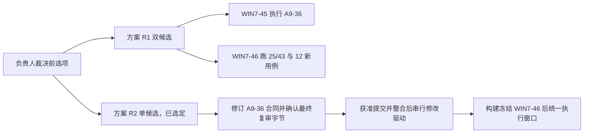

# A9-39 — Alpha 2 最终 Win7 候选与门 A 材料

```text
Status: APPROVED_FOR_IMPLEMENTATION
Task Type: RELEASE_REISSUE_AND_GATE_A_PREPARATION
Target Branch: codex/a9-alpha2-integration-r2
Source Baseline: 4a62b24c550a1062ca4dd6aa72a5f28c7a9ebd56
Target Version: 0.3.0-alpha.2
Candidate: WIN7-46 (proposed; recheck before freeze)
Phase-Gate: A9_39_IMPLEMENTATION_AUTHORIZED
Win7-Validation: NOT_PERFORMED
Decision: ADR-0250, ADR-0251
Revision: r3 (2026-10-16; option A approval and phase 1 execution)
```

## 1. 结论、交付目标与本轮边界

负责人已选择方案 R2，执行代理以 ADR-0251 登记。
A9-36 产品绑定改为 WIN7-46，M6 回退目标仍为 WIN7-42。
Alpha 2 最终候选须包含 A9-37、A9-38；构建和冻结须等待 §6 的前置顺序。
负责人已批准选项 A，本任务为 `APPROVED_FOR_IMPLEMENTATION`。
本轮只做阶段 1：同步非共享文件的候选身份，完成本地检查并保存证据。

负责人 2026-10-16 原话：

> A9-37、A9-38 列入 Alpha 2 范围。请按整合分支准备新 Win7 候选的门 A 材料，并说明与 A9-36 在 WIN7-45 上执行的关系。

获准的完整交付是从整合分支生成新 Win7 候选，完成双构建、逐字节比对、冻结及准确门 A 材料。
WIN7-46 是拟用编号，不是已形成的候选。执行与门 B 另行授权。
任务批准也不代替负责人签发门 A，不直接产生 Alpha 2/RC 结论。

阶段 1 只修改 §3 中本轮指定的七条实现路径、本文与任务索引。
不提交、不推送、不连接远端或目标机、不构建正式候选。
不写其他工作树，不安装依赖，不修改共享 driver 或 contract-test。没有派发子代理。

治理依据为 `CLAUDE.md`、`AGENTS.md` §3/C14、全局 `ACCEPTANCE_AND_RELEASE_WORKFLOW.md`。
写作只读引用主工作区 `/Users/qlyf/Developer/win7-coding-Agent/docs/OUTPUT_STYLE.md` 与同目录 `GLOSSARY.md`。
本树未同步这两份文件，本轮不复制治理文件。

以下保留 2026-10-16 的 r2 文档修订记录；r3 执行记录见 §11。
输入为 `outputs/a9-39-draft/independent-review-r1.md`，审核绑定初稿 SHA-256 `2b323191…`。
独立审核 r1 发现 0P0/2P1/5P2；执行代理已核实两条 P1 的源码依据属实。
本次只修订文档判据与裁决记录；逐项处置见 §10，未重跑产品行为。

## 2. 实际基线与事实复核

以下保留初稿的开发机静态核对，绑定 `4a62b24c…`。历史运行只引用原记录，不复跑。
本次修订已重新核对当前分支、HEAD、工作区及审核输入哈希；其余沿用初稿记录。

| 项 | 初稿核对与本次修订记录 |
|---|---|
| 当前工作树 | `/Users/qlyf/.codex/worktrees/a9-alpha2-integration-r2/win7-coding-Agent`，已登记；分支 `codex/a9-alpha2-integration-r2`。初稿入场干净；r2 入场已有三个已修改文档及未跟踪的本文，均保留 |
| 提交链 | `013cf7966c1f5858e2a2c58542d6f9495e88d29e` → `234e3dfbcf25e27e3fafe29162244551eac771ea` → `4a62b24c550a1062ca4dd6aa72a5f28c7a9ebd56`，逐级父提交相符 |
| 当前产品字节 | `src/shell/product/a9-agent-runtime.js` SHA-256 `1809d4a559eb7fd7d35548d0a5412ca91d78a590224a451f478cb9013234924b`，等于 ADR-0249 绑定值 |
| 构建 Profile | `scripts/release/build-a9-product-v3.mjs:34–36` 的 `A9-BATCH2-INPUTS-D013-V26-MANAGED` 硬编码 `candidate: 'WIN7-45'`、`candidateTentative: true`，事实相符 |
| 输入锁与套件说明 | `release/win7-product-v3/a9-batch2-input-lock.json:124` 为 WIN7-45；同目录 `A9_BATCH2_WIN7_VALIDATION.md` 与 `README.md` 写 WIN7-45，事实相符 |
| 套件 JSON 路径差异 | 源目录没有 `release/win7-product-v3/A9_BATCH2_VALIDATION_KIT.json`。该文件由构建脚本 `assembleBatch2Validation/createBatch2ValidationKit` 生成。实际读取的是主工作区 `.acceptance/candidates/WIN7-45/A9_BATCH2_VALIDATION_KIT.json`，SHA-256 `64804b2f…`，source `ba042757…`，25 用例/43 断言 |
| 套件源合同 | `release/win7-product-v3/a9-batch2-fixtures.cjs` 的 `CONTRACT/CASES` 是 JSON 的来源；`candidate`、完成状态也含 WIN7-45。完整性和报告校验器从该合同派生候选号与授权状态 |
| 驱动入包 | 构建脚本第 899 行复制 `src/shell/tests/product/a9-batch2-driver-entry.cjs` 至包内 `validation/a9-batch2-driver.cjs`，事实相符。该路径也是 A9-36 六路径之一 |
| A9-36 当前树 | `/Users/qlyf/.codex/worktrees/a9-36-alpha2-supplement/win7-coding-Agent`，HEAD `013cf796…`，有未提交实现与文档；不能把工作字节当成 HEAD 已包含 |
| A9-36 检查数修正 | 319/319 是 §10 的历史结果；§10.10 最新登记为 321/321。§10.2 已有八轮复审记录，末轮为 0P0/0P1/0P2。本轮只读报告和文件，未重跑其测试或独审 |
| A9-36 当前停止点 | §10.7 记录 r5 两次入口失败；§10.9 记录 r6 在完整性检查处 `A9_36_CANDIDATE_CHANGED`，账本 `HALTED`，没有产品启动或断言结果。§10.10 为 original-fs 修复后的 r7 待签材料，不是可复用的新门 A |
| A9-36 §2 合同 | 产品仍绑定 WIN7-45：source `ba042757a04f428cb3db3ccd10888a7bebe97d3b`、ZIP SHA-256 `ae1d4bb109df68c2f23e08cb4b927f2168f7a1f645969643f35101bf8f9da96e`；普通驱动变化不重发产品。M6 回退目标仍为 WIN7-42，事实相符 |
| WIN7-45 冻结参考 | 已读 `git show b121f14:docs/plans/A9_33_WIN7_45_ACCEPTANCE_HANDOFF.md` §3～§5。a9-33 工作树 `.acceptance/a9-33-rehearsal/w45-formal-preparation/` 有独立构建记录；冻结 `DOUBLE_BUILD.json` 记录 ZIP 逐字节相同与准确载荷 SHA。它们只证明原候选准备 |
| 候选号 | A9-33 §6.57/§6.73 记录 WIN7-44 留给 R 类计划；WIN7-45 已用。主工作区 `.acceptance/candidates/` 当前目录为 WIN7-41、42、43、45，无 WIN7-46；本地 WIN7-46/w46 refs 查询无结果。未联网核远端，冻结前仍须核号 |
| ADR 核号 | 初稿核对 a9-33 最大 0243、a9-36 最大 0245、本分支追加前最大 0249；初稿追加 0250，r2 追加 0251。A9-36 分支已获知不得使用 0246～0251，新 ADR 从 0252 起；整合前再核号 |

A9-36 的只读来源是该树 `docs/tasks/A9_36_ALPHA2_SUPPLEMENTAL_ACCEPTANCE.md` §2、§3、§4.1、§8、§10。
初稿复算其 driver 为 `ddf8f134…`、合同测试为 `4874c42f…`、编排器为 `d87e76cd…`。
这些是观察时点的未提交输入，后续变化须重新绑定。

WIN7-45 已有正式 Win7 运行事实保留原绑定，见[交接书](../plans/A9_33_WIN7_45_ACCEPTANCE_HANDOFF.md)。
不把原 25/43 的直接 PASS 改成 WIN7-46 的 PASS，也不改旧失败或 `HALTED`。
初稿发现的差异是套件 JSON 的源路径，以及 A9-36 的检查数和后续停止记录。

## 3. 已批准的精确允许路径与输入

负责人于 2026-10-16 对“A9-39 是否按选项 A 批准实施”回复原话：

> 批准

选项 A：执行代理先改不与 A9-36 共用的文件。
A9-36 合入整合分支后，再在驱动与合同测试中追加 §5 的 12 个新用例。
之后双干净构建、比对、冻结 WIN7-46，形成门 A 材料。
不包括门 A 执行、目标机、推送与发布。
当前分支须为 `codex/a9-alpha2-integration-r2`，实现只限下表。
不借用 A9-33/36 的批准修改新候选。

本轮仅阶段 1：下表前六条路径与 package-test，共七条。
fixtures 本轮仅改身份字段，保留原 25/43；smoke、driver、contract-test 本轮不改。
共享 driver 与 contract-test 继续按 ADR-0251 串行交接。

| 实现路径 | 最小修改责任 |
|---|---|
| `scripts/release/build-a9-product-v3.mjs` | 同步新候选 Profile、任务/套件身份与生成 JSON；保留干净源码门、锁校验和确定性装配 |
| `release/win7-product-v3/a9-batch2-input-lock.json` | 同步候选、Win7 未执行状态与来源；`inputs`、原生合同和批准登记不变 |
| `release/win7-product-v3/a9-batch2-fixtures.cjs` | 同步候选/任务/结果上限；保留原 25/43，追加 §5 的 12 用例、固定夹具和证据合同 |
| `release/win7-product-v3/A9_BATCH2_WIN7_VALIDATION.md` | 新候选身份、直接用例、判据、准确授权字段、阶段/预算与限制 |
| `release/win7-product-v3/README.md` | 新候选和套件入口、构建输入及证据边界 |
| `release/win7-product-v3/RUN_A9_BATCH2_INTEGRITY.cmd` | 只更新候选提示，保留 ASCII/CRLF |
| `release/win7-product-v3/a9-batch2-smoke.cjs` | 为 §5 增加固定驱动模式、隔离配置/工作区、重启与证据回收编排；不接受自由脚本 |
| `src/shell/tests/product/a9-batch2-driver-entry.cjs` | 经真实窗口、preload、Schema IPC 执行新用例；与 A9-36 串行交接，见 §6 |
| `src/shell/tests/product/a9-batch2-contract.test.ts` | 新判定器、零派发反例、旧 25/43 不丢项与新身份检查；承接 A9-36 复审后字节 |
| `scripts/release/test/a9-batch2-package.test.mjs` | 同步现有 WIN7-45/用例数硬编码；验证新候选 JSON、物理闭包和旧候选授权拒绝 |

套件 JSON 的准确产物路径为包根 `A9_BATCH2_VALIDATION_KIT.json`。
它由上述生产者与 fixtures 生成，不在 `release/` 下新增手写副本。
双构建输出中的 JSON 均须比对；冻结副本保持只读。
新增 12 用例后，原集合仍为 25/43；拟新集合为 37 用例，断言总数依实现合同核定，不预填 PASS。

上述十路径是 A9-39 的完整实现白名单。
方案 R2 下 A9-36 编排器、请求模块、桌面入口和其验证说明的候选适配，须由修订后的 A9-36 六路径合同承担。
不将它们隐含加入 A9-39；若需第十一路径，先复审任务书再批准。
Core 不在白名单内。A37-04 按现有加载器区分秘密拒绝和解码拒绝，不修改 Core。
文档可更新本任务、两个索引、`docs/DECISIONS.md`、既有 STATUS/STATUS_LOG、交接书和既有覆盖矩阵；不另建平行台账。

### 3.1 不变输入与证据适用性

开发机比较 `ba042757…` 至本轮 HEAD：`native/`、`src/runner/` 与 managed 输入锁没有路径差异。
本树受 Git 跟踪的 24 份依赖清单/锁文件逐件字节比较均未变；构建准入时仍须核对实际安装依赖与输入闭包。
当前 batch2 锁的 `inputs` 与冻结 WIN7-45 锁相同。

| 已锁定输入 | 输入 ZIP SHA-256 前 8 位 | 包内关键字节 SHA-256 前 8 位 |
|---|---|---|
| Electron 22.3.27 / Node 16.17.1 / ABI 110 | `ad723ed7…` | `electron.exe`：`2ed95437…` |
| D-013 v26 managed helper，协议 3 | `25167410…` | `helper.exe`：`2036bf69…` |
| A6 better-sqlite3 8.7.0 / SQLite 3.43.1 | `2cb0cd32…` | `better_sqlite3.node`：`7138aa23…` |

完整值以 `release/win7-product-v3/a9-batch2-input-lock.json` 的 `inputs` 为准。
沿用原生双返回与批准登记，不重建未变化的 native，不改依赖、协议、ABI 或构建参数。
新包仍直接核对其输入、闭包、模块实际加载和上下游调用，不继承旧包整体 PASS。
若发现上述输入或调用合同变化，停止依赖构建，重新分析影响；本任务不授权原生修复。

## 4. WIN7-45 原 25 用例、43 断言的影响分析

依据为冻结 Kit `64804b2f…` 的 `required_cases`，并对照本树 fixtures、driver 与两个产品提交。
A9-37 改 checkpoint 的秘密判定；项目说明保留保守外发门。
A9-38 改 Basic 组合登记、Shell 敏感值、实时预览保留长度与单令牌脱敏。
两项均位于 `a9-agent-runtime.js`，不改 UI、Schema、数据库格式或原生组件。

下表“产品路径”表示修改入口或其消费链须直接复验，不表示原断言已失败。
“身份与闭包”表示新候选必须重新绑定。“原样”表示输入和判据可原样复跑，仍须当前候选直接执行。
原 25/43 全部保留；不因追加用例改旧断言，不从本表推导继承权限。

| 用例编号 | 断言数 | A9-37 / A9-38 影响与处理 |
|---|---:|---|
| B2-G0-ENV | 5 | 原样。环境判据未改；直接重新读目标、普通令牌与当前运行时 |
| B2-G1-PACKAGE | 4 | 身份与闭包。新 source/ZIP/锁/Kit/驱动变化；四项全部直接核验 |
| B2-CH-01-START | 2 | 身份与闭包。实际加载新 runtime；不沿用 WIN7-45 首绘与身份报告 |
| B2-CH-02-BACKGROUND | 2 | 产品路径。后台启动的 checkpoint、敏感环境与输出脱敏共路；原判据复跑 |
| B2-CH-03-STOP | 2 | 原样。Stop、所有权、Job 清理合同未改；原数据不含新增凭据形态 |
| B2-CH-04-INTERRUPT-RESTART | 2 | 产品路径。重启恢复区重校验、已知组合恢复与零重放共路；不覆盖新增组合判据 |
| B2-CH-05-CONTINUE | 2 | 产品路径。续跑新轮 checkpoint、秘密门与 Shell 敏感环境共路；原判据复跑 |
| B2-CH-06-NORMAL-EXIT | 2 | 产品路径；退出断言原样复跑。前置后台启动进入轮前基线冻结；退出选择、真实退出与同实例清理未改 |
| B2-S01-LIVE-TICK | 1 | 产品路径。Shell 前 checkpoint 与 A9-38 输出敏感值共路；原时序判据复跑 |
| B2-S02-STREAM-ORDER | 1 | 产品路径。输出流经过新脱敏入口；顺序合同未改，原判据复跑 |
| B2-S03-SQLITE-BEFORE-IPC | 1 | 产品路径。新投影仍须先持久化再显示；原判据复跑 |
| B2-S03T-TERMINAL-AUDIT | 1 | 产品路径。Shell/输出终态经过共享入口；故障注入与硬停判据不变 |
| B2-S04-ENCODING-CROSSCHUNK | 1 | 产品路径。Shell、输出脱敏共路；UTF-8/CRLF 判据不变。此项不是 checkpoint 的 GBK/UTF-16LE 证据 |
| B2-S05-LIMITS-SECRET-BACKPRESSURE | 2 | 产品路径，直接安全重点。A01 的跨 chunk 秘密脱敏与保留长度受 A9-38 影响；A02 的取消/回收判据不变。旧 API key 输入不能证明 Basic 组合 |
| B2-S06-REFRESH-PAGING-RESTART | 1 | 产品路径。新输出投影与重启加载共路；原分页/顺序判据复跑 |
| B2-BG-01-LIMIT-THREE | 1 | 产品路径。每次启动都经 checkpoint 与敏感环境；3/4 上限判据不变 |
| B2-BG-02-OWNERSHIP-CURSOR | 1 | 产品路径。依赖本轮后台启动和脱敏后的输出读取；所有权/游标判据不变 |
| B2-BG-03-STOP-RELEASE-EXIT | 2 | 产品路径。后台启动与新敏感值共路；Stop/release 判据不变。无效 cwd 仍不能证明 KL-12 |
| B2-CONT-01-RESTART-ZERO-REQUEST | 2 | 产品路径。恢复重校验与续跑新轮受影响；原零请求/旧轮不变判据复跑 |
| B2-CONT-03-APPROVAL-UNKNOWN-EFFECTS | 2 | 产品路径。write/edit/delete/Shell 后观察门与 checkpoint 共路；旧批准/归属拒绝判据不变 |
| B2-SAFE-02-AUDIT-HARD-STOP | 1 | 产品路径。共享副作用入口前的 checkpoint 已改；必需审计失败仍硬停 |
| B2-UI-01-CONTINUE-INTERACTION | 1 | 产品路径。继续与 Stop 旅程消费新 runtime；交互判据不变，不据此重做 UI 设计 |
| B2-UI-02-LAYOUTS-DPI | 1 | 原样。布局与页面缩放未改；沿用原视口和可达范围 |
| B2-G3-REPORT-NEGATIVES | 1 | 身份与闭包。准确候选、Kit 与用例集合变更；错 pin/漏证据/改报告/错候选继续拒绝 |
| B2-G4-SECRETS-POSTFLIGHT | 2 | 身份与闭包及安全重点。扫描器未改，须覆盖本 run 新凭据形态及正控；新证据清单和后飞行直接生成 |

合计：产品路径 18 用例/26 断言；身份与闭包 4 用例/9 断言；原样 3 用例/8 断言。
原样三项为 B2-G0-ENV、B2-CH-03-STOP、B2-UI-02-LAYOUTS-DPI。
全部 25/43 均可保留原判据复跑，候选身份必须更新。
没有一项原用例直接证明普通示例的逐字节撤销、项目说明保守门或新增 Basic 组合闭包，故另加 §5。

## 5. A9-37/38 新增 Win7 直接用例提案

拟新增 12 用例：A9-37 四项、A9-38 八项。
新增模式归入新候选的 p07-safe，原十阶段顺序与原 25/43 保留。
实施时以固定子样本表列出每个变体，不用一次 PASS 代替未执行的变体。
新增断言数、阶段耗时与有界预算在冻结前核定；不沿用旧 7200 秒已足够的假设。

共同入口为冻结包真实 main/preload/Schema IPC/Core/Workspace/Runner 与 SQLite。
用隔离工作区、候选外隔离数据根及合成凭据；新用例使用本机回环固定响应，不调用真实服务。
不得调用私有脱敏函数、Mock、fake safeStorage 或修改产品来替代 Win7 直接证据。
M5 的真实服务仍属于 A9-36；方案 R2 已选定，仍须新门 A 明确批准才纳入同一窗口。

拒绝用例同时核对结构化错误、`tool_start`/Runner 派发事实、外部标记未变化。
不能观察实际派发时记 `UNKNOWN`，不只凭模型回复推定“Shell 0 次”。
每项 JSON 记录 source/ZIP/Kit、run、普通用户身份、输入摘要及实际观察值。
SQLite、事件、Provider 记录和文件清单逐件计算 SHA-256；不在报告明文输出凭据。

| 新用例编号 | 固定输入与通过判据 | 证据形式 |
|---|---|---|
| B2-A37-01 | 工作区含 `Authorization: Bearer YOUR_API_KEY`、源码 `authorization: token`、虚构 URL userinfo；UTF-8/UTF-16LE/GBK 各一组。普通 Shell 实际修改文件；记录 B0、B1、撤销后 B2，要求 B1≠B0、B2=B0，不因启发式阻断 | `a37-01.json`；逐文件长度/SHA、真实 Shell 结束事件、Diff/撤销结果和 checkpoint 归属 |
| B2-A37-02 | 当前 API key、代理密码、自定义头和进程内旧值；原文、标准/URL-safe base64 带/不带 padding、percent 及文件路径分别覆盖。必须 `A9_CHECKPOINT_SECRET_BLOCKED`、零 Shell 派发，不产生含秘密的恢复副本 | `a37-02.json`；逐变体拒绝记录、派发计数、恢复区扫描与文件哈希 |
| B2-A37-03 | 先生成普通恢复基线，再把其中合成值登记为已知秘密；当前与重启加载路径均拒绝不安全恢复。撤销不得静默写回秘密或伪报完整恢复；新秘密重校验生效 | `a37-03.json`；登记前后 checkpoint 索引、恢复区文件清单、错误/诊断、重启后状态与原文件字节 |
| B2-A37-04 | 子样本 A：可加载的 UTF-8 AGENTS.md 项目说明含未登记 Authorization 或 URL userinfo。保守秘密门返回 `secret_blocked`，不得把 checkpoint 放宽套到外发门。子样本 B：UTF-16LE 带 BOM，以及含非 UTF-8 字节的 GBK 文件，分别返回 `decode_error`。两部分均核对回环 Provider 未收到项目说明正文；不修改 Core | `a37-04.json`；分列秘密门与解码拒绝子样本，记录加载状态、Provider 请求体摘要/受控扫描、请求计数与输入文件 SHA |
| B2-A38-01 | 已登记用户名:密码组合，含裸串与 Proxy-Authorization；标准/URL-safe、带/不带 padding、percent 逐项覆盖；UTF-8 与 Latin-1 组合 base64，并以 UTF-8/UTF-16LE/GBK 文件承载。全部 checkpoint 阻断、零 Shell 派发 | `a38-01.json`；编码样本摘要表、错误码、派发计数、恢复区/结果/事件扫描 |
| B2-A38-02 | 同进程清除代理、改用户名、改密码后分别重试。每个曾登记组合继续阻断；新组合登记后同样阻断；不把同密码的未登记用户名宣称已覆盖 | `a38-02.json`；配置变化顺序与摘要、旧/新组合逐项结果、零派发观察 |
| B2-A38-03 | 在公开 Shell 设置写入包含已知组合的环境覆盖；UTF-8/Latin-1 及 URL-safe 形式分别覆盖。新设置拒绝；先写普通设置再登记秘密时旧覆盖被重校验。自动 Shell 选择和真实 Runner 不接收该覆盖 | `a38-03.json`；设置响应、重校验诊断、实际 Shell 身份/Runner 输入的脱敏摘要与零派发证据 |
| B2-A38-04 | 未登记合成令牌采用 Authorization/Proxy-Authorization、大小写、冒号/等号，方案 Basic/NTLM/Negotiate/1Custom/!Custom/_Custom。提示、标题、命令、最终消息均将完整单令牌替换；快照、事件与 SQLite 不留令牌 | `a38-04.json`；按输入/投影表面分行的脱敏结果、快照/事件扫描与 SQLite 查询摘要 |
| B2-A38-05 | 模型流式预览独立子样本：回环 Provider 分块返回已登记 Basic 组合及编码变体，分界落在组合及其编码中间。在第二段到达前读取真实 `liveModelPreview`，核对秘密前缀未提前显示；再核对终态、SQLite 与重启后投影。保留 Shell 独立子样本：分块输出相同组合及变体，核对完整输出、实时快照、事件、SQLite 与重启后投影均无泄漏 | `a38-05.json`；模型与 Shell 子样本分列。记录实际 chunk 的序号/时刻、第二段到达前的真实 `liveModelPreview`、终态与各表面扫描、SQLite 和重启后查询摘要 |
| B2-A38-06 | 未登记 `other:other-pass` 及文档 `Authorization: Basic dXNlcjpwYXNz` 只放工作区文件。Shell 执行、恢复与撤销逐字节相同；日志仍保守脱敏。只证明未登记组合不误拦，不保证其安全识别 | `a38-06.json`；B0/B1/B2、Shell 事件、checkpoint 和投影对照 |
| B2-A38-07 | 同一普通 agent 身份通过真实 safeStorage/DPAPI 保存合成代理配置，退出后重启；当前组合在裸串文件中仍阻断，零 Shell 派发。不得用 fake safeStorage，旧进程已清除的组合不要求跨重启恢复 | `a38-07.json`；保存/退出/重启与密文来源元数据、当前组合拒绝、进程身份/退出记录；不回传 vault |
| B2-A38-08 | 单令牌方案后接空格/制表符的正例；凭据结束后普通下一行保持。另对 Bearer 与 URL userinfo 做回归，凭据仍脱敏。比较精确投影文本，不因多吞普通下一行而通过 | `a38-08.json`；逐输入预期/实际文本、换行边界、快照/事件/SQLite 扫描 |

合成输入文件本来含测试秘密，须在受控输入清单单列；不能将它们混作产品泄漏，也不能排除产品输出目录以掩盖泄漏。
秘密扫描正控包含新增编码形态，扫描结果只记录命中位置类别与摘要。
所有产品输出、恢复区、报告和投影均属于泄漏检查对象。
GBK 直接用例尚未执行，ADR-0249 K5 仍为 `NOT_VERIFIED`；不得因已列用例就关闭。

ADR-0249 K2～K8 限制继续披露：未登记用户名、Digest 多参数、历史日志不回洗、GBK、POSIX 替代证据、带引号/JSON 键、高码位代理凭据。
本任务不修这些产品边界；发现新产品缺陷先保存反例，另按 C14 授权。
KL-12 仍为 P1/NOT_PERFORMED。

## 6. 待裁决：A9-36 与新候选的关系

负责人已选择方案 R2，裁决见 §6.3 与 ADR-0251。
以下保留裁决前的问题、选项表及方案 R1 分析，作为历史记录。
原问题：A9-36 §2 绑定 WIN7-45，而 Alpha 2 最终产品必须含 A9-37/38。
负责人须决定补证在哪个候选上执行，以及哪些旧证据允许准确继承。



| 选项 | 执行范围与合同 | 影响 |
|---|---|---|
| 方案 R1 双候选 | A9-36 按原合同在 WIN7-45 执行。WIN7-46 只跑原 25/43 回归与 §5 的 12 新用例。M6 仍以 WIN7-42 为回退目标 | 不改 A9-36 产品绑定，可独立准备两组材料。需两个准确候选/run/授权闭包；WIN7-45 的 M3 直接事实仍只证明旧产品，最终 Alpha 2 证据对应可能未闭合 |
| 方案 R2 单候选 | 新 ADR 修订 A9-36 §2 为 WIN7-46；完成最终复审、获准提交并合入整合分支，再构建。一次 Win7 窗口覆盖 25/43、M1～M5、M6 与 §5；M6 回退目标仍为 WIN7-42 | 候选一致，M3 与共享安全直接绑定最终产品。候选冻结须等待 A9-36 稳定输入；适配后须重做相关开发机检查、受影响独审和准确门 A 材料 |

### 6.1 方案 R1 的有效性与继承问题（历史分析）

A9-36 的 M3 覆盖 G05/G08/G14：Diff、checkpoint、逐文件/整轮撤销、后台修改、晚写漂移和重启。
A9-37 改其上游秘密判定；A9-38 又改组合、恢复重校验及 Shell 敏感值。
即使 Workspace 文件相同，也不能据此把 WIN7-45 的 M3 PASS 迁为 WIN7-46 直接 PASS。
§5 的 12 用例也不等于 A9-36 M3 全集合。

方案 R1 若仍要求 WIN7-46 的 G08/M3 闭合，须逐项提出准确继承或另行批准补跑受影响 M3。
后者超出“WIN7-46 只跑 25/43 与新用例”的方案 R1 范围，必须明确修订。
继承材料至少绑定组件字节、依赖/参数/配置、上下游行为、原 source/ZIP/run/身份和可核验报告。
由负责人批准其适用范围，标 `INHERITED_EVIDENCE`，不记当前候选直接 PASS。
ADR-0155 仍为 Proposed；现行 batch2 套件不批准任何继承，不能靠 ADR-0250 自动放行。
缺少具体批准时，相关最终候选覆盖保持 `NOT_PERFORMED`，不能签完整 Alpha 2。

### 6.2 方案 R2 的合同、同一写者与时间依赖

ADR-0251 已裁决替换 A9-36 §2 的产品绑定及 M6 正向版本，保留 WIN7-42 回退目标。
A9-36 §8 的 F45 系列夹具/基线、正向模块 SHA 与新候选身份须重新分析并绑定，不能只换显示名称。
其 M2-05、M3-04、隔离与已知限制裁决保持，除非负责人另作具体决定。

driver 和 contract-test 都是共享路径，不能由 A9-36 与 A9-39 同时写。
先由 A9-36 执行者完成其六路径修订与最终复审，固定完整 SHA 并获准提交。
整合执行者将其合入当前整合分支后，再由 A9-39 执行者串行追加 §5。
整合保留 A9-36 原判定与反例，再运行旧 25/43 合同和新用例检查。
不得在 A9-36 未提交工作树取一份中途 driver 直接打包。

最终完整新候选 SHA 只能在构建后形成。
构建前固定的是已复审的源码合同与占位拒绝规则；不把占位哈希签成产品绑定。
构建后再给候选外 A9-36 授权/夹具材料绑定实际 source/ZIP/manifest/Kit，避免为填包哈希反复重建产品。
冻结后不回改包内 driver；若包内字节必须变化，按新候选流程处理。

A9-36 §10.10 已有 321/321 与第八轮复审，方案 R2 不要求无变化重做全部历史审核。
但需先确认最终工作字节，复审候选适配和整合差异，再获准提交/合入。
r6 的完整性失败、`HALTED` 与首失败保留；original-fs 修复仍无 Win7 成功证据，先做实际运行时只读准入。
方案 R2 已选定：不签发、不执行现有 WIN7-45 r7。
r7 原字节保留，其 candidate、run、期限与预算不复用。
须在 WIN7-46 构建、冻结后，重新生成准确门 A 材料。

同一窗口可以有 batch2 与 A9-36 各自账本和子 run；材料须明确共同候选、调度顺序及总预算。
不得把“一个窗口”写成复用一份已消费授权，也不把原 16 请求/7200 秒与 A9-36 预算自动相加后视为获批。
M5 的服务、模型、隔离密文配置及费用上限须由新门 A 单独列明。
方案 R2 的先后依赖会延后冻结，等待批准与目标机窗口的时间不算已完成进度。

### 6.3 负责人裁决与执行边界（2026-10-16）

负责人已选择方案 R2。执行代理以 [ADR-0251](../DECISIONS.md#adr-0251-alpha-2-补证采用方案-r2a9-36-改在-win7-46-执行win7-45-的-a9-36-r7-门-a-不签发) 登记 Accepted 裁决。
负责人对原提问“选方案 R1 还是方案 R2”的回复原话为：

> r2

裁决为 A9-36 改在 WIN7-46 执行，M6 回退目标仍为 WIN7-42。
不签发、不执行现有 WIN7-45 r7；原字节及 r6 `HALTED`、首失败均保留。

1. 由 A9-36 执行者固定最终六路径字节。
2. 完成 A9-36 最终复审。
3. 获负责人批准后提交 A9-36。
4. 将 A9-36 合入 `codex/a9-alpha2-integration-r2`。
5. 之后才由获准的 A9-39 执行者修改共享文件。
6. 构建并冻结 WIN7-46 后重新生成门 A。

第 5 步的共享文件是 `a9-batch2-driver-entry.cjs` 与 `a9-batch2-contract.test.ts`。
一个 Win7 窗口覆盖原 25/43、A9-36 M1～M6 与 A9-37/38 新用例；各自独立账本。
A9-36 分支已获知不得使用 ADR-0246～0251，新 ADR 从 0252 起；整合前再核号。
方案 R2 裁决本身不批准实施；后续选项 A 实施批准见 §3。
本轮不授予提交或目标动作权限。
本裁决不签发门 A/门 B、Win7、Alpha 2/RC。

## 7. 门 A 材料清单

参照 WIN7-45 交接书 `b121f14` 版本 §3～§5，只列字段和依赖，不复用其 SHA、run 或回执。
“可准备”表示已有来源可整理，本轮没有生成授权载荷；“依赖冻结”表示须填准确新字节；“依赖负责人”表示不能由执行代理代签。

| 材料/字段 | 当前状态 | 必需内容 |
|---|---|---|
| 方案 R2 与实现合同 | 方案已裁决；选项 A 已批准，阶段 1 执行见 §11 | ADR-0251、A9-36 合同修订与最终复审、提交/整合授权、本任务实施批准 |
| 候选号核对 | 可准备 | 重新核 refs/登记/目录；保留 WIN7-44 与全部历史候选；占号冲突即停 |
| 源码身份与范围 | 可准备 | 当前完整基线、两个产品提交、最终整合提交、干净状态与精确路径差异；不得以本轮 HEAD 代替未来最终 source |
| 原生/依赖输入 | 可准备 | §3.1 完整锁值、批准登记 commit/SHA、实际输入 ZIP 与 helper/SQLite/Electron 哈希、适用性分析 |
| 双构建记录 | 依赖冻结 | 同一最终 source 的两个独立干净目录；Node/工具版本、实际 argv、依赖链接与输入、起止 UTC、退出码、构建前后干净；共享输入与跨机 UNKNOWN 分开记 |
| 逐字节比对 | 依赖冻结 | 两 ZIP 的大小/SHA 和逐字节一致；条目数量与内容缺失/额外/变化为零；JSON/manifest/Kit 一致，不照抄旧 800 条目 |
| 冻结身份 | 依赖冻结 | candidate/source/version、ZIP 名/大小/SHA、manifest/Kit/锁 SHA、native 批准登记、helper SHA、双构建 SHA、冻结时间、目录权限及 IDENTITY.sha256 的 SHA |
| 冻结外状态 | 依赖冻结 | `FROZEN_CANDIDATE.json`、保护清单和候选外结果根；包内 tentative/NOT_PERFORMED 不在冻结后回改 |
| 固定 run 与目录 | 依赖负责人 | 新 UUID、本地候选外运行根、新远端根准确绝对路径；不得复用 WIN7-45 或 A9-36 旧 run |
| 目标准确身份 | 可准备 | 沿用拟目标 `192.168.1.3` / `dccs-chaizl-PC\agent`；**门 A 前在执行步骤 R1 重新只读核对**。OS build、主机名、SID、活动 console 会话、Medium/非提升/InJob 与普通进程身份均须记录，当前为 UNKNOWN |
| 环境准入与新根 | 可准备 | 执行步骤 R1 只读核空间、运行时、相关进程树/旧任务和新根不存在。门 A 签发后、写入前再确认；任一未知停止依赖动作，不按历史 session 2 或 5 推定当前身份 |
| 执行角色 | 依赖负责人 | 执行代理、未参与执行的独立审核、负责人签门 B；角色和精确范围写进材料 |
| 预算与时间窗 | 依赖负责人 | 正式次数、阶段/请求/服务调用、总墙钟、TTL、费用、上传/下载、有效期和有界重试；用新集合核算，不复用旧授权额度 |
| 准确授权载荷 | 依赖冻结 | 签名载荷必须含 `schema_version: 1`、`formal_input_lock_sha256`、`approval_registry.commit`、`approval_registry.sha256`；并含 kind/status、run、target.machine_name/account_sid、candidate.source_commit/package/manifest/Kit/helper SHA。文件在候选外，机器 APPROVED 字段不构成签发 |
| 授权 SHA 与独立 pin | 依赖负责人 | 负责人确认载荷完整 SHA；另存回执、签发/截止时间与独立 pin，不改已签字节，不以 draft 的 SHA 代替待签载荷 |
| 传输与调度闭包 | 依赖冻结 | 管理员 SSH 仅传输、校验与调度。外部锁/登记/授权与粘合文件逐项大小/SHA；任务 XML 的执行文件、参数、目录、SID、InteractiveToken、LeastPrivilege、期限和触发器回读；工具运行时准入 |
| 执行步骤 R1～R8 | 可准备 | 身份只读复核→新根/权限→准确传输→物理解包闭包→任务回读→最短链/回归/新用例→证据回收→退出与后飞行；本轮仅列计划 |
| 一次性任务收尾 | 依赖负责人 | 执行代理在用后逐项移除本轮准确登记的一次性任务。保留移除回执及后飞行记录，不删除历史任务或证据；须纳入新门 A 的准确范围 |
| 原始证据与保密 | 可准备 | 先保存原始字节，再逐件大小/SHA 对账；秘密扫描正控、真实退出码/时刻、PID+创建时间同实例清理；不回传凭据/vault，不覆盖首失败 |
| 覆盖矩阵与限制 | 可准备 | 在既有矩阵逐项关联 25/43、12 新用例、方案 R2 下 M1～M6；直接/准确继承/未执行分列，KL-12 保持 P1/NOT_PERFORMED |
| 独立审核与门 B 入口 | 依赖负责人 | 正式执行后才核原始结果、审计、生命周期与限制；另行授权审核与门 B，不在门 A 准备阶段签结论 |

本轮未执行上述目标准入，目标机当前状态为 `UNKNOWN`。
执行步骤 R1 的只读核对仍须获准连接目标机；本轮不以此清单扩大网络授权。

## 8. 验证计划、停止条件与未执行边界

执行代理先按依赖顺序编译，再检查实际消费者加载当前输出。阶段 1 的限定检查见 §11。
正式生产者要求干净且已提交的源码；实现完成后须另获准确本地提交授权，才能进入双构建。
本轮禁止提交，不使用 `allowUncommitted`、临时豁免或中途工作字节绕过源码门。
执行与改动相关的 package/contract/脱敏检查、A9-32 §5 复验及项目必需检查。
新验收组件先在 Electron 22/Node 16.17.1 与实际 PowerShell 入口验证所需能力。
original-fs 的物理视图失败不能由开发机模拟 PASS 代替；不在目标机现场修改候选。

新候选最短链为真实启动→普通示例 Shell→字节变更/Diff→撤销→已知秘密拒绝→正常退出。
先通过实际入口，再进入受影响回归与原合同必跑项。
方案 R2 的实际顺序与 A9-36 前置结合后须在准确执行材料固定，不取消其 M4 准入。
新集合的预演需求须在准确执行材料中明确，旧 WIN7-45 预演不能代替新包；本任务实施批准不授权目标预演。

身份、完整性、安全、必需审计或未知生命周期失败，保存首个错误并停止全部依赖步骤。
同类失败连续两轮仍未解释，停止整批重试，先做最小复现和共同原因诊断。
只有同范围、合同允许、实际进程树已结束且没有硬门阻断时，才可用新不可变工具/run 做获准的有界重试。
不得延长等待、减少断言或放宽判据来通过；旧 FAIL/UNKNOWN/HALTED 不复活、不覆盖。

下表保留 r2 文档轮次的检查与边界；阶段 1 当前结果见 §11。

| r2 检查/结论 | 证据层级与状态 |
|---|---|
| 分支、HEAD、父提交、文件与候选登记、原 Kit 25/43、A9-36 合同/记录 | 开发机只读检查，绑定 `4a62b24c…`；不构成行为 PASS |
| `npm run docs:check` | 使用 nvm 绝对路径的 Node 20.17.0；本轮结果见 §9 |
| `git -c core.fsmonitor=false diff --check` | 本轮结果见 §9 |
| 实现修改、构建、双构建、比对、冻结与准确载荷生成 | `NOT_PERFORMED`，本轮未授权 |
| Electron/Win10/Win7 运行，12 新用例、M1～M6、目标只读准入 | `NOT_PERFORMED`，本轮不连接远端或目标机 |
| 门 A/门 B、Win7 最终结论、Alpha 2/RC | `NOT_PERFORMED`，不签发 |
| 提交、推送、发布、其他工作树写入 | `NOT_PERFORMED`，本轮禁止 |

KL-12（真实 helper 启动后 ready 失败清理）仍为 P1/NOT_PERFORMED。
无效 cwd 拒绝不替代该证据；新增用例数量不关闭该项。
本任务的完成标准是可核验的新候选与待负责人签发的准确门 A 材料，不是验收通过。

## 9. 本轮文档检查记录

本节登记 r2 文档检查；产品、构建与目标执行仍按 §8 保持 `NOT_PERFORMED`。
开发机检查绑定 `4a62b24c…` 加本轮四件文档差异，Node 为 `v20.17.0`。

| 命令 | 实际结果 |
|---|---|
| `npm run docs:check` | 退出码 0，`ok: true`，364 文件、53 任务书 |
| `git -c core.fsmonitor=false diff --check` | 退出码 0，无输出 |

Node 使用 `/Users/qlyf/.nvm/versions/node/v20.17.0/bin/node`。
npm 使用同安装目录的 `lib/node_modules/npm/bin/npm-cli.js`，PATH 首项固定为该 Node 的 `bin`。
新任务书的 25 行原用例合计 43 断言，三个分类计数相符，新增用例编号共 12 个且不重复。
以上仅为开发机文档和只读一致性检查，不提升任何候选或验收状态。

## 10. 独立审核 r1 处置

本表登记 r2 对审核输入 `2b323191…` 的七项文档修订。
处置结论限开发机文档；不构成独立复审通过或 Win7 行为证据。

| 审核项 | r2 处置 | 位置与边界 |
|---|---|---|
| P1-1 | A38-05 增加模型流式预览独立子样本。回环 Provider 分块返回 Basic 组合及编码变体；第二段到达前读取真实 `liveModelPreview`，再核对终态、SQLite 与重启后投影。保留 Shell 子样本 | §5；模型与 Shell 分列证据，运行均为 `NOT_PERFORMED` |
| P1-2 | A37-04 拆为可加载 UTF-8 的 `secret_blocked` 与 UTF-16LE 带 BOM、非 UTF-8 字节 GBK 的 `decode_error`。两部分均核对 Provider 未收到正文 | §3、§5；不修改 Core，Core 不在白名单 |
| P2-3 | 补入 `RUN_A9_BATCH2_INTEGRITY.cmd`，只更新候选提示并保留 ASCII/CRLF。允许路径合计改为十条 | §3；本轮未修改该实现文件 |
| P2-4 | CH-06 改为“产品路径；退出断言原样复跑”。逐行复算为产品路径 18/26、身份与闭包 4/9、原样 3/8，合计仍为 25/43 | §4、§9；不改旧断言 |
| P2-5 | 依据负责人原话“r2”登记 ADR-0251。不签发、不执行现有 WIN7-45 r7；保留原字节、r6 `HALTED` 与首失败，旧 candidate/run/期限/预算不复用 | §1、§6；WIN7-46 冻结后重做门 A，本任务状态不变 |
| P2-6 | 签名载荷补 `schema_version`、`formal_input_lock_sha256`、`approval_registry.commit/sha256`；补管理员 SSH 仅传输、校验与调度，以及执行代理用后逐项移除一次性任务 | §7；均须写入后续准确授权，本轮不连接目标机 |
| P2-7 | 候选选项统一写“方案 R1/方案 R2”；执行序列统一写“执行步骤 R1～R8”，单步引用注明“执行步骤” | §1、§3、§5～§8；历史选项表保留 |

## 11. 执行记录

### 11.1 选项 A 批准与阶段 1 范围（2026-10-16）

负责人原话“批准”及选项 A 完整范围见 §3。
Status 为 `APPROVED_FOR_IMPLEMENTATION`，Phase-Gate 为 `A9_39_IMPLEMENTATION_AUTHORIZED`。
本轮不新增 ADR；身份同步沿用 ADR-0250/0251，不改变接口、安全模型、依赖或持久化格式。

开发机入场分支为 `codex/a9-alpha2-integration-r2`，HEAD 为 `4a62b24c…`。
任务书修改前 SHA-256 为 `8719c659…`。
已有修改为 `docs/DECISIONS.md`、`docs/DECISIONS_INDEX.md`、`docs/tasks/README.md` 及未跟踪的本文。
执行代理保留这些输入；两个 DECISIONS 文件不改字节。
治理写作文件只读引用主工作区，未复制到本树。

交付范围为七条实现路径的 WIN7-46 身份同步及本地验证。
`candidateTentative` / `candidate_tentative` 保持 true，冻结前重新核号。
只改打包 Profile、身份夹具和说明；不改产品、native、依赖、原生合同或批准登记。
`inputs` 段按原字节保护，其中 WIN7-45 的历史来源保留。
fixtures 仍为 25 用例/43 断言；§5 的 12 新用例留给阶段 2。

证据写入 `outputs/a9-39-phase1/`，修改前记录为 `baseline.json`。
本轮直接执行 `verify:quick`、package-test、两个 shell 测试、`docs:check` 与 `diff --check`。
先完成七模块编译/静态检查，再运行消费者测试。
package-test 使用现有 TEST_ONLY 合成 PE 与临时仓库；其装配结果仅为开发机 `SURROGATE`。
临时夹具内部提交不变更本工作树 HEAD、索引或分支，不构建正式候选。

适用项为 C14、编码与路径规则、P15 的证据边界及包身份/授权 fail-closed。
无新依赖或系统 API；C15/C16 登记保持原字节。
最短产品链仍为 §8 的启动、Shell、Diff、撤销、秘密拒绝与正常退出，本轮为 `NOT_PERFORMED`。
共享 driver/contract 若因旧身份失败，保留失败用例与原因，不改断言或共享文件。
双干净正式构建、冻结、门 A、Win10/Win7 实机、提交、推送与发布均为 `NOT_PERFORMED`。
KL-12 仍为 P1/NOT_PERFORMED。

### 11.2 阶段 1 开发机结果

本节绑定 HEAD `4a62b24c…` 与本轮七条实现路径的最终字节。
完整 SHA、命令、退出码、原始日志与保留项逐条说明见 `outputs/a9-39-phase1/report.md`。
不据开发机结果签 WIN7-46 或 Alpha 2 结论。

| 检查 | 退出码与结果 |
|---|---|
| `npm run verify:quick` | 0；七模块编译/静态、七项设计门通过 |
| package-test 首轮 | 1；8 PASS/1 FAIL，原始 `package-test.log` 保留 |
| package-test 修正后 | 0；9 PASS/0 FAIL；新身份 JSON 与旧 WIN7-45 授权三种拒绝检查通过 |
| shell 两文件合跑 | 1；283 PASS/1 FAIL，共 284 项 |
| contract-test | 240 PASS/1 FAIL，共 241 项 |
| package-runtime-test | 43 PASS/0 FAIL |

首轮 package-test 的失败位于本轮新增断言。
执行代理误把 manifest/Kit 的 `candidate_tentative` 当作 runtime descriptor 的既有字段。
现有 descriptor schema 1 只携带 candidate；修正断言为明确检查该字段不存在。
断言与测试均保留；不新增产品字段，不改 Schema 或原始 FAIL。
仅因该断言修正复跑 package-test；未无变化重跑七模块或 shell 两文件。

共享 contract 的唯一失败为 `the contract is a closed set with the expected shape`。
第 54 行期望 WIN7-45，实际为 WIN7-46；按阶段边界保留失败，留给阶段 2。
driver 第 1096 行仍硬编码 WIN7-45，影响 `B2-CH-01-START-A01` 的身份判定。
这是静态发现，Electron 驱动本轮为 `NOT_PERFORMED`，不冒充已执行 FAIL。
两个共享文件保持入场 SHA；第 391 行旧授权夹具也留给阶段 2 检查。
Jest 有异步操作未及时停止的提示；进程随后自行结束，实际退出码为 1，未使用 forceExit。

`inputs` 原始片段为 3698 字节，修改前后 SHA-256 均为 `fcd3842a…`。
原生源码、原生合同、批准登记与 managed 锁保持原字节。
CMD 为 955 字节 ASCII，16 个 CRLF，无孤立 CR/LF。
fixtures 从 `LIMITS` 到文件末尾逐字节不变，仍为 25 用例/43 断言。
`verify:quick` 改写的 24 个受跟踪 runner 生成文件已另存证据并恢复入场字节。
恢复记录为 `generated-restore.json`，保护核对为 `preservation.json`。

`rg 'WIN7-45'` 覆盖 §3 全部十路径，共 11 个匹配行。
本轮七路径只余锁内历史来源与旧授权拒绝测试名，共两行。
其余为未改 smoke 的历史头注释、共享文件历史文字及阶段 2 的旧身份检查。
逐行位置、保留理由及补充 `WIN7_45` 检索见上述报告。
文档与差异检查的实际退出码见同目录 `docs-check.command.json` 与 `diff-check.command.json`。
阶段 1 记录不改变 §6 串行交接、冻结前核号、KL-12 或后续门的边界。
