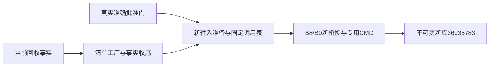
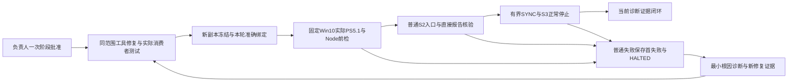

# ENGINEERING_02 — Win10 真实入口与输入绑定改造

```text
Status: APPROVED_FOR_IMPLEMENTATION
Task Type: ENGINEERING_TOOLING
Target Branch: codex/a9-alpha2
Source Baseline: a53c9b9d861486e5923bc82ea70b31b76af1a939 (plus protected working-tree changes; not product source)
Phase-Gate: ENGINEERING_02_FINAL_SINGLE_ATTEMPT_HALTED_TOOL_PATH
Current Phase Decisions: ADR-0234 / ADR-0235 Accepted (exact one p17/w16 final phase; p17 frozen; w16 HALTED before upload/product; no automatic further attempt)
Win10-Validation: PASS (c07/r05 diagnostic tool-repair stage only;52 main calls and12 readonly SFTP;98 raw files verified; ordinary/SYNC/dispatcher/normal stop bound; current target owner-designated trusted under ADR-0219; technical host integrity UNKNOWN; overall task NOT_COMPLETE; formal Win10/product/Win7 NOT_PERFORMED)
Win7-Validation: NOT_PERFORMED
Decision: ADR-0194 / ADR-0195 / ADR-0196 / ADR-0197 / ADR-0198 / ADR-0199 / ADR-0200 / ADR-0201 (Accepted; ADR-0201 two-path local diagnostic only); ADR-0202 Accepted (four-path local contract only); ADR-0203 Accepted (two-path local stream diagnostic only); ADR-0204 Accepted (two-path local own-child progress preference only); ADR-0205 / ADR-0206 Accepted (prior desktop scopes); ADR-0207 Accepted (prior B2-only local scope); ADR-0208 Accepted (two-path B3-only local scope); ADR-0209 Accepted (failure-cleanup local scope); ADR-0210 / ADR-0211 Accepted (v6 and B4/B5 local scopes); ADR-0212 Accepted (B6/B7 diagnostic local scope v2); ADR-0213 Superseded by ADR-0219 (prospective target trust decision; historical diagnostic boundary preserved); ADR-0214 Accepted (complete 13-path local consumer scope; frozen local copies only); ADR-0215 Accepted (owner-approved bounded tool-repair phase); ADR-0216 Accepted (exact r04 replacement owner-approved); ADR-0217 Accepted (owner-approved complete exclusion-proof contract and bounded c07/r05 extension); ADR-0218 Accepted (exact successful-r05 ordinary raw readonly supplement); ADR-0219 Accepted (current Win10 target owner-designated trusted; no new execution scope)
```

当前入口见§138：p17同字节冻结，三项Win10冻结前门PASS；唯一替代部署因工具路径错误失败，w16 HALTED。产品未执行，按负责人止损策略停止，不自动追加版本或批次。
准确旧解析实例已在w06同句柄终止一次；历史超时退出UNKNOWN保持。
当前阶段累计84SSH、8上传、3只读SFTP，共95会话；主窗口仍2、ADR-0226新根4，当前完整产品阶段SYNC与产品请求均0。
§107原完整产品阶段及§107.2准确.NET4.8.1批准保持。
p01至p03源槽位已使用；w01/w02 HALTED不恢复。
p04与w03仅由准确增补批准激活，原累计限额保持。
负责人已在§105指定当前Win10为可信验收环境。
环境信任选择已解除；技术主机完整性UNKNOWN与历史诊断边界保持。
方案覆盖最短产品链路、八phase/十请求、真实退出语义工具及证据收口。
冻结c07/r05诊断工具修复阶段已完成，见§102至§104。
Win10验收机52项主调用通过；B16普通S2、第四次runtime-SYNC和B17身份/正常停止均PASS。
两入口held退出0、任务停用；调度器COMPLETED、产品请求0。
获批补收集四件普通原始报告共9058字节，context/result准确SHA与原Win10中央回执一致。
开发机冻结中央v2按原运行时间回放通过，98件当前原始报告及关联摘要已核验。
本轮45 SSH、7上传、12只读SFTP；阶段累计128会话，上传3410588、复制199469字节，SYNC1。
旧冻结输入、首失败、首证据缺口、HALTED与UNKNOWN保持，不用后续结果改写历史。
技术主机完整性UNKNOWN；真实非子进程排除分支NOT_VERIFIED，原始pipe字节身份UNKNOWN。
本次只完成诊断工具修复阶段，ENGINEERING_02整体NOT_COMPLETE。
产品、正式Win10验收、Win7与负责人最终接受仍NOT_PERFORMED或未签发。
没有新c08/r06、主调用重跑、产品/系统/清理或Git交付权限。

先独立改工具，再用不变 r4 开发包检查真实链路。
2026-10-07，负责人要求“按你的推荐继续”。本轮承接 A＋r4 方向并准备具体材料。
初次立项时未获准确实现批准，该轮只改文档。当前批准与结果见§25。
原 [ENGINEERING_01](ENGINEERING_01_VERIFICATION_ENTRY_AND_REPORT_PILOT.md)保持 COMPLETE。
详细计划沿用其 §6。本任务承载准确范围及后续执行记录，不另建台账。

## 1. 交付与边界

执行代理集中生成输入，并在真实消费者派发前拒绝旧运行事实。
产品身份、工具源码身份与取证构建身份分别核验。
新工具在实际 Win10 取得新准入，再进入最短产品链路和受影响回归。
退出自动化先检查语义定位能力，再核对原生 API 实际 response。

本任务不改产品实现、helper、原生锁、历史候选或冻结工具。
不推进 A9-32/33/34，不合并，不继承历史产品 PASS 为新工具 PASS。
不提交、推送、发布、删除或改变系统权限。
远端连接、写入、编译、启动、请求与 UI 操作另绑具体范围。

## 2. 实际基线与只读参照

| 对象 | 开发机直接核对结果 | 用途 |
|---|---|---|
| 当前树 | `codex/a9-alpha2@a53c9b9d…`；18修改、2删除、20 untracked状态项 | 工具开发位置；保护已有修改，不声称clean HEAD |
| 历史树 | `codex/a9-31-background-tools@571ec550…`；14修改、8 untracked状态项 | 只读参照，不在该树实施 |
| r4产品 | source `8d207ab1…`；ZIP `e96fdf96…`；manifest `d084907c…`；101330419字节、784 ZIP条目 | 不重建、不重签，不计正式Win7候选 |
| capture | 源码、DLL、build和批准记录均在本地；SHA已复算 | 可准备复用绑定；实际目标准入须直接执行 |
| observer | 源码、launcher、pin和build返回记录在本地；未在本地工具根找到原EXE | 记录中的EXE SHA不能证明已取得字节；部署BLOCKED |
| 历史结果 | R2矩阵为WIN10_SINGLE_ROOT_PASS；Recovery/G4/Policy/conhost限制保留 | 回放参考，不是新工具结果 |

历史只读工具根：

```text
/Users/qlyf/.codex/worktrees/a9-31-background-tools/win7-coding-Agent/.acceptance/a9-31-developer/
```

输入为 `product-r4/package/Win7CodingAgent-0.3.0-alpha.2-win7-x64.zip`、
`product-r4/package-identity.json`、`product-r4-win10-r2/control-scripts/`四源、
`product-r4-win10-r2/event-sources/`两源、`product-r4-win10-r2/capture-built/`四件、
`product-r4-win10-r2/observer-components/v1/pin.json`与`observer-v1-build.stdout`。
失败样本按原计划 §6.5 逐件列 SHA 后读取，不导入或执行旧 remote-actions。

新工具身份来自实际新文件清单及 SHA，不以当前 HEAD 冒充新源码快照。
旧组件 build.source 原值保留。源码 provenance 由准确源码字节和快照证明。
不能因旧字段为8d207ab，声称该提交 Git 树包含这些派生 C# 文件。

## 3. 待批准的本地实现白名单

以下十个文件均为新路径。批准前不创建实现文件。
不新增依赖、系统 API、C# 源或产品打包内容。

| 精确路径 | 责任与消费者 |
|---|---|
| `scripts/release/validation/win10/input-binding.cjs` | 实际CLI；读取合同，生成静态/运行输入，校验闭包与准入 |
| `scripts/release/validation/win10/product-driver.cjs` | 承接锁定r4/R2 driver；读取新绑定；执行真实Renderer、重启创建与原生回执入口 |
| `scripts/release/validation/win10/stage-product.ps1` | 校验产品与组件双身份，保留capture证明判据 |
| `scripts/release/validation/win10/launch-product-desktop.ps1` | 普通入口、预算、固定请求与上一树终态门 |
| `scripts/release/validation/win10/serve-product-desktop.ps1` | 迁移Capture-Build/BuildApproval、observer ready/final、SYNC与worker消费者 |
| `scripts/release/validation/win10/launch-manifest-observer.ps1` | 新部署绑定；保留原源码和EXE/build身份，不将source重写成产品source |
| `scripts/release/validation/win10/exit-dialog-action.cjs` | 单次UI动作契约与真实回执校验；无可靠、获准语义提供者时拒绝点击 |
| `scripts/release/test/win10-input-binding.test.mjs` | 实际CLI、静态确定性、当前事实隔离、独占创建和错输入拒绝 |
| `scripts/release/test/win10-entry.test.mjs` | 历史失败回放、实际表达式和实际文件创建点反例 |
| `scripts/release/test/win10-contract.test.mjs` | 双身份全部消费者、UI错response、收尾与前置失败后零派发 |

文档维护限本任务、ENGINEERING_01承接链接、任务索引、STATUS/STATUS_LOG、
工程优化方案、ADR-0194及ADR索引。不改Accepted正文、AGENTS或产品任务状态。

本地证据限新目录 `outputs/engineering-win10-entry-20261007-r1/`：
`baseline.json`、`source-manifest.json`、`replay-manifest.json`、`replay-result.json`、
`local-inputs.json`、`local-validation.log`、`preservation.json`、`entry-capability-review.md`。
夹具仅在该目录的 `fixtures/<固定安全case-id>/` 创建。
三份测试明确枚举夹具写点；禁止任意路径输入、覆盖旧输出或自动删除。
首失败与夹具保留。以上目录本轮未创建。

未来 `.acceptance/engineering-win10-entry-r1/`与远端新根不在本地实现批准内。
本地样本不能生成OWNER_APPROVED或Win10准入记录。

## 4. 输入格式与全部消费者

格式见[ADR-0194](../DECISIONS.md#adr-0194-win10-验证工具的分层输入与产品取证双身份)。
新绑定为schema_version 2，静态与运行输入分开。
嵌套原build/批准/pin保留原字节与旧schema，不静默迁移。
原九字段request.source仍表示产品source；master/revision绑定新工具闭包。
新运行envelope另绑fresh run、当前父实例及回执。
未知、缺失、重复或多余字段拒绝。

| 分层 | 来源与硬门 |
|---|---|
| product_identity | 准确source、ZIP SHA/size、manifest、原生锁/helper、运行版本及包内加载；实际复算 |
| tool_identity | 新工具版本、真实源码快照、清单SHA；HEAD只定位仓库 |
| components | 各自ID、源码快照SHA、真实build/批准SHA、artifact SHA/size/MVID、compiler/refs/arguments、API/Profile、legacy_source_binding |
| deployment | 当前准确根与部署映射；不改历史build编译目录 |
| policy | phase、预算、时钟和完整性/安全判据；不可通过参数关闭硬门 |
| 当前运行输入 | fresh run/request、PID+creation ticks、SID/Session/提升/Job、ready/heartbeat、receipt及SHA、master/revision |

大整数跨JS/PS用十进制字符串。
manifest五参数从本轮记录生成：PinSha256、AdmitRequestId、AdmitLabel、ComponentVersion、Tag。
sync-current在本根sync-actual返回后生成，不内嵌旧PID、ticks或receipt。
运行输入逐请求独占创建，派发前再次核验实例、文件与回执。

双身份不是删source比较。产品、组件和本轮批准关联分别验证。
observer ready/final.source核对原组件legacy source，产品source从新运行绑定核验。
两者可不同，request/master/revision、机器、dispatcher实例、artifact和proof闭包仍须一致。
capture原build/批准匹配原来源，新运行批准另明确允许其用于当前产品。
不加宽松fallback，不回退旧driver，不热换冻结组件。

## 5. 顺序、反例与验收

| 阶段 | 地点与动作 | 完成条件 |
|---|---|---|
| 本地实现 | 先集中生成和校验，再迁移全部消费者 | 实际CLI一致；前置失败非零退出，无下游派发 |
| 本地回放 | 锁定历史样本；执行真实序列化字符串和创建点 | 原错误实现呈现缺口，新版满足判据，历史字节不变 |
| 工具准备 | 另获授权后在Win10准入，必要时独立编译observer | PS5.1/Electron22/Node16/CLR4、真实组件闭包与自有会话收尾直接验证 |
| 最短产品链路 | 新根普通入口：Boot→短Background→读输出→Stop→持久化与收尾 | main/preload/IPC/SQLite/Renderer及包内helper有当前直接证据 |
| 受影响回归 | 原计划八phase、十请求覆盖；点击与恢复单列 | 不以最短链路代替矩阵；绑定新工具与不变r4 |
| 收口 | 完整回收、size/SHA、秘密扫描、适用审核和负责人裁决 | 工具准入与普通产品结果分开；Win7保持NOT_PERFORMED |

反例覆盖错产品/工具/组件哈希、错来源或批准、旧根、重复run、错父ticks、旧receipt、
缺manifest参数、重复/多余字段、越界路径、输出已存在、重启EEXIST、晚到成功、
NT错卷/同basename、短命87、时间相等与±1tick、错父/Session、丢事件、
StopExit response=1、ReleaseExit response=0、取消、超时、无真实回执与未知收尾。

不同产品/组件source正例先用明确标注的离线合同样本。
真实r4与原组件均保留历史8d207ab字段；该运行不能证明任意未来产品兼容。
换产品时直接核验新包闭包与受影响接口，不继承整体PASS。

本地实现后运行三份定向测试、脚本实际CLI及语法检查：

```sh
node --test scripts/release/test/win10-input-binding.test.mjs scripts/release/test/win10-entry.test.mjs scripts/release/test/win10-contract.test.mjs
node scripts/check_docs.mjs
git -c core.fsmonitor=false diff --check
```

本地Node20.17.0。不下载旧运行时，不做七模块产品全量构建。
PS5.1 ParseFile、Electron/Node16真实入口、短命进程和UI在Win10直接准入。
本地测试不能代签这些能力。

## 6. UI与取证可用性边界

真实退出窗口须属于本请求产品PID+creation，标题与按钮集合一致。
StopExit“停止后退出”要求原生response=0。
ReleaseExit“留给系统后退出”要求response=1及逐句柄移交回执。
取消=2不计成功。120秒、错选HALTED与晚到观察语义保持。
点击方不能写产品response，不能固定返回或以坐标猜测代替语义定位。
本地可实现动作契约和拒绝反例，实际语义能力为NOT_PERFORMED。
新增UIA/API/程序集或外部工具前须C15/C16和准确范围批准。
此前停止该实现及实际点击，其余获批本地工作继续。

observer EXE本地字节缺口不阻断合同与消费者实现。
部署前须取得准确旧EXE并核验闭包，或获批后用锁定源码/工具链独立编译。
推荐后者：生成真实新build/EXE/MVID，不改源码，不伪造旧构建来源。
远端编译及运行时核验本轮未授权。
不保证新编译SHA相同，按实际字节锁定并重新准入。
需改C#源/API/证明格式时停该项，先列精确差异，不扩大白名单。

## 7. 停止、重试与回滚

身份、完整性、安全、必需审计、未知生命周期或丢事件失败，停全部依赖派发。
首失败、输入、HALTED/UNKNOWN与后补观察保留。
同类失败连续两轮未解释或闭环时，停整批，先最小复现和共因诊断。
普通本地修复及定向复验在获批白名单内继续，不重复请求同范围批准。
不延长等待、减少断言、放宽时间/路径/归属以取得通过。

实际Win10次数、窗口、目标、账户、新根、停止及回收另行准确批准。
旧HALTED不恢复，旧根不写入，新安全工具取得新版本准入。
回滚是停止使用并保留记录，不删除、不恢复用户文件、不换绑历史PASS。

## 8. 执行记录与待批准动作

2026-10-07，开发机准备本任务及ADR-0194 Proposed。
分支、HEAD、dirty、r4与组件来源已核对。
原observer EXE未在本地找到；部署BLOCKED，未连远端取回。
源码实现、回放测试、编译、UI、产品启动、候选冻结与Git交付均NOT_PERFORMED。
后续在本节记录工具返工、产品执行、审批等待和人工介入起止。
无计时记UNKNOWN，重叠区间不重复计入总耗时。

**当前待批准动作：**批准本任务§3–7及ADR-0194，
仅限当前分支十路径本地实现、指定outputs证据与定向检查。
不包含远端、GUI、组件编译、普通产品执行或Git交付。
负责人批准准确材料后登记APPROVED_FOR_IMPLEMENTATION，方可开始实现。

## 9. 完整参考身份

下列值只绑定原输入。新工具不得复用旧工具SHA。

```text
工具开发HEAD: a53c9b9d861486e5923bc82ea70b31b76af1a939
历史树HEAD: 571ec550b5e09611f55557563d0cf2f1a4a40d1b
r4 source: 8d207ab11d2c8134a81e4e62900f395aae99944e
r4 ZIP: e96fdf9678ffede770704fa68cfd39ea7ac6bf42ba0c3dd5fd400aa7dd7cd1a0
r4 manifest: d084907ce7d488f0bf98984b49fe09b6e6d5c86b0c9786db46a33c40e62eda1c
stage-product-r3.ps1: f41cf571e5706f89e47dbc855b90c608e8d13d3318cd0763b1b3063e8c26d268
launch-product-r3-desktop.ps1: b859bd36a9104b22ab359ece783a1575a35aed74dfab1c18c11660598cd7256f
serve-product-r3-desktop.ps1: 80a29258ddae9ba134435fb1ddd171be5f9ba029b0b9a7a9b95f31a4416b2d0d
product-r3-driver.cjs: 24ddd6f68e15c16c57eed40b51203449ab34dae79bd08287dda7658a2a956e37
capture source: dbc85763ce25287adcb4c853e37963755c56d9561f9d06e41f53bfdb78e952cd
capture DLL: 3f45cc66e7f81c7321bdce4b71338614ceae618d9c0636620a0f47b72d880064
capture build: c5afee88aea36920f7d6a56a35bd136548a993608d5303a034bd6b6ab0a84cca
capture approval: d4947801b67738be45da98606fb2cf6672bacb80f228968b878bcd9d4a22ae2d
observer source: 218a2ed353acb0338b0c831f58e3233b3a7802465bffca41535cc62ed9571f78
observer launcher: 17370629b5dcbc818d7040dbbc12265b1b833988a7a8e3fbb012b83d2d01a1b0
observer pin: 0f26ff6477cb516b46c93f744fc2e6b713b079d01b6ff96432ae47e26ca23298
observer build stdout: 735dfc827ada09d649c03ede4c96a936f5c7da86b2fe3be802a592dac9bfa6db
observer EXE: NOT_OBTAINED locally; recorded SHA is not proof of local bytes
```


本轮开发机文档检查PASS：207文件、51任务；diff --check、相对链接、UTF-8无BOM与LF通过。
保护复核：1715项白名单外当前树记录、8849项历史源码与选定工具/证据无变化。
七份原文档仅指定登记或追加；原Accepted ADR正文与两个HEAD保持。
新建一份任务草案，未创建实现或执行目录。


## 10. 2026-10-07 本地实施批准与绑定

负责人明确批准“ENGINEERING_02 §3–7 与 ADR-0194，仅限本地实现和定向检查”。
批准前任务SHA为58a569b4…，ADR段落SHA为cd99824d…，已逐字节复核。
完整值见本轮outputs的baseline.json。仅当前分支十路径、指定outputs及定向检查进入实施。
远端、GUI、组件编译、普通产品和Git交付继续NOT_PERFORMED。原历史草稿记录保持。

## 11. 本地实施结果与恢复条件（2026-10-07）

开发机直接检查PASS。实际分支codex/a9-alpha2，HEAD a53c9b9d…未变；原dirty/untracked保留。
新建§3十个实现/测试文件。完整源码SHA见
`outputs/engineering-win10-entry-20261007-r1/source-manifest.json`。
这是工作区源码快照，HEAD不是新工具源码身份。

静态配置与当前事实已分层；实际CLI集中生成schema2输入和四版revision。
source、候选/工具/组件SHA、原master完整合同、根、fresh run、SID/Session/Job、
PID/creation ticks、当前回执、manifest五参数及准确准入集合均有拒绝反例。
组件原build/pin/批准字节保持；产品source只在产品投影中绑定，不重写旧构建来源。
四个PS消费者迁移到新绑定；原NT/时钟/短命进程证明判据保持。
其实际ParseFile与运行、中央校验器接口及部署闭包须在Win10直接准入。
本地没有为旧registration/checks生成新PASS或运行批准。

真实Renderer字符串及query序列化已执行；旧表达式SyntaxError反例保留。
真实late-event entry跨重启创建不同wx文件，原EEXIST与晚到失败反例保留。
历史sync实际回执及高精度边界已回放；历史receipt不作为当前目标运行事实。
复核补上SYNC实际预检旁路的授权门；有绑定时也在读预检输入前拒绝。
普通driver、四个PS执行模式和真实UI点击继续拒绝未获准动作。
UI仅完成语义动作契约与实际response校验：Stop=0、Release=1；取消/错选/超时不通过。

本地Node20.17.0：三份定向测试最终17/17 PASS，0 FAIL、0 SKIP；三份CJS语法检查PASS。
实际CLI生成及复验最终静态输入、四版revision和historical runtime replay。
早期local-inputs.json未覆盖；当前SHA检查非零拒绝，最终输入另存fixtures/final-r1/static.json。
`outputs/engineering-win10-entry-20261007-r1/local-validation.log`保留五次检查及实际CLI结果。
同目录`replay-manifest.json`锁定17件只读历史输入。
`replay-result.json`区分开发机与目标能力。
`entry-capability-review.md`列出实际调用点与限制。

| 费用/工作项 | 本轮记录 |
|---|---|
| 工具返工 | 有新源码修改后共五次17组检查；最终TAP 591.431625 ms。总实施耗时UNKNOWN；无产品整批重试 |
| 产品执行 | NOT_PERFORMED；未启动r4、未执行八phase/十请求或Win7 |
| 审批等待 | 本地准确批准已收到；未重复请求本地批准；等待耗时UNKNOWN |
| 人工介入 | 负责人批准之外无本轮桌面/PowerShell手工操作；目标操作NOT_PERFORMED，人工耗时UNKNOWN |

部署BLOCKED：observer EXE本地字节NOT_OBTAINED。
恢复条件仍为取得准确原EXE并核验，或准确批准锁定源码/工具链独立编译并形成真实新build/EXE/MVID。
Win10/GUI动作另绑目标、账户、新根、次数、窗口、当前运行批准与回收范围。
语义提供者涉及新API/程序集时先登记C15/C16；未取得条件前停止点击，其他本地工作已完成。
不能只移除本地拒绝门；须完成新准入记录及实际PS/Node16/CLR闭包检查。
然后走Boot→短Background→输出→Stop→持久化/收尾，再扩展受影响回归。
Win10准入、普通产品、真实语义点击及Win7实机均NOT_PERFORMED。
历史PASS、首失败、HALTED、UNKNOWN、冻结工具和候选未改判。
未连接远端、编译组件、提交、推送、合并、发布、删除或改系统权限。

保护检查结果见
`outputs/engineering-win10-entry-20261007-r1/preservation.json`。
文档检查与diff --check的实际结果追加至同轮local-validation.log。
首次保护报告生成的自身链接顺序失败、首次文档检查的ignored outputs链接失败均保留在该日志。
输出证据按项目规则用字面量路径引用；未改检查器或Git忽略规则。

## 12. Win10后续批准、连接阻断与本地准备（2026-10-07）

负责人在执行代理建议“在Win10重新编译观察工具，先验证工具，再检查不变r4”后回复“批准”。
这次批准承接该建议，保留§10的本地批准，不重签原ADR或历史运行。
执行代理登记后续意图，不将连接尝试或准备输入登记为目标PASS。
批准不含提交、推送、合并、发布、删除、系统权限、服务或网络配置修改。
新UIA/API/程序集仍须§6具体登记与批准。

执行代理已核对codex/a9-alpha2@a53c9b9d…及dirty/untracked。
本轮实施源码没有变更，七件工具源码另作字节一致准备快照。
本地证据沿用本任务指定的未来目录：`.acceptance/engineering-win10-entry-r1/`。
该目录承载本轮baseline、连接原始结果、脱敏设备状态、编译输入和保护检查，不另建项目台账。
原`outputs/engineering-win10-entry-20261007-r1/`73件记录保持。

### 12.1 绑定范围与恢复顺序

| 对象 | 本轮准备范围与门 |
|---|---|
| 目标 | WIN-2JQ66JE4HTQ；历史SSH入口Administrator@192.168.1.4；当前机器身份未取得，不能仅因旧地址开始编译 |
| 编译身份 | 原SID后缀500、Session0；实际身份和工具链先直接核验；不改变账户或权限 |
| 产品身份 | 原SID后缀1005、Session3、Medium、非提升、InJob=false；不能用编译身份代替普通桌面 |
| 新根 | `C:\Users\a9builder.WIN-2JQ66JE4HTQ\AppData\Local\A9-Engineering-Win10-Entry-20261007-R2`；当前是否存在UNKNOWN；复核fresh后才创建 |
| observer输入 | 原42102字节源码，SHA 218a2ed3…；编译器、三引用及系统API依赖锁从原pin取得；不改C#源，不要求新EXE复现旧SHA |
| 编译预算 | 一次独立build，编译30秒、输出排空1秒；原38项SelfTest须直接执行。超时或未知生命周期停该项并保存结果 |
| 产品预算 | 新普通入口120分钟、上限16请求；计划原十请求/八phase。先最短链路，未通过不发后续矩阵 |
| 回收 | 仅本轮准确实例、文件和自有ETW会话；保留输入、首失败及输出，不删除旧根或恢复HALTED |

完整值与精确编译参数见同目录`execution-scope.json`、`compile-inputs.json`。
编译run为af97125fe92066887a4f9779653e1f8b，未使用。
源码快照为`inputs/manifest-process-observer.cs`；七件工具为`tool-sources/`。
实际EXE SHA、MVID、compiler PID/creation及自检结果仍UNKNOWN或NOT_PERFORMED。
准备清单不作为OWNER_APPROVED、Win10准入或实际build记录。

恢复后依次执行：

1. 严格SSH核对同一Win10机器、账户、工具链、新根与空间。
2. 独立编译observer并回收真实新build/EXE/MVID。
3. 依据真实新工件绑定组件与当前批准，核对全部消费者。
4. 直接运行PS5.1、Node16/Electron22、CLR及进程取证准入。
5. 从普通桌面走Boot→短Background→输出→Stop→持久化/收尾。
6. 满足前置门后进入受影响回归，并核验本轮进程树与会话终态。

新build身份与原master中旧EXE/MVID不同，不能填成原build或改原pin。
现有实现保留LOCAL_IMPLEMENTATION_ONLY门。
新build生成后还须在十路径内接入本轮真实构建/运行绑定；不能只移除拒绝门。
原master、build/pin/批准和旧PASS保留，只在新版本中形成明确组件关联。
真实退出点击仍需可核验语义提供者；它不因本次“批准”获得任意新API或模拟response权限。

### 12.2 本轮实际预检与阻断

| 检查 | 实际结果 |
|---|---|
| 现有known_hosts | 原地址有RSA及ECDSA记录；未修改；StrictHostKeyChecking=yes |
| 首次SSH | 本地网络沙箱拒绝Operation not permitted；原stdout/stderr保留 |
| 正常联网审批后的SSH | exit255，No route to host；stdout0字节，未确认主机身份，没有远端写入 |
| UU初次只读设备查询 | 本地沙箱下返回客户端连接错误；原脱敏记录保留 |
| 本机客户端窗口读取 | 读取未完成，cgWindowNotFound；没有读到Win10桌面，没有进行远端UI操作 |
| 正常审批后的UU只读查询 | 指定设备aeawvgbqbmba3ctt/WIN-2JQ66JE4HTQ为isOnline=false；未切换到其他设备 |
| Win10编译/准入/普通产品/真实点击 | NOT_PERFORMED，停止全部依赖派发 |

原始SSH输入、stdout/stderr及exit记录分别为`readonly-preflight-*`。
设备结果为`relay-device-inventory-network-r1.json`，只保留设备标识与在线状态。
本机窗口读取工具报告耗时673.3211秒；该时间是客户端读取等待，不是产品执行。
本轮没有修改实现、远端账户、网络、服务、权限、known_hosts或旧候选。

负责人所需帮助：让WIN-2JQ66JE4HTQ开机联网，使执行机能访问其SSH22。
若同一机器的地址变化，提供准确新地址；不能猜测或切到其他Windows机器。
恢复条件是严格连接后确认机器、身份和工具链，再复核新根fresh。
当前批准在同一目标和范围内保留；恢复后不重复请求同范围批准。

工具准备起止见同目录`local-preparation-result.json`。
产品执行NOT_PERFORMED；批准等待耗时UNKNOWN；人工恢复尚未执行，耗时UNKNOWN。
文档及保护检查写入`local-validation.log`与`preservation.json`。

## 13. Win10上线后的连接预检（2026-10-07）

负责人报告“当前Win10已在线”。原批准保持，执行代理恢复同一目标的只读预检。
codex/a9-alpha2@a53c9b9d…未变；原dirty/untracked保留。
本轮证据独占写入`.acceptance/engineering-win10-entry-r1/resume-1/`，不覆盖§12失败。
本地实现、原编译输入和准备源码保持，未启动编译或产品。

2026-10-07 06:29:58 UTC，严格SSH连接Administrator@192.168.1.4:22返回exit255、Connection refused。
它与此前No route to host是不同结果；尚未取得远端主机、身份或工具链信息。
stdout0字节，stderr62字节；输入SHA仍62627ce9…。
原始结果见同目录`readonly-preflight.stdout`、`readonly-preflight.stderr`和`readonly-preflight-execution.json`。
未改known_hosts；没有远端写入、进程启动或服务操作。

2026-10-07 06:30:52 UTC，UU只读设备查询确认aeawvgbqbmba3ctt/WIN-2JQ66JE4HTQ为isOnline=true。
该结果证明客户端报告设备在线，不能代替SSH主机身份或普通桌面准入。
脱敏结果为同目录`relay-device-info.json`。未连接其他Windows设备。

当前停止全部依赖SSH身份预检的编译、工具准入和产品派发。
需要负责人确认同一Win10的当前IP/SSH端口，以及Bitvise SSH Server是否运行。
若服务未运行，由负责人恢复；§12不授权执行代理修改服务或网络配置。
若地址变化，只接受负责人提供的同一机器准确地址；继续严格主机密钥核验。
恢复连接后先核对机器、身份、工具链和新根fresh，再执行原批准范围。
不重复请求同范围批准，不将在线状态或连接失败记为产品FAIL或PASS。

本轮产品执行、组件编译、Win10工具准入、实际UI和Win7均NOT_PERFORMED。
文档检查与保护复核见同目录`local-validation.log`、`preservation.json`。

## 14. Win10重试、编译与直接检查（2026-10-07）

SSH连接阻断已解除。执行代理按负责人“重试一下”继续§12的原批准范围。
分支仍为codex/a9-alpha2，HEAD a53c9b9d…。
本轮未改十件实现/测试源码。证据另存原任务目录的`resume-2/`。
旧失败、候选、冻结工具、HALTED和UNKNOWN记录保持。

### 14.1 目标与真实构建

| 对象 | 本轮直接证据 |
|---|---|
| 主机与入口 | WIN-2JQ66JE4HTQ；192.168.1.4:22；严格主机密钥检查保持 |
| SSH服务 | 08:04:48 UTC读取BvSshServer为Running，PID532；22端口由同一PID监听 |
| 运行时 | Win10 19045 x64；PS5.1.19041.6456；CLR4.0.30319.42000 |
| 编译角色 | Administrator、SID尾500、Session0；该角色不用于普通产品验收 |
| 工具链 | 原csc、三Framework引用及六系统文件共十件，size/SHA直接匹配；签名检查通过 |
| 新根 | §12指定R2根在07:14:25 UTC独占准备；仅在该根编译和执行只读工具检查 |
| C#源码 | 原42102字节快照；SHA 218a2ed3…，未修改 |
| 编译run | 4aeb52928eedfb5c5da379f1ee77d89c；csc PID19564；creation FILETIME 134358320975939546；exit0 |
| 新EXE | 34304字节；SHA 3ae30252…；MVID 77def7b9-02e7-422d-a84c-81905df62b8c |
| CLR自检 | 新EXE实际加载，原SelfTest返回38；PASS，仅证明这些自检 |
| 回收 | 源码、EXE、build、scope、入口和编译stdout/stderr共七件size/SHA匹配 |

完整新身份：

```text
observer EXE SHA: 3ae30252c0eefdbd451432ee2e801656f0ffd530237cefde3194ffa7572651b6
observer MVID: 77def7b9-02e7-422d-a84c-81905df62b8c
observer build scope SHA: 5d265bacf5b4cfb89a555e81a23e5536149392ab909add593e1d96d0fb93c8a0
observer build entry SHA: 26491fe527f3edd1ee338d38d8d0fb94a902502f847d860983ea82d2ba57b67d
observer source SHA: 218a2ed353acb0338b0c831f58e3233b3a7802465bffca41535cc62ed9571f78
```

真实构建为`component-return-r3/observer-build.json`。
真实scope限定组件编译及CLR自检，明确不授权产品执行。
该记录保留`scope_sha256`，没有`pin_sha256`。
不补造原pin字段，不伪称原EXE已取得。
原组件的历史来源字段仍为8d207ab1…，源码快照不伪称归属当前工具HEAD。

### 14.2 检查、失败与费用

Win10验收机上的12组定向检查PASS，见`tool-check-r2.stdout`。
四份PS消费者由实际PS5.1 ParseFile解析。
三份CJS由实际Node16.17.1检查语法。
实际host字节SHA为2ed95437…；Electron22.3.27、ABI110直接读取。
四个driver自检入口成功返回：主自检128、SYNC88、重启31、Recovery33。
它们仍是只读或构造输入的自检，不证明真实短命进程、文件重启、ETW或退出对话框。

本地实际中央CLI复验schema2参考输入成功。
把真实新build/scope及EXE身份代入现有校验器，得到INTEGRITY_OBSERVER_BUILD。
旧输入的执行入口仍返回SCOPE_WIN10_NOT_AUTHORIZED。
这些拒绝见`binding-diagnostic-local-r2.stdout`，证据层级为开发机。
完整中央CLI的Win10绑定检查NOT_PERFORMED。

| 工作项 | 实际记录 |
|---|---|
| 工具返工 | 依赖命令超过Windows长度限制；准备状态标签替换错误；PS5.1文件非ASCII字面量解码错误；GUI EXE等待包装错误。原始结果全部保留；分别改为分组读取、新回执、ASCII入口及显式ProcessStartInfo等待 |
| 构建执行 | 原r2入口在csc启动前拒绝；最小诊断确认字节及字段匹配，根因为中文字面量解码。新r3编译一次；07:34:57.5755192–07:34:57.8204013 UTC，244.8821 ms |
| 工具检查 | r2定向检查07:59:33.1154820–07:59:33.7446484 UTC，629.1664 ms；不是整体工具准入计时 |
| 产品执行 | NOT_PERFORMED；没有八phase重试或真实产品启动 |
| 审批等待 | 原范围批准持续有效；新增合同裁决未收到，等待耗时UNKNOWN |
| 人工介入 | 负责人使Win10上线并要求重试；操作及耗时UNKNOWN；未要求负责人手工输入PowerShell |

自动审批拒绝上传完整历史schema2绑定输入及诊断脚本。
拒绝理由是该载荷外发范围及目标信任依据未明确。
拒绝发生在命令执行前；这份完整历史输入未上传。
执行代理改为本地诊断，没有重试该上传或改命令绕过。
已批准的新C#快照与七件工具源码上传保持独立记录。

### 14.3 当前停止点

08:06:49 UTC，执行代理用原锁定capture DLL只读核对现有进程。
DLL字节SHA、size及MVID均匹配。
当前只找到一件Explorer：SID尾500、Session1、高完整性、已提升、InJob=false。
SSH检查进程为SID尾500、Session0、已提升、InJob=true。
没有找到满足原SID尾1005、Session3、Medium、非提升、InJob=false的桌面入口。
记录见`process-identity.stdout`；不能用Explorer结果代替未来dispatcher身份。

新构建绑定及普通桌面前置条件均未关闭。
停ETW完整准入、普通产品派发及真实UI点击。
独立编译、只读检查、合同诊断和本地材料整理已完成。
恢复条件与精确差异见§15；不解除身份、完整性或旧HALTED硬门。

开发机文档检查PASS：207文件、51任务；diff --check及七件文档UTF-8无BOM/LF通过。
保护复核见`resume-2/preservation-r2.json`：1726项白名单外当前树、8849项历史记录、
32项前轮证据及73项原outputs保持；两个HEAD及原DECISIONS字节前缀保持。
首次保护脚本把五个符号链接读成目标字节而误报，原结果保存为preservation.json。
后续直接核对五个LINK字面量目标通过，未改链接或目标，未覆盖首报告。

## 15. 新构建与当前桌面绑定的待裁决材料

推荐为实际Win10执行新增schema3合同，并保留schema2本地回放。
[ADR-0195](../DECISIONS.md#adr-0195-win10-真实新构建与当前桌面执行绑定)为Proposed。
本节是具体方案，不是新格式实现批准。
原§10的本地批准与§12的同目标运行意图保留，不重复求批。
需要裁决的是新记录格式及当前Session绑定规则。

### 15.1 现有合同差异与消费者

| 差异 | 具体消费者 | 新版要求 |
|---|---|---|
| 新build使用scope_sha256；旧build使用pin_sha256 | input-binding的validateComponent；observer launcher的INTEGRITY_BUILD；serve的Assert-ObserverFiles | 显式区分两种记录；保留原字节，分别校验真实scope或旧pin；不重命名字段掩盖差异 |
| 新EXE SHA/MVID与旧master不同 | input-binding的validateStatic/legacyMaster/createRevision；四份PS的Engineering-Master及serve的Observer-Schema | 原master仅作完整只读参考；当前artifact由真实新build及关联批准产生，所有投影一致 |
| 原批准仅本地；真实build scope仅组件编译 | input-binding的requireWin10Execution；四份PS的Assert-EngineeringExecution；driver的普通及SYNC入口 | 原批准保留；另核验本轮执行范围及当前直接准入，不能只删拒绝门 |
| 旧registration/checks使用历史scope和固定PASS字段 | serve的Registration-Schema/Checks-Schema/Assert-Revision | 新registration绑定本轮合同、工具清单、构建及原始检查记录SHA；必需结果集合全部直接满足后才派发 |
| 历史Session3被固定为身份条件；当前桌面是管理员Session1 | input-binding的currentIdentity；serve的Assert-Identity及dispatcher/observer参数 | SID、Medium、非提升、普通身份和无Job保持固定；Session从该普通桌面实测后逐run绑定，所有进程必须相等；缺失或变化拒绝 |

此差异不涉及C#源码、原生API、conhost证明格式或产品包。
capture沿用原DLL/build/批准字节，构建证据单列INHERITED_EVIDENCE。
其实际加载、跨账户访问、API和当前身份仍要直接核验。
observer的新build与scope均为直接证据，不能继承旧EXE或旧工具准入。

### 15.2 精确格式与实施范围

静态schema3顶层限定以下字段：
`schema_version`、`kind`、`status`、`product_identity`、`tool_identity`、`components`、
`deployment`、`policy`、`historical_reference`、`implementation_approval`、`execution_scope`。
`kind`固定为`win10-static`，`status`固定为`WIN10_INPUTS_NOT_ADMISSION`。
schema2保持本地回放用途，不能隐式升级。
未知版本、重复、缺失及多余字段仍拒绝。

| 分层 | 准确含义 |
|---|---|
| historical_reference | 原master、observer build/pin及原记录的原字节与SHA；只读；旧artifact不作为当前artifact |
| components.capture | 原来源、源码、DLL、build/批准、compiler/引用/参数/API/MVID；当前关联另由execution_scope限制 |
| components.observer | component_id、legacy_source_binding、source_snapshot、artifact、build_record、build_scope、bootstrap、profile、api_profile、build_bytes、scope_bytes；真实build以INDEPENDENT_ENGINEERING_02_OBSERVER显式区分 |
| deployment | 本轮R2根、package、host及新evidence\\observer-components\\v2；编译原目录和参数不改写 |
| implementation_approval | §10原本地批准及原SHA，不改成运行批准 |
| execution_scope | 新版合同SHA、§12批准关联、主机、新根、准确r4/组件身份、新工具清单摘要、角色、允许模式、八phase/16请求/120分钟及停止规则；由执行代理登记真实批准来源 |

runtime及revision另用schema3。
runtime的kind固定为`current-run`，status固定为`CURRENT_RUNTIME_NOT_PRODUCT_PASS`。
revision的kind固定为`revision`，status固定为`WIN10_REVISION_NOT_ADMISSION`。
revision保留binding_sha256、label、source_digest及compatibility的严格绑定。
runtime限定`schema_version`、`kind`、`status`、`run_id`、`root`、`source`、`context`、
`receipt`、`receipt_sha256`及`manifest_parameters`。
context限定root、request_id、master_sha256、revision_sha256、parent、identity、
identity_scope、tool_digest及execution_scope_sha256。
后两项绑定当前工具清单及运行范围，不能从待验回执反推。
Session及PID/creation ticks均来自实际进程，ticks保持十进制字符串。
runtime每请求独占生成，旧receipt/run/PID不作为当前事实。

schema3派发分两种角色：ADMIN_TOOL_ADMISSION及ORDINARY_PRODUCT。
前者只允许锁定取证准入；后者还须准确必需结果集合与真实普通身份。
schema2、旧registration/checks或构造PASS不能取得任一角色。
新projection、registration及checks显式使用新合同身份，不冒用旧批准状态。

源改动只限§3中input-binding、driver、四份PS和三份既有测试，共九路径。
exit-dialog-action保持现有语义契约；无提供者则拒绝点击。
不新增C#、API、依赖、产品路径或平行台账。
数据格式变化按AGENTS.md §4新增ADR；ADR-0194 Accepted正文保持。

### 15.3 顺序、验收、停止与人工帮助

1. 负责人裁决本节及ADR-0195。新格式保持Proposed时，停该格式实现。
2. 执行代理在九路径接入真实新build/scope与本轮运行关联。
3. 在开发机执行现有三份定向测试及实际CLI拒绝反例。
4. 按准确新工具清单准备新版本，只在本任务R2根操作。
5. 在Win10直接核验PS5.1/Node16实际中央CLI与全部消费者。
6. 运行新observer自有ETW准入，先固定1cmd＋1PowerShell；原预算及判据保持。
7. 负责人提供普通账户桌面。执行代理测量并绑定该Session和身份。
8. 核验跨账户访问及真实dispatcher身份，然后走最短产品链路。
9. 最短链路通过后进入原受影响回归；退出语义提供者缺失则仅停相关phase。
10. 回收当前记录，核验SHA、size、秘密、实际进程树及自有会话终态。

原最短链路为Boot→短Background→输出→Stop→持久化/收尾。
反例新增错scope SHA、把新scope当旧pin、改旧master来源、旧EXE配新MVID、
旧批准当运行批准、管理员/Job桌面、错当前Session、旧registration及缺准入结果。
要求所有真实消费者在前置失败时零派发。
新工具与r4身份分开；Win7仍NOT_PERFORMED。

人工帮助限定为负责人登录原普通账户a9builder，或报告该账户不可用。
当前未测得符合条件的普通桌面，不允许执行代理改账户、ACL、UAC、服务、许可或网络。
若普通账户的实际Session不是历史3，按获批新规则逐run绑定，不猜测Session。
真实dispatcher仍须Medium、非提升、SID尾1005、Ordinary=true、InJob=false。
若桌面只能从Host Job入口启动，停产品链路；不解除Job、不退到管理员。

远端写入仅限本任务R2根及准确新工具/绑定/准入/请求/证据闭包。
历史工具、旧根及候选只读。完整历史参考输入的上传已被自动审批拒绝，本方案不重试该动作。
新绑定中只外发获裁决且消费者必需的字段及明确组件记录。
远端工具审批独立生效；收到拒绝时停具体动作，不换包装绕过。
收尾只操作本轮准确实例及自有会话，保留首失败与所有新输出。
同类未闭环两轮先最小诊断；身份、完整性、安全、审计、丢事件或未知生命周期立即停下游。
回滚是停用新版并保留记录，不覆盖原输入、不恢复旧HALTED、不删除。

| 选项 | 影响 |
|---|---|
| 推荐：批准§15及ADR-0195 | 接入已经真实编译的新EXE，当前普通Session逐run绑定；保持完整性与身份门；按上述顺序继续 |
| 保持现状 | schema2本地工具与本轮新build分开保留；普通产品继续BLOCKED；不把已完成检查提升为整体PASS |

当前需要负责人裁决§15及ADR-0195，并恢复普通账户桌面。
这不是重复申请SSH、独立编译或原定向检查批准。


## 16. §15批准与账户切换协助（2026-10-07）

负责人回复“批准，能否帮我切换账户”。据此批准§15及ADR-0195，保留原任务授权。
批准前全文与SHA保存于`.acceptance/engineering-win10-entry-r1/resume-3/`。
仅原九路径、新格式定向检查与原同目标Win10范围进入实施。
负责人另外授权帮助打开账户切换界面，不包含密码、账户或系统权限配置。
UU CLI已发起到准确设备的连接；计算机控制工具随后拒绝访问UU远程窗口。
执行代理停止该窗口控制，不用SSH或其他API绕过该拒绝。
需负责人在UU中选择原普通账户a9builder并完成登录。其余本地实现继续。
原会话不注销；当前身份、Session及无Job状态仍须直接测量。


### 16.1 本地新版本交付与实际范围

开发机九路径改造完成，22/22定向检查PASS，0 FAIL、0 SKIP。
最初源码清单为`final-source-manifest.json`；HEAD仍为a53c9b9d…。
最初静态输入为`win10-static-v2.json`，SHA 41b2198b…；七件工具摘要70c8f907…。
该版本保留；后续UTF-8管道及当前ETW关联修复后的准确版本见§17。
这是当前工作区源码身份，不声称新提交或候选。

schema2保留本地回放；schema3严格分开原实现批准、本轮执行范围及真实新构建。
新observer仍绑定真实scope，不补造旧pin字段；所有消费者由中央CLI校验。
历史master/build/pin原字节在本地只读参照中保留。
新的可部署输入只含原记录SHA/size和消费者必需的固定合同字段。
它不含完整历史master或原schema2输入。
捕获组件原build/批准及新observer build/scope用原字节Base64绑定，来源字段未重写。

四份PS迁移到中央verify-static/project-master及角色授权入口。
当前构建、源码、EXE/MVID、入口及系统依赖必须逐件核验。
原Observer-Schema及构建消费者接新build_scope/build_record，不能把scope当pin。
旧registration/checks明确拒绝；新注册绑定当前执行范围、工具/组件摘要及七类直接准入原记录。
必需项是PS5.1解析、Node16中央CLI、物理闭包、四版revision、capture探针、observer ETW及跨账户访问。
每项同时核对具体结果，不只核对顶层PASS或数量。
构造SURROGATE/PASS的七件实际夹具文件被拒绝。

普通Session由真实进程测量，全部子实例必须匹配；管理员、提升及Host Job门保持。
新运行输入绑定当前master/revision、工具及scope SHA、fresh request/run及原生父实例。
当前receipt必须在本轮输入中匹配，且返回时间距生成时不超过5秒；旧历史receipt拒绝。
该限制只约束新输入的当前性，不改原NT/conhost/SYNC时钟证明判据。
实际Renderer字符串、重启创建点及原生证明体的回放检查保持。
产品driver在导入Electron或进入真实SYNC控制前分别检查普通产品或管理员取证角色。

本轮未重建r4、helper、capture或observer。未改exit-dialog-action。
新源涉及九件既有路径；七件部署工具快照为`tool-sources-v2/`，包含未变退出动作契约。
Win10新工具PS5.1解析、中央CLI及真实消费者执行仍NOT_PERFORMED。
已有§14的38项CLR及旧12组目标检查不继承为新版整体PASS。

### 16.2 账户协助与上传停止点

UU连接请求08:38:28 UTC返回success；该结果不证明窗口可控制或已经切换。
计算机控制工具随后返回“Computer Use was not approved to use UU远程”。
本次窗口读取等待559.3971秒后拒绝，工具请求timeout为15秒。
执行代理停止窗口控制，不通过SSH/API锁屏、注销、切换或模拟登录绕过。
负责人可在UU中打开开始菜单→账户头像→切换用户或a9builder，完成登录。
原管理员会话保留；不收取密码，不重置密码，不改账户、ACL、UAC或系统配置。

09:13:39 UTC，只读核对仍仅发现管理员Explorer，SID尾500、Session1、已提升、InJob=false。
记录为`process-identity-r1.stdout`。普通桌面入口仍BLOCKED。
另直接读取原Node运行时：win32、WIN-2JQ66JE4HTQ、os.release=10.0.19045、Node16.17.1/Electron22.3.27/ABI110。
记录为`native-runtime-facts-r2.stdout`。原引号解析失败另存r1，不覆盖。
这些只读系统事实不作为新工具消费者PASS。

自动审批拒绝把新工具及schema3绑定上传到R2新子目录。
明确拒绝理由是可信目的地及这份具体源码/绑定载荷的外发授权未被接受。
该拒绝发生在命令启动前，没有创建current-v2远端目录或上传这九件新文件。
拒绝记录为`auto-review-rejection.json`，未重试或改包装绕过。
准备好的精确载荷清单为`current-tool-check-upload.json`。

| 对象 | 需要负责人明确确认的具体动作 |
|---|---|
| 目的地 | 同一可信Win10：WIN-2JQ66JE4HTQ，Administrator@192.168.1.4:22；严格主机密钥检查保持 |
| 新目录 | C:\Users\a9builder.WIN-2JQ66JE4HTQ\AppData\Local\A9-Engineering-Win10-Entry-20261007-R2\tool-checks\current-v2 |
| 七件工具 | input-binding.cjs、product-driver.cjs、stage-product.ps1、launch-product-desktop.ps1、serve-product-desktop.ps1、launch-manifest-observer.ps1、exit-dialog-action.cjs；size/SHA见清单 |
| 两件输入 | win10-static-v2.json及current-tool-check-input.ps1；size/SHA见清单 |
| 动作 | 创建上述准确新目录，上传九件文件；核验字节后执行只读PS5.1解析、Node16中央CLI/语法与四个driver自检 |
| 范围 | 本次恢复动作不启动产品或ETW，不修改账户、服务、网络或权限；原后续运行批准保持 |

需要负责人明确确认上述目的地可信，并允许这九件具体载荷外发。
项目§15及ADR-0195批准已登记，本问题由自动审批拒绝产生，不重复申请原实现批准。
收到确认后仍需走工具审批；等待或确认不代替技术准入。

### 16.3 分项费用与剩余检查

| 工作项 | 本轮实际记录 |
|---|---|
| 工具返工 | 九路径实现；有新改动后运行五次定向检查，21/21、21/21、22/22、22/22、22/22 PASS；最终910.343875 ms。整体编码耗时UNKNOWN |
| 产品执行 | NOT_PERFORMED；新版本未上传，未启动产品或整批重试 |
| 审批等待 | 项目准确批准已收到；窗口控制与九件上传分别被工具拒绝。新外发确认未收到，等待耗时UNKNOWN |
| 人工介入 | UU连接请求成功；账户登录待负责人完成，耗时UNKNOWN；未要求手工输入PowerShell |

停止新版Win10部署、完整工具准入、普通产品派发与真实退出点击。
本地实现、定向验证、材料整理及保护检查独立完成。
恢复需工具接受准确载荷的外发授权，以及当前普通账户桌面满足身份门。
Win7、提交、推送、合并、发布、删除及系统权限操作均NOT_PERFORMED。
## 17. 普通账户实测、外发确认与新版Win10定向检查（2026-10-07）

### 17.1 当前桌面身份

负责人报告已切换a9builder，执行代理只读核对真实进程和控制台会话。
09:36:25 UTC，Explorer PID20988对应a9builder，SID尾1005、Session2。
creation ticks为字符串`639269622264222329`。
完整性为Medium，ElevationType=1、Elevated=false、Ordinary=true、InJob=false。
09:40:32 UTC，quser确认a9builder为console Session2，状态运行中。
Administrator为Session3，状态断开；SSH管理通道仍使用Administrator。
普通账户登录帮助已完成；Bitvise许可和账户配置未改动。

直接证据位于`.acceptance/engineering-win10-entry-r1/resume-3/`：
`process-identity-r2.stdout`、`desktop-sessions-r1.stdout`及`account-switch-check-r1.json`。
现有Explorer符合普通桌面前置条件，不代替新dispatcher、worker或产品的真实身份。
新实例仍须重新测量PID、creation ticks、SID、当前Session及无Job状态。
§16的管理员Session1和工具拒绝记录保持，不用当前结果改写历史。

### 17.2 明确外发确认与准确版本

负责人回复“确认该 Win10 可信，允许上述九件文件外发和定向检查”。
确认绑定`current-tool-check-review-v4-r2.json`的准确目的地及九件文件。
清单SHA为670e06a8…；许可记录为`transfer-approval-r1.json`。
收到具体确认后，正常工具审批允许上传；原自动审批拒绝保留。

目的地为WIN-2JQ66JE4HTQ，Administrator@192.168.1.4:22。
远端目录保持原定准确路径：
`C:\Users\a9builder.WIN-2JQ66JE4HTQ\AppData\Local\A9-Engineering-Win10-Entry-20261007-R2\tool-checks\current-v2`。
09:43:59 UTC，九件文件上传成功，总计337199字节。
实际创建新目录前拒绝已有目标，并检查全部父目录重解析点。
远端九件闭包及每件size/SHA随后直接核验PASS。
历史工具、候选、原根及系统配置未改动。

当前本地准确文件为：
`tool-sources-v4/`、`win10-static-v4.json`、`current-tool-check-v4-input.ps1`。
静态输入SHA为822856c4…；七件工具摘要6c6fca8f…。
九件源路径清单为`final-source-manifest-v4.json`。
部署及输入九件清单为`current-tool-check-review-v4-r2.json`。
这仍是a53c9b9d…的工作区源码，不声称新提交或候选。
新绑定未包含完整历史master或原schema2输入。

最初v2、v3快照保留；它们不作为当前上传或PASS版本。
最终源码增加UTF-8重定向管道编码，避免中文scope读入失真。
observer Admit改用当前master/revision，并要求准确1cmd＋1PowerShell。
输入验证器同时检查ETW结果的当前master/revision关联。
这些变更均在原九路径及§15范围内；未增加API、依赖或产品改动。
最初v4元数据误用不存在的digest属性，另存r2修正为files_digest。
载荷字节未改变，原元数据及`metadata-correction-r1.json`保留。

### 17.3 实际检查与剩余条件

09:44:57.766–09:44:59.441 UTC，Win10定向检查14/14 PASS。
结果绑定上列当前静态输入和七件源码字节。
实际运行时为PS5.1、Node16.17.1/Electron22.3.27/ABI110。
记录为`current-tool-check-run-r1.stdout`和对应`execution.json`。

| 直接检查 | Win10实际结果 |
|---|---|
| 四份PS消费者解析 | 4/4 PASS |
| 真实Node运行时版本 | PASS |
| 三份CJS语法 | 3/3 PASS |
| 当前中央CLI verify-static及project-master | 2/2 PASS |
| driver原四个自检入口 | 4/4 PASS |
| 九件远端文件size/SHA和闭包 | PASS，独立于上述14组 |

这只证明新版语法、中央投影和自检入口，不是完整工具准入或产品PASS。
部署位置为独立tool-checks目录，未安装到正式control/inputs入口。
完整物理闭包、四版revision实际消费者、capture实际探针、observer ETW及跨账户访问仍待直接验证。
新registration不得由这14项构造完整准入PASS。
后续顺序沿用§15：补齐全部准入，测量新dispatcher，再走最短产品链路。
本次明确恢复范围不启动产品或ETW，相关动作均NOT_PERFORMED。
真实退出自动点击仍受提供者及工具窗口权限约束；缺失时停止该phase。
原后续执行批准保留，不因本次检查重复请求原实现批准。

| 工作项 | 当前分项结果 |
|---|---|
| 工具返工 | 九路径完成；开发机最终22/22 PASS，910.343875 ms；总体耗时UNKNOWN |
| Win10工具执行 | 新版14/14 PASS；实际检查区间1.675317秒；传输另记录，不混入产品耗时 |
| 产品执行 | NOT_PERFORMED；未启动产品或ETW |
| 审批等待 | 具体外发确认已收到，上传工具审批已通过；历史拒绝及等待记录保留，等待总耗时UNKNOWN |
| 人工介入 | 负责人完成a9builder登录；执行代理只读核验，人工耗时UNKNOWN |

任务保持APPROVED_FOR_IMPLEMENTATION，未登记整体目标验证COMPLETE。
Win7、提交、推送、合并、发布、删除及系统权限操作均NOT_PERFORMED。
开发机三份CJS语法、文档链接及diff检查PASS；207份文档、51份任务已核对。
16件源/文档为UTF-8无BOM、LF。
1717件本树原文件、157件前阶段证据、73件原本地证据及8849件历史树记录均未改变。
Accepted ADR正文及批准前快照保持；保护结果为`preservation-r2.json`。
原r1检查把章节分隔空行计入ADR，导致FAIL；该报告保留，仅修正提取边界复核。
产品全量测试未执行。


## 18. 七项准入与最短产品链路执行（2026-10-07）

Win10验收机工具准入PASS；r4最短产品链路FAIL。
执行代理沿用原批准，未改源码、产品包或取证组件字节。
本地分支仍为codex/a9-alpha2，HEAD仍为a53c9b9d…。
本轮记录集中在`.acceptance/engineering-win10-entry-r1/resume-4/`。
原dirty/untracked、候选、冻结工具和前轮证据保留。

### 18.1 当前闭包与七项直接准入

静态输入SHA为822856c4…；工具摘要为6c6fca8f…。
组件摘要为f1cc515f…；当前执行范围摘要为f293c967…。
完整值沿用`generated-inputs-manifest.json`。
当前准入run为0d56489f0dc1260771e66b972a52ccd9。
新根仍为§12的R2；旧r4根仅作只读复制来源。
产品784文件和host73文件已直接校验。
复制不是产品行为PASS，也不改变原包的开发包身份。

| 当前直接记录 | Win10验收机结果 | 实际消费者或动作 |
|---|---|---|
| ps51-parse | PASS | PS5.1解析四份当前PS源码 |
| node16-cli | PASS | Electron22的Node16实际CLI及14组检查 |
| physical-closure | PASS | 当前stage VerifyOnly核验真实组件和产品闭包 |
| request-revision | PASS | 四版当前revision通过真实消费者 |
| capture-probe | PASS | 真实DLL、MVID、Snapshot及token查询 |
| observer-etw | PASS | 1cmd＋1PowerShell、两条conhost证明、零丢失、自有会话结束 |
| cross-account-access | PASS | 普通账户实际读写与管理员实际复读，四项方向完整 |

中央校验器先核验七份原记录及其SHA/size，再登记四版revision。
当前checks和admission字节相同，SHA为8dab9887…。
登记结果见`register-current-run-r1.stdout`。
回收后又按当前源码接口复核七项记录，未构造缺失PASS。
capture构建字节属于INHERITED_EVIDENCE；本轮加载、身份和访问是直接证据。
observer构建沿用§14真实新build；本轮ETW准入是直接证据。

负责人普通打开访问探针后，执行代理实测SID尾1005、Session2、Medium、未提升、无Job。
探针PID为4784，creation ticks为639269648695139685。
负责人随后普通打开dispatcher；实际PID为15536。
其creation ticks为639269656217831639，身份及无Job已用真实句柄复核。
未来worker和产品仍须单独核验；不能只继承这次dispatcher结果。

### 18.2 当前SYNC回执与Boot

首次SYNC编排错误把driver当模块导入，未进入CLI。
进程已退出，首失败run ec6e09feee9bc47ecc8e2c47eb89e3ee保留。
修复仅改变候选外编排，使用原CLI及新run；工具源码未变。
第二次run为58e7819250c7d224423bcd2cca8e1503。
真实CLI取得一个SYNC回执，并覆盖status7、坏argv和ENOENT反例。
中央生成器在回执返回5秒内生成并核验当前输入。
PID为16624，creation ticks保持字符串639269657443762061。
该输入仅证明管理员取证预检，不是普通产品PASS。
输入SHA为821a4d9e…；实际进程已退出，不再作为当前活进程使用。

Boot请求为dc57320e6fdf7d7e500e0222abcb7bc9。
revision为normal-short，SHA为a6d83532…。
实际Renderer操作、隔离、模式表单、焦点、784闭包、原生加载和正常关闭共9项PASS。
worker及dispatcher返回PHASE_PASS_REQUIRES_EVIDENCE_REVIEW。
执行代理回收并复核后，确认该Boot直接检查PASS。
全部已持有实例退出，自有ETW终态OBSERVER_FINAL_CLOSED，零丢失。
回收45件记录的SHA/size及秘密扫描PASS。
准确复核见`boot-review-r1.json`。
Boot不构成完整r4或Win7验收PASS。

### 18.3 短Background首失败及停止

短Background请求为f49752aa72d4ddd733e483cd61bd5dab。
它使用同一normal-short revision；前项observer终态已核验。
产品完成11项前置检查，随后driver返回FAIL。
错误为LIFECYCLE_CAPTURE_FAILED，正常停止又出现超时。
worker和dispatcher均为HALTED，held_tree_ended=false。
这些失败不能因后补观察或强制退出改判。

| 首失败 | 直接事实 | 当前分析 |
|---|---|---|
| capture归属门 | SogouCloud.exe PID29248，快照parent PID16588；子创建639269657968140711，当前父创建639269659966286884 | 子比当前父早199.815秒；两者不能形成该父子关系。旧父身份UNKNOWN，PID复用是推断 |
| observer回调门 | InvalidOperationException:DUPLICATE_START_PID；终态NOT_PROVEN | 原实现按PID保存全会话started/tracked集合；未按创建时间区分代次。具体被拒绝事件未写入事件文件，其PID及创建时间UNKNOWN |
| 产品收尾 | driver cleanup_error为TIMEOUT:failure product stop；当前产品PID5632仍在本轮持有树中 | 正常收尾FAIL。单实例强制退出待负责人裁决，不计正常收尾PASS |

capture的ParentGate在子早于当前父时抛出异常。
observer的Receive按started.Contains(pid)选择并拒绝重复开始。
两处均在冻结C#组件中，超出§15九路径和不改C#的授权。
不能按程序名忽略搜狗，不能杀外部进程，不能放宽UNKNOWN硬门。

首失败回收281件，共2568560字节，SHA/size和秘密扫描PASS。
准确结果见`short-failure-return-verification-r1.json`。
observer自有会话session_absent=true，consumer_ended=true，丢失计数全零。
其open_instances非空，仍保持NOT_PROVEN；会话关闭不证明产品树已清理。

本轮R2停止使用，不恢复HALTED，不覆盖输入或结论。
完整Background、Shell、EncodingSecurity、FailureBoundaries、StopExit、ReleaseExit、Recovery及控制失败回放均NOT_PERFORMED。
真实退出response和语义自动点击均NOT_PERFORMED。
语义提供者的新增API/组件批准边界继续按§6执行。

### 18.4 分项费用与人工参与

以下区间均为UTC；它们不是总耗时，重叠区间不能相加。

| 类别 | 实测或当前状态 |
|---|---|
| 工具准备与准入 | 五项管理员直接记录10:07:03.340–10:07:42.690；ETW小准入10:08:56.795–10:09:00.633；跨账户复读10:16:25.670–10:16:26.929；登记10:18:11.055–10:18:11.833 |
| 工具编排返工 | SYNC首失败10:27:44.835–10:28:10.282；修复后的CLI10:28:57.661–10:29:03.546；首份编排失败保留 |
| 产品执行 | Boot产品时间取driver原记录；ETW区间10:29:35.908–10:30:53.187。短Background产品时间取driver原记录；ETW区间10:32:39.543–10:35:28.232，结果NOT_PROVEN |
| 审批等待 | 原范围批准持续有效；两件C#修复和新根未批准，等待耗时UNKNOWN |
| 人工介入 | 负责人普通打开访问探针和dispatcher；未实测人工操作耗时。当前单实例强制退出另待裁决 |

当前需负责人裁决收尾恢复方式及§19的组件修复范围。
执行代理已停止依赖产品派发，继续证据回收、根因分析和文档检查。
Win7、提交、推送、合并、发布、删除和系统权限操作均NOT_PERFORMED。

### 18.5 负责人批准的单实例恢复与后补观察

负责人回复“允许结束该测试实例（推荐）”。
执行代理在10:46:32.230 UTC重新核验PID5632的真实句柄、路径、哈希及普通token。
creation ticks仍为639269659945965152，未操作其他目标。
该测试产品在10:46:32.255 UTC强制退出，实际exit_code=-1。
准确动作、批准与回执见`owner-approved-single-test-force-exit-r1`系列记录。
本动作不操作搜狗，不恢复R2，不计正常退出PASS。

10:48:29.993 UTC，当前快照未见本轮九个已知PID。
自有ETW会话查询返回4201，当前会话不存在。
该观察只说明当时未见这些PID，不补造原实例的完整退出回执。
原held_tree_ended=false、HALTED、UNKNOWN及NOT_PROVEN保持。
首失败回收件的原SHA与字节保持；后补观察另存。
恢复动作实测10:46:29.520–10:46:31.105 UTC。
人工批准等待不并入工具或产品执行耗时。
本轮额外远端动作到此收口，新组件实现与新根继续等待准确批准。

## 19. PID复用问题的待批准修复计划

推荐继续A＋r4，先修取证组件，再重走最短产品链路。
本节及ADR-0196是具体待批准材料，不扩大当前实现授权。
不把本轮Win10失败归因于尚未执行的Win7验收。

### 19.1 合同差异与精确文件范围

§15要求不改C#、API或原证明判据，并仅允许R2根。
本轮真实反例说明组件需要区分进程代次。
这涉及取证判据、新组件字节及新根，须负责人准确批准。
Accepted ADR-0194/0195正文保持；新差异写入ADR-0196 Proposed。

拟保留§15的九路径，另增三条工具路径，共12条。
这是拟议白名单；批准前不创建源码、不实施改造。

| 拟增路径 | 组件与责任 |
|---|---|
| `scripts/release/validation/win10/capture-source.cs` | 从原SHA dbc85763…源码开始；以真实保留句柄和两次快照证明某观察不属于当前父实例 |
| `scripts/release/validation/win10/manifest-process-observer.cs` | 从原SHA 218a2ed3…源码开始；按PID＋创建FILETIME区分开始/结束及父子代次 |
| `scripts/release/validation/win10/build-forensic-components.ps1` | 用已锁定CLR4 csc/引用独立构建两组件，生成真实source/build/scope/artifact/MVID记录 |

现有input-binding管理新闭包、版本与执行范围。
stage/launch/serve核验新组件并消费代次证明。
observer launcher绑定实际新build；driver保持真实CLI、Renderer与退出入口。
三份既有测试覆盖下列反例；不新建平行任务或台账。
exit-dialog-action、产品包及helper不在此次拟增范围。

### 19.2 实施顺序与反例

1. 先核验首失败及原源码SHA，保留独立副本。
2. 修capture的明确非父子关系分类。
3. 修observer的实例键和父子代次关联。
4. 独立构建依赖，记录真实两组件来源和字节。
5. 更新中央绑定及实际消费者。
6. 回放本轮两类反例，再做实际运行时准入。
7. 新工具冻结后，从Boot和短Background重新进入产品。
8. 最短链路通过后运行原受影响矩阵。

capture只可在保留父/子句柄、两次快照和两次身份查询一致时记录明确排除。
排除依据是子创建时间早于已固定父实例，不能依赖程序名或猜测。
新排除记录绑定request/master/revision、父/子PID＋creation、Session、image和两个快照区间。
缺失查询、句柄身份变化、时钟未知、真实子生命周期未知仍HALTED。
这种排除不产生该外部进程的结束或清理PASS。

observer以PID＋创建FILETIME作为实例键。
合法新代次不能复用旧实例的开始、结束或父子证明。
相同实例的重复START/END、错误CreateTime、模糊父代次和丢事件仍拒绝。
事件原字段可保留；所有唯一性、归属和终态消费者须同时更新。
当前未持久化的拒绝事件仅能记UNKNOWN，不伪造历史事件补足证明。

| 反例 | 必须得到的结果 |
|---|---|
| 本轮旧Sogou子早于当前父，且完整身份复核一致 | 单独排除该错误父子关系并留下直接记录；不操作外部进程 |
| 真实子、查询拒绝、缺创建时间、二次身份变化 | 不能排除；按相应身份/生命周期硬门停止 |
| PID相同但创建时间不同的合法新代次 | 新代次独立关联；旧代次证明不能借用 |
| 相同PID＋创建时间重复START/END | 拒绝；不能以PID复用解释真正重复事件 |
| 结束事件指向错误代次、父代次不唯一、时钟跨界 | 保留UNKNOWN或FAIL并停止下游 |
| 新DLL/EXE配旧build、scope、MVID或registration | 完整性拒绝，产品零派发 |

### 19.3 本地、Win10与远端边界

本地拟批准项为12路径实现、两类失败回放、三份定向测试、语法及文档检查。
不在开发机生成Win10原生准入PASS。
不新增运行时、第三方依赖、系统API或权限。
两组件仍为Win10取证专用，不纳入Win7产品包。
需要新API、证明格式超出上述字段或产品改动时，停止相关项并重新裁决。

拟用新根：`C:\Users\a9builder.WIN-2JQ66JE4HTQ\AppData\Local\A9-Engineering-Win10-Entry-20261007-R3`。
该根尚未批准、创建或写入；R2及历史根保持只读。
远端动作待本地修复形成准确文件/SHA清单后另行具体批准。
动作包括上传新工具/源码/绑定、两次独立组件build及新目标准入。
每组件先限定一次build、30秒编译和1秒排空，失败保留，不整批盲重试。
新准入先核验PS5.1、Node16/Electron22、CLR4及新实际组件能力。
再核验普通身份、四项跨账户访问、新dispatcher和自有ETW收尾。
产品仍用原r4 ZIP、manifest、lock和helper哈希；不重建产品。
每run绑定当前事实，新checks和registration不能继承R2准入PASS。
产品预算拟沿用八phase、16请求、120分钟；每phase保留原预算及判据。
UI语义提供者未批准时，只停相关phase；不得写造response。

### 19.4 验收、停止与回滚

两类本轮失败回放须分别闭环，且所有拒绝反例仍成立。
新组件build及实际加载必须绑定准确源码、工具链、SHA/size/MVID。
Boot→短Background→输出→Stop→持久化/收尾须取得直接证据。
随后覆盖受影响矩阵，准确记录NOT_PERFORMED与人工介入。
Win7保持NOT_PERFORMED；本节不批准合并、提交、推送或发布。

身份、完整性、审计、丢事件、模糊父代次或未知生命周期立即停下游。
同类失败连续两轮未闭环时先最小诊断，不延长等待或弱化判据。
回滚为停止新版本和保留记录；不恢复R2 HALTED或换绑旧PASS。
本地修复可先独立进行；新远端准入依赖准确后续批准。
当前残留收尾也不得计为正常产品退出或工具修复验收。

## 20. 取证组件本地修复批准与执行（2026-10-07）

负责人明确回复“批准，并继续A＋r4，先修取证组件”。
批准§19和ADR-0196，仅限九条既有路径与三条新增路径，共12路径。
§19保留批准前方案；§3和§15的旧路径限制由本轮准确范围补充。
分支为codex/a9-alpha2，HEAD a53c9b9d861486e5923bc82ea70b31b76af1a939。
已有dirty/untracked及两个ZIP删除状态保持。
证据独占写入原任务的`resume-5/`，不另建台账、不覆盖首失败。
批准原文及材料SHA见`resume-5/local-approval.json`。
R3远端、Win10原生编译/运行、Win7与Git交付均未获本轮批准。

### 20.1 组件登记与执行边界

两组件为Apache-2.0仓库取证代码，仅用于Win10验收机。
它们保持Win10 PS5.1/CLR4 x64测试专用Profile；Win7产品包不包含它们。
来源分别为19439字节SHA dbc85763ce25287adcb4c853e37963755c56d9561f9d06e41f53bfdb78e952cd，
及42102字节SHA 218a2ed353acb0338b0c831f58e3233b3a7802465bffca41535cc62ed9571f78。
旧来源只证明原源码字节，不伪称属于当前HEAD或产品提交。
新构建绑定当前准确源码SHA、原来源SHA、独立build/scope/artifact/MVID。
沿用锁定Framework64 CLR4 csc及三引用，沿用原kernel32/advapi32/tdh API。
不新增API、第三方依赖、安装、注册表、服务或权限动作。
系统API与引用字节在未来Win10 build和实际加载时再次核验。
失败保存结构化记录，停止新版本；不回到R2 HALTED、不操作外部进程。
本机没有csc、Mono、dotnet或PowerShell；实际原生编译和PS解析为NOT_PERFORMED。
本地检查不构成Win10工具准入或产品PASS。

### 20.2 准确本地白名单与消费者

| 路径 | 实际改动与消费者 |
|---|---|
| `scripts/release/validation/win10/capture-source.cs` | V5查询组件；保留句柄、两次快照及双身份复核；serve消费明确排除 |
| `scripts/release/validation/win10/manifest-process-observer.cs` | PID＋创建FILETIME关联事件、父代次、conhost证明和open_instances；launcher及serve消费 |
| `scripts/release/validation/win10/build-forensic-components.ps1` | 独立构建生产者；锁定十件系统依赖及原只读身份查询DLL；中央绑定读取真实构建 |
| `scripts/release/validation/win10/input-binding.cjs` | v3工具闭包、新构建校验、准备scope、排除和事件日志校验；全部真实入口消费 |
| `scripts/release/validation/win10/product-driver.cjs` | 显式核验本地取证范围；产品身份保持不变；启动仍受中央授权门约束 |
| `scripts/release/validation/win10/stage-product.ps1` | 识别R3绑定入口；准备文件不能取得产品执行权限 |
| `scripts/release/validation/win10/launch-product-desktop.ps1` | 识别R3绑定入口；普通身份、fresh run、预算及上轮终态门保持 |
| `scripts/release/validation/win10/serve-product-desktop.ps1` | 消费新capture/build和observer身份；独占保存排除记录；检查最终事件代次 |
| `scripts/release/validation/win10/launch-manifest-observer.ps1` | 区分旧、新build/MVID和38/43项自检；按父代次及生存区间筛选准入事件 |
| `scripts/release/test/win10-input-binding.test.mjs` | 新scope与双组件构建反例；构造数据明确为SURROGATE |
| `scripts/release/test/win10-entry.test.mjs` | 当前红证据回放、完整排除反例、合法复用及重复/错代次拒绝 |
| `scripts/release/test/win10-contract.test.mjs` | 实际消费者及导入API闭包检查；退出选择原判据保持 |

exit-dialog-action字节保持，不在本轮改动路径内。
新工具闭包包含它作为既有消费者依赖，共十件运行工具。
三份测试单列。准确size/SHA见`resume-5/final-source-manifest-v3-r3.json`。
产品ZIP、manifest、lock、helper及host身份保持原r4，不重建产品。

### 20.3 本地检查及历史反例的准确结果

开发机绑定a53c9b9d…及准确dirty源码快照。
三份定向测试28/28 PASS。实际Node20的CJS语法检查PASS。
这些结果不构成Node16、PS5.1或CLR4的当前准入。
本机原生C#编译、PS5.1解析及Win10实际加载为NOT_PERFORMED。
未来observer实际SelfTest须返回43；本机未执行该CLR自检。

capture回放读取原Sogou错误观察，不改其UNKNOWN。
子实例确实比当前固定父实例早199.8146173秒。
原记录没有二次观察，不能补判为直接排除。
构造的完整双观察通过实际消费者校验；缺字段、变身份和错时钟仍拒绝。
同PID的已保留实例出现新代次时，capture仍停止，不能静默覆盖句柄或漏记新实例。
该边界不借用observer证明替代必需的真实查询句柄。

observer回放保留原NOT_PROVEN及DUPLICATE_START_PID。
原日志的前65项按代次检查成立。
第66项conhost的父PID为11196，已知旧父实例已结束。
新父实例START未在原日志持久化；其创建时间和归属仍UNKNOWN。
新版拒绝整份日志的模糊父代次，不能给旧失败补造事件。
构造的合法父/子PID复用、独立配对和终态校验成立。
同实例重复、错误END及未闭环复用仍拒绝。

observer最终文件关闭或哈希审计失败现在明确停止，不静默吞异常。
首次本地回放额外要求普通END image与START完全同名，检查FAIL。
真实helper END为spike02_helper，START为spike02_helper.exe。
该额外要求不属于原合同，执行代理已撤回。
一般事件身份使用PID＋创建FILETIME；conhost的原图像判据保持。
首诊断及首次测试失败保存；后续结果不覆盖它们。

### 20.4 构建准备、后续门与具体远端边界

`resume-5/build-preparation-r3/`冻结十件工具及两份build准备scope。
两份scope均为LOCAL_PREPARATION_NOT_REMOTE_AUTHORIZATION。
它们不包含负责人远端批准，生产者会在创建目录和编译前拒绝。
新artifact SHA、size、MVID和compiler PID/creation仍UNKNOWN。
不得生成虚假的Win10 build、checks或registration。
中央静态绑定须在两份真实build回收后生成。
该版本执行范围仍为本地批准；产品和ETW入口继续拒绝R3派发。
后续实际运行范围须绑定准确新工件及真实远端批准，不能移除拒绝门冒充授权。

建议下一步只批准组件构建与预检。
准确准备载荷见`resume-5/remote-component-review-r3.json`。
先用严格SSH核对原可信目标WIN-2JQ66JE4HTQ及当前身份。
再核对R3根fresh，上传十件准确工具源码，并形成两份批准scope。
scope只允许从准备版本补录本次远端批准和评审SHA。
复制原R2的73件已锁定host字节到R3，不启动产品。
原R2 capture DLL仅作真实编译身份查询，核验原SHA和MVID后只读加载。
每组件一次build，编译30秒，排空合计1秒；输出上限保持。
编译器输出及中央JSON消费者显式使用UTF-8；原准备快照保留。
先构建capture，再构建observer，回收源码、build、scope、工件与编译输出。
实际PS5.1解析及CLR自检先行；该步骤不启动产品、自有ETW或UI。

本轮未连接远端，未创建或写入R3。
Win10准入、Boot、短Background和受影响矩阵均NOT_PERFORMED。
构建成功后再冻结真实工件、生成当前绑定并登记准确运行范围。
随后完成实际工具准入和普通身份检查，再进入最短真实产品链路。
真实语义点击仍依赖单独批准的提供者。
Win7、Git交付、合并、发布、删除和系统权限操作均未执行。

### 20.5 停止、保护与费用

未知代次、缺身份、查询失败、时钟冲突、完整性或审计失败立即停止依赖动作。
本地回滚为停止新版本并保留全部新记录，不恢复R2或改写旧PASS。
分支、两个HEAD、1733项原工作区及823项既有本任务证据按SHA保护。
源码白名单和文档变更单列，不删除、重置或提交。

| 分项 | 本轮记录 |
|---|---|
| 工具返工 | 实际本地起止与耗时见local-closeout.json；包含源码、回放、检查和文档 |
| 产品执行 | NOT_PERFORMED；没有启动产品 |
| 审批等待 | 本地批准原文已登记；远端等待起止未建立，耗时UNKNOWN |
| 人工介入 | 无远端桌面操作；下一步需要负责人批准准确构建载荷 |

文档及保护检查见同目录`document-check-final.log`、`preservation-final-r2.json`。
任务保持APPROVED_FOR_IMPLEMENTATION，未登记COMPLETE或Win10 PASS。

## 21. 两件组件Win10编译与自检（2026-10-07）

负责人回复“批准，做两件组件的 Win10 编译与自检”。
本轮批准绑定`resume-5/remote-component-review-r3.json`。
该评审SHA为f545cb07f6ace11b9056f133b7fb03ae8d55eef93309fda01c5d5f8c91893fec。
§20保留为上一轮本地结果；ADR-0196的Accepted正文保持。
本轮实际基线为codex/a9-alpha2@a53c9b9d…和受保护dirty源码。
本轮证据沿用原任务的`resume-6/`。
批准原文、两个新scope准确字节和保护基线已登记。

执行代理只使用严格SSH连接原可信Win10。
执行账户为Administrator，目的地为192.168.1.4:22。
先只读核验身份、运行时、十件依赖、73件host与R3根fresh。
随后独占创建R3，写入冻结十件工具及两个批准scope。
scope仅改变状态和本次批准字段；原准备输入保持。
先构建capture，再构建observer；每件仅一次。
编译预算为30秒，编译输出排空合计1秒。
直接运行capture查询自检与observer的43项CLR自检。
实际PS5.1解析五件脚本；回收真实源码、scope、build、工件和输出。

本轮交付为组件编译与自检，不能补判工具准入或产品PASS。
产品、ETW、GUI、Win7及Git交付均不在本轮执行范围。
不修改系统权限，不删除文件，不恢复R2 HALTED。
身份、完整性、审计或未知生命周期失败立即停止依赖动作。
首失败独占保存；无新的批准不重编同一组件。
产品最短链路仍为NOT_PERFORMED，待新组件实际准入后执行。

### 21.1 Win10直接结果与准确身份

两件组件的编译与CLR自检PASS。
本轮不构成当前工具准入或产品PASS。
目标为WIN-2JQ66JE4HTQ，系统为Win10 19045 x64。
实际PS为5.1.19041.6456，CLR为4.0.30319.42000。
编译身份为Administrator，SID尾号500，Session0。
实际RID为12288，已提升，InJob=true。
该身份只满足组件构建，不代替a9builder普通桌面证明。

| 组件 | 当前源码SHA | 新工件size / SHA | 实际MVID | CLR自检 | 编译器PID / 创建ticks / 退出码 |
|---|---|---|---|---|---|
| capture | 68ae4cca… | 22016 / 9a205e4c… | f87e40ae-f1bf-4eef-b2a0-30cbb6da0bc0 | 1项PASS；实际自身查询、创建时间、Session、访问位和精确时钟 | 29148 / 639269731014328061 / 0 |
| observer | 0f4ff8fc… | 40960 / 94472c18… | 9988c904-333c-4405-9c97-63dcf41b1d74 | 43项PASS；纯CLR逻辑，不启动ETW | 11404 / 639269731363763168 / 0 |

实际run沿用批准的588f8e2e…与7e4b3a0a…。
两个scope的SHA为7b6e6225…与a73c2d37…。
准确完整值见`resume-6/component-stage-result.json`。
两组件分别仅编译一次，编译30秒和总排空1秒预算保持。
两份原始build与调用返回JSON的字段和值完全相同。
编译器记录的退出码均为0，回收时两个PID均不存在。
未执行强制退出或其他进程操作。

十件系统依赖的当前size、SHA及Authenticode为PASS。
R3根在创建前直接确认不存在，父路径无重解析点。
73件host源与目标字节PASS，共230673075字节。
十件冻结工具和两份批准scope的远端字节PASS。
实际PS5.1解析五件脚本PASS。
`resume-6/component-return-verification.json`包含14件原始文件。
执行代理逐件核验其size和SHA，结果PASS。
R2只读；新工件、build、scope、源码与编译输出写在R3。
未修改原scope、候选、冻结工具、首失败、HALTED或UNKNOWN。

### 21.2 编排诊断与输入绑定阻断

首次普通沙箱SSH返回Operation not permitted。
工具审批随后允许已批准的严格SSH动作，未发生Auto Review拒绝。
首次stdin ReadToEnd预检未返回，60秒超时。
短EncodedCommand直接返回，旧driver进程列表为空，R3仍不存在。
执行代理随后使用短指令完成预检。
短预检首次函数名H命中PowerShell内置Get-History别名。
新预检函数改名HashFile，原失败和输入均保留。
本地Python的换行及七位小数差异只影响编排和耗时计算。
原Win10记录的七位时间小数和全部字节保持。

执行代理在开发机尝试用真实回收结果生成v3输入绑定。
首次读取旧v2绑定时误用了当前源码目录，触发INTEGRITY_FILE_BYTES。
改为准确的冻结tool-sources-v4后，旧绑定与旧字节核验成立。
继续生成新绑定时，实际消费者再次触发INTEGRITY_FILE_BYTES。
故障位于[绑定器](../../scripts/release/validation/win10/input-binding.cjs)的verifyFile。
createForensicStatic在检查build.output_rows时调用该函数。
verifyFile用JSON.stringify比较整个对象，包含字段顺序。
PowerShell Row输出顺序为sha256、file、size。
fileRow生成顺序为file、size、sha256。
四件编译输出的文件名、size和SHA完全相同。
仅在内存改变字段顺序时，原比较器接受相同值。
改变size、SHA或增加字段的三个反例仍被拒绝。
最小诊断见`resume-6/binding-output-order-diagnosis.json`。
该文件保留准确输入及结果。
该诊断不改原始build或scope，不代替整体绑定PASS。

当前执行绑定生成FAIL，没有生成v3执行绑定。
新组件编译、自检PASS保持为组件层结果。
新工具准入、产品、ETW、GUI和Win7均NOT_PERFORMED。
执行代理停止其依赖动作，不重排原证据来绕过完整性门。
R2原准入PASS、产品链路FAIL与observer NOT_PROVEN均保持。

### 21.3 下一步合同差异与恢复条件

建议先修报告字段比较，再安排新工具实际准入。
修复必须保留精确字段集、类型、size和SHA判据。
原生来源、原始build字节及实际MVID不得改写。

存在两项具体差异，需要在后续准确方案中处理：

1. 构建生产者使用普通Hashtable，绑定器要求对象插入顺序相同。
2. build_scope.validator必须等于当前工具闭包中的input-binding字节。

直接修改绑定器会产生新validator SHA。
本轮scope仍准确绑定990f1331…，不能改签为修复后的SHA。
若仅重排生产者输出，生产者SHA也会改变。
本轮build仍准确绑定71aba376…，不能补造一次新编译。

后续方案须选择并登记构建身份与运行工具身份的关系。
允许继承时，须核验原编译器、参数、依赖、源码及原验证器字节。
不能确认或合同不允许时，使用新不可变版本和fresh run重新构建。
本轮批准只含两组件各一次构建，不批准重编或替换R3冻结输入。
恢复条件为：本地最小修复通过真实报告反例，准确来源合同成立，
新远端载荷、根目录、run和实际准入范围获得适用批准。
本轮无需负责人桌面操作，尚不能签发产品或Win7结果。

### 21.4 保护、执行范围与费用

本轮源码修改为0，文档沿用原任务、状态入口和流水。
原1736项工作区文件中，1732项保持，四项文档改动单列。
891项既有任务证据的SHA保持。
历史工作树的8849项文件、分支和两个HEAD保持。
两个既有ZIP删除状态保持。
未执行提交、推送、合并、发布、删除或系统权限操作。

| 分项 | 本轮事实 |
|---|---|
| 工具返工 | 本轮修复编排兼容问题；未修改冻结十件工具；报告顺序缺陷已最小复现，未闭环 |
| 组件编译与自检 | capture约0.204秒、observer约0.290秒；仅为各自Win10 build记录区间，不含网络、编排及等待 |
| 产品执行 | NOT_PERFORMED |
| 审批等待 | 准确批准原文已登记；等待起点未计时，耗时UNKNOWN |
| 人工介入 | 负责人批准本轮范围；本轮桌面操作0次，未改账户或权限 |

保护核验与文档检查见同目录preservation-final.json和document-check-closeout.log。
任务保持APPROVED_FOR_IMPLEMENTATION，未登记COMPLETE。

## 22. 报告比较与构建验证器身份修复（2026-10-07）

负责人对§21.3的修复建议回复“批准”。
批准本地修报告字段比较，并明确新验证器与本次构建证据的绑定合同。
决定见[ADR-0197](../DECISIONS.md#adr-0197-win10报告字段比较与构建验证器身份分离)。
实际基线保持codex/a9-alpha2@a53c9b9d…和原dirty/untracked。
批准、基线和结果沿用本任务的`resume-7/`，不另建台账。
R3、原始build/scope、两工件、首失败及旧记录全部保留。

### 22.1 精确实施范围与验收

| 允许路径 | 本轮责任 |
|---|---|
| `scripts/release/validation/win10/input-binding.cjs` | file/size/SHA按值核验；v4分别绑定原构建验证器和当前运行工具 |
| `scripts/release/validation/win10/serve-product-desktop.ps1` | v4消费原v3组件格式与代次证明，保留原安全门 |
| `scripts/release/validation/win10/launch-manifest-observer.ps1` | v4核验43项自检、实际artifact/MVID与事件代次 |
| `scripts/release/test/win10-input-binding.test.mjs` | 原始R3报告与旧验证器反例；字段顺序和损坏记录反例 |
| `scripts/release/test/win10-contract.test.mjs` | 两件实际PS消费者同时识别v3/v4，并保持执行范围拒绝 |

五条路径均位于§20既有12路径内。
不改C#、生产者、stage、产品driver、desktop launcher或exit-dialog-action。
不新增依赖、API、权限或Win7产品能力。

新绑定使用engineering-02-v4，仍为WIN10_INPUTS_NOT_ADMISSION。
build_provenance版本为1，状态INHERITED_EVIDENCE。
只继承本轮两份精确build/scope及其真实原生工件。
保留原validator 990f1331…的字节、size、SHA；不能改签为当前工具。
当前工具源码、原C#、生产者、依赖和参数分别核验。
源或工件变化、旧验证器漂移、build/scope变化立即拒绝继承。
原始输出不重排、不重新序列化；只比较准确字段值。

成功条件为：实际消费者接受原始14件回收结果，构成准确当前输入绑定；
缺字段、多字段、类型错误、size/SHA错误、旧工件与改签验证器仍被拒绝。
新执行范围继续拒绝远端产品和ETW；旧v3合同继续有效。
本地按受影响测试、CJS语法、文档规则及SHA保护检查交付。
本次不连接远端、不上传、不重编、不启动产品或ETW。
Win10新工具准入和Win7仍为NOT_PERFORMED。

### 22.2 实际本地结果与证据继承

开发机Node20.17.0的30项定向检查PASS。
三件CJS语法与受影响源码UTF-8无BOM、LF检查PASS。
原实现的两个新增真实反例FAIL，保存为report-binding-red.log。
修复后真实报告、字段顺序和损坏输入反例PASS。
定向检查使用三份既有测试，不新增测试任务或平行台账。

真实CLI为forensic-static-inherited。
执行代理明确传入原v2绑定、冻结旧源码目录、两件R3回收目录及原验证器文件。
CLI直接生成v4绑定，verify-static和project-master直接检查PASS。
四份当前revision和投影master已实际生成。
独占写入拒绝重复文件；错误哈希、多字段、类型错误及损坏证据仍拒绝。
将原scope.validator改签为当前工具、伪造成功build或换用旧工件均被拒绝。
新执行范围的roles为空；两执行角色仍拒绝SCOPE_R3_REMOTE_NOT_APPROVED。

| 身份 | 准确绑定 |
|---|---|
| 不变产品r4 | 源8d207ab1…，ZIP e96fdf96…，manifest/lock/helper和Electron字节保持 |
| 原capture构建 | build 4ec18b39…，scope 7b6e6225…，DLL 9a205e4c…，MVID f87e40ae… |
| 原observer构建 | build dc8e24dd…，scope a73c2d37…，EXE 94472c18…，MVID 9988c904… |
| 原构建验证器 | 74590字节，SHA 990f1331…；原字节嵌入build_provenance，仅校验，不执行 |
| 新运行绑定器 | 77773字节，SHA 65568b38…；工具版本engineering-02-v4 |
| 新工具闭包 | 十件文件，digest d9c1bf26…；C#与生产者字节保持 |
| 当前v4输入绑定 | 254752字节，SHA 89a5b7ac…；状态WIN10_INPUTS_NOT_ADMISSION |

准确完整值见`resume-7/binding-generation-result.json`与current-source-manifest.json。
新build_provenance版本1明确记录INHERITED_EVIDENCE和原验证器字节。
它只允许本次两份精确R3 build和scope，不通配其他历史来源。
原始build/scope、编译输出、源码和工件均未改写。
本轮不需要重编C#或产品；不把继承构建证据写成当前工具准入PASS。
本轮没有连接远端、运行编译器、启动ETW、产品或GUI。
变更后的两件PS消费者在Win10解析仍为NOT_PERFORMED。
变更后Node16和当前取证工具实际准入仍为NOT_PERFORMED。

### 22.3 已准备的准确远端定向检查边界

建议下一步只做新工具PS5.1解析和Node16只读CLI检查。
该步骤不属于本次本地批准，执行前需准确远端批准。
准备材料为`resume-7/remote-directed-review-v4-r3.json`。
它包含十件准确冻结工具、当前v4绑定和一件固定执行输入，共12件。
总计657442字节；准确size和SHA逐件列于评审。
准备的r1输入误替换SHA256，未批准、未派发；诊断与r1材料保留。
r2修复该准备错误；r3避开PowerShell自动变量args。
三份准备材料均未派发，PS5.1真实解析仍未执行。

原可信目标为WIN-2JQ66JE4HTQ，Administrator@192.168.1.4:22。
SSH继续使用StrictHostKeyChecking=yes，不改账户、服务、主机键或权限。
目的目录为R3下的`tool-checks\current-v4`。
目录fresh目前UNKNOWN，本轮未连接远端核实。
获准后先只读核验目标、当前身份、host、R3和目录fresh。
再只创建该新目录，独占上传12件文件并核验字节。
不覆盖R3的control、inputs、compile、原工具或任何结果。

固定PS输入解析五件脚本，核对实际Node16/Electron/ABI。
随后执行三件CJS语法及verify-static、project-master、execution-scope。
所有Node均使用锁定Electron的Node模式，记录PID、creation、exit和输出。
每项等待10秒，输出排空合计1秒；未知生命周期立即停止。
输入核验身份DLL时只读使用R2旧DLL的原SHA和MVID。
它不加载新组件，不启动编译器、ETW、产品、GUI或普通dispatcher。
该结果只能证明解析与CLI，不完成capture/observer真实能力准入。

实际取证工具准入和普通产品链路仍须后续完整执行范围。
其新运行输入与部署须保留当前冻结R3，不能热替换或恢复HALTED。
本轮不批准重编、Git交付、发布、删除或系统权限动作。

### 22.4 保护、停止与费用

实际变更为三件工具源码、两份既有测试和六份治理文档。
1736项原工作区文件中，1725项受保护，其余11项逐项列出。
1015项既有任务证据与历史工作树8849项文件按SHA保护。
两个HEAD、分支、已有dirty/untracked和两个ZIP删除状态保持。
ADR-0194/0195/0196的Accepted正文保持，只追加ADR-0197。

字段或字节不匹配、原验证器漂移、原build变动仍立即停止下游。
回滚为停止新v4工具并保留新证据；不回到R2 HALTED。
不改失败报告、旧候选或原UNKNOWN。

| 分项 | 本轮事实 |
|---|---|
| 工具返工 | 本地字段比较、身份合同、真实报告反例及消费者闭包修复完成；起止见local-closeout.json |
| 产品执行 | NOT_PERFORMED |
| 审批等待 | 本地批准已登记；等待起点未计时，耗时UNKNOWN |
| 人工介入 | 负责人本地批准；本轮桌面操作0次；远端定向检查待准确批准 |

文档检查与SHA保护见同目录document-check-final.log和preservation-final.json。
本地完成不登记整个任务COMPLETE，不产生新工具或Win7 PASS。

## 23. 新v4工具Win10解析与只读CLI检查（2026-10-07）

Win10验收机的v4解析与只读CLI检查PASS。
该结论绑定工具digest d9c1bf26…与绑定文件89a5b7ac…。
当前取证工具实际能力准入仍为NOT_PERFORMED。
本轮不把解析结果计为产品或Win7 PASS。

### 23.1 准确批准与实际基线

负责人回复“批准”，对应上一轮准确12件上传和定向检查问题。
批准清单为`resume-7/remote-directed-review-v4-r3.json`。
清单SHA为cc473db4…，总计12件657442字节。
固定执行输入SHA为0cc63350…，7620字节。
准确批准记录位于`resume-8/remote-approval.json`。
原清单仍保留准备状态，不改写为批准材料。
原ADR-0197保持仅本地合同决定，不改写Accepted正文。
本轮远端检查授权独立登记，不改签原组件build scope。

工具源码基线为codex/a9-alpha2@a53c9b9d…及受保护dirty。
不变r4的产品源为8d207ab1…，ZIP SHA为e96fdf96…。
组件构建仍分别绑定原验证器、原报告和原DLL/EXE。
本轮未重编组件，也未执行原组件自检。

可信目标为WIN-2JQ66JE4HTQ，Administrator@192.168.1.4:22。
StrictHostKeyChecking=yes、BatchMode和锁定密钥保持。
实际SSH检查身份为Administrator、Session0、RID12288、Elevated=true。
该身份只用于本轮工具检查，不证明普通桌面身份。
实际PS为5.1.19041.6456，系统build为19045，x64。
锁定host SHA为2ed95437…，157602304字节。

### 23.2 实际远端动作及结果

执行代理只创建R3的`tool-checks/current-v4`及必要父目录。
创建前确认目的目录不存在，创建后确认目录为空。
只向该新目录上传批准的12件文件。
原R3 control、inputs、compile和原工具没有写入动作。
R2 HALTED控制流没有恢复动作。

| 检查 | Win10验收机结果 | 直接依据 |
|---|---|---|
| 主机、当前身份、host、fresh目录 | PASS | preflight-r1.stdout |
| 新目录创建、12件上传 | PASS | create-directory-r1.stdout、sftp-upload-execution.json |
| 12件执行前后size/SHA及目录项数 | PASS | verify-upload-r1.stdout、verify-after-r1.stdout |
| 固定输入size/SHA与自身PS5.1解析 | PASS | invoke-directed-input.ps1、directed-r1-execution.json |
| 五件PS5.1解析 | PASS | directed-r1.stdout，parse-*五项 |
| 实际Electron/Node/ABI | PASS：22.3.27 / 16.17.1 / 110 | directed-result.json |
| 三件CJS语法 | PASS | directed-r1.stdout，syntax-*三项 |
| verify-static、project-master、execution-scope | PASS | directed-r1.stdout，三项CLI |
| 七件Node PID/creation/exit及收尾 | PASS：七项exit=0，原实例已结束 | directed-result.json、lifecycle-after-r1.stdout |
| 产品、ETW、编译、GUI、Win7 | NOT_PERFORMED | 本轮批准范围与实际动作 |

固定输入只执行一次，未发生重试。
实际检查时间为2026-10-07 13:22:36 UTC附近，精确起止见原输出。
每件Node记录实际PID和原生100ns创建时间。
各Node的stderr为空，stdout按既有上限收集。
SSH stderr保留原服务提示，不计为Node stderr。
核验后原12件文件字节保持。
实际返回状态为CURRENT_V4_PARSE_CLI_PASS_NOT_RUNTIME_ADMISSION。
执行scope仍为LOCAL_FORENSIC_REPAIR_REMOTE_NOT_AUTHORIZED，roles为空。
该关闭状态符合本轮批准范围，不表示本轮只读检查未批准。

### 23.3 当前边界与下一步

报告字段顺序误拒已在当前Node16实际入口闭环。
新运行绑定器接受原R3 build/scope，原字节未重排。
组件构建仍标为INHERITED_EVIDENCE。
本轮未调用capture的当前查询能力或observer的实际ETW能力。
短命进程、时钟边界、设备路径和事件归属准入仍待完整运行范围。
普通桌面dispatcher、最短产品链路及真实退出response未执行。

下一步先准备当前取证工具的准确运行时准入范围。
需明确新输入、部署位置、普通桌面入口、ETW会话及有界收尾。
新输入须独立于冻结R3输入，不覆盖或热替换。
产品范围批准前不能从本轮解析/CLI授权推导运行权限。
实际准入通过后，再从不变r4的Boot和短Background进入受影响回归。
不以当前结果继承R2工具准入或补判旧FAIL、HALTED、UNKNOWN。

身份、完整性或未知生命周期失败立即停止依赖动作。
停止方式为保留当前工具、输入和新证据，不删除远端目录。
不存在本轮强制终止或权限变更动作。
现阶段无须负责人输入PowerShell或操作桌面。
后续准确运行范围仍需负责人批准，本轮不请求抽象运行授权。

### 23.4 保护与分项记录

本轮只修改任务书、任务索引、STATUS和STATUS_LOG。
实现源码、两份既有测试、Accepted ADR、候选和旧证据保持。
1736项主工作区文件中，1732项按SHA保护。
1054项此前任务证据与历史工作树8849项文件按SHA保护。
两个分支/HEAD及两个原ZIP删除状态保持。
文档检查及SHA保护结果位于`resume-8`。

| 分项 | 本轮事实 |
|---|---|
| 工具返工 | 实现源码未改；远端准备、12件上传、一次解析/CLI与收尾核验完成 |
| 产品执行 | NOT_PERFORMED |
| 审批等待 | 准确12件远端批准已登记；等待耗时UNKNOWN |
| 人工介入 | 负责人批准；本轮桌面操作0次 |

新Phase-Gate为ENGINEERING_02_WIN10_V4_PARSE_CLI_PASS_RUNTIME_ADMISSION_NOT_PERFORMED。
任务仍未登记COMPLETE，不提交、推送、合并、发布或删除。

## 24. 当前取证工具实际能力准入计划（2026-10-07）

计划已完成，实施和远端执行均为NOT_PERFORMED。
负责人本轮回复“批准”，承接§23之后的具体准入准备。
本轮不将准备批准登记为实现批准。
当前已执行结论仍为§23的Win10解析/CLI PASS。
新本地范围为DRAFT_READY_FOR_REVIEW，对应ADR-0198 Proposed。

### 24.1 实际基线、阻断与交付结果

工具分支为codex/a9-alpha2，HEAD a53c9b9d…，已有dirty/untracked保持。
产品选择仍为不变r4：源8d207ab1…，ZIP e96fdf96…。
当前v4十件工具digest为d9c1bf26…，绑定SHA为89a5b7ac…。
原构建验证器990f1331…与当前运行绑定器65568b38…分别绑定。
capture DLL为22016字节、SHA 9a205e4c…、MVID f87e40ae-f1bf-4eef-b2a0-30cbb6da0bc0。
observer EXE为40960字节、SHA 94472c18…、MVID 9988c904-333c-4405-9c97-63dcf41b1d74。
原R3 build/scope和14件回收文件作为只读来源。
组件构建继承条件继续按ADR-0197逐项核验，不重编未变C#。

当前中央门对forensic绑定始终拒绝实际运行。
依据为input-binding.cjs的executionScope和requireWin10Execution。
不能仅添加ADMIN_TOOL_ADMISSION角色来复用整个执行入口。
observer的Run、Stop、Admit当前共用管理员入口，须按操作分开。
serve的LibraryOnly当前跳过执行授权，不能借此加载新组件并执行查询。
它在新准入版本中也须先核验专用操作授权。
当前七项admission合同只证明旧格式；capture-probe仅核验身份与快照数量。
新的时钟、排除证据与代次检查不能仅复用这些旧字段判PASS。
上述变更涉及执行合同，须先批准ADR-0198和准确本地范围。

交付结果为当前两件组件在真实Win10运行时上的能力证据。
证据须绑定新工具、新输入、当前身份、run和实际收尾。
取证能力证据不赋予产品运行权限。
产品七项准入、最短链路和Win7继续分别登记。

### 24.2 待批准的精确本地文件范围

以下七路径为拟实施范围，当前未加入新实施批准。
不从§19或§22的历史白名单推导本步骤授权。

| 路径 | 拟改动 | 实际消费者 |
|---|---|---|
| `scripts/release/validation/win10/input-binding.cjs` | 新准入版本、R4运行根、专用角色/操作门、原R3构建身份和当前能力回执校验 | 两件PS消费者与准入编排 |
| `scripts/release/validation/win10/serve-product-desktop.ps1` | 专用准入上下文；LibraryOnly也先过授权；保留真实Load-Capture、Accept-Capture和身份链 | 查询、时钟、排除与普通子进程探针 |
| `scripts/release/validation/win10/launch-manifest-observer.ps1` | 新上下文只允许Admit；拒绝Build/Run/Stop；完整保存自身会话停止错误与结果 | ETW短命cmd/PowerShell准入 |
| `scripts/release/validation/win10/forensic-admission.ps1` | 新增固定编排入口；生成和检查当前运行事实、探针回执及有界收尾 | Administrator固定请求与一次普通桌面探针 |
| `scripts/release/test/win10-input-binding.test.mjs` | 专用门、继承原构建、错根/错角色/错操作/错回执反例 | 中央合同测试 |
| `scripts/release/test/win10-entry.test.mjs` | 当前红证据回放及真实消费者上下文检查 | capture与observer入口 |
| `scripts/release/test/win10-contract.test.mjs` | 新入口闭包、受限动作与旧产品门拒绝检查 | 实际PS/CJS消费者 |

不改C#、构建生产者、产品driver、stage、桌面产品launcher和退出脚本。
不新增API、依赖、运行时、提权、服务、安装或账户动作。
生成的启动CMD只用ASCII和CRLF，作为单独冻结执行输入登记。
其用途是打开固定普通探针，不是通用命令执行器。
其余新文本继续UTF-8无BOM、LF。

### 24.3 执行合同与ADR差异

新工具拟用engineering-02-v5-admission，保留旧v2/v3/v4行为和输入字节。
新执行根固定为：

```text
C:\Users\a9builder.WIN-2JQ66JE4HTQ\AppData\Local\A9-Engineering-Win10-Entry-20261007-R4
```

R4只是新运行目录，不改变不变r4产品身份。
原组件的构建根仍是R3，原build目录、scope、验证器和参数不重绑。
新运行输入、control、组件副本、能力回执和run写在R4。
copy与加载后均核验原artifact SHA/MVID及原始build/scope字节。
原R3和R2仅作批准范围内的只读来源，不能热替换。
新根fresh、容量和当前会话状态目前UNKNOWN，本轮未连接远端。

新版本继续使用严格中央校验，按版本定义准确字段集。
准入执行scope增加专用角色和操作绑定。
管理员角色只允许固定查询、自有ETW Admit和四件canary操作。
普通角色只允许自己的受控子进程查询和四件canary操作。
它们均不允许ORDINARY_PRODUCT、产品request、Boot或后台任务派发。
默认操作、缺字段、未知角色、Mode Run/Stop/Build和任意命令均拒绝。
serve LibraryOnly不构成授权豁免；先校验操作，再加载或执行能力。
没有批准的输入、错字节或错源时，组件不能加载。

固定配置只包含目标、原产品/组件身份、工具闭包、操作和预算。
PID、原生creation ticks、Explorer父实例、Session及当前token来自执行时。
fresh run、当前回执和实际ETW request ID在新根独占生成。
回执绑定输入SHA、工具digest、组件digest、run、操作和当前实例。
旧回执、错根、PID复用或缺失时间证据均拒绝。
准备输入不包含可运行批准，批准后形成新不可变输入版本。
不改签本轮准备文件或任何已执行文件。

原七项ADMISSION_CASES不减少，不把部分能力报告写成admission.json全PASS。
新能力回执只补当前组件和消费者的相关证据。
产品权限、普通产品dispatcher和最短链路必须另有准确执行范围。
技术PASS仍不构成负责人接受或Win7结论。

### 24.4 实施顺序、反例与验收条件

| 顺序 | 动作 | 验收与停止条件 |
|---|---|---|
| 1 本地 | 实现专用门，先保留旧实现拒绝反例 | 新角色不能运行产品；旧v3/v4仍拒绝；LibraryOnly无豁免 |
| 2 本地 | 生成准备输入、准确闭包和运行范围 | 原R3 build/scope逐字节保持；无占位SHA；新工具与原构建验证器分别绑定 |
| 3 本地 | 回放原失败，检查实际消费者 | 原Sogou时序缺口、DUPLICATE_START_PID和NOT_PROVEN保持；构造补全记录仅为SURROGATE |
| 4 Win10 | 先核验目标、空间、根fresh、PS5.1/Node16和组件闭包 | 任一身份、完整性或加载差异立即停止下游 |
| 5 Win10 | 真实查询、时钟与受控子进程 | 使用当前DLL和实际serve调用；Pin/查询/退出绑定同PID与100ns创建时间；排除证据字段齐全 |
| 6 Win10 | 实际observer Admit：cmd和PowerShell各一个 | 实际NT设备路径分类、代次日志和conhost证据满足原条件；丢事件为0；自身会话已关闭并不存在 |
| 7 Win10 | 普通桌面探针与四向canary | 当前a9builder token、Explorer父实例、Session、普通完整性和Job条件满足；管理员结果不替代 |
| 8 本地/Win10 | 回收原始证据并验证实际收尾 | 先保存首失败，再汇总；每件size/SHA、进程和会话收尾可核验 |
| 9 后续 | 准备产品准确范围，先Boot和短Background | 工具能力与适用七项准入满足后才进入；本提案不启动产品 |

反例包括错source、候选/工具/组件SHA、错运行根和旧run。
还包括缺回执、重复字段、PID复用、父代次错误和错Session。
准入门反例覆盖ORDINARY_PRODUCT、产品请求及observer Run/Stop/Build。
capture覆盖二次观察缺失、错钟域、跨时间边界和查询句柄未知。
observer覆盖重复start、错代次、重复/缺stop、丢事件与会话未结束。
NT路径覆盖cmd、PowerShell、真实设备卷映射和拒绝反例。
其他卷仅在目标存在可核验样本时直接验证；缺样本记NOT_PERFORMED。

短命对象在实际准入中分别验证可查询实例与退出后的保持句柄。
受控准备/释放信号只用于保持已取得的真实句柄，不伪造真实查询成功。
立即退出cmd作为实际ETW样本，不能用轮询漏见补签归属。
查询失败留下UNKNOWN或FAIL，不能用对象随后消失补判PASS。
构造快照和时钟边界反例与真实运行事实分别标明。
不操作搜狗、UU、其他桌面应用或非本run的进程。

预算沿用15秒ready、每固定子进程8秒、45秒准入工作阶段和30秒会话停止。
输出沿用observer 8MiB事件预算、4096事件及既有输出上限。
控制器总回收上限180秒，用于已有阶段组合，不延长任何失败判据。
每一能力批次先运行一次。
仅普通编排/夹具错误允许一次同范围修复后的新版本/run重试。
重试前须证明前一run进程树和ETW会话已结束，重新核验准确字节。
同类错误第二轮未闭环时停止整批，先做共同根因最小诊断。
身份、完整性、必需审计或未知生命周期失败不适用普通重试。

### 24.5 本地、Win10与人工边界

| 位置/执行者 | 可完成项 | 当前状态 |
|---|---|---|
| 开发机执行代理 | 计划、ADR、准确七路径范围、文档检查和SHA保护 | 本轮完成 |
| 开发机执行代理 | 七路径实现、准备输入、红证据回放及定向检查 | NOT_PERFORMED；需准确本地批准 |
| Win10执行代理 | 新根、传输、PS5.1/Node16、当前组件查询和自有ETW会话 | NOT_PERFORMED；实现后形成准确载荷与执行审批材料 |
| a9builder桌面负责人 | 通过资源管理器打开一次固定普通探针CMD | NOT_PERFORMED；当该输入已冻结并获准时再提供准确路径 |
| 负责人 | 新本地合同、准确远端执行范围、后续产品范围 | 当前只批准准备；未批准上述实现或运行 |
| Win7实机 | 本候选正式Win7验收 | NOT_PERFORMED；不在本提案范围 |

远端只使用原可信WIN-2JQ66JE4HTQ、Administrator@192.168.1.4:22和严格SSH。
新增远端审批材料须列出每件实际size/SHA、源/目的路径及只读复制来源。
必须包含固定子进程参数、自有会话名、读写路径和收尾预算。
本轮未生成准确载荷，载荷准备为NOT_PERFORMED。
不把计划作为文件外发批准。
后续传输和副本仅创建新根的已批准路径，不覆盖旧证据。
不调整ACL、账户、任务计划、服务、系统权限或主机密钥。
不强制结束未知进程，不执行任意会话停止或恢复HALTED。
若自有会话/进程收尾UNKNOWN，保留证据并向负责人说明具体实例。
恢复条件为按准确新动作证明该实例和会话已结束，而不是延长等待。

### 24.6 停止、回滚与分项记录

当前停止的是依赖新合同的实现和远端运行。
原因是§24的新增操作授权、入口与报告格式尚未批准。
所需帮助为负责人批准七路径本地范围与ADR-0198。
获准后先完成本地实现和准确材料，再进入相应远端范围。
本轮独立的文档准备、链接检查和受保护SHA核验继续完成。

回滚先停止新run和派发，保留新工具、准备输入和失败证据。
本地只回退本批新增改动，不覆盖之前dirty或旧报告。
不删除R4，不恢复R2 HALTED，不切回旧门强行执行。
产品仍用不变r4，原C#字节未变时不重复原生编译。

| 分项 | 本轮事实 |
|---|---|
| 工具返工 | 计划和合同差异调查；实现NOT_PERFORMED |
| 产品执行 | NOT_PERFORMED |
| 审批等待 | 准备批准已登记；新本地范围待批准；耗时UNKNOWN |
| 人工介入 | 负责人准备批准；桌面操作0次 |

本轮基线、批准解释和保护证据位于`resume-9`。
不另建台账，不提交、推送、合并、发布、删除或改系统权限。

## 25. 当前取证专用门与编排入口本地实施（2026-10-07）

负责人批准§24.2–24.5七路径本地实现与定向检查。
ADR-0198为Accepted，仅本地；原§24保留准备时状态。
准确本轮允许路径为§24.2七路径，分支为codex/a9-alpha2。
当前实现资格为APPROVED_FOR_IMPLEMENTATION，不借用历史范围。
本轮基线为a53c9b9d…及受保护dirty/untracked。
本轮证据写在`resume-10`，不覆盖原失败或候选。
远端、ETW、产品、Win7、提交、推送、合并、发布、删除和系统权限动作未批准。


### 25.1 本地实现结果

准确七路径见§24.2，实际消费者与范围保持。
input-binding新增专用角色、操作、当前上下文和能力回执校验。
新LibraryOnly先过中央门，再加载当前组件。
observer新上下文只允许Admit，Run、Stop、Build拒绝。
新编排只执行固定AdminQuery、Observer和canary模式。
普通模式使用真实New-Pinned、Capture及Accept-Capture。
产品driver、stage、产品launcher、退出脚本及C#未改。
原七项ADMISSION_CASES保持，不生成部分准入全PASS。

输入与工具使用按SHA区分的目录。
inputs/bindings/输入SHA下保存master-pin与scope记录。
control/versions/工具digest下保存当前11件工具。
每个run、claim、canary和能力回执使用独占创建。
scope记录使用中央生成的紧凑JSON字节。
其SHA与scopeDigest一致，不用PowerShell键顺序计算。
已运行输入、工具和原build/scope不可覆盖或重绑。

固定配置包含源、ZIP、组件、工具闭包和允许操作。
当前PID、creation ticks、token、Explorer链和run来自执行时。
回执校验输入、工具、组件、source、操作、run和父实例。
当前上下文有效180秒，批准输入有效两小时。
完成回执按其真实finished_at核验，不因人工复读延迟改签。
普通结果只记录自己观察的两个读方向。
管理员四向结果须绑定同一canary轮的普通回执和实际文件。
旧run、错SHA、跨轮回执或缺字段拒绝。

NT路径分类从原实际消费者抽出同一函数。
observer新模式保持真实查询句柄到固定短命对象退出后。
实际设备卷来自当前observer回执。
cmd、PowerShell的路径、实例、退出及conhost代次分别绑定。
构造路径拒绝样本只标为SURROGATE，不证明其他设备卷。
会话启动前保存自己的准确会话意图。
会话和进程启动后保存真实PID、创建时间与源。
未知退出、查询/关闭失败和自身会话停止错误保留。
不吞停止错误，不把未知写成0或PASS。

### 25.2 定向检查与证据层级

开发机Node20.17.0、darwin arm64完成40项定向检查。
最终40 PASS、0 FAIL、0 SKIP，耗时1430.804833 ms。
实际CLI生成新准备输入，验证当前11件闭包和revision wrapper。
重复创建输入被拒绝，原输入字节保持。
新增反例覆盖角色、操作、根、source、SHA、时窗、PID、Session、Explorer、句柄、设备卷和当前回执。
构造上下文和能力对象只在测试内存中，不输出Win10直接证据。
原搜狗时序缺口、DUPLICATE_START_PID与NOT_PROVEN回放保持。
原build validator与当前运行工具分别绑定。
原DLL/EXE、MVID、参数、依赖、build与scope不重编或改签。

最初两个准入门反例按旧行为FAIL，红日志保持。
夹具目录耗尽、变量/路径错误先保存，再做最小诊断和修复。
普通夹具改为独占随机目录，不删除原夹具。
冻结副本的factory因输出白名单拒绝，原拒绝保持。
执行代理改用仓库CLI的既有输出目录，复制同一不可变字节。
没有弱化输出门或改动远端。

| 检查 | 层级与绑定 | 结果 |
|---|---|---|
| 中央门、实际CLI及历史反例回放 | 开发机a53c9b9d…及七路径dirty，当前工具digest见下 | PASS |
| 构造身份、代次、设备卷与时钟边界 | SURROGATE，仅内存拒绝检查 | PASS；不是目标证据 |
| 原R3构建字节及构建验证器 | 原build/scope与SHA，ADR-0197允许的INHERITED_EVIDENCE | INHERITED_EVIDENCE |
| 新PS5.1/Node16目标解析与CLI | 当前v5工具 | NOT_PERFORMED |
| 当前真实查询、设备卷、ETW与普通桌面 | 当前v5准备输入 | NOT_PERFORMED |
| 产品、真实退出response、语义点击与Win7 | 不变r4，后续准确范围 | NOT_PERFORMED |

新排除阳性与其他设备卷的Win10直接样本为NOT_PERFORMED。
普通探针capture_exclusions=0不构成排除阳性PASS。
原v4的Win10解析/CLI PASS不继承为当前v5解析或能力PASS。
最短产品链路仍须在适用准入和准确产品批准后进入。

### 25.3 准确准备输入与远端动作边界

当前准备输入为254293字节，SHA为7c67af7d…。
完整SHA为`7c67af7ddee025720647150328c570a3b107eee22c02abb3fc25cf95cfce5b8e`。
当前工具digest为7d42665c…。
完整值为`7d42665c9fd1d367f29d037d4c6883fb5d5a671eeb7b5007b4df63f236b0ae9c`。
准备输入roles=[]、remote_approval=null，产品门拒绝。
前一准备副本和所有失败记录保留，均没有远端授权。

准确材料见取证远端审批材料：`.acceptance/engineering-win10-entry-r1/resume-10/remote-admission-review-v5-r2.md`。
机器材料列出25件622218字节的准确上传清单。
861件665358328字节只在Win10内从原R2目录只读复制。
它们用于满足现有真实消费者完整性门，不启动产品。
执行代理不修改或移除旧来源。
新根fresh、空间、当前账户/Session和源字节仍UNKNOWN。
批准后先核验这些事实，再创建新根并执行固定检查。

本轮没有生成可运行的批准输入。
远端获准后只按准确材料的五字段转换形成新不可变输入。
上传前登记该输入和scope记录实际size/SHA。
新输入与所有运行事实由当前批准和实际执行分别绑定。
任何identity、完整性、审计或未知生命周期失败立即停止下游。
普通夹具仅一次有界新版本/run重试，先证明前轮收尾。
不延长15/8/45/30秒阶段预算或180秒总回收上限。
不从新准入范围推导产品、Win7、Git、发布、删除或系统权限批准。

### 25.4 人工参与、停止与回滚

本地七路径实现和独立材料准备已完成。
停止的是Win10连接、上传、复制、ETW和普通桌面动作。
原因是本次“批准”只包含本地实现与定向检查。
所需帮助为负责人批准§25.3链接中的准确远端材料。
恢复条件为明确批准该材料，并通过目标、字节和完整性预检。
执行代理获准后提供本run普通CMD的实际路径与SHA。
负责人在当前a9builder资源管理器普通打开一次。
执行代理负责其余启动、状态、回执和收尾收集。

若自有实例或会话收尾UNKNOWN，保留首失败。
执行代理报告具体PID/创建时间、会话、原因和帮助需求。
恢复须证明那个实例和会话已结束，并取得新增恢复动作授权。
其他独立、已授权工作继续。
本地回滚仅撤销本轮七路径改动，须保留基线和当前证据。
远端回滚先停止当前派发，保留新根、旧源与证据。
不删除新根、不恢复HALTED、不覆盖候选或旧失败。

### 25.5 分项记录与本轮入口

| 项目 | 实际记录 |
|---|---|
| 工具返工 | 七路径实施与最小诊断完成；总编码耗时UNKNOWN；最终定向检查1430.804833 ms |
| 产品执行 | NOT_PERFORMED |
| 审批等待 | 本地已批准；远端准确范围待批准；等待时长UNKNOWN |
| 人工介入 | 本轮桌面操作NOT_PERFORMED；后续普通CMD一次打开 |

本轮基线：`.acceptance/engineering-win10-entry-r1/resume-10/baseline.json`、
准确本地批准：`.acceptance/engineering-win10-entry-r1/resume-10/local-approval.json`、
定向检查：`.acceptance/engineering-win10-entry-r1/resume-10/local-directed-summary-final.json`、
当前准备输入：`.acceptance/engineering-win10-entry-r1/resume-10/current-admission-prepared-v5-r2.json`、
ADR保护：`.acceptance/engineering-win10-entry-r1/resume-10/adr-preservation.json`均在resume-10。
本轮状态沿用本任务、STATUS与原索引，不另建平行台账。
未登记COMPLETE，未提交、推送、合并、发布、删除或改系统权限。

## 26. 新v5工具Win10首失败与入口路径修复（2026-10-08）

旧v5在Win10解析与CLI PASS，AdminQuery真实入口FAIL。
修复版仅开发机40项定向检查PASS，Win10为NOT_PERFORMED。
ETW、普通桌面、产品与Win7为NOT_PERFORMED，原FAIL不改判。

### 26.1 准确批准与实际基线

负责人本轮回复“批准”，绑定§25.3材料a3263d8d…。
范围为25件622218字节外发、861件665358328字节只读复制及固定取证准入。
执行代理按获准五字段转换生成新批准输入与scope，并先登记准确字节。
输入SHA为5dafc766…，scope SHA为c310b891…。
27件实际外发共878206字节，远端逐件size/SHA PASS。
本轮远端批准不改写ADR-0198的Accepted本地范围正文。

开发机仍为codex/a9-alpha2@a53c9b9d…及受保护dirty/untracked。
Win10为WIN-2JQ66JE4HTQ、Administrator@192.168.1.4:22，严格主机密钥检查保持。
实际SID500、Session0、OS19045和x64 PASS。
PS5.1.19041.6456、Node16.17.1、Electron22.3.27、ABI110 PASS。
原R4根不存在，可用空间10603347968字节。
执行代理核验861件来源后创建空R4，再复制并核验全部字节。
仅写新R4，R2/R3为只读来源。
产品source8d207ab1…、ZIP e96fdf96…与原组件SHA/MVID保持。

### 26.2 直接检查、首失败与收尾

| 检查 | 证据层级与绑定 | 结果 |
|---|---|---|
| 27件外发与861件只读复制 | Win10，输入5dafc766…、工具7d42665c… | PASS |
| 六件PS解析、三件CJS语法 | Win10真实PS5.1与Node16，工具7d42665c… | PASS |
| static、组件、digest、revision与master CLI | Win10五项当前检查，八件Node实际退出0 | PASS |
| AdminQuery真实LibraryOnly入口 | Win10，run c56ee5173aa94c8fbb005d056a9109c3 | FAIL |
| ETW、普通canary、产品与Win7 | 旧v5完整性门阻断下游 | NOT_PERFORMED |
| 修复版目标解析与能力 | 新工具e3edafc9…、准备输入54189419… | NOT_PERFORMED |

首失败发生在serve的Assert-ObserverFiles。
该函数把launcher、C#源和EXE均拼到observer组件目录。
获准清单把launcher放在control/versions/7d42665c…目录。
组件目录没有该文件，完整性门拒绝，AdminQuery查询尚未执行。
没有降低断言或复制额外文件绕过拒绝。
原结果SHA为d8add476…，上下文SHA为5b1e740f…。
原PID29652、creation ticks639269935354561850已结束。
只读复核为ENDED_PID_ABSENT，observer Admit目录数为0。
没有启动自有ETW会话或普通子进程。

控制器H函数曾碰撞PS的Get-History别名。
该夹具在文件查询前失败，未启动Node，首失败保持。
新不可变控制器用Get-A9ExactSha256后，真实运行时检查PASS。
过长EncodedCommand均在SSH前拒绝，长度门保持7600。
这些NOT_DISPATCHED记录不计为目标运行失败或产品执行。

### 26.3 已授权本地修复与新材料

本地只改§24.2中的serve与win10-entry测试两路径。
v5的launcher检查使用当前已认证EngineeringToolRoot。
C#源与EXE继续使用observer组件目录。
非重解析、size/SHA、角色、操作和原构建身份门保持。
旧v2/v3/v4分支不改，不重编C#或改签原build/scope。
该修复对齐§25.1既定目录，不变接口或数据格式，无需新增ADR。
Accepted ADR正文保持。

开发机Node20.17.0定向检查40 PASS、0 FAIL、0 SKIP，1494.202166 ms。
真实CLI生成新准备输入，冻结当前11件工具闭包。
新工具digest为e3edafc9…，准备输入SHA为54189419…。
完整值在准确机器材料，roles=[]、remote_approval=null。
旧工具、输入、失败claim保持，不覆盖或重派发。

准确材料为`.acceptance/engineering-win10-entry-r1/resume-11/remote-admission-review-v5-r3.md`。
机器材料SHA为5d8b201e…。
仅一件变化脚本外发76947字节，SHA c4efeb99…。
十件未变化工具在R4内只读复制，共367560字节。
原861件闭包与14件组件/报告只读复用，准确875件清单分别绑定。
新输入与scope只按五字段转换生成，上传前登记实际size/SHA。
使用新digest、pin、run与claim，不恢复原失败run。

### 26.4 停止、人工参与与恢复条件

停止新版本远端写入、AdminQuery重试及后续能力探针。
原因是完整性门FAIL，变化脚本不属于旧准确字节批准。
ADR-0198要求远端执行绑定实际文件、目标、实例、会话和收尾预算。
所需帮助为负责人批准§26.3准确材料。
恢复条件为明确批准新字节及十件复制，当前预检通过，使用新pin和fresh run。
原实例已结束，不需要强制结束或新增系统动作。

获准后依次检查新字节、PS5.1/Node16、AdminQuery、Observer Admit和canary。
普通CMD须由成功的CanaryCreate生成，再核对实际路径与SHA。
负责人从当前a9builder资源管理器普通打开一次。
执行代理负责其他派发、回执、中央校验与自身收尾核对。
预算仍为15/8/45/30秒，当前上下文180秒。
这是初批失败后的第一次局部修复。
第二次同类未闭环失败停止整批，先诊断共同根因。
身份、完整性、审计或未知生命周期立即停止依赖动作。
远端回滚仅停止派发并保留新根，不删除或覆盖旧字节。
不恢复HALTED，不把强制退出改判正常PASS。
产品、Win7、重编、系统权限、Git交付与发布不在新材料范围。

### 26.5 分项记录与证据入口

| 项目 | 本轮实际记录 |
|---|---|
| 工具返工 | Win10入口首FAIL已保存；两路径本地修复；40项开发机定向检查PASS；总编码耗时UNKNOWN |
| 产品执行 | NOT_PERFORMED |
| 审批等待 | 原准入已批准并执行至首FAIL；准确修复材料待批准；等待时长UNKNOWN |
| 人工介入 | 本轮普通桌面动作NOT_PERFORMED；成功生成CMD后普通打开一次 |

证据集中在`.acceptance/engineering-win10-entry-r1/resume-11/`。
基线为baseline.json，批准为remote-approval.json，外发为exact-transfer-input-v5-r1.json。
直接解析与CLI为ps51-current-parse-r1、node16-current-cli-r2原始输出和执行记录。
首失败原字节在adminquery-first-failure目录，原远端run保持。
本地修复结果为local-layout-directed-r1.json，准备输入为current-admission-prepared-v5-r3.json。
下一步材料为remote-admission-review-v5-r3.json与875件只读复用清单。
沿用本任务、STATUS与原索引，不另建状态台账。
未登记COMPLETE，未提交、推送、合并、发布、删除或改系统权限。


## 27. 第二次真实入口失败与只读最小诊断（2026-10-08）

第二版工具Win10解析与CLI PASS，AdminQuery真实入口再次FAIL。
执行代理已停止整批能力重试，保留两次首失败。
原实例已结束，ETW、canary、产品和Win7为NOT_PERFORMED。
新读取器仅开发机40项检查PASS，PS5.1只读验证为NOT_PERFORMED。

### 27.1 我们在做什么

先校准取证工具，再用它验证不变r4产品。
工具必须绑定正确文件、当前进程、当前日志和实际退出。
解析成功只证明源码能被运行时读懂，不能证明真实入口成功。
管理员用于受限取证，普通a9builder用于真实普通桌面身份检查。
当前还没有到达普通桌面步骤。
原产品包没有改动，不重建或把工具FAIL判为产品FAIL。
取证工具通过适用准入后，才进入最短产品链路与受影响回归。
Win10结果仍不能替代Win7实机验收或主分支合并批准。

### 27.2 准确批准、外发与直接结果

负责人回复“批准，并且跟我解释我们在做什么”。
准确批准绑定§26机器材料5d8b201e…，不是未来任意字节。
执行代理按五字段转换生成新输入5ee5f5b5…与scope fa845124…。
批准时窗为2026-10-08 00:22:48–02:22:48 UTC。
源码仍为codex/a9-alpha2@a53c9b9d…及受保护dirty/untracked。
产品源8d207ab1…、ZIP e96fdf96…保持。

可信Win10实际SID500、Session0、OS19045、PS5.1和x64复核PASS。
原PID29652实例已结束，新版本与输入目录不存在。
875件现有复用文件与十件复制源的实际size/SHA及非重解析路径PASS。
只创建新e3edafc9…工具目录与5ee5f5b5…绑定目录。
三件332935字节外发及十件367560字节独占复制PASS。
旧R4版本、R2/R3、候选与原失败不覆盖。
本轮远端准确批准独立登记，不更改Accepted ADR-0198正文。

| 检查 | 证据层级与绑定 | 结果 |
|---|---|---|
| 六件PS解析、三件CJS语法 | Win10真实PS5.1/Node16，工具e3edafc9… | PASS |
| 五项中央CLI、组件依赖与八件Node实际退出0 | Win10，输入5ee5f5b5… | PASS |
| 原launcher目录检查 | 同一真实LibraryOnly入口已越过该检查 | PASS；只限这个检查 |
| AdminQuery真实入口 | Win10 run36d0207ad2484f1a8442ec153a464800 | FAIL |
| ETW、普通canary、产品与Win7 | 同一批次下游已停止 | NOT_PERFORMED |
| 新专用读取器 | 开发机40项PASS；工具d906de71… | PS5.1实际行为NOT_PERFORMED |

执行代理生成的预检控制器把反斜杠b误转成U+0008。
失败发生在Test-Path，未创建目录、上传或启动子进程。
原记录保持，新不可变控制器修正该字符后预检PASS。
这属于控制器夹具错误，不计产品执行。
新只读控制器过长版本在SSH前拒绝，7600长度门保持。

### 27.3 第二次首失败、共同根因与最小复现

第二次错误为INTEGRITY_LOCAL_REPLAY_NOT_EXECUTABLE。
原结果SHA为0aa38d08…，上下文SHA为aaf9a26a…。
原PID24584、creation ticks639270160318753971已结束。
只读复核为ENDED_PID_ABSENT，observer Admit目录数为0。
查询尚未执行，未启动取证会话、普通子进程或产品。

Read-Json拒绝全部schema_version2记录。
新v5执行范围也使用版本2，类型是执行范围，不是本地回放。
Assert-Master调用该通用读取器读取已经哈希绑定的scope-approval。
合法scope因此被拒绝，不能弱化完整性门继续派发。
本地实际中央CLI返回与原1317字节scope完全一致，SHA fa845124…。
结合真实Win10错误和准确源码，记录类型混淆已定位。
孤立读取函数的PS5.1最小执行仍为NOT_PERFORMED。

两次失败的共同原因是消费者仍按旧目录和旧记录假设运行。
第一处目录规则已修复，第二处格式规则已定位。
按ADR-0198与§26.4，第二次同类入口失败停止整批。
本轮没有通过延长预算、减断言或再换pin进行第三批能力尝试。

### 27.4 已授权本地修复与只读材料

本地只改§24.2的serve与既有win10-entry测试两路径。
新增Read-ExecutionScope只接收当前绑定目录的scope文件。
它核对固定路径、65536字节上限、SHA和中央完整对象。
通用Read-Json仍拒绝版本2本地回放。
旧v2/v3/v4分支、角色门、原native构建与产品身份保持。
不改变数据格式或安全模型，无需新增ADR。

开发机Node20.17.0检查40 PASS、0 FAIL、0 SKIP，1509.37325 ms。
真实CLI冻结当前11件闭包，新工具digest d906de71…。
新准备输入a672ce19…、scope ad0acad7…分别冻结。
roles=[]、remote_approval=null、product_execution_authorized=false。
不将上传/诊断批准填入原生能力执行范围，不激活旧批准输入。

准确下一步材料为`.acceptance/engineering-win10-entry-r1/resume-12/remote-scope-reader-readonly-review-v2.md`。
机器材料SHA为4fc700e4…，15680字节。
仅三件固定字节外发，共333160字节。
它们是77864字节serve、新准备输入和闭合scope。
十件未变工具只读复制到新digest目录，共367560字节。
新目录必须不存在，独占创建；旧版本和失败claim保持。

两件准确控制器只经EncodedCommand执行，不上传到远端。
它们从准确serve的AST提取五个固定读取函数，不运行bootstrap。
使用真实PS5.1与锁定Node16读取scope和检查拒绝。
覆盖合法scope、通用回放拒绝、错SHA、错路径和关闭的原生执行门。
不加载capture DLL或observer EXE，不调用实际AdminQuery或ETW。
结果只可记录为只读读取器检查，不能计实际能力或产品PASS。
每中央调用10秒，客户端30秒超时，SSH收尾上限55秒。
超时记UNKNOWN，停止并保存部分输出，不断言远端已结束。

### 27.5 停止、人工参与与恢复条件

当前停止的是整批取证及新版本远端写入。
原因是第二次完整性失败，以及新serve字节未在本轮准确批准内。
所需帮助为负责人批准§27.4的准确只读最小验证材料。
恢复只开放三件外发、十件复制、解析与固定读取函数检查。
不开放第三批实际能力准入；只读验证通过后另形成准确能力范围。
本材料没有普通CMD或人工桌面动作。
已知原实例均已结束，不需要强制退出或系统变更。

原失败、候选、旧工具、HALTED和UNKNOWN不覆盖或改判。
回滚仅停止新派发并保留版本与证据，不删除目录。
本轮未重编、提交、推送、合并、发布、删除或改系统权限。

### 27.6 分项记录与证据入口

| 项目 | 实际记录 |
|---|---|
| 工具返工 | 第二次入口FAIL已保留；共同根因诊断及两路径读取器修复完成；开发机40项PASS；总编码耗时UNKNOWN |
| 产品执行 | NOT_PERFORMED |
| 审批等待 | 精确修复批次已批准并停止于第二FAIL；新的只读材料待批准；等待时长UNKNOWN |
| 人工介入 | 普通桌面操作NOT_PERFORMED；当前只读材料没有人工启动动作 |

证据集中在`.acceptance/engineering-win10-entry-r1/resume-12/`。
实际批准为remote-approval.json；外发为exact-transfer-input-v5-r2.json。
解析与CLI原始输出、执行记录及copy-tool10-to-new-version-r1均保留。
原失败字节在adminquery-second-failure目录；共同根因见scope-contract-root-cause-r1.json。
本地检查为local-scope-directed-r1.json；新准备输入为current-admission-prepared-v5-r4.json。
下一步准确材料为remote-scope-reader-readonly-review-v2.json与两件PS5.1控制器。
沿用本任务、STATUS、STATUS_LOG与原索引，不另建状态台账。


## 28. Win10只读范围读取器通过与单次恢复提案（2026-10-08）

### 28.1 当前批准与准确基线

负责人回复“批准”，只批准§27.4的只读最小材料。
准确材料SHA为4fc700e4…，15680字节。
执行代理在codex/a9-alpha2@a53c9b9d…实施本轮检查。
已有dirty、untracked和两份已删除ZIP的状态保持。
本轮没有修改实现源码或本地冻结工具。
产品source 8d207ab1…、ZIP e96fdf96…的不变r4保持。
原历史树、R2/R3、两次FAIL、HALTED和UNKNOWN保留。

新工具digest为d906de71…。
新闭合输入a672ce19…、紧凑scope ad0acad7…保持准确字节。
负责人只读批准另存，不转换输入执行字段。
roles=[]、remote_approval=null、product_execution_authorized=false。

### 28.2 Win10直接检查与实际收尾

| 检查 | 直接证据与结果 |
|---|---|
| 目标和环境 | WIN-2JQ66JE4HTQ；Administrator SID500、Session0、OS19045 x64、PS5.1.19041.6456；PASS |
| 原失败实例 | PID24584、creation ticks639270160318753971；ENDED_PID_ABSENT |
| 准确三件上传 | 333160字节；独占新目录；size/SHA PASS |
| 十件工具复制 | 367560字节；源只读、目的CreateNew；源/目的size/SHA PASS |
| 六件PS解析 | 当前工具d906de71…；真实PS5.1；PASS |
| 合法scope | AST提取当前Read-ExecutionScope；完整对象与锁定Node16中央结果一致；PASS |
| 通用回放拒绝 | schema_version2仍触发INTEGRITY_LOCAL_REPLAY_NOT_EXECUTABLE；PASS |
| 错SHA与错路径 | 分别拒绝INTEGRITY_SCOPE_APPROVAL和SCOPE_CURRENT_SCOPE_FILE；PASS |
| 关闭Native门 | capture-self-query仅做中央拒绝检查；SCOPE_ADMISSION_REMOTE_NOT_APPROVED；PASS |
| 最后文件闭包 | 十一件工具、两件输入准确字节及roles=[]、remote_approval=null；PASS |

正向诊断PID12128，creation ticks639270177132840485。
负例诊断PID26780，creation ticks639270177431228748。
执行代理分别只读复核，均为ENDED_PID_ABSENT。
两次准确控制器均经EncodedCommand执行，未上传控制器文件。
客户端30秒内返回exit0，没有发生超时。
中央调用按原10秒门等待实际退出，不推定未知生命周期。

本轮只提取五个固定函数，不调用serve全局bootstrap。
实际Node使用锁定Electron22.3.27 RunAsNode方式运行。
未加载capture DLL或observer EXE，未运行AdminQuery实际harness。
只读PASS不能提升为组件能力、完整工具准入或产品PASS。

### 28.3 继承、未执行与合同差异

原开发机40项定向检查输入未变，不重复运行。
其本轮适用性标INHERITED_EVIDENCE，不计新的Win10能力PASS。
原R3组件构建保持；新运行工具不冒充原构建验证器。
产品r4没有重编、改签或重新冻结。
原七项ADMISSION_CASES保持，未伪造完整admission.json PASS。
真实取证、ETW、canary、普通桌面、产品、退出response与Win7均NOT_PERFORMED。

ADR-0198规定初始批次后至多一次同范围修复重试。
该次数已用完，最小诊断PASS不自动授权新批次。
[ADR-0199](../DECISIONS.md#adr-0199-win10取证最小诊断后的单次恢复)为Proposed。
它提出准确一次恢复，Accepted ADR-0198正文保持。
提案不改变角色、API、来源、预算、安全门或产品权限。
仅负责人批准准确材料后才开放这次运行。

### 28.4 待裁决的准确下一步

材料为`.acceptance/engineering-win10-entry-r1/resume-13/remote-native-resume-review-v1.md`。
机器材料为18636字节，SHA ec6fafdf…。
本次准备不登记为执行或实现批准。
可信Win10、R4、d906de71…十一件现有工具与原组件固定。
不再上传或复制工具，875件原字节只读核验。
真实批准后仅允许中央五字段转换生成新输入及紧凑scope。
两件合计255988字节，准确SHA在真实批准后生成并登记，再外发。
派生变化仅限execution_scope的status、remote_approval和取证roles。
prepared输入、产品、工具、构建、依赖及其他字段不变。

固定顺序为AdminQuery、Observer Admit、CanaryCreate、Ordinary与CanaryVerify。
每个Mode至多一次；上一项PASS且实例结束后才进入下一项。
只使用fresh run、当前token、PID/creation ticks、Session与准确回执。
普通CMD须由CanaryCreate成功生成后提供准确路径及size/SHA。
负责人只需从当前a9builder资源管理器普通打开该CMD一次。
管理员结果不能代替普通证据，不要求手工输入命令或切账户。

预算保持15/8/45/30秒阶段门及180秒控制器上限。
不自动重试、延长等待或减少断言。
任一身份、完整性、必需审计或未知生命周期错误停止依赖下游。
先保存首失败，再只读收集；未知实例不自动强制结束。
产品、Win7、重编、系统权限及Git交付继续不在准确范围。

### 28.5 停止、负责人帮助与回滚

当前停止实际能力恢复，原因是次数合同与批准范围未开放。
负责人所需裁决是ADR-0199与§28.4准确材料的一次恢复。
恢复条件为批准已绑定新材料、旧实例已结束且新输入字节核验PASS。
本轮没有需要负责人操作的桌面步骤。
执行代理继续完成结果登记、材料准备、文档与保护检查。
回滚为停止新派发，保留新目录和原始证据，不删除或改判。

### 28.6 分项记录与证据入口

| 项目 | 本轮实际记录 |
|---|---|
| 工具返工 | 本轮实现源码未改；五项只读检查及六件PS解析为Win10直接PASS；工具实现总耗时UNKNOWN |
| 产品执行 | NOT_PERFORMED |
| 审批等待 | 只读材料4fc700e4…已批准并完成；单次实际能力恢复待准确裁决；总等待时长UNKNOWN |
| 人工介入 | 本轮普通桌面操作NOT_PERFORMED；未来仅固定CMD一次普通打开 |

证据在`.acceptance/engineering-win10-entry-r1/resume-13/`。
批准为readonly-owner-approval.json；汇总为readonly-scope-result.json。
三件外发、十件复制、PS解析与两件准确控制器均保留stdout/stderr及执行记录。
实例收尾为positive-exit-check-r1和final-closure-exit-r1。
待裁决材料为remote-native-resume-review-v1.json与同名Markdown。
沿用本任务、STATUS、STATUS_LOG、任务索引与ADR索引。
未另建平行任务或状态台账，未登记COMPLETE。
未提交、推送、合并、发布、删除或改系统权限。


## 29. ADR-0199单次Win10能力恢复（2026-10-08）

### 29.1 准确批准、输入与边界

负责人回复“批准”，批准§28.4材料与ADR-0199的一次恢复。
准确机器材料SHA ec6fafdf…，18636字节。
新批准记录首次UTC观察01:06:27，有效至03:06:27。
原准备输入a672ce19…保持闭合，不复活旧失败输入。
新输入3db7f49a…为254671字节，scope 9b30fdc7…为1317字节。
准确源、目的、size/SHA在resume-14/exact-transfer-input.json。
仅允许外发这两件派生输入，共255988字节。
当前十一件工具d906de71…与原R3构建身份保持，不再上传工具。

中央批准转换只接收真实五字段。
派生变化限execution_scope的status、remote_approval及两个取证角色。
产品执行仍false，其余字段与准备输入一致。
生成器先拒绝.acceptance输出路径，错误SCOPE_OUTPUT已保存。
执行代理改用校验器规定的outputs目录生成，再按原字节归档。
此本地夹具错误发生在远端连接和能力执行前，不消耗Mode次数。
没有修改校验器或绕过输出范围门。

本轮顺序、反例、预算、人工点和停止边界沿用§28.4及准确材料。
每固定Mode至多一次，不允许额外重试。
身份、完整性、必需审计或未知生命周期失败停止依赖下游。
产品、重编、系统权限、Win7和Git交付均未开放。
当前目标与字节核验、实际能力、ETW及普通桌面为NOT_PERFORMED。
结果将在本节续记，不另建平行任务或状态台账。


### 29.2 准确字节与直接能力结果

| 检查 | Win10直接结果与绑定 |
|---|---|
| 身份、旧实例与空间 | Administrator SID500、Session0、PS5.1.19041.6456、OS19045；四个旧实例ENDED_PID_ABSENT；PASS |
| 当前十一件工具 | d906de71…闭包，旧闭合输入未变；PASS |
| 875件复用文件 | 861件产品/host/输入665358328字节，14件组件177875字节；size/SHA PASS |
| 新批准输入外发 | 两件255988字节；新独占目录；size/SHA PASS |
| 当前中央CLI | verify-static、assert-components、admission-digests、execution-scope与project-master；五件Node实际退出0；PASS |
| 完整scope对象 | 原日志缺sha256字段保持；另直接比对中央完整对象与当前scope准确字节；PASS |
| 实际AdminQuery | run38195d288bbd40c8845042175070ada6；源工件9a205e4c…、MVID f87e40ae…；PASS |
| 实际Observer Admit | run98fbde2650bc42238658bc02937630b9；request b80d5ef8a91644798b2a39d064950633；工件94472c18…、MVID 9988c904…；PASS |
| CanaryCreate | runc0e55366aca34607b05c8cf26a83471e；两件管理员canary与固定CMD生成；仅CANARY_PREPARED_NOT_ADMISSION |
| 普通桌面入口 | 负责人截图显示SecurityException/UnauthorizedAccess；脚本被执行策略拒绝；FAIL |
| 普通实际能力与CanaryVerify | 无普通claim或普通回执，后续停止；NOT_PERFORMED |

AdminQuery通过真实serve LibraryOnly加载原capture DLL。
PID29720、creation ticks639270189485607585，真实查询身份一致。
查询句柄access 1052672、inheritable=false，快照306件。
实际精确时钟前后递增，实例已只读核验ENDED_PID_ABSENT。
原始context d725bbe1…与result 1d4d9c65…按准确字节保存。
复制到开发机的CLI校验因真实路径门拒绝，原拒绝保留。
该本地路径不适用，不替代Win10实际中央验证或绕过路径门。

Observer真实NT设备映射为Device HarddiskVolume3。
cmd和PowerShell各一个，查询句柄在退出后仍能读取实例证据。
两件conhost代次证明满足实际父子与时间边界。
实际events_lost、log_buffers_lost、realtime_buffers_lost均为0。
消费者已结束，open_instances为空，自身session_absent=true。
自身会话为A9-A31-R5-Manifest-b80d5ef8a91644798b2a39d064950633。
原harness、observer、两件样本与两件conhost的六个实例均ENDED_PID_ABSENT。
十件原始事件、intent和报告14163字节已收集，size/SHA一致。
其他设备卷样本NOT_PERFORMED，不提升为全卷分类PASS。

### 29.3 普通入口首失败与只读策略诊断

固定CMD为548字节，SHA 75c3e26d…，准确内容已比对原harness。
执行代理在提供路径前核验两件canary、prepared/context及producer退出。
负责人按请求打开文件后提供错误截图。
错误为PowerShell无法加载forensic-admission.ps1，系统禁止运行脚本。
截图和首次FAIL记录保存在ordinary-entry-first-failure。
本轮没有产生Ordinary claim或普通回执。
普通harness尚未进入；失败窗口实际PID、token和有效策略为UNKNOWN。
不根据截图路径或管理员身份补签普通账户身份。

只读核对：Administrator CurrentUser为RemoteSigned。
管理员MachinePolicy、UserPolicy、Process、LocalMachine均为Undefined。
a9builder SID1005用户配置已加载，没有个人执行策略项。
机器和普通用户组策略未读取到EnableScripts或ExecutionPolicy值。
缺少普通策略与截图一致；默认Restricted为有依据的推断。
实际失败普通进程的有效策略仍UNKNOWN。
未修改注册表、账户、机器、用户或Process执行策略。
文件流读取失败记录保留，该观测为UNKNOWN，不调用Unblock-File。

普通实际能力未执行，管理员能力不能替代。
本轮不重复打开旧CMD，不运行CanaryVerify，不启动产品。
原两次完整性FAIL、本轮普通入口FAIL、HALTED与UNKNOWN均保持。
按ADR-0199的新失败停止规则，本批次停止。

### 29.4 控制器返工、继承与人工参与

瞬态预检把UTC批准时间按本地DateTime比较，误报APPROVAL_EXPIRED。
错误发生在写入和实际Mode前，原记录保持。
新控制器使用DateTimeOffset比较，批准时间和两小时窗口不变。
该控制器修正不改变冻结工具或输入，不计额外Mode执行。
同轮scope日志缺字段、本地副本路径拒绝和文件流读取失败均保留。
各项结论只使用适用的实际证据，不把UNKNOWN填为0。

原六件PS解析与三件CJS语法未改，标INHERITED_EVIDENCE。
原R3组件构建按准确build/scope继承，新能力检查为Win10直接证据。
不重编、不改签构建来源或冒充完整工具准入PASS。
原七项ADMISSION_CASES保持，完整准入、产品与Win7为NOT_PERFORMED。

| 项目 | 本轮实际记录 |
|---|---|
| 工具返工 | 实现源码未改；瞬态控制器错误已保存并诊断；编码总耗时UNKNOWN |
| 产品执行 | NOT_PERFORMED |
| 审批等待 | ADR-0199准确批准已执行至普通入口FAIL；新过程策略计划待裁决；总等待时长UNKNOWN |
| 人工介入 | 负责人普通打开固定CMD一次，提供错误截图；未要求切账户、管理员启动或手工PowerShell命令 |

### 29.5 停止、恢复与证据入口

本批次停止于普通入口FAIL，不自动重试或变更系统条件。
恢复需要先裁决§30的新过程策略条件，完成本地修复与定向检查。
之后才形成准确新工具、新闭合输入和有界远端范围。
原输入、工具、CMD、claim、候选与失败不覆盖、不重派发。
回滚仅停止派发并保留证据，不删除目录。

证据集中于.acceptance/engineering-win10-entry-r1/resume-14。
汇总为capability-result-summary.json，保持部分能力PASS与入口FAIL。
adminquery-direct和observer-direct分别保留实际回执和原始事件。
canary-prepared保留准确固定CMD、两件管理员canary与生成回执。
ordinary-entry-first-failure保留负责人截图和首失败。
只读策略为readonly-execution-policy-r2，未改系统。
未提交、推送、合并、发布、删除或改系统权限。

## 30. 普通取证入口过程策略修复计划（2026-10-08）

### 30.1 问题、选择与推荐

普通桌面真实-File入口受执行策略限制。
管理员CurrentUser RemoteSigned不属于普通账户运行事实。
推荐在固定普通探针进程显式使用RemoteSigned。
Process范围只影响该PowerShell会话，不写持久注册表。
依据为微软PS5.1 about_Execution_Policies，准确链接见本轮计划材料。
存在强制组策略或实际有效策略不匹配时继续拒绝。
不使用Bypass、Unrestricted、Set-ExecutionPolicy或Unblock-File。
不切账户，不修改普通账户或机器的持久策略。
负责人也可选择保持停止，保留部分PASS与普通入口FAIL。

### 30.2 准确本地范围与验收

准确范围只限§24.2中的forensic-admission.ps1和win10-entry.test.mjs。
前者生成的固定普通CMD增加-ExecutionPolicy RemoteSigned。
在组件加载或claim创建前检查实际Process及有效策略。
保留原-NoLogo、-NoProfile、-NonInteractive、-File和准确参数。
后者定向验证固定命令、错有效策略与强制组策略拒绝。
原source、哈希、token、Explorer、Session、Job、回执和收尾门保持。
不新增C#、构建者、API、依赖或产品实现。
旧版本保持，新工具闭包与闭合输入待本地通过后生成。

现有白名单不自动授权这项新运行条件。
[ADR-0200](../DECISIONS.md#adr-0200-win10普通取证入口的进程执行策略)保持Proposed。
准确计划为resume-14/ordinary-policy-recovery-plan-v1.md。
机器材料4383字节，SHA b1adc696…。
本轮只生成计划，未实施这项修复，不登记实现批准。

### 30.3 远端、停止与回滚

本计划仅申请两路径本地修复及定向检查。
不申请远端新字节外发、过程策略执行或重新打开CMD。
本地通过后形成具体size/SHA、新不可变输入和有界运行材料。
旧ADR-0199批次、旧canary和旧CMD不重启。
继承仅在字节、依赖、参数、配置及上下游适用条件满足时允许。
不能仅因原工件哈希相同继承新的入口PASS。
任一身份、完整性、必需审计或未知生命周期错误停止依赖下游。
回滚为停止派发，保留全部版本和证据，不删除或改判。
产品、Win7、系统权限、账户、服务、计划任务、安装与Git交付未开放。
负责人所需帮助是批准ADR-0200与本材料的准确本地范围，或保持停止。
其他结果登记、文档规则与保护检查继续完成。


## 31. 普通入口过程策略本地修复（2026-10-08）

### 31.1 准确批准与实施范围

负责人回复“批准”，批准ADR-0200和§30准确本地材料。
材料SHA b1adc696…，4383字节，批准首次UTC观察01:38:13。
实际基线为codex/a9-alpha2@a53c9b9d…及受保护dirty。
准确实现只限scripts/release/validation/win10/forensic-admission.ps1。
准确检查只限scripts/release/test/win10-entry.test.mjs。
本轮保护旧十一件工具、输入、CMD、canary、候选与原失败。
不改C#、原组件构建或产品r4，不开放额外实现路径。
本地过程策略条件与实际PS5.1能力检查分别登记。
开发机检查不能计Win10入口、普通身份或产品PASS。
本轮不连接远端、外发或重新派发旧批次，后续材料先准确冻结。
当前实施与定向检查NOT_PERFORMED，结果在本节续记。


### 31.2 本地修复与反例

固定普通CMD增加-ExecutionPolicy RemoteSigned，其他准确参数保持。
harness新增Assert-OrdinaryExecutionPolicy，仅Ordinary分支调用。
原根、输入哈希和版本门先执行。
随后实际读取Process、有效策略及MachinePolicy/UserPolicy。
Process或有效策略不是RemoteSigned时拒绝。
MachinePolicy或UserPolicy不是Undefined时拒绝，不覆盖强制策略。
拒绝门先于中央执行调用、DLL加载、fresh run和claim。
原Token、Explorer、Session、Job、输出控制与实际收尾保持。

新增标准输出为版本1的ORDINARY_EXECUTION_POLICY_OBSERVED_NOT_ADMISSION。
它绑定当前输入SHA及四项策略观察，不代表普通身份或能力PASS。
记录发生在身份验证前，不能借它补签普通桌面身份。
未改变持久scope、context或能力回执格式，也未改变旧本地批准字段。
未新增依赖或API，使用已锁PS5.1的Microsoft.PowerShell.Security cmdlet。
Profile仍为Win10 PS5.1/CLR4测试专用，不计Win7兼容证据。

当前两路径的失败反例在源码修复前保存。
固定CMD缺过程参数、缺实际加载前门均得到预期FAIL。
首次测试词法器未接受PinSha256中的数字，该夹具错误已保留并修正。
第二份红结果确认真实缺陷，随后仅修准确harness路径。
新增源码检查使用实际CMD生成表达式，核对ASCII/CRLF和准确参数。
策略谓词检查读取实际条件，覆盖错误Process/有效策略及强制组策略。
该谓词执行明确为SURROGATE，不冒充Get-ExecutionPolicy实际行为。

### 31.3 直接、继承与未执行检查

| 检查 | 证据层级与结果 |
|---|---|
| 三份工具定向测试 | 开发机Node20.17.0；42 PASS、0 FAIL、0 SKIP；1537.015917 ms |
| 固定CMD准确生成与策略谓词 | 开发机源码求值及SURROGATE；PASS，不是PS5.1行为 |
| 十一件新工具与闭合输入 | 开发机实际中央CLI冻结，准确字节和无权限scope；PASS |
| 原产品与两组件身份 | 源、artifact、MVID、build/scope/validator/参数未变；按适用条件保留原证据 |
| 原管理员查询/Observer能力 | 原d906de71…与3db7f49a…的Win10直接PASS；不重签为新工具PASS |
| 新PS5.1、策略cmdlet、普通身份及实际能力 | NOT_PERFORMED；本轮无远端授权或连接 |
| 产品、退出response、Win7、完整工具准入 | NOT_PERFORMED |

新增两项检查通过后运行受影响三份工具测试。
没有运行产品全量、GUI、截图或未变化原生重编。
开发机没有PowerShell，不安装新运行时补签目标环境结论。
旧七项ADMISSION_CASES保持，不生成伪造完整admission.json PASS。

### 31.4 准确新闭包与双身份

新工具digest bea1ec92…，十一件共446507字节。
唯一变化工具为forensic-admission.ps1，20714字节，SHA c13343f8…。
其他十件425793字节未变，计划只读复制到新版本目录。
测试源码另存准确SHA，不进入远端工具闭包。
准备输入3a7f1ad7…为254293字节，scope 93c9dab0…为1003字节。
roles=[]、remote_approval=null、product_execution_authorized=false。
本地批准记录独立绑定ADR-0200准确材料和两路径。
原ADR-0198 in-schema本地合同字段保持，不用新哈希伪造旧来源。

不变r4产品source 8d207ab1…、ZIP e96fdf96…保持。
capture DLL 9a205e4c…、observer EXE 94472c18…和MVID保持。
原R3 build/scope、构建验证器、参数、依赖及源快照保持。
新工具源码身份与原取证构建身份分别登记，不重编或改签。
原历史树、旧工具、候选、CMD、首失败、HALTED和UNKNOWN受保护。

### 31.5 准确远端材料与停止边界

材料为resume-15/remote-policy-capability-review-v1.md。
机器材料27826字节，SHA 74cb19bf…，当前未获远端批准。
目标仍为可信WIN-2JQ66JE4HTQ，Administrator@192.168.1.4:22及原R4。
StrictHostKeyChecking=yes，原已核验主机密钥保持。
拟外发一件20714字节变化harness及两件准确派生批准输入。
三件共276702字节，另只读复制十件工具425793字节。
875件原产品/host/输入/组件只读核验，不重编或覆盖。
新工具和新输入目录独占创建，旧ADR-0199批次不重启。

派生批准输入只接收原中央五字段，真正批准后登记准确size/SHA再外发。
未发生的批准时间或哈希当前不伪造。
最先做真实PS5.1解析、Node16当前CLI及策略函数正反例。
两件固定模板只代入真正批准后的输入SHA，其他代码保持。
Encoded长度6176和6476，单件客户端上限30秒。
实际调用使用明确Process Restricted负例及RemoteSigned正例。
只提取一个哈希绑定函数，不执行harness全局入口或加载Native。
普通身份保持NOT_PERFORMED，实际强制组策略负例不通过改系统制造。

随后仅在前项满足、实例已结束且新准确批准有效时进入固定能力顺序。
顺序为AdminQuery、Observer Admit、CanaryCreate、Ordinary、CanaryVerify。
每个控制器或Mode至多一次，不自动重试或延长原15/8/45/30秒判据。
新能力回执须直接绑定新输入、新run、token、Session及PID/creation ticks。
部分能力不能替代原七项完整工具准入，不提前进入产品。
旧失败pause CMD窗口PID为UNKNOWN，负责人先关闭旧窗口，不重开旧CMD。
新普通CMD只有CanaryCreate成功并核验准确路径与size/SHA后才提供。
负责人只需从a9builder资源管理器普通打开新CMD一次，不手工输命令。

当前远端动作停止，原因是本轮准确批准仅为两路径本地工作。
所需帮助是负责人裁决本材料的三件外发、十件复制、策略检查和一次新能力批次。
任何新身份、完整性、策略、必需审计或未知生命周期失败保存首失败并停止依赖下游。
客户端超时记UNKNOWN，不推定远端退出，不强制结束未知实例。
回滚仅停止派发并保留版本/证据，不删除目录或改判旧结果。
机器/用户策略、注册表、权限、账户、服务、计划任务、安装、Win7和Git交付未开放。

### 31.6 分项记录与证据入口

| 项目 | 本轮实际记录 |
|---|---|
| 工具返工 | 两路径本地实现完成；源码反例及42项定向检查保存；测试1537.015917 ms，编码总耗时UNKNOWN |
| 产品执行 | NOT_PERFORMED |
| 审批等待 | ADR-0200本地准确批准已完成；新远端材料74cb19bf…待裁决，等待总时长UNKNOWN |
| 人工介入 | 本轮无新远端或桌面动作；旧截图保持，未来需要关闭旧pause窗口并普通打开新固定CMD一次 |

证据集中于.acceptance/engineering-win10-entry-r1/resume-15。
local-owner-approval.json绑定本轮准确本地批准。
before-local-repair保存两件原源码，local-policy-red-r1/r2保留失败。
local-policy-directed-r1为开发机直接检查，actual_PS51未执行。
tool-sources-v5-r5、local-tool-freeze和current-admission-prepared-v5-r5保留新字节。
remote-policy-capability-review-v1与两件policy-ps51模板为准确下一步材料。
沿用本任务和原状态入口，不另建平行任务或状态台账。
未登记COMPLETE，未提交、推送、合并、发布、删除或改系统权限。

## 32. 新过程策略与取证能力批次批准（2026-10-08）

负责人回复“批准”，批准§31所列材料74cb19bf…的一次准确远端批次。
材料27826字节，完整SHA为74cb19bf50ed065c321f3469e9292ecc0b949257d4d7ef40477f8543a3db6412。
首次收到回复后的UTC观察为2026-10-08T01:57:14.000Z。
新scope有效至2026-10-08T03:57:14.000Z，不自动续期。
准确五字段由中央admission-approved转换，不扩大ADR-0200原本地批准。
实际branch为codex/a9-alpha2，HEAD a53c9b9d861486e5923bc82ea70b31b76af1a939。
已有dirty、untracked、两个ABSENT ZIP和全部首失败保持。

目标仍为可信WIN-2JQ66JE4HTQ及Administrator@192.168.1.4:22。
StrictHostKeyChecking=yes和原R4根保持。
只开放一件准确变化harness与两件派生输入外发，共276702字节。
十件未变工具425793字节只读复制至新bea1ec92…版本，目的CreateNew。
875件原产品、host、输入和组件只读核验。
产品身份与原R3取证构建身份保持，不重编、覆盖或改签。

先真实PS5.1解析和Node16当前输入CLI，再Restricted负例和RemoteSigned正例。
随后AdminQuery、Observer Admit、CanaryCreate、Ordinary、CanaryVerify各一次。
每一步必须以前项满足、准确批准有效及相关实例已结束为条件。
实际强制组策略负例不制造系统配置变化，保持NOT_PERFORMED。
普通身份须由a9builder资源管理器进入，管理员步骤不能替代。
新CMD只有CanaryCreate成功且准确字节核验后才提供。
负责人须先关闭旧失败pause窗口，不重新运行旧CMD。

本次绑定、原始输出、实例收尾和字节清单集中于.acceptance/engineering-win10-entry-r1/resume-16。
沿用本任务和原状态入口，不建立平行任务或台账。
身份、完整性、策略、审计或未知生命周期失败保存首失败并停止依赖下游。
客户端超时记UNKNOWN，不推定远端已退出，不自动重试或强制结束。
产品、退出response、Win7、持久系统策略、权限、账户及Git交付未开放。
批准时Phase-Gate为ENGINEERING_02_ONE_POLICY_CAPABILITY_BATCH_AUTHORIZED，当时目标检查NOT_PERFORMED。

### 32.1 准确输入与实际Win10前置结果

批准master为254671字节，SHA b36841e0da5b101a3b081befc2f3adc1be139db3c7be99e7e9607fc97d616e09。
scope为1317字节，SHA f20dc2be2f0371974dc7a6d5a58c2b0cbd02343fb087456af95856d18b377f1d。
只有两项取证角色，product_execution_authorized=false。
准确外发三件276702字节及十件CreateNew副本425793字节，远端size/SHA直接PASS。
原875件665536203字节只读核验PASS，不重编或改签。
实际PS5.1.19041.6456解析六件当前脚本PASS。
锁定Node16以当前输入完成五项CLI检查PASS，完整scope逐字节一致。
三件未变CJS语法仅INHERITED_EVIDENCE。

准备Node检查控制器时Encoded长度7980超过7600上限，在本地派发前拒绝。
缩短诊断结果格式后长度7388，原五项操作及完整scope比较保持。
这不是目标工具失败，也不增加远端重试次数。

Restricted负例实际Process及有效策略均为Restricted，得到准确拒绝PASS。
正例实际两项均为RemoteSigned，PASS。
两例MachinePolicy/UserPolicy均为Undefined，不修改持久策略。
负例PID26536/639270219789858118，正例PID23808/639270219957259455。
两实例均以准确PID/creation ticks核验ENDED_PID_ABSENT。
这是管理员策略函数直接证据，不是a9builder身份PASS。
真实强制组策略负例保持NOT_PERFORMED。

### 32.2 新输入的查询、ETW和收尾

AdminQuery run为268f9ed1a721401d8e6e910f8fb8f8d3，Win10直接PASS。
context SHA ce8aa38d72f1538ecc3b18128d38f19cd591eb8dfb8e16258bc164b37448dcc8。
result SHA 0357950620ce7c387d2ab3a1009e0ac0fa4e7d12ab2ef58114c8cb8f3d90e21a。
PID13932、creation ticks639270220187758852、Session0，实际实例已结束。
查询access1052672、inheritable=false、快照309项、精确时钟前后顺序满足。
实际加载原capture artifact和MVID，工具与产品身份分别绑定新输入。

Observer run为ea4e1bf4bef6431db45766d0d0a09fc6，Win10直接PASS。
context SHA cce5c54b473341ba34d81d21d52ef9ff6142d9af95bf1572fa1a5aec7cc623eb。
result SHA 598c7fc264900029011e24764e724e8386eed19bd2ff157ae6c22b9e18835984。
own session为A9-A31-R5-Manifest-2c4d8391cde64d49b3b81cfa0076280d。
准确DLL/EXE和MVID保持，NT设备映射为HarddiskVolume3。
两个短命根样本持有的查询句柄可在退出后取证，两件conhost精确退出证明满足。
三类lost均为0，open_instances为空，consumer结束且自身session absent。
harness、observer、cmd、PowerShell及两件conhost共六实例均ENDED_PID_ABSENT。
十件原始证据14140字节已按准确SHA复制至observer-direct/raw。
中央真实路径校验在Win10 harness内完成，本地副本仅作字节与结构核验。
旧能力回执与首失败保持，不重签为本次PASS。

### 32.3 普通桌面人工步骤待回执

CanaryCreate run为f4f2a768664c4efc972c540e6ec67153，状态CANARY_PREPARED_NOT_ADMISSION。
producer PID23648、creation ticks639270221438129257，实际实例ENDED_PID_ABSENT。
新固定CMD为578字节，SHA 84fb1cae53a5f72b15fa1e8267fb44f4989aff8f4a56691eddbdc1279a6428e9。
实际ASCII/CRLF字节与当前生成式一致，声明本进程RemoteSigned。
准确路径为R4/runs/f4f2a768664c4efc972c540e6ec67153/run-ordinary-forensic-admission.cmd。
五件原始准备文件已保存于resume-16/canary-prepared。

执行代理已请负责人关闭旧失败pause窗口，从当前a9builder资源管理器普通打开该新CMD一次。
原因是管理员SSH不能代替真实普通Explorer、token、Session和Job入口。
收到人工回执并核验Ordinary当前证据前，CanaryVerify保持NOT_PERFORMED。
实际普通身份、自己的子进程捕获/退出及双向canary仍为NOT_PERFORMED。
新批次不自动重试，窗口报错即保存首失败并停止依赖动作。
当前Phase-Gate为ENGINEERING_02_POLICY_QUERY_OBSERVER_PASS_PENDING_ORDINARY。
产品、退出response、语义点击、Win7及完整七项工具准入均为NOT_PERFORMED。

### 32.4 普通身份已进入，捕获首失败与下游停止

负责人确认关闭旧失败窗口并普通打开新入口一次。
当前Ordinary run为5f2d4797bb544780aaf69db4949ea4e6。
context SHA b3d858c748acd40970dbdf13ced66bfec4b9d8859f9a10e694f4b37064917f2b。
result SHA 6c92a738486f7e8fc1ada724b670c32d48656156ae6e20793d49ebe171a6ee5d。
Win10实际账户为a9builder、SID尾1005、Session2、RID8192。
Elevated=false、Ordinary=true、InJob=false。
Explorer PID20988、creation ticks639269622264222329，与普通CMD及harness链准确绑定。
本次确实越过原执行策略加载阻断并进入真实普通探针。
这个入口结果不构成完整Ordinary能力PASS。

实际能力FAIL，错误LIFECYCLE_OWN_CHILD_CAPTURE。
harness PID25324、creation ticks639270224296104728。
自己启动的子进程PID22012、creation ticks639270224368866093。
原失败回执owned_lifecycle为UNKNOWN，exit code及exit ticks为UNKNOWN。
首失败及原始context/result已CreateNew保存，未覆盖或改判。
没有ordinary-result-reference，CanaryVerify前置条件不满足。
执行代理立即停止CanaryVerify和全部依赖下游，没有重开CMD或自动重试。

之后只读核验两个准确实例均ENDED_PID_ABSENT，无需强制结束。
child-ready.txt存在，child-release.txt不存在。
两件普通canary文件已写入，但无完整普通能力回执，不计双向canary PASS。
原UNKNOWN不因后来实例结束而改写。
错误判据合并了Added数量、匹配PID、Gaps及Excluded条件。
失败回执未保存原始数量和条目，具体触发分支为UNKNOWN。
当前证据不能判定原capture DLL有缺陷，也不能断言是等待不足。
不通过延长预算、减少断言、重编原生或批量重试猜测原因。

本次窗口操作和失败收集见resume-16/owner-ordinary-open-reply.json及ordinary-direct。
first-failure.json保留原FAIL与UNKNOWN，failure-raw保留只读后续观察。
当前Phase-Gate为ENGINEERING_02_ORDINARY_CAPTURE_FAIL_DOWNSTREAM_STOPPED。
产品、退出response、Win7及完整七项工具准入为NOT_PERFORMED。

### 32.5 仅本地最小诊断提案（待负责人裁决）

推荐批准ADR-0201及以下两路径的本地诊断实现与定向检查。
这不是现有批次的重试批准。

| 选项 | 影响 |
|---|---|
| 批准两路径本地诊断 | 在真实Capture调用点保存实际数量和条目；本地完成后再提供准确远端材料 |
| 保持停止 | 保留现有身份、查询、ETW证据及普通首失败；捕获原因仍为UNKNOWN |

准确实施路径为scripts/release/validation/win10/forensic-admission.ps1和scripts/release/test/win10-entry.test.mjs。
在Capture返回后、Accept-Capture和原断言前CreateNew保存版本1诊断。
诊断包含当前输入、工具、run和实例绑定，以及真实Added/Gaps/Excluded数量及相关固定字段。
每类最多128项、输出262144字节，不序列化句柄或CommandLine。
只增加候选外失败诊断，不改变Capture调用、原判据、预算、普通身份或完整性门。
定向反例覆盖零条、正确一条、错误PID、多条、gap、exclusion和超限。
本地反例明确SURROGATE，未执行的真实PS5.1检查仍NOT_PERFORMED。
不变原生组件不重编，不修改绑定器、产品或旧证据。

本轮准确批准要求新失败停止下游且每步至多一次。
ADR-0200本地范围只批准过程策略修复，不批准该新诊断变化。
因此新的两路径实现需要负责人裁决，当前未实施。
恢复条件为本地准确批准、定向检查完成和新字节冻结。
之后另行批准准确远端最小诊断材料，使用新输入和新run。
旧失败CMD、claim和输入不恢复，不自动重新运行整批。
未知生命周期、身份或完整性失败仍停止依赖动作。

准确本地诊断材料为resume-16/ordinary-capture-local-diagnostic-review-v1.md。
机器材料3134字节，SHA f471f7b845032bf8bea25cdd911accea8c6f1aa4b686b9632aabf741adc792d2。
它逐项绑定两路径的当前size/SHA，不包含尚未实施的新字节。
ADR-0201状态为Proposed，未登记新实现或远端批准。

### 32.6 分项记录与保护

| 项目 | 本轮记录 |
|---|---|
| 工具返工 | 无实现源码改动；当前字节PS5.1/Node16直接检查PASS；新增诊断仅为提案 |
| 产品执行 | NOT_PERFORMED |
| 审批等待 | 准确批次74cb19bf…已获批；新ADR-0201及两路径本地诊断待裁决，总等待时长UNKNOWN |
| 人工介入 | 负责人关闭旧窗口并普通打开一个新CMD；实际账户及Explorer链已取证 |

原已通过查询、ETW及当前失败分别保存，不重签为完整准入PASS。
Accepted ADR正文、旧候选、原组件、首失败、HALTED、UNKNOWN及历史工作树受保护。
记录沿用本任务、STATUS和STATUS_LOG，不建立平行状态台账。
任务保持APPROVED_FOR_IMPLEMENTATION，不登记COMPLETE。
未提交、推送、合并、发布、删除、重编、改变账户或系统权限。

## 33. 捕获首失败诊断的本地批准与实施（2026-10-08）

负责人回复“批准”，批准§32.5及ADR-0201的两路径本地诊断。
准确机器材料3134字节，SHA f471f7b845032bf8bea25cdd911accea8c6f1aa4b686b9632aabf741adc792d2。
原ADR-0201提案SHA为1cc9f631599e84e57f6c9e9848917a281adeec572965ca0068ca2c03a1dabf5c。
实际baseline为codex/a9-alpha2@a53c9b9d…及受保护dirty。
两件实现源码size/SHA与材料逐件匹配，修改前字节已保存。
允许路径只有forensic-admission.ps1与win10-entry.test.mjs。
不开放原生重编、中央绑定器改动、Win10连接/外发、普通CMD重试或产品执行。
当前Phase-Gate为ENGINEERING_02_LOCAL_CAPTURE_DIAGNOSTIC_AUTHORIZED。
已有Win10首失败、原UNKNOWN、旧回执和停止批次保持。
证据集中于.acceptance/engineering-win10-entry-r1/resume-17。

### 33.1 实际两路径改动与原断言保护

五件投影函数只复制固定字段，不序列化QueryProcess、句柄、CommandLine、环境或凭据。
Save-CaptureDiagnostic绑定当前source、输入、scope、工具、组件、run和父子实例。
记录实际Added/Gaps/Excluded数量及相关证明字段。
creation ticks及证明中的64位值按字符串保存，UNKNOWN保持UNKNOWN。
Gap记录step、error type和native error known/code，不输出任意原始异常文本。

真实Capture返回后，在Accept-Capture及原捕获断言前写capture-before-assert.json。
每类最多128项，版本1、UTF-8无BOM、CreateNew、总字节上限262144。
空指针、超限或保存失败继续fail closed，不吞异常。
原Capture调用、Added恰一条/准确PID/无gap/无exclusion断言及同实例校验保持。
原8秒ready/exit预算及普通身份、Explorer、Session、Job和回执门保持。
移除本次六个诊断函数及唯一调用，可逐字节恢复原20714字节harness。
恢复字节SHA c13343f8…与原冻结工具相同，非诊断代码未改变。
原C#、DLL/EXE、MVID、构建验证器、参数、依赖和r4产品不变。
没有新增依赖或系统API，沿用Win10 PS5.1/CLR4测试专用Profile。

### 33.2 开发机检查与证据层级

改动前保存一次实际入口生产顺序反例，1 FAIL、15 SKIP。
该FAIL确认原入口缺少断言前诊断，不是Win10新运行。
新增三项定向检查随后3 PASS，13项因名称过滤SKIP。
最终运行三份受影响工具测试，Node20.17.0为45 PASS、0 FAIL、0 SKIP，1613.706 ms。
源码生产顺序及原断言检查为开发机直接证据。
固定字段投影、原谓词反例、行数/UTF-8字节限制及exclusive写入检查为SURROGATE。
覆盖零条、正确一条、错误PID、多条、gap、exclusion、129行、字节超限和文件已存在。
这些结果不是PS5.1解释器或Native/普通桌面能力PASS。
开发机没有PowerShell，当前PS5.1、真实Capture诊断及普通能力均NOT_PERFORMED。
未运行产品全量、GUI、原生重编或Win7。

### 33.3 新闭包、输入与双身份

新工具3731ea93…，十一件449101字节。
唯一变化工具harness为23308字节、SHA 8edff3b1…。
十件425793字节未变，计划从原bea1ec92…只读复制至新目录。
测试源另有准确SHA，不进入远端工具闭包。
中央admission-static以准确v4原始参考和新快照生成闭合输入。
准备输入b4dfda8a…为254293字节，scope f6872761…为1003字节。
roles=[]、remote_approval=null、product_execution_authorized=false。
原ADR-0198 in-schema批准字段保持，ADR-0201真实批准单独登记，不伪造旧哈希。
原组件source/build/scope/artifact/validator及MVID保持，不改签为新构建来源。
不变r4 source 8d207ab1…、ZIP e96fdf96…继续作为产品身份。
当前新工具和取证构建身份分别登记，不继承为当前完整工具PASS。

### 33.4 准确远端最小材料与新边界

材料为resume-17/remote-minimal-capture-diagnostic-review-v1.md。
机器材料27603字节，SHA 5c2d8dfdf1db9c1b3c317152a2d5ab63c08d41453ac6ac751f004a8f7e9602c4。
目标保持可信WIN-2JQ66JE4HTQ、Administrator@192.168.1.4:22及原R4。
StrictHostKeyChecking=yes、IdentitiesOnly=yes和原主机密钥保持。

| 拟外发 | 字节 | 身份与用途 |
|---|---:|---|
| 新harness | 23308 | 8edff3b1…，新工具快照 |
| 固定PS投影检查执行材料 | 5866 | 57620a8c…，独立新目录，固定源不随未来批准改变 |
| 未来批准master | 254671 | 真正批准后按原五字段转换，之后登记准确SHA |
| 同一scope | 1317 | 紧凑scope，之后登记准确SHA |

四件共285162字节，十件副本425793字节。
875件665536203字节只读核验，不重编、覆盖或改签。
新工具、输入、执行材料及fixture目录独占创建。
原完整Encoded模板长度12440超过7600，上限拒绝发生在本地，无远端派发。
该模板保留，改为材料明确列出的额外固定脚本外发。
哈希验证后的短派发模板Encoded长度1440，不放宽上限或改用stdin。
这个新增外发文件仅在准确远端批准后上传，本轮未连接Win10。

目标先解析六件工具和固定执行材料，再跑新输入Node16五项CLI及完整scope比较。
固定PS脚本只从准确harness AST提取已列十个函数。
实际PS函数投影与原谓词在六件SURROGATE数据中运行，保存非正式fixture文件。
验证129行、输出超限及重复CreateNew拒绝，不加载DLL/EXE、创建admission context/claim或启动ETW。
真实Process/effective RemoteSigned及两项group scope Undefined门保持。
这些检查不代表实际普通身份或Native捕获证据。

前项满足且实例结束后，仅CanaryCreate一次，再从a9builder Explorer普通打开新CMD一次。
新CMD准确路径和size/SHA仅在实际生成并核验后提供。
负责人先关闭上轮失败pause窗口，不重新打开旧CMD。
采集新Capture诊断、原始回执、首失败及真实实例收尾后停止。
本最小批次不执行AdminQuery、Observer、CanaryVerify或产品。
旧查询/ETW按组件字节、原参数和未受影响消费者的适用条件标INHERITED_EVIDENCE。
新输入的AdminQuery/Observer回执仍NOT_PERFORMED，不重签旧输入PASS。
原七项完整工具准入不缩减，也不由部分结果生成完整admission.json PASS。

当前远端动作停止，原因是此次准确批准仅开放两路径本地工作。
所需帮助为负责人裁决四件外发、十件复制、目标运行时检查和一次新普通诊断。
恢复条件为该准确材料批准、当前字节和现场前置门满足、相关实例结束。
每个控制器/Mode一次；新身份、完整性、策略、审计或未知生命周期失败停止依赖动作。
不延长原预算、不减少原断言、不恢复旧输入/claim/CMD/停止批次。
客户端超时记UNKNOWN，不推定远端已结束，不强制结束未知实例。
回滚仅停止派发并保留全部新旧版本和证据，不删除或修改系统权限。

### 33.5 分项记录与交付

| 项目 | 本轮记录 |
|---|---|
| 工具返工 | 两路径本地诊断完成；45项定向检查PASS；测试1613.706 ms，实施总耗时UNKNOWN |
| 产品执行 | NOT_PERFORMED |
| 审批等待 | 材料f471f7b8…本地准确批准已完成；新远端材料5c2d8dfd…待裁决，总等待时长UNKNOWN |
| 人工介入 | 本轮无新桌面或远端动作；未来只在前置满足后关闭旧失败窗口并普通打开新CMD一次 |

结果集中于resume-17，沿用本任务、STATUS与STATUS_LOG。
local-owner-approval.json、before-local-diagnostic和红/绿检查保留准确批准与源码变化。
local-tool-freeze、tool-sources-v5-r6和current-admission-prepared-v5-r6保留冻结字节。
固定PS执行材料及remote-minimal-capture-diagnostic-review-v1保留准确下一步边界。
原Win10 FAIL、UNKNOWN、旧回执、HALTED、候选和历史工作树保护继续。
ADR-0201批准登记后正文保持不可变。
任务未登记COMPLETE，未提交、推送、合并、发布、删除、重编或改变系统权限。

## 34. Win10最小捕获诊断批次批准（2026-10-07，负责人时区）

负责人回复“批准”，绑定§33.4准确材料5c2d8dfd…，机器材料27603字节。
批准时间为2026-10-08T02:52:51.000Z，有效期止于2026-10-08T04:52:51.000Z。
负责人时区America/Los_Angeles，对应10月7日19:52:51至21:52:51。
不自动续期，不重跑同一控制器或Mode，不将本次登记改为实现或产品批准。
当前分支codex/a9-alpha2、HEAD a53c9b9d…及已有dirty/untracked保持。
新批准只转换准备输入的原五字段，其余字节字段保持。
批准输入254671字节，SHA 317d1a04876e91bad07c486ffa4900b83a02dae3ec79a3615ae45b28fc4531ad。
scope为1317字节，SHA 9a2cfcb853e9d7b404eb86dc7a12667a0d4252e925ed84553e1591eae7411438。
执行证据集中于.acceptance/engineering-win10-entry-r1/resume-18，沿用本任务和既有状态流水。

### 34.1 准确动作和停止边界

目标为可信WIN-2JQ66JE4HTQ、Administrator@192.168.1.4:22及原R4。
先只读核验身份、物理根、旧实例与旧ETW结束回执、875件665536203字节、十件复制源及容量。
只向新工具、producer和批准输入目录上传四件285162字节。
只从旧bea1ec92…独占复制十件425793字节至新3731ea93…。
新工具十一件449101字节，唯一工具变化为23308字节harness 8edff3b1…。
执行六件工具及固定producer的PS5.1解析、新输入Node16五项CLI和完整scope比较。
固定producer只检查真实PS函数的六件SURROGATE数据、原谓词、限额和CreateNew拒绝。
该检查不加载原生组件，不创建正式准入context/claim，不启动ETW或产品。
前项满足且实际实例结束后，CanaryCreate一次，再由负责人从普通Explorer打开新CMD一次。
新入口路径和准确size/SHA只在现场生成并核验后给出，负责人先关闭旧失败pause窗口。
采集实际Capture诊断、原始首失败和实例收尾后停止，即使部分能力PASS也不推进下游。
AdminQuery、Observer、CanaryVerify、完整七项准入、产品与Win7均NOT_PERFORMED。
旧查询与ETW保留原绑定，仅在适用条件核验后标INHERITED_EVIDENCE。

每个控制器/Mode只运行一次；客户端超时记UNKNOWN，不推定远端结束。
身份、完整性、策略、审计或未知生命周期失败停止依赖动作。
不延长预算、弱化断言、恢复旧输入/claim/CMD/HALTED或强制结束未知实例。
回滚仅停止派发并保留全部新旧字节和证据，不删除、不改系统权限或持久执行策略。
Accepted ADR-0201正文、候选、首失败和历史UNKNOWN保持不可变。

### 34.2 分项记录

| 项目 | 当前记录 |
|---|---|
| 工具返工 | 本轮未改实现；使用已完成的两路径本地诊断和冻结新工具 |
| 产品执行 | NOT_PERFORMED |
| 审批等待 | 材料5c2d8dfd…已准确批准；总等待时长UNKNOWN |
| 人工介入 | 仅在现场检查满足后关闭旧窗口、普通打开新CMD一次 |

当前Phase-Gate为ENGINEERING_02_MINIMAL_CAPTURE_DIAGNOSTIC_REMOTE_AUTHORIZED。
本节先登记授权；实际结果按原始执行回执补录，不将准备材料登记为Win10 PASS。

### 34.3 当前运行时前置结果与人工入口

Win10身份为原Administrator SID500、Session0、OS19045及PS5.1.19041.6456。
物理根和新目录前置PASS，可用10591019008字节，容量下限1076025643字节。
十个准确旧实例均ENDED_PID_ABSENT，旧ETW结束回执准确SHA保持。
875件665536203字节只读复核PASS，十件425793字节复制源准确。
四件上传285162字节及十件CreateNew复制425793字节逐件size/SHA PASS。
六件工具与固定producer在目标PS5.1解析PASS。
锁定Node16五项CLI均退出0并结束，完整scope与当前批准输入一致。
未变三件CJS语法为INHERITED_EVIDENCE，不重新运行旧语法检查。

固定producer一次4.205秒客户端记录，六件实际PS函数SURROGATE检查PASS。
覆盖零条/正确一条/错误PID/多条/gap/exclusion及129行、字节上限、重复CreateNew拒绝。
六件原始fixture共6841字节，准确size/SHA及UNKNOWN保存到ps51-surrogate-direct。
producer PID19448、ticks639270252275591736，后来只读ENDED_PID_ABSENT。
Process及effective RemoteSigned，两项group scope Undefined，未改变持久策略。
Native捕获和普通身份仍NOT_PERFORMED，不将SURROGATE提升为真实Capture PASS。

CanaryCreate只运行一次，run 26ac87d2d67f470eb3793466469d4d6c。
真实Token/LibraryOnly门满足，父PID5508、ticks639270252892838160、Session0。
当前context SHA 99348eae1118f5bbd5c06a5efdca2a10d0be1515675c866cf42bb8d4edcea82e。
五件准备文件原始字节已收集，生产实例后来只读ENDED_PID_ABSENT。
新CMD578字节，SHA b3594aeffc4909cac57cea9bd9c09e58a91c73210f679a53ed54c72d188ed5ea。
入口为原R4的runs\26ac87d2d67f470eb3793466469d4d6c\run-ordinary-forensic-admission.cmd。
CMD逐字节符合冻结harness实际生产表达式，调用绝对PS5.1路径和准确CanaryRunId。
负责人需先关闭旧失败窗口，再从a9builder Explorer普通打开此新CMD一次。
管理员SSH不能替代该真实普通桌面启动链，依赖的普通取证等待该人工动作。
恢复条件为实际新入口完成、当前授权未过期及当前回执可取证。

两项本地报告处理错误独立保留，不重复任何远端检查或CanaryCreate。
第一项为已保存exit0回执后的打印器误把数字files当数组，修复显示类型守卫。
第二项为本地CMD解码器期待旧参数拼写，按冻结生产表达式复核已有字节。
远端目标无对应失败，原始回执和失败分析记录均保留，不弱化目标判据。
Bitvise仍报告评价期结束、仅管理员可连；本批使用原管理员连接，不改变服务或许可。
当前Phase-Gate为ENGINEERING_02_MINIMAL_CAPTURE_DIAGNOSTIC_WAIT_ORDINARY_DESKTOP。

### 34.4 真实普通诊断、准确反例与批次停止

负责人确认已关闭旧失败窗口并普通打开新26ac87d2…入口一次。
当前Ordinary run为a6ac0a9c61ed4fd7951494cd8085e0a7，输入317d1a04…、工具3731ea93…。
context为1789字节，SHA fa5dfdf93d7f95b48d703129d2adcc47faa133c6b7b32e9413f414398fead432。
capability为1087字节，SHA a059b70d52ca3fb8f50dbc1e3041a5d710f72fa26b02b8ddbe87c3812bca23c2。
Win10真实身份为a9builder SID1005、Session2、RID8192、Ordinary true、Elevated false、InJob false。
普通启动链为Explorer20988、CMD29168、PowerShell11200，各实例creation ticks准确绑定。
本轮不是管理员窗口误用，普通身份及Explorer入口门已满足。

capability结果为FAIL，错误LIFECYCLE_OWN_CHILD_CAPTURE。
执行时段2026-10-08T03:02:54.2395418Z至03:03:01.0179128Z，6.778秒。
capture-before-assert.json已在真实Capture后、原消费者及断言前独占保存。
诊断1958字节，SHA 0dbde4913fdcb014a335ef216c347aa333bc6268f724b516630b5580b3278319。
诊断准确source、pin、scope、工具、组件、run、父子实例与当前context一致。
真实Added=2、Gaps=0、Excluded=0，两个Ownership均PROVEN。

| 实际实例 | PID | 父PID | creation ticks | Session | NT设备路径 |
|---|---:|---:|---|---:|---|
| 普通harness | 11200 | CMD29168 | 639270253729909644 | 2 | 当前context的PS5.1入口 |
| 自己的PowerShell测试子进程 | 7752 | 11200 | 639270253802686336 | 2 | \Device\HarddiskVolume3\Windows\System32\WindowsPowerShell\v1.0\powershell.exe |
| 该测试子进程的conhost | 26240 | 7752 | 639270253807858478 | 2 | \Device\HarddiskVolume3\Windows\System32\conhost.exe |

准确原生Capture源码CaptureRows逐层发现已证明的后代，返回整个捕获集合。
原harness错误地把集合总条数固定为1，且直接取Added[0]作为唯一子进程。
当前中央verifyCapability同样固定child.capture_added===1，构成两端合同差异。
这次失败的具体分支已确定为Added.Count!=1；错误PID、gap或exclusion分支不成立。
结论是当前夹具与回执消费者误把真实集合当单进程，尚无证据判定原生Capture缺陷。
CreateNoWindow下该conhost的内部产生机制仍UNKNOWN，不据此新增系统配置或原生改动。
旧5f2d4797…没有保存捕获集合，不能把本轮具体分支补签为旧失败原因。

原owned_lifecycle UNKNOWN、退出值UNKNOWN保持，不签普通能力或正常退出PASS。
ready五字节存在，release不存在；普通canary各221字节，reference不存在。
close_errors与capture_issues原始数组均为空，仅按原始回执记录。
后来只读核验11200/7752/26240的准确实例均ENDED_PID_ABSENT。
这证明当前测试实例已结束，不补写原失败瞬间的UNKNOWN、退出值或正常收尾。
未强制结束任何进程，新的pause CMD生命周期UNKNOWN，负责人可关闭自己的窗口。
CanaryVerify、AdminQuery、Observer、完整准入、产品、Win7及Git交付NOT_PERFORMED。
所有依赖下游已停止，原输入、claim、CMD和批次不恢复，不再整批重试。
当前Phase-Gate为ENGINEERING_02_ORDINARY_CAPTURE_CONTRACT_FAIL_DOWNSTREAM_STOPPED。

### 34.5 分项结果

| 项目 | 本轮实际结果 |
|---|---|
| 工具返工 | 本轮未改实现；目标解析/绑定/PS函数检查完成；实际捕获合同FAIL已解释 |
| 产品执行 | NOT_PERFORMED |
| 审批等待 | 本批准确批准已完成，原窗口两小时不续期；下一合同提案未批准 |
| 人工介入 | 负责人关闭旧窗口并普通打开新CMD一次；普通账户与Explorer链已取证 |

首失败、原UNKNOWN、实际Capture诊断、context/result及后续收尾分别保存在resume-18。
两个同类普通失败后已停止整批重试；下一步先回放这次最小真实反例。
原native/source/build/MVID、产品r4、旧Accepted ADR正文及历史工作树保持。
准确下一本地材料为resume-18/local-capture-set-contract-review-v1.md。
对应机器材料5682字节，SHA 628e48032c7d00518982892231860eddd95425f181a460ae8b3e49d564f2dc83。
材料绑定§35 SHA e2c2f5bb…及ADR-0202提案SHA 4cda34d0…，四件当前源码size/SHA逐件列出。
尚未批准或实施该合同修复，不连接或派发新目标动作。

## 35. 普通捕获集合合同的本地修复提案（2026-10-07，待负责人裁决）

依据为§34.4的当前Win10真实两条Added反例，以及ADR-0202 Proposed。
本节是提案，不属于实现批准，不重新开放远端或产品。
原ADR-0201只批准诊断记录，原七项准入和当前完整性门不改写。

### 35.1 精确本地范围与消费者

分支codex/a9-alpha2、HEAD a53c9b9d…及保护dirty保持。
仅申请以下四路径；实施前准确size/SHA、真实诊断SHA和本节/ADR SHA写入裁决材料。

| 路径 | 修复责任与实际消费者 |
|---|---|
| scripts/release/validation/win10/forensic-admission.ps1 | 分类完整Capture集合，证明准确PowerShell根及可选一件conhost，核验全部实例退出并生成版本化证明 |
| scripts/release/validation/win10/input-binding.cjs | ordinary-probe真实回执消费者核验完整集合、逐实例绑定及退出，不接受仅扩大数字范围的PASS |
| scripts/release/test/win10-entry.test.mjs | 回放当前原始两条诊断，检查真实PS生产顺序、全部条目分类和原预算/保存/释放/收尾门 |
| scripts/release/test/win10-contract.test.mjs | 检查实际CJS消费者的新版本化证明、原实例/时间/身份/字节门及逐字段反例 |

其余实现、C#、DLL/EXE、MVID、原构建验证器、依赖与r4产品保持。
不新增库、API、权限、角色、模式或系统变更。
本地只完成上述实现、定向检查、不可变新工具/闭合输入和下一准确远端材料。
不能调用当前停止批次、重新打开现有CMD或复用当前claim。

### 35.2 判据与版本化证明

先保持断言前原始诊断，然后核验Gaps=0和Excluded=0。
完整Added集合只允许准确自己的PowerShell根一件，以及其直接conhost后代零或一件。
按PID及creation ticks寻找准确根，不依赖数组顺序。
不把原断言改成Count>=1，不筛掉或忽略额外条目。
任何其他进程、多个根、重复PID/代次、额外conhost、父实例不符或UNKNOWN均拒绝。
PowerShell根继续以既有held查询句柄作AssertSameInstance，原PID/ticks/Session/NT路径保持。
conhost须准确父PID/父creation ticks、Session、创建顺序、同卷完整NT路径及Ownership PROVEN。
不能仅凭进程名、前缀、大小写模糊匹配或日志自称PASS识别conhost。
原锁定conhost字节仍由组件/依赖闭包门核验，不伪造旧构建来源。

ordinary-probe新details增加capture_set，schema_version=1，表示新版本完整集合证明。
capture_set明确raw_added_count、root_count、console_count、gap_count、excluded_count和全部instances。
instances逐件记录kind、PID、父PID、创建/父创建ticks、Session、NT路径和捕获证明。
记录逐实例same_instance、退出码、退出ticks与held_query_after_exit，不序列化句柄对象。
child.capture_added保持真实总条数；中央消费者要求总数=根数1+console数0或1。
中央消费者校验全部条目与child/context一致，不根据单个计数生成PASS。
新工具拒绝旧无capture_set形状，旧不可变回执不迁移、不改签。
外层原source、pin、scope、工具、组件、run、角色及canary绑定保持。

准确分类后才写release，维持原8秒共同预算，按剩余时间查询根及全部conhost退出。
每个实例继续保留query句柄直到取得真实退出码/ticks，随后关闭全部句柄。
未知、超时、非零退出、输出错误或关闭错误均FAIL，不延时、不强杀、不补PASS。
失败仍保留部分诊断及UNKNOWN，不让异常路径跳过清理或生成普通reference。

### 35.3 顺序、反例与验收

先保存当前四件源码字节及原首失败，回放当前两条真实诊断证明旧判据拒绝。
只读回放是开发机SURROGATE，不是目标平台直接PASS。
随后先修PS生产合同，再修中央回执消费者，最后更新两个受影响检查。
定向运行原三份工具套件，不扩大产品全量、GUI或原生构建。
检查仅根、根加一件准确conhost、数组倒序及真实当前两条集合。
反例覆盖零根、错误根、其他后代、额外conhost、错父PID/ticks、PID重用、错Session/卷/路径、gap、exclusion、UNKNOWN、重复、超时/非零退出及旧形状回执。
每个计数、实例、时间、退出和绑定字段单独篡改都应被中央消费者拒绝。
保存红到绿回放和明确证据层级，不用测试数量替代准入。

本地检查通过后冻结新工具和闭合输入，批准角色仍为空、remote_approval=null、产品权限false。
未来Win10准入先实际PS5.1分类/序列化反例，再新CanaryCreate/普通诊断/逐实例退出。
其后仅按另行准确批准和完整七项合同判断能否进入CanaryVerify、最短产品链路及受影响回归。
当前仅申请本地四路径，不连接、外发、构建原生、启动产品或新增Win10运行。

### 35.4 停止、回滚与所需帮助

本轮已完成所有获准诊断，新的合同实现停止。
原因是ADR-0201明确保留原断言与中央合同，不能用诊断批准改变它们。
所需帮助为负责人裁决本节与ADR-0202的四路径本地实现和定向检查。
恢复条件是该准确范围批准、当前文件字节仍匹配且任务/分支/白名单门满足。
合同或字节漂移、身份/完整性/权限/审计/未知生命周期失败停止依赖动作。
两轮同类未闭环时停止整批重试并回到最小反例；其余独立已授权工作继续。
回滚先停止新派发，保留红证据和新旧版本；若恢复源码，核验保存字节并保护外来修改。
回滚不删除、不改系统配置、不恢复旧批次或改判原失败。

## 36. 完整捕获集合合同的本地批准与实施（2026-10-07，负责人时区）

负责人批准§35及ADR-0202四路径本地修复和定向检查。
准确机器材料5682字节、SHA 628e48032c7d00518982892231860eddd95425f181a460ae8b3e49d564f2dc83。
当前codex/a9-alpha2@a53c9b9d…及保护dirty/untracked保持。
四件当前源码、原§35和ADR提案SHA与材料匹配，修改前字节已保存。
成功条件为准确完整集合分类、逐实例退出证明及实际回执消费者拒绝全部反例。
实现仅限§35.1四路径；产品、原生、构建来源、MVID与依赖保持。
本地回放为SURROGATE，新Win10/Win7运行NOT_PERFORMED。
获准本地完成后冻结无角色的新工具/输入并准备准确下一目标材料。
不连接Win10、不上传、不重试现有入口，不提交/推送/合并/发布或修改系统配置。
当前Phase-Gate为ENGINEERING_02_LOCAL_CAPTURE_SET_CONTRACT_AUTHORIZED。

### 36.1 实际实现与合同消费者

forensic-admission.ps1新增Get-OrdinaryCaptureSet，只读取实际Capture及当前父子实例。
完整集合只允许准确PowerShell根一件、直接conhost零或一件，数组顺序无关。
每件核验PID/creation ticks、父代次、Session、完整同卷NT路径、Ownership及锁定时钟证明。
原生proof.ActualPid与每件PID交叉核验，避免仅改conhost PID的回执被接受。
原诊断生产函数及CreateNew/上限不变，诊断仍在分类和证明之前保存。
先完成全部分类及同实例证明，才写release；未知或不匹配仍失败。
根使用原held查询句柄作AssertSameInstance，conhost另开准确同实例查询并立即关闭复核句柄。
原Capture返回的每件句柄保留到取得真实退出码/ticks后关闭。
全部等待及stdout/stderr drain使用原8秒预算剩余时间，不增加总等待。
异常路径关闭全部捕获句柄，包括被拒绝条目；部分集合及UNKNOWN按原失败路径保留。
未使用强制结束、清理目录或延长预算。

ordinary-probe增加details.capture_set版本1，完整记录计数及全部逐实例证明。
child.capture_added保持真实总数，其他child与canary字段沿用原合同。
input-binding.cjs的实际verifyCapability调用validateOrdinaryCaptureSet核验全部字段。
总数必须等于准确根1加console0或1，禁止仅扩大数量范围生成PASS。
所有实例核验实际PID、父代次、捕获/查询/退出时间及held_query_after_exit。
旧无capture_set形状拒绝，旧回执字节不迁移或改签。
AdminQuery、Observer及其余模式的既有代码保持，不减少完整七项准入。
没有新增运行时、库、原生API或系统前置，沿用Win10 PS5.1/CLR4测试专用Profile。
该工具不构成Win7组件，产品r4及原生构建身份保持。

### 36.2 定向检查与证据层级

开发机v20.17.0三份原定向工具套件最终47 PASS、0 FAIL、0 SKIP，1692.857375 ms。
准确命令为§7既有三份工具套件，实际读取当前CJS及PS源码，不使用旧编译输出。
真实两条诊断回放确认原PS谓词因Added.Count!=1拒绝，旧中央消费者拒绝新集合形状。
新中央消费者接受仅根、根加准确conhost及数组倒序的SURROGATE回执。
错误根/其他后代/额外conhost/重复/PID重用/父代次/Session/卷/路径/时间/UNKNOWN/非零退出/旧形状均拒绝。
计数、逐实例及证明字段的定向篡改检查完成；新增actual_pid补齐首轮暴露的单字段缺口。
原Win10诊断中的退出值和proof.ActualPid未记录，回放补值明确SURROGATE，不能补签原事实。
PS源码检查覆盖真实生产顺序、身份门、分类、release、全部held退出/关闭与原预算。
开发机无PowerShell，PS5.1新分类/序列化与真实普通运行均NOT_PERFORMED。
新CJS语法直接检查PASS，未执行产品全量、GUI、原生重编或Win7。

首轮模块相对路径错误单独保留，未记为目标环境失败。
完整r1为45 PASS、2 FAIL，暴露actual_pid绑定缺口及旧单进程源断言，随后精确修复。
输入生成首轮引用误用同名旧v2，中央SCOPE_ADMISSION_REFERENCE实际拒绝，无目标外发。
后以准确v4参考89a5b7ac…和原工具快照生成闭合输入，不放宽生成门。
首scope布局带LF，在使用前发现；原文件及freeze保留，r2紧凑字节匹配中央scopeDigest。
没有重试Win10或覆写首失败，以上均为本地返工证据。

### 36.3 准确冻结、下一远端边界及恢复条件

新工具a946a700…十一件456974字节。
两件变化工具共130177字节，其余九件326797字节不变。
闭合输入d9bc1bd2…为254294字节。
r2 scope为1003字节、SHA f4f6e266…，无角色、remote_approval=null、产品权限false。
freeze-v2记录准确当前字节，原freeze及LF布局文件作为本地首次返工保留。
components和product_identity逐字段与原输入相同，不伪造旧构建来源或绕过完整性门。
新增ADR-0202真实本地批准独立登记，旧in-schema ADR-0198身份字段保持。

准确材料resume-19/remote-capture-set-capability-review-v1.md。
机器材料20015字节，SHA 803593bfa93ec27faad7d684a423e70ac388e98e3bb28418baa4b08de6f0bbdf。
目标保持可信WIN-2JQ66JE4HTQ、Administrator@192.168.1.4:22及原R4。
五件外发393016字节，包括两件工具、6850字节固定PS预检、未来真实批准master及scope。
九件独占副本326797字节，875件665536203字节只读复核。
未来master按实际“批准”及固定时间格式为254672字节，scope1317字节，SHA在真实批准后生成。
新固定预检只抽取六件源函数，三正例/19反例及PS序列化均为SURROGATE。
不加载DLL/EXE、不创建admission run/claim、不启动ETW或产品。
短哈希派发Encoded长度1440，7600上限保持，不经stdin传代码。
前置及真实运行时门满足后仅CanaryCreate一次、普通Explorer新CMD一次，再收集并停止。
实际普通步骤必须证明所有准确实例及真实退出，未知保持UNKNOWN。
本拟议批次不执行AdminQuery、Observer、CanaryVerify、完整准入、产品或Win7。
旧查询/ETW只按完整适用条件INHERITED_EVIDENCE，不重签当前新输入PASS。

本轮远端动作停止，原因是负责人明确只批准本地四路径及定向检查。
所需帮助为负责人裁决上述准确五件外发和有界最小运行材料。
恢复条件为该准确材料获准、当前字节及现场门满足、相关实例结束及新输入在两小时窗口内有效。
不从未过期的旧窗口推导新字节或新执行授权，旧停止批次不恢复。
每个控制器/Mode一次，不自动续期、重试、强杀或延长预算。
身份、完整性、策略、审计或未知生命周期失败停止依赖下游，保存首失败及部分结果。
回滚仅停止派发、保留新旧版本及红证据；本地恢复须先保护外来修改再核验保存字节。
不删除、不改系统配置、不重新构建原生，不提交、推送、合并或发布。

### 36.4 分项记录

| 项目 | 本轮实际结果 |
|---|---|
| 工具返工 | 四路径本地完成；47项定向PASS，最终套件1692.857375 ms，实施总时长UNKNOWN |
| 产品执行 | NOT_PERFORMED |
| 审批等待 | 本地材料628e4803…已批准；新远端材料803593bf…待裁决，总等待时长UNKNOWN |
| 人工介入 | 本轮无新桌面操作；未来现场门满足后关闭旧pause窗口并普通打开新CMD一次 |

证据集中于resume-19，本任务、STATUS及STATUS_LOG沿用原记录，不建立平行状态台账。
旧Win10 FAIL、UNKNOWN、HALTED、候选、原生构建及历史工作树受保护。
当前Phase-Gate为ENGINEERING_02_LOCAL_CAPTURE_SET_CONTRACT_PASS_WIN10_NOT_PERFORMED。
Accepted ADR-0202批准登记后正文保持不可变，任务未登记COMPLETE。

## 37. Win10完整捕获集合最小批次批准（2026-10-07，负责人时区）

负责人批准准确材料803593bf…的有界Win10最小检查。
机器材料20015字节，五件外发393016字节，九件独占副本326797字节。
实际基线codex/a9-alpha2@a53c9b9d…及受保护dirty/untracked保持。
原产品r4、取证组件构建来源和全部旧失败保持。
目标为可信WIN-2JQ66JE4HTQ、Administrator@192.168.1.4:22及原R4。
SSH保持StrictHostKeyChecking=yes、IdentitiesOnly=yes、BatchMode=yes。
批准窗口为2026-10-08T03:24:17.000Z至05:24:17.000Z，不自动续期。
起点采用答复后首次实际UTC观察，人工消息发送时刻不可取得。
新中央输入f3d318b4…为254672字节，scope 4dc07ad9…为1317字节。
只有批准scope变化，其余字段与闭合输入d9bc1bd2…完全相同。
产品执行权限false；实际授权仍限本节列明的最小Mode。

固定顺序为前置只读核验、独占上传/复制、实际PS5.1与Node16检查。
随后执行固定分类预检一次、CanaryCreate一次、a9builder新普通入口一次。
每项一次，保留三件SURROGATE与真实普通诊断及全部实例收尾。
即使普通能力PASS也停止，不执行完整准入或下游产品。
不执行AdminQuery、Observer、CanaryVerify、Win7、原生重编或系统变更。
不提交、推送、合并、发布、删除或恢复旧输入/claim/CMD。
身份、完整性、策略、审计或UNKNOWN生命周期失败立即停止依赖动作。
回滚只停止派发并保留全部新旧证据，不强制结束未知实例。

本地控制器首次组合Node脚本超7600上限，在派发前拒绝。
语法检查与五项CLI拆成独立一次控制器，不放宽断言或预算。
准确批准及输入证据目录：`.acceptance/engineering-win10-entry-r1/resume-20/`。
记录为`remote-approval.json`及`approved-preparation.json`。
执行结果继续登记在本节，不另建任务台账。

### 37.1 目标运行时直接检查与新入口

Win10主机、管理员SID500/Session0、PS5.1.19041.6456及OS19045 x64 PASS。
875件665536203字节直接复核PASS，九件复制源326797字节PASS。
上轮11200/7752/26240及两个producer准确代次均ENDED_PID_ABSENT。
原observer-final 830aedf7…闭合报告只标INHERITED_EVIDENCE。
五件准确上传393016字节与九件独占复制326797字节PASS。
当前十一件工具456974字节，无旧版本覆盖。
实际PS5.1解析六件工具及6850字节producer PASS。
锁定Node16检查当前input-binding.cjs语法PASS。
另外两件未变CJS语法沿用INHERITED_EVIDENCE。
五项中央CLI及完整scope对象比较PASS，实际六个Node实例均零退出并drain完成。
固定PS预检仅一次，三正例与19反例PASS。
三件原始SURROGATE JSON共4974字节已逐件收集复算。
预检producer26220/639270270731384081已结束。
预检仍无真实退出证明，不计原生或普通准入PASS。
进程级RemoteSigned、MachinePolicy/UserPolicy均Undefined。
stderr只包含既有Bitvise许可banner及PowerShell模块progress，无错误记录。

CanaryCreate仅一次，新run 6af78227ecf34b0aa1e90d2c89362e0d。
五件原始准备文件已收集，context/输入/组件/CMD表达式均匹配。
生产实例9480/639270271315012824已结束。
新CMD为578字节、SHA a1ed46e1cb56db271d12ccfdc0c8fa5720ace7228de6aa46a01844e6b8dae3ea。
准确路径保存在上述证据目录的`canarycreate-direct/canary-prepared.json`。
执行代理已请求负责人关闭旧失败pause窗口并从a9builder Explorer打开新CMD一次。
这是实际普通桌面父链要求，管理员SSH不能替代。
等待期间真实普通结果NOT_PERFORMED，不重试Mode或重开旧入口。

### 37.2 当前停止点、计时与恢复条件

当前停止点为负责人普通桌面操作，相关Ordinary动作尚未执行。
原因是准确普通用户及Explorer父链只能从真实桌面入口取得。
所需帮助为关闭旧失败pause CMD，并普通打开已核验的新CMD一次。
恢复条件为负责人答复已打开、准确输入仍有效且结果及实例终态可读。
有效期后不再派发，也不自动延长或重开入口。
其余独立工作已完成：批准登记、证据收集、字节保护和文档检查。

| 分项 | 当前记录 |
|---|---|
| 工具返工 | 本地长度上限、collector字段位置及忽略目录链接三件已修；首错误保留。没有目标执行重试。 |
| Win10工具执行 | 见`batch-timing-owner-pending.json`；记录各控制器实测时长及并发去重时长。 |
| 产品执行 | NOT_PERFORMED；本批权限false。 |
| 审批等待 | 材料创建至批准首次观察189.286秒；人工发送时刻UNKNOWN。 |
| 人工介入 | 等待关闭旧窗口并打开准确新CMD一次；未冒充执行完成。 |

开发机文档规则PASS，207文件及51任务；diff检查PASS。
267条本地文档链接核验PASS，UTF-8无BOM/LF满足。
1733个受保护路径状态、2018件既有证据及8849个历史树状态保持。
十一件工具源码、Accepted ADR正文、产品及原生身份保持。
检查器最初拒绝三条指向忽略证据目录的链接，已改为路径文本。
没有修改检查器、追踪忽略文件或改动系统权限。
完整工具准入、产品、语义点击/退出response及Win7均NOT_PERFORMED。

### 37.3 完整目标核对与一次只读状态观察

2026-10-08T03:36:10.0684249Z，Win10直接只读观察新f3d318b4…输入。
结果为ORDINARY_CLAIM_NOT_PRESENT_NOT_PASS，reference_present=false。
原始输出`readonly-ordinary-discovery-r1.stdout`及执行记录已保存。
该观察未派发Ordinary，也没有重试入口；人工操作仍待完成。
尚无当前普通回执，不根据预检或旧普通身份登记PASS。
本轮只读观察已用完，不自动重复同一控制器。

当前最小批次没有完成整个ENGINEERING_02目标。
依据§5、§6及当前实际消费者，剩余要求如下。
这些是当前缺口核对，不是新实施或远端批准。

| 完整目标要求 | 当前证据与缺口 | 后续进入条件 |
|---|---|---|
| 集中输入、反例和真实调用点 | 开发机§36的47项PASS；Win10当前字节、解析和CLI PASS。Renderer/重启文件在新产品运行仍NOT_PERFORMED。 | 保持当前准确工具/产品身份，进入获批真实消费者。 |
| 普通捕获与逐实例退出 | PS分类三正例/19反例为SURROGATE；当前Ordinary claim未出现。 | 负责人普通打开新CMD一次；准确根及可选conhost全部真实证明、零退出及中央verify-capability通过。 |
| 当前AdminQuery/Observer/CanaryVerify | 本批明确禁止；旧查询/ETW仅INHERITED_EVIDENCE，不可重签新输入。 | 当前Ordinary闭环后准备准确下一批材料并获批，保存当前查询/会话/四向访问及完整收尾。 |
| 七项完整工具准入 | 现阶段未形成当前完整checks/admission/registration。ADMISSION_CASES仍为七件。 | ps51-parse、node16-cli、physical-closure、request-revision、capture-probe、observer-etw、cross-account-access逐件满足当前绑定和消费者。 |
| 当前产品授权与revision | 当前输入仅ADMIN_FORENSIC_ADMISSION/ORDINARY_FORENSIC_ADMISSION，product_execution_authorized=false。 | 准确产品范围获批；正式当前产品输入、desktop记录、四版revision及registration通过。不能只加角色或构造PASS。 |
| 最短r4真实链路 | R2旧Boot PASS与短Background HALTED保留；新工具/r4最短链路NOT_PERFORMED。 | 工具和产品门满足后，Boot→短Background→输出→Stop→SQLite持久化→实际树/会话结束；任一硬门失败停回归。 |
| 受影响回归 | 原八phase/十请求合同保持；当前新工具尚未执行。 | 最短链路PASS后，覆盖Boot、Background、Shell、EncodingSecurity、FailureBoundaries、StopExit、ReleaseExit、Recovery及规定反例。最短链路不替代矩阵。 |
| 退出语义与实际response | 当前exit-dialog-action.cjs只验证动作合同/回执；performAction明确拒绝，未有获批语义提供者。 | 先形成准确语义能力/依赖/API材料及所需批准。StopExit实际response=0、ReleaseExit=1和移交证明，取消/错值/超时保持拒绝。 |
| 双身份与最终取证 | 产品r4及原生构建身份未变，875件直接字节PASS；本批结果不能证明产品行为。 | 全部新结果绑定source、包/工具/组件哈希、run、实际身份/父代次和收尾；回收size/SHA、秘密扫描及适用复核。 |
| 下一步项目结论 | 当前仅工具预检PASS，等待人工入口。不能宣布产品闭环、合并或Win7通过。 | 完成获批Win10产品链路与回归后，区分PASS、可复现缺陷与剩余阻断；Win7另列NOT_PERFORMED，Git交付另行批准。 |

立即所需帮助仍只有准确普通桌面入口操作。
在普通结果未知时，不申请空泛产品批准或预先派发下游。
本节核对保留完整目标，不以局部工具PASS缩减交付范围。

### 37.4 自动续行的阻断核对

执行代理在本次批准执行及随后两轮续行遇到同一负责人入口阻断。
首轮完成准确部署、预检、CanaryCreate和收集，属于进展。
上一轮只有缺回执观察及完整目标缺口登记，未改变下一动作，计无进展。
当前未收到负责人已打开的确认；本地没有Ordinary原始收集结果。
最后真实Win10观察仍为03:36:10Z无当前claim/reference，不冒充当前实时查询。
本轮未重复只读控制器、未启动入口、未延期或扩大范围。
没有已确认存活的产品/Ordinary执行句柄，不能将人工等待记为进程等待。

同一阻断已持续三个目标回合，独立已授权工作均已完成。
目标登记BLOCKED，任务不登记COMPLETE，完整Win10目标保持。
原因是§37实际普通桌面入口要求，以及当前产品执行权限false。
所需帮助仍为负责人关闭旧失败CMD，从a9builder Explorer普通打开准确新CMD一次。
入口run为6af78227ecf34b0aa1e90d2c89362e0d，CMD身份a1ed46e1…/578字节。
有效截止2026-10-08T05:24:17.000Z；过期后不要打开或重开。
恢复条件为负责人确认操作，准确回执及实例终态可核验且批准仍有效。
若窗口已过期或产生新硬门失败，先保存事实并准备准确恢复材料，不能复用旧执行批准。
恢复后只收集本批真实普通结果；本批即使PASS也停止，不自动进入产品。
下一产品/完整准入范围仍须准确材料和负责人批准。

### 37.5 普通入口实际结果与停止批次（2026-10-07，负责人时区）

负责人回复“已点击”，执行代理只读收集当前Ordinary结果。
没有重试Mode或入口，旧无claim观察保持原样。
新run b374fdb890754f6ba4b0aa63383ad2d5，绑定f3d318b4…、工具a946a700…。
context为1789字节、SHA 628e31d2…；result为2796字节、SHA 7a0da4e9…。
断言前Capture诊断1960字节、SHA 11270011…，全部原字节保存。
实际身份为a9builder SID1005、Session2、Medium、非提升、无Job。
实际父链为PowerShell21804→普通CMD29652→Explorer20988，准确代次有记录。
harness开始03:43:08.9254428Z，结束03:43:15.7509068Z。

| 实际实例 | Win10直接证明 | 后续只读状态 |
|---|---|---|
| PowerShell18888/639270277949612967 | 准确NT路径及父代次、same_instance=true、exit_code=0、exit_ticks=639270277957265866、held_query_after_exit=true | ENDED_PID_ABSENT |
| conhost6876/639270277954568059 | 同卷NT路径及根代次、same_instance=true、exit_code=0、exit_ticks=639270277957279045、held_query_after_exit=true | ENDED_PID_ABSENT |
| harness21804/639270277877064266 | 当前普通父实例，close_errors=[]、capture_issues=[] | ENDED_PID_ABSENT |

Added2/Gaps0/Excluded0，root_count=1、console_count=1。
原总数固定1的问题已越过，完整集合及全部held退出取得直接证据。
开发机纯消费者接受实际partial集合及投影child；未构造PID/退出值。
完整FAIL回执被本地verifyCapability拒绝为INTEGRITY_CAPABILITY_RESULT。
该检查不计目标中央完整准入PASS，目标未在PS失败后调用中央verify-capability。

当前首失败为OWN_CHILD_STDERR。
准确源断言顺序证明两流drain完成、各不超过4096字符，但stderr非空。
回执未保存两流文本、长度或hash，具体内容UNKNOWN。
EncodedCommand的CLIXML progress只是假设，不能据此忽略stderr。
子进程和管道已结束，后补观察无法还原未持久化的文本。
没有verification-first-failure文件，因为PS先失败。
ready/release、四件canary及两个当前claim已收集复算。
ordinary-result-reference不存在，CanaryVerify与全部下游停止。
按803593bf…本批收集后停止，不因部分退出证明满足改签整体PASS。
产品r4、原生来源/DLL/EXE/MVID及十一件工具源码未改。

### 37.6 分项收口

| 分项 | 实际结果 |
|---|---|
| 工具返工 | 集合问题取得直接退出证明；新的stderr无内容证据，先保存首FAIL，不盲目重试。 |
| 工具执行 | 当前Ordinary结果跨度6.825464秒；自有根存活0.765290秒，conhost存活0.271099秒。 |
| 产品执行 | NOT_PERFORMED；产品权限false，没有产品请求。 |
| 审批等待 | 旧窗口及189.286秒观察间隔保持；下一两路径本地诊断待裁决。 |
| 人工介入 | 负责人确认已点击，普通身份与Explorer链直接核验；人工耗时UNKNOWN。 |

证据仍在resume-20，汇总为current-ordinary-stream-failure-summary.json。
原人工入口阻断已解除；当前等待准确新诊断授权。
本批不扩大到AdminQuery、Observer、CanaryVerify、产品、Win7、系统变更或Git交付。

准确下一材料resume-20/local-stream-diagnostic-review-v1.md。
机器材料4891字节、SHA d30bbbdc4a3b37262344c4b6f464e0b4553951def9f6539af250032915d1e8f1。
仅申请§38/ADR-0203两路径本地诊断和定向检查，当前未批准。

## 38. 自有子进程输出首失败诊断提案（2026-10-07，待负责人裁决）

推荐先保留有界输出证据，再判断OWN_CHILD_STDERR根因。
当前仅能证明stderr非空，不把假设当原因或直接放宽判据。
本节与ADR-0203 Proposed尚未批准，不实施。

### 38.1 精确范围与边界

| 精确路径 | 拟改责任 |
|---|---|
| scripts/release/validation/win10/forensic-admission.ps1 | 两流drain后、原输出断言前，CreateNew保存当前run/parent/child的版本化stdout/stderr诊断。 |
| scripts/release/test/win10-entry.test.mjs | 检查实际生产顺序、字段投影、有界文本、独占创建及原断言保持；本地回放明确SURROGATE。 |

input-binding.cjs、中央回执合同、产品及原生source/build/MVID保持。
子fixture、进程argv、UTF8 StreamReader解码和ReadToEndAsync保持。
不关闭或过滤progress，不把CLIXML或非空stderr改为PASS。
原8秒共同预算、4096字符/流、drain和全部held退出/关闭门保持。
保存开销计入原预算，保存后按同一8秒条件复核，不增加等待。

### 38.2 固定诊断合同

新文件为当前run下child-stream-before-assert.json，schema_version=1。
状态OWN_CHILD_STREAM_DIAGNOSTIC_V1_NOT_ADMISSION，层级WIN10_DIRECT。
固定绑定source、binding/scope/tool/component摘要、run、role、operation、parent及child。
记录两流完成状态及各自UTF-16 code unit长度。
每流最多保存4096个UTF-16 code unit，不拆代理对，并记录truncated。
文本来自现有UTF8 StreamReader解码，不称原始管道字节。
保存文本按UTF-8重编码，记录准确字节数及SHA256。
未截断且已完成时才记录完整解码文本SHA；截断时完整SHA记UNKNOWN。
不对原管道字节、未知退出或未完成流补值。
JSON总上限262144字节，CreateNew、非重解析与UTF-8无BOM/LF保持。
只保存本测试自己的固定子进程文本，不读取环境、凭据或其他进程输出。
drain前失败不访问未完成Result，保留原失败，不生成虚假诊断。
诊断不供中央成功回执消费，原输出和成功判据不变。

### 38.3 顺序、反例和验收

先保存两件准确源码和当前首FAIL，再实现最小诊断及定向检查。
覆盖空流、固定标记、ASCII stderr、CLIXML progress/error、中文及非BMP。
覆盖4096/4097边界、截断/完整hash UNKNOWN、已有文件拒绝、额外字段及错误绑定。
progress/error只取证，非空stderr拒绝保持。
检查真实诊断位于OUTPUT_LIMIT/OWN_CHILD_STDERR前、release和逐实例退出后。
确认其他Mode、中央消费者、子fixture、预算及判据未变。
运行§5原三份工具定向套件、相关语法、docs及diff检查。
开发机无PowerShell，源检查不签PS5.1或真实普通输出PASS。
本地完成后冻结无角色、remote_approval=null、产品权限false的新工具与闭合输入。
随后准备准确新目标材料，不复用本批input/claim/CMD或执行批准。

### 38.4 停止与恢复

当前803593bf…批准要求每Mode一次、收集后停止，本批已用完。
§35/ADR-0202批准是捕获集合合同，不自动开放本次输出诊断。
所需帮助为负责人批准§38、ADR-0203及准确两路径本地材料。
恢复条件是准确源码size/SHA、任务/分支及新批准仍匹配。
此次不连接Win10、不上传、不重编原生、不运行产品或Win7。
不提交、推送、合并、发布、删除或修改系统权限。
新失败、字节漂移及身份/完整性/审计/UNKNOWN生命周期故障停止依赖动作。
不以增加等待、丢弃stderr或弱化断言修复。
回滚停止派发，保护外来修改后恢复保存的本地源码，保留全部证据。
实际新stderr取证及真正修复须后续准确范围，不先承诺PASS。

## 39. 两路径输出诊断本地执行（2026-10-07）

负责人回复“批准”，批准§38、ADR-0203及4891字节材料d30bbbdc…。
执行代理先保存原§38、Proposed ADR和两件准确源码。
当前分支codex/a9-alpha2，HEAD a53c9b9d861486e5923bc82ea70b31b76af1a939。
dirty与untracked受保护，既有两件缺失ZIP状态不变。
批准记录及新证据沿用.acceptance/engineering-win10-entry-r1/resume-21。
原§38文字保留为批准前提案；当前授权以本节准确批准记录为准。
ADR-0203已登记Accepted，较早Accepted正文保持。

### 39.1 精确实施、组件与消费者

| 路径 | 当前责任 | 当前字节 |
|---|---|---:|
| scripts/release/validation/win10/forensic-admission.ps1 | Get/Save-ChildStreamDiagnostic及唯一Ordinary调用点 | 29740 |
| scripts/release/test/win10-entry.test.mjs | 新增七项源顺序及SURROGATE边界检查 | 44872 |

诊断绑定当前source、binding/scope/tool/component摘要、run、role、operation和parent/child。
固定文件child-stream-before-assert.json为schema1，仅供执行代理定位。
其状态为OWN_CHILD_STREAM_DIAGNOSTIC_V1_NOT_ADMISSION。
中央input-binding.cjs不消费此文件，版本化capture_set合同不变。
其他十件工具、产品r4及原生构建来源不变。

Get-ChildStreamDiagnostic先要求任务完成且RanToCompletion。
未完成、故障或取消时，不访问Result。
两流是现有UTF8 StreamReader的解码文本。
每流保存最多4096个UTF-16 code unit，不拆代理对。
诊断记录保存文本的准确UTF-8字节数及SHA。
截断时完整解码文本SHA为UNKNOWN，原管道字节身份始终UNKNOWN。
父子字段固定投影，不序列化句柄、环境或额外对象字段。
Save沿用CreateNew、物理路径校验、UTF-8无BOM和262144字节上限。

调用点在release、全部held退出和drain之后。
调用点在原OUTPUT_LIMIT/OWN_CHILD_STDERR断言之前。
保存后再次按原8秒预算检查，超预算停止下游。
源码重建比较确认其余模式、fixture、argv、解码、drain、原断言及关闭门逐字一致。
非空stderr和CLIXML仍失败，不过滤progress，不更改成功判据。

### 39.2 开发机检查及证据层级

绑定当前HEAD、两件源码及工具6f91b239…。
Node20.17.0三份定向套件54 PASS、0 FAIL、0 SKIP。
新检查先在未加PS helper时保存18 PASS/6 FAIL，再实施得到54 PASS。
首轮红证据保留，不覆盖失败。
检查包括空流、标记、ASCII stderr、中文、非BMP和CLIXML。
检查包括4096/4097边界、代理对截断和完整hash UNKNOWN。
检查包括不完成任务、CreateNew碰撞、错误绑定和额外字段。
错误绑定/额外字段的比较是SURROGATE读取检查，不新增中央诊断消费者。
源顺序与文本投影回放是开发机证据，不代签PS5.1或真实子输出。

| 检查 | 层级 | 结果 |
|---|---|---|
| 三份工具定向套件 | 开发机 | 54 PASS，0 FAIL，0 SKIP |
| 中央admission-static实际CLI | 开发机 | PASS；生成新闭合输入 |
| 精确源码重建及原模式保持 | 开发机 | PASS |
| 新PS5.1实际解析及文本函数 | Win10验收机 | NOT_PERFORMED |
| 新普通入口、输出内容和保存耗时 | Win10验收机 | NOT_PERFORMED |
| 当前产品链路、退出response及回归 | Win10验收机 | NOT_PERFORMED |
| 当前候选实机验收 | Win7实机 | NOT_PERFORMED |

开发机没有PowerShell，不以源码检查代签PS语法。
本轮未连接、上传、重编原生或执行产品。
原run b374fdb8…的FAIL及较早UNKNOWN/HALTED保持。
新诊断不能恢复已关闭管道中的旧文本，也不解释旧stderr具体原因。

### 39.3 冻结、身份与合同差异

| 对象 | 准确值 |
|---|---|
| 新工具摘要 | 6f91b2394012cb9e4c1824a96c3ba90acda35557a8b3f8502dd5f85bb1956b0e |
| 十一件工具总字节 | 459206 |
| 新闭合输入SHA | 0978bd4527bbabc1b470b878cd0c53183a19a99f4318f6e7fa544cf487b84105 |
| 新闭合输入字节 | 254294 |
| 新scope摘要 | 5b5ca4b7ca47cd432324b30c22ee22299d596ac7d216319d331961b1a52eaff3 |
| 新scope字节 | 1003 |
| 新输入执行角色 | [] |
| 新远端批准 | null |
| 产品执行权限 | false |

新快照为resume-21/tool-sources-v5-r8。
输入为current-admission-prepared-v5-r8.json，scope为scope-prepared-v5-r8.json。
source仍是产品8d207ab1…，ZIP仍e96fdf96…。
capture/observer的C#、DLL/EXE、MVID、依赖、旧binder和build scope保持。
本次工具摘要不能回填为旧原生构建来源。

ADR-0203仅新增诊断侧证据，不变更中央成功回执合同。
任务通用准入角色清单包含较多Mode。
下一材料另外约束仅CanaryCreate与Ordinary，不借通用清单执行其他Mode。
完整七项准入及注册仍未完成，部分能力不计完整PASS。
整体目标与最短产品链路继续沿用§37.3，不缩减为工具本地完成。

### 39.4 准确下一目标材料与停止条件

新材料resume-21/remote-stream-diagnostic-review-v1.md。
机器材料22117字节，SHA 8c372d3ef65d7b43c7513447acd223f30c4aeaf20594690fab7e5e21c5e8baf5。
当前仅准备材料，不登记远端批准。
若回复按“批准”转换，四件外发共293348字节。
十件独占副本共429466字节，全部准确路径及size/SHA见机器材料。
批准后master/scope的SHA须由真正新批准生成，当前UNKNOWN。
字节漂移时外发前停止，不扩大范围。

固定顺序为现场门、独占字节、实际运行时预检、CanaryCreate一次、普通入口一次、收集后停止。
固定PS预检7619字节，短派发Encoded1424字符。
其八件真实源函数检查11种文本与3种未完成任务。
三件文件明确SURROGATE，假设子身份UNKNOWN，不创建子进程或准入claim。
未变分类函数只有逐字哈希和适用性满足时继承旧PS反例。
875件旧产品/原生闭包只读核验，不重编或改签。
真实普通run必须收集新child-stream-before-assert.json及原capture/context/result/首失败。
drain前失败可以没有输出诊断，不补造内容。
逐件保存held身份、退出及关闭证明；不能证明时停止。

每个控制器和Mode一次，两小时窗口，不自动重试或续期。
身份、完整性、策略、审计及UNKNOWN生命周期失败停止依赖动作。
即使普通能力PASS，也停止，不执行AdminQuery、Observer、CanaryVerify或产品。
不恢复旧input、claim、CMD或HALTED。
回滚先停止派发，保护外来修改后恢复两件保存源码，全部证据保留。
不删除、不强制退出、不改系统权限，不提交、推送、合并或发布。

本地批准明确不连接Win10、不上传。
所需帮助为负责人批准上述准确最小远端材料。
恢复条件为新批准、现场门及准确新输入有效。
随后还需负责人关闭旧失败pause窗口，普通打开新CMD一次。
执行代理在真实生成及核验后提供准确路径。

### 39.5 工作量与整体进度

| 类别 | 本轮实际动作 | 剩余 |
|---|---|---|
| 工具返工 | 两路径诊断、54项定向检查、新冻结及下一材料 | Win10解析/诊断函数与真实输出检查 |
| 产品执行 | NOT_PERFORMED | 七项准入后最短真实产品链路及受影响回归 |
| 审批等待 | 本地d30bbbdc…已批准并执行 | 新准确远端材料尚未批准 |
| 人工介入 | 本轮无新增桌面操作 | 下一批通过预检后，负责人普通打开一次新CMD |

当前Phase-Gate为ENGINEERING_02_LOCAL_STREAM_DIAGNOSTIC_PASS_WIN10_NOT_PERFORMED。
工具本地范围完成，整个ENGINEERING_02目标未完成，任务不登记COMPLETE。

## 40. Win10有界输出诊断最小批次批准（2026-10-07，负责人时区）

负责人回复“批准”，批准22117字节材料8c372d3e…。
执行代理核对codex/a9-alpha2@a53c9b9d…及十一件工具准确字节。
四件外发293348字节、十件独占副本429466字节，不覆盖旧版本。
真实新批准输入e3741db5506ddb137668f0288bf52b8952e236956bc1338966ee80b555382f1a、scope 74503662ad7d0fd1cc18bcd4ff14be4c162b57088256849d81787ad6c1851b2b已冻结。
窗口2026-10-08T04:13:18.000Z至2026-10-08T06:13:18.000Z，不自动续期或重试。
本批仅运行时预检、CanaryCreate一次、普通新入口一次、收集后停止。
AdminQuery、Observer、CanaryVerify、原生重编、产品和Win7未授权。
产品权限false，原FAIL/UNKNOWN/HALTED及Accepted ADR正文保持。
实际执行证据沿用.acceptance/engineering-win10-entry-r1/resume-22。
当前目标检查NOT_PERFORMED；逐项结果完成后追加本节。

### 40.1 实际预检与普通入口等待

Win10可信目标、管理员SID-500、Session0、PS5.1.19041.6456及容量门PASS。
原861件产品/宿主输入665358328字节及14件原生177875字节直接核验PASS。
十件工具复制源、四件上传293348字节及十件独占副本429466字节均PASS。
六件PS工具及7619字节固定预检脚本实际PS5.1 ParseFile PASS。
Node16五项中央CLI及全部五个held实例exit0/drain PASS。
未变CJS语法按准确字节/相同运行时继承，未冒充本轮直接语法PASS。

固定预检仅执行一次，11种文本、3种未完成任务及CreateNew碰撞PASS。
三件原始SURROGATE文件共9207字节已收集并核验。
构造子身份UNKNOWN及run= SURROGATE_NOT_A_RUN，不能计真实普通准入。
预检生产实例19568、creation_ticks 639270298152201515已结束。
原生未重编、未加载该预检；旧分类/查询/ETW仅按适用条件继承。

CanaryCreate仅一次，新run bb4076b76e284a14b1acef7ca4d8961a。
新CMD578字节，SHA fd87bd3627181011b94c599305bfb3b8314e6b683514b2de51d1bcf2fd307c9b。
五件准备原始文件及固定生产表达式已核验，未使用手写替代入口。
生产实例13632、creation_ticks 639270298665968640已结束。
当前等待负责人关闭旧失败pause窗口，从a9builder Explorer普通打开新CMD一次。
需要人工操作是因为管理员SSH不能代替真实普通桌面父链。
本批Ordinary、具体输出、完整准入、产品及Win7仍NOT_PERFORMED。
执行代理准备了只读回收脚本，未代替负责人派发。

### 40.2 当前普通输出首失败及收尾

负责人截图显示先误开旧6af78227…入口，旧f3d318b4… claim已存在而拒绝。
该截图只证明旧入口重复使用被拒，不能计本批新普通运行。
旧重开可能形成的额外上下文为UNKNOWN，未扩大扫描或删除。
负责人随后回复“已开启”，执行代理只读收集本批新claim。
当前Ordinary run e26d55f128124d1681864eba351b2bd2，绑定e3741db5…/6f91b239…。
真实a9builder SID-1005、Session2、Medium、不提权、InJob=false及Explorer链满足。
当前结果仍FAIL OWN_CHILD_STDERR，不改判PASS。

| 当前原始文件 | 字节 | SHA256 |
|---|---:|---|
| current-context.json | 1789 | 766fd8bd69b138b30ea921de189dbb4a3ef21ba6c59192083b6a753e73a6dd47 |
| capability-result.json | 2798 | 62963754affa320dafd1bd42c9f2fb11ed1bd591c6f788dded5ea1df41280476 |
| capture-before-assert.json | 1961 | cdf75fc6ef97ebdb614aabe5318bd4ce58661b862c976df63c7c25c43dc3f258 |
| child-stream-before-assert.json | 2483 | 5ba2ca1e78c547bfa27c48e9d6360db1722430ad0a06b0f049cbeacea908250b |

stdout为固定标记A9-FORENSIC-OWNED-CHILD，23个UTF-16 code unit、23字节。
其SHA为1aea376e2abd6309bbd7f1e3ce7d15ea3b8a3de8f53e9682e566d166ba8eb41d。
stderr为376个UTF-16 code unit，保存文本重编码404字节。
其SHA为821020161208f807e91b67ba4add7b4b0a659459c070046085d1bfed51bda719。
两流均完成且未截断，摘要与当前source/input/tool/component/run/parent/child逐项一致。

XML直接解析只含一件S=progress对象，记录类型Completed，没有Error流对象。
本次已确认的触发机制是进度记录使原非空stderr门失败。
不能据此把整项改为PASS，也不回填旧无诊断run的具体内容。
文本含11个替换字符，原管道字节及原中文内容UNKNOWN。
具体产生该进度的cmdlet或模块仍UNKNOWN，不从乱码补造名称。

PowerShell11492、creation_ticks 639270302620079915及conhost17936、creation_ticks 639270302624841558均有同实例/exit0/held证明。
根父12364、creation_ticks 639270302549175981身份准确。
capture_set为root1/conhost1，Gaps0、Excluded0，capture_issues和close_errors为空。
后来父、根及conhost准确实例均ENDED_PID_ABSENT，无强制退出。
主CMD15980是负责人保留的祖先窗口，未声明它结束。

ready/release、四件canary和两件claim原始字节已收集。
ordinary-result-reference不存在，verification-first-failure和独立first-failure文件未生成。
首FAIL由准确capability-result原始文件保留，不伪造这些缺失文件。
诊断后的原8秒门已满足，失败发生在随后的非空stderr门。
整个result时间间隔6.6453952秒，不能冒充单独保存耗时或共享预算的实测起点。

本批按要求收集后STOPPED，不再重试Mode、入口或续用窗口。
CanaryVerify、完整七项准入、产品最短链路、回归、退出response及Win7均NOT_PERFORMED。
旧FAIL/UNKNOWN/HALTED及产品/原生构建身份保持。
当前材料沿用resume-22/current-ordinary-stream-diagnosis.json及ordinary-direct/ordinary-closure-direct。

### 40.3 工作分类与剩余目标

| 类别 | 实际结果 | 下一事项 |
|---|---|---|
| 工具返工 | 本批诊断成功保存当前输出，完整普通能力仍FAIL | 拟修自有fixture的进度偏好，见§41 |
| 产品执行 | NOT_PERFORMED | 通过完整工具门后进入原最短产品链路及受影响回归 |
| 审批等待 | 8c372d3e…远端批准已执行并停止 | §41新本地修复尚未批准 |
| 人工介入 | 旧入口截图后，负责人打开新入口，真实父链已取证 | 本批不再需要重开，下一桌面动作待新准确材料 |

本轮不是产品缺陷结论，整个ENGINEERING_02目标未完成。

## 41. 自有PowerShell夹具进度输出的最小修复提案（2026-10-07，待负责人裁决）

推荐只在固定自有子fixture第一句设置ProgressPreference为SilentlyContinue。
当前父脚本已设置该变量，但子fixture没有自己的设置。
这是基于本次CLIXML进度记录的最小修复建议，尚无修复后PS5.1事实。
原非空stderr门及真实产品输出处理保持。

### 41.1 两路径范围与不变合同

| 精确路径 | 拟改责任 |
|---|---|
| scripts/release/validation/win10/forensic-admission.ps1 | 只在固定自有子fixture首句前置进度偏好；不改父进程过滤、argv、解码或drain |
| scripts/release/test/win10-entry.test.mjs | 检查实际fixture首句、唯一作用域及原错误/CLIXML拒绝门保持 |

其他工具、中央input-binding.cjs及capture_set成功回执合同不改。
不删除stderr、不解析后丢弃progress，不把CLIXML改为成功。
若新子fixture仍产生任何stderr，原OWN_CHILD_STDERR仍失败。
保留8秒共同预算、4096输出上限、当前诊断、身份和全部held退出/关闭门。
只控制自己的固定测试子进程，不修改产品、任意命令或系统PowerShell偏好。
不增加依赖、原生API、运行时、构建或权限。
产品r4及C#/DLL/EXE/MVID/source/build/binder身份保持。

### 41.2 实施、反例与验收

先保存准确两件源码、当前run及旧失败。
在原fixture最前插入一条进度偏好语句。
确认其余fixture、参数、release及源码模式逐字保持。
沿用现有实际源投影及空流、标记、中文、代理对、截断和CLIXML反例。
新增真实fixture首句与子进程范围检查。
ASCII错误、CLIXML Error、额外stderr和超限仍拒绝。
先在原实现保存新反例红结果，再实现并跑§5三份定向套件。
完成相关CLI、语法、文档、链接和diff检查。
开发机没有PowerShell，不签新PS5.1或普通实际PASS。
完成后冻结无角色、remote_approval=null和产品权限false的新工具/输入。
准备另行准确目标材料，不执行或继承本批新run/claim/CMD。

下一目标材料应先证明实际PS5.1固定child语句与两流行为。
这些目标事实当前NOT_PERFORMED，不以本地谓词证明修复成功。
只有相应现场门通过，才进入一次新普通Explorer入口和收尾。
完整产品目标、原七项准入和受影响矩阵继续沿用§37.3。

### 41.3 停止、恢复与回滚

§38.1明确要求“不关闭或过滤progress，不把CLIXML或非空stderr改为PASS”。
ADR-0203批准只记录诊断，并明确保持原子fixture。
当前8c372d3e…批次每项一次、收集后停止，已用完。
本提案将改变自己的子fixture，须新§41及ADR-0204准确本地裁决。
所需帮助为负责人批准两路径本地修复和定向检查。
恢复条件为准确源码/任务/分支匹配、新批准登记后实施。
此次不连接Win10、不上传、不执行新目标run或原生重编、产品、Win7。
不提交、推送、合并、发布、删除或改系统权限。
身份、完整性、审计或UNKNOWN生命周期故障停止依赖动作。
同类失败再次未闭环时先做最小共同根因诊断，不加长预算或放宽判据。
回滚停止派发，保护外来修改后恢复保存的两件本地源码，保留所有版本和证据。

## 42. 自有子fixture进度偏好的本地执行（2026-10-07）

负责人已批准§41、ADR-0204和准确材料b2372099…。
执行代理核对codex/a9-alpha2@a53c9b9d…。
两件源文件与批准材料一致，已有修改和证据保留。
本轮仅本地实施、定向检查、冻结输入及准备另行目标材料。
本轮不连接Win10、不上传、不执行产品或Win7。
### 42.1 两路径结果及证据层级

执行代理只改自己的固定测试子进程首句及对应定向检查。
forensic-admission.ps1为29780字节，SHA 0663b6b3…。
子进程第一句为$ProgressPreference='SilentlyContinue'。
反向去掉这条语句后，与批准前29740字节源码逐字相同。
其余fixture、argv、解码、drain、8秒、4096和全部held门保持。
父进程没有过滤stderr；中央input-binding.cjs未改。
新检查先在旧实现得到24 PASS、1 FAIL，首红已保存。
修复后§5三套定向检查55 PASS、0 FAIL、0 SKIP。
ASCII、CLIXML Error、额外空格/换行和超限仍拒绝。
这些结果是开发机源码和SURROGATE证据，不是PS5.1行为证据。
开发机没有PowerShell，新实际PS5.1效果NOT_PERFORMED。
中央admission-static及verify-static实际CLI PASS。
Node语法、文档207文件/51任务及diff检查PASS。
本地链接和保护核对见resume-23/preservation-and-review-final.json。

### 42.2 新不可变工具、输入和身份

| 项目 | 当前准确结果 |
|---|---|
| 新工具 | 342d147b…；十一件459246字节 |
| 变动工具 | 只forensic-admission.ps1，29780字节 |
| 未变工具 | 十件429466字节；中央CJS及全部消费者未变 |
| 新闭合输入 | 7ada3eec…；254294字节 |
| 新scope | af131e53…；1003字节，canonical无末尾LF |
| 当前执行权限 | roles为空，remote_approval=null，产品权限false |
| 产品与原生 | 不变r4，组件f0a0fcae…；原源码/构建/DLL/EXE/MVID/binder保持 |

准确清单沿用.acceptance/engineering-win10-entry-r1/resume-23/local-tool-freeze-v2.json。
初版清单中的original_fixture键表述不准确；原文件保留。
v2明确只改变子fixture首句，其余字节未变，不覆盖初版。
原run e26d55f1…仍FAIL，诊断和全部退出证明保留。
不从旧FAIL、UNKNOWN、HALTED或本地检查继承当前普通PASS。

### 42.3 下一准确Win10材料与动作边界

材料沿用.acceptance/engineering-win10-entry-r1/resume-23/remote-own-child-progress-review-v1.md。
机器材料26032字节，SHA e1889532…。
本轮未连接Win10，未上传或执行任何新目标run。
本地批准不构成远端批准。
未来回复“批准”后才派生新master和scope；当前两者SHA为UNKNOWN。
字节数按确定中央转换计算，实际漂移则在外发前停止。

| 顺序 | 未来准确动作 | 前置和停止条件 |
|---|---|---|
| 1 | 可信原主机、管理员Session0、PS5.1、旧875件和全部旧实例只读核验 | 身份、哈希、容量或结束事实不满足则停止依赖动作 |
| 2 | 四件外发293044字节、十件独占副本429466字节 | 新路径且逐件前后size/SHA一致，禁止覆盖 |
| 3 | 六件工具与固定预检PS解析，Node16五项CLI | 实际运行时PASS后才执行子进程 |
| 4 | 执行一次当前源码完整固定子进程片段 | 原8秒；两流、全部root/conhost held退出和close均满足 |
| 5 | CanaryCreate一次并核验新578字节CMD | 预检和生产实例准确代次均已结束 |
| 6 | 负责人用普通a9builder Explorer打开新入口一次 | 管理员SSH不能代替普通父链；不重开旧入口 |
| 7 | 收集当前结果、两份诊断、首失败和全部退出证明后停止 | 即使PASS也不进入其他Mode或产品 |

新固定预检7275字节，SHA 7b43b7f1…，短派发Encoded为1432字符。
它提取15件当前AST函数及未变serve源码的两件Pin函数。
它执行当前fixture起始至directions之前的完整源片段。
原8秒、输出门、同实例、held退出及close原样执行。
预检加载准确既有DLL/MVID，不重编原生、不运行AdminQuery模式或ETW。
它是管理员Session0真实源预检，不生成普通准入回执。
纯文本/任务反例和未变分类函数只按适用条件INHERITED_EVIDENCE。
本地仅准备该固定执行材料；PS5.1解析和运行均NOT_PERFORMED。

每个固定派发/Mode一次、两小时窗口，无自动重试或续期。
通用中央角色清单较宽，本材料另加更窄动作边界。
不执行AdminQuery、Observer、CanaryVerify、产品、语义点击或Win7。
不改系统、权限、账户、策略、服务、注册表或许可。
不提交、推送、合并、发布或删除。
异常或UNKNOWN生命周期停止下游，保存第一失败。
同类失败再次未闭环时先最小共同根因诊断，不加长预算或降低断言。
回滚先停止派发，保护外来修改后恢复两件保存源码，保留所有证据。
恢复要求准确远端材料获批、现场门满足、新真实批准输入有效。
完整七项准入、最短产品链路、八phase/十请求及退出response沿用§37.3。
整个ENGINEERING_02仍未完成。

### 42.4 工作分类

| 类别 | 本轮结果 | 下一事项 |
|---|---|---|
| 工具返工 | 两路径修复和开发机55项PASS；工具/输入冻结 | 新PS5.1固定child及普通真实效果待验证 |
| 产品执行 | NOT_PERFORMED；r4字节未变 | 完整工具门后进入最短链路及受影响回归 |
| 审批等待 | b2372099…本地批准已执行 | e1889532…远端材料尚未批准，不虚构等待时长 |
| 人工介入 | 本轮NOT_PERFORMED | 未来前置通过后，负责人关闭旧窗口并打开准确新CMD一次 |

实际工作窗口和分类沿用resume-23/work-category-record.json。


## 43. 普通桌面入口复用调查与实验提案（2026-10-07）

负责人在另一个聊天选中“验证可复用的普通桌面执行入口”并要求“开始”。
本节只承接入口调查与具体实验准备，不改§42已冻结工具、输入或远端提案。
§42所属聊天的本地修复已完成，未执行其新远端批次。
执行代理没有向该聊天发送消息，也未改其实现或证据。

### 43.1 只读事实与目标

开发机仍为codex/a9-alpha2@a53c9b9d…，原dirty/untracked保留。
Win10只读SSH核对成功，目标WIN-2JQ66JE4HTQ、build19045、PS5.1.19041.6456。
管理员Session0只用于查询，不计普通桌面通过。
a9builder Explorer PID20988、Session2、creation ticks639269622264222329仍在。
当前列举进程中没有普通PowerShell调度器，不能据旧ready文件继续请求。
本次未加载capture库；现场Integrity/InJob为UNKNOWN。
R2 final超过本次131072字节读取边界，未解析，其状态UNKNOWN。
历史直接计划任务启动曾FAIL_HOST_JOB，不重启或放宽旧门。
首个网络沙箱错误保留；经正常工具升级后只读查询成功，不属于产品失败。

目标是无需人工输入CMD，一次真实普通入口完成成功、预设失败、新请求成功及正常退出。
计划任务只启动普通会话的固定bootstrap，再请求现有Explorer启动控制器。
这是微软Execute In Explorer机制的待实测应用，不承诺该机自动启动PASS。
实际控制器仍须满足普通SID、当前Explorer父链、Session、Medium、非提升和noHostJob。
bootstrap不充当准入控制器；禁止解绑Job、breakaway、伪造父进程或放宽身份门。

### 43.2 待批准的完整范围

准确材料位于outputs/engineering-win10-entry-20261007-r1/desktop-reuse-20261008-r1/。
人读文件为desktop-entry-review-v1.md，机器文件为desktop-entry-review-v1.json。
机器材料7666字节，SHA256 04c81f90192785dfe2f468a8c94ad0903f15d384bee7f555a6d7fc8841ab136c。
ADR-0205为Proposed，本节未批准，不扩展当前实现白名单。

| 拟新增路径 | 责任 |
|---|---|
| scripts/release/validation/win10/start-desktop-entry-probe.ps1 | 固定普通会话Shell启动及闭包预检 |
| scripts/release/validation/win10/desktop-entry-probe.ps1 | 有限诊断控制器、固定请求与退出证明 |
| scripts/release/test/win10-desktop-entry.test.mjs | 实际序列化、拒绝和继续门的定向反例 |

新API依赖提案登记于WIN7_CONSTRAINTS的WIN10_PS51_EXISTING_EXPLORER_FIXED_PROBE_PROPOSED。
仅Win10主机工具，不进入产品或Win7交付闭包。
现有capture DLL 9a205e4c…、MVID f87e40ae-f1bf-4eef-b2a0-30cbb6da0bc0只复用，不编译。
首次与一次有界普通修复重试使用机器材料的独立R1/R2新根和新按需任务。
最多两次入口，每次15分钟、三请求；请求只含固定case、nonce及本轮清单身份。
三例依次exit0、预设exit17、exit0；第二例保留FAIL，不改判产品PASS。
原控制器PID+creation须保持，全部捕获实例结束后才进入下一请求。
子进程共享8秒、4096上限和held退出/关闭要求不降低。
控制器退出也必须有同实例保留句柄的直接证明，不能只查PID不存在。

本提案申请同时覆盖三路径实现、定向检查、新根上传、固定任务注册/回读/运行/禁用。
只在不存在时创建InteractiveToken/LeastPrivilege任务，不保存密码、设置触发或自动重启。
最多一次原因明确且全部旧树已结束的普通修复重试，使用新不可变字节和run。
批准后先冻结实际size/SHA、XML与请求哈希，现场重核；缺失或漂移则停外发。
身份、完整性、安全、审计和UNKNOWN生命周期失败停止依赖动作，不自动重试。
任务结束或失败后禁用，不删除；保留首失败、全部版本和回收证据。
普通获批操作不逐步补批，新API、权限或范围改变仍停止相关动作。

### 43.3 当前结果与恢复条件

本节只完成开发机材料和两次Win10只读查询。
新三件实现、Shell COM调用、任务注册、新入口及三请求均NOT_PERFORMED。
未写远端文件，未启动产品、§42新Modes或Win7。
不恢复旧R2/R3/R4/HALTED，不修改旧证据、当前取证判据或冻结输入。
不改账户、ACL、UAC、持久策略、注册表、服务、Bitvise，不执行Git交付或删除。

AGENTS.md C14要求任务书授权路径后才可实现。
AGENTS.md §5要求系统配置修改仅在任务书明确授权、可审计且可回滚时允许。
恢复条件为负责人批准本节、ADR-0205及准确材料，登记对应范围后实施。
完成条件为无人手动输入、同控制器三个真实请求、失败保留、全部退出、任务禁用和回收size/SHA闭合。
该结果只证明有限诊断入口可复用，不代替当前七项准入、产品链路或Win7。
未来接入§42须明确消费者与启动合同差异，不能直接替换它的人工入口要求。

## 44. 普通桌面诊断入口实施与验证（2026-10-07）

负责人已批准§43、ADR-0205及7666字节准确材料04c81f90…。
当前分支codex/a9-alpha2@a53c9b9d…，受保护dirty与既有证据保留。
本节明确新增以下三路径进入当前实现白名单：

| 允许实现路径 | 范围 |
|---|---|
| scripts/release/validation/win10/start-desktop-entry-probe.ps1 | 固定启动、预检、监督、收集和禁用 |
| scripts/release/validation/win10/desktop-entry-probe.ps1 | 有限控制器及三个固定自有请求 |
| scripts/release/test/win10-desktop-entry.test.mjs | 入口与请求的定向合同检查 |

批准同时覆盖§43固定新根、按需任务、Shell COM、已有捕获库复用及最多两轮实验。
批准记录沿用本轮outputs的owner-approval.json；普通范围内动作不逐项补批。
§42冻结工具与另一聊天的远端批准状态保持。
本轮不执行产品、现有forensic-admission Modes、Win7或Git交付。
具体源码、现场绑定、首失败、收尾和结果在本节后续登记。

### 44.1 Win10 直接执行结果

执行代理已自动启动普通桌面控制器，完成三个固定请求。
整体FAIL，不能登记入口验收PASS。
绑定codex/a9-alpha2@a53c9b9d…、R2清单f3290dce…和run 35a73ef6…。
准确结果沿用本轮outputs的experiment-result-v1.json，SHA256 c96f7323…。

| Win10 验收机检查 | 结果与依据 |
|---|---|
| 无人工CMD、无截图Computer Use | PASS；固定按需任务与Explorer Shell COM自动启动 |
| 普通控制器身份 | PASS；SID1005、Session2、Medium、非提升、noHostJob |
| 真实父链 | PASS；Explorer20988 → CMD2244 → PowerShell13292，均绑定creation |
| 同控制器三请求 | PASS；PID13292、creation639270334497094469保持 |
| 第一请求 | PASS；固定子进程exit0，587ms，stderr为空 |
| 第二请求 | FAIL按预设保留；固定子进程exit17，456ms，完整树已结束 |
| 第三请求 | PASS；固定子进程exit0，425ms，stderr为空 |
| 子进程树 | PASS；每例PowerShell与conhost两实例，共六例均有held同实例退出证明 |
| 入口实例退出 | 五个不同实例均有held退出证明；bootstrap退出码1，其余exit0 |
| bootstrap关闭 | UNKNOWN；bootstrap-final.json缺失，整体FAIL |
| 任务禁用 | PASS；R1/R2均Disabled，最终只读回读保留 |
| 产品、原取证Modes、Win7 | NOT_PERFORMED |

原始结果位于returned-r2；32件回收逐件核验size/SHA。
第二请求的first-failure.json与result-2.json逐字节一致。
监督结果保持LIFECYCLE_ENTRY_EXIT_CODE，不因请求成功改判。
bootstrap与其conhost、CMD与其conhost、控制器共五个不同实例。
监督失败处理重复保存了相同held证明；复核按PID加creation去重。
重复记录不增加实例数量，全部重复的退出事实一致。
CMD为已有D019系统组件，固定路径及哈希进入本轮清单。
CMD仅为Explorer启动的固定控制台父进程，不接收任意命令请求。
捕获DLL、源码、构建记录与MVID均继承原准确字节，未重编。

### 44.2 首失败与原因

R1清单4b3701b2…、run 2dd7ebb1…保留FAIL INTEGRITY_TASK_READBACK。
任务注册后未运行，监督器在Run前禁用任务。
只读XML与COM回读证明，SID被显示为a9builder用户名。
其解析后的SID仍为批准的1005；其他回读字段逐项一致。
执行代理将用户名称解析为SID后比较，身份门仍要求准确SID。
本次普通修复使用独立R2，不覆盖或恢复R1。

R2已完成全部请求，但bootstrap在COM收尾时exit1。
现有finally在ReleaseComObject后将已释放包装器加入数组。
Win10最小复现得到InvalidComObjectException，和缺失收尾记录吻合。
该复现未调用ShellExecute，未启动第三轮入口。
COM关闭是否完整仍UNKNOWN，不能以进程退出替代关闭证据。

最早只读传输曾在SSH输入读取处超时，原UNKNOWN记录保留。
新传输能力测试通过后，执行代理使用分行协议完成后续动作。
超时记录不计入口实例退出证明，也不改判PASS。
Bitvise许可提示来自SSH服务，与三个夹具的stderr分开留存。
执行代理没有修改Bitvise配置或许可。

### 44.3 本地收尾修复与边界

执行代理先保留R1/R2冻结源码和失败，再修改本节允许的启动脚本。
新实现先保存COM对象引用并去重，再逆序释放。
对象保留使用单元素引用，避免枚举Shell窗口集合。
释放后不再枚举或追加已释放包装器，异常仍显式留存。
本地修复快照位于local-cleanup-repair-v3。

Win10 PS5.1解析与准确函数的红绿回退诊断PASS。
旧逻辑FAIL，新源码PASS，回退旧逻辑再次FAIL。
这只是COM最小诊断，不是完整入口复验。
开发机定向检查11 PASS/0 FAIL/0 SKIP。
既有十一件工具源码及十一件冻结工具副本逐件哈希未变。
§42准入材料、产品候选及其远端批准状态保持。
修复后的完整入口NOT_PERFORMED。

## 45. 收尾修复的一次新增R3完整复验申请（2026-10-07）

本节为待批准范围，不授权第三轮入口。
§43及原owner-approval.json将实验限制为两轮；本轮已用完。
两轮原失败、输入和任务保留，任务均已禁用。

准确申请为本轮outputs的desktop-entry-review-v2.json。
材料4565字节，SHA256 76cdb9e6…；人读文件为desktop-entry-review-v2.md。
申请只增加固定R3新根、新任务及一次完整复验，不增加重试。
根与任务名称仅将原DesktopEntryProbe-20261008-R2的尾缀改为R3。
材料列出当前三路径源码及批准后准确源码size/SHA。
实现仅继续修复本节原三路径，并将两个根白名单字面量限定为R3。
批准后新清单绑定新批准记录、实际源码与既有八件闭包。
先做PS5.1预检，再创建不存在的InteractiveToken/LeastPrivilege按需任务。
回读后运行三个固定请求，15分钟、8秒、4096限制保持。
收集全部退出、bootstrap-final及关闭记录，再禁用任务并核验回收哈希。
身份、完整性、审计或UNKNOWN生命周期失败仍停止依赖动作。
不复用R1/R2，不运行原取证Modes、产品或Win7。
账户、ACL、服务、持久策略、Git交付与删除不进入本节范围。
当前Phase-Gate保持ENGINEERING_02_DESKTOP_ENTRY_CLEANUP_FAIL_RETRY_EXHAUSTED。

## 46. R3一次完整复验的批准与执行（2026-10-07）

负责人回复“批准，按推荐A执行”，批准§45准确材料desktop-entry-review-v2.json。
材料4565字节，SHA256 76cdb9e6…，批准前已逐字节复核大小和哈希。
批准记录为本轮outputs的owner-approval-r3.json，SHA256 45b29ada…。
原owner-approval.json及R1/R2全部输入、失败和任务保持不变。

执行者为Claude Code会话“Computeuse 技能安装”。其他会话不得创建或启动R3，避免双重执行。
批准范围、限制和硬停止条件以§45和材料v2的allowed_actions及required_pass为准。
仅一次入口，不自动重试；身份、完整性、审计或UNKNOWN生命周期失败停止依赖动作。
产品、原取证Modes、Win7、账户、ACL、服务、持久策略、Git交付和删除仍未授权。

### 46.1 本地源码绑定（开发机）

两个白名单PS脚本各替换唯一一处根字面量，替换前副本保存于local-r3-pre-transform。
替换前大小和哈希与材料current_local_source逐项一致。
替换后start-desktop-entry-probe.ps1为28732字节，SHA a43ad2fb…。
替换后desktop-entry-probe.ps1为11956字节，SHA 3716e6bc…。
两者与材料exact_post_approval_source一致，无BOM、无CRLF。
测试文件未改，开发机定向检查11 PASS/0 FAIL/0 SKIP。

### 46.2 当前状态

Win10现场重核、R3清单冻结、上传、PS5.1预检、任务注册、入口执行、收集和禁用均NOT_PERFORMED。
后续每一步的实际结果追加到本节，不改写已记录内容。

### 46.3 Win10 R3 完整复验结果（Win10 验收机，2026-10-07）

执行代理（Claude Code会话）自动启动普通桌面控制器，一次完成三个固定请求。
整体PASS，登记为DESKTOP_ENTRY_REUSE_DIAGNOSTIC_PASS_NOT_PRODUCT_ADMISSION，不是产品准入。
绑定codex/a9-alpha2@a53c9b9d…、R3清单e42a0ab2…、实验bcfc1604…。
结果记录为本轮outputs的experiment-result-v2.json，SHA256 8e8d9e54…，由脚本从原始证据重算得出。

| 材料v2 required_pass | 结果与依据 |
|---|---|
| 无人工CMD、无截图Computer Use | PASS；固定按需任务加Explorer Shell COM，约5秒完成 |
| 普通身份与Explorer链 | PASS；SID1005、Session2、Medium、非提升、noHostJob；Explorer20988→CMD2776→PowerShell25500 |
| 同控制器三请求 | PASS；PID25500、creation639270344798683143保持 |
| 预设失败保留 | PASS；第二请求exit17、FIXTURE_FAILED_TREE_CONFIRMED，first-failure与result-2逐字节一致 |
| 三请求退出码与stderr | PASS；0、17、0；stderr均为空；共享预算801、521、698毫秒 |
| 六个夹具实例 | PASS；每请求PowerShell与conhost各一，均有保留句柄的退出证明 |
| 五个入口实例 | PASS；bootstrap、其conhost、CMD、其conhost、控制器均有held退出证明 |
| bootstrap-final | PASS；文件存在，error为空，COM与查询关闭错误均为空，bootstrap退出码0 |
| controller-final | PASS；COMPLETED_FIXED_DIAGNOSTIC，三请求，退出码0，关闭错误为空 |
| supervisor-final与cleanup | PASS；supervisor-cleanup无COM和禁用错误 |
| 任务禁用与回收 | PASS；R3任务Disabled，33件34162字节逐件size/SHA核验 |
| 产品、原取证Modes、Win7 | NOT_PERFORMED |

R2的bootstrap COM关闭失败在本轮不再出现，§44.3的本地修复在Win10完整入口得到验证。
PS5.1预检先通过：九件上传逐件核验，三个合法请求通过，十二个非法请求被拒绝。
现场重核与批准材料一致：Explorer 20988及creation不变，四件系统文件size/SHA未漂移，R3根与任务原不存在。
收尾只读核对：R1/R2/R3任务均Disabled，无残留进程，R3根按批准保留。
SSH的Bitvise许可提示与夹具stderr分开留存，未修改Bitvise配置或许可。

此结果证明有限诊断入口可复用，不代替当前七项准入、产品链路、受影响回归或Win7。
入口依赖a9builder保持登录并存在唯一合格Explorer；注销、重启或Explorer替换后需人工恢复。
同一入口尚未接入§42的forensic-admission Modes，接入前须明确消费者与启动合同差异。
批准的入口实验额度已用完：R1、R2、R3各一次，剩余0。
未提交、推送、发布、删除，未改账户、ACL、UAC、服务、持久策略或注册表。
当前Phase-Gate为ENGINEERING_02_DESKTOP_ENTRY_REUSE_DIAGNOSTIC_PASS_NOT_PRODUCT_ADMISSION。

## 47. 取证普通入口接入自动入口的范围提案（2026-10-07，待负责人裁决）

负责人对§46.3之后的下一步选择“按推荐A起草”。本节只起草范围，不批准，不实施。
执行代理为Claude Code会话“Computeuse 技能安装”。本节编写过程未连接Win10，未创建实现文件、任务或远端根。

### 47.1 问题与目标

§42.3第6步仍要求负责人在a9builder的Explorer打开CanaryCreate生成的CMD一次。
这是取证准入链上剩下的唯一人工动作，管理员SSH在Session 0，不能充当普通父链。
目标是由固定按需任务请求现有Explorer启动同一份CMD，负责人无需双击。
消费者forensic-admission.ps1、整套冻结工具、CMD字节与中央批准均不改。

Win10验收机上的§46.3固定诊断入口已通过，绑定R3清单e42a0ab2…。
消费者Ordinary分支只核对每级祖先的SID、Session和镜像路径，不核对命令行（开发机读取源码）。
CanaryCreate的CMD为578字节，末行为`pause`（开发机读取源码与已保存样本）。

### 47.2 合同差异

| 项目 | 人工入口 | 拟议自动入口 |
|---|---|---|
| 启动者 | 负责人在Explorer双击 | 固定任务请求现有Explorer启动cmd.exe |
| `pause` | 负责人关闭窗口 | 启动用cmd.exe输入重定向到NUL；Win10效果UNKNOWN，由阶段A验证 |
| CMD字节 | CanaryCreate生成的578字节 | 字节不变；桥接按pin与run id重算期望文本，不一致即拒绝 |
| CMD实例退出 | 停在`pause`，不在捕获集合内 | CMD及其conhost须自然退出并有保留句柄的退出证明 |
| 授权 | 中央角色与远端批准决定 | 桥接不增加授权，仍由同一批中央门决定 |

`pause`的三个处理选项及影响见机器材料。选项B改动冻结工具，选项C无自然退出证明，均不进入本范围。

### 47.3 待批准的完整范围

准确材料位于outputs/engineering-win10-entry-20261007-r1/ordinary-bridge-20261008-r1/。
人读文件为ordinary-bridge-review-v1.md，机器文件为ordinary-bridge-review-v1.json。
机器材料8328字节，SHA256 572b8f9a…。ADR-0206为Proposed，本节未批准，不扩展当前实现白名单。

| 拟新增路径 | 责任 |
|---|---|
| scripts/release/validation/win10/start-ordinary-entry-bridge.ps1 | 固定预检、任务注册、Explorer启动、监督、收集和禁用 |
| scripts/release/validation/win10/ordinary-entry-fixture.ps1 | 阶段A自有夹具，走同一条祖先链并写一份记录 |
| scripts/release/test/win10-ordinary-entry-bridge.test.mjs | 序列化、拒绝、过期和单次启动的定向检查 |

固定根与任务名为A9-Engineering02-OrdinaryBridge-20261008-加A1、A2、B1。
任务仅InteractiveToken、LeastPrivilege，无密码、无触发器、无自动重启，只在不存在时新建，结束后禁用。

| 阶段 | 目标 | 次数 | 前置 |
|---|---|---|---|
| A | 自有固定CMD，形状与CanaryCreate CMD相同 | 最多2次；第二次仅限原因明确的修复且旧树已结束 | 无 |
| B | CanaryCreate生成的真实CMD | 1次，不重试 | §42.3远端材料e1889532…获批且第1至5步通过；否则NOT_PERFORMED |

阶段B启动前核对四项：路径等于canary-prepared.json的ordinary_command；578字节且SHA等于command_sha256；字节等于按pin与run id重算的文本；中央有效窗口未过期。
阶段B启动后只收集、禁用任务并停止，不执行CanaryVerify、AdminQuery、Observer、产品或Win7。
桥接结论只回答启动与退出是否成立，消费者的PASS或FAIL原样记录，不由桥接改判。
每次入口15分钟，无自动重试；身份、完整性、安全、审计和UNKNOWN生命周期失败停止依赖动作。
桥接失败时，§42.3第6步的人工双击继续有效，任何门都不放宽。
不新增系统API、原生构建或下载依赖；Win7 NOT_PERFORMED。

### 47.4 待裁决

问题：是否批准把取证普通入口接入自动入口，以及阶段B是否随§42获批自动衔接。

| 方案 | 内容 | 影响 |
|---|---|---|
| 1 | 批准§47、ADR-0206与材料，覆盖三路径实现、阶段A，以及以§42获批为条件的阶段B | 新增最多三个按需任务，结束后禁用；阶段B不再逐次补批 |
| 2 | 只批准阶段A | 阶段B前多一次裁决 |
| 3 | 不实施 | 每次取证准入仍需负责人在Explorer打开CMD |

推荐方案1。阶段B启动的是§42本来就要运行的消费者，桥接只替换启动者，不增加授权。
需要批准的依据：AGENTS.md §4 C14要求实现路径先获任务书授权，§5要求系统配置修改可审计且可回滚。

### 47.5 当前结果与恢复条件

材料草案已写入outputs，ADR-0206已追加为Proposed，依赖登记已追加说明。
三件实现文件、阶段A、阶段B、任务注册和任何远端动作均NOT_PERFORMED。
§42.3远端材料e1889532…的批准状态不变；本节不改§42冻结工具、输入或其远端提案。
恢复条件为负责人批准本节、ADR-0206及准确材料572b8f9a…，登记对应范围后实施。

## 48. 取证普通入口桥接的批准与实施（2026-10-07）

负责人回复“批准，按推荐方案1执行”，批准§47、ADR-0206及材料ordinary-bridge-review-v1.json。
材料8328字节，SHA256 572b8f9a…，批准前已逐字节复核大小和哈希。
批准记录为同目录owner-approval.json，1503字节，SHA256 d6e8bce9…。
当前分支codex/a9-alpha2@a53c9b9d…，受保护dirty与既有证据保留。
执行者为Claude Code会话“Computeuse 技能安装”。其他会话不得创建或启动A1、A2、B1，避免双重执行。
本节明确新增以下三路径进入当前实现白名单：

| 允许实现路径 | 范围 |
|---|---|
| scripts/release/validation/win10/start-ordinary-entry-bridge.ps1 | 固定预检、任务注册、Explorer启动、监督、收集和禁用 |
| scripts/release/validation/win10/ordinary-entry-fixture.ps1 | 阶段A自有夹具 |
| scripts/release/test/win10-ordinary-entry-bridge.test.mjs | 序列化、拒绝、过期和单次启动的定向检查 |

批准覆盖§47.3的固定根与按需任务、阶段A最多两次入口、阶段B一次入口及其启动前四项核对。
桥接以只读方式读取已冻结的start-desktop-entry-probe.ps1（SHA a43ad2fb…）作为辅助函数库，不修改该文件。
阶段B仅在§42.3远端材料e1889532…获批且第1至5步通过后执行；当前NOT_PERFORMED，本批准不替代该批准。
身份、完整性、安全、审计和UNKNOWN生命周期失败停止依赖动作，不自动重试。
不改forensic-admission.ps1及整套冻结工具、CMD字节、中央批准；不运行AdminQuery、Observer、CanaryVerify、产品或Win7。
不改账户、ACL、UAC、服务、持久策略、注册表或许可，不提交、推送、发布或删除。
具体源码、现场绑定、首失败、收尾和结果在本节后续登记。

### 48.1 本地实现与检查（开发机）

三件文件按§48白名单实现，未改白名单外的任何实现文件，forensic-admission.ps1、input-binding.cjs 和整套冻结工具字节未变。

| 路径 | 大小 | SHA256 |
|---|---|---|
| scripts/release/validation/win10/start-ordinary-entry-bridge.ps1 | 25585 | 8cfdaa04… |
| scripts/release/validation/win10/ordinary-entry-fixture.ps1 | 4368 | 73c60dfb… |
| scripts/release/test/win10-ordinary-entry-bridge.test.mjs | 10626 | 70d58bcc… |

辅助函数库为已冻结的start-desktop-entry-probe.ps1，SHA a43ad2fb…，加载前校验哈希，不修改。
定向检查13项新增加11项R3，共24 PASS、0 FAIL、0 SKIP。docs:check与diff检查通过，三个文件为UTF-8无BOM、LF。
变异检查：在临时副本中逐项破坏关键行，17个有效变异均被对应测试抓到。
检查中发现并修复一处过松断言（暂停放行条件）和一个无效变异，修复后重做，结果已计入上述17项。
桥接CMD模板与CanaryCreate源码及已保存的578字节样本逐项一致。

### 48.2 Win10 PS5.1 只读解析与纯函数检查（Win10 验收机）

三件脚本在Win10 PS5.1.19041.6456解析，错误数均为0。
按真实CanaryCreate样本拆出路径、根、pin和run id，Cmd-Text重建的字节与样本逐字节一致，578字节。
翻转一个字节和截短均被拒绝。启动参数精确等于`/d /s /c ""<路径>" <NUL"`，九种非法路径全部被拒绝。
该检查不写文件，不建根。记录为本轮outputs的parse-check-1。

### 48.3 阶段A首次入口A1（Win10 验收机，2026-10-07）

阶段A一次通过，登记为ORDINARY_ENTRY_BRIDGE_LAUNCH_AND_EXIT_PASS_NOT_ADMISSION，不是产品准入。
绑定codex/a9-alpha2@a53c9b9d…、A1清单d96d7bb6…、实验01cafa8d…。
结果记录为本轮outputs的experiment-result-a1.json，SHA256 dc94aae2…，由脚本从原始证据重算得出。
上传与PS5.1预检先通过：十一件逐件核验，固定夹具CMD的381字节按期望文本重算一致，七种非法启动路径被拒绝。

| 阶段A通过项 | 结果与依据 |
|---|---|
| 无人工动作、无截图 | PASS；执行代理未操作桌面，固定任务加Explorer Shell COM，约3秒完成 |
| 祖先链 | PASS；夹具PowerShell14492 → cmd.exe26740 → Explorer20988，SID1005、Session2 |
| 普通身份 | PASS；Medium、非提升、无宿主Job，执行策略观察与消费者要求一致 |
| `pause`释放 | PASS；cmd.exe在PowerShell退出后13毫秒自然退出，退出码0，未按键 |
| 入口实例退出证明 | PASS；bootstrap、其conhost、cmd.exe、其conhost、夹具PowerShell共五个实例，均有保留句柄的退出证明且退出码0 |
| 夹具记录 | PASS；FIXTURE_CHAIN_OK_NOT_ADMISSION |
| bootstrap与收尾 | PASS；退出码0，COM与查询关闭错误均为空，supervisor-cleanup无错误 |
| 任务禁用与回收 | PASS；A1任务Disabled，17件逐件核验大小和SHA |

§47.2中`pause`的Win10效果原为UNKNOWN，现由阶段A实测为输入重定向到NUL后无需按键即释放。
收尾只读核对：A1/R1/R2/R3任务均Disabled，A1根按批准保留，A2/B1不存在，无残留进程。
Explorer下原有的一个停在`pause`的旧cmd.exe（PID 15980）在启动前列入基线，未被桥接选中、固定或结束。

### 48.4 当前状态与剩余边界

阶段A额度：已用1次，A2未创建。阶段B：NOT_PERFORMED。
阶段B仍以§42.3远端材料e1889532…获批、CanaryCreate第1至5步通过为前置；本批准不替代该批准。
阶段B的真实CMD路径、启动前四项核对和Ordinary捕获形状已在代码与静态检查中实现，尚未在Win10对真实消费者执行。
桥接依赖a9builder保持登录且唯一合格Explorer存在；注销、重启或Explorer替换后需人工恢复。
本批证明桥接机制在自有夹具上成立，不证明§42取证准入、产品链路或Win7。
未提交、推送、发布、删除，未改账户、ACL、UAC、服务、持久策略、注册表或许可。
当前Phase-Gate为ENGINEERING_02_ORDINARY_ENTRY_BRIDGE_PHASE_A_PASS_PHASE_B_WAITING_TASK_42_APPROVAL。

### 48.5 阶段B结果（Win10 验收机，2026-10-08）

阶段B一次通过，桥接部分登记为ORDINARY_ENTRY_BRIDGE_LAUNCH_AND_EXIT_PASS_NOT_ADMISSION。
前置满足：§42.3远端材料e1889532…已获批，第1至5步通过，阶段A已通过，见本轮outputs的phase-b-preconditions.json。
绑定B1清单3cefd3e0…、实验bc308e75…，结果记录为experiment-result-b1.json，SHA256 10d3c50e…，由脚本从原始证据重算得出。
上传与预检先通过：路径、578字节大小、command_sha256、按pin与run id重算的文本、有效窗口四项启动前核对全部成立。

| 桥接通过项 | 结果与依据 |
|---|---|
| 单次启动真实CMD | PASS；桥接对runs\e2ac6132…\run-ordinary-forensic-admission.cmd只记录并发起一次启动，输入重定向到NUL |
| 桥接固定的入口实例 | PASS；cmd.exe11140与harness PowerShell22428，其conhost各一，加bootstrap及其conhost，共五个实例 |
| 与消费者记录互证 | PASS；消费者回执的祖先链为22428→11140→Explorer20988，与桥接固定的实例一致 |
| `pause`释放 | PASS；cmd.exe在harness退出后11毫秒自然退出，退出码0，未按键 |
| 退出证明 | PASS；五个实例均有保留句柄的退出证明且退出码0 |
| bootstrap与收尾 | PASS；COM与查询关闭错误均为空，supervisor-cleanup无错误 |
| 任务禁用与回收 | PASS；B1任务Disabled，14件逐件核验大小和SHA |

桥接不判断消费者结论：消费者结果由其自己的门给出，见§49。
阶段A与阶段B额度：A已用1次，B已用1次，均为一次通过，无重试。

## 49. §42.3远端批次的批准与执行（2026-10-08）

负责人回复“批准，按推荐1执行”，批准§42.3远端材料remote-own-child-progress-review-v1.json，26032字节，SHA256 e1889532…。
第6步由§48阶段B的桥接代替负责人双击，该替换已在§48预先批准，并以本批准为前置。
批准输入由中央CLI（admission-approved，未改）在批准后派生：批准时间2026-10-08T07:06:31Z，窗口两小时，不续期。
新批准输入c5ee27ad…为254672字节，scope a48c17e9…为1317字节，均与材料预告的字节数一致。
工具摘要342d147b…，角色为ADMIN_FORENSIC_ADMISSION与ORDINARY_FORENSIC_ADMISSION，product_execution_authorized为false。
完整回复原文保存在resume-24的owner-approval-context.json，remote-approval.json的response字段按材料固定为“批准”。
执行者为Claude Code会话“Computeuse 技能安装”。本批无人工桌面动作，无截图。

### 49.1 步骤结果（Win10 验收机）

| 步骤 | 结果 |
|---|---|
| 1 只读核验 | PASS；主机身份、五个旧实例均已结束、861件与14件原生件字节一致、十件复制源一致 |
| 2 独占创建、四件上传、十件复制 | PASS；上传四件293044字节，复制十件429466字节，逐件前后大小与SHA一致，无覆盖 |
| 3 PS5.1解析与Node16 | PASS；工具脚本与固定预检解析无错误，Node16五项CLI通过 |
| 4 固定自有子进程预检 | 首次调用停止，重跑PASS，见下 |
| 5 CanaryCreate一次 | PASS；run e2ac6132…，新CMD 578字节，SHA 38de8fcc…，生产者已结束 |
| 6 普通入口 | PASS；由桥接B1启动，见§48.5 |
| 7 收集并停止 | 已执行；不进入任何下游操作 |

步骤4首次调用在预检自己的第一道门停止：SCOPE_ORDINARY_EXECUTION_POLICY，进程级策略为Undefined。
原因是执行代理调用时漏传材料要求的Process RemoteSigned，属于执行代理的调用遗漏，不是产品或工具缺陷。
该门在创建目录和子进程之前，只读核对确认没有任何副作用：预检目录不存在，没有新run，没有claim。
首次记录invoke-own-child-preflight-r1保留；随后按材料的Process RemoteSigned重跑，记录为invoke-own-child-preflight-r2，通过。
这一项实际只有一次产品逻辑执行。负责人如认为该重跑超出“每项一次”，可在裁决中指出。

步骤4重跑结果：OWN_CHILD_PS51_PREFLIGHT_PASS_NOT_ADMISSION，run 5caa786d…，结果b56d3dae…。
子进程退出码0，stdout恰为固定标记A9-FORENSIC-OWNED-CHILD，stderr为空，共享预算587毫秒，上限8000毫秒。
生产者、自有子进程与其conhost均有同实例保留句柄的退出证明，且随后均为ENDED_PID_ABSENT。
级别为管理员Session 0直接检查，不是普通桌面准入，也不是中央准入回执。

### 49.2 普通取证项结果（Win10 验收机）

消费者Ordinary分支在桥接启动后一次运行，原始回执status为PASS，记录为OWN_CHILD_ORDINARY_PROBE_PASS，不是完整准入。
绑定codex/a9-alpha2@a53c9b9d…、批准输入c5ee27ad…、工具342d147b…、run 86bccf0b…。
回执capability-result.json的SHA256为eaf1a26d…，context为a7c2408e…，两者与ordinary-result-reference.json一致。

| 检查 | 结果与依据 |
|---|---|
| 普通身份 | PASS；a9builder SID1005、Session 2、Medium、非提升、无宿主Job |
| 祖先链 | PASS；harness PowerShell22428 → cmd.exe11140 → Explorer20988，同SID同Session |
| 自有子进程 | PASS；PowerShell15420与conhost18216，退出码均为0，同实例，保留句柄证明 |
| 捕获集合 | PASS；根1个、conhost1个，gap与excluded均为0 |
| 输出流 | PASS；stdout为固定标记，stderr为空；原OWN_CHILD_STDERR失败不再出现 |
| 金丝雀 | PASS；admin-write-user-read与user-read-admin-write均通过 |
| 实例终态 | PASS；harness父进程、根、conhost只读核对均为ENDED_PID_ABSENT |
| 本地replay | PASS；冻结的中央verifyCapability对同一绑定、上下文和回执无拒绝，仅为开发机本地重放，不是Win10中央回执 |

§37起反复出现的OWN_CHILD_STDERR首失败在本批清除，根因修复见§41至§42。
本批Ordinary回执为PASS，且全程无人双击CMD；§34.4、§37.5、§40.2记录的此前同类普通项为FAIL。

### 49.3 未执行与剩余边界

按材料未执行：AdminQuery、Observer、CanaryVerify、完整admission.json、产品启动、语义点击、强制结束、Win7、Git交付。
七项完整工具准入、最短产品链路、受影响回归、退出response和Win7仍未完成，任务不登记COMPLETE。
下一阶段（当前AdminQuery/Observer/CanaryVerify及完整准入）需要新的准确材料和负责人批准，不继承本批批准。
本批Ordinary的claim已消耗，不能复用本次pin；下一批须新派生批准输入。
入口依赖a9builder保持登录且唯一合格Explorer存在；注销、重启或Explorer替换后需人工恢复。
Explorer下原有停在`pause`的旧cmd.exe（PID15980）未被触碰，仍由负责人管理。
SSH所在Bitvise评价期已结束，只接受管理员连接，本批未改配置或许可。
未提交、推送、发布、删除，未改账户、ACL、UAC、服务、持久策略或注册表。
当前Phase-Gate为ENGINEERING_02_OWN_CHILD_ORDINARY_PROBE_PASS_BRIDGE_LAUNCHED_DOWNSTREAM_WAITING_APPROVAL。

## 50. 当前自动化能力只读核验（2026-10-08）

负责人要求“验证当前能否自动化执行”。
执行代理核验真实现场和§46.3、§48.5、§49.2原始证据。
当前固定Win10验证流程的自动入口可用，仍不签产品完整链路或Win7。
绑定codex/a9-alpha2@a53c9b9d…；现场观测2026-10-08T07:31:23Z。
本轮不改实现、不写远端、不注册或启动任务、不重用已消耗claim。

| 检查 | 证据层级与结果 |
|---|---|
| 当前SSH与普通Explorer | Win10只读PASS；SID1005、Session2、Medium、非提升、noHostJob，准确实例20988保持 |
| 文件哈希 | Win10只读PASS；四件系统文件及79件闭包、CMD、结果与claim，共83件一致 |
| 进程终态 | Win10只读PASS；18个已记录绑定实例均已结束 |
| 固定任务 | Win10只读PASS；R1/R2/R3/A1/B1均Disabled，R3/A1/B1退出码0 |
| R3请求与收尾 | 原Win10直接证据复核PASS；同控制器exit0/17/0，首失败保留，六个夹具和五个入口实例held退出闭合 |
| B1真实CMD与消费者 | 原Win10直接证据复核PASS；固定CMD经Explorer自动启动，NUL释放pause，Ordinary回执eaf1a26d…为PASS |
| 中央函数重放 | 开发机PASS；冻结verifyCapability无拒绝，不是新的Win10中央回执 |
| 完整准入、产品、Win7 | NOT_PERFORMED |

原R3/B1文件、回收size/SHA、准确manifest及消费者父链逐项复核。
当前源码与相应冻结入口哈希一致；本轮未修改实现文件。
核验机器结果沿用outputs/engineering-win10-entry-20261007-r1/current-automation-20261008-r1/verification-result.json。
本轮首个只读诊断映射错误保留，随后按原收集脚本的真实路径修正。
该错误没有远端写入，不涉及重试产品或入口。

旧Ordinary claim已消耗，即使窗口未过期也不能重复执行。
后续批次仍须新派生输入和适用授权，不需要人工CMD或截图操作。
a9builder登录与合格Explorer为当前前置；注销或重启后的自动恢复NOT_VERIFIED。
任意目标的完整无人闭环NOT_VERIFIED；固定入口PASS不能替代产品与Win7合同。
任务和索引的旧Phase-Gate已按§49结论同步；STATUS旧批次改标历史快照。
本轮不提交、推送、发布或删除。

## 51. 本聊天批准与已执行批次的核对（2026-10-08）

负责人在本聊天回复“批准”，对应§42.3准确材料e1889532…。
执行代理先核对实际codex/a9-alpha2@a53c9b9d…及工作区。
发现该材料已由§49所记另一执行者完成，B1额度和claim均已消耗。
本轮不重新派生批准、不重复上传或启动，不恢复旧入口。
本次回复不新增AdminQuery、Observer、CanaryVerify、实现或产品权限。

### 51.1 原始结果复算与证据层级

执行代理在开发机复算已保存的Win10直接文件。
准确24件返回文件共21068字节，与原回收size/SHA/Base64逐件相同。
十一件工具与当前源码及冻结清单一致，产品/原生身份未变。
批准输入c5ee27ad…及scope a48c17e9…准确，只有批准scope从准备输入改变。
普通context a7c2408e…、结果eaf1a26d…及reference逐项一致。
当前run86bccf0b…结果PASS，不是产品PASS或完整工具准入。

| 已核对项 | 直接记录及本轮复算 |
|---|---|
| 普通身份 | SID1005、Session2、Medium、非提升、noJob；22428→11140→Explorer20988 |
| 固定测试集合 | PowerShell15420及conhost18216，same-instance、held退出码0；gap/excluded均0 |
| 输出 | 固定23字节标记；stderr为空；两流完成且长度/SHA相符 |
| 入口桥接 | B1五个实例held零退出；pause无需按键自然结束 |
| 中央消费者 | 冻结verifyCapability函数本地重放PASS；不是新Win10中央回执 |
| 最近现场 | §50在07:31:23Z只读核验83件哈希及18个结束实例；本轮未新连接 |

§49.1的首次预检为FAIL SCOPE_ORDINARY_EXECUTION_POLICY。
第二次调用后实际子进程预检PASS，原8秒内计时587毫秒。
虽然首次未创建子进程，控制器仍被调用两次。
§42.3材料的“每项一次”与该事实存在执行差异。
本轮不追认该重发，不把全批写成一次通过，也不改写§49原记录。
原stderr失败及当前成功分别保留，不能把旧失败回填成PASS。
准确本轮结果沿用.acceptance/engineering-win10-entry-r1/resume-25/approved-scope-reconciliation.json。

### 51.2 后续动作边界及恢复条件

推荐先准备新批次的自动入口，再完成原七项工具准入。
普通新回执必须绑定新批准输入、新run和新claim。
不能改绑当前成功回执，不能重用B1根或任务。
现有start-ordinary-entry-bridge.ps1只接受A1、A2和B1。
B1已经使用；其他根当前会被源码拒绝。
自动化下一入口需要新的准确实现/根/任务范围，旧批准不扩大。
所需负责人帮助是裁决准备后的准确新实现及远端材料。
恢复要求新允许范围、不可变输入、当前身份及原收尾均满足。
本轮尚未生成该新增范围的批准请求，不能据此实施或外发。

工具下一批须覆盖AdminQuery、Observer、CanaryCreate、新Ordinary、CanaryVerify。
原ps51-parse、node16-cli、physical-closure、request-revision、capture-probe、observer-etw及cross-account-access七项保持。
具体检查量和继承按准确字节、运行时、参数、配置及上下游适用性确定。
工具完整门关闭后，仍须准确产品权限再从最短r4链路进入回归。
本轮产品、语义点击、Win7、原生重编和Git交付NOT_PERFORMED。
不改系统权限、账户、服务、策略或注册表，不删除证据。
独立的本轮原始证据核对和当前状态同步已继续完成。

### 51.3 工作分类

| 类别 | 本轮结果 |
|---|---|
| 工具返工 | 无新实现；复算当前普通PASS及原预检调用差异 |
| 产品执行 | NOT_PERFORMED |
| 审批等待 | 本聊天批准的材料已执行；新增范围未批准，不虚构等待时长 |
| 人工介入 | 本轮NOT_PERFORMED；原B1无人双击/按键；登录与Explorer仍是环境前置 |

本轮准确时间窗口沿用resume-25/work-category-record.json。
旧候选、Frozen工具、首失败、HALTED、UNKNOWN及另一个聊天的修改均保留。

## 52. B2新批次自动入口的准确本地提案（2026-10-08，待负责人裁决）

负责人再次回复“批准”，执行代理承接推进新入口及完整工具准入的方向。
上一回复未给出新文件/根/任务的准确材料，本次先完成可审阅范围。
本轮没有实施、连接、上传或新目标运行。
B1普通结果和桥接PASS保持，旧claim不恢复。

### 52.1 准确基线、两路径与消费者

基线codex/a9-alpha2@a53c9b9d…，已有dirty/untracked保持。
当前桥接25585字节，SHA8cfdaa04…；对应检查10626字节，SHA70d58bcc…。
任务当前APPROVED_FOR_IMPLEMENTATION不自动开放本提案的新范围。
现有ADR-0206只涵盖A1/A2/B1，指定的执行者及一次B1入口保持。
本次提案是ADR-0207 Proposed，不改Accepted ADR正文。

| 精确实施路径 | 拟改责任 |
|---|---|
| scripts/release/validation/win10/start-ordinary-entry-bridge.ps1 | 仅四处唯一替换：ADR标识、新范围SHA、仅B2根、仅phaseB |
| scripts/release/test/win10-ordinary-entry-bridge.test.mjs | 修改对应范围断言，新增旧根/旧范围/错phase与弱化变异拒绝 |

源四处替换可逐字反向还原原桥接，其余行为保持。
B2新桥接只接受Ordinary目标，不开放fixture phase或任意root。
新范围SHA绑定manifest及真实新批准记录，不伪造旧572b批准。
范围文件与实现输出哈希分开，避免自引用哈希。
测试新输出在获批实施后绑定，当前UNKNOWN。
本地consumer为五份Win10定向套件。
未来目标consumer为按需bootstrap/supervisor、现有Explorer及原Ordinary脚本。
不改辅助函数库a43ad2fb…、CMD578字节、冻结十一件工具或中央合同。
产品r4、DLL/EXE/MVID、源码/构建/binder和系统API/运行时保持。

### 52.2 顺序、反例、验收及停止

1. 保存准确原两件源码、B1结果、首失败和已有修改。
2. 新检查在旧实现先失败，保存首红。
3. 应用准确四处替换，完成五套定向检查。
4. 临时隔离投影中弱化根/范围/phase，确认新反例能抓到。
5. 完成反向字节还原、CLI、语法、文档、链接及diff核验。
6. 冻结新桥接，准备另行准确完整工具准入材料后停止。

反例覆盖B1/A1/A2/B3、通配符、路径越界与大小写差异的旧或错误根。
仅B2、phaseB及新准确范围哈希作为正例。
旧572b范围/批准、错task/version/pin/run/CMD/哈希/窗口均拒绝。
原Explorer/Medium/noJob、8秒、4096、非空stderr及全部held退出/close门保持。
没有本地PowerShell，不用开发机源码/SURROGATE检查签目标PASS。
本地检查与新源字节冻结后才准备后续远端准确size/SHA和目的。
测试通过数不预签；依原判据完成，不按预期数量填结果。
身份、完整性、审计、合同冲突或UNKNOWN生命周期停止依赖动作。
回滚先停派发，保护外来修改后恢复保存源码，保留所有版本与证据。
不减断言，不延长原消费者预算，不恢复旧HALTED。

### 52.3 B2预留及未来完整准入边界

新根仅规划为C:\Users\a9builder.WIN-2JQ66JE4HTQ\AppData\Local\A9-Engineering02-OrdinaryBridge-20261008-B2。
新任务仅规划为\A9-Engineering02-OrdinaryBridge-20261008-B2。
本提案不授权创建、上传、注册、运行或禁用任何远端根/任务。
旧A1/A2/B1由原指定执行者管理，本执行者不操作。
后续B2须在准确远端材料中指定唯一执行者、有效窗口及一次调用额度。

未来工具准入继续保留原七项，不把旧普通PASS改绑成当前全门PASS。
新真实批准会从无角色7ada3eec…派生新输入，新pin/claim/run必须不可变。
Mode顺序按前置安排AdminQuery、Observer、CanaryCreate、新Ordinary、CanaryVerify。
Observer只在准确新批准中运行自己的ETW会话，原丢失/意外进程和held收尾门保持。
B2只负责启动新的CanaryCreate CMD，消费者自行给结论。
四个跨账户读写方向由完整CanaryVerify证明。
实际PS5.1解析、Node16、物理闭包、请求版本、捕获、ETW和跨账户均沿用原合同。
强制要求当前直接记录的字段必须从实际运行事实生成，不能仅填旧检查计数。
继承先核对字节、依赖、运行时、参数、配置、上下游适用性和原报告，明确INHERITED_EVIDENCE。
未受影响原生组件不自动重编，但真实包闭包及消费者加载仍须直接检查。
收齐当前七项及实际中央验证后停止，再另获产品准确权限。
产品按Boot→短Background→读输出→Stop→SQLite及树结束进入受影响回归。
原八phase/十请求、真实退出response和Win7门保持。

此次只申请两路径本地实现和定向检查；远端、产品、原生重编、Win7均不申请。
后续材料须明确Process RemoteSigned及GPO前置，不改持久策略。
“每项一次”计入任何控制器调用，策略门先失败也不得自行重发。
同类失败连续两轮未闭环时先最小共同根因诊断，不增加等待或弱化判据。
不改系统权限、账户、ACL、UAC、服务、注册表、许可，不执行Git交付或删除。

### 52.4 准确材料、负责人帮助与恢复条件

材料沿用.acceptance/engineering-win10-entry-r1/resume-26/local-b2-entry-review-v1.md。
机器材料8559字节，SHA2f97c195…。
固定范围3749字节，SHA80f38afb…。
拟桥接25498字节，SHA00f61acc…，当前只计算、未写成源码。
完整旧源、四处替换、新根、所有拒绝项及哈希见机器材料。
AGENTS.md C14要求准确任务/分支/允许范围，ADR-0206不包含B2。
需要负责人裁决本节、ADR-0207及这份准确两路径本地材料。
恢复条件是准确裁决登记、源码/分支一致，然后实施和检查。
本轮独立可完成的文档、哈希计算及保护核对继续完成。
此提案没有登记为实现批准；整体ENGINEERING_02未完成。

| 工作类别 | 本轮事实 |
|---|---|
| 工具返工 | 无实现；完成准确B2范围及后续全准入规划 |
| 产品执行 | NOT_PERFORMED |
| 审批等待 | 当前方向已承接；准确两路径材料待裁决，无虚构等待时长 |
| 人工介入 | NOT_PERFORMED；未来仍依赖已登录的普通Explorer，注销/重启后需负责人恢复 |

## 53. B2新批次入口的本地实施（2026-10-08）

负责人已批准§52、ADR-0207及准确材料2f97c195…。
执行代理核对codex/a9-alpha2@a53c9b9d…及准确两件源文件。
本次只在§52两条路径实施，不扩展原远端根/任务范围。
本轮不连接、上传、目标执行、原生重编、产品、Win7或Git交付。
### 53.1 本地结果与准确范围

两路径本地修改已完成，开发机81 PASS、0 FAIL、0 SKIP。
绑定codex/a9-alpha2@a53c9b9d…及受保护dirty/untracked。
新B2的Win10解析、入口和完整七项准入均NOT_PERFORMED。
整体ENGINEERING_02未完成。

| 路径与消费者 | 本次变化 | 准确字节 |
|---|---|---|
| scripts/release/validation/win10/start-ordinary-entry-bridge.ps1；B2固定任务/普通Explorer | 只改四处：ADR注释、范围哈希、精确B2根、固定phaseB | 25498；SHA00f61acc… |
| scripts/release/test/win10-ordinary-entry-bridge.test.mjs；开发机定向检查 | 源绑定范围反例与五个隔离变异反例 | 15648；SHAcb030b83… |

新PS可逆替换回原25585字节、SHA8cfdaa04…。
执行代理已证明其余PS字节完全一致。
十一件中央工具342d147b…未改。
desktop-entry-lib、四个系统文件及原生构建来源未改。
新B2只接受本地scope80f38afb…与phaseB。
A1/A2/B1/B3、大小写、通配符、穿越和旧批准均拒绝。
CMD保持578字节，原Ordinary预算保持8秒。
身份、stderr、held退出和close门保持。

冻结记录：`/Users/qlyf/Developer/win7-coding-Agent/.acceptance/engineering-win10-entry-r1/resume-27/local-b2-freeze.json`保存完整源哈希。
批准记录：`/Users/qlyf/Developer/win7-coding-Agent/.acceptance/engineering-win10-entry-r1/resume-27/owner-local-approval.json`保存真实本地范围。
ADR-0207登记Accepted后，正文保持。
§52原提案和原源码逐字节保留。

### 53.2 失败、反例和定向检查

| 检查 | 结果 | 证据层级 |
|---|---|---|
| 新反例在旧桥接上的首红 | 12 PASS / 3 FAIL | 开发机源绑定SURROGATE |
| 前两次五套件检查 | 各80 PASS / 1 FAIL | 开发机；均保留 |
| 共同根因最小诊断 | 五个变异均拒绝 | 开发机隔离变异 |
| 根因修复后的窄检查 | 2 PASS / 0 FAIL / 13 SKIP | 开发机；只选择范围测试 |
| 最终五套件 | 81 PASS / 0 FAIL / 0 SKIP | 开发机源与合同检查 |
| Node语法与当前中央verify-static CLI | PASS | 开发机真实CLI；不是目标准入 |
| 新PS5.1解析、新B2入口、七项当前记录 | NOT_PERFORMED | Win10验收机 |
| 产品链路、退出response、Win7 | NOT_PERFORMED | 对应目标实机 |

前两次失败来自测试断言的异常类型。
phaseA和旧review变异被真实范围门拒绝。
它们返回INTEGRITY_MANIFEST_SCOPE，而非AssertionError。
执行代理在第二次失败后停止整批重试。
最小诊断：`/Users/qlyf/Developer/win7-coding-Agent/.acceptance/engineering-win10-entry-r1/resume-27/minimal-mutation-diagnosis.json`保存五个准确错误。
修复只让这两个反例匹配准确错误消息。
其余三个仍要求AssertionError。
产品断言、中央合同和PS范围门没有放宽。

首红：`/Users/qlyf/Developer/win7-coding-Agent/.acceptance/engineering-win10-entry-r1/resume-27/first-red.stdout`、
第一轮：`/Users/qlyf/Developer/win7-coding-Agent/.acceptance/engineering-win10-entry-r1/resume-27/directed-r1.stdout`、
第二轮：`/Users/qlyf/Developer/win7-coding-Agent/.acceptance/engineering-win10-entry-r1/resume-27/directed-r2.stdout`与
最终结果：`/Users/qlyf/Developer/win7-coding-Agent/.acceptance/engineering-win10-entry-r1/resume-27/directed-r3.stdout`全部保留。
本地没有PowerShell，新PS的目标效果不能由源测试签PASS。

### 53.3 下一批准确材料与合同差异

Win10材料：`/Users/qlyf/Developer/win7-coding-Agent/.acceptance/engineering-win10-entry-r1/resume-27/remote-b2-full-admission-review-v1.md`已完成，待负责人单独裁决。
机器材料30637字节，SHA29313d4f…。
固定三件外发48413字节，六件独占复制115075字节。
后四件来自真实新批准、Canary和当前Explorer。
它们生成前的SHA为UNKNOWN。
七件外发总上限324882字节。
全部准确源、目的、生成字段和字节门在机器材料中。
偏离范围、来源、大小或路径时，外发前停止。

未来使用原R4与唯一新B2根/固定任务。
工具342d147b…、产品source8d207ab1…和两件原生来源独立绑定。
原构建来源保持，不标为当前工具重编。
普通claim使用当前新批准、新run和当前578字节CMD。
不续用已消耗的c5ee旧claim，不改原B1或其他聊天任务。

固定证据生产器只为下一批目标材料准备。
它不属于本次两路径仓库实现，也未获准在目标执行。
准备检查：`/Users/qlyf/Developer/win7-coding-Agent/.acceptance/engineering-win10-entry-r1/resume-27/preparatory-source-check.json`记录CJS语法、Python解析和100ns时间边界检查。
实际PS5.1解析和运行仍NOT_PERFORMED。

中央CLI生成批准输入的实际命令是admission-approved。
原材料中的approve-admission-static称呼不是实际CLI命令。
新材料使用准确命令，不改旧材料。
revision CLI的本地outputs限制继续有效。
生产器调用未改createRevision公共函数，在独立报告根写当前规范化版本。
四个driver self-test来自固定反例的当前执行，不冒充产品启动。

七项当前记录可以在独立报告目录被中央校验。
当前远端取证scope仍令product=false。
产品registration、desktop-session和ORDINARY_PRODUCT执行门仍关闭。
新材料因此止于七项记录验证，不写产品注册路径。
§52中的完整注册规划尚未执行，需后续准确合同裁决。
这项差异不通过修改Accepted ADR、旧来源或完整性门处理。

### 53.4 停止、回滚与工作分类

身份、完整性、安全、审计或未知生命周期失败时，停止相关下游。
每次控制器调用都计数，不自动重试。
原8秒和全部held退出/关闭判据保持。
回滚先停止派发并保留首失败与新旧文件。
不删除、不强制结束、不恢复HALTED。
原B1与875件保护闭包保持。
人工只在普通登录/Explorer缺失、SSH环境变更或需要新增恢复动作时参与。
恢复须原准确环境与批准范围重新成立。
独立本地记录继续完成。

| 工作类别 | 本轮事实 |
|---|---|
| 工具返工 | 两路径实施、最小诊断、81项定向检查、冻结与下一批材料 |
| 产品执行 | NOT_PERFORMED |
| 审批等待 | §52本地批准已落实；准确Win10材料待裁决，无虚构等待时长 |
| 人工介入 | NOT_PERFORMED；本轮没有要求负责人操作CMD |

本轮没有连接Win10、上传、创建或启动任务。
没有AdminQuery、Observer、CanaryVerify、原生重编、产品、Win7或Git交付。
本地批准未登记为远端或产品批准。

## 54. B2七项工具检查的批准与执行（2026-10-08）

负责人批准准确材料29313d4f…的一次Win10检查。
真实回复为“批准一次 Win10 七项工具检查（推荐）”。
执行代理登记首个当前UTC观测09:01:57Z，两小时窗口至11:01:57Z。
精确机器材料30637字节、固定三件48413字节，七件外发总上限324882字节。
本聊天只执行新B2，每项一次，不自动重试或续期。
产品、原生重编、Win7、强制结束、Git交付和系统权限变更不在批准内。
### 54.1 当前直接事实与首失败

本批停止在Win10只读预检，未进入七项工具检查。
绑定codex/a9-alpha2@a53c9b9d…、工具342d147b…和新输入a666003f…。
新批准输入254672字节，scope1317字节、SHAc0345508…。
执行代理只调用三个只读收集命令，各一次。
原输入和失败保持，不复用已停止批次的窗口。

| 项目 | 当前结果 | 证据层级 |
|---|---|---|
| 环境与身份 | PASS；09:10:52Z当前观测 | Win10只读，非准入 |
| 旧实例、旧任务及新任务缺失收集 | UNKNOWN；收集器FAIL，未输出结构化总结 | Win10真实调用 |
| 875件复用闭包和十一件工具检查 | NOT_PERFORMED；首个哈希调用失败 | Win10真实调用 |
| Prepare、AdminQuery、Observer | NOT_PERFORMED | Win10七项工具检查 |
| CanaryCreate、Ordinary、CanaryVerify、Finalize | NOT_PERFORMED | Win10七项工具检查 |
| 上传、独占复制、新B2根和任务 | NOT_PERFORMED | 远端动作 |
| 产品、原生重编、Win7、Git交付 | NOT_PERFORMED | 对应执行边界 |

管理员为SID500、Session0、High且Elevated。
其InJob=true符合ADMIN_TOOL_ADMISSION合同。
普通Explorer PID20988、creation639269622264222329。
普通身份为SID1005、Session2、Medium、未提升且InJob=false。
四件系统文件准确size/SHA与原桥接行一致。
磁盘可用8538095616字节，满足材料下限。
MachinePolicy/UserPolicy为Undefined，当前Process为RemoteSigned。
身份检查只加载原捕获DLL/MVID并读取当前token。
它不是AdminQuery模式，也不签七项准入PASS。

首失败发生在09:11:40Z的旧记录收集器。
新B2任务不存在，COM GetTask在PS5.1包装为FileNotFoundException。
HRESULT为0x80070002，原脚本只捕获COMException。
异常没有被处理，控制器返回1。
执行代理暂停上传、任务创建和全部下游派发。

独立只读闭包命令在09:13:06Z返回1。
函数名H被内置别名解析为Get-History。
它把首个文件路径绑定为history Id，因此还未校验任何闭包行。
这不是重复旧记录收集，也不是产品运行失败。

原始stdout、stderr、CLIXML与调用SHA保留在resume-28。
首失败与根因：`/Users/qlyf/Developer/win7-coding-Agent/.acceptance/engineering-win10-entry-r1/resume-28/first-failure.json`。
准确环境事实：`/Users/qlyf/Developer/win7-coding-Agent/.acceptance/engineering-win10-entry-r1/resume-28/environment-verification.json`。
旧记录没有因后来推断而补签PASS。
本次没有未知测试子进程需要强制恢复。

### 54.2 最小共同入口诊断与本地修正

两处错误来自新只读收集脚本的实际调用点。
原桥接、冻结核心工具、两件原生和产品字节未改。
本次没有扩大两路径仓库实现。

执行代理只在候选外准备下一次准确收集材料。
新异常判据要求HRESULT和准确异常类型同时符合。
只接受0x80070002及FileNotFoundException/COMException。
其他异常、记录实例仍活着、旧任务未禁用和close错误仍停止。
哈希和逐件断言函数使用唯一Read-A9FileSha256与Assert-A9FileRow名称。
路径、大小、SHA和reparse判据保持。

本地正反源检查和命令长度检查PASS。
三个准确只读命令的源码、SHA和encoded长度已冻结。
新的PS5.1解析及运行NOT_PERFORMED。
这次本地准备不授权重试旧控制器。
检查记录：`/Users/qlyf/Developer/win7-coding-Agent/.acceptance/engineering-win10-entry-r1/resume-28/collector-source-check-v2.json`。

本地收集结果验证曾错误读取旧系统行的version字段。
原桥接固定行只声明path、size和SHA。
执行代理已按原三字段核验全部四件，并保留实际版本诊断。
没有追加旧合同字段，也没有将缺失版本写成PASS或零。
此本地收集错误不改变原始目标结果。

### 54.3 准确重新执行材料与授权边界

新材料已准备，尚未批准。
Markdown：`/Users/qlyf/Developer/win7-coding-Agent/.acceptance/engineering-win10-entry-r1/resume-28/remote-b2-full-admission-review-v2.md`。
机器材料35007字节，SHA80a413ba…。
新材料完整重列原范围并绑定三件准确只读命令。
旧29313材料及失败不改写。

固定外发仍三件48413字节，复制仍六件115075字节。
新批准和当前事实派生四件，七件外发上限324882字节。
目标仍为可信WIN-2JQ66JE4HTQ、原R4和唯一新B2。
执行代理未创建B2或生产器目录。
未来仍先核验全部新鲜条件。

建议负责人批准这份新准确材料的一次批次。
新窗口、新输入和新run来自真实新回复。
原a666输入保持，不重用原窗口或控制器调用。
三件只读命令各一次，全部前置PASS后进入原七项范围。
原Ordinary的8秒预算和产品关闭状态保持。
本聊天只操作新B2，不接管原A1/A2/B1。

需要新批准的具体原因是原机器材料的once-only停止条件。
原预检失败已消耗调用，不允许自动重试或续期。
规则不是要求负责人反复操作CMD。
本轮人工介入NOT_PERFORMED。
独立可完成的诊断、准确材料和保护核对已继续完成。

| 工作类别 | 本轮事实 |
|---|---|
| 工具返工 | 批准输入生成、三个只读调用、两处收集诊断与新准确材料 |
| 产品执行 | NOT_PERFORMED |
| 审批等待 | 原批准已消耗对应调用；新35007字节材料待负责人裁决 |
| 人工介入 | NOT_PERFORMED；未要求负责人点击或输入CMD |

本轮不登记COMPLETE，不提交、推送、合并、发布或删除。
旧候选、冻结工具、首失败、HALTED与UNKNOWN证据保持。

## 55. 修正只读收集器后的B2七项工具检查（2026-10-08）

负责人已批准准确35007字节材料80a413ba…。
真实回复为“批准”，新窗口09:31:29Z至11:31:29Z。
原29313批次、a666输入和全部首失败保留。
执行代理只调用三件准确新只读命令各一次。
全部前置PASS后，才进入原七项范围。
固定三件、六件复制、产品关闭、原8秒和不自动重试边界保持。
### 55.1 当前直接证据

本批在B2 Supervise首失败处停止，完整七项准入未完成。
绑定codex/a9-alpha2@a53c9b9d…、工具342d147b…、新输入6fe1b807…。
新批准窗口09:31:29Z至11:31:29Z，不复用旧a666输入。
产品source8d207ab1…和两件原生构建来源保持。

| 项目 | 本批结果 | Win10绑定 |
|---|---|---|
| 三项只读预检 | PASS；875件665536203字节、十一件459246字节一致 | 18旧实例已结束、五旧任务Disabled |
| 实际PS解析与根谓词 | PASS；八件PS、八个根样本 | B2唯一正例，七拒绝反例 |
| Node语法 | PASS；四个实际实例held exit0/close[] | 原Electron22.3.27/Node16.17.1 |
| Prepare | 四项当前case记录生成 | run edd6663b…；PS父22824 held exit0；12个Node held exit0 |
| AdminQuery | PASS；当前中央verify-capability通过 | run4c4d3479…；result04295636…；PS父5920 held exit0 |
| Observer | PASS；1cmd/1PS、丢失0、自有会话关闭、open_instances空 | rund570d78a…；result8c1bcde8…；PS父25812 held exit0 |
| CanaryCreate | 当前CMD准备完成，不是准入PASS | runa7e02dbe…；578字节、SHAf371c026…；父19884 held exit0 |
| B2 Preflight | PASS；准确CMD和七个路径拒绝样本 | manifestb5e3fcf5…；父26668 held exit0 |
| B2 Supervise | FAIL；缺失signals目录 | 父6768、creation639270523937181401、held exit1 |
| Ordinary、CanaryVerify、Finalize | NOT_PERFORMED | 当前Ordinary claim不存在 |
| 完整七项、产品链路、退出response、Win7 | NOT_PERFORMED | 不签当前候选或产品PASS |

七件外发实际309407字节，低于批准上限324882。
固定三件48413字节、批准输入两件255989字节。
当前B2配置两件5005字节，approval891、manifest4114。
六件复制115075字节，逐件源/目标字节一致。
最后两件准确SHA为372036a1…与b5e3fcf5…。
Mode/Preflight/Supervise实际控制器均各调用一次。
本轮未重编原生、启动产品或改变系统权限。

### 55.2 本地当前事实的失败与最小诊断

本地配置工厂共有四次调用，只有一次生成了文件。
前三次失败没有生成配置，也未派发任何Mode或任务。
这些调用与事实刷新次数保留，不把整批标为完全一次调用合规。

第一次事实在等待期间超过120秒，时间门拒绝。
第二次即时观测比收集端返回时间靠前，仍被时间门拒绝。
准确工厂进入时刻未记录，第二次分支由跨主机时间推断。
最小诊断发现Win10观测比收集端返回时间约靠前0.15秒。
执行代理有界等待真实收集端UTC追上原观测。
目标时间戳、120秒、100ns精度及普通8秒预算均未改。

第三次通过时间门后，完整系统行比较拒绝。
四件path、size、SHA均一致。
采集脚本漏了file_version及product_version。
执行代理重新读取实际版本资源，没有填旧值或删判据。
第四次生成唯一不可变配置对。
原工厂9beda89b…、桥接和中央完整性门保持。

事实过期首失败、时钟诊断、系统行首失败保留在resume-29。
这些本地返工不能记为产品执行，也不掩盖B2真实首失败。

### 55.3 signals首失败与实际收尾

准备脚本只建control、inputs、evidence，漏建signals。
原桥接实际消费signals中的许可/终止信号。
Preflight没有验证这些目录，故在Supervise后才暴露。
这是执行代理的准备遗漏及入口前检缺口。

B2任务已经注册并执行Bootstrap。
Supervise在写入bootstrap许可信号时遇到不存在的signals。
Bootstrap随后FAIL LIFECYCLE_READY_UNKNOWN:signals\bootstrap-permit.json。
两个原始错误都保存，不修改首失败或补签PASS。

原始B2记录：`/Users/qlyf/Developer/win7-coding-Agent/.acceptance/engineering-win10-entry-r1/resume-29/B2-failure-raw`。
准确汇总：`/Users/qlyf/Developer/win7-coding-Agent/.acceptance/engineering-win10-entry-r1/resume-29/B2-failure-raw-index.json`。
B2任务state1、Enabled=false，LastTaskResult1仅为调度诊断。
任务已禁用，未删除、重开或修改原XML证据。

Bootstrap PID21900、creation639270523945212905。
捕获conhost PID25572、creation639270523945282754。
10:47:28Z只读查询确认两个记录实例已结束。
实际退出码及缺失held退出证明仍UNKNOWN。
PID不存在不补签早先正常收尾PASS。
当前没有需要强制结束的记录实例。
Ordinary claim不存在，未启动实际普通消费者或产品。
CanaryVerify和Finalize因该门失败保持NOT_PERFORMED。

### 55.4 停止与工作分类

停止B2全部下游，不创建signals后续跑原B2。
原代码拒绝已有supervisor-start及固定任务。
当前只读回收、根因诊断和准确新提案独立完成。
不删除旧记录、重绑定原配置或恢复HALTED/UNKNOWN。

| 工作类别 | 本轮事实 |
|---|---|
| 工具返工 | 预检、上传、六件复制、四case及两Native能力、当前事实返工、B2失败诊断 |
| 产品执行 | NOT_PERFORMED |
| 审批等待 | 原批次停止；新B3两路径本地提案待负责人裁决 |
| 人工介入 | NOT_PERFORMED；未请求点击或输入CMD |

## 56. B3与完整目录共同入口前检的本地提案（2026-10-08，待裁决）

建议负责人批准ADR-0208和准确两路径本地范围。
B2已使用且首失败必须保留，不能复用。
新B3仅是下一批保留根与任务，尚未创建或获远端批准。

准确材料：`/Users/qlyf/Developer/win7-coding-Agent/.acceptance/engineering-win10-entry-r1/resume-29/local-b3-entry-and-layout-review-v1.md`。
机器材料4660字节、SHAe0691ca2…。
固定范围1951字节、SHAe501d574…。
两路径是start-ordinary-entry-bridge.ps1和对应test.mjs。

拟改四处：ADR注释、新范围哈希、唯一B3根、共同入口目录门。
目录门位于Read-BridgeManifest，在读manifest、加载原生和注册任务之前。
control、inputs、evidence、signals必须是已存在的plain目录。
判据覆盖Preflight、Supervise和Bootstrap，不自动mkdir或降低完整性门。
phaseB、stdinNUL、578字节CMD、普通身份、8秒与全部held门保持。

新PS仅计算，25714字节、SHAe095e034…。
未写为实现，反向重建与原25498字节完全一致。
对应测试须拒绝缺目录、后移目录门、只在Preflight检查、旧根和旧范围。
采用原五套件及变异反例，开发机不签新目标PASS。

本地获批后才改两路径并冻结源码。
后续准确Win10材料再单独准备和裁决。
新批先证明完整四目录布局和完整版本资源。
旧6fe结果只按准确适用性承接，不填新七项直接PASS。
不主动连接、上传、新任务/Mode、原生重编、产品或Win7。
当前完整七项及ENGINEERING_02仍未完成。

C14及Accepted ADR-0207只授权B2精确根。
B3根和新的共同目录判据需新的准确本地批准。
本提案不登记为实施批准。

## 57. B3两路径本地执行（2026-10-08）

负责人真实回复“批准”，本地首次观察11:13:41Z。
授权材料为§56的4660字节机器材料e0691ca2…。
固定范围1951字节、SHAe501d574…，ADR-0208已Accepted。
批准只覆盖下列两路径、定向检查、字节冻结和后续准确目标材料准备。

| 允许路径 | 本轮影响 |
|---|---|
| scripts/release/validation/win10/start-ordinary-entry-bridge.ps1 | 唯一B3根、新scope、共同四目录前检、ADR注释 |
| scripts/release/test/win10-ordinary-entry-bridge.test.mjs | B3正例、旧根/范围拒绝、共同调用点及目录变异反例 |

实际基线codex/a9-alpha2@a53c9b9d861486e5923bc82ea70b31b76af1a939。
已有dirty/untracked、两个已缺失ZIP和全部历史证据保留。
本轮基线、真实批准和原两件源码保存在resume-30。
原B2 FAIL、Disabled任务和退出码UNKNOWN不改判。
先保留旧实现上的首红，再实施准确四处替换。
开发机只检查源码调用点和投影，不签PS5.1目标行为PASS。
中央十一件工具、产品r4及两件原生保持，原8秒和身份/held门保持。
未来Win10材料先证明完整四目录，再进入新B3实际入口。
当前未连接Win10，未上传或运行远端任务/Mode。
本地检查与后续材料的实际结果在本节继续记录。
产品、Win7、Git交付、删除、强制结束和系统变更均不授权。

### 57.1 实际结果与字节

开发机先保存旧PS上的12 PASS/5 FAIL首红。
准确四处替换后首次16 PASS/1 FAIL，变异夹具要求了错误异常类型。
该失败保留；仅将恢复旧B2根反例改为要求准确SCOPE_TARGET_ROOT_RUNTIME。
最小检查1 PASS/0 FAIL/16 SKIP，随后五套83 PASS/0 FAIL/0 SKIP。
七个范围变异与七个目录变异均被原反例拒绝。
本地投影检查不是PowerShell解释器或实机文件系统证据。

新桥接25714字节、SHAe095e034d5ddb4bdbdad1dec939684bd7a3893bda5b5759eb8bb5aa1109dd185。
对应测试20492字节、SHAfc2fce9dce63db2451cc973f3d00b6a13286c5dbe8d677dcd48b5a0a3663278a。
反向替换还原原B2的25498字节/00f61acc…，其余PS字节保持。
实际中央verify-static CLI及Node测试语法PASS。
本机没有PowerShell，新B3目标解析与真实入口NOT_PERFORMED。

本地冻结：`/Users/qlyf/Developer/win7-coding-Agent/.acceptance/engineering-win10-entry-r1/resume-30/local-b3-freeze.json`。
准确本地批准SHA为bde098ec…，原材料e0691ca2…保持。
两件源码备份、首红、夹具失败和最终定向输出均保留在resume-30。
十一件中央工具、原库a43ad2fb…、capture/observer和产品r4未改。
未变化构建来源只按INHERITED_EVIDENCE承接，目标加载仍需直接检查。

### 57.2 后续准备及工作分类

B3配置工厂仅替换范围、根/版本、冻结记录名及新桥接行。
原100ns/120秒、真实批准、source/pin/run/系统行和普通身份门保持。
完整事实收集器包含path、size、SHA、file_version、product_version。
本地收集后连续处理，必要时只等真实UTC追上，最多1秒。
不改时间数据、系统时间、120秒或8秒判据，不循环采集或调用工厂。
历史过期事实和漏版本字段在本地被拒绝，未生成当前Win10输入。

下一准确布局脚本复制实际共同目录谓词和冻结Assert-Plain源码。
未来只在唯一新B3根逐步创建四目录，并保留四次缺目录拒绝及完整正例。
这是共享谓词实机检查，不是Preflight/Supervise重试或完整入口PASS。
不删除、重命名、创建reparse或更改系统权限。
三项只读预检须确认20旧记录实例已结束、6旧任务Disabled和新B3不存在。
原B2退出码UNKNOWN保持，新的PID缺失查询不补签旧held退出证明。

远端材料初稿的旧根标签和216字节容量差异已在本地审核时发现。
原v1及差异保留；最终准确材料使用v2，未获远端批准或执行。

| 工作类别 | 本轮结果 |
|---|---|
| 工具返工 | 两路径实现、首红与夹具修复、83项检查、冻结及准确B3远端材料 |
| 产品执行 | NOT_PERFORMED |
| 审批等待 | 本地批准已完成；下一准确远端材料待裁决，等待时长UNKNOWN |
| 人工介入 | NOT_PERFORMED；不需要输入CMD或点击窗口 |

## 58. 新B3一次Win10七项工具检查材料（2026-10-08，未批准）

准确材料：`/Users/qlyf/Developer/win7-coding-Agent/.acceptance/engineering-win10-entry-r1/resume-30/remote-b3-seven-tool-check-review-v2.md`。
机器材料43094字节，SHA256 cef6ab9432a2752eb95c2b7a8f77b6b73456da22e9d04882ae99f09d1ec6f4c4。

仅申请原可信WIN-2JQ66JE4HTQ、Administrator@192.168.1.4:22和原R4。
唯一新增根/任务为A9-Engineering02-OrdinaryBridge-20261008-B3。
三件固定外发48629字节，四件动态由真实新批准和当前事实生成。
最多七件325098字节，六件独占复制115075字节。
动态未来SHA、PID、ticks、run及批准时间保持UNKNOWN，生成后逐件冻结再核验。
当前资料不授权任何远端写入、连接或派发。

拟先运行三件准确只读预检，再新输入、目录布局和实际PS5.1/Node16能力检查。
新的真正批准从无角色7ada3eec…派生新pin和两小时窗口，不续用6fe。
布局完整后，Prepare、AdminQuery、Observer、CanaryCreate及B3入口各一次。
当前事实一件只读采集并立即调用工厂一次，再外发最后两件。
随后Ordinary、CanaryVerify、Finalize与中央七项重读核验各一次。
任何实际控制器调用都计入一次额度，前置失败也不重发。
不自动重试、续期、重新采集或生成，不恢复原B2/UNKNOWN/HALTED。
新七项要求当前绑定直接记录，旧四项和两件能力不能补填。

停止条件是目录、身份、完整性、必需审计、时间或未知生命周期失败。
只收集自己的新证据并按新批准禁用自己创建的准确B3任务，不删除或强制结束。
若账户、普通Explorer、连接或许可不满足，报告负责人帮助与恢复条件。
继续保护原产品、冻结工具、构建来源和全部旧失败。
产品registration、真实退出response、Win7、原生重编和Git交付均不申请。
本节不是远端批准，也不将本地实现批准登记为实机准入。

## 59. B3准确v2许可与禁止冲突，v3待裁决（2026-10-08）

负责人真实回复“批准”，首次观察11:31:18Z。
批准准确v2为43094字节、SHAcef6ab9432a2752eb95c2b7a8f77b6b73456da22e9d04882ae99f09d1ec6f4c4。
原批准窗口11:31:18Z至13:31:18Z，真实发送时刻UNKNOWN。
该批准不覆盖任何后续不同SHA的材料。

### 59.1 执行前首个阻断

准确材料operations[8]允许创建并运行唯一新B3。
operations[12]允许控制器按需禁用自己新建的B3任务。
同一材料denied[5]却写“A1/A2/B1/B3 task creation/run/disable”。
这是执行代理在继承模板时漏改禁止清单，不是Win10或产品故障。
AGENTS.md规定“规则缺失、任务书未授权或文档冲突时，停止相关实现并报告；不得自行扩大范围”。
按该门暂停相关远端动作，未连接、上传、创建目录/任务或派发Mode。
未派生中央批准输入，没有消耗任何目标控制器调用。
当前运行时、入口和完整七项保持NOT_PERFORMED，不记目标FAIL。

原v2材料不改写，真实批准及停止记录保存在：
`/Users/qlyf/Developer/win7-coding-Agent/.acceptance/engineering-win10-entry-r1/resume-31/owner-v2-approval-and-stop.json`。
本地83项检查和冻结源码保持，不重复运行未变化检查。
全部旧候选、首失败、HALTED及UNKNOWN保持。

### 59.2 准确最小更正和独立核对

v3只把denied[5]中的B3更正为B2，准确机器材料只有一个ASCII字节变化。
禁止对象为旧A1/A2/B1/B2；允许范围仍只有新B3。
其余所有JSON字段与v2完全相同，反向还原逐字节一致。
源码、角色、运行时、三件固定外发、动态预算、复制六件、次数和判据均不变。
旧B3禁止冲突在本地核对中为FAIL，v3许可/禁止核对为PASS。
这是本地合同核对，不是Win10实机结果。

准确v3材料：
`/Users/qlyf/Developer/win7-coding-Agent/.acceptance/engineering-win10-entry-r1/resume-31/remote-b3-seven-tool-check-review-v3.md`。
机器材料43094字节，SHA256 9fd9842ce464811f18161fe4b401750125103c75ca0f9762ea8e9b84a053df63。
差异及反向验证见resume-31/scope-conflict-and-exact-correction.json。
独立核对20件本地绑定行、6件复制、11件工具和3件只读命令字节均PASS。
本轮没有源码修改、目标连接或系统变化。

### 59.3 负责人帮助、恢复和工作分类

需要负责人裁决准确v3，以消除许可和禁止的矛盾。
获准后才以新真实回复派生输入及两小时窗口，再执行原一次B3七项范围。
不沿用v2窗口或将其批准哈希重绑到v3。
若不批准，保持当前本地结果和全部首失败，不执行相关目标动作。
不需要登录、点击或CMD输入；只需范围裁决。
其他独立工作已完成：字节、范围、文档、链接和保护核对。

| 工作类别 | 本轮事实 |
|---|---|
| 工具返工 | 执行前许可/禁止审查、一字节材料更正及独立本地核对 |
| 产品执行 | NOT_PERFORMED |
| 审批等待 | v2真实批准保留；准确v3待裁决，等待时长UNKNOWN |
| 人工介入 | NOT_PERFORMED；没有请求桌面操作 |

下一准确范围仍为原可信WIN-2JQ66JE4HTQ、Administrator@192.168.1.4:22及原R4/新B3。
最多七件外发325098字节，六件独占复制115075字节。
每项控制器一次，不自动重试，原8秒及全部身份/完整性/held门保持。
不启动产品/Win7，不重编原生，不改系统权限，不强制结束、删除或Git交付。
本地更正材料本身不是远端批准。

## 60. 失败收尾的两路径本地修复提案（2026-10-08，待裁决）

负责人选择继续A＋r4，先补失败收尾，再执行Win10七项。
负责人同时要求暂不直接执行v3。
执行代理先形成准确本地提案，不将路线选择写成实现批准。
当前Phase-Gate为ENGINEERING_02_LOCAL_FAILURE_CLEANUP_REPAIR_PENDING。
ADR-0209为Proposed，原Accepted ADR正文保持。

### 60.1 实际基线、问题与影响

实际基线codex/a9-alpha2@a53c9b9d861486e5923bc82ea70b31b76af1a939。
已有dirty/untracked、两个缺失ZIP、候选和历史证据保留。
桥接25714/e095e034…，测试20492/fc2fce9d…，未改实现。
源码失败catch先写abort信号，再执行held退出查询。
信号写入抛错会跳过退出查询，finally随后关闭句柄。
B2原supervisor-final含空exit_proofs，原退出码UNKNOWN保持。
B3目录前检已防初始缺目录，未隔离后续信号写异常。
这是开发机源码检查及历史Win10记录，不是新B3实机结果。

唯一实现路径是桥接脚本与win10-ordinary-entry-bridge.test.mjs。
具体完整路径、大小、SHA和消费者见准确材料。
停止信号、held退出证明、Collect及后续收尾控制器受影响。
十一件中央工具、CMD、产品r4、两件原生与原预算保持。
当前修改只涉及本节及状态、日志、ADR和索引文档。

### 60.2 准确材料、实施与验收

准确材料：`/Users/qlyf/Developer/win7-coding-Agent/.acceptance/engineering-win10-entry-r1/resume-32/local-failure-cleanup-review-v1.md`。
机器材料3130字节，SHA256 e748751e9c823d132b59e3e01742416532b34e2a9cc2b95699172ccc4bab67c8。
固定范围2988字节，SHA256 5e7b3fc50e26bc553113e1445eddeab46062e1c6abd9cf5922647e2d05227d39。
改前源码、文档、真实路线指令和保护行保存在resume-32。

获准后先保存停止信号异常的原实现首红。
仅隔离abort异常，保留首个error，继续逐个处理held对象。
查询失败记UNKNOWN并继续；取证尝试后再关闭句柄。
任务禁用与COM关闭结果继续保留，收尾失败不签PASS。
本轮最终记录使用schema_version=2与signal_errors数组。
原error、exit_proofs和各关闭结果的含义保持。
仅桥接固定review字段改绑本次准确scope，不接受任意根。
保持B3唯一根与共同四目录门，不重新按PID打开实例补证。

定向反例覆盖信号写失败、单个查询失败与后续继续。
同时检查首失败保留、正常路径及原范围拒绝反例。
开发机替代控制流检查标SURROGATE，目标PS5.1保持NOT_PERFORMED。
运行受影响桥接测试及原五套定向检查，不跑全量产品测试。
新源、字节和输入另存冻结，不覆盖原B3快照或v3材料。

后续材料补绑旧B1固定模板4197/3cefd3e0…。
真实运行事实仍由新批准、CanaryCreate和当前Explorer生成。
明确Mode使用-File，已锁定收集器与布局使用列明EncodedCommand。
新实现冻结后重算外发字节，再形成准确目标范围。
不沿用v2窗口、v3源码哈希或旧批准，不执行当前v3。

### 60.3 停止、恢复与最短链路

新增路径、API、权限、预算或弱化判据时，停止相关实现。
基线、原错误或held对象无法保留时，停止相关实现。
保护外来改动后，只恢复本轮两文件的本次差异。
原B2、冻结工具、候选、首失败、HALTED与UNKNOWN保持。
不删除证据，不强制结束进程，不改系统权限。

负责人需批准准确§60及ADR-0209，才能实施这处新增合同。
原§57只批准根与目录前检，不自动批准失败收尾改造。
所需人工帮助是范围裁决，无需CMD或桌面操作。
获准后恢复本地两路径修复，不连接或上传Win10。
产品、Win7、原生重编、Git交付与远端七项均不在本提案批准内。

最短后续链路：本地反例与修复 → 新准确目标材料 → Win10七项。
工具准入满足后，另按适用批准进入最短产品链路和受影响回归。
真实退出response和Win7仍须各自直接证据，不由工具PASS替代。

| 工作类别 | 本轮事实 |
|---|---|
| 工具返工 | 准确两路径提案、基线保护及材料规则收敛；实施和新测试NOT_PERFORMED |
| 产品执行 | NOT_PERFORMED |
| 审批等待 | 路线已选择；新增准确本地范围待裁决，等待时长UNKNOWN |
| 人工介入 | NOT_PERFORMED；无需桌面操作 |

开发机文档检查PASS，覆盖207文件与51任务。
本轮8处材料绑定、8个材料链接及22项保护检查PASS。
首次保护检查的换行边界断言错误保留，修正检查后PASS。
原任务历史、Accepted ADR、两件源码、v3与B2原始记录保持。
检查原始输出及保护结果保存在resume-32。

## 61. 失败收尾两路径本地执行（2026-10-08）

负责人真实回复“批准 §60 与 ADR-0209，仅限上述两路径本地修复”，本地首次观察13:30Z，人工发送时刻UNKNOWN。
批准登记在resume-32：`/Users/qlyf/Developer/win7-coding-Agent/.acceptance/engineering-win10-entry-r1/resume-32/owner-local-approval-v1.json`，ADR-0209已Accepted。
批准只覆盖两件文件、定向检查、字节冻结和后续材料准备。
连接、上传、Win10执行、产品、Win7、原生重编、Git交付和删除均未授权，也未执行。

### 61.1 实际结果与字节

开发机先在原e095e034…桥接上取首红：21项中14 PASS、7 FAIL。
失败项为收尾反例18、19、21和范围绑定5、14、15、20。
反例18的原始错误是“信号写入抛错直接逃出catch”，与§60描述一致。
修复后桥接测试21项全部PASS，原五套定向检查87 PASS、0 FAIL、0 SKIP。
87项含本轮4项新增；§57的83 PASS不计入本轮结果。
中央verify-static CLI退出码0，Node测试语法PASS。
六个收尾变异（信号未隔离、查询未隔离、先关句柄、覆盖首错误、丢失signal_errors、禁用未隔离）均被拒绝。

| 文件 | 改前 | 改后 |
|---|---|---|
| scripts/release/validation/win10/start-ordinary-entry-bridge.ps1 | 25714字节，e095e034… | 26433字节，6fd6ba63… |
| scripts/release/test/win10-ordinary-entry-bridge.test.mjs | 20492字节，fc2fce9d… | 31225字节，cdc2863c… |

桥接改动：

1. abort信号写入包进独立try，错误写入signal_errors，不替换首个error。
2. 逐件执行Finish-Held；单个失败记UNKNOWN并继续，实例读取失败也单列。
3. 取证尝试后才在finally关闭句柄。
4. 任务禁用错误单列到disable_errors，不再跳过最终记录。
5. supervisor-final使用schema_version=2，新增signal_errors和disable_errors。
6. BridgeReviewSha改为固定范围SHA 5e7b3fc5…；旧e501d574…被测试拒绝。

B3唯一根、共同四目录前检、身份门、8秒预算和held查询预算保持。
冻结库a43ad2fb…、十一件中央工具、CMD字节、产品r4和两件原生组件的字节未变。
dirty/untracked保持47项，与基线记录完全一致。
本机没有PowerShell：控制流投影为SURROGATE，真实PS5.1解析与入口为NOT_PERFORMED。
新源码冻结于resume-33：`/Users/qlyf/Developer/win7-coding-Agent/.acceptance/engineering-win10-entry-r1/resume-33/local-cleanup-freeze.json`，首红与定向输出同目录保留。

### 61.2 两项收敛

B1固定模板（4197字节，3cefd3e0…）现由工厂v2做身份门，不符即拒绝。
工厂v2、完成器v2和渲染器均在resume-33，哈希见v4机器材料：`/Users/qlyf/Developer/win7-coding-Agent/.acceptance/engineering-win10-entry-r1/resume-33/remote-b3-seven-tool-check-review-v4.json`。
调用方式在v4的invocation_contract逐项列出：外层EncodedCommand或SFTP，内层-File或无。
工厂以合成数据做了一次本地运行，结果为SURROGATE，不是真实批准、CanaryCreate或Explorer事实。

| 工作类别 | 本轮事实 |
|---|---|
| 工具返工 | 两路径实现、首红、六变异、冻结、工厂/渲染器及v4材料；计时UNKNOWN |
| 产品执行 | NOT_PERFORMED |
| 审批等待 | §60范围裁决已完成，等待时长UNKNOWN；v4远端材料待裁决 |
| 人工介入 | 一次范围裁决；无CMD或桌面操作 |

## 62. 新B3一次Win10七项工具检查材料v4（2026-10-08，未批准）

建议批准一次新B3七项工具检查，当前尚未获远端批准。
机器材料v4：`/Users/qlyf/Developer/win7-coding-Agent/.acceptance/engineering-win10-entry-r1/resume-33/remote-b3-seven-tool-check-review-v4.json`为59630字节，SHA256 9cb601eb…。
人读说明：`/Users/qlyf/Developer/win7-coding-Agent/.acceptance/engineering-win10-entry-r1/resume-33/remote-b3-seven-tool-check-review-v4.md`同目录。
v4取代未执行的v3；v3、v2及其批准记录保持原样。

新字节：桥接26433/6fd6ba63…，固定外发3件49348字节，最多外发7件325817字节，容量下限1076038133字节。
目标、七项合同、次数、两小时窗口、8秒预算和全部身份门与v3相同。
新批准、新pin、新run和当前回执尚不存在，历史结果不补填为当前PASS。
外发清单、SSH调用最多23次（含2次条件调用）、SFTP 3次共7件，均已写入机器材料。
渲染类调用的源码与命令SHA在批准后生成，调用前写入记录，当前为UNKNOWN。
本次七项只走正常路径，失败收尾的目标PS5.1行为保持NOT_PERFORMED。

停止条件、回滚和禁止项沿用v3；当前不需要人工点击或CMD输入。
所需批准依据是[AGENTS.md §4](../../AGENTS.md#4-实现授权与允许路径)。
恢复条件：负责人批准本节准确v4材料，之后才连接并核对当前事实。

| 工作类别 | 本轮事实 |
|---|---|
| 工具返工 | v4材料、渲染器与工厂v2；计时UNKNOWN |
| 产品执行 | NOT_PERFORMED |
| 审批等待 | v4远端范围待裁决，等待时长UNKNOWN |
| 人工介入 | NOT_PERFORMED |

## 63. 新B3七项工具检查执行结果（2026-10-08）

结论：新B3七项Win10工具检查全部PASS，产品和Win7均未执行。
证据层级：Win10验收机（WIN-2JQ66JE4HTQ，Build 19045，PS5.1.19041.6456）；绑定v4材料SHA 9cb601eb…、桥接6fd6ba63…、新pin 4a2e03c9…。
负责人真实回复“批准 v4 材料，仅限新 B3 一次七项工具检查”，窗口13:45:35Z至15:45:35Z，人工发送时刻UNKNOWN。
批准记录：`/Users/qlyf/Developer/win7-coding-Agent/.acceptance/engineering-win10-entry-r1/resume-33/owner-remote-approval.json`。运行汇总：`/Users/qlyf/Developer/win7-coding-Agent/.acceptance/engineering-win10-entry-r1/resume-33/run-result.json`，12614字节，SHA a64ef420…。

| 项目 | 结果 |
|---|---|
| 三项只读预检 | PASS：20个旧实例已结束，6个旧任务Disabled，B3不存在，875件闭包与十一件工具字节一致 |
| 四目录共同谓词 | 真实PS5.1依次拒绝4次缺目录，完整目录PASS |
| 新桥接上传与解析 | 26433/6fd6ba63…上传核验；八件PS源码真实PS5.1解析无错误；根谓词拒绝8个错误根 |
| Node16语法 | 4件PASS，各有held退出码0 |
| Prepare、AdminQuery、Observer、CanaryCreate | 各1次，退出码0 |
| 当前事实与工厂 | 采集1次、工厂1次，对齐等待0.038秒，事实未改 |
| 桥接Preflight、Supervise | 各1次；真实Explorer启动578字节CMD，pause在13毫秒内释放 |
| CanaryVerify、Finalize | 各1次；七项案例中央核验为SEVEN_CURRENT_CASES_CENTRAL_VERIFIED_NOT_PRODUCT_REGISTRATION |
| 桥接最终记录 | schema_version=2，signal_errors和disable_errors为空，任务已禁用，错误为空 |

七项案例为ps51-parse、node16-cli、physical-closure、request-revision、capture-probe、observer-etw、cross-account-access。
admission.json状态为DIRECTED_WIN10_CHECKS_PASS_NOT_PRODUCT，七条记录的master SHA均为新pin。
首次调用13:45:57Z，最后一次13:48:57Z，全程约3分钟。

### 63.1 调用次数与偏差

SSH EncodedCommand共21次，条件调用bridge-disable和collect-readonly未使用；SFTP上传3次7件，字节与v4一致。
自动重试0次，旧B2、旧任务、旧实例、冻结工具、产品和原生字节均未变化。

| 偏差 | 处理 |
|---|---|
| 渲染器在sftp-first4处抛KeyError，发生在任何网络动作之前 | 调用未消耗；只在上下文补占位路径，渲染器字节不变 |
| 三次只读SFTP下载（25件、目录列表、20件）未列入v4调用清单 | 只读，不写目标；属于v4“保存当前原始证据”范围，作为材料缺口记录 |
| 本地循环测试在stage-directories成功后停止 | 无远端影响 |

### 63.2 未覆盖项与下一边界

本次只走正常路径：ADR-0209失败收尾在目标机的真实行为仍为NOT_PERFORMED。
没有启动产品，没有真实退出对话框，没有Win7证据；Win10工具PASS不替代产品验收。
`ENGINEERING_02`Phase-Gate改为ENGINEERING_02_B3_SEVEN_TOOL_CHECKS_PASS_PRODUCT_CHAIN_PENDING。
下一步是按适用批准进入最短产品链路及受影响回归；当前没有对应的准确范围批准。
恢复条件：负责人裁决准确的产品链路范围。

| 工作类别 | 本轮事实 |
|---|---|
| 工具返工 | 一次渲染器上下文补丁；其余按v4执行；计时UNKNOWN |
| 产品执行 | NOT_PERFORMED |
| 审批等待 | v4裁决等待时长UNKNOWN；窗口内实际用时约3分钟 |
| 人工介入 | 一次远端范围裁决；无CMD或桌面操作 |

## 64. 最短产品链路的分阶段范围提案（2026-10-08，待裁决）

结论：现有工具不能派发产品，最短产品链路须先做一次本地合同扩展，再经两次独立的 Win10 批准。
证据层级：开发机，直接执行实际 `input-binding.cjs` 与读取实际 `product-driver.cjs`；Win10 与 Win7 均 NOT_PERFORMED。
负责人已选择“出最短产品链路范围提案”；本节不是实现批准，也不是远端批准。
机器材料：`/Users/qlyf/Developer/win7-coding-Agent/.acceptance/engineering-win10-entry-r1/resume-34/product-chain-local-scope-v1.json`，6099字节，SHA256 49c0d0e9…。
改前基线：`/Users/qlyf/Developer/win7-coding-Agent/.acceptance/engineering-win10-entry-r1/resume-34/baseline.json`，6687字节，SHA256 a279a177…。

### 64.1 为什么现在不能直接跑产品

| 事实 | 依据 |
|---|---|
| 当前 v5 绑定的角色只有两个取证角色 | `ADMISSION_OPERATIONS` 只含 ADMIN_FORENSIC_ADMISSION、ORDINARY_FORENSIC_ADMISSION |
| 产品角色在 v5 被拒绝 | 开发机实测 `validateAdmissionOperation(v5, ORDINARY_PRODUCT, boot)` 抛 SCOPE_ADMISSION_OPERATION |
| 驱动器拒绝取证版本 | `product-driver.cjs` 第 20 行对 v3/v4/v5 抛 SCOPE_FORENSIC_EXECUTION_CONTRACT |
| 旧产品版本 v2 不接受新原生组件 | v2 校验旧 observer 源码 42102/218a2ed3…，新组件为 47824/0f4ff8fc… |
| 工具字节变化会改变工具摘要 | 342d147b… 下的七项 PASS 不能继承到新摘要 |

因此 B3 的七项 PASS 证明取证工具准入，不证明产品可派发。

### 64.2 阶段与批准

| 阶段 | 位置 | 内容 | 批准 |
|---|---|---|---|
| S1 | 开发机 | 新增 engineering-02-v6-product：保留全部取证操作，只为产品加三个请求；七路径本地实现、定向检查、字节冻结，并准备 S2/S3 准确材料 | 本提案 |
| S2 | Win10 | v6 摘要下重跑七项工具检查，方法同 v4；产出产品角色要求的 admission 检查 | 另需准确远端批准 |
| S3 | Win10 | SYNC 回执 → Boot → 短 Background（启动→读输出→停止→持久化），共 3 个请求，上限 30 分钟，自动重试 0 | 另需准确远端与产品批准 |
| S4 | Win10 | 其余 6 个 phase、原十请求回归、真实退出 response | S3 PASS 后另行裁决 |

最短链路定义沿用本任务 §15：Boot→短Background→读输出→Stop→持久化/收尾。
实际代码中短 Background 在 normal-short 修订下执行启动、读输出、停止和状态核验，故请求数为 3。
真实退出对话框属于 StopExit 与 ReleaseExit，不在最短链路内；进入 S4 时按实际 response 核对，语义提供者缺失则只停相关 phase。

### 64.3 S1 的准确范围

允许路径共 7 件，改前大小与 SHA 见机器材料：

| 路径 | 拟改内容 |
|---|---|
| `scripts/release/validation/win10/input-binding.cjs` | v6 版本、产品操作集合、两级执行范围、角色门 |
| `scripts/release/validation/win10/product-driver.cjs` | 接受 v6 的三项请求，继续拒绝取证版本 |
| `scripts/release/validation/win10/serve-product-desktop.ps1` | 消费 v6 范围与三项请求 |
| `scripts/release/validation/win10/launch-manifest-observer.ps1` | v6 内只对三项请求开放 Run 与 Stop，Build 继续拒绝 |
| `scripts/release/test/win10-input-binding.test.mjs` | v5 仍拒绝产品；v6 本地准备拒绝产品；批准后仅放行三项 |
| `scripts/release/test/win10-entry.test.mjs` | 消费者门与旧版本拒绝反例 |
| `scripts/release/test/win10-contract.test.mjs` | 驱动器门与其余 phase 拒绝反例 |

不改 stage-product、launch-product-desktop、forensic-admission、exit-dialog-action、C# 源码、构建脚本、桥接脚本、产品 r4 和两件原生组件。
需要七路径之外的文件时，停止并报告，不静默扩展。
先在原实现上保存失败反例，再实施；本机没有 PowerShell，控制流检查标 SURROGATE。

### 64.4 入口方式与待核实项

产品派发必须来自普通桌面。S3 的入口有两种：

| 选项 | 内容 | 影响 |
|---|---|---|
| E1（推荐） | 负责人在已登录的普通桌面打开预置 CMD，每个请求一次，共 3 次，不需要输入 | 沿用 R2 已用机制；不改桥接 |
| E2 | 桥接自动派发产品 | 需另改桥接及其测试并重做入口门，另提方案，不阻塞 S1 |

下列项目在 S1 实施时核实，核实前记 UNKNOWN：

1. v6 如何同时满足 `inputs/admission.json`、`evidence/desktop-session.json` 与版本化 `inputs/bindings/<pin>/`。
2. 三个请求的确切编排与 dispatcher 参数。
3. desktop-session 证据的生成方式；执行代理不改账户、ACL 或权限。

### 64.5 停止、回滚与影响

需要新增路径、系统 API、权限、预算或弱化身份、完整性、审计门时，停止相关实现。
首失败、HALTED 或 UNKNOWN 无法保留时，停止相关实现。
保护外来改动后，只恢复本轮七文件的本次差异。
S1 批准不含连接、上传、Win10 执行、产品、Win7、原生重编、Git 交付、删除和系统变更。
ADR-0210 当前为 Proposed。所需批准依据是 [AGENTS.md §4](../../AGENTS.md#4-实现授权与允许路径)。
恢复条件：负责人批准本节准确范围与 ADR-0210；S2、S3 各自再取得准确远端批准。

| 工作类别 | 本轮事实 |
|---|---|
| 工具返工 | 本提案的代码核查、基线保存与材料；计时 UNKNOWN |
| 产品执行 | NOT_PERFORMED |
| 审批等待 | 选项 A 已裁决；S1 范围待裁决，等待时长 UNKNOWN |
| 人工介入 | 一次范围裁决；S3 另需 3 次开 CMD |

## 65. S1 七路径批准与实施前停止：需增补两路径（2026-10-08，待裁决）

结论：S1 已获批准，但实施前核查发现七路径不足，已停止；未做任何实现修改。
证据层级：开发机，直接读取 stage-product.ps1 与 launch-product-desktop.ps1。
负责人真实回复“批准 ADR-0210 和 S1 七路径本地实现，选项 A”，本地首次观察14:00:56Z，人工发送时刻 UNKNOWN。
批准记录：`/Users/qlyf/Developer/win7-coding-Agent/.acceptance/engineering-win10-entry-r1/resume-34/owner-local-approval-v1.json`；入口选 E1，仅用于 S3。
停止依据：本任务 §64.5 与 AGENTS.md C14，需要七路径之外的文件时停止并报告。

### 65.1 发现

| 文件 | 事实 |
|---|---|
| `stage-product.ps1` 第 15 行 | 只接受 R2、R3 根；固定读 `inputs\master-pin.json`；工具按 `control\<文件>` 取 |
| `launch-product-desktop.ps1` 第 15 行 | 同上，并用 `<根>\control\input-binding.cjs` 调中央校验 |
| `serve-product-desktop.ps1`、`launch-manifest-observer.ps1` | 已接受 R4、`inputs\bindings\<pin>\master-pin.json`、`control\versions\<摘要>`（v5 已处理） |

后果：v6 绑定放在 R4 时，产品 worker 的 stage 与 launch 会以 SCOPE_ROOT_OR_BINDING 拒绝，产品无法暂存或启动。
R3 不能复用：其 control 目录保存 v4 工具闭包，不得覆盖。
§64.1 把这两件当作通用门是我的判断错误；本节更正该点。
核查记录：`/Users/qlyf/Developer/win7-coding-Agent/.acceptance/engineering-win10-entry-r1/resume-34/scope-finding-v1.json`，1416 字节，SHA ccd495ac…。

### 65.2 增补提案

| 路径 | 改前 | 拟改内容 |
|---|---|---|
| `scripts/release/validation/win10/stage-product.ps1` | 16027 字节，e8867f23… | 接受 R4 根、版本化绑定路径、`control\versions\<摘要>` 工具根 |
| `scripts/release/validation/win10/launch-product-desktop.ps1` | 13840 字节，f064f1d0… | 同上，含中央校验器路径 |

写法与 serve、observer 既有 v5 处理一致，其余逻辑与门不变；R2/R3 旧路径保持可用。
`win10-entry.test.mjs` 已在原七路径内，增补这两件的 R4/v6 接受、旧路径保持与错根拒绝反例。
增补后共 9 路径；准确材料：`/Users/qlyf/Developer/win7-coding-Agent/.acceptance/engineering-win10-entry-r1/resume-34/product-chain-local-scope-v2.json`，7121 字节，SHA 1c0bb9d9…。
原 v1 范围（6099 字节，49c0d0e9…）与改前副本保持不变。

### 65.3 边界与恢复

ADR-0210 保持为七路径批准，路径增补不新增 ADR；不改接口格式，只让两个消费者识别已存在的 R4 布局。
其余边界不变：不连接、上传、执行产品、Win7、原生重编、Git 交付、删除或改系统权限。
恢复条件：负责人批准 §65.2 的 9 路径；批准后先在原实现上保存失败反例，再实施。
所需批准依据是 [AGENTS.md §4](../../AGENTS.md#4-实现授权与允许路径)。

| 工作类别 | 本轮事实 |
|---|---|
| 工具返工 | 实施前核查与范围增补材料；计时 UNKNOWN |
| 产品执行 | NOT_PERFORMED |
| 审批等待 | S1 裁决已完成；增补两路径待裁决，等待时长 UNKNOWN |
| 人工介入 | 一次范围裁决 |

## 66. S1 九路径本地执行：v6 产品合同（2026-10-08）

结论：v6 产品合同的九路径本地实现已完成，五套定向检查 95 PASS；Win10、产品和 Win7 均 NOT_PERFORMED。
证据层级：开发机，codex/a9-alpha2@a53c9b9d…；控制流与文本检查为 SURROGATE，本机无 PowerShell。
负责人真实回复“批准增补两路径，共 9 路径，选项 A”，本地首次观察 14:07:24Z，人工发送时刻 UNKNOWN。
批准记录：`/Users/qlyf/Developer/win7-coding-Agent/.acceptance/engineering-win10-entry-r1/resume-34/owner-local-approval-v2.json`；范围：`/Users/qlyf/Developer/win7-coding-Agent/.acceptance/engineering-win10-entry-r1/resume-34/product-chain-local-scope-v2.json`，7121 字节，SHA 1c0bb9d9…。

### 66.1 实际改动与字节

先在原实现上追加 8 项新测试，取首红：95 项中 87 PASS、8 FAIL，输出在 `/Users/qlyf/Developer/win7-coding-Agent/.acceptance/engineering-win10-entry-r1/resume-34/first-red.stdout`。
修复后五套 95 PASS、0 FAIL、0 SKIP；旧 v5 作用域摘要不变（6bc6ccebe…仍可复算）。

| 路径 | 改前 | 改后 |
|---|---|---|
| `scripts/release/validation/win10/input-binding.cjs` | 102669，5328d24d… | 106297，6dc6ca5d… |
| `scripts/release/validation/win10/product-driver.cjs` | 111626，8cc1f9a2… | 111869，bfd9b97e… |
| `scripts/release/validation/win10/serve-product-desktop.ps1` | 77864，4b74846b… | 77741，b0b5caf5… |
| `scripts/release/validation/win10/launch-manifest-observer.ps1` | 21784，6a322e57… | 21536，fb8d5c81… |
| `scripts/release/validation/win10/stage-product.ps1` | 16027，e8867f23… | 16672，1a742620… |
| `scripts/release/validation/win10/launch-product-desktop.ps1` | 13840，f064f1d0… | 14485，16aeab34… |
| `scripts/release/test/win10-input-binding.test.mjs` | 28417，dc19634e… | 35795，00aac252… |
| `scripts/release/test/win10-entry.test.mjs` | 46054，95f4e2de… | 51315，7c918cad… |
| `scripts/release/test/win10-contract.test.mjs` | 30446，acbd60dc… | 30615，6aa3edb0… |

新工具闭包（十一件）摘要为 6bdf0666…，取代 342d147b…；冻结快照与逐件哈希见 `/Users/qlyf/Developer/win7-coding-Agent/.acceptance/engineering-win10-entry-r1/resume-34/local-v6-freeze.json`，7116 字节，SHA b6b5c22e…。

### 66.2 v6 合同内容

1. 新增 `engineering-02-v6-product`，属于取证族和准入族：v5 的全部取证操作与根 R4 保持。
2. 批准后的 v6 角色为四个：两个取证角色加 ADMIN_TOOL_ADMISSION、ORDINARY_PRODUCT；批准前角色为空。
3. 产品范围固定为 phase Boot 与 Background、修订标签 normal-short、请求 SYNC/Boot/Background、上限 3。
4. 产品角色经新增中央门：必须已批准、在两小时窗口内、`product_execution_authorized` 为真；v5 仍拒绝全部产品角色。
5. 驱动器与 serve 对每个请求调用 `assertProductRequest`，其他 phase 与标签一律拒绝。
6. v6 的桌面记录与准入检查按绑定哈希分文件：`desktop-session-<pin>.json`、`admission-<pin>.json`；旧版本文件名不变。
7. stage、launch、serve 的修订目录改用工具根下的 `revisions\`，旧根下与原路径等价；stage、launch 接受 R4。
8. 新增中央命令 `product-static`、`assert-product-request`；`authorize` 传入绑定哈希。

验证：五套 95 PASS。六个隔离变异中五个被拒绝；`product_execution_authorized` 的防御性检查无法用任何可构造绑定区分，记为等价变异。
四个 PS 文件只做了括号配对检查，真实 PS5.1 解析为 NOT_PERFORMED。
冻结库、`forensic-admission.ps1`、`exit-dialog-action.cjs`、C# 源码、构建脚本、桥接脚本、产品 r4 与两件原生组件字节未变。

### 66.3 对 S2、S3 的影响（实施中发现）

1. S2 与 S3 必须共用一个已批准绑定。七项检查记录绑定执行范围摘要，而产品授权位于同一范围内；因此一次远端批准应同时覆盖 S2 和 S3，窗口两小时。
2. 新工具闭包使旧 v5 绑定无法被新工具加载（工具哈希不符），这是预期结果。
3. 产品角色读取 `inputs` 下的 checks、registration、revision 记录与 `evidence\desktop-session-<pin>.json`；R2 用临时脚本写入，S2/S3 材料须移植并绑定哈希。
4. E1 入口需要预置 CMD 与 dispatcher 参数，须按 R2 的 dispatcher 入口材料移植。
5. 以上四项属于 S2/S3 材料，本轮未编制；它们是下一步的准确工作。

| 工作类别 | 本轮事实 |
|---|---|
| 工具返工 | 九路径实现、首红、变异检查、冻结；计时 UNKNOWN |
| 产品执行 | NOT_PERFORMED |
| 审批等待 | 增补两路径裁决已完成，等待时长 UNKNOWN |
| 人工介入 | 一次范围裁决 |

## 67. S2+S3 合并远端材料与 S1 补充修复（2026-10-08，未批准）

结论：S2+S3 合并远端材料已编制完成，待负责人批准；编制中又修复三处 S1 缺陷，均在已批准九路径内。
证据层级：开发机，codex/a9-alpha2@a53c9b9d…；本地干跑为 SURROGATE，Win10、产品和 Win7 均 NOT_PERFORMED。
负责人真实回复“批准选项 A，编制 S2+S3 合并的远端材料”，本地首次观察 14:21:00Z，记录：`/Users/qlyf/Developer/win7-coding-Agent/.acceptance/engineering-win10-entry-r1/resume-34/owner-material-approval-v1.json`。

### 67.1 编制中发现并修复的 S1 缺陷

| 缺陷 | 后果 | 修复 |
|---|---|---|
| launch、stage、serve 仍固定读 `inputs\master-pin.json` | R4 上 dispatcher、stage 与驱动器会以 INTEGRITY_MASTER_PIN 失败 | 改读已核验的绑定文件 |
| v6 产品 worker 仍以 `-ExecutionPolicy Bypass` 启动 | 与 RemoteSigned 合同不一致 | v6 改为 RemoteSigned，旧版本不变 |
| serve 从解包后的修订读 `label` | 解包后无该字段，产品请求门会以空参数失败 | 改从原始修订包装文件读取 |

每项都先写测试取首红（win10-entry 27 PASS、1 FAIL），再修复；五套定向检查 96 PASS、0 FAIL、0 SKIP。
最终冻结：`/Users/qlyf/Developer/win7-coding-Agent/.acceptance/engineering-win10-entry-r1/resume-34/local-v6-freeze-r3.json`；工具闭包摘要 9590baea…，取代 §66 的 6bdf0666…。
相对 §66 有变化的文件：serve 77879/13443099…、stage 16655/f0d90a59…、launch 14595/2a7458ac…、win10-entry 测试 52731/a55175cb…。

### 67.2 材料要点

机器材料：`/Users/qlyf/Developer/win7-coding-Agent/.acceptance/engineering-win10-entry-r1/resume-35/remote-v6-s2-s3-review-v1.json`，25736 字节，SHA256 91ca4072…；人读说明同目录 `.md`。
本地准备绑定：`outputs/engineering-win10-entry-20261007-r1/v6-product-prepared-20261008-r3/product-prepared-v6.json`，254640 字节，SHA256 341169d4…。

| 项目 | 内容 |
|---|---|
| 批准结构 | 一个绑定覆盖 S2 与 S3；窗口两小时；七项记录绑定执行范围摘要，产品授权在同一范围 |
| 外发 | 27 件 787549 字节，3 次 SFTP；新工具 11 件，producer/evidence/调用入口/辅助 10 件，批准后生成 6 件 |
| 调用 | SSH EncodedCommand 32 次（最长 7648 字符）；上传后统一经 `invoke-v6.ps1` 的封闭调用表以 -File 启动 |
| 产品请求 | SYNC 1 次，Boot 1 次，短 Background 1 次；自动重试 0 |
| 人工 | 负责人 2 次 Win+R 打开 CMD：CanaryCreate 的普通 CMD 和 dispatcher CMD；各按一次任意键 |
| 只读回收 | 最多 4 次 SFTP 会话，均列入调用清单 |

B3 桥接根已使用且桥接不在批准路径内，所以 S2 的普通入口改由负责人打开 CanaryCreate 生成的 CMD。
R2 的临时脚本已移植为 7 件固定辅助文件：桌面记录、登记、修订目录、SYNC 包装与执行、请求发布、状态等待。
本地干跑用合成批准派生绑定与输入，大小与材料预测一致（255077/1592/6960/521/562/568），34 个调用全部可渲染；记录 `/Users/qlyf/Developer/win7-coding-Agent/.acceptance/engineering-win10-entry-r1/resume-35/dry-run-surrogate.json`。

### 67.3 风险、边界与恢复

v6 消费者在 Win10 上是首次真实运行，serve、stage、launch、observer 只在本机做过文本检查。
R4 根总字节须不超过 1 GiB；requests 目录与 dispatcher 记录名的当前状态在预检前为 UNKNOWN。
真实退出对话框、其余 6 个 phase 与 Win7 不在本批次内；失败收尾的目标机行为仍 NOT_PERFORMED。
恢复条件：负责人批准本节准确材料；批准后才连接 Win10。

| 工作类别 | 本轮事实 |
|---|---|
| 工具返工 | 三处 S1 修复、7 件辅助、调用入口、渲染器、准备与回收脚本、干跑；计时 UNKNOWN |
| 产品执行 | NOT_PERFORMED |
| 审批等待 | 材料编制裁决已完成；远端批准待裁决，等待时长 UNKNOWN |
| 人工介入 | 一次裁决；批准后需 2 次 Win+R |

## 68. 负责人无法手动打开 CMD：桥接自动入口 B4/B5 提案（2026-10-08，待裁决）

结论：§67 的 E1 人工入口不可用，§67 材料 v1 不能按原样执行；建议扩展已验证的桥接，提供 S2 与 S3 两次自动普通入口。
证据层级：开发机，直接读取桥接脚本；Win10、产品和 Win7 均 NOT_PERFORMED。
负责人真实回复“我没有办法手动 win+r”，记录：`/Users/qlyf/Developer/win7-coding-Agent/.acceptance/engineering-win10-entry-r1/resume-36/owner-constraint-no-manual-entry.json`。

### 68.1 为什么只能用桥接

S2 的跨账户检查和 S3 的 dispatcher 都必须是普通桌面 Explorer 的子进程，且不在 Job 中。
计划任务直接启动的进程不满足 Explorer 祖先要求；管理员通道也不能代替普通桌面。
B3 已证明桥接可行：计划任务只启动 Bootstrap，由现有 Explorer 的 ShellExecute 打开 CMD，stdin 为 NUL。
现有桥接只接受唯一 B3 根和 ORDINARY 目标，B3 已用，且桥接不在九路径内。

### 68.2 拟议范围（ADR-0211 Proposed）

| 路径 | 改前 | 拟改内容 |
|---|---|---|
| `scripts/release/validation/win10/start-ordinary-entry-bridge.ps1` | 26433，6fd6ba63… | 根门改为恰好 B4、B5；新增 DISPATCHER 目标；监督窗口按类型 |
| `scripts/release/test/win10-ordinary-entry-bridge.test.mjs` | 31225，cdc2863c… | B4/B5 正例、旧根与错类型拒绝、CMD 字节变异、窗口取值 |

| 项目 | B4（S2） | B5（S3） |
|---|---|---|
| 目标类型 | ORDINARY，原合同不变 | DISPATCHER，新增 |
| CMD | CanaryCreate 生成的 578 字节 CMD | `R4\run-product-dispatcher-v6.cmd`，按原模板重算后逐字节相等 |
| 监督窗口 | 15 分钟 | 60 分钟，dispatcher 收到 stop.json 后退出 |

身份门、pause 释放 10 秒门、held 取证、ADR-0209 失败收尾和全部禁止项保持；B1/B2/B3/A1/A2 继续拒绝。
桥接不属于十一件工具闭包，v6 工具摘要 9590baea… 不变。
固定范围：`/Users/qlyf/Developer/win7-coding-Agent/.acceptance/engineering-win10-entry-r1/resume-36/bridge-entry-scope-v1.json`，2412 字节，SHA256 226b3da3…。

### 68.3 后果与恢复

批准后先保存原实现首红，再实施并冻结；随后把 §67 材料改编为 v2：增加 B4、B5 两次桥接，去掉人工步骤。
v2 仍需负责人单独批准后才连接 Win10。
恢复条件：负责人批准本节两路径与 ADR-0211。

| 工作类别 | 本轮事实 |
|---|---|
| 工具返工 | 入口约束核查与提案；计时 UNKNOWN |
| 产品执行 | NOT_PERFORMED |
| 审批等待 | 桥接两路径待裁决，等待时长 UNKNOWN |
| 人工介入 | 负责人告知无法手动操作；此后不再安排人工步骤 |

## 69. 桥接 B4/B5 本地执行与无人工远端材料 v2（2026-10-08，未批准）

结论：桥接 B4/B5 两路径已实现并冻结；S2+S3 远端材料 v2 已编制，全程无人工步骤，待负责人批准。
证据层级：开发机，codex/a9-alpha2@a53c9b9d…；源码文本检查与本地干跑为 SURROGATE，Win10、产品和 Win7 均 NOT_PERFORMED。
负责人真实回复“批准 ADR-0211 两路径本地修改，选项 A”，本地首次观察 14:45:47Z，记录：`/Users/qlyf/Developer/win7-coding-Agent/.acceptance/engineering-win10-entry-r1/resume-36/owner-local-approval-v1.json`。

### 69.1 桥接实现

| 路径 | 改前 | 改后 |
|---|---|---|
| `scripts/release/validation/win10/start-ordinary-entry-bridge.ps1` | 26433，6fd6ba63… | 28105，44c2f48f… |
| `scripts/release/test/win10-ordinary-entry-bridge.test.mjs` | 31225，cdc2863c… | 33528，31f40092… |

1. 根门改为恰好 B4、B5；B1/B2/B3/A1/A2 等继续拒绝。
2. B4 只接受 ORDINARY 目标（原合同）；B5 只接受新 DISPATCHER 目标，类型不能互换。
3. DISPATCHER 校验已批准的 v6 绑定、工具摘要、产品授权与窗口，并按原模板重算 CMD 后逐字节比对。
4. 监督窗口：ORDINARY 15 分钟，DISPATCHER 60 分钟；其余门与 ADR-0209 收尾不变。
5. BridgeReviewSha 改绑固定范围 226b3da3…。

首红：桥接测试 22 项中 16 PASS、6 FAIL；修复后五套定向检查 97 PASS、0 FAIL。六个隔离变异全部被拒绝。
冻结：`/Users/qlyf/Developer/win7-coding-Agent/.acceptance/engineering-win10-entry-r1/resume-36/local-bridge-freeze.json`。桥接不在十一件工具内，v6 工具摘要 9590baea… 不变。

### 69.2 远端材料 v2

机器材料：`/Users/qlyf/Developer/win7-coding-Agent/.acceptance/engineering-win10-entry-r1/resume-35/remote-v6-s2-s3-review-v2.json`，34364 字节，SHA256 dc63f091…；人读说明同目录 `.md`。v1（91ca4072…）作废并保留。

| 项目 | 内容 |
|---|---|
| 人工步骤 | 无；B4 打开 CanaryCreate 的普通 CMD，B5 打开 dispatcher CMD |
| 外发 | 33 件，确定部分 844809 字节，上限 885769 字节，7 次 SFTP |
| 调用 | SSH EncodedCommand 48 次（最长 7648 字符）；只读回收 3 次 SFTP |
| 新增本地工具 | 桥接配置工厂 v3 与完成器 v3（B4/B5）、上下文步骤脚本、调用入口 v2（含桥接调用）、渲染器 v3 |
| 产品请求 | SYNC 1 次，Boot 1 次，短 Background 1 次；自动重试 0 |

工厂 v3 以合成批准对 B4、B5 各干跑一次：B4 生成 ORDINARY 目标，B5 生成 DISPATCHER 目标，评审字段均为 226b3da3…；记录为 SURROGATE。
52 个渲染调用全部生成，括号配对检查通过；所有材料引用的文件大小与 SHA256 复核 43 项一致。

### 69.3 风险与恢复

v6 消费者与 B5 的 dispatcher 目标在 Win10 上都是首次真实运行，本机只做过文本检查。
R4 根总字节须不超过 1 GiB；真实退出对话框、其余 6 个 phase 与 Win7 不在本批次内。
恢复条件：负责人批准本节准确材料 v2；批准后才连接 Win10。

| 工作类别 | 本轮事实 |
|---|---|
| 工具返工 | 桥接两路径、首红、六变异、冻结、工厂 v3、渲染器 v3、材料 v2；计时 UNKNOWN |
| 产品执行 | NOT_PERFORMED |
| 审批等待 | ADR-0211 裁决已完成；材料 v2 待裁决，等待时长 UNKNOWN |
| 人工介入 | 无 |

## 70. 材料 v2 首个调用失败与更正版 v3（2026-10-08，未批准）

结论：材料 v2 获批后第一个只读预检调用失败，未发生任何远端写入；原因是材料自身缺陷，已更正为 v3，需重新批准。
证据层级：Win10 验收机（一次只读调用的原始错误）与开发机（更正与检查）；产品和 Win7 均 NOT_PERFORMED。
负责人真实回复“批准”，本地首次观察 23:07:59Z；记录：`/Users/qlyf/Developer/win7-coding-Agent/.acceptance/engineering-win10-entry-r1/resume-35/owner-remote-approval-v2.json`。
本地派生的 v2 绑定 4436f18c… 与窗口 23:07:59Z–01:07:59Z 只为 v2 生成，不复用。

### 70.1 首失败

调用 `v6-preflight-environment` 在 23:08:03Z 运行，退出码 1，原始输出：`/Users/qlyf/Developer/win7-coding-Agent/.acceptance/engineering-win10-entry-r1/resume-35/run/calls/`。
错误为 `Get-History : 无法绑定参数“Id”`：渲染器内联定义了函数 `H`，而 PowerShell 5.1 自带别名 `h`（Get-History），别名优先于函数。
该调用在第一次哈希检查处失败，没有创建目录、文件、任务或进程；其余 47 次 SSH 调用和 7 次上传均未执行。
调用入口与 7 件辅助脚本使用 `Hash`、`Plain`，不受影响。首失败记录：`/Users/qlyf/Developer/win7-coding-Agent/.acceptance/engineering-win10-entry-r1/resume-35/run/first-failure-v6-preflight-environment.json`。

### 70.2 更正

渲染器 v4 只做两处改动：内联函数改名为 `Get-V6Hash`、`Assert-V6Plain`；新增检查，拒绝任何与 PowerShell 默认别名同名的函数。
对 61 个可在目标机运行的 PS 源（渲染结果、调用入口、辅助脚本、十一件工具、桥接、冻结库、布局模板）扫描，未发现其他别名同名函数。
52 个调用全部重新渲染，最长 7740 字符。调用、顺序、外发、门与预算与 v2 相同；运行目录改为 `run-v3`。
材料 v3：`/Users/qlyf/Developer/win7-coding-Agent/.acceptance/engineering-win10-entry-r1/resume-35/remote-v6-s2-s3-review-v3.json`，35255 字节，SHA256 4434a5a3…。

| 工作类别 | 本轮事实 |
|---|---|
| 工具返工 | 首失败诊断与渲染器更正；计时 UNKNOWN |
| 产品执行 | NOT_PERFORMED |
| 审批等待 | v3 待裁决，等待时长 UNKNOWN |
| 人工介入 | 无 |

## 71. 材料 v3 建目录调用失败与更正版 v4（2026-10-08，未批准）

结论：材料 v3 的四项只读预检全部 PASS，随后的建目录调用在第一处检查失败，未发生远端写入；已更正为 v4，需重新批准。
证据层级：Win10 验收机（四项只读预检结果与一次失败原始输出）；开发机（更正与复核）。产品和 Win7 均 NOT_PERFORMED。
负责人真实回复“批准”，本地首次观察 23:10:24Z；v3 绑定 4894c4ae… 与窗口不复用。

| 只读预检（23:10Z） | 结果 |
|---|---|
| 环境 | a9builder Explorer PID 20988、Session 2、Medium、无 Job；系统文件与此前一致；可用空间 8053997568 字节 |
| 状态 | 12 个新鲜标志全部为真；requests 与 observers 目录不存在；run 目录名全部为 32 位十六进制 |
| 保留 | 25 个历史实例全部已结束；7 个旧任务均 Disabled |
| 闭包 | 875 件、665536203 字节与旧十一件工具一致 |

失败：`v6-stage-directories` 先检查 `admission-v6-v1\pending` 的父目录，而该父目录是本调用自己要创建的，于是在任何 New-Item 之前抛出“路径不存在”。
更正：只检查清单之外的父目录；创建后再逐个检查新目录。渲染器 v5 仅此一处改动，最长命令 7740 字符。
复核：其余内联脚本、调用入口和 7 件辅助脚本逐个阅读；`OpenQuery`、`HasExitedStrict()`、`Token` 均与原生库 `capture-source.cs` 一致。
材料 v4：`/Users/qlyf/Developer/win7-coding-Agent/.acceptance/engineering-win10-entry-r1/resume-35/remote-v6-s2-s3-review-v4.json`，36269 字节，SHA256 0554362f…；调用、外发、门与预算不变，无人工步骤。
失败记录：`/Users/qlyf/Developer/win7-coding-Agent/.acceptance/engineering-win10-entry-r1/resume-35/run-v3/second-failure-v6-stage-directories.json`。

本机没有 PowerShell，这两次缺陷都只能在目标机暴露；这是本批次的已知风险，不代表 Win10 环境问题。

## 72. 材料 v4 执行到 Prepare 失败与更正版 v5（2026-10-08，未批准）

结论：材料 v4 的预检、建目录、上传、核验、PS5.1 解析与 Node 语法全部 PASS；S2 的 Prepare 失败。原因是移植的 evidence 脚本仍写死旧中央工具哈希。已更正为 v5，需重新批准。
证据层级：Win10 验收机（v4 执行结果与只读回收的运行帧）；开发机（复现与更正）。产品和 Win7 均 NOT_PERFORMED。
负责人真实回复“批准”，本地首次观察 23:51:16Z；v4 绑定 5631046d… 与窗口不复用。

| v4 已完成（23:51Z 起） | 结果 |
|---|---|
| 四项只读预检 | PASS；25 个历史实例已结束，7 个旧任务 Disabled |
| 建目录、11 件工具与 13 件文件上传 | 字节核验 PASS |
| 13 个 PS 文件真实 PS5.1 解析、6 个 CJS 的 Node16 语法 | PASS |
| Prepare 运行帧 | 11 次 Node 检查退出码 0；解析文件、自检计数（128/88/31/33）与绑定一致 |
| Prepare 证据生成 | FAIL：evidence 脚本校验中央 input-binding 为旧哈希 5328d24d…，新闭包为 6dc6ca5d… |

失败发生在 v4 已写入之后；写入保留不删除：新工具根、绑定 5631046d…、修订 cbd05677…、`admission-v6-v1` 文件、空的 requests 目录、报告目录 `admission-5631046d…`（3 个文件）。
记录：`/Users/qlyf/Developer/win7-coding-Agent/.acceptance/engineering-win10-entry-r1/resume-35/run-v4/third-failure-mode-prepare.json`；只读回收：`/Users/qlyf/Developer/win7-coding-Agent/.acceptance/engineering-win10-entry-r1/resume-35/run-v4/diag-prepare/`。

更正：
1. evidence v3 改为新 input-binding 哈希；producer v3 绑定 evidence v3。
2. 扫描全部上传文件中的 64 位哈希，除这一处外都对应当前文件。
3. 已上传并核验的新工具根只读复用（v6-verify-tools 再核一次），不重建、不重传。
4. producer 与辅助文件放入新目录 `admission-v6-v2`，不覆盖 v1 目录。

材料 v5：`/Users/qlyf/Developer/win7-coding-Agent/.acceptance/engineering-win10-entry-r1/resume-35/remote-v6-s2-s3-review-v5.json`，37556 字节，SHA256 db5ea22a…；外发 22 件，确定部分 380542 字节，6 次 SFTP，SSH 48 次，无人工步骤。

## 73. 材料 v5 执行到 AdminQuery 失败：需增补第十路径（2026-10-09，待裁决）

结论：材料 v5 的预检、上传、解析和 S2 Prepare 全部 PASS；AdminQuery 被中央工具 `forensic-admission.ps1` 的版本门拒绝。修复需要改动九路径之外的文件，已停止并请求增补。
证据层级：Win10 验收机（v5 执行结果与原始错误）；开发机（全工具扫描）。产品和 Win7 均 NOT_PERFORMED。
负责人真实回复“批准”，本地首次观察 23:55:09Z；v5 绑定 26defad9… 与窗口不复用。

| v5 结果（23:55Z 起） | 结论 |
|---|---|
| 四项只读预检、建目录、已有工具根复核、13 件上传核验、PS5.1 解析、Node 语法 | PASS |
| S2 Prepare | PASS：FOUR_CURRENT_CASES_READY_NOT_FULL_ADMISSION，run 521142c9… |
| S2 AdminQuery | FAIL：`forensic-admission.ps1` 第 90 行只接受 `engineering-02-v5-admission`，抛 SCOPE_ADMISSION_VERSION |

原因：§64 的范围评估遗漏了这个中央工具里的版本门；当时本地检索只显示了截断片段。
全部十一件工具复扫：除 observer 中有意保留的 v5 Admit 规则外，这是唯一只认 v5 的检查。
记录：`/Users/qlyf/Developer/win7-coding-Agent/.acceptance/engineering-win10-entry-r1/resume-35/run-v5/fourth-failure-mode-adminquery.json`；v5 写入（绑定、修订、admission-v6-v2、Prepare 四个案例）保留不删除。

### 73.1 增补提案

| 路径 | 改前 | 拟改内容 |
|---|---|---|
| `scripts/release/validation/win10/forensic-admission.ps1` | 29780，0663b6b3… | 第 90 行版本门改为接受 v5 与 v6；其余不变 |
| `scripts/release/test/win10-entry.test.mjs`（已在九路径内） | 52731，a55175cb… | 增加该门的文本反例 |

后果：工具闭包摘要再变，须上传新工具根并重跑 S2 Prepare；材料改编为 v6 后另行批准。
固定范围：`/Users/qlyf/Developer/win7-coding-Agent/.acceptance/engineering-win10-entry-r1/resume-37/forensic-admission-scope-v1.json`，1329 字节，SHA256 bddc1e18…。

## 74. 第十路径修复、冻结 r4 与材料 v6（2026-10-09，未批准）

结论：第十路径已按批准修复并冻结；材料 v6 已生成，需负责人批准后才能执行远端动作。
证据层级：开发机（定向测试、冻结与渲染核验，SURROGATE）。Win10 验收机、产品和 Win7 均 NOT_PERFORMED。
负责人真实回复“批准”第十路径，本地首次观察 00:00:26Z；记录 `/Users/qlyf/Developer/win7-coding-Agent/.acceptance/engineering-win10-entry-r1/resume-37/owner-local-approval-v1.json`。

| 本地动作 | 结果 |
|---|---|
| `forensic-admission.ps1` 第 90 行 | 改为接受 v5 与 v6；29814 字节，afa74f8a… |
| `win10-entry.test.mjs` | 增加版本门文本反例；53260 字节，0e3e8683… |
| 首红与修复后 | 首红 28 PASS / 1 FAIL；修复后五套 98 PASS / 0 FAIL / 0 SKIP |
| 冻结 r4 | `/Users/qlyf/Developer/win7-coding-Agent/.acceptance/engineering-win10-entry-r1/resume-37/local-v6-freeze-r4.json`，3144 字节，8c6a0322… |
| 工具闭包摘要 | 7102b3f2…，替代 9590baea…；旧七项检查不继承 |
| 准备绑定 r4 | 254640 字节，9c67cc0c… |

材料 v6 相对 v5 的变化：
1. 上传新工具根 7102b3f2…，增加 sftp-v6-tools 一次批次（11 件，464301 字节）。
2. producer 与辅助文件放入新目录 `admission-v6-v3`，不覆盖 v1、v2 目录。
3. 补回 baseline 段：分支、HEAD a53c9b9d…、冻结 r4。v4、v5 材料缺此段，不影响已执行步骤。
4. prior_attempts 记入 v5 失败与第十路径批准；v5 绑定 26defad9… 不复用。

材料 v6：`/Users/qlyf/Developer/win7-coding-Agent/.acceptance/engineering-win10-entry-r1/resume-35/remote-v6-s2-s3-review-v6.json`，39667 字节，SHA256 47a386aa…。
外发 33 件，确定部分 844843 字节，上限 885803 字节；SSH 48 次，上传 SFTP 7 次，只读回收 SFTP 3 次；无人工步骤。
渲染核验（开发机，合成上下文）：52 个调用全部渲染，最长 7740 字符；旧摘要与旧 producer 目录引用 0 处；材料引用的 32 个文件和 11 件工具大小与 SHA 一致。

## 75. 材料 v6 执行到 layout-b4 失败与修正案 1（2026-10-09，待裁决）

结论：材料 v6 的预检、上传、解析与 S2 四个模式全部 PASS；layout-b4 在写入前被范围检查拒绝。已停止，拟以修正案 1 修正并在原窗口内续跑。
证据层级：Win10 验收机（v6 执行结果与原始错误）；开发机（诊断与试渲染）。产品和 Win7 均 NOT_PERFORMED。
负责人真实回复“批准”材料 v6，本地首次观察 00:11:06Z；绑定 c77c4091…，窗口至 02:11:12Z。

| v6 结果（00:11Z 起） | 结论 |
|---|---|
| 四项只读预检、建目录、新工具根 11 件与 13 件上传核验、PS5.1 解析、Node 语法 | PASS |
| Prepare、AdminQuery、Observer、CanaryCreate | PASS；canary run 2c339087… |
| collect-canary 只读回收 | PASS，3 个文件 |
| layout-b4 | FAIL：SCOPE；stdout 0 字节，抛出点在建目录之前，远端无写入 |

原因：layout 模板沿用 B3 的 `b3-layout-template-v1.ps1`，它拒绝 product_execution_authorized 为 true 的绑定；v6 绑定为 true。
扫描：其余渲染调用、上传文件、桥接脚本、工厂 v4、finisher v4 均要求 true 或不检查；唯一要求 false 的 build-forensic-components 不在本批次调用。

修正案 1：`/Users/qlyf/Developer/win7-coding-Agent/.acceptance/engineering-win10-entry-r1/resume-35/remote-v6-amendment-1.json`，4050 字节，SHA256 45f48dd3…。
1. 渲染器 v8 只把该条件改为“不为 true 则拒绝”，影响 layout-b4 与 layout-b5。
2. run-call v7 改用渲染器 v8；layout-b4 重试一次，记录写入 `calls-amend1`，原失败记录保留。
3. 绑定、窗口、调用顺序、上传集、预算与停止条件不变；窗口过期即停止，不延长。
试渲染（开发机，真实上下文）：layout-b4 与失败命令相比只差这一条件，长度 6504 字符。

## 76. 修正案 1 执行：S2 PASS，S3 helper-sync 失败与修正案 2（2026-10-09，待裁决）

结论：S2 七项当前检查已通过中央核验；S3 前四步 PASS；helper-sync 因参数被库脚本清空而失败。已停止，拟以修正案 2 在原窗口内续跑。
证据层级：Win10 验收机（绑定 c77c4091…，执行结果与只读诊断文件）；开发机（试渲染）。产品和 Win7 均 NOT_PERFORMED。
负责人真实回复“批准”修正案 1，本地首次观察 00:16:51Z；记录 `/Users/qlyf/Developer/win7-coding-Agent/.acceptance/engineering-win10-entry-r1/resume-35/owner-remote-approval-v6-amendment-1.json`。

| 步骤（00:16Z 起） | 结果 |
|---|---|
| layout-b4 重试、copies、桥接上传与核验、current-facts、B4 包生成 | PASS |
| B4 preflight、supervise、collect | PASS；普通入口自动完成，无人工步骤 |
| ordinary-receipt-check、CanaryVerify | PASS |
| Finalize | SEVEN_CURRENT_CASES_CENTRAL_VERIFIED_NOT_PRODUCT_REGISTRATION，checks 7c2b3d88… |
| desktop-record、register、revision-dir、stage-verify | PASS |
| helper-sync | FAIL：INTEGRITY_SYNC_PREFLIGHT_ROOT |

只读诊断：远端 `sync-input.json` 中 request_id 与 revision_sha256 均为空串。
原因：`sync-v6-run.ps1` 点源加载 `serve-product-desktop.ps1`；后者的参数块同名声明这两个参数，点源时把调用方变量重置为空。
`publish-v6-request.ps1` 有同一缺陷，尚未调用。库脚本的其他顶层变量与两个助手无冲突。
远端写入：`runs\7975f6db…` 及其中 4 个文件保留不删除；未产生 SYNC 回执；该 ID 不复用。
已知问题：collect-s2 把目录当文件下载，get 退出码 1；只读，不影响门；S2 证据仍在远端。

修正案 2：`/Users/qlyf/Developer/win7-coding-Agent/.acceptance/engineering-win10-entry-r1/resume-35/remote-v6-amendment-2.json`，7181 字节，SHA256 e92ee894…。
1. 两个助手 -v2 版在点源前保存、点源后恢复这两个参数，并复核格式。
2. invoke-v6-v2.ps1 只改 sync 与 publish 两行；后续调用全部经它启动。
3. 新增一次上传（3 件，20720 字节）、一次核验、一次 PS5.1 解析。
4. helper-sync 用新 SYNC ID 4b1ae5c4… 重试一次；Boot、Background 不变。
绑定、窗口、预算与停止条件不变；窗口过期即停止，不延长。

## 77. 修正案 2 执行：helper-sync 生命周期 UNKNOWN，依赖动作停止（2026-10-09，待裁决）

结论：修正案 2 的上传、核验与 PS5.1 解析 PASS；helper-sync 重试在 120 秒内未退出，生命周期 UNKNOWN。全部依赖动作已停止。
证据层级：Win10 验收机（执行记录与只读 SFTP 列表）。产品和 Win7 均 NOT_PERFORMED。
负责人真实回复“批准”修正案 2，本地首次观察 00:23:02Z；记录 `/Users/qlyf/Developer/win7-coding-Agent/.acceptance/engineering-win10-entry-r1/resume-35/owner-remote-approval-v6-amendment-2.json`。

| 事实 | 值 |
|---|---|
| 助手进程 | PID 30808，creation ticks 639271021869554720 |
| invoke-v6-v2 结果 | LIFECYCLE_CALL_UNKNOWN，退出码与退出时间 UNKNOWN |
| SSH 会话 | 本地 180 秒超时仍未关闭；与子进程仍存活一致，未证实 |
| 运行目录 `runs\4b1ae5c4…` | 不存在；助手停在首次写入之前 |

只读诊断需要一次进程查询，不在已批准材料内：`/Users/qlyf/Developer/win7-coding-Agent/.acceptance/engineering-win10-entry-r1/resume-35/run-v6/diag-sync2/diag-process-query.ps1`，命令 3352 字符，SHA256 79ce752d…。
该查询只读取 PID 30808 的进程树和全部 electron.exe 进程，不结束任何进程。

### 77.1 只读进程查询结果与诊断提案

负责人真实回复“批准”只读查询，本地首次观察 00:52:53Z。首次本地调用因本机无 `timeout` 命令未发出（退出码 127，记录保留）；00:53:03Z 实际执行一次。
结果：PID 30808 不存在，无 electron.exe 进程，`runs\4b1ae5c4…` 不存在。助手已结束；结束时间与退出码 UNKNOWN。
静态检查：库脚本加载路径中每个子进程等待上限 10 秒，无读取标准输入的语句；未找到超过 120 秒的阻塞点。原因 UNKNOWN。
诊断提案：一次带逐行跟踪的库加载，在 SYNC 首次写入前结束，不启动 SYNC；命令 `/Users/qlyf/Developer/win7-coding-Agent/.acceptance/engineering-win10-entry-r1/resume-35/run-v6/diag-sync2/diag-sync-trace.ps1`，4448 字符，SHA256 14de455a…。

### 77.2 跟踪诊断结果

负责人真实回复“批准”跟踪诊断，本地首次观察 00:55Z；00:55:30Z 执行，退出码 0。
库加载 7 秒完成；两个参数恢复正确；`runs\4b1ae5c4…` 仍不存在；未启动 SYNC。停顿未复现，原因仍 UNKNOWN。
差异：诊断的标准输入为空设备；invoke 启动的助手继承 SSH 会话的标准输入。此差异是否导致停顿：待验证。
下一步提案：一次只读事件日志查询（Windows PowerShell、PowerShell/Operational、Application，00:22:30Z～00:53:00Z），取 PID 30808 的结束时间与错误；命令 `/Users/qlyf/Developer/win7-coding-Agent/.acceptance/engineering-win10-entry-r1/resume-35/run-v6/diag-sync2/diag-event-query.ps1`，4176 字符，SHA256 6a767609…。

### 77.3 事件日志查询：Win10 验收机完整性失败

结论：Win10 验收机上有与本批次无关的隐藏 PowerShell 活动，具备恶意程序特征。主机完整性失败，全部远端动作停止。
证据层级：Win10 验收机（只读事件日志，00:43Z～00:52Z）。负责人真实回复“批准”查询，00:56:5xZ 执行，退出码 0。
指标：`/Users/qlyf/Developer/win7-coding-Agent/.acceptance/engineering-win10-entry-r1/resume-35/run-v6/diag-sync2/host-integrity-indicators.json`（SHA256 34a2af52…）；31 条不同命令行：`/Users/qlyf/Developer/win7-coding-Agent/.acceptance/engineering-win10-entry-r1/resume-35/run-v6/diag-sync2/event-command-lines.json`。

| 观察到的动作（管理员权限） | 内容 |
|---|---|
| 防火墙放行 | a9builder 缓存目录下的 SecurityHealthHost.exe、RuntimeHost.exe，及 7 个 .NET 系统程序 |
| 防火墙阻断 | “SecurityHealthHost-StratumLock”阻断 6 个远端地址；stratum 是矿池协议 |
| Defender | 关闭安全中心通知；为多个账户的缓存目录、.NET 目录、Program Files (x86) 添加排除 |

这些命令行与本批次任何渲染调用、上传文件或调用表都不匹配。首次出现时间 UNKNOWN；查询受每个日志 400 条上限截断。
影响：本机今日全部 Win10 结果（含 S2 七项检查 PASS）完整性 UNKNOWN，不得作为当前 PASS 使用。
helper-sync 停顿与此活动的关系：UNKNOWN。执行代理未结束进程、未改规则或设置、未删除文件。

### 77.4 只读时间线查询

负责人真实回复“批准”两次只读时间线查询；两次退出码均为 0。记录：`/Users/qlyf/Developer/win7-coding-Agent/.acceptance/engineering-win10-entry-r1/resume-35/run-v6/diag-sync2/diag-timeline-events.stdout`、`/Users/qlyf/Developer/win7-coding-Agent/.acceptance/engineering-win10-entry-r1/resume-35/run-v6/diag-sync2/diag-timeline-files.stdout`。

| 来源 | 结果 |
|---|---|
| Defender 配置变更（5007，日志最早保留到 2025-10-28） | 17 条匹配；最早 2026-05-26T13:32:44Z，内容为新增进程排除 `lolMiner.exe`；最晚 2026-08-21T13:24:50Z |
| 防火墙规则新增（2004/2097，日志最早保留到 2026-10-01） | 0 条 |
| Windows PowerShell 日志 | 最早记录已是 2026-10-09T01:10:27Z；日志已滚动覆盖，00:43Z～00:52Z 的记录只剩本地副本 |
| 计划任务注册（106）、新建账户（4720） | 无记录 |
| 文件时间查询 | 无效：PowerShell 中逗号先于加号结合，路径数组被拼成一个字符串，结果不可用 |

结论：挖矿程序最早可见时间为 2026-05-26T13:32:44Z（证据层级：Win10 验收机 Defender 日志）。真实安装时间 UNKNOWN，可能更早。
影响：该机 2026-05-26 以后的全部 Win10 结果完整性 UNKNOWN。PowerShell 日志在 01:10Z 前后被填满滚动，说明活动在持续。

## 78. v6 批次关闭与续跑前置条件（2026-10-09，待裁决）

结论：v6 窗口已于 02:11:12Z 到期，绑定 c77c4091… 不再使用。S3 为 NOT_PERFORMED。续跑需要新材料与新绑定，并先解决三项前置条件。
证据层级：开发机（本地工具修正，未在 Win10 验收机执行）。
负责人指示“先不管这些，推进你的任务”；该指示与停止规则冲突，冲突清单见负责人回复，等待裁决。

本地已完成（不需要远端动作）：
1. `/Users/qlyf/Developer/win7-coding-Agent/.acceptance/engineering-win10-entry-r1/resume-35/collect-v6-v7.py`：只下载普通文件，get 失败不中止整批；修正 v6 s2 漏取 11 个文件的问题。
2. `/Users/qlyf/Developer/win7-coding-Agent/.acceptance/engineering-win10-entry-r1/resume-35/files-7102b3f2-r6-pending/invoke-v6-v3.ps1`（11409 字节，d89bd1f0…）：子进程标准输入在启动时关闭；超时时只读记录存活状态与直接子进程。

续跑前置条件：
1. 主机完整性：负责人裁决是否在已入侵主机上继续；继续时全部结果只能标为完整性 UNKNOWN。
2. helper-sync 两轮未闭环：原因 UNKNOWN；第三次执行需负责人明确放行。
3. 桥接根目录：`start-ordinary-entry-bridge.ps1` 第 19 行只接受 B4、B5；两者的目录与计划任务已存在，不得删除。续跑需扩展为新版本号，属实现范围变更，需单独批准。

## 79. 原地清理路线与桥接根目录 B6/B7 提案（2026-10-09，待裁决）

结论：负责人选择原地清理（§78 选项 A）。清理由负责人或其指定人员执行；执行代理不执行清理。清理期间先提出 ADR-0212。
证据层级：开发机（范围文件与核验脚本，未执行）。Win10 验收机、产品和 Win7 均 NOT_PERFORMED。

| 步骤 | 执行者 | 状态 |
|---|---|---|
| 按清理清单原地清理 | 负责人或其指定人员 | NOT_PERFORMED |
| 只读核验 A、B | 执行代理，需负责人批准 | 脚本已备：`/Users/qlyf/Developer/win7-coding-Agent/.acceptance/engineering-win10-entry-r1/resume-38/verify-clean/verify-clean-a.ps1`（fd86cfb8…）、`verify-clean-b.ps1`（57f056f7…） |
| 裁决主机可信 | 负责人 | 待核验结果 |
| ADR-0212 两路径本地实现 | 执行代理，需负责人批准 | 范围 `/Users/qlyf/Developer/win7-coding-Agent/.acceptance/engineering-win10-entry-r1/resume-38/bridge-b6-b7-scope-v1.json`，2172 字节，fec949ed… |
| 材料 v7 | 执行代理编制，负责人批准后执行 | NOT_PERFORMED |

原地清理只能证明已知指标消失；未知持久化保持 UNKNOWN。2026-05-26 以后该机历史证据完整性保持 UNKNOWN。

## 80. 续推材料的本地核对（2026-10-08，负责人时区）

结论：两路径提案的文件身份与当前工作区一致；两条核验命令与对应脚本内容一致。
证据层级：开发机，`codex/a9-alpha2@a53c9b9d…`及受保护未提交文件。
执行代理未连接Win10验收机，未改实现或派发产品。

### 80.1 核验材料身份与标注补正

§79列出的fd86cfb8…、57f056f7…是`.command.txt`文件哈希，不能作为`.ps1`文件哈希。
执行代理将两条命令的EncodedCommand按UTF-16LE解码，分别与UTF-8脚本逐字符比对，结果PASS。
四个文件均保留原字节。

目录：`/Users/qlyf/Developer/win7-coding-Agent/.acceptance/engineering-win10-entry-r1/resume-38/verify-clean/`。

| 文件 | 字节数 | SHA256 | 开发机核对 |
|---|---:|---|---|
| `verify-clean-a.ps1` | 2407 | 4850b850… | UTF-8无BOM、无CR |
| `verify-clean-a.command.txt` | 6516 | fd86cfb8… | 解码内容与A脚本一致 |
| `verify-clean-b.ps1` | 1736 | 313d9ccd… | UTF-8无BOM、无CR |
| `verify-clean-b.command.txt` | 4728 | 57f056f7… | 解码内容与B脚本一致 |

核验目标固定为WIN-2JQ66JE4HTQ、管理员SID后缀500。
只读核验仍需§79所列准确批准；本轮没有执行。

### 80.2 核验结果的解释边界

A脚本有四处、B脚本有两处`-ErrorAction SilentlyContinue`。
这些查询的空结果无法区分“没有匹配项”和“查询失败”。
执行代理不得据空数组或零计数签发清理PASS；无法确认查询成功时记UNKNOWN。
B脚本的HKCU只覆盖当前管理员账户，不覆盖其他账户的用户注册表。
两个脚本也不提供未知持久化不存在的证明。
脚本的`READ_ONLY_CLEAN_CHECK_A/B`只标识观察输出，不是主机可信裁决。
主机可信仍由负责人依据结果裁决；需要增补查询时先明确准确范围。

### 80.3 实现范围与下一动作

范围文件仍为§79的`bridge-b6-b7-scope-v1.json`，2172字节、fec949ed…。
桥接脚本28105字节、44c2f48f…；定向测试33528字节、31f40092…。
两件文件均与该范围文件中的完整SHA256一致，未实施B6/B7修改。
ADR-0212仍为Proposed；本轮“继续推进”没有重绑为准确实现批准。

下一步依次为负责人确认清理完成、批准两条只读核验、裁决主机可信、批准ADR-0212两路径本地实现。
材料v7在实现与冻结之后编制，并单列远端执行批准。
原v6失败、UNKNOWN、HALTED与窗口关闭状态保持。
不运行产品全量测试。

### 80.4 本轮验证结果

| 检查 | 开发机结果 |
|---|---|
| `node scripts/check_docs.mjs` | PASS，207个文件、51个任务书 |
| 本轮三份文档的`git diff --check` | PASS |
| 全工作区`git diff --check` | FAIL，`docs/DECISIONS.md:3322`已有EOF空行；该文件本轮未改，SHA256与开始时一致 |
| 保护复核 | PASS，61个非本轮路径的存在状态与SHA256保持；HEAD不变 |
| Win10清理后只读核验、产品、Win7 | NOT_PERFORMED |

本轮只修改本任务书、STATUS和STATUS_LOG。
范围文件、两条命令、两份脚本、两件拟实现文件和Accepted ADR正文保持。

## 81. 当前主机诊断路线批准与准确范围准备（2026-10-09，负责人时区）

结论：负责人批准当前主机诊断路线，不计入正式验收；执行代理已准备两路径本地范围v2。
证据层级：开发机，`codex/a9-alpha2@a53c9b9d…`及受保护未提交文件。
Win10诊断运行、产品及Win7均NOT_PERFORMED。

### 81.1 本次批准的边界

负责人问“能否忽略清理继续验收”。执行代理说明当前机器只可继续诊断，所有结果完整性UNKNOWN，不能签发验收PASS。
执行代理还说明须调整停止合同、批准新范围与新窗口，不能恢复过期v6批次。
负责人随后真实回复“批准”。本次按当前主机诊断路线承接，不解释为换机或主机可信裁决。

记录：`/Users/qlyf/Developer/win7-coding-Agent/.acceptance/engineering-win10-entry-r1/resume-38/diagnostic-route-owner-approval-v1.json`，691字节、497e7e55…。
诊断与正式验收的边界登记为[ADR-0213](../DECISIONS.md#adr-0213-当前-win10-主机的诊断路线与验收证据边界)。

| 项目 | 本次状态 |
|---|---|
| 当前主机诊断路线、合同与准确范围准备 | 负责人已批准 |
| 主机可信、历史Win10结果重新签发 | 不授予；完整性UNKNOWN保持 |
| ADR-0212两路径本地实现 | 准确范围v2已备，仍待批准 |
| 第三次helper-sync、新绑定、新窗口及远端调用 | 未绑定准确材料，NOT_PERFORMED |
| 正式验收、Win7、系统变更、删除及Git交付 | NOT_PERFORMED，未授权 |

### 81.2 两路径本地范围v2

准确材料：`/Users/qlyf/Developer/win7-coding-Agent/.acceptance/engineering-win10-entry-r1/resume-38/bridge-b6-b7-diagnostic-scope-v2.json`，3508字节、5e7b954e…。
原v1的2172字节、fec949ed…保留，不改写或重绑。

v2只移除本地实施前的主机可信要求，改由负责人批准准确本地范围。
目标文件与v1一致：桥接脚本28105字节、44c2f48f…；定向测试33528字节、31f40092…。
拟改根门为恰好B6/ORDINARY和B7/DISPATCHER；B4、B5及旧根拒绝。
BridgeReviewSha绑定v2材料完整SHA256。
15/60分钟监督窗口、身份门、held取证、ADR-0209收尾和stdin NUL均保持。
产品r4、两件原生、十一件工具闭包及冻结库均不变。
本轮未编写或修改这两个实现文件。

### 81.3 新远端材料的准备要求

两路径实施与冻结后，编制诊断材料v7。
复用既有修正案1/2修复、invoke-v6-v3和collect-v6-v7，逐件核验当前字节。
producer采用新目录admission-v6-v4；B4/B5及原producer目录保留。
新材料明确当前目标、账户、新绑定、新窗口、调用、预算及收尾，不生成占位批准时间。
helper-sync已两轮未闭环，第三次调用须明确单次有界诊断、存活观察和收尾方案，并准确批准。
不因超时增加等待、不热换安全组件、不弱化身份、哈希、审计或生命周期判据。
目标返回的原始退出码与功能观察分别记录，主机完整性始终UNKNOWN。
任何目标观察均不登记工具正式准入、DEVELOPER_VERIFIED或验收PASS，也不继承旧准入。
正式验收仍等待可信环境；旧完整性失败、HALTED及到期窗口保留。

### 81.4 开发机验证与交接

`node scripts/check_docs.mjs` PASS：207个文件、51个任务书。
全工作区`git diff --check` PASS。
新增ADR后，§80记录的旧EOF空行已位于文档内部；旧失败记录保留。
58个非本轮路径的存在状态与SHA256保持，两个拟实施文件仍与范围v2一致，HEAD不变。
保护复核：`/Users/qlyf/Developer/win7-coding-Agent/.acceptance/engineering-win10-entry-r1/resume-38/diagnostic-preparation-preservation-result-v1.json`。
本轮仅改本任务书、STATUS、STATUS_LOG、任务索引、DECISIONS及ADR索引，并创建上述本地材料。
未连接、上传、派发产品、实施B6/B7、执行Win7或Git交付。

待负责人准确批准：ADR-0212与诊断范围v2所列两路径本地实现及定向检查。
批准后只改`start-ordinary-entry-bridge.ps1`和`win10-ordinary-entry-bridge.test.mjs`。
本地验证与冻结完成后再编制新远端材料，不把本地批准用于远端动作。

## 82. Win10实机优先：必要入口调整与只读前检（2026-10-09，负责人时区）

结论：负责人直接要求将Win10实机验证作为最高优先项；执行代理推进已呈现的两路径必要准备，优先真实PS5.1前检。
证据层级：开发机，`codex/a9-alpha2@a53c9b9d…`及受保护未提交文件；实机结果随后记录。
完整性UNKNOWN的诊断路线保持，不登记正式验收PASS。

### 82.1 授权与保护范围

负责人原文：“请你将win10实机验证作为最优项推进任务”。
本轮承接上一条已完整呈现的ADR-0212与两路径范围v2，仅修改桥接脚本和其定向测试。
批准记录：`/Users/qlyf/Developer/win7-coding-Agent/.acceptance/engineering-win10-entry-r1/resume-39/owner-priority-local-direction-v1.json`。
原两文件已逐字节保存于同目录，范围v2、原v6、历史目录和运行证据保持。
不扩大到产品实现、原生、冻结库、十一件工具闭包、系统设置、删除或Git交付。

优先准备一次固定只读Win10前检：当前运行时/目标身份、B6/B7是否空闲，以及当前桥接和既有invoke/sync/publish修复的真实PS5.1解析。
只读前检不写远端文件、不创建任务、不运行被解析脚本、不派发产品或helper-sync。
该前检是管理员Session0诊断，不代替普通桌面或产品链路证据。
准确命令、输入、预算和返回记录在执行前冻结于本节证据目录，工具所需沙箱审批正常执行。
完整产品材料v7、新窗口、第三次helper-sync及远端写入仍须准确范围批准。

### 82.2 本地最小修改与冻结

桥接脚本只改三处：准确范围SHA、B6/B7根门、B6/ORDINARY类型映射。
执行代理按保存的原字节生成这三处替换的期望结果，当前脚本逐字节相同。
身份、监督窗口、CMD、held取证、ADR-0209收尾及冻结库保持。
定向测试更新B6/B7正例、B4/B5拒绝、旧范围拒绝；其余失败收尾反例保持。

| 开发机检查 | 结果 |
|---|---|
| 新断言与原桥接脚本 | 17 PASS / 5 FAIL，首红保存于scope-first-red-r2.stdout |
| 最小修复后的定向检查 | 22 PASS / 0 FAIL / 0 SKIP，SURROGATE |
| 桥接脚本冻结 | 28105字节、505ca76e… |
| 定向测试冻结 | 33745字节、d595bafd… |

冻结清单：`/Users/qlyf/Developer/win7-coding-Agent/.acceptance/engineering-win10-entry-r1/resume-39/local-freeze-v1.json`。
初次本地写测试时使用了本机Python不支持的write_text换行参数，写入未发生。
其后的原22/22基线误存于first-red.stdout；已单列initial-check-classification.json，不能作为首红。
真正首红、修复后结果和原字节均保留。

### 82.3 Auto Review拒绝与实质更安全的检查

四份内部脚本的内存解析外发被Auto Review拒绝，SSH未发出。
理由：未明确授权66354字节内部源码载荷发往Administrator@192.168.1.4。
拒绝记录：`/Users/qlyf/Developer/win7-coding-Agent/.acceptance/engineering-win10-entry-r1/resume-39/auto-review-rejection-source-parse-v1.json`。
执行代理已单列准确授权问题，不通过其他入口或命令变体发送该载荷。

其余已授权工作改为不外发内部源码的只读环境查询，并解析远端已部署的两份脚本。
第一次实际查询退出码1：命令转义丢失反斜杠，Test-Path报路径非法；未取得观察输出，原失败保留。
执行代理用String.raw保留反斜杠，以Join-Path组合两处路径；无控制字符，新命令7624字符，窗口不延长。
第二次实际查询退出码0；没有远端写入、任务创建、产品派发或脚本执行。

### 82.4 当前Win10直接观察与剩余门

证据层级：Win10验收机诊断；2026-10-09T08:18:48Z；主机完整性UNKNOWN。
管理员SID后缀500、Session0，不替代普通桌面身份。

| 观察项 | 当前直接返回 |
|---|---|
| 目标与运行时 | WIN-2JQ66JE4HTQ，build19045，PS5.1.19041.6456，64位进程 |
| 已部署sync-v2 | 5395字节、0ea80d27…匹配；PS5.1 ParseFile零错误 |
| 已部署publish-v2 | 4445字节、28617c65…匹配；PS5.1 ParseFile零错误 |
| B6/B7 | 两目录不存在；无对应计划任务 |
| B4/B5任务 | B4为Disabled；返回列表中无B5，不据此推定历史目录不存在 |
| Explorer实例 | PID1452/Session3/ticks639269622341965741；PID20988/Session2/ticks639269622264222329；未证明token或Job |
| R4六个调度固定点 | claim/start/ready/final/stop及dispatcher CMD均不存在 |
| C盘可用字节 | 9702711296，采集时观察，不保证后续容量 |

原始输出与退出记录：`/Users/qlyf/Developer/win7-coding-Agent/.acceptance/engineering-win10-entry-r1/resume-39/win10-existing-readonly-execution-v2.json`。
摘要：同目录win10-diagnostic-summary-v1.json。
SSH stderr244字节为Bitvise评估期结束提示；管理员连接完成，不修改授权或服务器设置。
这两份已有脚本仅完成解析，没有执行SYNC/publish，也不证明invoke-v3或当前桥接字节可运行。

当前源解析材料v2只保留身份门及内存ParseInput，无路径或环境查询。
输入仍为原四份冻结源码66354字节，591e0f34…；命令4876字符。
准确范围：同目录win10-current-source-parse-scope-v2.json，87b0a243…；外发明确批准仍PENDING。
普通桌面、当前桥接/invoke-v3实机解析、第三次helper-sync、产品链路及Win7均NOT_PERFORMED。
不能把管理员观察或已部署两份解析替代这些门。

### 82.5 开发机收尾与保护复核

文档检查PASS：207个文件、51个任务书；全工作区git diff --check PASS。
56个非本轮路径的存在状态与SHA256保持；当前两文件与冻结副本一致，原范围v2哈希保持，HEAD不变。
保护复核：本节证据目录preservation-result-v1.json。
四份源码外发的明确授权问题仍等待负责人回复；本轮未发送该载荷。
等待只暂停其依赖动作；不重做已完成且输入未变的检查。

## 83. 获批源码解析超时与输入通道最小复现（2026-10-09，负责人时区）

结论：Win10验收机的两次诊断解析调用均超时。
执行代理停止整批源码解析，先做最小复现。
公开等长载荷确认读取方式差异。
当前源码解析仍NOT_PERFORMED，正式验收仍NOT_PERFORMED。
开发机基线为codex/a9-alpha2@a53c9b9d…及保护中的工作区。
本节证据目录：/Users/qlyf/Developer/win7-coding-Agent/.acceptance/engineering-win10-entry-r1/resume-39/。

### 83.1 首次明确外发批准与超时

负责人对§82单次外发问题回复“批准”。
准确范围为win10-current-source-parse-scope-v2.json，87b0a243…。
批准记录为owner-source-transfer-approval-v2.json，f90ac597…。
执行代理向Administrator@192.168.1.4调用一次。
SSH保持StrictHostKeyChecking=yes。
66354字节冻结输入绑定591e0f34…。
2026-10-09T08:27:29Z至08:28:29Z，该调用达到60秒预算。
原始退出记录为TIMEOUT，stdout为0字节。
stderr为244字节Bitvise授权提示。
远端是否完整接收载荷为UNKNOWN。
没有远端文件写入，没有执行被解析脚本或产品。
§82的Auto Review拒绝已有后续明确批准。
原拒绝记录保留，不能继续写为当前授权阻断。

执行记录：win10-current-source-parse-execution-v2.json。
08:31:08Z只读查询未发现准确脚本SHA匹配进程。
原调用PID、退出时间和退出码仍UNKNOWN。
查询记录：parse-call-lifecycle-query-execution-v1.json。
执行代理没有延长等待或复用该一次调用授权。

### 83.2 固定长度复验批准与第二次超时

负责人明确选择“批准这一次固定长度复验”。
准确范围为win10-fixed-length-parse-scope-v4.json，f0fd7aa8…。
批准记录为owner-fixed-length-parse-approval-v4.json，6f715000…。
冻结输入仅含桥接与invoke-v3两源，共52963字节、d35af2a2…。
未重复解析已成功且未变化的sync-v2/publish-v2。

2026-10-09T08:42:16Z至08:43:16Z，该调用再次达到60秒预算。
stdout返回ENTER，PID25508，创建ticks639271321366504706，Session0。
没有返回完整载荷标记，ParseInput未到达。
执行记录：win10-fixed-length-parse-execution-v4.json。
本次调用没有远端文件写入或产品执行。
两次首失败、原始输出、调用claim及准确批准均保留。

08:45:12Z只读查询未发现该准确脚本SHA的匹配进程。
该观察不证明原调用的退出时间、退出码或完整进程树。
输入通道为重定向输入，ConsoleHost，输入代码页936。
读者为System.IO.TextReader+SyncTextReader。
查询不读取stdin，也不结束任何进程。
记录：parse-input-channel-query-execution-v1.json。

### 83.3 停止整批重试后的最小诊断

同类失败已连续两次，执行代理停止源码解析批次。
最小复现仅发送公开标记，不发送内部源码。
每种方式各调用一次，单次预算10秒。

| Win10验收机诊断 | 结果 | 证据 |
|---|---|---|
| 16字节标记，Console单字符读取 | PASS，返回首字符82 | stdin-minimal-console-execution-v1.json |
| 16字节标记，显式Text管道 | PASS，一行精确匹配 | stdin-minimal-pipeline-execution-v1.json |
| 52963字节公开标记，Console.ReadBlock | FAIL，10秒TIMEOUT；缓冲为System.Char[]，长度52963 | stdin-size-console-execution-v1.json |
| 同一52963字节标记，显式Text管道 | PASS，1.54秒；一行52962字符，哈希匹配 | stdin-size-pipeline-execution-v1.json |

等长公开载荷的差异直接绑定两种读取方式。
该结果不定位Bitvise或PowerShell内部实现的原因。
内部机制保持UNKNOWN。
不能把公开标记PASS继承为源码解析PASS。

Microsoft文档声明-InputFormat Text接收文本数据。
来源：[about_PowerShell_exe](https://learn.microsoft.com/en-us/powershell/module/microsoft.powershell.core/about/about_powershell_exe?view=powershell-5.1)。
实际通道能力以本节Win10直接输出为准。

### 83.4 新Text管道单次解析材料

执行代理已冻结win10-text-pipeline-parse-scope-v5.json，901a4131…。
命令6082字符，预算仍为60秒，调用次数为1。
有效期截至2026-10-09T09:10:13.943057Z。
新材料未派发，明确源码外发批准PENDING。

目标、身份门、两份源字节和输入SHA保持。
桥接28105字节、505ca76e…；invoke-v3为11409字节、d89bd1f0…。
命令显式使用-InputFormat Text。
它要求仅一行输入，并重建冻结输入的最后一个LF。
重建后先核验准确输入长度及SHA。
随后核验两源长度及SHA，再调用ParseInput。
开发机逐字节确认重建输入与原冻结输入相同。

本范围仅授权请求一次内存解析。
没有远端文件写入、任务创建或被解析源码执行。
产品、第三次helper-sync、系统设置和正式验收均不在范围内。
前两次准确批准各只允许一次，均已消费。
不能据其推导第三次源码外发批准。
原v6窗口、绑定、FAIL/HALTED及候选均不恢复。

### 83.5 本轮保护与检查

本轮没有再次修改两件实现文件。
56个保护路径和两件冻结输入在实机诊断后保持。
检查记录：preservation-pre-section83-v1.json。
文档更新和最终保护复核结果由同目录的新记录承载。

## 84. 已确认挖矿进程终止及重新启动入口禁用（2026-10-09，负责人时区）

结论：执行代理结束两个先后出现的已确认挖矿实例。
已证实重新启动它的计划任务已禁用。
证据层级：Win10验收机诊断，WIN-2JQ66JE4HTQ / 192.168.1.4。
操作run为miner-stop-20261009-r1；开发机基线为codex/a9-alpha2@a53c9b9d…及受保护dirty。
本节不绑定产品候选，不签发正式验收PASS；主机完整性保持UNKNOWN。

### 84.1 授权与实际改动

负责人当前目标为“结束恶意挖矿程序”，并要求保持网络连接。
本次仅据此执行准确实例终止和必要的重新启动入口禁用。
§79的执行代理不清理边界仅在这两项当前授权动作上被取代。
不推导全机清理或其他系统配置授权。

- PID18428，启动ticks639269622958271805：核对准确路径并持有进程句柄后终止。
- PID8864，启动ticks639271327453779806：确认重新挖矿后，以同样实例绑定方式终止。
- 仅禁用`\Windows System Health Check`；原XML已下载保全，SHA9143366a…。

网络、SSH、系统文件、Defender配置及其他计划任务未由本次操作修改。
没有删除文件、重启、重装、产品派发、Win7执行、提交或推送。

### 84.2 原始失败与重新启动证据

| Win10验收机诊断 | 直接观察与保留结果 |
|---|---|
| 原实例终止 | 08:47:55Z句柄确认退出、PID消失；即时TCP仍有1条，命令退出1，原失败保留 |
| 独立只读复查 | 08:48:48Z原PID和外联消失；退出0 |
| 第一轮有界观察 | 08:52:08Z发现RuntimeHost PID31004；观察退出1，未写成完成 |
| 重新启动链 | RuntimeHost PID31004→InstallUtil PID8864→缓存目录SecurityHealthHost PID4140；PID8864再次连接31.59.137.217:8443 |
| 必要局部处置 | 08:59:23Z准确任务Disabled、Enabled=false；PID8864句柄退出；退出0 |

PID4140在处置前已不在本次当前进程树中，执行代理未另行终止它。
RuntimeHost文件读取返回ItemNotFound，完整文件身份保持UNKNOWN。
原只读输出中的file_bytes=0和file_sha256={}是空值序列化结果，不作为0字节或哈希证据。

### 84.3 完成核验与已知限制

09:00:35Z至09:06:03Z，17次只读采样覆盖327秒。
所列挖矿/加载器进程和原外部地址连接均为0，准确任务始终Disabled。
该有界观察退出0；09:06:35Z新的独立SSH只读查询再次确认相同状态。
这证明已确认挖矿实例已结束，并覆盖一个已观察的5分钟任务周期。
不证明未知恶意程序不存在，也不保证未来不会再次感染。

当前RuntimeTask PID2848仍运行，`\ProxiesPeer`仍Running，`\WU_3c2c19ee`仍Ready。
其他持久化、Defender排除项与入侵入口清理均NOT_PERFORMED。
PID4992已识别为ScreenConnect.ClientService.exe；其安装授权UNKNOWN，未终止。
2026-05-26以后历史Win10证据完整性继续UNKNOWN。
工程任务Phase-Gate、原失败与HALTED保持；本节不替代§83的解析授权或结果。

本节证据目录：/Users/qlyf/Developer/win7-coding-Agent/.acceptance/engineering-win10-entry-r1/miner-stop-20261009-r1/。
完整结果为result-v1.json，SHA6df62aa6…。
原任务定义为Windows-System-Health-Check.before.xml。
终止、首失败、重新启动、最终观察的命令、脚本、原始输出和退出记录均保留。

### 83.6 Text管道批准与当前源码直接解析

结论：Win10验收机的当前两源诊断解析PASS。
本结论绑定bridge 505ca76e…、invoke-v3 d89bd1f0…。
本结论不签发正式工具准入或产品验收。

负责人明确选择“批准这一次 Text 管道解析”。
准确材料为901a4131…，一次调用。
批准记录：owner-text-pipeline-parse-approval-v5.json，e3e57df9…。
调用使用严格SSH、固定两源和60秒预算。
2026-10-09T08:56:35Z至08:56:36Z，SSH退出码0。
目标返回PID31164、创建ticks639271329961821985、Session0。
完整载荷标记为PARSE_DIAG_INPUT_READ_52963。

| Win10验收机直接检查 | 结果 |
|---|---|
| 冻结输入52963字节及d35af2a2… | PASS，哈希门后到达最终结果 |
| bridge 28105字节、505ca76e… | PASS，真实PS5.1解析零错误 |
| invoke-v3 11409字节、d89bd1f0… | PASS，真实PS5.1解析零错误 |
| 两源数量、顺序、长度与SHA回收 | PASS，开发机逐项对照准确scope |
| 普通桌面、被解析脚本执行、产品与Win7 | NOT_PERFORMED |
| 主机完整性、目标PID的held退出证据 | UNKNOWN |

执行记录：win10-text-pipeline-parse-execution-v5.json。
原始输出：win10-text-pipeline-parse-v5.stdout与同名stderr。
核验摘要：win10-current-source-parse-summary-v5.json。
stderr仍为244字节Bitvise授权提示，原始字节保留。
本次没有远端文件写入、系统配置变更或产品执行。
前两次源码超时与公开Console.ReadBlock失败均保持。
解析卡点通过显式Text管道绕过，内部机制仍UNKNOWN。

### 83.7 后续真实入口的边界核对

执行代理只读检查了invoke-v3的当前闭合调用表。
该文件仍限制BridgeVersion为B4/B5。
该文件仍绑定producer目录admission-v6-v3。
它不能原样派发B6/B7诊断入口。
真实PS5.1解析PASS只证明语法，不证明新入口可派发。

诊断材料v7须沿用§81.3，并保留v3的stdin关闭与存活观察修复。
新生成调用输入须准确绑定B6/B7、admission-v6-v4、新窗口和新run。
本轮未改invoke-v3、sync-v2、publish-v2或冻结工具闭包。
第三次helper-sync仍需准确单次范围、存活观察及收尾方案。
本轮输入通道结果不证明原helper-sync生命周期问题已修复。
正式验收的可信环境门继续关闭。

## 85. B6/B7真实入口诊断材料与只读前检（2026-10-09，负责人时区）

结论：执行代理已冻结一次B6/B7入口批次材料。
证据层级为开发机及Win10验收机只读诊断。
开发机基线为codex/a9-alpha2@a53c9b9d…及受保护dirty。
新材料为33753字节、cf4eac7b…。
准确远端批准PENDING，真实入口仍NOT_PERFORMED。
整体任务未完成，正式验收门保持。

### 85.1 当前指令与Win10直接前检

负责人选中“B6/B7 普通桌面真实入口”，并要求“开始推进”。
执行代理承接该方向，完成本地准备及一次只读实机查询。
该指令不作为尚未呈现的新写入范围批准。
授权记录为owner-entry-direction-v1.json。
证据目录为/Users/qlyf/Developer/win7-coding-Agent/.acceptance/engineering-win10-entry-r1/resume-41/。

严格SSH在10:05:57Z至10:06:00Z退出0。
目标为Administrator@192.168.1.4，WIN-2JQ66JE4HTQ。
PS为5.1.19041.6456，系统build19045。
只读调用未上传源码、写文件、创建任务或派发产品。
原始退出记录为entry-readonly-preflight-execution-v1.json。
stdout为2176字节、2391304d…，stderr为244字节授权提示。

| Win10验收机直接观察 | 结果 |
|---|---|
| 当前普通Explorer | PID20988，创建ticks639269622264222329 |
| 普通token | SID1005、Session2、Medium、非提升、Ordinary=true、InJob=false |
| 另一Explorer | PID1452，SID500、Session3、High、提升；不作为普通入口 |
| B6/B7目录和任务 | 两目录不存在，成功任务查询无对应任务 |
| 新producer与调度固定点 | admission-v6-v4不存在；claim/start/ready/final/stop/CMD不存在 |
| 主机完整性 | UNKNOWN；不签发正式准入或验收PASS |

本次观察不证明B6/B7已执行。
执行时重新检查目录、任务、系统字节及当前Explorer。
桥接事实有效期仍为120秒。

### 85.2 新批次的准确边界

准确材料：`/Users/qlyf/Developer/win7-coding-Agent/.acceptance/engineering-win10-entry-r1/resume-41/remote-v7-entry-review-v1.json`。
完整SHA256为`cf4eac7b29e2192140e91631e017c649ee17de24a728f7b21d413f86a54a4581`。
材料冻结40件本地输入，逐件记录大小和SHA。
调用表共47项：41次SSH、6次SFTP上传。
另含五阶段只读取证，最多10次SFTP会话。
每个调用先独占claim，再派发；自动重试为0。

| 阶段 | 本次允许动作与依赖 |
|---|---|
| 前检 | 当前环境、闭包、目录与历史实例状态；失败即停止依赖动作 |
| S2/B6 | 当前七项诊断检查及B6普通入口；核验held收尾和任务禁用 |
| S3前置 | 诊断记录登记、revision目录与stage检查；不登记项目正式准入 |
| 第三次SYNC | 先查询旧准确实例；仅一次，内层120秒、外层180秒 |
| B7 | 仅在SYNC凭据与held生命周期完整后启动调度器；验证身份后立即正常停止 |
| 收尾 | 收集原始证据，核验调度final、held退出和B6/B7任务禁用 |

八件producer输入共51591字节。
桥接505ca76e…上传两次，共56210字节。
动态绑定、scope、revision与CMD共264150字节。
两组桥接批准与清单合计上限40960字节。
外发总量上限412911字节。
十二件远端独占副本合计230150字节。
十一件7102b3f2…工具闭包只复核后复用。
不重编未变化原生组件，不重建r4产品包。

新调用器为9690字节、d87283be…。
它绑定B6/B7、admission-v6-v4及当前桥接字节。
它保留stdin关闭、held句柄和超时存活观察。
SYNC脚本仅改新producer路径，5395字节、9b4d5686…。
helper-publish、helper-state、observer-run、observer-stop已移出闭合表。
本批次Boot、Background及其他产品请求数量为0。

固定v6绑定格式仍含产品角色及request_limit=3。
这是未变化格式的上界，不是本批次允许量。
材料明确有效产品请求上限为0。
新调用器和本地派发表均拒绝产品发布调用。
新窗口仅在真实批准后生成，持续两小时。
旧窗口、失败及HALTED不恢复。

### 85.3 有界失败处理与验证等级

旧SYNC实例为29892/639271018796198730及30808/639271021869554720。
新查询只验证当前是否仍存活。
旧调用退出码与完整树UNKNOWN保持。
第三次SYNC超时保存当前PID、创建时间及直接子进程观察。
不延长预算，不自动第四次重试。
SYNC失败或生命周期UNKNOWN阻止B7。
现有ADR-0209桥接失败收尾合同保持。
不强制结束未知进程，不删除旧根或证据。

| 开发机检查 | 结果与限制 |
|---|---|
| 本地演练 | PASS，43调用生成，最长命令7740字符；仅SURROGATE |
| 新根与旧根 | B6/B7正例通过；B4/B5拒绝；仅SURROGATE |
| 产品派发表 | 四个已移除调用拒绝；产品请求数量0 |
| 输入完整性 | 40件冻结输入及四个固定命令逐件核验PASS |
| 真实批准门 | 缺真实负责人批准记录时拒绝，未生成run-v7 |
| 新调用器目标PS5.1解析 | NOT_PERFORMED；上传后先做目标解析门 |
| B6/B7实机执行 | NOT_PERFORMED |
| 当前桥接解析 | §83.6的同字节诊断解析，INHERITED_EVIDENCE |

演练记录为entry-local-dry-run-result-v3.json。
演练目录明确标为SURROGATE，禁止作为真实执行输入。
本地首次布局绑定错误与CLI输出范围错误均保留。
首失败记录为local-material-first-failure-v1.json和local-dry-run-first-failure-v1.json。
没有远端派发这些失败草稿。
本轮未再次修改产品、原生、主桥接实现或定向测试。

### 85.4 准确批准与收尾检查

§81.3要求：“第三次调用须明确单次有界诊断、存活观察和收尾方案，并准确批准。”
ADR-0212要求：“新远端范围与窗口须另行批准。”
本次材料增加远端文件写入、B6/B7任务及第三次SYNC。
前次源码解析批准不涵盖这些动作。
执行代理完成材料和本地检查后，提交本批次一次批准。
负责人批准后按准确材料执行，不重复请求同范围普通动作批准。
工具要求的沙箱审批仍正常执行。

本轮仅更新任务书、STATUS、STATUS_LOG和任务索引。
60件保护路径的存在状态与SHA复核PASS，HEAD保持。
保护记录为preservation-result-v1.json。
文档检查PASS：207个文件、51个任务书。
全工作区git diff --check PASS。
检查记录为local-final-checks-v1.json。
真实入口、产品、正式验收、Win7、删除和Git交付均NOT_PERFORMED。

## 86. 获批B6通过、第三次SYNC通过及B7绑定失败（2026-10-09，负责人时区）

结论：B6与本次SYNC诊断通过，B7失败，批次HALTED。
证据层级为Win10验收机诊断，主机完整性UNKNOWN。
开发机基线为codex/a9-alpha2@a53c9b9d…及受保护dirty。
整体任务未完成，不登记正式工具准入或验收PASS。
证据目录沿用§85的resume-41，执行记录位于run-v7。

### 86.1 准确批准与实际范围

负责人明确回复“批准本次 B6/B7 诊断批次”。
准确材料为cf4eac7b…，批准记录为owner-entry-remote-approval-v1.json。
新窗口为2026-10-09T13:07:04Z至15:07:04Z。
新绑定为b4d87441…，revision为bbce06c5…。
本轮46项调用已派发，正常停止项因前置失败NOT_PERFORMED。
实际外发381867字节，低于批准上限412911字节。
五阶段只读取证回收83件文件，下载缺失项为0。
下载数量不替代业务和生命周期判据。
原cf4eac7b…材料与40件冻结输入未改写。
执行代理未重编原生、重建产品、删除、提交或推送。
产品请求数量为0。

### 86.2 当前直接结果与实机边界

| Win10验收机诊断 | 当前直接结果 |
|---|---|
| 运行时与新输入 | 11份PS5.1解析零错误，6份Electron/Node语法检查及held退出通过 |
| 闭包 | 875件产品、宿主和取证文件复核；当前11件工具字节匹配 |
| B6当前入口 | 清单7e36603a…；普通Canary run 6f679788…；启动及退出通过 |
| B6收尾 | 6条held记录覆盖5个不同实例，退出码均0；任务禁用；关闭错误为空 |
| S2当前七项 | run 22418025…；七项记录字节与结果匹配；仅诊断staging |
| 当前第三次SYNC | run 75f90d17…；helper PID17392、ticks639271492478651220；约6秒退出0 |
| SYNC真实运行时 | 父PID17240、Session0；1份实际回执；3个负例符合判据；runtime 9fd2c309… |
| B7 | 清单1495fe8f…；INTEGRITY_RECORD_BINDING；任务禁用记录已回收 |
| B7原bootstrap退出 | UNKNOWN；supervisor-final的exit_proofs为空 |
| 调度器身份调用 | 120秒TIMEOUT，stdout为0；原查询进程生命周期UNKNOWN |
| 正常调度停止、产品、Win7 | NOT_PERFORMED |

B6入口CMD为PID6556、ticks639271488454221746。
B6入口PowerShell为PID30928、ticks639271488465256459。
冻结桥接在存活期间执行了普通身份门。
其CMD、conhost及PowerShell目标必须InJob=false。
计划任务bootstrap允许InJob=true，合同见冻结库Assert-Ordinary -Bootstrap。
本地首次核对误将目标的no-Job条件用于bootstrap。
执行代理保留该本地检查失败并按实际合同重新核对。
该过程没有修改目标身份门或产品判据。
记录为b6-local-first-check-failure-v1.json。

本次SYNC是管理员Session0诊断，不作为普通产品运行证据。
旧两个SYNC准确实例在13:27:03Z均不可打开，返回NativeError87。
旧退出码和完整树UNKNOWN保持。
本次helper held退出、实际回执及runtime字节已回收核验。
实际runtime为9fd2c309…，原失败与两次源码超时保持。

### 86.3 B7首失败、停止与根因限制

B7监督进程PID2624、ticks639271494835978133。
它在13:31:24Z返回exit1，原错误为INTEGRITY_RECORD_BINDING。
它在读取bootstrap-start后、Open-Bound前失败。
该进程自身held退出证明完整，bootstrap held证明未建立。
bootstrap为PID9612、ticks639271494843970761。
其后续final为START阶段等待bootstrap-permit超时。
该final不证明原进程实际退出码或完整进程树。

已回收B7任务禁用、abort及supervisor-cleanup记录。
收尾的disable_errors、signal_errors及COM关闭错误为空。
完整进程退出不能据此写为PASS。
当前证据没有bootstrap-permit、launch-request、entry-pinned或dispatcher-start。
执行代理未发送正常停止信号，也未派发产品请求。
首失败为b7-first-failure-v1.json。
控制状态为HALTED.json，不恢复旧控制流。
完整批次结果为batch-result-v1.json。

原始读取字节未记录，根因保持UNKNOWN。
回收后的bootstrap-start与当前清单/experiment精确匹配。
冻结库Write-Record用CreateNew和FileShare.Read写入。
Wait-File只检查路径存在，随后立即Read-Record。
这是一个静态可疑读取窗口，不作为Win10根因裁决。
调查记录为record-publication-investigation-v1.json。
执行代理未改冻结库、主桥接或实现测试。

### 86.4 最小共享读写诊断材料

执行代理准备一次实际PS5.1最小诊断，先验证共享读写行为。
准确材料：`/Users/qlyf/Developer/win7-coding-Agent/.acceptance/engineering-win10-entry-r1/resume-41/record-publication-probe-scope-v2.json`。
完整SHA256为`b93b6b8e07d92533ba5a1d699bf3c07a5bd188152aaed39f9a0e9224c8ea70c2`。
本材料尚未批准，远端执行NOT_PERFORMED。
模板为2867字节，填充后命令7784字符。
命令UTF-16LE往返和长度门在开发机通过。
目标语法与共享语义仍NOT_PERFORMED。

目标仍为Administrator@192.168.1.4，SID500、Session0。
仅一次调用，预算30秒，新批准窗口30分钟。
读取已有B7冻结库，先核验a43ad2fb…，只加载Library模式。
新建唯一D1诊断目录，写两件各137字节公开标记。
远端新文件总量274字节，不发送内部源码载荷。
诊断读取写者尚未关闭的文件，再测试完成后的有效文件。
诊断还确认完整错误绑定仍被拒绝。
原故障读取字节UNKNOWN保持，不据诊断自动恢复B7。

本诊断不创建任务、不启动dispatcher、不再执行SYNC或产品。
不改实现、冻结库、B6/B7旧证据、主机配置，也不删除文件。
仅替换新批准派生的准确UTC截止时间。
不在批准前生成占位批准时间。
该范围不属于原47项闭合表，新增远端写入须准确批准。
原批次没有自动重试权限；本次是独立最小诊断。

### 86.5 本轮保护与检查

本轮仅补充四件既有权威文档和候选外执行证据。
60件保护路径的存在状态及SHA复核PASS，40件冻结输入和HEAD保持。
保护记录为execution-preservation-v1.json。
文档检查PASS：207个文件、51个任务书；全工作区git diff --check PASS。
检查记录为execution-local-checks-v1.json。
主机完整性UNKNOWN，正式验收仍等待可信环境。
B6技术诊断通过不表示整体任务COMPLETE。

## 87. 最小共享读写诊断通过与新库修复范围（2026-10-09，负责人时区）

结论：执行代理在Win10实际PS5.1复现早读绑定失败。
该结果只证明公开夹具行为，原B7根因保持UNKNOWN。
证据层级为Win10验收机诊断，主机完整性UNKNOWN。
开发机基线为codex/a9-alpha2@a53c9b9d…及受保护dirty。
当前Phase-Gate为ENGINEERING_02_RECORD_PUBLICATION_REPAIR_PENDING_B7_HALTED。
原B7批次保持HALTED，不恢复旧控制流。

### 87.1 准确批准与单次执行

负责人真实回复“批准这一次最小诊断”。
准确范围为§86.4的b93b6b8e…，仅一次、30秒。
批准记录时间为20:45:18Z，窗口截至21:15:18.000Z。
该时间为执行代理登记时间，人工发送时刻UNKNOWN。
本次调用从20:46:31Z至20:46:32Z，用时1.423秒。
SSH退出码0；原始stdout为605字节，stderr为244字节。
stderr为Bitvise许可提示，原字节保留。

执行代理先核验冻结库a43ad2fb…，再加载Library模式。
目标为Administrator@192.168.1.4，WIN-2JQ66JE4HTQ、SID500、Session0。
实际PS5.1身份与版本门通过；SSH保持严格主机密钥检查。
START记录为PID17524、创建ticks639271755913631704。
START记录与SSH退出不代替held进程树退出证据。
本次没有额外生命周期查询；该证据仍UNKNOWN。

仅新建D1诊断目录和两件公开标记，各137字节。
目标目录为C:\Users\a9builder.WIN-2JQ66JE4HTQ\AppData\Local\A9-Engineering02-RecordPublishDiag-20261009-D1。
文件总量274字节，返回SHA与开发机重算一致。
原范围、库、旧目录、任务及B7证据未修改。
执行代理没有创建任务，也没有运行dispatcher、SYNC或产品。
本次准确批准已消费，不授予第二次远端调用。

### 87.2 实际观察与根因限制

| Win10实际PS5.1观察 | 直接结果 |
|---|---|
| 写者尚未写入且未关闭，现有Wait-File读取 | INTEGRITY_RECORD_BINDING |
| 写者仍打开，Read/FileShare.Read取得读句柄 | 拒绝，原生错误32 |
| 写者写完并关闭，同一有效文件 | BOUND |
| 完整错误绑定文件 | 拒绝，INTEGRITY_RECORD_BINDING |
| 两件公开文件的137字节与SHA | 开发机重算PASS |

原生错误32为本次实际共享冲突结果。
这证明路径存在不能保证记录已经完成发布。
现有共享读取可在写者关闭前读到未完成记录。
该窗口可产生与B7相同的错误名称。
原B7故障时读取的字节未保存，不能据此裁决原根因。
后收集的有效bootstrap-start不替代故障时字节证据。
原B7 bootstrap退出及身份调用原生命周期UNKNOWN保持。
原B7失败、正常停止NOT_PERFORMED和HALTED记录不改判。

### 87.3 冻结结果与本地检查

证据目录：`/Users/qlyf/Developer/win7-coding-Agent/.acceptance/engineering-win10-entry-r1/resume-41/publication-probe-run-v2/`。
准确批准为同层owner-publication-probe-approval-v2.json。
结果为result-v1.json；原始stdout.raw、stderr.raw和execution-v1.json保留。
冻结命令7784字符，源码SHAfa078049…，命令SHA3ad18811…。
读前保存frozen-binding-v1.json与单次dispatch-claim-v1.json。

本地首次派生命令为7766字符，长度门失败。
失败发生在远端派发前，原源码及首失败记录保留。
修正为既有RemoteSigned前缀和同一截止时间的毫秒UTC表示。
修正后命令7784字符、UTF-16LE往返和截止时间等价检查通过。
该本地修正没有消费远端调用，也没有延长批准窗口。
没有再执行已经通过且输入未变化的产品或桥接检查。
最终保护与文档检查由同目录local-checks-v1.json承载。

### 87.4 新库副本的最小本地修复范围

执行代理已准备两件新路径的本地修复范围。
准确材料：`/Users/qlyf/Developer/win7-coding-Agent/.acceptance/engineering-win10-entry-r1/resume-41/record-publication-local-repair-scope-v1.json`。
材料3473字节，SHA256为`49275403eccaa903ae5d7d1362d6019b44cf56a6a4e025a4c8e3bc63f8ad072b`。
该范围尚未批准，不加入当前实现白名单。
实现NOT_PERFORMED，没有写两件新实现文件。

| 新路径 | 拟实施内容 |
|---|---|
| outputs/engineering-win10-entry-20261007-r1/record-publication-20261009-r1/control/desktop-entry-lib.ps1 | 从冻结库复制新版本；仅修Read-Record、Wait-File及必要内部助手 |
| outputs/engineering-win10-entry-20261007-r1/record-publication-20261009-r1/test/record-publication.ps1 | 定向PS5.1夹具，覆盖发布窗口、有效及错误记录、大小、权限和原预算 |

建议用Read/FileShare.Read取得句柄后再解析。
Wait-File只重试未出现的文件和准确共享错误32。
重试计入原ms总预算，不延长原等待。
完整错误JSON、错误绑定、权限及其他I/O失败仍关闭。
路径、UTF-8、输出上限、身份、哈希、审计和held合同保持。
旧库、桥接、十一件工具闭包、产品及原生字节保持。
实际PS5.1夹具执行不由开发机检查代替。

该材料仅申请本地两路径，远端、B7重试和产品均不授权。
新实现冻结后再准备准确的Win10最短夹具范围。
现有§82.1明确“不扩大到产品实现、原生、冻结库”。
本次诊断范围也明确排除实现改动。
因此本地新库实现需要新增准确范围批准。
其余本地取证、文档和保护检查已继续完成。

## 88. 新库副本两路径本地修复（2026-10-09，负责人时区）

### 88.1 准确批准与实现白名单

负责人真实回复“批准这两路径本地修复”。
准确范围为§87.4的3473字节、49275403…。
批准记录位于resume-41/local-publication-repair-r1/owner-approval-v1.json。
该回复只批准本地实现，不含远端或B7重跑。
任务仍在当前分区，状态为APPROVED_FOR_IMPLEMENTATION。
实际分支为codex/a9-alpha2，HEAD为a53c9b9d…。

本次将以下两件新路径加入当前实现白名单：

- outputs/engineering-win10-entry-20261007-r1/record-publication-20261009-r1/control/desktop-entry-lib.ps1
- outputs/engineering-win10-entry-20261007-r1/record-publication-20261009-r1/test/record-publication.ps1

库只从冻结a43ad2fb…复制新版本。
只允许修改Read-Record、Wait-File及其必要内部助手。
公共函数签名、其他模式、身份、绑定及held合同保持。
夹具只覆盖新读取与等待行为。
使用既有PS5.1/.NET系统组件，不新增外部依赖、原生或P/Invoke。
新夹具的并发写者使用同进程PowerShell runspace。
它不启动外部子进程，不创建任务，不修改ACL。
真正的文件ACL拒绝仍NOT_PERFORMED；夹具以目录读拒绝检验真实错误5。
主机完整性UNKNOWN，原B7失败、未知退出及HALTED保持。

### 88.2 改动结果与本地验证

执行代理已生成两件新路径，原库没有覆盖。
新Read-Record以Read/FileShare.Read取得句柄。
长度、UTF-8读取与JSON解析都在持有句柄时完成。
文本为空或空白时拒绝为INTEGRITY_RECORD_JSON。
读者句柄及StreamReader在成功和失败路径均释放。
新Wait-File只重试准确IOException共享错误32。
未出现文件仍在原等待中轮询。
其他I/O错误、权限、JSON及绑定失败仍关闭。
所有重试计入原ms总预算，睡眠不超过剩余等待。
读后也核对同一个计时器，不延长原等待。

| 本轮新字节 | 尺寸 | SHA256前缀 |
|---|---:|---|
| 新库副本 | 29431字节 | 36d35783… |
| 新PS5.1夹具 | 12141字节 | 31f62d5b… |

冻结记录位于resume-41/local-publication-repair-r1/local-freeze-v1.json。
两函数的公共签名与原库一致。
移除这两函数的正文后，新旧库逐字节相同。
两件新文本的UTF-8无BOM、LF与UTF-16LE往返检查PASS。
这些检查仅属开发机结构证据，不是PS5.1解析或行为PASS。
本机没有pwsh或Windows PS5.1，目标检查仍NOT_PERFORMED。
未变化的桥接、产品、原生和工具检查没有重复执行。

本轮静态复核修正夹具失败路径后冻结。
哈希回收只检查本次成功创建的records目录。
纯路径检查先于加载Library模式源码。
超时计时先记录，再做文件写入和收尾。
初稿及发现保存在fixture-first-draft.ps1和local-static-findings-v1.json。
首次库差异检查的正则不支持多行函数，首失败保留。
修正检查器后，两函数之外的字节相等检查PASS。
该检查器修正没有改变实现或远端行为。

### 88.3 最短Win10夹具范围

准确材料：`/Users/qlyf/Developer/win7-coding-Agent/.acceptance/engineering-win10-entry-r1/resume-41/local-publication-repair-r1/win10-publication-fixture-scope-v1.json`。
材料7147字节，SHA256为`f5c394ce3bfa051ce2e48695e8942a42be4a8559fefb0e32a32d31e5cb980ae1`。
本材料尚未批准，远端执行NOT_PERFORMED。
本地实现批准不授予本次新目录、源码外发或夹具执行。

目标为Administrator@192.168.1.4、WIN-2JQ66JE4HTQ、SID500、Session0。
固定Win10 build19045、64位PS5.1.19041.6456。
新目录为C:\Users\a9builder.WIN-2JQ66JE4HTQ\AppData\Local\A9-Engineering02-RecordPublishFix-20261009-D2。
新批准窗口仅在真实批准后生成，为30分钟。
三项固定调用各限一次、30秒，调用预算合计90秒。

| 次序 | 准确动作 |
|---|---|
| 1 | 只读核对目标身份、运行时、窗口、纯父路径和D2未占用 |
| 2 | 新建D2、control、test；上传两件冻结源码，共41572字节 |
| 3 | 实际PS5.1解析两源后，执行Library模式与定向夹具 |

夹具创建records及其permission-denied子目录。
新目录总数为5，公开文件11件，上限525275字节。
含两件源码的远端文件总上限为566847字节。
所有文件使用新路径；不覆盖、不删除任何旧字节。
预检与执行模板填充后为3612与5876字符，UTF-16LE往返检查PASS。
模板只替换批准派生的准确截止时间，不预生成批准时间。
调用前冻结派生源码与命令；每项调用使用一次性claim。
任一身份、哈希、解析、退出或预算失败停止下游调用。
不自动重试，不增加隐藏查询或恢复调用。

夹具有12个场景，数量不是通过结论。
覆盖未写及已Flush但未关闭的写者、并发关闭后读取、持锁及缺文件超时。
覆盖完整有效记录、错误绑定、错误JSON及关闭后的空记录。
覆盖262144字节正例、262145字节拒绝、中文/空格/UTF-8 BOM。
用目录读取拒绝的真实错误5检查不重试权限错误。
不改ACL；真实文件ACL拒绝仍NOT_PERFORMED。
并发关闭在同一进程runspace中完成，不启动外部子进程。
夹具保留首次失败、当前阶段、文件SHA及资源收尾错误。

本范围不重跑B7，不创建任务，不启动dispatcher、SYNC或产品。
主机完整性UNKNOWN，结果不签正式Win10验收PASS。
原B7根因、原bootstrap退出和身份调用生命周期UNKNOWN保持。
Win7、系统修改、原生重编、删除、提交与推送均不授权。

### 88.4 本轮完成边界与保护

本轮完成已批准两路径本地实现和夹具准备。
整体任务未完成；新库的实际PS5.1检查还未执行。
源、夹具、原生与产品影响分别记录，不据局部工具证明产品通过。
当前Phase-Gate为ENGINEERING_02_RECORD_PUBLICATION_LOCAL_READY_TARGET_PENDING_B7_HALTED。

保护前快照包含60件保护路径和40件冻结输入。
另记录此前两次运行的460件文件，保护历史首失败与HALTED。
最终保护、HEAD及检查结果位于local-publication-repair-r1/local-checks-v1.json。
沿用原任务、STATUS与STATUS_LOG，不另建状态台账。

### 88.5 显式UTF-8调用材料v2

执行代理在准备后复核发现调用入口的编码依赖。
夹具为UTF-8无BOM，含20个非ASCII字符。
v1从文件调用夹具，没有显式指定源码解码。
本轮没有核验目标默认代码页，不能据此保证中文源码解码。
v1的f5c394ce…材料及申请保留，不派发。
本发现发生在远端前，没有消费任何远端调用。
两件冻结源码保持36d35783…与31f62d5b…。

v2先按字节读取、校验尺寸和SHA，再用严格UTF-8解码。
调用ParseInput时绑定固定源码文件名。
执行前要求AST生成的ScriptBlock.File等于夹具固定路径。
实际PSCommandPath是否按该文件名绑定，仍由夹具路径门检验。
只执行这个准确源码AST，不修改、转码或新增远端源码文件。
库为纯ASCII字节，仍以Library模式加载。
SHA计算器在调用模板中显式释放。
目标语法、AST文件名及自动变量绑定仍NOT_PERFORMED。

准确材料：`/Users/qlyf/Developer/win7-coding-Agent/.acceptance/engineering-win10-entry-r1/resume-41/local-publication-repair-r1/win10-publication-fixture-scope-v2.json`。
材料8536字节，SHA256为`8cf98df3e22de8d035b1d2f9b95513df5e4005cd82feefedebb65e078b13b475`。
本材料尚未批准，远端执行NOT_PERFORMED。
新执行模板为win10-fixture-call-template-v2.ps1。
填充后命令7048字符，UTF-16LE往返及长度门PASS。
只读前检模板和41572字节上传批次保持原字节。
三项各一次、各30秒、D2目录、11件公开标记及30分钟新窗口保持。
远端文件总上限仍为566847字节，不增加目录或子进程。

返回门明确要求12个指定场景通过，阶段COMPLETED。
错误与资源收尾错误须为空。
11件文件的名称、尺寸及SHA须匹配公开标记。
原B7、主机完整性和正式验收边界保持。
本地实现完成不表示整体目标完成。
准确新材料批准仍PENDING。

## 89. 新库Win10夹具诊断通过与新桥接接入范围（2026-10-09，负责人时区）

结论：执行代理完成获批v2的三项单次调用。
新库在实际PS5.1通过解析与12个夹具场景。
该结果仅为Win10验收机诊断，不是普通桌面或正式验收PASS。
基线为codex/a9-alpha2@a53c9b9d…及受保护dirty。
原B7失败、未知退出和HALTED不改判，主机完整性UNKNOWN。
当前Phase-Gate为ENGINEERING_02_RECORD_PUBLICATION_WIN10_DIAG_PASS_BRIDGE_SCOPE_PENDING_B7_HALTED。

### 89.1 准确批准与实际执行

负责人同时回复批准旧v1和替代v2。
执行代理只派发8cf98df3…的v2。
旧f5c394ce…保持不派发，没有派生旧v1窗口。
准确批准登记于target-publication-fixture-v2/owner-approval-v1.json。
执行代理登记时刻为23:49:42.365Z，人工发送时刻UNKNOWN。
v2窗口截至2026-10-10T00:19:42.365Z。
调用前已冻结准确源码、命令、批准SHA及一次性claim。
三项调用各执行一次，没有第二次调用或额外查询。

| 获批调用 | 直接结果 | 用时 |
|---|---|---:|
| 只读前检 | 身份、固定运行时、纯父路径和D2空闲门通过，退出0 | 1.332秒 |
| 严格SFTP | 两件冻结源码共41572字节，退出0 | 0.218秒 |
| 源码解析与夹具 | 两源尺寸/SHA通过，显式UTF-8解析与AST文件名门通过，退出0 | 2.113秒 |

目标为Administrator@192.168.1.4、WIN-2JQ66JE4HTQ、SID500、Session0。
实际运行时为64位PS5.1.19041.6456、Win10 build19045。
前检START为PID17552、创建ticks639271866266343599。
夹具START为PID11528、创建ticks639271866767574916。
新库仍为29431字节、36d35783…，夹具12141字节、31f62d5b…。
冻结源码与首次批准输入的字节保持。
本次没有held远端进程退出查询，该证明仍UNKNOWN。
SSH退出0不补签held进程树退出或原B7的退出证明。
每项stderr均为244字节Bitvise许可提示，原字节保留。

### 89.2 实际PS5.1行为与返回绑定

两源按准确字节核验后，用严格UTF-8解码。
ParseInput绑定固定文件名，两个源码解析错误为0。
AST生成的ScriptBlock.File与夹具固定路径相同。
夹具的PSCommandPath门通过，确认本次文件名绑定适用。
不是默认代码页文件执行，也没有创建BOM副本。

| Win10实际PS5.1诊断 | 返回与核验 |
|---|---|
| 空写者及Flush后未关闭的写者 | 新Read-Record均拒绝，共享错误32 |
| 同进程runspace关闭写者 | Wait-File返回BOUND，写者句柄已关闭；237ms |
| 持锁与缺文件等待 | 各配置200ms，调用者测得各234ms；返回原LIFECYCLE_READY_UNKNOWN |
| 完整有效记录 | Read-Record与Wait-File均BOUND |
| 完整错误绑定 | INTEGRITY_RECORD_BINDING，仍拒绝 |
| 完整错误JSON与关闭后的空记录 | 直接拒绝；空记录为INTEGRITY_RECORD_JSON |
| 262144字节与262145字节 | 前者BOUND，后者OUTPUT_LIMIT |
| 中文、空格、UTF-8 BOM | 内容/路径/绑定检查通过 |
| 目录读访问拒绝 | 真实错误5，读和等待均拒绝；没有改ACL |
| 同进程资源收尾 | cleanup_errors为空 |

固定12个场景的名称、顺序和PASS结果匹配。
夹具阶段COMPLETED、错误为空及资源收尾门均通过。
11件公开文件的名称、尺寸和SHA与批准材料逐项相同。
公开文件总量为525275字节，含源码总量566847字节。
最大文件262145字节只用于验证保留的输出上限拒绝。
完整错误、共享错误、权限错误和生命周期超时没有互相替代。
真实文件ACL拒绝仍NOT_PERFORMED；错误5来自新建目录读取。
没有创建任务、外部子进程、dispatcher、SYNC或产品请求。
没有修改或删除旧目录、库、证据与系统配置。

### 89.3 结论限制与证据

本次只证明新库在D2夹具中的读取与等待行为。
原B7故障时读取字节仍UNKNOWN，不能裁决原根因。
原B7 bootstrap held退出和身份调用生命周期UNKNOWN保持。
当前正式验收受主机完整性UNKNOWN限制，不签正式工具或产品PASS。
新库普通桌面消费者、B7重试、产品与Win7均NOT_PERFORMED。
本批三项调用已消费，剩余窗口不授予新调用。

证据目录：`/Users/qlyf/Developer/win7-coding-Agent/.acceptance/engineering-win10-entry-r1/resume-41/local-publication-repair-r1/target-publication-fixture-v2/`。
完整结果为result-v1.json。
三项原始stdout/stderr、退出记录和claim保留。
输入与命令绑定为execution-binding-v1.json。
新源、旧范围、旧首失败、HALTED和候选保持。
最终文档与保护结果由local-checks-v1.json承载。

### 89.4 下一步实际消费者的最小本地范围

实际桥接仍将LibrarySha固定为旧a43ad2fb…。
它只接受B6/B7，不能直接接入新库36d35783…。
B6/B7为保留的旧根，不能覆盖或恢复。
执行代理已准备新桥接副本与定向测试的两路径范围。
该范围尚未批准，不加入当前实现白名单。
没有生成这两件新实现文件。

准确材料：`/Users/qlyf/Developer/win7-coding-Agent/.acceptance/engineering-win10-entry-r1/resume-41/local-publication-repair-r1/bridge-b8-b9-new-library-local-scope-v1.json`。
材料5545字节，SHA256为`2db661141f90a6fc462ad092c543ccd91219fd125fe66a798a5a23c7427c43d1`。

| 新路径 | 仅申请本地改动 |
|---|---|
| outputs/engineering-win10-entry-20261007-r1/record-publication-20261009-r1/control/start-ordinary-entry-bridge.ps1 | 复制505ca76e…；只改新范围SHA、新库SHA、B8/B9根门、类型映射和库说明注释 |
| outputs/engineering-win10-entry-20261007-r1/record-publication-20261009-r1/test/win10-ordinary-entry-bridge.test.mjs | 复制d595bafd…；读取新副本/新库，更新路径与绑定，保留原反例并增加B6/B7拒绝 |

B8仅映射ORDINARY，B9仅映射DISPATCHER。
新副本加载同层已经实测的新库36d35783…。
其他桥接字节、公共签名、模式和原15/60分钟预算保持。
身份、清单、哈希、审计、held、收尾及stdin NUL合同保持。
原源、原测试、旧根、原生、工具闭包及产品不改。
定向Node检查只标SURROGATE，不代替实际PS5.1或普通桌面消费者。
实施后冻结新字节，再准备准确的B8/B9远端诊断范围。
本材料不授权远端、任务创建、B7恢复、dispatcher、SYNC或产品执行。

现有本地批准49275403…仅覆盖新库与PS5.1夹具。
本次远端批准8cf98df3…也不授予新桥接实现或B7重跑。
因此新增两路径实现需要准确范围批准。
已授权的实机取证、结果核验及文档保护工作继续完成。

## 90. 新桥接B8/B9两路径本地接入（2026-10-09，负责人时区）

### 90.1 准确批准与实施白名单

负责人回复“批准两路径本地接入”。
对应问题ID为call_c9dde4c3b5bf47f2849c915bf24417fa。
准确材料为§89.4的5545字节范围，SHA256为2db661141f90a6fc462ad092c543ccd91219fd125fe66a798a5a23c7427c43d1。
该批准仅将以下两个新路径加入本任务当前实施白名单：

- outputs/engineering-win10-entry-20261007-r1/record-publication-20261009-r1/control/start-ordinary-entry-bridge.ps1
- outputs/engineering-win10-entry-20261007-r1/record-publication-20261009-r1/test/win10-ordinary-entry-bridge.test.mjs

实际基线为codex/a9-alpha2@a53c9b9d861486e5923bc82ea70b31b76af1a939及受保护dirty。
原桥接505ca76e…、原测试d595bafd…、新库36d35783…和实机夹具结果68abbdd4…均直接复算匹配。
仅生成新桥接和测试副本；批准不包含远端、任务创建、dispatcher、SYNC或产品执行。
原B7保持HALTED，原故障读取字节、根因与缺失的held退出证据保持UNKNOWN。
主机完整性UNKNOWN；该本地批准不签发Win10正式验收或Win7结论。
真实回复、修改前保护清单与四份权威文档字节保存在`/Users/qlyf/Developer/win7-coding-Agent/.acceptance/engineering-win10-entry-r1/resume-41/local-publication-repair-r1/bridge-b8-b9-local-r1/`。

### 90.2 实际接入与开发机验证

新桥接28097字节，SHA256为15a795f38130694635ea1b7992f0c31973a068940abafeb2bb01a89f114515f0。
新测试34912字节，SHA256为0d492c9dfee6c64965d94dab974b1ebc10ae0ffa3585da5dace2289e62d42f02。
新库29431字节，SHA256仍为36d35783e8682259ac36e56f40ee20243a3ca474453f32f5b7b2cdb52527e3d7。

桥接仅有批准的五项变换：范围SHA、库SHA、B8/B9根门、B8类型映射与库说明注释。
从原桥接505ca76e…重新应用准确字面量变换后，新桥接全部字节匹配。
新测试实际读取新桥接和同层新库；原夹具、原消费者继续按未变字节读取。
原22项用例保留，新增B6/B7根拒绝与扩门反例，旧范围SHA在清单和批准两处均拒绝。
身份、held、错误绑定、字节一致性和失败收尾断言保持。
新测试的全部变换也独立重建匹配，文本为UTF-8无BOM、LF。

先保留新测试对未修桥接的首个FAIL：22项中16通过、6失败。
实施准确五项变换后，定向Node检查22/22 PASS。
这些检查均为开发机SURROGATE；不证明新桥接已在PS5.1或普通桌面运行。
复核脚本曾将正则的test方法计入用例，得到28而非22；首个失败保留。
仅修正该复核计数为顶层声明数22，没有修改实现或减少测试。

材料目录沿用§90.1；implementation-checks-v1.json、source-review-v1.json和local-freeze-v1.json记录实际字节与冻结结论。
新库§89的Win10诊断为INHERITED_EVIDENCE，字节和相关库能力未变。
新桥接实际PS5.1解析、普通桌面入口和dispatcher均NOT_PERFORMED。
产品和原生字节未变，本轮不重建原生或产品。

### 90.3 实际调用链的剩余依赖

新桥接副本完成不等于整条B8/B9远端入口可派发。
核对旧不可变消费者后发现以下依赖：

| 消费者 | 开发机直接核对 | 对下一步的影响 |
|---|---|---|
| resume-41/files/invoke-v6.ps1，d87283be… | ValidateSet仅B6/B7，调用表固定桥接28105字节及505ca76e… | 不能调用新桥接15a795f3… |
| resume-41/bridge-packet-factory-v5.py，3a0c841f… | 仅接受B6/B7，范围固定5e7b954e…，库行来自旧B1模板 | 不能生成绑定新库36d35783…的B8/B9清单 |
| R4的run-product-dispatcher-v6.cmd | 上次v7已上传该固定路径，旧调用与新批准窗口不能互换 | 当前远端存在性和SHA仍UNKNOWN，不能覆盖或复用旧批准 |

旧调用器、工厂、编排器和派发器路径均未修改。
本轮准确两路径批准不覆盖它们，不能借该批准扩大实现或远端执行。
先取得只读现状和新桥接的实际PS5.1解析，再准备完整消费者范围。
后续普通入口必须使用新run与不可变输入，原B7控制流保持HALTED。
当前观察不能补签原B7的缺失held退出或原故障读取字节。

### 90.4 下一批Win10只读前检与解析材料

准确材料：`/Users/qlyf/Developer/win7-coding-Agent/.acceptance/engineering-win10-entry-r1/resume-41/local-publication-repair-r1/bridge-b8-b9-local-r1/win10-readonly-next-v1/win10-b8-b9-readonly-preflight-and-parse-scope-v2.json`。
材料9516字节，SHA256为ba32f428fe4367ae3e4b7dfd7708ff1b8eee588f1bdc1c5c859bf06e78b4f9c9。
目标仍为Administrator@192.168.1.4，Win10 build19045、PS5.1.19041.6456、Administrator SID500/Session0。
SSH保持StrictHostKeyChecking=yes；新30分钟窗口仅在准确批准后生成。
每次派发前记录材料、源码、命令SHA及单次claim。

| 调用 | 范围 | 预算 | 派生命令字符数 |
|---|---|---:|---:|
| old-entry-lifecycle | 仅查询4个准确PID/创建ticks实例与原B7/旧pin/旧身份调用匹配进程；不输出命令行 | 30秒，限一次 | 7092 |
| current-task-path | 只读查询B7/B8/B9任务与6个固定路径，任务名按调度器大小写行为核对占用 | 30秒，限一次 | 7408 |
| parse-current-sources | Text管道读取新桥接和新库，核对长度/SHA后严格UTF-8解析，不执行源码 | 60秒，限一次 | 6338 |

外发源码解码后57528字节；单行JSON载荷76988字节，SHA逐件冻结。
只读命令先记录自身PID和创建ticks；SSH退出不补签历史held退出。
原一次命令11324字符超过7900门，未派发并保留；改为三项单次调用，各自低于7900，不延长预算。
v1只读材料保留且DO_NOT_DISPATCH；v2修正任务名大小写占用与目录/缺失尺寸UNKNOWN。
本地编码往返、长度、载荷逐字节核对及只读范围复核PASS，仅SURROGATE。
新模板实际PS5.1执行仍NOT_PERFORMED。

该批不写远端文件，不创建或禁用任务，不启动入口、dispatcher、SYNC或产品。
失败、TIMEOUT或调用生命周期UNKNOWN时停止依赖动作并保留首个失败，不自动重试或追加查询。
只读观察发现活实例、匹配进程或B8/B9占用时，只报告事实，不自动清理。
范围准确远端批准PENDING，本轮远端调用0。
§90.1明确排除远端，因此不能使用该本地批准派发这三项新调用。
整体ENGINEERING_02目标未完成；主机完整性和原B7根因仍UNKNOWN，Win7仍NOT_PERFORMED。

### 90.5 本轮保护与收尾检查

受保护60路径、原冻结40输入、原460件运行文件和最近51件本地材料均SHA匹配。
原源4件、新库和新冻结桥接/测试均字节匹配，分支与HEAD保持。
任务历史正文、STATUS历史条目和STATUS_LOG原字节保留，任务索引仅同步当前Phase-Gate。
check_docs.mjs PASS，207文件/51任务；git diff --check PASS。
本轮仅两件批准的新消费者实现；三项远端命令作为待批准材料准备，未派发。
本地调用链复核发现的旧绑定依赖已记录，不把22项SURROGATE当作完整远端链路PASS。
批准两路径本地接入的交付已完成，远端前检与源码外发准确批准PENDING。
本轮远端调用0，无任务创建、入口启动、产品执行、清理、删除、提交或推送。

## 91. 获批Win10只读前检与新源码解析完成（2026-10-09，负责人时区）

### 91.1 准确批准与实际调用

负责人回复“批准本次三项只读前检与解析”，问题ID为call_9651dac52f2b478292e9543e01fe92fe。
批准材料为§90.4的9516字节v2，SHA256为ba32f428fe4367ae3e4b7dfd7708ff1b8eee588f1bdc1c5c859bf06e78b4f9c9。
真实批准后本地记录时刻为2026-10-10T01:21:35.730Z，不冒充原回复投递时刻。
派生窗口为01:21:35.730Z至01:51:35.730Z。
目标为Administrator@192.168.1.4；实际Win10主机WIN-2JQ66JE4HTQ，build19045，PS5.1.19041.6456，SID500/Session0。
执行基线为codex/a9-alpha2@a53c9b9d861486e5923bc82ea70b31b76af1a939及受保护dirty。
每项先校验材料、输入和命令SHA，再保存单次claim；SSH保持StrictHostKeyChecking=yes。
前项通过后才执行后项；三项均只调用一次，SSH退出0，没有自动重试。

| 调用 | 预算与实际用时 | ENTER PID / 创建ticks | Win10验收机诊断结果 |
|---|---|---|---|
| old-entry-lifecycle | 30秒 / 0.778秒 | 23352 / 639271921869244154 | 四个准确旧实例PID_ABSENT_NOW；旧B7根、旧pin和原身份调用匹配进程为0 |
| current-task-path | 30秒 / 1.568秒 | 17836 / 639271921954885732 | B7任务禁用；B8/B9任务与根未占用；旧CMD身份匹配 |
| parse-current-sources | 60秒 / 1.167秒 | 30008 / 639271922166908656 | Text管道长度、SHA、严格UTF-8与两份源码PS5.1解析全部PASS |

三项已消费，窗口内剩余可派发调用为0。
本轮远端文件写入0、任务创建或变更0、源码执行0、产品请求0。
未启动普通入口、dispatcher或SYNC，没有清理、删除、提交或推送。
SSH退出及当前无匹配进程不补签原B7的缺失held退出和原进程树终态。
原批次HALTED与原退出、读取字节、根因UNKNOWN保持。

### 91.2 直接证据与路径查询纠正

实际外发JSON载荷76988字节，解码源码合计57528字节。
桥接28097字节，SHA256为15a795f38130694635ea1b7992f0c31973a068940abafeb2bb01a89f114515f0。
新库29431字节，SHA256为36d35783e8682259ac36e56f40ee20243a3ca474453f32f5b7b2cdb52527e3d7。
两份源码在实际PS5.1解析零错误；只调用Parser.ParseInput，没有执行源码。
原22/22桥接检查保持开发机SURROGATE；当前直接解析不等于普通桌面消费或完整消费者链PASS。

旧R4的run-product-dispatcher-v6.cmd在01:23:16.0984585Z存在。
它521字节，SHA256为dcd8c75efe6a546c329ebe9db0b01c8d5a52a506c894702a890c19025b696d11。
保留的resume-41/run-v7同名副本经本地直接复算完全匹配。
旧CMD不能覆盖或换绑新pin；当前观察也不能作为未来入口的freshness证据。

前检材料查询D2根下的desktop-entry-lib.ps1，该字面量遗漏control。
原不可变上传记录和夹具返回证明实际部署路径为D2/control/desktop-entry-lib.ps1。
本次返回只证明错误查询路径不存在，不证明真实部署库缺失或发生漂移。
正确部署路径的当前远端复查为NOT_PERFORMED；没有追加未经批准的第四次查询。
此错误与原始返回保留在聚合结果的library_path_observation_correction中。

本轮原始stdout、stderr、claim、逐项结果及真实批准均位于：
`/Users/qlyf/Developer/win7-coding-Agent/.acceptance/engineering-win10-entry-r1/resume-41/local-publication-repair-r1/bridge-b8-b9-local-r1/win10-readonly-next-v1/approved-run-v2/`。
聚合result-v1.json为7602字节，SHA256为6f868015574149c96da6eb7289bb70024175e194501fa3d6a1bcd877576c76db。
每项stderr均为244字节，与保留的Bitvise提示匹配，原始字节未丢弃。
证据层级仅Win10验收机诊断；主机完整性UNKNOWN，正式验收门不开放。

### 91.3 完整本地消费者范围待批准

准确材料：`/Users/qlyf/Developer/win7-coding-Agent/.acceptance/engineering-win10-entry-r1/resume-41/local-publication-repair-r1/bridge-b8-b9-local-r1/consumer-chain-local-scope-v2.json`。
材料20450字节，SHA256为6b05106aea03acb6db1b8107bd15d8203b1acb0e6e42efd54495f6bb29c70dfd。
ADR-0214状态Proposed；准确批准该范围时一并裁决其本地提案，不授予远端权限。
以下13个新实现路径全部未创建，未加入当前实施白名单。

| 准确新路径 | 本地允许变换 |
|---|---|
| `/Users/qlyf/Developer/win7-coding-Agent/outputs/engineering-win10-entry-20261007-r1/record-publication-20261009-r1/control/start-ordinary-entry-bridge-b8-b9-v2.ps1` | 新桥接：只改本范围SHA和B9专用CMD文件名 |
| `/Users/qlyf/Developer/win7-coding-Agent/outputs/engineering-win10-entry-20261007-r1/record-publication-20261009-r1/test/win10-ordinary-entry-bridge-b8-b9-v2.test.mjs` | 新测试：保留22项及旧反例，核验新绑定 |
| `/Users/qlyf/Developer/win7-coding-Agent/.acceptance/engineering-win10-entry-r1/resume-41/b8-b9-consumer-r1/files/invoke-v6.ps1` | 固定调用器：B8/B9与冻结调用表 |
| `/Users/qlyf/Developer/win7-coding-Agent/.acceptance/engineering-win10-entry-r1/resume-41/b8-b9-consumer-r1/files/sync-v6-run-v2.ps1` | SYNC包装器：只改新辅助目录指针 |
| `/Users/qlyf/Developer/win7-coding-Agent/.acceptance/engineering-win10-entry-r1/resume-41/b8-b9-consumer-r1/v8-entry-renderer-v1.py` | 渲染器：新根、上传与固定命令表 |
| `/Users/qlyf/Developer/win7-coding-Agent/.acceptance/engineering-win10-entry-r1/resume-41/b8-b9-consumer-r1/bridge-packet-factory-v6.py` | 清单工厂：绑定新桥接、库与新CMD |
| `/Users/qlyf/Developer/win7-coding-Agent/.acceptance/engineering-win10-entry-r1/resume-41/b8-b9-consumer-r1/finish-bridge-facts-and-packet-v6.py` | 事实收尾：新输入路径与SHA |
| `/Users/qlyf/Developer/win7-coding-Agent/.acceptance/engineering-win10-entry-r1/resume-41/b8-b9-consumer-r1/v8-entry-prepare-inputs-v1.py` | 输入准备：真实准确批准后生成新run |
| `/Users/qlyf/Developer/win7-coding-Agent/.acceptance/engineering-win10-entry-r1/resume-41/b8-b9-consumer-r1/v8-entry-context-steps-v1.py` | 上下文编排：新路径、标签和事实 |
| `/Users/qlyf/Developer/win7-coding-Agent/.acceptance/engineering-win10-entry-r1/resume-41/b8-b9-consumer-r1/v8-entry-run-call-v1.py` | 单次调用器：保留claim、HALTED与批准门 |
| `/Users/qlyf/Developer/win7-coding-Agent/.acceptance/engineering-win10-entry-r1/resume-41/b8-b9-consumer-r1/v8-entry-collect-v1.py` | 结果采集：保留真实批准与单次采集门 |
| `/Users/qlyf/Developer/win7-coding-Agent/.acceptance/engineering-win10-entry-r1/resume-41/b8-b9-consumer-r1/prior-entry-lifecycle-preflight-v1.ps1` | 只读生命周期模板：保留原实例并增加本次三个准确ENTER实例 |
| `/Users/qlyf/Developer/win7-coding-Agent/.acceptance/engineering-win10-entry-r1/resume-41/b8-b9-consumer-r1/consumer-chain.test.py` | 定向消费者链测试：实际生成链与拒绝反例 |

旧调用器、清单工厂和七件本地编排消费者仍绑定B6/B7、旧桥接、旧窗口或旧命名空间。
拟议新副本统一B8/B9、新桥接与新库SHA；旧源、旧run和旧CMD不改。
新桥接只再改本范围SHA与run-product-dispatcher-v6-b9.cmd，库36d35783…保持。
新生产辅助目录为admission-v6-v5；六件未变辅助源和十一件工具闭包按准确SHA引用。
新库使用准确上传描述，五件原生与proof复制保持；不复制错误D2根库路径。
身份诊断内层等待由300秒改为90秒，外层120秒不变，不延长等待。
原身份、held、审计、NUL、收尾和15/60分钟入口预算保持。
本地测试覆盖实际新消费者及旧根、旧绑定、已消费批准、HALTED和越界请求拒绝。
新改源须在后续准确获批目标批次先解析；本次15a795f3…解析不能直接继承给新改桥接。
本地完成后只准备一批完整新Win10诊断材料，明确一次第四次有界SYNC、B8/B9身份与正常停止，产品请求0，不派发。
未来新窗口和实际runtime事实仅在对应真实远端准确批准后生成；本地SURROGATE不能派发。

C14与§90.1仅批准原两路径；本次批准仅三项只读调用。
13个新增消费者实现不在既有范围，需要负责人准确批准，不能借用已有批准。
本地范围不含网络、源码外发、远端写入、任务、入口、SYNC或产品执行。
不改产品、原生、冻结库或历史证据，不清理、不删除、不提交或推送。
材料v1保留且DO_NOT_IMPLEMENT；未经申请的v3为未采用准备材料，不替换v2。

### 91.4 本轮保护与收尾

已完成授权的三项调用和原始证据核验。
四份任务状态文档同步本轮直接结果；只新增Proposed ADR-0214及索引行。
历史任务正文、Accepted ADR、历史STATUS和STATUS_LOG保持。
当前13路径提案未实施，普通入口、dispatcher、产品、正式验收及Win7均NOT_PERFORMED。
保护复算PASS：58件受保护路径字节不变；ADR正文与索引旧字节前缀保留，仅追加本轮提案。
40件冻结输入、460件旧运行文件及30件最近本地材料全部SHA匹配。
原两件已冻结桥接/测试和新库保持；13件待批准新实现路径全部不存在。
check_docs.mjs PASS，207文件/51任务；git diff --check PASS。
任务§1至§90、STATUS历史、STATUS_LOG旧前缀保持；任务索引仅同步当前Phase-Gate。
详见本轮preservation-final-v1.json和local-checks-v1.json。
整体ENGINEERING_02目标未完成；原B7保持HALTED，主机完整性与原根因仍UNKNOWN。

## 92. 完整13路径本地消费者接入（2026-10-09，负责人时区）

### 92.1 准确批准与实施白名单

负责人回复“批准13路径本地接入及ADR-0214”，问题ID为call_gN0fUwzc4oAp2oVvTmRZHIsM。
批准材料为§91.3的20450字节v2，SHA256为6b05106aea03acb6db1b8107bd15d8203b1acb0e6e42efd54495f6bb29c70dfd。
ADR-0214本地提案获接受；以下13个准确新路径加入当前实施白名单。

- /Users/qlyf/Developer/win7-coding-Agent/outputs/engineering-win10-entry-20261007-r1/record-publication-20261009-r1/control/start-ordinary-entry-bridge-b8-b9-v2.ps1
- /Users/qlyf/Developer/win7-coding-Agent/outputs/engineering-win10-entry-20261007-r1/record-publication-20261009-r1/test/win10-ordinary-entry-bridge-b8-b9-v2.test.mjs
- /Users/qlyf/Developer/win7-coding-Agent/.acceptance/engineering-win10-entry-r1/resume-41/b8-b9-consumer-r1/files/invoke-v6.ps1
- /Users/qlyf/Developer/win7-coding-Agent/.acceptance/engineering-win10-entry-r1/resume-41/b8-b9-consumer-r1/files/sync-v6-run-v2.ps1
- /Users/qlyf/Developer/win7-coding-Agent/.acceptance/engineering-win10-entry-r1/resume-41/b8-b9-consumer-r1/v8-entry-renderer-v1.py
- /Users/qlyf/Developer/win7-coding-Agent/.acceptance/engineering-win10-entry-r1/resume-41/b8-b9-consumer-r1/bridge-packet-factory-v6.py
- /Users/qlyf/Developer/win7-coding-Agent/.acceptance/engineering-win10-entry-r1/resume-41/b8-b9-consumer-r1/finish-bridge-facts-and-packet-v6.py
- /Users/qlyf/Developer/win7-coding-Agent/.acceptance/engineering-win10-entry-r1/resume-41/b8-b9-consumer-r1/v8-entry-prepare-inputs-v1.py
- /Users/qlyf/Developer/win7-coding-Agent/.acceptance/engineering-win10-entry-r1/resume-41/b8-b9-consumer-r1/v8-entry-context-steps-v1.py
- /Users/qlyf/Developer/win7-coding-Agent/.acceptance/engineering-win10-entry-r1/resume-41/b8-b9-consumer-r1/v8-entry-run-call-v1.py
- /Users/qlyf/Developer/win7-coding-Agent/.acceptance/engineering-win10-entry-r1/resume-41/b8-b9-consumer-r1/v8-entry-collect-v1.py
- /Users/qlyf/Developer/win7-coding-Agent/.acceptance/engineering-win10-entry-r1/resume-41/b8-b9-consumer-r1/prior-entry-lifecycle-preflight-v1.ps1
- /Users/qlyf/Developer/win7-coding-Agent/.acceptance/engineering-win10-entry-r1/resume-41/b8-b9-consumer-r1/consumer-chain.test.py

实际基线codex/a9-alpha2@a53c9b9d861486e5923bc82ea70b31b76af1a939及受保护dirty。
本轮仅本地消费者副本、定向验证、冻结与下一批完整远端材料准备，不派发网络或远端。
产品、原生、十一件工具、新库及旧CMD字节保持，原B7保持HALTED与UNKNOWN。
新改消费者实际PS5.1、B8/B9入口及产品仍NOT_PERFORMED；主机完整性UNKNOWN。
真实批准与修改前字节保存于resume-41/b8-b9-consumer-r1/local-evidence及owner-local-approval-v1.json。

### 92.2 冻结交付与最短消费者链

本轮变更属于工具消费者与定向夹具。
产品8d207ab1…/ZIP e96fdf96…、十一件工具闭包7102b3f2…与原生字节不改，不重建产品或原生。
新桥接只对15a795f3…作两项字面量变换，其他字节匹配。
SYNC包装器只改admission-v6-v4至admission-v6-v5，其他字节匹配。
调用器只更新B8/B9、新目录、新桥接及包装器行的准确尺寸/SHA。
工厂绑定本轮真实本地批准、新桥接与库；新CMD为run-product-dispatcher-v6-b9.cmd。
五件原生与proof保留远端独占复制，新库改为准确上传，旧库不复制。
编排器保持真实远端批准、来源SHA、窗口、单次claim与HALTED拒绝门。
派发器身份内部等待为90秒，外层120秒；其他原15/60分钟入口预算保持。
B9身份观察只依赖当前supervisor claim和通过的preflight，避免等待supervisor结束后才发送stop。
正常stop必须收到产品既有COMPLETED状态、请求0和无错误，随后等待held supervisor结果。

以下图表示已接通并完成开发机测试的源码链；图中的远端执行仍NOT_PERFORMED。



| 准确冻结源码路径 | 字节 | SHA256 |
|---|---:|---|
| `.acceptance/engineering-win10-entry-r1/resume-41/b8-b9-consumer-r1/v8-entry-renderer-v1.py` | 28759 | ea21aaefc6ea29d76d9535eea41ba307d53547233207092af78ade6267301fb6 |
| `.acceptance/engineering-win10-entry-r1/resume-41/b8-b9-consumer-r1/bridge-packet-factory-v6.py` | 8028 | e45fc8a9bdcfbc05e9078de72a5b1687fd37748e11f557c0c7fe803ac6f7f1df |
| `.acceptance/engineering-win10-entry-r1/resume-41/b8-b9-consumer-r1/finish-bridge-facts-and-packet-v6.py` | 2243 | 6e0b9ae464c93ee09d46cad57e4885f54654116f1b484e000e78adff91850284 |
| `.acceptance/engineering-win10-entry-r1/resume-41/b8-b9-consumer-r1/v8-entry-prepare-inputs-v1.py` | 5192 | a25ea1a75bac9705d596be983d5c7dd1e130b78a5f837cf28e54df6be2dfd597 |
| `.acceptance/engineering-win10-entry-r1/resume-41/b8-b9-consumer-r1/v8-entry-context-steps-v1.py` | 2898 | 1105cd27ec6a8f7d82e283f655534c06b15b883b71658f776d228a18da01c2e9 |
| `.acceptance/engineering-win10-entry-r1/resume-41/b8-b9-consumer-r1/v8-entry-run-call-v1.py` | 11143 | 6e6773ce52a7406a1e41da392af8d6e0c4834fe4c6ee1c4c84791f66fff2836f |
| `.acceptance/engineering-win10-entry-r1/resume-41/b8-b9-consumer-r1/v8-entry-collect-v1.py` | 5622 | 8e2c453cef706d755458a7d16936054bdcfaeb028d4cbaaf5b2adcc1cbddcb7e |
| `.acceptance/engineering-win10-entry-r1/resume-41/b8-b9-consumer-r1/files/invoke-v6.ps1` | 9690 | 7602c4e3d798245026e7168cd1b2dbac652eaf5208548a30dbfaa6c0604fecf4 |
| `.acceptance/engineering-win10-entry-r1/resume-41/b8-b9-consumer-r1/files/sync-v6-run-v2.ps1` | 5395 | e07109bea24f1918039b76ddd76f4a4e74c081a1d09e710249ec37854c51e847 |
| `outputs/engineering-win10-entry-20261007-r1/record-publication-20261009-r1/control/start-ordinary-entry-bridge-b8-b9-v2.ps1` | 28100 | 3e06960830b632932e34ce4e9b8a380668023980b47ecffcf9b560e97e7465f6 |
| `outputs/engineering-win10-entry-20261007-r1/record-publication-20261009-r1/test/win10-ordinary-entry-bridge-b8-b9-v2.test.mjs` | 35607 | a1cebf8c9d666d9fc1bd2af55c516b98f97dc9acc3c1c6b3ae050c317058b9a2 |
| `.acceptance/engineering-win10-entry-r1/resume-41/b8-b9-consumer-r1/prior-entry-lifecycle-preflight-v1.ps1` | 2686 | 684775b4885db87559b85511694774571b46ed746f9e1ca125ac6f47b874b21b |
| `.acceptance/engineering-win10-entry-r1/resume-41/b8-b9-consumer-r1/consumer-chain.test.py` | 19398 | 7098600547682e85da88c31583d73a5b63e5c233b92271a74f4ed09e6f37ecde |

完整冻结材料为`/Users/qlyf/Developer/win7-coding-Agent/.acceptance/engineering-win10-entry-r1/resume-41/b8-b9-consumer-r1/local-freeze-v1.json`。
13件新源码与全部44件来源/依赖已逐件复算。
源码使用UTF-8无BOM与LF；八件Python源码编译通过。
新源冻结后不覆盖；真实远端批准后只派生新窗口、pin、revision、run与当前事实。
当前没有run-v8，也没有owner-v8-entry-remote-approval-v1.json。

### 92.3 直接检查、继承证据与首失败

| 检查 | 层级及结果 | 范围与限制 |
|---|---|---|
| 新桥接定向测试 | 开发机SURROGATE，23/23 PASS | 原22项与旧根/旧review反例保留，新增旧CMD文件名拒绝；不替代PS5.1 |
| 完整消费者链测试 | 开发机，21/21 PASS；目标事实为SURROGATE | 实际新工厂、renderer、invoker表、scope/claim/预算校验；所有命令往返及上传尺寸/SHA；无网络 |
| 八件Python源码 | 开发机，编译PASS | 安全import不启动Node、SSH或SFTP，命令入口均受main保护 |
| 44件输入及source review | 开发机PASS | 原两字面量桥接变换、单一包装器目录变换及调用器准确变换全部字节匹配 |
| 未变库36d35783… | INHERITED_EVIDENCE，Win10验收机诊断 | 沿用§89实际PS5.1解析与12场景；新根上传、加载与消费者仍需直接验证 |
| 十一件工具、六件辅助源、五件原生/proof | 开发机直接SHA匹配；运行证据按未受影响部分继承 | 新目标仍直接核对闭包、身份与实际加载；不继承整体入口PASS |
| 新桥接3e069608…、调用器与包装器PS5.1 | NOT_PERFORMED | 必须在新获批目标批次先解析；§91的15a795f3…不是新改源直接证据 |
| B8/B9真实入口、dispatcher及产品 | NOT_PERFORMED | 本轮本地批准排除远端和入口执行，产品请求0 |

测试数据均在新local-evidence下独立保存。
正例合成窗口固定在2000年，当前时间已过期，另标SURROGATE，不能用于远端派发。
远端调用器拒绝SURROGATE、既有claim、HALTED、旧版本批准与产品请求权限。
首个旧绑定结果17通过/6失败保留；新测试文件名遗漏导致的22通过/1失败保留；最终23项通过。
首个消费者链结果16通过/1错误保留，发现stop预期误写STOPPED，而实际源使用COMPLETED。
修复后的19通过/1失败来自夹具引用旧库的本地路径遗漏packet-b1，原失败保留后修正。
增加30秒生命周期预算检查后最终21项通过。
renderer首个编译失败及其准确源码保存；从原不可变源按准确标签重建，避免改写哈希子串。
不通过减少断言、扩大预算、补签原UNKNOWN或修改旧源取得PASS。

### 92.4 完整Win10诊断材料待准确批准

准确材料：`/Users/qlyf/Developer/win7-coding-Agent/.acceptance/engineering-win10-entry-r1/resume-41/b8-b9-consumer-r1/remote-v8-entry-review-v1.json`。
材料45479字节，SHA256为5430bf7a357b6966e25ce838ed4992859a2ceb026bf3f4465dab446b8e3e40cb。
目标Administrator@192.168.1.4及原R4，新根仅B8/B9，新辅助目录admission-v6-v5。
主机完整性UNKNOWN，仅承接ADR-0213诊断路线，不签发正式验收。

| 动作 | 准确上限与Gate |
|---|---|
| 固定调用表 | 48项各限一次：42 SSH与6 SFTP上传；先claim，无自动重试 |
| 只读当前前检 | 初始7个准确旧/本次ENTER实例及旧marker，30秒；环境、闭包、freshness和原保留状态按固定源核对 |
| 上传 | 20件，源码固定166653字节；合计上传上限471763字节；派发前冻结实际尺寸和SHA |
| 原生/proof复制 | 新B8/B9各5件，合计172686字节；来源B1逐件SHA，独占创建，不复制旧库 |
| 实际解析 | 新invoker/wrapper与工具先PS5.1/Node检查；每个新桥接/库上传后严格UTF-8 PS5.1解析先于入口 |
| 普通入口 | 当前canary与120秒内完整Explorer事实；B8仅ORDINARY，原held收尾与任务禁用门保持 |
| 第四次SYNC | 准确另批一次，内层120秒、外层180秒、子进程30秒；旧第一次/第二次UNKNOWN保留，第三次结果不作为新pin运行事实 |
| 调度器入口 | B9仅DISPATCHER，新CMD/new pin；身份内层90秒、外层120秒，PASS后立即正常stop，请求0 |
| 只读回收 | canary/B8/S2/B9/S3各一次，最多10个SFTP会话；list60秒/get300秒，缺失输出UNKNOWN |
| 新窗口 | 仅在真实准确远端批准后生成两小时窗口；当前未生成，不复用旧run-v7或已消费批准 |

44件renderer调用全部在本地生成，EncodedCommand最大7740字符，均低于7900并逐字节往返。
另4件不可变命令源与SHA直接核对，总调用表48项闭合。
身份、完整性、审计、预算或当前生命周期失败立即停止依赖动作，保留首个HALTED。
正常收尾仅处理本批创建的任务和进程；不强制终止，不清理旧任务、旧CMD或证据。
真实窗口内可按准确只读回收范围保留失败，缺失证据不能登记PASS。
本材料不授权Boot/Background、产品请求、主机修复、ACL/安全配置、删除、Win7或Git交付。
§92.1仅批准本地；这48项远端调用、源码外发、两任务创建及第四次SYNC需要本次准确远端批准。

### 92.5 本轮保护与收尾

源码审阅与全部44件冻结输入复算PASS。
旧任务、旧CMD、原失败、HALTED和UNKNOWN保持。
文档check_docs.mjs PASS，207文件/51任务；git diff --check PASS。
58件受保护路径、40件原冻结输入、460件旧运行文件、30件最近材料及67件桥接/只读证据全部字节匹配。
ADR-0214及索引仅按本次批准将Proposed改为Accepted，其他Accepted正文保持。
任务§1至§91、STATUS历史、STATUS_LOG旧前缀保持；任务索引仅更新当前Phase-Gate。
13件新源与44件输入冻结后均SHA匹配，没有真实远端批准或run-v8。
收尾结果见local-evidence/preservation-final-v1.json及local-checks-final-v1.json。
本次13路径本地交付已完成；整体ENGINEERING_02目标未完成。
本轮网络与远端调用0，未运行PS5.1、任务、入口、SYNC或产品，未清理、删除、提交或推送。

## 93. 获批B8/B9批次前段完成，canary本地顺序失败后停止（2026-10-09，负责人时区）

### 93.1 准确远端批准、窗口与实际输入

负责人回复“批准本次完整B8/B9 Win10诊断批次”，问题ID为call_91a9e9d41f3344758334562554875cc2。
批准准确材料为§92.4的45479字节JSON，SHA256为5430bf7a357b6966e25ce838ed4992859a2ceb026bf3f4465dab446b8e3e40cb。
目标Administrator@192.168.1.4；实际基线codex/a9-alpha2@a53c9b9d861486e5923bc82ea70b31b76af1a939及受保护dirty。
批准后登记新窗口2026-10-10T04:54:09.664Z至06:54:09.664Z；这是收到真实批准后建立的执行窗口，不冒充消息原始送达时间。
真实批准记录为.acceptance/engineering-win10-entry-r1/resume-41/b8-b9-consumer-r1/owner-v8-entry-remote-approval-v1.json。
原review的remote_approval保持null，不覆盖原材料或旧run-v7。
新pin为bc0027ae89e478186648c5160b926c362ae390caed1c1dd876714eb8e03723e7。
新revision为6e51986eda9c8e66d1b41eae848ae5c0612ee1e844979082f25c0fe1654a88b7。
生成master/scope/revision/CMD的实际尺寸分别为255077/1592/6960/521字节，总动态基础264150字节，符合批准上限。
生成输入逐件冻结；旧521字节CMD本地副本SHA保持dcd8c75e…，没有上传覆盖旧CMD或新B9 CMD。

### 93.2 已执行的Win10验收机诊断

以下结论仅为Win10验收机诊断，绑定本批pin和准确review，不构成正式产品或Win7验收。

| 检查 | 实际结果 | 证据与限制 |
|---|---|---|
| 准确输入保护 | 开发机PASS | 批次前44件冻结输入及材料SHA匹配，分支/HEAD保持 |
| 旧入口当前生命周期 | Win10诊断PASS | 原7个准确实例当前PID均不存在，matched_processes为空；初始当前ENTER为31532/639272048734719232；历史退出与树仍UNKNOWN |
| 当前环境及普通Explorer | Win10诊断PASS | build19045、PS5.1.19041.6456、a9builder SID1005 Session2 Medium非提权InJob=false |
| R4闭包、保留状态、freshness | Win10诊断PASS | 旧闭包可核验，旧任务禁用且不运行，COM关闭无错；R4新pin/producer/新CMD等fresh，requests_entries=0 |
| 新目录和第一次上传 | Win10诊断PASS | 独占创建本pin目录、admission-v6-v5及pending；11件新文件上传后尺寸/SHA匹配 |
| 实际PS5.1解析 | Win10诊断PASS | 11件工具/辅助PS源码，包括新invoker7602c4e3…与wrapper e07109be…；不包含未上传的新桥接3e069608… |
| 实际Node语法 | Win10诊断PASS | 六件CJS检查held退出0；不作为产品行为证据 |
| Prepare/AdminQuery/Observer/CanaryCreate | Win10诊断PASS | 四项固定调用均held_query_after_exit=true、exit_code=0、close_errors为空，实际返回及SHA保留 |
| B8/B9布局freshness、桥接解析及入口 | NOT_PERFORMED | 尚未到layout-b8；本轮前检freshness只覆盖R4准确路径，早先B8/B9未占用结果不能冒充当前观察 |
| 第四次SYNC、dispatcher身份/stop、产品 | NOT_PERFORMED | 未到达对应固定项；本批有效产品请求0 |

固定表48项中执行15项：14 SSH和1 SFTP上传，均退出0且result_validated=true。
另外33项未派发；6次上传中的其余5次未派发；只读SFTP实际会话0。
全部逐项claim、命令/批次、stdout、stderr和execution保留于b8-b9-consumer-r1/run-v8/calls。
已知Bitvise 244字节stderr单独保留，不作为主机可信结论。
当前三项取证与canary run分别为b34c67a7150440988f2f21bcfae64f52、6978599501954a94808049be26510695、c9e69524e9ea4db4922d4cc442d847d5。
原B7、旧SYNC及旧失败的UNKNOWN不因当前观察而改判。

### 93.3 首个本地顺序错误与停止

执行代理在mode-canarycreate通过后先调用v8-entry-collect-v1.py canary，未先执行v8-entry-context-steps-v1.py canary。
实际冻结context步骤会从本批mode-canarycreate真实stdout派生run_id，不需要手工录入，也不需要先回收。
回收器先写collection-canary-claim.json，随后读取缺失ctx.run_id，报KeyError: 'run_id'。
这是执行代理的调用顺序错误，并暴露回收器在claim前缺少context完整前检。
错误发生于冻结源第30行；首次SFTP调用在第42行，尚未进入。
因此没有canary list/get，也没有returns-canary目录；一次性claim已存在，不能删除、重签或重跑。
首错误逐字记录自工具返回，标明capture来源，保留于run-v8/canary-collection-first-failure-v1.stderr。
本批首个HALTED和聚合结果已独占创建于run-v8/HALTED.json和result-v1.json。
依赖canary的B8/B9及后续调用停止，不恢复run-v8，不调用剩余动作，不从两小时未到期推导重试许可。
原B7 HALTED、根因和缺失held退出UNKNOWN保持；主机完整性UNKNOWN。

### 93.4 新本地隔离范围待准确批准

准确材料为.acceptance/engineering-win10-entry-r1/resume-41/b8-b9-consumer-r1/canary-order-isolation-local-scope-v1.json。
材料9354字节，SHA256为37e2d3070255d3150be59df6c118cd6a25d2e2dc56d4b4b54f4719f5d5d20aae。
状态PROPOSED，仅准备材料，尚未创建其中10件新源或身份表。
新版本只隔离run-v9、producer admission-v6-v6、准确来源SHA与当前生命周期实例，并补齐canary context先登记、claim前完整检查。
新桥接3e069608…、库36d35783…、原生、产品、六件辅助源、十一件工具及旧CMD保持。
工厂和finisher继续使用原不可变源；保留原21项与全部身份/完整性/held/审计/收尾/once失败反例。
新定向夹具验证缺run_id、缺/失败canary执行时不写claim且不启动网络，正确顺序使用实际消费者；全部窗口为过期SURROGATE。
不生成真实run-v9、窗口、pin或revision，不含网络、远端写入、任务、入口、SYNC、产品、清理或Git交付。
AGENTS.md C14及§92.1仅覆盖旧13个准确路径，未覆盖这10件新副本；准确批准后才可加入当前白名单并实施。
新远端批次另按完成后的冻结源码与完整准确材料批准；不复用原HALTED或已消费的调用/claim。

### 93.5 结果与保护

本批15项前段诊断完成，首个本地顺序失败已保存，本批HALTED。
完整ENGINEERING_02目标NOT_COMPLETE，B8/B9普通入口、调度器正常停止、产品及Win7未完成。
旧源与44件冻结输入保持，首失败、claim、旧CMD及旧证据保持。
未清理、删除、提交、推送、执行产品或修改系统安全配置。
本轮沿用原任务、STATUS、任务索引与STATUS_LOG，新增当前证据，不另建项目状态台账。

## 94. 获批10路径canary顺序本地隔离修复（2026-10-09，负责人时区）

### 94.1 准确批准与当前实施白名单

负责人回复“批准10路径本地隔离修复”，问题ID为call_X044okhfQeEzK77RpdjEM41o。
批准材料9354字节，SHA256为37e2d3070255d3150be59df6c118cd6a25d2e2dc56d4b4b54f4719f5d5d20aae。
真实记录为.acceptance/engineering-win10-entry-r1/resume-41/b8-b9-consumer-r1/owner-canary-order-local-approval-v1.json。
当前分支codex/a9-alpha2、HEAD a53c9b9d861486e5923bc82ea70b31b76af1a939与受保护dirty保持。
以下10件准确新副本加入本任务实施白名单，按批准材料的逐路径改动边界实施：

- /Users/qlyf/Developer/win7-coding-Agent/.acceptance/engineering-win10-entry-r1/resume-41/b8-b9-consumer-r1/files/invoke-v7.ps1
- /Users/qlyf/Developer/win7-coding-Agent/.acceptance/engineering-win10-entry-r1/resume-41/b8-b9-consumer-r1/files/sync-v6-run-v3.ps1
- /Users/qlyf/Developer/win7-coding-Agent/.acceptance/engineering-win10-entry-r1/resume-41/b8-b9-consumer-r1/v9-entry-renderer-v1.py
- /Users/qlyf/Developer/win7-coding-Agent/.acceptance/engineering-win10-entry-r1/resume-41/b8-b9-consumer-r1/v9-entry-prepare-inputs-v1.py
- /Users/qlyf/Developer/win7-coding-Agent/.acceptance/engineering-win10-entry-r1/resume-41/b8-b9-consumer-r1/v9-entry-context-steps-v1.py
- /Users/qlyf/Developer/win7-coding-Agent/.acceptance/engineering-win10-entry-r1/resume-41/b8-b9-consumer-r1/v9-entry-run-call-v1.py
- /Users/qlyf/Developer/win7-coding-Agent/.acceptance/engineering-win10-entry-r1/resume-41/b8-b9-consumer-r1/v9-entry-collect-v1.py
- /Users/qlyf/Developer/win7-coding-Agent/.acceptance/engineering-win10-entry-r1/resume-41/b8-b9-consumer-r1/v9-entry-identities-v1.json
- /Users/qlyf/Developer/win7-coding-Agent/.acceptance/engineering-win10-entry-r1/resume-41/b8-b9-consumer-r1/consumer-chain-v9.test.py
- /Users/qlyf/Developer/win7-coding-Agent/.acceptance/engineering-win10-entry-r1/resume-41/b8-b9-consumer-r1/prior-entry-lifecycle-preflight-v2.ps1

本轮只修复本地编排顺序及claim前置检查、形成新隔离版本、定向本地验证和冻结，并准备新准确远端材料。
原run-v8及claim/HALTED不变，不恢复或重试旧控制流；原B7、旧未知及主机完整性UNKNOWN保持。
不含网络、远端写入、任务、入口、SYNC、产品请求、真实窗口/pin/revision/run-v9生成、清理或Git交付。
旧桥接、库、产品、原生、工具和六件辅助源不变；无新依赖/API/Profile，不改Accepted ADR正文。
新版本的实际PS5.1、普通入口及产品仍NOT_PERFORMED，开发机SURROGATE不能替代目标证据。

### 94.2 修复范围与新输入

新包装器仅将admission-v6-v5改为admission-v6-v6。
新调用器仅改变该目录和对应包装器准确SHA，闭合调用表、held句柄、stdin关闭、身份、预算与收尾保持。
新本地文件invoke-v7.ps1和sync-v6-run-v3.ps1上传到新目录时保留远端invoke-v6.ps1与sync-v6-run-v2.ps1 basename。
新renderer仅绑定新身份表、来源SHA、生命周期源与新目录，旧桥接/库/工具及调用表保持。
canary context先检查HALTED与重复登记，再验证当前execution退出0且result_validated=true、原stdout SHA、pin与32hex run_id。
回收器先通过真实远端批准/窗口/冻结输入门，再完整生成固定阶段目录和检查前置事实，然后独占claim并list/get。
canary缺run_id或执行缺失/失败拒绝，不产生claim或returns目录，不启动网络。
S2依赖Finalize和准确当前输出；B8/B9失败回收须本review的supervisor claim和manifest SHA；S3失败回收须本review的SYNC claim与当前run/revision。
失败只读回收仍允许保存证据，不恢复HALTED或下游派发，不重试已耗用claim。
初始生命周期保留原7实例与marker，增加本批31532/639272048734719232及旧run-v8 pin marker；预算仍30秒。
主机完整性UNKNOWN，不终止进程或补签原历史退出。

| 新源码 | 字节 | SHA256 |
|---|---:|---|
| .acceptance/engineering-win10-entry-r1/resume-41/b8-b9-consumer-r1/files/invoke-v7.ps1 | 9690 | 2c9503cb5c0beb8ef663c2e8d495ccfef6b3d455dfbae379ca74791e39f21970 |
| .acceptance/engineering-win10-entry-r1/resume-41/b8-b9-consumer-r1/files/sync-v6-run-v3.ps1 | 5395 | 69772b0fb67239953cfac1656e095ce7836c55999baed074a8c883bd76a67c5f |
| .acceptance/engineering-win10-entry-r1/resume-41/b8-b9-consumer-r1/v9-entry-renderer-v1.py | 28759 | 8f68b2f49b4da4c07408ae64e424bad0a8f4c058abd9b76164578cb7e5258485 |
| .acceptance/engineering-win10-entry-r1/resume-41/b8-b9-consumer-r1/v9-entry-prepare-inputs-v1.py | 5192 | f8f77e0958be4d8d813206674dc66a859d59803663a53772fdbbdec91749090d |
| .acceptance/engineering-win10-entry-r1/resume-41/b8-b9-consumer-r1/v9-entry-context-steps-v1.py | 3373 | deaa0f746c70e910858686925386d2a5c04baebc412a0579992386687da93e72 |
| .acceptance/engineering-win10-entry-r1/resume-41/b8-b9-consumer-r1/v9-entry-run-call-v1.py | 12122 | c3609b5ee1f9ed0d995ef61d4cb8ccd699f791faabc93936f6118ff5a77e4dfc |
| .acceptance/engineering-win10-entry-r1/resume-41/b8-b9-consumer-r1/v9-entry-collect-v1.py | 7832 | ab25869b235a247240644d3f43d251870d0d219cbe66c91fc1eebb21db9f1e8d |
| .acceptance/engineering-win10-entry-r1/resume-41/b8-b9-consumer-r1/v9-entry-identities-v1.json | 5162 | 4bf422ffd495c66e61f472f284b46f8ecdf8620a057dc289887459f66322b5e0 |
| .acceptance/engineering-win10-entry-r1/resume-41/b8-b9-consumer-r1/consumer-chain-v9.test.py | 30884 | f1d63cd47b743ab542bfa80170298d2b6235345be451aa415a571986a46d95ff |
| .acceptance/engineering-win10-entry-r1/resume-41/b8-b9-consumer-r1/prior-entry-lifecycle-preflight-v2.ps1 | 2809 | 5e460cdf4e990c42613835c63baf0c5435f08ca90af3fcde45afe44072d83f57 |

冻结材料为.acceptance/engineering-win10-entry-r1/resume-41/b8-b9-consumer-r1/local-freeze-v9-v1.json。
10件新源及46件来源/依赖逐件复算，六件Python源码编译PASS，文本UTF-8无BOM、LF。
所有冻结输入后续不覆盖；下一次真实远端批准只派生新的准确窗口、pin、revision和run-v9。

### 94.3 直接检查、继承与未执行

| 检查 | 证据层级与结果 | 限制 |
|---|---|---|
| 原21项消费者检查与10项新增反例/正例 | 开发机31/31 PASS | 原21项保留，真实工厂、renderer、调用表和本地文件消费者；窗口过期于2000年、运输替代、无网络 |
| 旧顺序反例 | 开发机SURROGATE直接复现 | 原v8回收器先耗用claim再KeyError run_id；网络调用0，旧源SHA与red记录保留 |
| 正确顺序实际消费者文件链 | 开发机SURROGATE PASS | context.main从验证输出登记run_id，collector.main实际scope/context/目录/文件解析及三文件字节核对；只替代SFTP传输；第二次claim拒绝 |
| 缺/失败执行、缺run_id、错stdout SHA或pin | 开发机直接拒绝PASS | claim前拒绝，无网络，context旧字节不变；HALTED和重复登记拒绝 |
| 新wrapper/invoker/renderer变换 | 开发机字节PASS | 逐件来源SHA，准确单目录/包装器SHA、身份表绑定变换；库/桥接/工具保持 |
| 全调用表、源编码与命令往返 | 开发机PASS | 44件renderer命令及4件冻结命令，共48项闭合；最大EncodedCommand 7740字符，均严格低于7900，预算不扩大 |
| 未变化桥接23项检查 | INHERITED_EVIDENCE，开发机SURROGATE | 桥接源、测试、库、工厂及对应scope/接口字节保持；未重复运行，不冒充本批Win10入口PASS |
| 新invoker2c9503cb…/wrapper69772b0f…实际PS5.1 | NOT_PERFORMED | v8的7602c4e3…/e07109be…仅旧源解析证据；新来源须下一批实际解析 |
| 库36d35783…实际PS5.1和12场景 | INHERITED_EVIDENCE，Win10验收机诊断 | 组件字节/接口保持；新根实际上传、解析、加载仍须直接检查 |
| B8/B9、第四次SYNC、产品/正式验收/Win7 | NOT_PERFORMED | 本轮明确本地，未生成真实远端批准、窗口、pin、revision或run-v9 |

首次修复前结果29项中22通过、4失败、3错误保留，表明claim顺序缺口和新增消费者函数尚未实现。
修复后29项通过，再增加真实本地文件回收链和HALTED/重复登记反例，最终31项通过。
所有red/stdout/stderr及独立SURROGATE输入保持；不删断言、扩大等待或改写旧证据。
最终实际文件回收测试触发原回收器write调用的ResourceWarning，原日志保留；测试退出0且三文件逐字节一致，不将运输夹具提升为目标平台结果。
本轮没有产品重建、原生编译、目标PS5.1、GUI或网络调用。

### 94.4 完整新Win10诊断材料待准确批准

准确材料为.acceptance/engineering-win10-entry-r1/resume-41/b8-b9-consumer-r1/remote-v9-entry-review-v1.json。
材料50052字节，SHA256为0f2037b2c05af506896c9dd4f8b1641ee56efc9277cbbc385fd09c0eec97841b。
目标仍Administrator@192.168.1.4、原R4、新B8/B9与新admission-v6-v6；原v8三目录和11件文件保留。
新批次先前检8准确实例与旧/新pin marker、环境、闭包、freshness和保留状态，再上传并实际解析新源。
必须按mode-canarycreate验证通过 → 本地context canary → 一次只读canary回收的准确顺序。
当前Explorer事实、B8/B9根和任务缺失门在本批直接核验，旧观察不替代当前freshness。
固定48项各限一次，42 SSH、6上传，另五阶段最多10只读SFTP；预算和依赖表保持。
上传上限471763字节，独占原生/proof复制172686字节，新B9 CMD521字节，旧CMD不覆盖。
第四次SYNC一次，内层120秒/外层180秒/子进程30秒；此前第四次未执行，编号不提升为第五次。
B9异步supervisor后身份内层90秒/外层120秒，身份通过后立即正常stop，核对COMPLETED、请求0、held退出和新任务禁用。
新两小时窗口仅在未来本材料准确批准后生成；现在remote_approval为null，无真实owner-v9/run-v9/新pin/revision。
失败停止，不自动重试、不复用run-v8 claim/HALTED，不清理、删除或修改安全配置。
产品请求0，主机完整性UNKNOWN，仅ADR-0213诊断路线，不签发正式工具/产品/Win7验收。
本次批准明确排除网络与远端，以上新远端范围必须另取得准确批准。

### 94.5 保护与阶段结果

10路径本地修复已完成并冻结；完整ENGINEERING_02目标未完成。
旧run-v8、claim、HALTED、原B7与UNKNOWN、所有旧源和证据保持。
文档与保护检查结果集中于canary-order-local-evidence-v1，沿用原任务/STATUS/STATUS_LOG/任务索引。
本轮未连接网络、远端写入、执行入口/SYNC/产品、清理、删除、提交或推送。

文档check_docs.mjs PASS，207文件/51任务；git diff --check PASS。
1379件受保护文件全部SHA一致，任务§1至§93、STATUS历史和STATUS_LOG旧前缀保持；ADR及索引正文/元数据字节不变。
10件新源及46件冻结输入复算PASS；真实owner-v9/run-v9仍不存在，既有dirty和两件历史ZIP缺失保持。

## 95. 获批新Win10批次到达B8前检，模式返回合同失败后停止（2026-10-09，负责人时区）

### 95.1 准确批准、窗口与输入

负责人回复“批准本次新的完整B8/B9诊断批次”，问题ID为call_5b3a919ebf584e578f65d9bde516b9f3。
准确材料50052字节，SHA256为0f2037b2c05af506896c9dd4f8b1641ee56efc9277cbbc385fd09c0eec97841b。
目标Administrator@192.168.1.4，基线codex/a9-alpha2@a53c9b9d861486e5923bc82ea70b31b76af1a939及受保护dirty保持。
批准后登记两小时窗口2026-10-10T05:55:03.097Z至07:55:03.097Z，不冒充消息原始送达时间。
新pin为bf30c67055b4b7e52bfd0f70c2704fefc0e5edd61ec7d5d67ad7c780f23cc408。
新revision为e548bb22d9057510d587ac36000343f0fc286fba21223e4b97705f68286912d1。
生成master/scope/revision/CMD实际尺寸255077/1592/6960/521字节，动态基础264150字节逐件冻结。
真实owner、生成输入、claim、原始返回及execution保存在b8-b9-consumer-r1/run-v9和owner-v9-entry-remote-approval-v1.json。
原材料remote_approval仍为null；run-v8及原claim/HALTED未修改。

### 95.2 当前Win10诊断结果

全部结论为Win10验收机诊断，绑定本批pin、实际源码与准确review，不签发正式工具/产品或Win7验收。

| 检查 | 当前结果 | 证据与限制 |
|---|---|---|
| 初始8实例/旧marker | Win10诊断PASS | 全部当前PID不存在，matched_processes为空；本次ENTER为30964/639272085217339228，历史退出仍UNKNOWN |
| 环境/闭包/保留/freshness | Win10诊断PASS | build19045、PS5.1.19041.6456、普通SID1005 Session2 Medium非提权InJob=false；R4当前请求目录为空，独占新pin/producer路径；不等同后续入口PASS |
| 新辅助源上传与解析 | Win10诊断PASS | 11件新文件尺寸/SHA匹配，11件PS源和六件CJS语法门；新调用器2c9503cb…、包装器69772b0f…实际解析 |
| Prepare/AdminQuery/Observer/CanaryCreate | Win10诊断PASS | 全部held退出0且关闭无错，当前pin取证与canary，不执行产品 |
| canary实际登记及回收 | Win10诊断PASS | 先context从已验证stdout/执行/pin派生run_id 4519c59fa6144eb1934f66f8aa16b6fc，再list/get各一次，三文件齐全 |
| B8布局/复制/桥接库解析/绑定 | Win10诊断PASS | 新根独占，五件原生/proof共86343字节；桥接3e069608…与库36d35783…上传并严格UTF8实际PS5.1解析；approval891字节、manifest4114字节匹配 |
| B8 Preflight子进程 | Win10直接held事实 | PID11224/639272087036921106、退出0、held_query_after_exit=true、stdout与stderr为空、close_errors为空；不单凭exit0签发入口或报告就绪PASS |
| 本地结果校验器 | FAIL，原记录保持 | 所有bridge子stdout无条件JSON解析，空响应触发Expecting value；result_validated=false，本批HALTED |
| B8 preflight.json直接字节 | UNKNOWN | 本批固定B8只读回收要求supervisor claim，尚未启动supervisor；没有新增回收或绕过该门 |
| B8 supervisor/任务/普通入口 | NOT_PERFORMED | 停止于Preflight结果校验，不创建任务、不启动入口 |
| B9/第四次SYNC/产品/正式验收/Win7 | NOT_PERFORMED | 所有依赖下游均未派发；本批有效产品请求0 |

48项固定表中已执行23项：20 SSH、3上传，所有实际SSH/SFTP退出0；22项结果验证通过，最后一项结果校验失败。
另外25项未执行；只读SFTP实际2会话，仅canary list/get。
实际上传377756字节、独占原生/proof复制86343字节；新B9 CMD未上传，旧CMD不覆盖。
当前Prepare/AdminQuery/Observer/canary run分别为dd55b24327784ab397a93ac74d4c48eb、cbc4f1e6136a4fddb8e69216f3701441、7288de18776545e88a751cc59495080f、4519c59fa6144eb1934f66f8aa16b6fc。
所有原始stdout/stderr、准确源/命令SHA与执行记录保留，Bitvise 244字节stderr单独保留。
原批准尚未到期不等于重试许可；原HALTED、claim和失败不删除、不修改或恢复。

### 95.3 已确认的模式返回合同错配

实际冻结桥接脚本第68至78行的Preflight分支，在功能导入、来源解析、启动路径反例和字节比较后写evidence/preflight.json。
Write-Record输出赋给null，然后return；该分支不输出stdout JSON。
实际冻结v9-entry-run-call-v1.py第94行对所有bridge调用无条件json.loads(obj.stdout)。
使用本次实际Win10包装stdout及同一冻结validator在开发机只读回放，得到相同空JSON错误。
这证明本地消费者预期与已执行源码返回合同不匹配，不证明普通入口已经启动，也不补签缺失报告字节。
准确诊断为run-v9/preflight-result-contract-diagnosis-v1.json，SHA256为081975cf871c3dde94ca2c2a84cc4e4f8e42659fc16deec713145237fd85f589。
原聚合结果为run-v9/result-v1.json，SHA256为fb8d747c9cdd659122d73d04d8f2ceb49e27a1e2c852b9210374e5397472c702。
首个HALTED、Expecting value、result_validated=false及原始字节保持，不用后补分析改判原结果。
Preflight、Supervise和Collect返回合同必须分别验证；修复不能只忽略空stdout或凭退出0允许supervisor。
必须新增固定只读导出preflight.json，直接核验实际报告和当前manifest/target/CMD，报告通过后才可派发supervisor。

### 95.4 下一轮完整本地范围待准确批准

准确材料为.acceptance/engineering-win10-entry-r1/resume-41/b8-b9-consumer-r1/bridge-mode-result-contract-local-scope-v1.json。
材料13361字节，SHA256为75c8156b4243c8e7e393ba978114e6e8905230a3810cb623b6ed939a4f45e31b。
14件只读来源逐件尺寸/SHA核验，新14件路径均尚未创建，状态PROPOSED。
新副本使用全新B10/ORDINARY、B11/DISPATCHER、admission-v6-v7和run-v10，旧B8输入和证据不覆盖。
保持桥接Preflight静默报告合同，按模式修复validator，并新增两个120秒单次固定只读报告导出门；未来50项固定表必须本地完整核验。
保留桥接23项、消费者31项与所有身份/held/完整性/审计/收尾/once/HALTED反例，新增真实静默返回及缺/错报告的拒绝夹具。
新源、工厂、finisher、调用器、身份表和编排作为完整链一次接入并冻结，不先进入下一轮实机。
库、产品、原生、十一工具、六辅助源和依赖不改；无新系统API、权限或外部格式，不改Accepted ADR正文。
本材料仅本地副本、定向验证、冻结和新远端材料准备，网络/远端/真实窗口/pin/revision/run-v10/入口/SYNC/产品均不授权。
AGENTS.md C14及§94.1只覆盖旧10件准确路径，冻结后不能覆盖，14件新副本须取得准确本地批准后才可加入白名单。
完整未来远端范围另须基于实际冻结源码准确批准，不恢复v9/v8/B7任何HALTED。
首次本地材料生成遇stdin非UTF8 SyntaxError，未创建材料或实施源；原错误保存于run-v9/local-material-generation-first-failure-v1.json后用结构化UTF8输入生成JSON。

### 95.5 阶段结果与保护

本批到达B8 Preflight的直接held事实，模式结果合同失败已保存；整体ENGINEERING_02目标未完成。
本批新源实际PS5.1及canary顺序问题已取得目标诊断，普通入口/调度器/产品仍未完成。
旧源、46件冻结输入、原B7/v8/v9 HALTED与所有UNKNOWN、候选、原生和旧证据保持。
没有清理、删除、提交、推送、强制终止或修改系统安全配置。
本轮结果、只读诊断、待批准范围及保护检查沿用原任务/STATUS/STATUS_LOG/任务索引与现有证据目录。

文档check_docs.mjs PASS，207文件/51任务；git diff --check PASS。
1959件受保护文件及46件冻结输入SHA保持，历史任务§1至§94、STATUS历史、STATUS_LOG旧前缀、ADR与索引均保持。
14件待批准新路径均未创建，未实施新的validator或改写原首失败。

## 96. 获批14路径模式输出合同本地修复（2026-10-09，负责人时区）

### 96.1 准确批准与当前实施白名单

负责人回复“批准14路径本地输出合同修复”，问题ID为call_3c3b12fde10a41d98feec46e6dfa3369。
准确材料13361字节，SHA256为75c8156b4243c8e7e393ba978114e6e8905230a3810cb623b6ed939a4f45e31b。
真实批准记录为.acceptance/engineering-win10-entry-r1/resume-41/b8-b9-consumer-r1/owner-mode-contract-local-approval-v1.json。
基线codex/a9-alpha2@a53c9b9d861486e5923bc82ea70b31b76af1a939及受保护dirty保持。
以下14件准确新路径加入本任务当前实施白名单，改动边界以批准材料逐路径allowed_change为准。

- /Users/qlyf/Developer/win7-coding-Agent/outputs/engineering-win10-entry-20261007-r1/record-publication-20261009-r1/control/start-ordinary-entry-bridge-b10-b11-v3.ps1
- /Users/qlyf/Developer/win7-coding-Agent/outputs/engineering-win10-entry-20261007-r1/record-publication-20261009-r1/test/win10-ordinary-entry-bridge-b10-b11-v3.test.mjs
- /Users/qlyf/Developer/win7-coding-Agent/.acceptance/engineering-win10-entry-r1/resume-41/b8-b9-consumer-r1/files/invoke-v8.ps1
- /Users/qlyf/Developer/win7-coding-Agent/.acceptance/engineering-win10-entry-r1/resume-41/b8-b9-consumer-r1/files/sync-v6-run-v4.ps1
- /Users/qlyf/Developer/win7-coding-Agent/.acceptance/engineering-win10-entry-r1/resume-41/b8-b9-consumer-r1/v10-entry-renderer-v1.py
- /Users/qlyf/Developer/win7-coding-Agent/.acceptance/engineering-win10-entry-r1/resume-41/b8-b9-consumer-r1/bridge-packet-factory-v7.py
- /Users/qlyf/Developer/win7-coding-Agent/.acceptance/engineering-win10-entry-r1/resume-41/b8-b9-consumer-r1/finish-bridge-facts-and-packet-v7.py
- /Users/qlyf/Developer/win7-coding-Agent/.acceptance/engineering-win10-entry-r1/resume-41/b8-b9-consumer-r1/v10-entry-prepare-inputs-v1.py
- /Users/qlyf/Developer/win7-coding-Agent/.acceptance/engineering-win10-entry-r1/resume-41/b8-b9-consumer-r1/v10-entry-context-steps-v1.py
- /Users/qlyf/Developer/win7-coding-Agent/.acceptance/engineering-win10-entry-r1/resume-41/b8-b9-consumer-r1/v10-entry-run-call-v1.py
- /Users/qlyf/Developer/win7-coding-Agent/.acceptance/engineering-win10-entry-r1/resume-41/b8-b9-consumer-r1/v10-entry-collect-v1.py
- /Users/qlyf/Developer/win7-coding-Agent/.acceptance/engineering-win10-entry-r1/resume-41/b8-b9-consumer-r1/prior-entry-lifecycle-preflight-v3.ps1
- /Users/qlyf/Developer/win7-coding-Agent/.acceptance/engineering-win10-entry-r1/resume-41/b8-b9-consumer-r1/consumer-chain-v10.test.py
- /Users/qlyf/Developer/win7-coding-Agent/.acceptance/engineering-win10-entry-r1/resume-41/b8-b9-consumer-r1/v10-entry-identities-v1.json

本轮完整本地消费者修复、定向验证、冻结和下一批材料准备；不含网络、远端写入/任务/入口/SYNC/产品和真实窗口/pin/revision/run-v10生成。
新根B10/B11需要从固定prefix后的完整版本取得version，不能继承仅取末两字符的B8/B9宽度假设；属于准确新根接入的必需修改。
产品、原生、库、十一工具和六辅助源不变；旧源、旧B8输入/证据、v9/v8/B7 HALTED和UNKNOWN保持。
新源实际PS5.1及真实入口仍NOT_PERFORMED，不以开发机SURROGATE替代目标诊断。

### 96.2 完整消费者修复与冻结

14件批准的新路径已创建；旧源和旧输入未覆盖。
新桥接8cccfaf4…绑定B10/ORDINARY和B11/DISPATCHER。
根版本从固定prefix后完整取出，兼容B10/B11的版本宽度。
新CMD为run-product-dispatcher-v6-b11.cmd；旧CMD保留。
新invoker7004a45a…与wrapper26f75e4c…绑定producer admission-v6-v7。
库36d35783…、十一工具、六辅助源、产品和原生字节不变。

新runner分别校验Preflight、Supervise与Collect真实返回合同。
Preflight仅接受准确空stdout及当前held/source/pin/mode/arguments绑定。
退出0只确认响应形状，不签发报告就绪。
两个固定只读导出调用分别读取当前B10/B11的preflight.json。
校验文件路径、大小、SHA、base64字节及报告绑定。
报告必须满足当前manifest/experiment、target/CMD、launch_arguments、rejected7和ordinary_NOT_PERFORMED。
缺报告、错误报告或绑定错误停止下游；supervisor必须依赖导出验证结果。
Supervise校验准确成功状态；Collect校验有界文件帧，保持实际无status的合同。
原身份、held、stdin、输出、审批、once、预算、审计和首失败门保留。

固定根失败只读回收允许本review的Preflight或Supervisor claim。
同时验证当前manifest原始大小/SHA及root/source/target/pin。
回收不恢复HALTED，不签发入口或产品PASS。
canary仍先验证execution/stdout SHA/pin并登记实际run_id，再回收。

冻结记录为.acceptance/engineering-win10-entry-r1/resume-41/b8-b9-consumer-r1/local-freeze-v10-v1.json。
记录19380字节，SHA256为88f090408ac64a05e8d598d62c0385475918d987adbba451fa5904180738f908。
14件新源及依赖输入冻结；远端材料连同冻结记录绑定52件准确输入。
新源冻结后不覆盖，不以本地修复改判原B8首失败。

### 96.3 开发机检查与原失败保护

新桥接24项检查PASS，保留原23项和全部安全反例。
新增源码合同检查覆盖静默Preflight、Collect文件帧和Supervise状态。
消费者41项检查PASS，保留原31项与canary顺序失败反例。
直接回放原v9真实包装输出，旧validator仍报空响应解析错误。
原result_validated=false、实际退出0和原报告字节UNKNOWN保持。
新模式、缺/坏报告、错误SHA/base64、错manifest/target/CMD、旧根、held/close错误均有拒绝证据。
两个报告门使用当前50项材料及实际validator/dispatch_guard作本地链路检查。
静默返回或缺报告拒绝supervisor；仅验证正确的过期SURROGATE报告后通过其前置检查。
该检查没有派发supervisor，也没有生成真实远端批准。

生命周期只读脚本保留八实例，加入v9 ENTER30964/639272085217339228与pin bf30c670…。
首轮命令7964字符超过原上限，失败输出与源码副本保留。
仅收短变量名后，九实例、原marker、观察字段和UNKNOWN内容保持。
本地最大命令7864字符，小于原7900边界；预算仍30秒。
46项动态命令完成编码往返和预算核验，另四项固定命令按原字节核验。
八件Python源码编译检查PASS；新文本保持UTF-8无BOM、LF。
本地运行记录在mode-contract-local-evidence-v1；网络和真实进程运输为0。
开发机/SURROGATE不替代新源实际PS5.1或Win10真实入口。

### 96.4 下一批完整Win10诊断材料

材料为.acceptance/engineering-win10-entry-r1/resume-41/b8-b9-consumer-r1/remote-v10-entry-review-v1.json。
材料56296字节，SHA256为b3a6b219ab227779d84b6f22faa3a6bde6c583eb3b489d6d27b35ca20da4867d。
状态PREPARED_NOT_APPROVED；目标仍为Administrator@192.168.1.4。
50项各限一次：44 SSH、6上传，另最多10次只读SFTP。
新增两个固定preflight.json导出调用，各120秒、只读。
其余已声明预算和停止条件保持，不延长等待，不自动重试。
先当前九实例生命周期、环境、闭包与实际PS5.1解析，再执行真实消费者。
B10/B11根、任务、producer和run-v10均全新；原B8/B9输入与所有HALTED保留。

固定上传166690字节；全部上传上限471800字节。
原生/proof独占复制172686字节；上传加复制总上限644486字节。
产品请求0，主机完整性UNKNOWN；仅按ADR-0213作诊断，不签发正式验收。
第四次SYNC仍限一次，内层120秒、外层180秒；此前未派发。
B11身份门通过后立即正常停止，要求COMPLETED且requests0。
只在新的准确远端批准后生成两小时窗口、owner-v10、run-v10、pin、revision和CMD。
本次本地批准明确排除这些远端动作，因此远端批准PENDING。

### 96.5 当前结论与保护边界

本次14路径本地修复、定向验证、冻结和新材料准备完成。
当前Phase-Gate为ENGINEERING_02_MODE_CONTRACT_LOCAL_READY_B10_B11_REMOTE_PENDING_B7_HALTED。
新源实际PS5.1、B10/B11真实入口、第四次SYNC、产品与Win7均NOT_PERFORMED。
原B7/v8/v9 HALTED、所有UNKNOWN及原首失败保持；整体目标未完成。
没有网络、远端写入、任务/入口/SYNC/产品执行、清理、删除、提交或推送。
保护及文档检查继续沿用本任务、STATUS、STATUS_LOG、任务索引与现有证据目录。
文档检查PASS，207文件/51任务；git diff --check PASS。
2150件受保护文件与52件冻结输入大小/SHA保持。
历史任务§1至§95、STATUS历史、STATUS_LOG旧前缀、ADR及索引保持。

## 97. 完整工具修复阶段授权方案（2026-10-09，待一次批准）

### 97.1 负责人请求、目标与批准单元

负责人要求将剩余工具修复、本地测试、同范围修复、新副本和固定Win10验证一次交批。
本节与ADR-0215 Proposed承载该阶段方案，不另建项目任务或状态台账。
当前分支codex/a9-alpha2，HEAD a53c9b9d861486e5923bc82ea70b31b76af1a939；受保护dirty保持。
现状为§96本地合同修复完成，普通入口与dispatcher真实链路尚未完成。

一次批准材料为.acceptance/engineering-win10-entry-r1/resume-41/b8-b9-consumer-r1/phase-r1/planning/phase-authorization-scope-v3.json。
材料192099字节，SHA256为62e3008115fd1fd4511f488fff5fb4a1ec37b80294d9ee6a77e4050e0b420d6e。
批准单元为该材料、任务§97及ADR-0215；没有本次阶段批准记录时禁止实施与派发。
阶段有效期为真实批准后七天；每轮生成新的两小时执行窗口。
该阶段只在固定主机闭合工具诊断链路，不签发正式工具准入、产品验收或Win7 PASS。
技术完成条件为当前工具、普通S2入口、runtime-SYNC及S3 dispatcher正常停止均有绑定诊断证据。
整体ENGINEERING_02的可信环境、产品链路、回归与正式验收义务继续保留。

旧b3a6b219…单批申请保持原字节，状态在本节记为暂停。
本阶段方案替代该申请的待批准执行路线，不把旧申请的回复当作阶段批准。
规划v1/v2草稿、发布文件计数复核与冻结字段首失败也保留；本次只批准上述v3。

### 97.2 精确本地范围与新版本规则

全部新源位于现有证据树phase-r1/candidates/c01至c06。
这六个目录名明确枚举，不允许自行追加c07或其他实现目录。
材料allowed_paths逐件列出252个准确路径：每组39类可修复源与三类只能复制的源。
材料families逐件绑定实际旧源、大小、SHA和允许职责。
以下相对路径均相对于每个准确版本目录。
本表及材料白名单只在负责人批准本阶段后生效，当前不创建这些文件。

| 类别 | 准确相对路径 | 可修复职责 |
|---|---|---|
| 桥接与测试 | bridge/control/start-ordinary-entry-bridge.ps1；bridge/test/win10-ordinary-entry-bridge.test.mjs | 固定普通/dispatcher根、模式合同、实际报告、原安全反例和收尾 |
| 调用器与SYNC | files/invoke.ps1；files/sync-wrapper.ps1 | 闭合调用表、当前源码/目标/阶段绑定、held、stdin和原预算 |
| 本地编排 | entry-renderer.py；bridge-packet-factory.py；finish-bridge-facts-and-packet.py；entry-prepare-inputs.py；entry-context-steps.py；entry-run-call.py；entry-collect.py | 实际输入、调用生成、阶段批准来源、前置/once门、模式结果、只读回收 |
| 生命周期与身份表 | prior-entry-lifecycle-preflight.ps1；entry-identities.json；test/consumer-chain.test.py | 所有旧/新已知实例与marker、准确源清单、实际消费者反例 |
| 库与证明脚本 | bridge/control/desktop-entry-lib.ps1；bridge/inputs/proof-source.ps1 | 编码、记录发布、错误与消费者接入；保留完整绑定和证明判据 |
| 八件工具消费者 | tool-closure/stage-product.ps1；launch-product-desktop.ps1；serve-product-desktop.ps1；launch-manifest-observer.ps1；input-binding.cjs；product-driver.cjs；exit-dialog-action.cjs；forensic-admission.ps1 | 各文件均在tool-closure下；修复工具输入/输出/调度接入，产品请求仍0 |
| 六件辅助源 | files/desktop-record-v6.ps1；full-admission-evidence-v4.cjs；full-admission-producer-v4.ps1；register-v6.cjs；revision-dir-v6.ps1；sync-v6.cjs | 各文件均在files下；当前工具摘要、运行绑定、报告和已声明协议接入 |
| 四件共同前检 | entry-layout-template.ps1；current-explorer-facts.ps1；preflight-closure.ps1；prior-sync-lifecycle-preflight.ps1 | 新根与任务、完整事实、源码闭包、当前生命周期和输出 |
| 四件定向Node测试 | test/win10-input-binding.test.mjs；win10-entry.test.mjs；win10-contract.test.mjs；win10-desktop-entry.test.mjs | 各文件均在test下；测试实际新副本，保留原安全与生命周期反例 |
| 实际PS5.1夹具 | test/ps51-capability-fixture.ps1 | 固定公开标记夹具；解析/导入、发布/读取和模式帧，不启动任务/入口/SYNC/产品 |
| 三件不可变副本 | tool-closure/capture-source.cs；manifest-process-observer.cs；build-forensic-components.ps1 | 各文件均在tool-closure下；只按原大小/SHA逐字节复制，不改、不编译 |

新源只修复已证实的工具缺陷及本轮修复引起的同范围失败。
不因审批合并而顺带重构、改变产品行为或引入通用验证平台。
不得改变原生API/ABI/协议、系统权限、依赖、产品包与外部产品Schema。
库和proof可修复发布/编码/调用错误，不能改变身份、同实例、父子、Session和退出证明判据。
错误绑定继续拒绝，UNKNOWN语义、必需审计和收尾门保持。

未冻结版本可直接编辑、定向测试并修复。
冻结或执行后不得覆盖，只能使用下一组c01至c06新路径。
最多六个冻结版本、六轮实现返工：一次初始集成与最多五轮同范围修复。
新工具摘要只由准确当前闭包计算；未变三件原生相关源必须维持原字节。
工具摘要变化时生成新的prepared元数据与全部消费者绑定，不重建r4产品或原生。
未改变的组件仅在字节、依赖、参数、配置与相关上下游行为适用时标INHERITED_EVIDENCE。

夹具仅位于phase-r1/local-fixtures/c01至c06，case-id按材料的固定正则限制。
每组最多128个安全case；使用过期2000年SURROGATE窗口，不生成可派发的伪批准。
fixture源码只来自已批准工具/测试职责；不借夹具目录新增一般实现。
每个版本的源码清单、冻结、prepared、检查和保护记录均独占创建。
原§96及全部旧冻结工具/候选/证据作为只读基线保留。

### 97.3 固定Win10目标、动作与预算

固定目标为Administrator@192.168.1.4:22，主机WIN-2JQ66JE4HTQ。
管理员身份为SID-500/Session0；普通身份为a9builder/SID-1005/Session2/Medium/非提升/InJob=false。
实际build19045、PS5.1.19041.6456 x64和当前Explorer必须直接核验。
SSH保持StrictHostKeyChecking=yes、IdentitiesOnly=yes、BatchMode=yes及现有私钥路径。
不输出凭据，不修改SSH、TLS、系统安全设置或账户。
现有r4产品包及原生工件只读核验；产品请求与执行均0。

| 轮次 | 普通/dispatcher根与同名任务 | 本地运行目录 | 新producer与CMD |
|---|---|---|---|
| r01 | B10/B11 | phase-r1/run-r01 | R4/tool-checks/engineering02-phase-r1-r01；run-product-dispatcher-phase-r1-r01.cmd |
| r02 | B12/B13 | phase-r1/run-r02 | R4/tool-checks/engineering02-phase-r1-r02；run-product-dispatcher-phase-r1-r02.cmd |
| r03 | B14/B15 | phase-r1/run-r03 | R4/tool-checks/engineering02-phase-r1-r03；run-product-dispatcher-phase-r1-r03.cmd |

桥接根均为现有固定prefix加上表版本；完整绝对路径与任务名逐件列在材料rounds内。
诊断目录固定为同一Local父目录下A9-Engineering02-PhaseR1-D01、D02、D03。
每轮只能使用自己的未占用根、任务、producer、CMD和目录，不覆盖、不清理旧路径。
工具闭包未变时只读核验原摘要目录；摘要变化时在R4/control/versions下独占创建准确64位摘要目录。
阶段最多三个新的摘要目录，不允许任意目标路径或来源文件。
修改过的proof-source直接上传到全新输入路径，不覆盖先复制的旧proof文件。

| 上限 | 每轮 | 整个阶段 |
|---|---|---|
| Win10轮次 | 一次，全部调用各限一次 | 最多三轮，初始一次加最多两轮修复后复验 |
| 主调用 | 最多52项：45 SSH、7上传 | 最多156项 |
| 最小诊断 | 最多一批5项：4 SSH、1上传 | 最多三批15项 |
| 只读SFTP | 五个主阶段共10次，诊断另2次 | 最多36次 |
| 全部远端会话 | 最多69次 | 最多207次：147 SSH、24上传、36只读SFTP |
| 主上传 | 最多40件，2097152字节 | 受阶段总上传上限约束 |
| 诊断上传 | 最多6件，262144字节 | 主/诊断上传总计最多7077888字节 |
| 原生/proof独占复制 | 最多15件，524288字节 | 最多1572864字节；上传加复制总计8650752字节 |
| 执行窗口 | 每轮新的两小时，诊断含在其中 | 三轮总计最多21600秒；真实阶段批准有效七天 |
| runtime-SYNC | 一次，内120秒/外180秒，原子进程30秒 | 最多三次；首轮为此前未派发的第四次 |

52项主调用沿用§96的50项闭合表与原预算。
仅增sftp-phase-tool-closure及verify-phase-tool-closure，各120秒。
闭包不变时新增上传记NOT_PERFORMED；闭包变化时先验证该上传再进入消费者。
材料逐轮列出全部主/诊断调用ID、依赖、预算、只读阶段和目标。
只允许目录、绑定、源码/库、工具闭包和已声明公开元数据/测试文件写入。
上传catalog枚举39个文件槽，上限40不允许增加未列文件。
诊断只执行固定冻结PS5.1夹具，最多32件公开标记文件、1048576字节。
诊断不创建任务、不启动桌面入口、SYNC或产品，不改变旧证据。

普通supervisor外层1260秒，dispatcher supervisor外层3960秒。
dispatcher身份内90秒/外120秒；身份通过后立即正常停止，要求COMPLETED且requests0。
收集list60秒/get300秒；EncodedCommand最多7899字符。
保留原单进程/单文件输出上限及Collect的64文件/1048576字节上限。
各预算为单次最大值，不是持续等待目标，也不保证所有最大值可装入两小时。
每次派发前核对剩余窗口足以覆盖该调用外层预算；不足时停止，不延长窗口。
阶段剩余期限不足两小时，不创建新的执行轮次。
次数、时间、大小、期限或容量边界不足都按上限处理，不通过换名重置。

### 97.4 一次批准与实际源码绑定

真实批准写入phase-r1/owner-stage-approval-v1.json，保存原回复、材料SHA、目标、时间和期限。
批准后接受ADR-0215，激活本节有限白名单；任务仍位于当前APPROVED_FOR_IMPLEMENTATION分区。
执行代理先测试阶段来源、次数/时限、越界、旧claim与SURROGATE拒绝门。
没有真实阶段批准、范围投影失败或计数不可核验时，不得连接目标。

源码形成后冻结准确输入、工具闭包、prepared、版本及本轮调用表。
执行绑定状态为DERIVED_EXECUTION_BINDING_FROM_OWNER_STAGE_APPROVAL。
必须绑定阶段材料SHA、真实批准记录SHA、准确源码/调用材料SHA、prepared、run、目标和新窗口。
该记录说明它是阶段批准派生输入，不能假造一次新的人工回复。
旧中央输入response字段沿用原Schema，来源明确为本阶段真实批准的派生执行绑定。
阶段来源及派生记录单独审计，不把Schema中的product_execution_authorized转换为产品权限。
每次派发、上传或只读回收前核验实际哈希、权限范围、依赖、预算和未消费claim。
新哈希、新副本、新普通故障修复和上述轮次不重新求批。
工具沙箱仍执行正常审核；拒绝时不换命令绕过，并报告受阻动作及原理由。



图中的修复回路只在新进程树已结束且剩余上限足够时成立。
任何新安全硬门失败直接停止依赖派发，不进入该修复回路。

### 97.5 真实链路与同范围失败处理

1. 核对真实阶段批准，测试授权/预算拒绝门。
2. 集中修复已证实的同链缺陷，保留原24项桥接和41项消费者反例。
3. 检查四件定向Node消费者及受影响路径；加载当前新副本。
4. 冻结实际工具输入与本轮准确哈希。
5. 核验固定Win10当前身份、空间、闭包、旧/新实例和全新任务/root。
6. 在实际PS5.1/目标Node检查新源解析、导入、发布、模式返回和受影响能力。
7. 执行Prepare/AdminQuery/Observer/CanaryCreate。
8. 验证execution/stdout SHA/pin后登记实际canary run_id，再回收。
9. 核验全新普通根、当前Explorer事实、manifest和静默Preflight。
10. 直接导出并校验当前preflight.json后，启动普通supervisor。
11. 验证普通消费者receipt、CanaryVerify/Finalize、held退出与任务禁用，回收S2。
12. 核验登记/revision/stage和旧SYNC生命周期，执行本轮一次有界runtime-SYNC。
13. 核验全新dispatcher源、事实、身份前提和直接Preflight报告。
14. 启动dispatcher supervisor，直接核验普通身份，立即正常停止。
15. 验证held退出、COMPLETED/requests0和任务禁用，回收并核验S3。
16. 在现有任务和状态记录直接/继承/未执行项及本阶段结果。

普通编排、模式、编码、记录发布、报告和测试失败先保留原始结果及首HALTED。
停止该批依赖调用，已消费claim不删除、不重签、不再次调用。
本阶段允许完成同范围本地修复和上述最小诊断，不因普通故障立即再次求批。
同类失败连续两轮未解释或未闭环，暂停整批重试，先做一次最小共同根因诊断。
只有新根因、修复或验证证据出现，才可使用下一组新版本和新轮次。
新进程树必须有实际held/退出证明，或确认该轮根本未派发入口进程。
历史PID当前不存在不能补签旧退出；原B7/v8/v9和UNKNOWN始终保持。
同一批HALTED控制器不恢复；下一轮保持新run、新claim、新绑定和全新目标根。
不因失败增加等待、减少断言、放宽身份/绑定或使用原生重编。

只在以下三类情况请求负责人裁决：

- 越界：准确路径、职责、目标、账户、动作、产品、原生、依赖、API或证明判据变化。
- 上限：六轮本地返工/版本、三轮Win10、最小诊断、单次预算、期限、大小或容量边界用尽。
- 安全硬门：新身份/完整性/权限/安全/必需审计/当前未知生命周期失败，或工具自动审核拒绝。

同类失败的唯一最小诊断用尽且无新证据时，按重试上限停止。
硬门失败立即停止全部依赖远端派发；其余独立、安全的本地读取和记录可继续。
隔离夹具的预置拒绝可证明失败门有效，不能将真实目标硬门失败改记为预置负例。
正常收尾只关闭已持有查询、禁用本阶段新任务、停止已验证身份的当前dispatcher。
没有删除、强制终止、旧任务操作、系统修复、提交、推送、发布、Win7或产品执行授权。

### 97.6 成功条件、证据与当前状态

本阶段完成须同时满足当前工具本地检查与实际PS5.1/Node能力检查。
普通S2链路、runtime-SYNC、S3 dispatcher正常停止须有当前源/pin/run/身份/报告/退出绑定。
必需原始字节与文件帧齐全，错误或缺失证据不能签PASS。
新运行不得遗留未解释的身份、安全、完整性、审计或当前生命周期UNKNOWN。
所有旧冻结输入、首失败、claim、HALTED、UNKNOWN、CMD、原生和候选保持。
完成结果仅记Win10诊断层级，不将整个ENGINEERING_02标COMPLETE。

当前方案状态PROPOSED，ADR-0215 Proposed；真实阶段批准PENDING。
本轮仅准备方案和治理记录，不创建252件新源、不生成真实阶段owner/run/window/pin/revision。
本轮没有网络、远端写入、产品、系统修改、清理、删除或Git交付。
当前Phase-Gate为ENGINEERING_02_TOOL_REPAIR_PHASE_AUTHORIZATION_PENDING。

### 97.7 方案复核与保护（2026-10-10，负责人时区）

开发机方案投影检查PASS：42类源、252个有限新路径、三轮闭合调用表及其依赖一致。
主/诊断会话、上传catalog、字节/复制、窗口、SYNC和必需报告Gate的总上限一致。
材料v3准确绑定ADR-0215提案正文；实际旧源大小/SHA及52件冻结输入复算保持。
规划v1/v2、字段校验首失败和首轮保护检查结果全部保留。
首轮保护检查将本次获准新增ADR的两件文档字节差异记为FAIL；原记录不改判。
复核v2分别验证旧ADR正文和索引行不变，只新增本次Proposed提案及索引行。
除本次两件ADR文档外的2542件受保护文件保持；两件ADR文档仅有获准新增内容。
历史任务§1至§96、STATUS历史、STATUS_LOG旧前缀、现有任务索引行保持。
当前任务索引仅更新本任务Phase-Gate，六件治理文档改动在本次方案范围内。
文档检查PASS，207文件/51任务；git diff --check PASS。
本轮未执行产品全量测试、Win10、GUI或源码实施；新阶段目标检查NOT_PERFORMED。

## 98. 完整工具修复阶段获批执行（2026-10-10，负责人时区）

### 98.1 准确批准与有限白名单生效

负责人回复“批准完整阶段方案及 ADR-0215”，问题ID为call_b59cf7d3faea483d95911b0efdf1c740。
准确材料192099字节，SHA256为62e3008115fd1fd4511f488fff5fb4a1ec37b80294d9ee6a77e4050e0b420d6e。
真实批准记录为phase-r1/owner-stage-approval-v1.json；阶段有效期按该记录的真实观察时间起七天。
ADR-0215状态更新为Accepted，提案正文保持；任务§97的有限授权生效。
当前任务仍为APPROVED_FOR_IMPLEMENTATION，分支codex/a9-alpha2@a53c9b9d…及受保护dirty保持。
准确材料allowed_paths列出的252个新路径加入本任务当前实施白名单。
每个路径仅按families对应职责及§97的限额执行；三类原生相关源只准逐字节复制。
范围内本地接入、同范围修复、冻结、新版本和三轮Win10有界验证不再逐项求批。
只在越界、已声明上限耗尽或新的安全硬门失败时请求裁决。
旧B10/B11单批申请保持暂停，原材料和全部历史证据不改。
原52件冻结输入与41件实际来源SHA直接复核保持；批准不恢复任何HALTED。
主机完整性UNKNOWN，产品请求0；本阶段仅取得工具诊断，不签正式验收或整体COMPLETE。
当前Phase-Gate为ENGINEERING_02_TOOL_REPAIR_PHASE_AUTHORIZED。

### 98.2 首次阶段执行、首失败及同范围修复

基线codex/a9-alpha2@a53c9b9d…及受保护dirty保持。
真实批准按原观察时间登记；有效期至2026-10-17T11:21:25.280Z。
c01冻结41件源，开发机24/45/76项检查PASS。
r01创建派生绑定后，在本地renderer摘要引用检查处停止。
该引用的生成顺序错误；冻结源码复算保持，SSH及远端claim为0。
执行代理保留c01、旧窗口和首HALTED，不恢复r01。

c02/r02完成当前身份、容量、875件闭包、保留和新目录前检。
11件工具上传后逐字节核验，11件PS与6件Node源在目标解析。
Prepare拒绝旧工具摘要；七个辅助消费者仍绑定7102b3f2…。
父进程9160/639272294005461960 held退出1，关闭错误为空。
原始stdout/stderr、claim、execution和HALTED保持。
未启动普通入口、调度器、SYNC或产品。

c03统一七件辅助源的工具摘要及其传递文件引用。
开发机24/47/76项检查PASS；新r03使用B14/B15的未来根。
实际Prepare在Node子调用拒绝后停止；父进程13548 held退出1。
冻结源输出prepare-frame及prepare-first-failure，原文件保持。
新的r03 HALTED不恢复；首失败未被本次诊断或修复改判。

### 98.3 Win10最小诊断与c05本地交付

按本阶段r03的五项最小诊断，创建全新D03并上传8312字节夹具。
c04夹具在实际PS5.1显式UTF8解析后执行，内层30秒、外层120秒。
仅读当前源、绑定与失败帧；仅在D03写公开diagnostic-result.json。
实际Node16.17.1、Electron22.3.27、ABI110直接观测。
原帧记录128/88/31/33项自检及静态和组件检查通过。
12件Node生命周期记录全部held退出且关闭错误为空。
最后Node19364退出1，拒绝发生在中央源码精确SHA检查。
期待6dc6ca5d…，实际合法当前源码为9bf9d6e0…。
独立诊断Node31464 held退出7，准确复现这项摘要拒绝。
诊断不执行证据生成器、入口、调度器、SYNC或产品。
诊断结果的准确文件帧已回收；原失败与原帧SHA已绑定。

c05只修复精确中央源码SHA及完整消费者引用，不删完整性检查。
源码41件与prepared冻结，源清单9482af5e…，工具摘要a1b2a87a…。
开发机桥接24、消费者与阶段门47、四件Node测试77项PASS。
中央源码拒绝门验证旧红、当前匹配、改字节红和回退红。
实际r03全部文件在本地负例前后保持，不生成c05真实run/window/pin/revision。
c05 Win10直接证据NOT_PERFORMED；c03实机证据只绑定c03。
产品、原生及三件原生相关来源保持；不重编、不清理、不删除、不提交或推送。

### 98.4 消费与停止状态

旧三个准确run目录都已使用并保持HALTED。
实际Win10主批次为2，r01在首个SSH前停止。
共33远端会话：28 SSH、5上传、只读SFTP0。
上传1568722字节；原生/proof复制0、SYNC0、产品请求0。
五个新源版本槽位已冻结；c04仅承载本阶段最小诊断。
普通S2、第四次SYNC、S3正常停止及正式验收NOT_PERFORMED。
原阶段没有第四个准确run、producer或CMD枚举，停止新的主批派发。
阶段目标和整体ENGINEERING_02均未完成；主机完整性UNKNOWN保持。
范围内最小诊断与本地修复已完成，新增精确替代范围见§99。

## 99. 未派发首轮的有界替代方案（2026-10-10，待裁决）

### 99.1 问题、推荐及准确材料

三个旧run不能恢复或覆盖；r01没有远端claim可供新控制器复用。
推荐新增r04，接替从未发起SSH的r01，保留全部旧事实。
另一选择是停止当前阶段；普通入口、SYNC与dispatcher继续NOT_PERFORMED。
本提案76,071字节，SHA256为ec0c51f3c3f2a9295b6af3dd963b085d1dee78c0f0d6dd1de78d8ce49183004a。
准确路径为phase-r1/planning/r04-replacement/r04-replacement-scope-v2.json。
ADR-0216为Proposed；负责人批准PENDING，不从既有阶段批准推断本次增补。

### 99.2 有界范围与来源

仅使用现有最后c06槽位的42个准确源路径，来源为冻结c05。
39类源按职责接入r04及组合授权门，三类原生相关源逐字节复制。
新run为phase-r1/run-r04，producer为R4下engineering02-phase-r1-r04。
新CMD为R4下run-product-dispatcher-phase-r1-r04.cmd。
普通/dispatcher根仍为原方案B10/B11；先验证当前路径和任务全新。
52项各限一次，45 SSH及7上传，另最多10次只读SFTP。
本轮最多62会话、上传2097152字节、复制524288字节。
只允许一次仍未派发的第四次SYNC，内120秒、外180秒。
普通supervisor外1260秒，dispatcher外3960秒；身份和正常停止门保持。
没有新的最小诊断批次，无自动重试；失败保留原始字节并HALTED。

原累计207会话、7077888上传、1572864复制、三次SYNC上限不增。
实际Win10主批次最多三次；源版本最多六个。
新增一个准确两小时窗口，生成窗口最多四个、28800秒。
r01仅本地停止，无远端生效时间；实际三个远端窗口累计最多21600秒。
原七天阶段期限不延长；新窗口必须在原期限内且剩余时间足够。
旧run/claim/window/pin/revision、冻结源、全部首失败及UNKNOWN不改。
主机仅按ADR-0213取得诊断；产品请求0，产品与Win7未执行。

原阶段批准与新增准确批准共同绑定c06实际源、prepared、调用表、命令和run。
实际字节形成后冻结哈希，不复用c05的远端结果，不伪造新的人工回复。
批准后范围内完成接入、定向本地检查、冻结和一次Win10真实链路。
同范围普通修复不逐项求批；冻结后没有第七源槽位或第五run权限。
仅越界、上限或新安全硬门请求裁决；工具自动审核保持。
当前只准备增补材料及治理记录，不创建c06、真实新增owner/r04/window/pin/revision。

## 100. 获批r04替代复验（2026-10-10，负责人时区）

### 100.1 真实批准与激活

负责人回复“批准一次r04替代复验及ADR-0216”。
准确材料76,071字节，SHA256 ec0c51f3c3f2a9295b6af3dd963b085d1dee78c0f0d6dd1de78d8ce49183004a。
真实回复记录为phase-r1/owner-r04-replacement-approval-v1.json。
记录观察时间2026-10-10T12:30:13.204Z，原阶段截止2026-10-17T11:21:25.280Z保持。
ADR-0216 Accepted，只变更生命周期状态，提案正文不改。
基线codex/a9-alpha2@a53c9b9d861486e5923bc82ea70b31b76af1a939及dirty保持。
仅使用最后c06槽位，41件现有源从冻结c05复制，三件原生相关源不改。
新run-r04、r04 producer/CMD及原B10/B11固定根按准确表执行。
52项各一次及最多10次只读SFTP，原累计上限和七天期限保持。
当前先完成组合授权门、本地定向检查与冻结；新窗口尚未生成。
旧三个run均HALTED，所有首失败、UNKNOWN、冻结输入与历史证据保持。
主机完整性UNKNOWN，产品请求0；正式验收、产品与Win7 NOT_PERFORMED。

### 100.2 c06与当前Win10实际结果

c06冻结41件源及100件执行输入，材料70,872字节，SHA256 6522aeed9300bee63182ca8f8202eefbea15999c12172d2ef020f18ad3310853。
开发机桥接24、消费者及阶段门52、Node77项PASS。
新增真实批准和预算门、超时原始证据及once拒绝检查；原安全反例保持。
首个消费者测试失败为旧夹具缺少新增批准字段，原red日志保留并修复。
2542件历史保护文件保持，原生三件源、产品及旧源字节不改。
窗口2026-10-10T12:35:23.176Z至14:35:23.176Z，原七天期限不延长。
当前pin为8f6051a19477e83a52fafec548f146d05f1b46a64ff0e82144d0fe3c576215eb。
revision为1a29620018dd7f82a3a847ee754902da81ded1df8df1b5879bb73871b4bbeee4。
Win10实际11件PS5.1解析、6件Node语法及Prepare/AdminQuery/Observer/CanaryCreate通过。
真实canary为9247434839f143308da241049f0c28a0，先登记，再只读回收三件文件。
B10排他布局、五件复制、新桥接库解析、当前事实和输入字节核验通过。
B10 Preflight held退出0且静默；直接报告准确绑定当前manifest与ORDINARY CMD。
supervisor PID24048、创建ticks639272327621089798，held退出1且关闭错误为空。
首失败LIFECYCLE_ENTRY_CAPTURE，run-r04 HALTED；剩余25项主调用NOT_PERFORMED。
实际主调用27项，26项结果门通过；23 SSH、4上传及4只读SFTP。
上传842769字节，复制86343字节，SYNC和产品请求0。
canary与B10两次只读回收共18件文件，没有UNKNOWN文件。
阶段实际累计51 SSH、9上传、4只读SFTP，共64会话。
累计上传2411491字节、复制86343字节、SYNC0；实际主批次3、源版本6已到上限。

### 100.3 首失败与真实收尾

entry-capture.json显示Added2、Gaps0、Excluded1。
Excluded PID26532的Adobe进程创建ticks639269622683665973，早于新CMD ticks639272327636496341。
原生结果ownership为EXCLUDED_NOT_CHILD_OF_PINNED_PARENT，第二观测为双方实例held证明。
桥接对任何非空Excluded拒绝；只读源码与实际记录确认这一合同错配。
旧JSON未保存完整第二观测字段，缺失字段保持UNKNOWN，不回填或改判。
六条held退出证明均0，其中bootstrap重复查询一次；五个唯一入口实例均已结束。
supervisor-final任务停用true，handle/signal/disable错误为空，COM收尾错误为空。
普通CMD已发起，完整S2未通过；canary消费者结果未回收，为UNKNOWN。
第四次SYNC、B11、产品、正式验收和Win7 NOT_PERFORMED，主机完整性UNKNOWN。
证据见phase-r1/r04-stage-result-v1.json与r04-capture-contract-diagnosis-v1.json。
所有冻结输入、首失败、旧HALTED及历史未知保持；没有恢复、重试、清理或Git交付。

## 101. 捕获排除证明合同与有界增补提案（2026-10-10，待裁决）

### 101.1 准确材料与决策边界

推荐修复完整非子进程排除证明合同，再进行一次新c07/r05验证。
本提案准确材料为phase-r1/planning/capture-exclusion-extension/capture-exclusion-contract-extension-scope-v3.json。
材料89289字节，SHA256 4b4d12e63dee2a16daeb3b633ce2ae3227278c4bb7e40ff954eed8c4212f16e5。
ADR-0217 Proposed，负责人批准PENDING。
需要新裁决的明确依据为§97.5、ADR-0215和ADR-0216的源版本/实机批次上限。
当前六个源版本和三个实机主批次已用尽；c06和全部run不可覆盖或恢复。
本节只是方案，不增加当前实施白名单；c07及新远端权限仅在准确批准后生效。

### 101.2 单次追加完整范围

沿用39类可修改工具/测试与三类原生逐字节复制，准确42条c07路径见材料。
处理桥接、公共库、proof-source/forensic消费者、中央v2 JSON合同及其摘要/测试链。
每条排除必须有完整第二快照与双方实例证明；Gaps、UNKNOWN和所有错配仍拒绝。
旧v1继续排除计数0，新v2完整计数和证明一致，旧结果不改判。
实际PS5.1 Preflight先执行同一谓词的明确SURROGATE正反例，再进入真实普通入口。
新r05及B16/B17固定根、任务、producer/CMD；先当前生命周期和全新路径前检。
52项单次，45 SSH、7上传，另最多10次只读SFTP，没有新最小诊断批次或自动重试。
上传2097152字节、复制524288字节，命令7899字符，输出和所有held/身份/停止门不变。
只一次仍未派发的第四次SYNC，内120秒/外180秒，产品请求0。
原源上限6增7，实际主批次3增4，生成窗口4增5、36000秒，实际远端窗口最多28800秒。
新窗口准确两小时，原2026-10-17T11:21:25.280Z截止不延长。
原147 SSH/24上传/36只读SFTP/207会话、7077888上传、1572864复制及三次SYNC总限不增。
没有c08/r06权限；冻结前同范围修复直接完成，冻结后任何失败HALTED并再裁决。
旧B10任务保持停用，旧root/CMD/首失败/UNKNOWN保留，不删除或清理。
主机UNKNOWN，产品、Win7、正式准入/验收、系统修改与Git交付不在范围。
批准后完成本地接入、定向验证、冻结和有界Win10验证；不逐项求批。

## 102. 获批c07/r05完整排除证明修复（2026-10-10，负责人时区）

### 102.1 真实批准与有限范围生效

负责人回复“批准本次 c07/r05 增补及 ADR-0217”。
准确材料89,289字节，SHA256 4b4d12e63dee2a16daeb3b633ce2ae3227278c4bb7e40ff954eed8c4212f16e5。
真实记录为phase-r1/owner-capture-exclusion-extension-approval-v1.json，观察时间2026-10-10T13:20:41.582Z。
ADR-0217 Accepted，仅变更状态，原提案正文不改。
任务§101准确材料所列42个c07新源路径加入当前实施白名单。
现有41件从冻结c06复制；三件原生相关源逐字节复制，固定PS测试源只在需要时生成。
改动仅覆盖完整排除证明、中央v2合同及其消费者、入口、摘要与定向测试。
原产品、原生、依赖、API、历史失败、UNKNOWN及四个HALTED保持。
新增一次r05、B16/B17、新producer/CMD；52项单次和最多10只读SFTP。
累计会话/上传/复制/SYNC总限不增，原截止2026-10-17T11:21:25.280Z不延长。
源版本7、实际主批次4、生成窗口5为新上限；无c08/r06或新诊断批次权限。
当前仅本地接入与检查；真实新run/window/pin/revision和远端NOT_PERFORMED。
主机完整性UNKNOWN，产品请求0；产品、Win7、正式验收、系统修改、清理、删除与Git交付NOT_PERFORMED。

### 102.2 开发机交付与准确冻结

c07已完成完整非子进程排除证明和独立中央v2合同修复。
当前Capture对象、完整26字段证明、实际held父实例及两次观察全部绑定。
全部Gap、UNKNOWN、重复、实例/时间/会话/图像错配继续拒绝。
旧v1只允许排除计数0，旧缩短证明不补填、不提升为v2。

开发机桥接24项、消费者与阶段55项、Node四组82项通过。
实际52个命令的边界和全部传递摘要在消费者检查中通过。
三件原生相关源码逐字节复制，产品及原生字段不变，无重建。
首失败和旧历史保留；实际PS5.1能力仍NOT_PERFORMED，必须在目标Preflight先检查。

准确冻结材料为phase-r1/candidates/c07/round-material-r05.json，71934字节。
SHA256为`4e7ca7ff6da4044bc07115e1b8f7e8c7933adf54534659f02ca5ab3e95395611`。
source-manifest为41条源码，SHA256为`03516616ccdbf2bdd65994d90d1b07f1a8a1dc1d2b82723037b7f9f8883ef3d9`。
local-freeze绑定106条准确输入；冻结后不覆盖或重绑。
新库SHA为`7794a9a8218770d5638c2fdde85cb7e14b6b59a144b0209b0a3edca0ee8d4f78`。
工具摘要为`3c6f169c7f1787bc89655856e9459b87ea940ab58e2b09df011eb44ac055be32`。
新真实窗口、pin、revision和r05远端调用在本次冻结时仍NOT_PERFORMED。

### 102.3 Win10验收机当前主链通过，完整证据仍有缺口

r05新两小时窗口为2026-10-10T13:51:44.822Z至15:51:44.822Z。
pin为`181b833a301a3fbb3e85db6df0958f459caa94ce2e71450e29dac929884efeac`。
revision为`9275567ec5390cbcddadf2c94b7cd1120f5ab2e773fa4016ac7510d886e8238a`。
52项主调用全部PASS，45 SSH、7上传、10只读SFTP，94件下载全部存在且摘要一致。
本轮上传999097、复制113126字节，一次第四次runtime-SYNC已执行并通过。
累计126会话：96 SSH、16上传、14只读SFTP；上传3410588、复制199469字节，阶段SYNC1、产品0。

B16普通真实入口、当前回执、中央CanaryVerify与Finalize均PASS。
B17当前调度器PID16208/创建时间639272374827135375，Session2、Medium、未提升、InJob=false。
B17正常停止COMPLETED、requests0、error=null，supervisor held退出0。
两入口各六条held退出0、五个独立实例，任务停用，signal/close/disable/COM错误为空。
两入口实际PS5.1同一排除谓词各1正例、68反例通过；能力夹具为SURROGATE，不冒充真实排除。
本轮两桥接Capture的Excluded为空；真实非子进程排除分支标NOT_VERIFIED。

最后收尾发现冻结S2收集器只列四个管理员run及canary，没有普通run目录。
当前中央已核验普通能力结果；本地只有准确context/result摘要引用，四件原始报告未下载。
完整证据为UNKNOWN，诊断工具修复阶段未完成，r05-stage-result-v1保留该缺口。
r05没有HALTED；主调用结果不改判，旧run仍HALTED，旧未知不补填。
10次本轮只读上限已用完，不借用剩余SSH/上传或覆盖冻结收集器。

保护复核PASS：2540件旧文件及2个旧缺失状态保留，489件旧run字节不变。
388条冻结输入、60件旧stdout和52件当前stdout准确摘要通过；任务§1至101及旧ADR正文保持。
任务整体NOT_COMPLETE，主机完整性UNKNOWN，正式Win10、产品和Win7 NOT_PERFORMED。
结果、首缺口与保护记录均沿用phase-r1目录。

## 103. 成功r05普通原始证据有界补收集提案（2026-10-10，待裁决）

仅新增一次两个只读SFTP会话，先30秒四件固定文件前检，再90秒get。
来源为实际ordinary-probe run `1574edac82224c42a834a9cde2a4efbd`。
四件为current-context.json、capability-result.json、capture-before-assert.json和child-stream-before-assert.json。
单件262144字节、总1048576字节；context/result绑定当前中央已经验证的准确SHA。
新本地目录returns-ordinary-r1，现有证据不覆盖；失败停止，无自动重试。
本轮只读上限10→12、会话62→64，原累计36只读及207会话等总上限保持。
批准后生成仅补收集30分钟有效期，仍在原七天截止内；不延长原r05执行窗口。
无新源、主批次、pin/revision、源码执行、远端写入、任务、入口、SYNC、产品、系统改动、清理或Git交付。
ADR-0218 Proposed；此提案本身不授权补收集。
准确材料为phase-r1/planning/r05-ordinary-raw-supplement/r05-ordinary-raw-supplement-scope-v2.json。
材料12852字节，SHA256 `cb42dd9bc15ba5472847ead8eb00c27240866401b21b14073ca986f185c0c77e`。

## 104. 获批r05普通原始证据补收集（2026-10-10，负责人时区）

负责人准确回复“批准本次两会话补收集及 ADR-0218”。
准确材料12852字节，SHA256 `cb42dd9bc15ba5472847ead8eb00c27240866401b21b14073ca986f185c0c77e`。
真实记录为phase-r1/planning/r05-ordinary-raw-supplement/owner-ordinary-raw-supplement-v1.json。
仅两个只读SFTP会话，30秒四件文件前检、90秒下载，各一次，无自动重试。
只读有效期2026-10-10T23:12:37.852Z至2026-10-10T23:42:37.852Z，原七天截止不延长。
本轮只读上限10→12、会话62→64，原累计36/207等限额保持。
ADR-0218仅状态Accepted，正文不变；冻结c07、r05主调用、pin/revision及两小时窗口不改。
四件原始报告核验后才可关闭诊断阶段；主机UNKNOWN、产品/正式Win10/Win7未执行。

### 104.1 两会话完成与普通原始报告核验

两个只读SFTP实际各执行一次，前检30秒、下载90秒预算均未耗尽。
四件普通run报告共9058字节，单件和总量均在准确上限内。
current-context为1789字节，SHA `f2d9e8aa6d2a44800b625af0ad3d2cbb5654d6ff17d479a42ca7e87c1f939e8b`。
capability-result为3570字节，SHA `e27b37c7a900bf101323e17e99d00f2009b48eae731de51a265cdf197cdca5c2`。
其余capture/stream原始字节保留，当前run/pin/source/实例和解码文本摘要关联核验PASS。
实际ordinary run为1574edac82224c42a834a9cde2a4efbd。
父实例13720/639272372789302039；普通身份Session2、Medium、未提升、InJob=false。
owned powershell为8828/639272372857410687，conhost为14732/639272372859964044。
两实例same-instance、held退出0、查询后退出时间及创建时间关联均通过。
新capture-set为v2，Added2/Gaps0/Excluded0；四件canary字节与绑定核验通过。

核验使用冻结中央c07模块ed9c4666…，在开发机按原报告finished_at回放。
原Win10报告与中央回执是直接目标证据；本次回放不是新增Win10执行或回执。
真实非子进程排除分支NOT_VERIFIED，原pipe字节身份UNKNOWN保持，仅证明解码文本。
补收集前本地登记曾因先创建空claim再统计预算中止；该零字节现场和首错误已保留。
准确新claim登记完成后才发出第一个SFTP；实际目标调用未重试，旧claim和冻结输入不变。

### 104.2 诊断工具修复阶段完成及保留边界

本轮52主调用全部PASS，12只读SFTP，98件当前原始文件齐全并核验。
本轮64会话；阶段累计128会话（96 SSH、16上传、16只读），全部在原累计上限内。
上传3410588、复制199469字节，阶段SYNC1、产品请求0；补收集内容9058字节另记。
诊断阶段既定成功条件已闭合，阶段完成不等于ENGINEERING_02整体COMPLETE或负责人最终接受。

新结果为phase-r1/r05-stage-result-v2.json，58217字节。
SHA256 `11698e6356e0338b5bbd555aa1789e33e3996a049823be2a620773106b45e621`。
普通原始核验为phase-r1/r05-ordinary-raw-verification-v1.json，3651字节。
SHA256 `7dfb437ae58a51bea025fa2d7b849cdde1ac5c9053fd4fd1718511e528919b59`。
旧r05-stage-result-v1及首证据缺口原字节保留，不改判其当时UNKNOWN。
保护复核：2540件原文件、2个原缺失状态、489件旧run及506件补收集前r05文件保持。
388条冻结输入、52件主调用及94件原取证不变，旧任务§1至101和Accepted ADR正文保持。
开发机24/55/82检查本次按不变c07字节记INHERITED_EVIDENCE，不重复执行。

主机完整性UNKNOWN（ADR-0213），只签诊断工具阶段技术结论。
产品执行、正式Win10验收、Win7、提交、推送、系统修改、清理与删除均NOT_PERFORMED。
整体任务保持APPROVED_FOR_IMPLEMENTATION和NOT_COMPLETE，后续可信环境与产品合同需分别处理。

## 105. 负责人指定当前Win10为可信验收环境（2026-10-10，负责人时区）

负责人直接指示“将win10设为可信”。
本指示回答上一轮可信环境路线选择，不再重复询问信任决定。
固定目标为Administrator@192.168.1.4:22，预期主机WIN-2JQ66JE4HTQ。
执行代理登记ADR-0219为Accepted；ADR-0213仅状态标记被取代，原正文保留。
当前目标可作为后续ENGINEERING_02工具准入与r4产品验证的可信验收环境。
信任来自负责人指定；技术主机完整性仍UNKNOWN，未执行新的远端安全检查。

真实负责人记录为phase-r1/planning/win10-owner-trust-20261010/owner-win10-trust-decision-v1.json。
记录3772字节，SHA256 `02e04da37ee78e1b193f98f1a982dd6ecd2c217b8b427525212b9bbfbec9dda0`。
c07/r05原始结果、首失败、首证据缺口、历史UNKNOWN与HALTED不改判。
当前分支codex/a9-alpha2、HEAD a53c9b9d…及已有dirty/untracked保持。
本次只新增裁决记录和权威文档，不改变实现、冻结输入或远端系统。

### 105.1 剩余整体目标与执行边界

ENGINEERING_02整体仍未完成；诊断工具阶段完成不是整体结束点。
依§5继续完成新工具准入、最短真实产品链路、完整回归与证据裁决。
Win7保持NOT_PERFORMED，不作为本任务Win10收口的额外前置。

| 剩余环节 | 准备内容与当前边界 |
|---|---|
| 新工具准入 | 新不可变工具及当前身份直接核验；c07/r05不追溯改为正式准入 |
| 最短产品链路 | 普通入口Boot、短Background、输出、Stop、持久化与收尾；产品尚未执行 |
| 完整回归 | 准确八phase/十请求；c07当前只开放Boot/Background与三个请求，须新消费者合同 |
| 真实退出操作 | StopExit response=0、ReleaseExit response=1；须准确语义能力登记，不以伪回执代替 |
| 证据收口 | 完整原始报告、size/SHA、秘密扫描、适用审核与负责人裁决 |

执行代理继续在本地准备一次完整阶段授权方案，范围内修复与有界验证一起列明。
信任裁决不重置原阶段源版本、run、窗口、会话、字节或SYNC额度。
没有从本裁决推导新c08/r06、远端、产品请求、UI、系统修改或Git交付权限。
新的准确执行范围尚未形成；实现和远端依赖动作继续NOT_PERFORMED。

## 106. 完整产品验证阶段方案（2026-10-10，待裁决）

剩余完整阶段方案已准备，负责人只需一次批准准确材料和ADR-0220。
ADR-0219已解决固定Win10环境的信任选择，不重复申请主机可信。
本节是新实施与远端范围提案；批准前只读核对、规划和文档维护。
AGENTS C14、§104至§105及旧阶段槽位限制不包含这些新路径、产品/UI执行。

准确材料为phase-r1/planning/product-completion-r1/product-completion-phase-scope-v1.json。
材料323008字节，SHA256 `7993bd86071b2c786a704ae3d7d299d9fcab7c1a57340596dd2cce7ce39019f1`。
开发机规划核验见同目录plan-validation-v1.json，不作为源码检查或Win10执行证据。
不变r4 ZIP已在本次准备直接复算：101330419字节，SHA e96fdf96…，784条目、展开236306435字节。
当前52类源的来源字节、历史十请求元组和当前c07结果已核对；未来源码未生成。

### 106.1 本地完整范围与不可变版本

沿用ENGINEERING_02任务及.acceptance主目录，不另立平行任务或台账。
新增兄弟目录resume-41/b8-b9-consumer-r1/product-phase-r1，当前未创建。
三个准确候选目录为candidates/p01、candidates/p02、candidates/p03。
每个目录包含材料local_scope列明的52条源码/测试路径，共156条实施路径。
其中49类可修复，三类原生相关源只允许逐字节复制。
这些路径均为待批准白名单，不借用c07或历史任务的批准。

| 新源组 | 准确范围与允许变化 |
|---|---|
| c07全部41条源 | 新副本接入完整产品元组、当前报告/身份、发布、调用、收集与失败处理；保留全部旧安全反例和v2排除证明 |
| 三条不可变源 | capture-source.cs、manifest-process-observer.cs、build-forensic-components.ps1，只复制，不编辑或编译 |
| 新阶段编排 | phase-runner.py、product-sequence.py，固定目标、一次claim、累计预算及十请求闭合表 |
| 真实退出工具 | tool-closure/exit-dialog-uia.ps1、files/exit-ui-fixture.cjs、files/exit-ui-wrapper.ps1 |
| 当前评审消费者 | review/phase.py、review/ready-negative.py、review/recovery.py，由三件历史锁定评审源派生，只迁移当前绑定与UTF-8 I/O |
| 三件定向测试 | test/win10-product-completion.test.mjs、test/product-review.test.py、test/ps51-capability-fixture.ps1 |

同范围冻结前修复、现有反例保留与定向复验直接完成。
冻结后使用下一个准确候选，不覆盖原字节；最多三次实施/源版本。
实际source-manifest、调用表、组件锁和执行材料在准确字节冻结后派生。
各消费者必须加载当前候选，原生构建验证器身份继续单独保留。
产品、helper、原生源码/ABI/API/编译参数、依赖和锁不改，不构建新包。
产品直接核验准确ZIP、784件物理闭包、运行版本与实际包内加载。

### 106.2 完整矩阵与最短真实链路

十请求元组来自历史r4/R2的原始requests与admission-binding，已直接核对。
新请求必须使用fresh request/run，不复用表中历史实例或回执。
SYNC每轮另限一次，并计入最多16请求；十请求主矩阵如下。

| 顺序 | phase | revision | 完成判据 |
|---|---|---|---|
| 1 | Boot | normal-short | 当前产品启动、包内加载、真实Renderer和持久化 |
| 2 | Background短链路 | normal-short | 启动、读到输出、Stop、持久化、held收尾 |
| 3 | Background完整 | normal-full | 原完整后台断言，不以短链路替代 |
| 4 | Background ready负例 | ready-negative | 预期夹具失败、完整原始报告及树已结束 |
| 5 | Shell | normal-full | 原真实Shell/Runner断言 |
| 6 | EncodingSecurity | normal-full | 原编码与安全断言，危险样本不执行 |
| 7 | FailureBoundaries | normal-full | 原失败边界与实际退出证明 |
| 8 | StopExit | normal-short | 唯一真实按钮动作，产品原生response=0 |
| 9 | ReleaseExit | normal-short | 唯一真实按钮动作，产品原生response=1及移交回执 |
| 10 | Recovery | normal-short | 原崩溃/重启、持久化与隔离测试退出判据 |

第1至2项先完成main/preload/IPC/SQLite/Renderer和包内helper直接证据。
先核验最短闭环和当前报告，再派发第3项；不额外重复一轮最短链路。
四个revision全部直接检查，controlled-boot只用于准入/拒绝反例。
Recovery沿用正常产品退出受阻的已知限制，不扩大到A9-34实现。
历史Esc/取消、真实排除分支及原pipe字节身份限制分别保留，不补签PASS。

### 106.3 退出语义API与实际运行时准入

新增Profile为E02-WIN10-UIA-V1_TEST_ONLY，见WIN7_CONSTRAINTS末节。
准确提案为同目录uia-c15-c16-proposed-profile-v1.json，3893字节、3883582c…。
只用当前已安装微软.NET/Windows系统组件，不下载、安装或更换程序集。
首只读前检取得实际系统文件版本、size/SHA、路径、强名称和加载闭包。
这些实际字段当前UNKNOWN，必须先锁定当前候选C15-C16-uia-lock.json才可使用API。

先在当前普通桌面执行两件隔离Electron工具窗口。
直接证明语义按钮调用、fixture原生response0/1及provider/fixture的held退出。
fixture使用独立记录，不能充当产品退出证据。
之后只对本次产品PID+creation、request/phase/sequence、标题与三个按钮的唯一匹配Invoke一次。
组件位于产品包外；同SID/Session、Medium、未提升、InJob=false，使用独立MTA进程。
保持原生120秒限时，最终校验产品自己的ACTUAL_NATIVE_API_RETURNED。
错按钮、错response、取消、晚到、无提供者或未知收尾均不计成功。
无语义定位时停止依赖动作；不改为坐标、SendKeys、提权、uiAccess或其他API。

### 106.4 固定Win10目标、轮次与总预算

目标Administrator@192.168.1.4:22，预期WIN-2JQ66JE4HTQ；保持StrictHostKeyChecking=yes。
编译/取证身份为SID500/Session0；产品与UI工具必须当前普通SID1005及Explorer会话。
实际Session不写死历史2或3；连接、进程、held实例与普通身份均直接核验。
每轮当前生命周期、空间和工具报告通过后，才进入产品下游。

| 新运行 | 新部署根 | 新普通/调度器桥接 |
|---|---|---|
| w01 | AppData/Local/A9-Engineering-Win10-Entry-20261010-P1 | B18/B19 |
| w02 | AppData/Local/A9-Engineering-Win10-Entry-20261010-P2 | B20/B21 |

每个准确远端根、任务、producer及CMD完整路径均列入范围材料。
全部须fresh、无reparse、可独占创建；不覆盖R4、B16/B17或旧CMD。
原生组件及真实build报告从准确旧路径只读核验后独占复制，再直接核验目标字节。
旧构建证据满足不变条件后只记INHERITED_EVIDENCE，当前运行时和进程收尾直接执行。

| 上限 | 每轮 | 新阶段总量 |
|---|---|---|
| 本地实施/源版本 | 使用p01至p03之一 | 最多3 |
| Win10主轮次/两小时窗口 | w01或w02 | 最多2 |
| SSH | 112 | 224 |
| 上传会话 | 12 | 24 |
| 只读SFTP | 48 | 96 |
| 全部远端会话 | 172 | 344 |
| r4 ZIP上传 | 101330419字节 | 202660838字节 |
| 工具与新输入上传 | 2097152字节 | 4194304字节 |
| 全部上传 | 103427571字节 | 206855142字节 |
| 独占组件复制 | 524288字节 | 1048576字节 |
| 请求，包含SYNC | 16 | 32 |
| 新runtime-SYNC | 1，内120秒/外180秒 | 2 |

批准有效七天；每轮准确两小时窗口在批准后生成，不延长任何旧窗口。
调用分类和准确命令在派发前冻结，全部按once claim计费，无同claim重发。
SSH预算包括45件前检/部署/工具准入，8件UIA能力，6件产品准备，
48件请求操作，3件正常停止和2件最小诊断，不成为任意命令权限。
源码上传60秒、准确ZIP上传180秒；原native/observer/dialog限时及输出预算保持。
远端空闲须至少4GiB；不足不清理历史产物，只停止依赖动作。
每轮只回收准确新根的列名原始证据，最多8192文件、单件64MiB、总512MiB。
这些产品回收额度不放宽旧工具JSON帧或进程输出、ETW和事件上限。

### 106.5 同范围修复、重试与硬停止

十件产品主请求加一次SYNC，占每轮11个请求槽位。
剩余最多五件额外请求用于合同明确的非HALT失败，所有重试共用这个额度。
普通非HALT请求每项最多重试一次；点击非HALT超时每phase最多三次尝试。
重试前须当前整树已结束、输入与身份一致、窗口有效；使用全新request/run。
错按钮/原生response、未知生命周期、身份、完整性或必需审计失败立即硬停止。
控制器HALTED不恢复，普通重试不能重新开放它。

最多两轮Win10，第二轮只用于已解释的同范围工具/夹具问题。
安全硬门失败不能直接换根重跑；先保留现场并请求负责人裁决。
同类连续两轮未闭环时停止整批，使用有界最小诊断，不能增时或减少判据。
源版本、轮次、会话、字节、请求、期限到限或新增范围时请求裁决。
批准后的范围内实施、修复、冻结、直接准入、请求、回收和正常收尾直接完成。

### 106.6 完成条件与当前准备结果

新工具在PS5.1/Electron22/Node16/CLR实际运行时先完成当前直接准入。
schema/api/interval/entry/files-scope、四revision、包闭包、自检与捕获/观察报告直接核验。
随后最短真实产品链路和十请求矩阵逐项取得当前报告与原始证据。
每请求停自有observer/ETW，证明当前held树结束，执行完整size/SHA与秘密扫描。
最后正常停止当前入口/调度器/自有会话，停用本轮新任务并保留其目录与输入。
开发机当前评审消费者不冒充独立审核；最终材料交负责人签发实际接受结论。
技术通过不自动成为负责人接受；任务COMPLETE只在实际合同全部关闭后登记。

准备结果：52源类、156明确新路径、10准确元组、8phase及总预算算术已核对。
c07的41件来源及r4 ZIP本次直接SHA复算；旧源与诊断证据原字节保持。
没有生成新实施源、candidate/run、负责人批准、pin/revision或实际窗口。
新工具测试、远端、产品与UI动作均NOT_PERFORMED；Win7仍NOT_PERFORMED。
不执行产品实现改动、原生重编、系统修复、清理、删除、提交、推送、合并或发布。
批准需求只来自本节新增实现/产品/UI/远端范围及原阶段已到槽位上限；主机信任已完成。

## 107. 获批完整产品验证阶段（2026-10-10，负责人时区）

负责人准确回复“批准完整产品验证阶段及 ADR-0220”。
批准绑定§106的7993bd86…材料，323008字节，完整SHA保留。
真实记录为product-phase-r1/owner-product-phase-approval-v1.json，3994字节。
SHA256 `1e86d69d8ddc14731bcade10b69e34f72186c25248e6e45abf1f0f11c3a96572`。
批准观察时间2026-10-11T00:01:08.277195Z，截止2026-10-18T00:01:08.277195Z。
负责人时区日期为2026-10-10；没有延长旧阶段期限或重置旧限额。
ADR-0220仅状态Accepted，正文不变；C15/C16的准确提案同时获批。

§106.1和准确材料local_scope的156条实施路径从本批准起生效。
允许三个p01至p03的新源版本和w01/w02两轮固定Win10验证，全部上限保持。
目标、十请求元组、实际UI操作、同范围修复、版本/冻结与回收按§106直接执行。
UIA系统程序集实际锁定必须先于API使用；未取得实际哈希时fail-closed。
旧phase-r1、c07/r05、Accepted正文、冻结、首失败与HALTED保持。
当前未执行新Win10主轮或产品；先完成当前候选本地合同与定向检查。

### 107.1 首次Win10只读前检与实际.NET版本边界

执行代理已生成新p01的44件来源副本、阶段调用守卫及当前只读前检源。
本地准备首先遇到Python3.9的write_text不支持newline参数，首错误已保存。
改为显式UTF-8字节写入；该错误发生在任何目标调用之前，不计远端重试。
输入调用规格和源码摘要固定后，仅发出一次30秒只读SSH。
实际目标WIN-2JQ66JE4HTQ、管理员15480/639272739217800089、Session0取得。
SSH退出0，stdout2753字节，error=null，尚未上传、写远端或启动产品。
标准错误包括既有Bitvise管理员连接提示及PS模块初始化CLIXML进度记录。
新P1/P2目录不存在，C盘空闲6442299392字节。
当前普通Explorer为SID1005、Session2；原始CIM创建时间只记观察，不代替held精确ticks。

四件UIA托管程序集与UIAutomationCore均存在，签名Valid；摘要在原始报告中。
注册表Release533325、CLR4.0.30319.42000，实际.NET Framework4.8.1。
四件AssemblyVersion4.0.0.0，file_version4.8.9316.0；不将程序集版本写成Framework4.8。
原准确Profile登记4.8，因此在使用UIA之前准备准确现有4.8.1登记增补。
本次UIA_API_used=false，程序集加载、真实UI与产品均NOT_PERFORMED。

准确增补为product-phase-r1/planning/runtime-481/existing-net481-profile-amendment-scope-v1.json。
材料4863字节，SHA256 `270978c7680b3643bd63b55237d103b19c4348175bce82dcf12487e84ff0dc0c`。
ADR-0221 Proposed，只改变当前已安装运行时登记，不新增系统安装、API、路径、轮次或任何额度。
新阶段截止和全部预算保持；当前只消费一次SSH，产品请求0、上传0、复制0。
API加载和依赖产品动作等待该准确裁决；其余已批准的本地合同与测试继续。

### 107.2 实际已有.NET4.8.1准确登记获批

负责人准确回复“批准准确已有 .NET4.8.1 登记及 ADR-0221”。
批准绑定4863字节270978c7…材料；ADR-0221仅状态Accepted，正文保持。
真实批准为product-phase-r1/planning/runtime-481/owner-runtime-481-approval-v1.json。
批准记录SHA256 `de899fcb2fd11ba696f4eee4d27ee982a3ee465e62ce049ad42915b27e7c85be`。
新p01/C15-C16-uia-lock.json绑定五件系统组件、原始前检与批准链。
锁SHA256 `1d9fd393de8c763d1144187d735fb0e2b312d83f7fd678e2e1768a794041da09`；实际加载前逐项重验，批准不替代目标能力证据。
不安装或替换组件，原阶段范围、额度和2026-10-18截止保持。
首次SSH和原始首失败保持；UIA实际加载、API、fixture与产品仍NOT_PERFORMED。
继续已批准的完整消费者、工具测试和Win10产品阶段，不逐动作重复申请。
### 107.3 产品工具链路与首次本地派发失败

p02的52件本地源、12件运行时工具、十请求/八phase编排、四revision、退出UIA工具、
独占r4包闭包与逐项原始取证已接入。开发机113项Node、50项消费者、21项原始复核及
驱动器128/88/31/33检查通过。这些结果不构成Win10运行时、UIA或产品PASS。

p02派发在本地时间参数校验停止，错误为`CONTEXT_FIELD_INVALID:VALID_UNTIL`。
原批准时间带六位小数，渲染合同只接受三位；未创建新远端claim、未新增SSH、未写P1、
未发包、未生成主窗口或执行产品。p02冻结源、w01/HALTED和原三次只读SSH事实保留。

按ADR-0220已有范围继续使用最后源槽位p03与第二轮w02/P2/B20/B21。
前检截止时间向下截至毫秒，不延长七天期限。实际部署门通过后才生成执行窗口。
执行顺序为先登记并直接核验四种revision，再运行runtime-SYNC。
p03开发机113项Node、52项消费者（含实际批准时间和执行顺序反例）、21项原始复核通过。
C15/C16已有4.8.1准确登记沿用ADR-0221。库、原生、产品与历史源保持。

当前阶段未完成。Win10全部PS5.1源解析、普通S2/UIA、S3、SYNC、十项产品请求和正常停止
仍须取得当前绑定的直接证据。负责人最终验收与Win7保持NOT_PERFORMED。
证据目录沿用`product-phase-r1`；首失败在`runs/w01/HALTED.json`，冻结源在`candidates/p02`。
本次不新增源版本、轮次、窗口、会话、字节、请求、SYNC、权限或期限。

### 107.4 Win10解析超时与完整替代裁决

p03冻结SHA256为`6d331131689bbe1f1483d5111fb18bb85d663ab674fe7ee68e535da5c13de2ed`。
w02唯一新SSH调用在60秒后超时，退出-9、标准输出0字节；远端生命周期UNKNOWN。
规格SHA256 `48760eb139f1a36048bdc294b9939a48f3b70b49163f75cc937a63e41388b78a`；
876177字节输入SHA256 `9d90257f7b3b745172719d22f0fc95481ff8291ecc0a9c53f554f084583f9e47`。
失败在`runs/w02/HALTED.json`原字节保留，没有重跑或恢复。
阶段累计4次SSH，上传/只读SFTP/原生复制/请求/SYNC/主窗口均0。
当前Win10全部源码解析结果NOT_PERFORMED；没有取得UIA或产品PASS。

源码对照确认当前调用器退回`Console.ReadLine`，未沿用历史已成功的Text管道；
启动PID/创建时间前置记录也缺失。这是本次工具回归；目标超时根因仍UNKNOWN。
旧Text成功输入52963字节、退出0，只标历史证据，不提升为当前876177字节通过。
源码与差异材料为`planning/text-ingress-replacement-r1/w02-first-failure-and-transport-comparison-v1.json`，
SHA256 `c2fa679b174c0452b791f10a419c894a095440c7a4c37e47aba5b436a265d760`。
155件保护文件大小/SHA逐件复核通过；原UNKNOWN与HALTED保持。

ADR-0222与一份完整替代方案已准备，状态Proposed。
材料`planning/text-ingress-replacement-r1/text-ingress-complete-replacement-scope-v1.json`，
27694字节，SHA256 `e670e8e3a63e7bb860051bb9d3571440c7a1ddead961389d86578334ee5f2875`。
完整新增实施白名单为材料中的52条p04绝对路径；批准前不实施或生成p04源。
新增w03/P3/B22/B23仅替代未执行的产品主链。旧w01/w02不恢复。
源槽位3→4、轮次目录2→3；原总额度、两窗口上限和七天截止保持。
两件各30秒只读诊断先于源码解析和新写入；有适用未知生命周期时停止下游。
批准后其余原范围动作直接完成；仅越界、到限或安全硬门再请求裁决。

需要新增裁决的明确依据为ADR-0220及§106仅列p01-p03与w01-w02，
以及本次未知生命周期硬门。通用自治或Win10信任裁决不扩大这两个枚举。
当前任务与完整产品阶段均未完成；负责人最终验收和Win7仍NOT_PERFORMED。

完整裁决材料以v2为准，v1原字节保留且不派发。
v2澄清原两轮枚举由三目录枚举替代；实际主窗口仍最多两件。
新增消费者必须同时绑定原阶段与准确增补批准，不替换原授权链。
未来公开canary与源码解析载荷在p04存在并冻结后派生准确长度/SHA。
当前不推定p04源码哈希，不创建新实施目录。
准确材料`planning/text-ingress-replacement-r1/text-ingress-complete-replacement-scope-v2.json`，
29581字节，SHA256 `f238e4449b0238487cd771afa4b8753cd69e7b41c2cdf9aba34809b2e83f5e84`。

开发机v2范围复核18项PASS，证据为`planning/text-ingress-replacement-r1/preapproval-scope-review-v2.json`。
报告SHA256 `73280253ee3bb38055163d9ba67020b9cbb4c63809222f0baf27d30a7dc6d400`。
155件原保护文件、52件当前冻结源及全部准确引用复算，共224件唯一绑定文件。
固定目标、52条新路径、三件不可变源、33项原限额与完整请求矩阵均核验。
原七天截止、四件真实claim、两件HALTED及旧命令准确指纹核验。
开发机文档检查207文件/51任务与diff检查PASS；执行代理不自称独立审核。
本地范围复核脚本首错误已保留，修正的是复核中的模式读取，没有实施新源或目标调用。

## 108. 完整p04/w03替代方案获批（2026-10-10，负责人时区）

负责人在准确v2批准问题后直接回复“批准”。
真实批准记录为`product-phase-r1/planning/text-ingress-replacement-r1/owner-text-ingress-replacement-approval-v1.json`。
记录7651字节，SHA256 `d4a9909b72e71e15ff3444b415dd84a703f2de12937f90ea5f6de72141572734`。
批准绑定29581字节、f238e444…准确范围及ADR-0222。
ADR-0222仅状态Accepted，正文保留；原ADR-0220及ADR-0221批准保持。

§107.4 v2材料`local_scope.allowed_implementation_paths`的52条p04绝对路径激活。
同范围修复与本地周期、源版本上限为4；只有w03/P3/B22/B23可进入剩余产品主链。
先冻结准确新源和载荷，完成两项各一次30秒只读诊断，再进入原目标检查。
现有两件HALTED不恢复，旧远端实际退出UNKNOWN不事后推定。
当前四件SSH消费保持；原累计344会话、206855142上传字节、32请求及两次SYNC不增。
实际主窗口仍最多两件；七天截止2026-10-18T00:01:08.277195Z不延长。
范围内动作直接完成，仅越界、到限或适用安全硬门再请求裁决。
当前先实施Text传输及完整消费者修复；新w03远端、UIA和产品NOT_PERFORMED。
全部冻结输入、首失败、历史证据、UNKNOWN和HALTED保留。

### 108.1 新Text通道取得当前旧解析实例仍存活的直接证据

开发机p04的113项Node、58项消费者、21项原始复核及驱动器128/88/31/33检查PASS。
首轮本地红检查105/113与57/58原字节保留；修复的是准确路径与增补合同消费者。
当前52件新源冻结；库、proof、三件原生相关源与r4产品字节保持。
冻结SHA256 `65a3c74c0b38d1f1099409b048da71e8575847e82d7e59a3c7a6fd51ade1833f`。
源清单SHA256 `bb8d6f2329f9205a7f2795c066a2e47c517f353940d59092ab64013364db12e8`。
214件保护文件大小及SHA复核PASS，开发机文档与diff检查PASS。
直接JSON源码解析载荷494312字节，SHA256 `7c0d0cde3596330eeb7732e4398b2e8e2b7e3f1c409a29c9abbed8a5a40e16e8`。
等长公开载荷SHA256 `5c193acd96aa26e16a62442df69321be4812fefa152bb6f66cb4bdfbdfe42e07`。
两件载荷已冻结，但没有执行公开canary或源码解析。

Win10一次当前生命周期只读SSH退出0，stdout553字节。
Text入口记录18088/639272813165221236、Session0后读取准确输入。
原w02冻结命令指纹bb70d6e3…匹配当前PID28868/639272795733065333。
该实例仍存活，System32 powershell.exe、管理员SID500、Session0直接取得。
当前生命周期门FAIL，w03/HALTED首验证失败保留。
stdout SHA256 `56808b2d3ebd8bf287a57705b6aacd55f0c2053cb52c0582f2f5e881409d2da1`。
HALTED SHA256 `0a1888ac7a595b6c5b589a9c81aa1658b5ea3098a4dc381d3fc11b8ae66124ef`。
Text小型EXEC调用通过不证明等长canary或当前全部源码通过。
旧w02历史实际退出与超时共同根因仍UNKNOWN。
没有终止旧进程；没有执行下一诊断、源码解析、部署、UIA或产品。
阶段累计五次SSH，上传、只读SFTP、复制、请求、SYNC与执行窗口均0。

首失败汇总`planning/live-parse-instance-recovery-r1/w03-live-instance-first-failure-v1.json`，
SHA256 `c419d608c5ad2d9015bbc223e46379236e421091d36dcebc27a7942a2dd06b9f`。
ADR-0222明确排除终止旧进程，当前安全硬门阻断下游。
未从负责人“将win10设为可信”推导终止权限或跳过生命周期门。

## 109. 准确旧解析实例处置与完整替代方案待裁决

新ADR-0223为Proposed；准确材料为
`product-phase-r1/planning/live-parse-instance-recovery-r1/complete-live-instance-recovery-and-replacement-scope-v3.json`。
37460字节，SHA256 `85d6082bd225ccbe0fd5149be648f6c292719c2dd68b5f3e8a931b6686d4994f`。
只处置PID28868/创建ticks639272795733065333这一准确旧解析实例。
当前镜像SHA、所有者、Session与冻结命令须在同一held句柄持有期间重验。
全部身份成立且仍存活后，最多一次Process.Kill，最多等待10秒。
缺失、错配、拒绝、超时或未知实际退出停止下游，不改用其他PID。
没有进程树、文件、服务、任务、安全配置或清理删除范围。

完整新增白名单为材料中的52条p05绝对路径；当前未实施。
新增w04/P4/B24/B25，仅承接未执行产品主链；旧三件HALTED不恢复。
源及本地周期4→5、轮次目录3→4；没有p06或自动重试。
该准确处置占用原stop三次中的一次，保留两次新实例正常收尾。
处置后两件各一次30秒只读诊断先于源码解析与新写入。
原累计344会话、206855142上传字节、32请求、两次SYNC和两实际窗口不增。
原七天截止2026-10-18T00:01:08.277195Z保持。
批准后其余范围内动作直接完成，仅越界、到限或适用安全硬门再请求裁决。

新增裁决依据为ADR-0222禁止旧进程终止、只枚举p04/w03并排除p05。
本材料与ADR仅为可复核提案；未创建p05/w04或执行处置。
当前任务未完成，产品、UIA、负责人最终验收与Win7 NOT_PERFORMED。


C15/C16准确旧解析实例Profile材料为`held-parse-process-c15-c16-proposed-profile-v1.json`，
4717字节，SHA256 `26d8933c0185b6ed8c8f63c9b0b1dfed81654a851efc89d10a7d3821f84c77c2`。
该材料已绑定既有Win10二十件组件前检；处置前必须另核当前已加载System.dll的路径、SHA、强名称、版本和有效签名。
不加载替代程序集；任何错配停止，先前v1提案保持。

本地准确方案复核17项通过；保护快照583件SHA保持。
前述v1/v2提案均保留，当前待裁决材料为v3；未新增远端动作或p05源码。

## 110. 完整准确实例恢复与p05/w04批准激活

负责人明确回复“批准完整恢复与替代验证及ADR-0223”。
仅批准§109的v3材料37460字节/SHA `85d6082bd225ccbe0fd5149be648f6c292719c2dd68b5f3e8a931b6686d4994f`，前述待批准记录保持。
准确批准记录`planning/live-parse-instance-recovery-r1/owner-complete-recovery-replacement-approval-v1.json`，
19058字节/SHA `57f795a767988d6d187f144a2b59f74622fdb8b35322796e7884e730d8a2a39e`。
观察并记录批准时间`2026-10-11T02:21:00.612993Z`；原七天截止`2026-10-18T00:01:08.277195Z`保持。
本段激活材料完整52条p05实现白名单和唯一w04/P4/B24/B25轮次，以及准确旧实例的单次处置。
同范围修复在冻结前直接完成；原累计所有额度、身份/完整性/审计/生命周期硬门保持。
p04字节、w03首失败与旧HALTED不恢复；实际处置、Win10工具/产品与Win7目前NOT_PERFORMED。

### 110.1 p05本地修复与冻结完成

52条批准源路径已复制，39条同范围修复，三件不可变源相同字节。
准确处置守卫绑定已批准单一实例、两组件字节/签名、完整批准链与一次性额度。
开发机Node113/113、消费者66/66、原始复核21/21通过。
当前p05驱动128/88/31/33已直接检查；随后仅修改桥接测试，驱动及依赖字节保持。
本地首准备失败、首检查失败和该次52源快照保留，没有以绿覆盖红。
源清单SHA `06d3ec19502d7fc8b7d62d5842c4261aa68a2ee035d779013ffbd0ed01da5098`。
冻结记录SHA `42d0eb0e5ec8886b7fa6fcea891689f28076de5949f356c019c53da0202fbd0b`。
解析与公开载荷各497108字节，准确处置载荷12555字节，命令7382/7394/7406字符，未超原上限。
583件保护复核保持；当前新阶段累计SSH5，其余0，未生成执行窗口。
Win10准确处置、源码解析、UIA、产品与Win7仍NOT_PERFORMED；下一步按准确批准执行w04处置。

## 111. w04实际已加载Process程序集守卫失败，目标处置未执行

准确批准后的w04单次SSH于2026-10-11T02:35:47.959481Z结束，退出1。
当前Text入口先记录自身PID31244/创建ticks639272829472882716/Session0。
实际结构化错误为`INTEGRITY_RECOVERY_LOADED_ASSEMBLY`。
在取得旧目标句柄之前失败，termination_count=0，action=NOT_PERFORMED。
本次未取得实际Location/版本/token/SHA/签名行，components为空。
这些具体事实与根因均UNKNOWN；不能将Windows路径大小写推测升级为根因。
旧PID28868在本次未取得或再次观察，当前状态UNKNOWN。
w04 HALTED保留；不得恢复该批或重发已消费的处置。
后续两诊断、全源解析、新写入、UIA、产品与Win7均NOT_PERFORMED。
新阶段累计SSH6；上传、只读SFTP、复制、请求、SYNC及实际窗口均0。

准确首失败材料`planning/loaded-process-profile-recovery-r1/w04-loaded-assembly-first-failure-v1.json`，
4012字节，SHA `e36264441c18398dc0ba3e034ce251a424ce41b5510211c8d79f2446ae3463fd`。
stdout561字节/SHA `a241a1ce5161a6003b8909fda0a66c84212102fac13939824a4978ace95cb50c`。
claim SHA `ab50efa9c00a7bd7f40fcf7c4fb48e09f9f3b4ca9e0a1f5eba29d2d2771d9120`。
没有Auto Review拒绝；当前阻断为实际组件安全门，不由工具权限批准替代。

## 112. 先只读取得实际组件、准确锁定后完整替代验证待裁决

ADR-0224为Proposed。准确材料
`planning/loaded-process-profile-recovery-r1/complete-component-lock-and-replacement-scope-v1.json`，
42743字节，SHA `13a5d7b933a1337c51f65895aa1af7aeb20802ca1182e9dc732b3995bc9b7782`。
完整新增范围为原52类p06主源及一条明确只读bootstrap源路径。
先冻结这一独立只读源、准确命令与输入，再执行一次固定目标30秒组件元数据SSH。
只读取得当前已加载Process程序集的实际位置、版本、强名称、字节及签名，先保存完整观察再判断。
只读调用不取得旧PID28868，不执行Kill、入口、任务或产品，不写远端。

只允许既有两个固定System.dll位置的Windows命名空间等价与已有准确字节。
System.dll必须3541424/SHA af125777…、Assembly4.0.0.0/token b77a5c561934e089/有效签名。
运行时仍须.NET4.8.1 Release533325、PS5.1.19041.6456、CLR4.0.30319.42000、Win19045。
只有这些已批准边界全部成立，才从实际观察派生不可变准确C15/C16锁。
后续处置用实际观察的准确路径字符串与字节，重验后才取得held目标并执行最多一次Kill/等10秒。
错误或未知字节、路径、版本、token、签名停止，不登记新组件或加载替代提供者。

元数据完成后才冻结主源，新增唯一w05/P5/B26/B27，先两诊断再完整原工具与十请求链路。
源及本地周期5→6、轮次目录4→5；不含p07、自动重试或旧HALTED恢复。
新增只读调用占原admission45中的一次；原stop3仍只含一次准确旧实例处置和两次正常收尾。
原344会话/206855142上传字节/32请求/2SYNC/2实际窗口及七天截止均不增。
18项本地方案核对通过，1053件保护快照SHA保持；p06/w05与新只读源尚未创建。
新增裁决依据为ADR-0223仅批准p05/w04的一次处置并明确排除p06，且当前组件硬门未闭合。
范围内动作获批后直接完成，只在越界、到限或适用硬门再裁决。

## 113. ADR-0224完整准确批准激活（2026-10-10，负责人时区）

负责人明确回复“批准组件观察、准确锁与完整替代验证及ADR-0224”。
问题绑定call_6d2c91959ffd48be8b6588f5a9668778，材料42743字节/SHA 13a5d7b9…保持。
实际批准记录`planning/loaded-process-profile-recovery-r1/owner-complete-component-lock-replacement-approval-v1.json`，
36224字节/SHA `934d03ffbb020fe799ada7ef20419a84c86ede19bd912c7e151c9281731e10c8`。
批准观察时间2026-10-11T02:55:27.971357Z；原截止2026-10-18T00:01:08.277195Z不变。
八件权威文档批准前字节已保存；§112所列52条p06路径与一条独立只读bootstrap路径激活。
源/本地周期上限6、唯一新w05/P5/B26/B27与材料明确的只读观察和准确锁派生获批。
先冻结独立只读源和输入，保存实际组件字段；准确现有字节与运行时成立后才冻结主源及执行处置。
仅绑定PID28868/创建ticks639272795733065333，同句柄最多一次Kill/等待10秒。
其后两只读门、完整工具与十请求链路依合同直接完成，不重复申请范围内动作。
原累计344会话、字节、请求、SYNC、两实际窗口及全部安全门保持。
旧w01–w04 HALTED、首失败与UNKNOWN保持；当前产品、UIA和Win7 NOT_PERFORMED。
仅越界、到限或适用安全硬门再请求准确裁决；无p07、自动重试、系统修改、清理删除或Git。

### 113.1 当前Win10组件观察通过，准确锁已派生

唯一只读组件SSH于2026-10-11T02:57:37.277804Z结束，退出0；不访问旧目标、不写远端。
Text入口先取得自身PID25264/创建ticks639272842564701874/Session0。
实际Process程序集位于`C:\Windows\Microsoft.Net\assembly\GAC_MSIL\System\v4.0_4.0.0.0__b77a5c561934e089\System.dll`。
当前位置与旧守卫存在大小写差异；w04具体历史字段和根因仍UNKNOWN，不改判旧失败。
当前.NET4.8.1 Release533325、PS5.1.19041.6456、CLR4.0.30319.42000、Win19045均匹配。
System3541424字节/SHA af125777…、Assembly4.0.0.0/token b77a5c561934e089、签名Valid。
文件版本4.8.9320.0；固定PowerShell455680/SHA 9785001b…、签名Valid；实际字段与非reparse祖先均已保存。
stdout1970字节/SHA `0349587a13d5902b2f783e2d95533fdc37ee294f427dbe4e4ea5dbc189fec792`。
准确C15/C16锁`candidates/p06/C15-C16-held-recovery-lock.json`，10776字节，
SHA `05f6b85b99527ab2247aecb8a9f66f6923e7f418779b114c90ff4f2e20a6e3ed`。
新p06的52源副本已创建，正完成新入口消费者和锁拒绝反例；当前主源未冻结。
阶段累计7SSH，其他消费及执行窗口均0；旧目标当前状态仍UNKNOWN。
准确恢复、两诊断、UIA、产品与Win7 NOT_PERFORMED；完成本地检查后继续获批链路。

## 114. p06冻结完成，w05恢复在本地准确数据目录处拒绝

开发机p06的113项Node、75项消费者、21项原始报告检查PASS。
四组当前驱动器检查128/88/31/33 PASS；桥接测试的首个旧材料路径错误与当时52源快照保留。
最后仅修复该测试路径，相关Node/消费者检查再次通过；未变化驱动器/复核源及依赖按准确字节保留直接检查。
1053件原保护文件复核PASS；p06源、输入和数据冻结后不覆盖。
source-manifest SHA `f4d6cdf1ca46880c9efd27cb266f4ab76b6f346f3c571c0a882f26eed13faf9e`。
local-freeze SHA `7f84ce3fa51672b201af23c558ccb948825797a846962ac9c1f4bca4e8fa8ca9`。
未来PS解析与公开载荷各499896字节，准确恢复输入20804字节；EXEC命令7382字符。

真实恢复入口在`phase-runner.py validate_spec`处拒绝`SCOPE_UNLISTED_CALL_SOURCE`。
`authority()`合并了扩展源路径，却未将扩展`data_only`合并到原`new_data_only`。
已批准的`C15-C16-held-recovery-lock.json`与`readonly-bootstrap-source-lock.json`因此被实际消费门拒绝。
原正例调用只含主脚本和run内载荷，漏掉真实恢复的两件候选数据行；这是本地检查缺口。
首失败准确材料`planning/loaded-process-profile-recovery-r1/w05-local-data-catalog-first-failure-v1.json`，
5281字节/SHA `ed6e777c3a87f14d298f5b1a0f42aef6a7edb1a3474987444a0482f7f7311e7a`。
已用冻结实际spec/catalog完整只读复现，网络启动函数被硬拒绝，累计账目不变。

拒绝发生在远端claim和SSH之前，恢复claim不存在，旧目标访问与Kill均NOT_PERFORMED。
当前旧PID状态UNKNOWN；既有组件观察PASS及w04历史未知保持。
w05 HALTED和准确未派发spec/catalog保留；不得恢复该轮或覆盖p06。
阶段累计7SSH，其余上传、只读SFTP、复制、请求、SYNC和执行窗口消费均0。
两诊断、全源PS解析、部署、UIA、产品和Win7 NOT_PERFORMED，任务未完成。
没有Auto Review拒绝；这是已冻结工具的数据范围消费缺口。

## 115. 完整准确数据闭包修复及未派发恢复替代方案待一次裁决

ADR-0225为Proposed，准确材料
`planning/complete-data-catalog-replacement-r1/complete-data-catalog-repair-and-replacement-scope-v3.json`，
155143字节/SHA `ef9eab85a28acebefae18a2c9c18b3b2979a0e1648c19739850695b48af8168a`。
未提交的v1/v2方案保留；v3一次覆盖原52类p07/p08/p09的156条明确新路径。
三类库、proof及原生相关源仅复制，原产品包和原生字节保持。
仅修复准确已批准数据名的合并、两件数据的固定身份、真实调用完整正例与新消费者。
本地同范围修复和检查在冻结前直接完成；冻结前必须运行实际完整调用目录验证而不派发网络。
保留113/75/21及128/88/31/33原检查和全部失败反例，新增缺失、错配、路径逃逸及陌生数据名拒绝。
准确原组件锁05f6b85b…及bootstrap锁5eb55e8e…只作不可变复制，保留原观察与批准链。
不重跑当前组件观察，不生成新组件登记，不换字节或运行时。

三个顺序槽位为p07/w06/P6/B28/B29、p08/w07/P7/B30/B31、p09/w08/P8/B32/B33。
分别使用admission-v7-w06/w07/w08和对应run-product-dispatcher-v7-w06/w07/w08.cmd，准确路径均已枚举。
源/本地周期6→9、轮次目录5→8；最多三个新版本与轮次，共用原额度，实际执行窗口仍最多两件。
普通工具失败已解释并定向修复、前轮实际进程树已结束或未启动，才可进入下一项明确副本。
两次同类失败未解释则先最小诊断；身份、完整性、必需审计、权限或未知生命周期仍立即停止依赖链并裁决。
p01–p06和w01–w05 HALTED保留，不重复已消费调用，不恢复旧轮，无p10/w09。
整个增补阶段只允许一次30秒准确旧实例恢复、最多一次Kill，仍仅PID28868/创建ticks639272795733065333；匹配后同句柄等待最多10秒。
后续替代仅可精确继承已完成该一次动作的直接证据并重新检查当前生命周期，不再执行Kill或制造历史退出。
每个实际进入的新轮先两项各30秒只读门，再按原合同执行当前PS5.1/环境/普通S2/直接报告/SYNC/UIA/S3及完整十请求和正常停止。
原每轮112SSH/12上传/48只读SFTP及阶段344会话、206855142上传字节、32请求、2SYNC均不增。
两件实际窗口及2026-10-18T00:01:08.277195Z截止保持；当前已消费7SSH，其余0。
每轮72SSH、8上传、15只读、11请求含1SYNC仅为容量核对；三槽位不能相加突破原阶段总限或两窗口。
1518件保护文件及198项准确方案复核通过；三个新源/新轮均未创建、未执行。
新增裁决依据为ADR-0224明确“No p07”且源上限6已消费；冻结输入及HALTED不能覆盖或恢复。
批准后范围内修复、检查和完整固定Win10验证直接完成，仅越界、到限或适用安全硬门再裁决。
不含系统修改、清理删除、产品/原生实现、Git或Win7，技术主机完整性UNKNOWN保持。

## 116. ADR-0225完整三槽位数据闭包阶段准确批准激活

负责人明确回复“批准完整数据闭包修复阶段及 ADR-0225”。
真实批准记录为product-phase-r1/planning/complete-data-catalog-replacement-r1/owner-complete-data-catalog-phase-approval-v1.json，
55153字节/SHA 047e3faae2f3cfb25fbbd3e77d5927dfdc32e24f24049d9912816ec897ccdc51，批准观察时间2026-10-11T03:23:51.640123Z。
准确绑定§115的v3方案155143字节/ef9eab85a28acebefae18a2c9c18b3b2979a0e1648c19739850695b48af8168a及ADR-0225。
156条新源路径和p07/w06/P6/B28/B29、p08/w07/P7/B30/B31、p09/w08/P8/B32/B33顺序槽位获批。
冻结前同范围修复、真实完整spec/catalog验证及必需测试直接完成；组件锁和三类不可变源按准确哈希复制。
整个增补阶段只允许一次30秒准确旧实例恢复和最多一次Kill；后续普通替代只继承完整直接证据并重查当前生命周期。
原累计344会话、206855142上传字节、32请求、2SYNC、两实际窗口及2026-10-18T00:01:08.277195Z截止均不增。
源/本地上限9、轮次目录上限8；下一槽位须满足普通失败已定位及前轮实际进程树已结束或未启动。
身份、完整性、安全、权限、必需审计及未知生命周期硬门保持。
冻结输入、首失败、UNKNOWN和旧HALTED保留；仅越界、到限或适用安全硬门再裁决。
已生成p07准确源副本，当前尚未冻结、尚无新远端调用；UIA、产品、负责人验收与Win7 NOT_PERFORMED。

### 116.1 p07完整输入闭包冻结与Win10单次准确恢复通过

p07开发机113项Node、85项消费者和21项报告复核PASS；驱动器128/88/31/33为同一p07直接证据的精确字节继承。
真实恢复源→载荷→spec/catalog→validate_spec在冻结前以全部五行输入通过，未派发网络或claim。
首轮8项本地失败与52源快照保留；新入口任务/CMD及当前测试输出路径已定向修复，未覆盖旧证据。
1518件保护文件准确哈希复核通过，三类不可变源及三件组件数据保持原字节。
p07源清单5b3e00f42633bcda0b99f438b2325b1450f35a7939716e3e7c0b299852b5783a，
冻结c43353f9365c1545a5412e9040f3229aed7c8447e86fae37cf21e266fc5f05a1。
w06单次30秒恢复SSH退出0，报告ae0ba55bce1f22f625da58a4dfb499aceda28e744d12f6cedab00e139889c6ea，claim c3dcb6c8…。
准确PID28868/创建ticks639272795733065333的组件、镜像、所有者和冻结命令重验成立；同一held句柄Kill一次，HasExited=true、ExitCode=-1。
状态EXACT_OLD_PARSE_HELD_EXIT_CONFIRMED，历史超时退出仍UNKNOWN；全阶段一次恢复额度已消费，不可再次Kill。
尚无远端写入、上传、窗口、SYNC或产品请求；继续两个只读门和当前PS5.1完整工具验证。

### 116.2 w06两个只读门通过，本地消费者缺口按获批条件替代

Win10当前旧解析命令实例为空，报告cd0df753…；502685字节等长公开Text通道通过，报告d7401f70…。
部署前本地检查准确发现冻结包工厂仍生成P5任务名，三个报告入口仍拒绝p07；首失败c3b10f0f…及w06 HALTED保留。
未派发源码解析、部署、任务、入口、UIA、SYNC或产品；三个已执行短SSH均退出0，冻结源未启动额外子进程。
入口与产品进程树NOT_STARTED，准确旧实例同句柄退出已取得，因此满足§115普通本地工具失败已解释与前轮未启动条件。
继续已批准p08/w07/P7/B30/B31槽位；新源保留p06准确复制基线与p07修复来源，冻结前修复任务名、缺失导入及当前报告候选消费。
新增生产包工厂准确目标合同检查，报告正例改用当前候选；全部原失败反例保持。
全阶段一次恢复额度已消费，p08仅精确继承完整直接证据并重查两个只读门，不再次Kill。
阶段累计10SSH，其余0；原窗口、累计限额、截止与全部历史保持。

### 116.3 p08完整本地修复冻结，准备当前Win10链路

p08的113项Node、89项消费者和21项报告复核PASS，完整生产恢复目录五行正例通过，原失败反例保持。
驱动器128/88/31/33直接p08检查通过；后续仅工具外修复，十二运行源字节及四个自测参数不变，按准确证据继承。
生产包工厂从准确ADR-0225轮次表消费P7/B30/B31任务与CMD，缺失importlib导入修复。
三个报告正例使用当前p08候选，原候选、原始文件、身份、审计与退出反例继续拒绝。
渲染器、revision-dir及前检准确组件表的文字哈希消费错配在冻结前修复；组件字节未改，绑定已取得的直接Win10观察与现有锁。
1518件历史保护文件及p07的52件冻结源复核通过；三类不可变源和三个组件数据副本原字节保持。
p08源清单4f7b9d48e32ee665831e9f07f98bbd0c1ec3bbe7ab04b81a650cf036b37cb977，
冻结0dede63a2a944b595cac5d53adddae5adeff94ee58084a5aeafa7117fc0ec280；实际parse载荷505473字节。
恢复继承精确绑定原spec/catalog、52源闭包、数据、载荷、claim、结果和当前组件锁；不重跑Kill或观察。
进入w07新的两项只读门后继续实际PS5.1完整工具、部署、普通入口、UIA、SYNC、十请求及正常停止。
原累计限额、两实际窗口和七天截止保持；当前UIA、产品、负责人验收与Win7 NOT_PERFORMED。

### 116.4 w07实际PS5.1解析通过，模板日期消费失败进入最后准确槽位

w07两项只读门通过，报告dbec5440…及e1722237…；准确恢复仅继承，未重复处置。
实际PS5.1解析22件当前源全部通过，报告dd3be8d6…；当前环境、容量与新根不存在检查通过，报告54571b21…。
prior-entry-lifecycle在日期占位符@@APPROVED_AT@@转换处退出1，报告d50d96be…/错误9f199b7a…，w07 HALTED保留。
product-sequence没有调用已有渲染器绑定模板日期；该错误发生在旧实例Get-Process/CIM之前，不是实际旧实例仍存活的证据。
未部署、上传、创建任务、启动入口或产品；短SSH已结束，入口与产品进程树NOT_STARTED。
普通模板消费根因已解释，继续获批最后p09/w08/P8/B32/B33槽位；不重复w07 claim、不改冻结p08。
新增真实日期消费正例与未渲染EXEC载荷拒绝，冻结前同范围修复直接完成；原身份、期限和生命周期门不弱化。
原累计源上限9、轮次上限8、两窗口与七天截止保持；当前15SSH，其余0。
当前UIA、产品、负责人验收与Win7 NOT_PERFORMED；p09之后没有新源或新轮授权。

## 117. p09冻结及w08归档首失败，原源槽位上限已达到

开发机p09的113项Node、92项消费者、21项原始报告检查PASS。
四组当前驱动器检查128/88/31/33 PASS，全部原安全反例保留。
版本标识替换曾破坏哈希常量；首红和当时52源快照保留。
冻结前改为完整标识边界替换，并复核准确组件身份。
p09源清单71a1e666…，冻结20e15a4f…；当前源码冻结后未覆盖。

Win10验收机w08两项只读门、22件实际PS5.1解析、环境和容量门PASS。
15件旧实例生命周期、全新P8目录、准确原生与输入复制PASS。
两次上传退出0；上传文件的远端完整字节尚未全部复算。
archive-stage于2026-10-11T03:56:05.999184Z退出1。
stdout为80字节/20a3b175…，stderr为919字节/5f717f44…。
冻结包装器只保留ARCHIVE_STAGE_FAILED，w08 HALTED和原claim保持。
准确子PID、创建时间、held退出与具体错误均UNKNOWN。
自身入口PID6504/创建ticks639272877649043514已记录，不能替代子进程退出证明。
没有创建入口任务、生成执行窗口、执行UIA、SYNC或产品。

开发机只读冻结源码诊断确认两个合同缺口。
当前归档清单缺少EXACT_R4_EXCLUSIVE_ARCHIVE_STAGE类型字段。
生产器根列表遗漏P8，另有不正确的反斜杠字符串消费。
VM替代探针在修正类型和旧允许根后才到达写入前边界。
该证据为SURROGATE源码合同诊断，不是Win10实际具体错误。
材料为planning/archive-consumer-recovery-phase-r1/frozen-archive-consumer-first-diagnosis-v1.json，1831字节/b73afc72…。
实际目标根因与子进程历史退出UNKNOWN保持。

阶段累计23SSH、2上传、0只读SFTP，共25会话。
上传102144334字节，准确原生与输入复制177787字节。
请求、SYNC、实际窗口均0；全阶段一次准确Kill已消费。
p07至p09/w06至w08全部冻结或HALTED，不能恢复旧控制流。
§115明确无p10/w09，源上限9和轮次目录上限8已用完。
停止依赖远端与新实施，继续原始证据保护和完整阶段材料。
当前产品、UIA、负责人验收与Win7 NOT_PERFORMED，整体NOT_COMPLETE。

## 118. 完整归档消费者修复与剩余Win10产品阶段待一次裁决

ADR-0226为Proposed，本节不构成新实施或远端批准。
准确材料位于product-phase-r1/planning/archive-consumer-recovery-phase-r1/complete-archive-consumer-recovery-phase-scope-v2.json。
材料266023字节，SHA256 cafa7ced87edddee155d0fca7d85e4e1cf5b1cc443281f9a0e6068e98db4e87a。
未提交v1保留，现只申请v2完整阶段。

范围覆盖原52类工具与测试的312条准确新副本路径。
另列一条当前归档生命周期及原始ZIP只读前检源，共313条。
每组47类工具与测试可在冻结前同范围修复。
库、proof、capture源、observer源和原生构建源五类只作准确复制。
原产品、原生字节、运行时、组件锁和全部旧候选保持。
原113/92/21及128/88/31/33检查和安全反例保持。
新增实际完整spec/catalog、归档类型与根、全部组件哈希消费及失败子进程取证检查。
新索引schema_version为2，绑定类型、当前根、阶段批准、原产品和准确只读ZIP来源。
当前Windows路径按实际单反斜杠字符串绑定，不改写历史输入。

六个顺序源码和目录槽位如下，准确完整路径以材料为准。

| 源 | 轮次 | 新根 | 普通入口 | 调度器 | 生产器 / CMD |
|---|---|---|---|---|---|
| p10 | w09 | P9 | B34 | B35 | admission-v7-w09 / run-product-dispatcher-v7-w09.cmd |
| p11 | w10 | P10 | B36 | B37 | admission-v7-w10 / run-product-dispatcher-v7-w10.cmd |
| p12 | w11 | P11 | B38 | B39 | admission-v7-w11 / run-product-dispatcher-v7-w11.cmd |
| p13 | w12 | P12 | B40 | B41 | admission-v7-w12 / run-product-dispatcher-v7-w12.cmd |
| p14 | w13 | P13 | B42 | B43 | admission-v7-w13 / run-product-dispatcher-v7-w13.cmd |
| p15 | w14 | P14 | B44 | B45 | admission-v7-w14 / run-product-dispatcher-v7-w14.cmd |

源和本地周期9→15，轮次目录8→14。
最多六个顺序源码槽位，最多三个实际新部署根。
实际产品执行窗口仍最多两次，每次两小时，当前已生成0。
源码或目录槽位不授予额外执行窗口。
普通工具失败须已定位、定向修复，并闭合前轮实际生命周期才进入下一槽位。
两次同类未解释失败先最小诊断；适用安全硬门继续停止依赖链。
无p16/w15，无重复claim或HALTED恢复。

所有新远端写入前，先执行唯一一次60秒只读SSH。
检查固定主机、管理员身份、原准确组件锁及旧归档命令。
观察准确自身6504/ticks实例与匹配冻结StageArchive命令的旧Electron子实例。
字段缺失、不可访问、仍存活或身份错配均停止。
只有完整当前观察证明旧匹配实例均不存在，才允许新根后续动作。
这是新当前生命周期判断，不补造旧子进程held退出或改判原失败。
该调用不写远端、不执行产品、不取得终止权限；新Kill额度0。
同时只读核验P8已有ZIP、旧生产器和归档清单的准确字节。

P8既有ZIP仅作只读来源，每次使用前重新校验准确哈希。
ZIP为101330419字节/e96fdf96…，无新ZIP上传或ZIP复制。
每个新根独占展开784件产品文件，共236306435字节。
73件宿主文件从该新产品闭包独占复制，共230673075字节。
每根产品与宿主合计466979510字节，三个根最多1400938530字节。
原原生与proof复制上限独立保持，不将宿主闭包计作额外原生组件。
旧P8、ZIP、失败目录和证据不覆盖、不删除、不恢复执行。
新包装器须在抛错前保存准确子身份、命令、镜像、held等待和有界原始输出。
任何当前未知生命周期仍停止，不能以退出0或输出为空替代完整证明。

随后执行当前PS5.1能力、全工具准入、普通S2及直接报告核验。
先完成最短产品链路，再执行完整十请求/八phase、SYNC、UIA、S3和真实退出按钮。
最后取得正常停止、原始文件、准确哈希与当前技术复核。
技术复核不代替负责人验收或Win7证据。

原阶段344会话、206855142上传字节、1048576原生与输入复制字节保持。
原每轮112SSH/12上传/48只读SFTP，阶段224SSH/24上传/96只读保持。
32请求、2SYNC、两实际窗口及2026-10-18T00:01:08.277195Z截止不增。
当前25会话不重置，剩余201SSH、22上传、96只读，共319会话。
剩余上传104710808字节、原生与输入复制870789字节；请求32、SYNC2、窗口2。
实际消费逐项记claim，全部累计限额优先于槽位和容量估算。
原主机信任裁决保持，技术主机完整性UNKNOWN。

开发机749项准确材料核对和4657件历史文件哈希复核PASS。
准确保护材料1534653字节/6168ebc2…；新源码与新轮尚未创建。
新增裁决依据是§115明确排除p10/w09，当前源上限9已达到。
本方案同时列明新只读观察、schema2、现有ZIP只读来源及新部署根。
批准后范围内直接完成，只在越界、到限、期限或适用安全硬门时再裁决。
不新增组件、系统设置、终止、清理删除、Git交付或Win7操作。

## 119. ADR-0226完整剩余阶段准确批准激活

负责人明确回复“批准完整剩余阶段及 ADR-0226”。
批准观察时间2026-10-11T04:22:48.607536Z，原截止保持。
真实记录planning/archive-consumer-recovery-phase-r1/owner-complete-archive-consumer-recovery-phase-approval-v1.json，
84280字节/SHA 5b2b5e112943d75813ab693ef14fd6741878b8bca4382de3d4fec88e346c6955。
准确绑定§118的266023字节/cafa7ced…方案，313条新源路径和六顺序槽位激活。
已按准确P9基线复制p10的52源和三件组件数据，尚未冻结。
冻结前同范围修复、真实完整合同检查及唯一只读前检直接完成。
只有新完整当前观察证明旧匹配归档实例不存在，才推进新远端写入。
原历史子退出及具体错误UNKNOWN保持，不重复任何旧claim或Kill。
阶段累计23SSH、2上传，共25会话，产品、UIA、请求、SYNC和窗口0。
原累计限额、两实际窗口及2026-10-18T00:01:08.277195Z截止不增。
4657件历史保护复核PASS，范围内动作直接完成，仅越界、到限、期限或安全硬门再裁决。
当前负责人验收与Win7 NOT_PERFORMED，整体NOT_COMPLETE。

### 119.1 唯一只读报告通过，本地传输提示误判保留并按范围替代

唯一前检于2026-10-11T04:29:19.059802Z结束，SSH退出0。
Win10当前报告24075344…确认旧匹配实例为空，P8 ZIP/生产器/清单和准确组件均匹配。
P8 package/host顶层为空，六新根均不存在，C盘剩余6333173760字节。
自身PID17040/创建ticks639272897577121260已记录；源不创建额外进程，产品树NOT_STARTED。
244字节stderr为此前已登记的Bitvise许可提示，b03c5519…，见§42/§72历史证据。
本地调用器在验证完整报告前错误拒绝所有非空SSH stderr，记录BOOTSTRAP_STDERR_NONEMPTY。
原CALL_FAILED、首回执、准确源快照及w09 HALTED保留，不回改判。
开发机直接复核fb1b2ab2…绑定准确source/spec/claim/result/raw，当前目标报告全部条件成立。
该复核只确认此次完整当前观察，不补造w08历史子退出或具体错误。
普通本地包装器根因已解释，短SSH已结束，无额外子进程或产品树。
按§118进入已批准p11/w10/P10/B36/B37；先准确P09副本，再显式继承p10授权消费修复。
修复仅分类准确已知传输提示，原字节保留，其他stderr和脚本错误继续拒绝。
唯一前检已消费，不重发、不恢复w09、不进行许可或权限配置修改。
阶段累计24SSH、2上传，共26会话；其他字节与请求/SYNC/窗口保持。
范围内本地合同修复和新轮当前生命周期继续执行，产品、UIA和Win7 NOT_PERFORMED。

### 119.2 p11完整消费者修复与冻结

开发机p11的52件源已冻结，不修改p10或旧候选。
当前manifest为014800eddf2f49cfbade48be6191e79eb0c45f93c18c70d936788e5c5390587e。
冻结记录local-freeze.json为33904a7a86a9a6d4a5d4b3859ee67a306b39066e3d55878822bae8ea1caa27de。
当前目标准确绑定w10/P10/B36/B37、admission-v7-w10和新CMD。
全部本地授权与数据消费继承原阶段并绑定ADR-0226，原累计限额不重置。
修复旧轮次查找、普通任务名、准入输出路径、当前根、归档schema2与既有ZIP来源。
真实生产校验器接受完整784件/73宿主索引；旧输入保持红，25项错误索引变体均拒绝。
有界子取证先建立增量读取，再获取身份，保留首错误、held退出与准确原始stdout/stderr。
本地消费者拒绝错误身份、SHA、命令、未知退出、缺失原始输出和超限；无新Kill。
实际部署根计数硬门为三，第四根在进程启动前拒绝。
当前包装源也纳入实际Win10 PS5.1解析，共23件、517427字节Text载荷。
116项Node、100项完整消费者、21项原始复核及128/88/31/33驱动器检查PASS。
4657件历史保护及五类不可变源准确比对PASS。
首红检查和源快照位于product-phase-r1/local-checks/p11-1791693621862227，全部保留。
完整本地记录为candidates/p11/local-validation.json；开发机证据不计Win10产品PASS。
冻结前累计24SSH、2上传，共26会话；新轮当前只读门开始，产品与窗口仍未生成。
唯一bootstrap不重发，W06准确held退出和W09当前完整只读报告分别标为INHERITED_EVIDENCE。
Win7、产品及负责人最终验收NOT_PERFORMED，整体NOT_COMPLETE。

## 120. p11归档本体结果与当前生命周期硬门裁决方案

p11/w10的新23件PS5.1解析、当前生命周期/Text、环境与旧入口前检均PASS。
Win10全新P10根、177787字节不可变复制及821938字节工具/数据上传通过。
新归档调用于2026-10-11T04:58:25.056130Z退出1；stderr 976字节/9fdfee00…原样保留。
实际PS5.1错误为ComputeHash单参数重载歧义，错误位置为实际归档帧的Child-Hash。
字节输出函数会展开数组；空输出返回空管道，最终诊断Hash调用存在null歧义。
这一原因是冻结源码诊断，准确空缓冲修复仍须在实际PS5.1定向复验。
首CALL_FAILED、52源冻结及w10 HALTED均保留，不恢复。
真实入口帧记录自身21476/ticks639272915003213634，未发布完整子诊断帧。

在原阶段只读收集范围内，三个SFTP仅确认路径、查询长度和下载准确归档结果。
原始809字节报告48c56008886006b045fc733a634d26de934dff1c99bfcc73fa5ee174f985870b保留。
报告记录784件产品、236306435字节及73件宿主展开完成。
实际Node16.17.1、Electron22.3.27、ABI110与当前index 41cad299…准确匹配。
报告中的子PID为21280；缺失创建ticks和held退出证据，仍UNKNOWN。
该报告只证明当前归档工具完成写报告，不代替完整生命周期或产品PASS。
现有p11保护、当前归档本体及全部历史冻结证据不变。

当前阶段累计32SSH、3上传、3只读，共38会话。
上传102966272字节，原生与输入复制355574字节；请求、SYNC、窗口均0。
三新部署根上限已用1；P10保留，未来仍最多两新根。
原344会话、206855142上传、1048576复制、32请求、2SYNC、两实际窗口和截止均不增。
当前产品、UIA、Win7及负责人最终验收NOT_PERFORMED，整体NOT_COMPLETE。

ADR-0226准确材料bounded_child_diagnostic_contract.unknown_lifecycle_hard_stop为true。
bounded_replacement_conditions.safety_hard_gate明确：
“Identity, byte integrity, required audit, permission or unknown lifecycle stops dependent actions and requires exact owner judgment; extra source slots do not waive this.”
因此只读收集完成后停止依赖的p12替代与新远端写入，未借用剩余源槽位豁免当前UNKNOWN。
本次边界不是冻结源普通修复权限不足，也不重新申请原完整产品阶段。

ADR-0227提出一次准确当前生命周期裁决，固定Administrator@192.168.1.4。
仅一次60秒SSH，批准后30分钟只读有效期，完整60秒预算必须在有效期内。
准确拟议源14570字节/cad8eea4…；只在批准后创建一个列明的新只读源路径。
通过Text管道外发19638字节，命令7382字符；先记录实际自身身份并解析准确源。
仍核验现有NET4.8.1/PS5.1准确组件锁，不重新登记、获取替代组件或执行产品。
只观察21476/ticks、报告PID21280及准确冻结StageArchive/旧命令匹配集合。
读取已有P8 ZIP、P10冻结生产器/索引和809字节结果的准确SHA。
匹配实例仍存活、字段未知、PID复用歧义、不可访问或字节错配继续停止。
无新Kill、收养、清理、删除、远端写入、产品或主执行窗口。
只有完整新当前观察确认匹配实例均不存在，才裁决允许已批准p12–p15剩余阶段。
历史w10创建ticks/held退出UNKNOWN与全部CALL_FAILED/HALTED保持。

后续仍使用原208条p12–p15源路径、47可修复类与五不可变类。
修复方案在材料中提供准确两个函数替换，保留空输出Byte[]并拒绝null。
新增同范围实际PS5.1函数夹具，先核验冻结真实函数的空/非空UTF8数组和SHA，再执行归档消费者。
实际夹具每轮最多一次30秒，计入原每轮上限，不增加会话、字节、请求或期限额度。
不省略空stdout/stderr、不吞错误、不弱化held、身份或审计判据。
冻结新版本后继续完整工具、普通S2、SYNC、最短链路、十请求/八phase、UIA与正常停止。
未来普通替代仍须闭合当轮真实生命周期，安全硬门继续裁决。

准确材料complete-empty-hash-lifecycle-judgment-and-remaining-scope-v1.json为55748字节，
SHA256 aff010e63ab979501addc97272485e09d62f3339492ecde6868aa2efb15f6ec1，
位于product-phase-r1/planning/archive-empty-hash-lifecycle-recovery-r1。
开发机19项方案核对和5786件原冻结/首失败/历史保护文件准确哈希PASS。
源仅为可审查JSON数据提案，额外只读源与p12尚未创建，新调用未派发。
该Proposed ADR不构成裁决批准；当前硬门保持。

## 121. 当前归档生命周期准确裁决获批（2026-10-10，负责人时区）

负责人回复“批准一次生命周期裁决及 ADR-0227，通过后继续原剩余阶段”。
准确材料55748字节/aff010e63ab979501addc97272485e09d62f3339492ecde6868aa2efb15f6ec1。
真实批准记录位于`product-phase-r1/planning/archive-empty-hash-lifecycle-recovery-r1/owner-current-archive-lifecycle-judgment-approval-v1.json`，55218字节，SHA256 cbdf44918272cd21262a58694540ec0c8690cbb74d90be8f0884f508e6c1db62。
批准观察时间2026-10-11T05:22:12.971922Z，新增只读截止2026-10-11T05:52:12.971922Z；原阶段截止和累计上限不变。
本次新增实现白名单仅为`/Users/qlyf/Developer/win7-coding-Agent/.acceptance/engineering-win10-entry-r1/resume-41/b8-b9-consumer-r1/product-phase-r1/planning/archive-empty-hash-lifecycle-recovery-r1/approved-lifecycle/current-w10-archive-lifecycle-and-origin-preflight.ps1`。
该源按获批JSON准确字节生成，14570字节/cad8eea4a8b04e12ca3c2eea5a3a2a5a469b847d9853487a0db8a5f7ab99f7d2。
固定Administrator@192.168.1.4，一次60秒SSH；无远端写入、Kill、产品请求或主窗口。
只有完整当前匹配实例为空，且准确组件、P8 ZIP、P10生产器/索引/原始结果全部一致，才进入原§118的p12–p15。
批准时5786件保护哈希PASS，p12未创建，新远端门NOT_PERFORMED。
原w10 CALL_FAILED、HALTED及历史子ticks/held退出UNKNOWN保持，不由当前观察回改。
范围内修复和验证直接完成；越界、到限、期限或安全硬门再裁决。

## 121.1 当前生命周期门通过与p12实施

Win10一次准确只读门于2026-10-11T05:26:43.694165Z返回exit0，完整当前匹配实例为空。
原始stdout6587字节/75808ccafbfb8105a261a28b252ec784f592d2c150c0903e7756c4a948543cae。
P8 ZIP、P10生产器/索引/原始报告、既有组件锁及四个未来根不存在均匹配。
准确结果锁f141e7e8cb525aef2e417785d875d3af06ab4f1504826a7a815d0df8f89bd1c0。
门后累计33SSH、3上传、3只读SFTP，共39会话；产品、SYNC、主窗口均0。
p12/w11/P11/B38/B39使用获批52路径，五不可变源类及既有组件保持准确原字节。
两函数空缓冲修复及实际PS5.1 AST函数夹具先于远端根创建与归档子进程。
ADR-0226范围、上限和截止保持；历史w10 CALL_FAILED/HALTED、子ticks与held退出UNKNOWN保留。

## 121.2 p12完整本地检查与冻结

p12源清单11254字节/2702d18d80d9bf2dbc7cbd3e3484cc91165d24f29bcc6af9b7e14b80b0d7bb54。
冻结2962字节/529da04d531735a8ac5b9e93a1f0fc02c225a865659a07006aad241bf11a16e4。
开发机116项Node、103项消费者、21项报告检查及128/88/31/33四组driver自检通过。
首次本地桥接断言仍使用P10、B38/B39，已在未冻结p12修正为获批P11；首失败及52源快照保留。
最终检查位于`product-phase-r1/local-checks/p12-final-1791696886693085000`。
报告与driver检查源及依赖随后保持字节，仅桥接测试断言改变；对应直接检查记录可核验。
实际完整恢复spec/catalog本地验证通过，不派发已消费的恢复调用，不新增Kill。
获批主记录本地内存尺寸预演260364字节，未生成主窗口、批准master、pin或revision。
冻结解析载荷517583字节，含23件源；哈希函数夹具载荷21400字节，实际PS5.1结果仍需取得。
冻结时5786件历史保护哈希PASS；源、产品、原生、所有旧HALTED和UNKNOWN保持。

## 121.3 p12捕获失败闭合与原范围p13替代

Win10 p12/w11的23件实际PS5.1解析、空/非空Byte[]与SHA/null反例夹具通过。
新P11根、原生/proof准确复制和冻结工具上传通过；归档子进程29900/ticks639272938534196685由同一held句柄确认exit0，流/句柄正常关闭，新增子进程0。
归档父入口16876/ticks639272938526622344，SSH包装返回exit0，身份和全部准确输入匹配。
原始归档帧2233字节/68d6dc75…保留；捕获stdout673字节中字符被空格分隔且截断，JSON消费失败，w11 HALTED。
原CALL_COMPLETE_NOT_PRODUCT_PASS只表示远端调用完成，不改为归档合同或产品PASS。
准确失败与生命周期记录4796字节/35844c29d26342af2e366299f68cbb576a237058873266f39c4d10fa007c484e。
根因为Char[]经过if输出管道被枚举，StringBuilder.Append隐式选择字符串重载；不移除空格或修补原失败内容。
原§118/ADR-0226同范围普通修复和下一顺序槽位有效，已进入p13/w12/P12/B40/B41，不恢复w11或重发其claim。
新Append调用显式使用Char[]；同一30秒实际PS5.1夹具提取冻结真实AST表达式，核验ASCII/中文/跨缓冲区内容与完整SHA。
该最小诊断先于最后一个新部署根和归档消费者，既有哈希、null、held、身份、预算及全部反例保持。
p13源清单2b31f0f7c51e11b72166937ee0e312a0a254c649948efa345fa7e17dc1861816，冻结8c9d347654a62a036ad258d985f034b65d800dca952fbbfc302f82ef3c9475e3。
开发机116/104/21及128/88/31/33检查通过，6396件历史/冻源/首失败保护PASS；未改产品或原生。
冻结时累计42SSH、4上传、3只读SFTP，共49会话；两新根已用，最后一根可用，两主窗口和产品请求仍0。
原三根、344会话、字节/请求/SYNC/窗口及截止不增；范围内继续，真实硬门或上限才裁决。

## 121.4 p13实际归档通过与生产器首失败

Win10 p13/w12的23件准确源解析、实际空/非空Byte[]/SHA/null及ASCII/中文/跨缓冲区捕获表达式夹具通过。
原始夹具1465字节/3b7bd414…；归档2295字节/e9aab9b4…，完整784件产品及73件宿主合同通过。
v6-verify-tools、v6-parse、v6-node-syntax、首批准材料上传和直接SHA验证通过。
实际主窗口2026-10-11T05:47:00.245Z至07:47:00.245Z，master260364字节/503b14f7…；原窗口不撤回、不重用或重绑。
mode-prepare于05:47:51.501774Z退出1，原始1278字节/04ef141c6153d53961a9299e3a8b81fc2867a34f8d899c4962ab8feba4e1f858。
入口31232/ticks639272944700675788；子28212/ticks639272944710167788由同一held句柄确认exit1及退出ticks639272944713538133，close_errors为空。
冻结生产器第11行SCOPE_PRODUCER_APPROVAL拒绝先于第17行内部Node启动；普通任务、SYNC、UIA和产品均NOT_PERFORMED。
当前有效master摘要852c9bd6244d53de958db6392e2d7c199412432665508eaa013e607cdb6c5156，生产器唯一旧摘要3c6f169c7f1787bc89655856e9459b87ea940ab58e2b09df011eb44ac055be32。
52源搜索及准确生成器消费证明确认该处漏更新，不以放宽判据、重绑旧master或延长等待修复。
准确首失败/held闭合/预算记录7308字节/66ea6e5a7b7bba183ee7dbf85faf404e5e161b5a034787baf5bbe18091c127f6，位于planning/producer-digest-and-last-root-amendment-r1。
原mode-prepare CALL_FAILED与w12 HALTED保留；旧w10子ticks/held退出UNKNOWN仍保持。
累计57SSH、6上传、3只读SFTP，共66会话；上传104904124、原生与输入复制711148字节。
三新部署根已用、主窗口1；产品请求及SYNC为0。停止依赖额外新根的远端链路。

## 122. 生产器本地修复完成，一次额外部署根方案待批准

p14/w13/P13/B42/B43属于原§118/ADR-0226及§121/ADR-0227已有52路径，实施白名单不增。
生成器先计算十二工具准确摘要，仅替换生产器唯一对应摘要字面量，再生成上传SHA与源清单；其他批准、时间、版本、身份及完整性条件保持。
同一原30秒实际PS5.1夹具将解析冻结生产器完整IfStatementAst，当前摘要通过；null批准、错误review/摘要/版本、未来/过期时间、历史摘要七例拒绝。
夹具仅使用内存构造条件数据，不签发批准、窗口、pin，不写远端或启动进程。
新增消费检查直接验证p13首失败原始字节及子held退出，现有生命周期诊断追加准确父/子PID、ticks、冻结命令与镜像参数；仍无新Kill。
开发机116项Node、106项消费者、21项报告检查通过；128/88/31/33四组driver源字节未变，标INHERITED_EVIDENCE。
首次本地迁移断言失败和52源快照保留；仅将当前生成摘要独立严格核验，全部固定组件SHA逐件保持。
实际完整spec/catalog本地检查通过；内存尺寸预演260364≤262144，无真实master、pin、revision或窗口。
6830件全部历史/冻源/首失败保护哈希PASS；p14未冻结、p15未创建，目标夹具NOT_PERFORMED。

ADR-0228仅提议增加一次实际部署根：原上限3→4，最多一新增根。
产品/宿主466979510字节每根的派生阶段上限1400938530→1867918040。
既有P8 ZIP仍只读重验，不重新上传或复制；原生/proof/输入独占复制另计且不增。
新增一根及两个桥接复制共290913字节，累计1002061≤1048576，余46515字节。
剩余原104条p14/p15路径、源版本15、目录14、47可修复/五不可变类保持。
首选p14；只有其普通失败发生于新增根和剩余主窗口消费前，已定位且准确真实生命周期闭合，才允许原p15替代。
两槽位合计最多一额外根、原最后一个两小时主窗口；本方案无第五根或第三窗口。
同类两次未解释失败先最小诊断；安全硬门和未知生命周期仍裁决，无重复claim或HALTED恢复。
所有原累计及每轮/类别预算在每项claim前核验。
原344会话、206855142上传、1048576原生与输入复制、32请求、2SYNC和2026-10-18T00:01:08.277195Z截止保持。
原两小时窗口总上限2不增；不存在期限或额度重置。
原完整工具、普通S2、直接报告、S3、最短产品链路、十请求/八phase、真实退出按钮、UIA、审计/进程树/原始证据与正常停止全部保留。

准确材料complete-producer-digest-and-one-root-completion-scope-v1.json，66689字节，SHA256 1c2232689ab6f651706493f1c2dca87d9ca8633fde110b91aea919802e777be1。
绝对路径为/Users/qlyf/Developer/win7-coding-Agent/.acceptance/engineering-win10-entry-r1/resume-41/b8-b9-consumer-r1/product-phase-r1/planning/producer-digest-and-last-root-amendment-r1/complete-producer-digest-and-one-root-completion-scope-v1.json。
批准后仅在已有源路径补入准确新额度批准绑定，完成定向检查再冻结实际字节；每项新claim绑定该冻结守卫及准确增补批准。
当前仍执行原三根拒绝门，本Proposed ADR和本地测试不构成新增根批准。
原批准材料actual_new_deployment_roots_max=3已用完，且产品/宿主展开派生上限随根数改变，必须由负责人准确裁决。
这项裁决不重批主机信任、原产品阶段或已有本地修复范围。
不新增产品/原生/运行时或系统修改、终止、清理删除、Git交付或Win7权限。
整体NOT_COMPLETE，产品/UIA及Win7/负责人最终验收NOT_PERFORMED；全部首失败、UNKNOWN、HALTED和历史冻结输入保留。

## 123. 一次额外部署根准确获批（2026-10-10，负责人时区）

负责人对§122/ADR-0228及66689字节/1c2232689ab6f651706493f1c2dca87d9ca8633fde110b91aea919802e777be1准确材料直接回复“批准”。
批准观察时间2026-10-11T06:20:11Z，原截止2026-10-18T00:01:08.277195Z不延长。
真实批准记录27455字节/73f81df92d8ddcc07690df6d82b2d4c2cbe6a449b9f0056757782993f4b2ca80。
准确额度绑定1197字节/72383a10f04da2e5103fb84c8812aa2aa8b2dc5744c4f85f9bca54a3d76cacc2。
两文件位于planning/producer-digest-and-last-root-amendment-r1，只据当前直接回复记录，未补造question item标识。
有效新增根最多一、原最后一个主窗口最多一；原累计限额、源路径、普通失败条件与安全硬门保持。
激活前6830件历史/冻源/首失败哈希再次PASS；累计66会话、三根/一个窗口、请求与SYNC0不重置。
p14仅在已有源路径绑定准确批准/额度哈希、完成必要定向检查后冻结；然后固定Win10直接继续完整工具及产品验证。
所有旧失败、HALTED、UNKNOWN和冻结输入保持；此批准不是当前产品PASS，Win7及负责人最终验收NOT_PERFORMED。

## 123.1 p14额度合同检查与冻结

p14源清单11254字节/5ac685980f312b3fef478ff36eebb3c4be60d8179e7d0d71ecfa345807d9dc66，冻结4041字节/6851181acfb88bda922c57055cf92739c9ef619ddaeaa4ad9460ef993ed135ac。
准确每项spec/catalog/claim绑定ADR-0228真实额度记录；原Accepted材料保留三根值，有效守卫仅由本批准允许第四根。
开发机116项Node与108项消费者检查通过，包含第五根、错误批准/摘要、额度/期限重置及catalog错配拒绝。
21项报告检查及128/88/31/33四组driver按实际源和依赖全部未变字节标INHERITED_EVIDENCE，报告与源快照可核验。
真实完整spec/catalog检查通过；6830件保护哈希再次PASS，原累计66会话保持。
冻结解析载荷517595字节，23源；实际生产器条件/哈希/捕获夹具源51148字节，尚未在新轮执行。
现有组件、旧恢复、ADR-0227一次当前门及两次已闭合工具失败证据原样核验通过；不重发这些调用。
现在执行w13准确两项30秒生命周期/Text诊断，再进入实际PS5.1检查；任何新根仍须当前能力与身份门先通过。

## 123.2 p14实际Win10门通过与报告父目录首失败

w13两项准确只读诊断通过；当前旧匹配实例为空，等长公开Text输入准确。
23件实际PS5.1解析通过；完整生产器条件接受当前摘要，null/review/摘要/版本/未来/过期/历史摘要七例拒绝。
原空/非空Byte[]、null、ASCII/中文/跨缓冲区捕获及SHA全部通过。
夹具原始2407字节/b9177eaa…；新P13独占根、原生/输入177787字节复制和工具上传通过。
784件产品/73件宿主展开和完整held归档合同通过，原始2297字节/37fafb73…；实际工具、PS5.1与Node16校验通过。
最后原主窗口2026-10-11T06:25:54.960Z至08:25:54.960Z，master260364字节/6c0399fd…；窗口与源保持冻结。
首次准入材料上传/哈希门通过；mode-prepare于06:26:33.718530Z退出1，w13 HALTED。
原始1457字节/76c62ae31d1788d4216e73a1fae63f3a80e867a82a657f5aae41c6c2c1ec1869。
入口23084/ticks639272967918633659，生产器子16692/ticks639272967928399981；同held句柄exit1，退出ticks639272967935748998，close_errors为空。
当前摘要拒绝已解除，实际错误为tool-checks目录不存在；两件冻结创建器均未创建该报告父目录，生产器Plain/Save要求先存在。
错误发生在内部Node准入检查之后、原生程序集加载之前；内部Node的实际PID/ticks/独立held退出报告没有发布，仍UNKNOWN。
冻结顺序表明错误到达前已执行等待/退出/关闭判据，这仅为静态支持，不能升级成已发布实例证据。
准确首失败与预算记录7683字节/c8dd29fb4368081028f69e322fd555e6cb99477d85fa53be28f1205a65ca717d。
累计72SSH、8上传、3只读SFTP，共83会话；上传106020025、原生/输入888935字节，根4、主窗口2，产品/SYNC0。
停止依赖当前生命周期硬门和已用窗口的远端动作；未启动普通任务、UIA或产品，旧首失败与HALTED不回改。

## 124. 报告目录修复与准确P13物理闭包复用方案待批准

已完成冻结生产器目录消费图本地复现：tool-checks缺失；bindings、canary/runs、claims、revision、UIA与observer均可定位其明确创建器。
本地方案a428bd97…包含目录补齐及前原生失败时发布准确bootstrap held诊断，保持所有拒绝条件。
当前未知bootstrap的只读源码以JSON提案保存，db66c979…；没有生成可执行文件或派发。
拟议门固定当前父/子实例、冻结命令及P13内部Node准确authorize-admission-start参数，完整当前匹配必须为空，历史UNKNOWN保留。
物理复用表f36a23ae…由准确当前master和索引生成，867件：784产品、73宿主、10原生/输入，共466979510加177787字节。
未提交v1误带ZIP目录前缀，已按实际master.product_root修正v2，原v1保留；从未派发或作为目标PASS。
7713件历史/冻结/首失败/真实额度记录准确保护哈希PASS。

ADR-0229提议只使用原最后52路径p15/w14，将原P14物理根映射改为准确既有P13；无新增物理根。
新B44/B45和任务A9-E02-Product-P13-B44/B45、producer admission-v7-w14、CMD run-product-dispatcher-v7-w14.cmd均独占新路径。
原package/host/原生/输入、旧工具版本、源/批准/窗口、producer和证据全只读；新工具摘要不得等于旧版本，所有新路径必须不存在。
先唯一60秒当前生命周期、准确组件、867件物理闭包、旧未启动状态、空间和新命名空间前检；不重登记组件、不Kill、不写远端。
只有全部当前匹配为空、大小/SHA/非reparse及目录计数准确才继续；第一次写入时该门不得早于300秒。
随后原30秒公开Text、实际PS5.1解析与哈希/捕获/生产器条件夹具。
同一30秒夹具增加真实Plain/Hash/Save目录读写验证，最多三个新目录、两件公开记录8192字节，准确固定tool-checks-layout-fixture-w14内；不启动子进程/原生/产品，不删除。
新增显式只读物理闭包消费者，不重新展开或复制产品/宿主/ZIP，旧StageArchive分支和判据保留且不派发。
前原生失败须发布真实bootstrap PID/ticks/held退出/关闭错误后再拒绝，不能补造本次历史字段。
完整目录、生产器、spec/catalog、身份/审计/失败反例和全部52消费者在新源冻结前验证。

控制主窗口上限2→3，仅新增一次两小时；总签发窗口时长14400→21600秒，实际完整产品批次上限2保持。
根总上限4、源版本15、目录14、原344会话/206855142上传/1048576独占复制/32请求/2SYNC与2026-10-18截止全部保持。
新根原生复制0，只有两桥接复制113126字节，累计1002061≤1048576，余46515。
本轮最多原112SSH/12上传/48只读，共172；累计最多255会话。类别、字节、期限与逐项claim门仍逐一适用。
原最短两请求、十请求/八phase、普通S2/S3、SYNC、隔离UIA及真实退出按钮、原始审计/进程树证据与正常停止全部保留。
无第五根、第四窗口、p16/w15、自动重试、旧HALTED恢复、Kill、产品/原生/系统/组件修改、清理删除、Git或Win7。

准确材料complete-report-parent-and-reused-root-completion-scope-v1.json为45671字节，SHA256 25ed0d3a9d80a3d87ee6165fe62773ff21401778b9658ea42cda270378fa757a。
位于/Users/qlyf/Developer/win7-coding-Agent/.acceptance/engineering-win10-entry-r1/resume-41/b8-b9-consumer-r1/product-phase-r1/planning/producer-parent-closure-reuse-recovery-r1。
p15未创建，新的当前门、命名空间和窗口未派发；仅JSON材料可审查，Proposed ADR不授予执行。
新增裁决依据：ADR-0228的额外根/最后旧窗口已使用并排除此后的p15替代；新p15复用映射及第三窗口未获批，bootstrap独立实例证据UNKNOWN触发当前生命周期硬门。
批准后仅在这项准确范围内直接完成，仍保留全部冻结输入、首失败、UNKNOWN和HALTED。
整体NOT_COMPLETE，产品/UIA/普通入口、Win7及负责人最终验收NOT_PERFORMED。

## 125. 准确P13复用与完整收口获批（2026-10-11）

负责人结构化答复“批准准确P13复用与完整收口及ADR-0229”，绑定§124准确45671字节/25ed0d3a9d80a3d87ee6165fe62773ff21401778b9658ea42cda270378fa757a材料。
questionItemId为["request_user_input_async","call_fZJxKPPGnb9mr4hwVEp0pdSG",0]，批准观察时间2026-10-11T07:12:48Z。
真实批准owner-final-reuse-completion-approval-v1.json为48049字节/b993bf679b32376537e02045ff70d0bafd57e2cbbd9770185bb8cf1f186e8e15。
准确生效绑定approved-final-reuse-completion-binding-v1.json为2907字节/cc9e9c6623dbb334d00748cf67b65b407b703d4b43bb364613e3ee5d070d9562。
二者位于原product-phase-r1/planning/producer-parent-closure-reuse-recovery-r1；沿用原任务、日志与累计台账。
仅原52条p15路径、w14及准确既有P13/B44/B45映射生效；无新物理根，只新增一次第三主窗口。
先修复报告父目录、前原生失败取证、只读复用消费者和真实生产合同，冻结后执行唯一60秒当前生命周期/867件闭包门。
通过后在原预算内完成完整工具、普通入口、SYNC、UIA、最短产品链路、十请求/八phase及正常停止；同范围普通动作不重批。
7713件保护哈希再次PASS；原83会话、四根、两窗口消耗保持，原七天截止及其他总额不变。
旧冻结输入、首失败、UNKNOWN与HALTED保留。新远端动作、产品、Win7及负责人最终验收NOT_PERFORMED；整体NOT_COMPLETE。

### 125.1 新源完整修复与一次冻结

p15在原52路径完成报告父目录、前原生bootstrap失败诊断、只读867件物理消费者和准确批准/预算守卫。
新Bridge工厂读取准确生效tuple；拒绝旧根/任务/命名空间、错误scope/owner、旧物理文件上传、重新归档/复制和新Kill。
开发机实际检查通过：12组产品/复用合同、82项其他工具合同、24项Bridge，共118项Node；116项消费者、21项审查测试及128/88/31/33驱动自检。
实际目标证据仍未取得，开发机通过不提升为Win10 PASS；不是独立审查或负责人最终接受。
本地首解析错误、哈希串迁移错误及完整消费者的首红均保留于原product-phase-r1/local-checks/p15-*；修复后完整真实消费者通过。
原五类不可变源和7713件保护字节再次PASS；R4产品、原生、组件与依赖未改。
源清单11255字节/087fdbb14961004bf696ed2d21bd4c0c90b600dc7c9fcebe0f027fd19556e803。
一次冻结1266字节/3c9e5d1011bc5b9f57d14b7dd5a6ca114a5f207471fdeac1b817af645f436333；不得覆盖、重绑或借本地修复继续旧run。

### 125.2 实际PS5.1只读变量失败与停止

唯一current-parse-lifecycle已消费；固定Administrator@192.168.1.4，w14首次SSH，入口35944/ticks639273006773611955/Session0。
stdout81字节/1c2f385a…；stderr979字节/3b81eaa6…含准确既有Bitvise提示前缀及真实CLIXML VariableNotWritable。
实际错误是生成源第9行赋值$host；PowerShell大小写不敏感，与只读Host变量冲突。本次主代理代码错误，不是产品缺陷。
结果CALL_FAILED、退出码1、原首错误UNKNOWN_SSH_STDERR_RETAINED和w14 HALTED原样保留，不改判。
源虽在错误前执行了一部分检查，但没有发布完整当前报告；生命周期/867件闭包/组件门均不能登记PASS。
当前入口独立held退出UNKNOWN；历史bootstrap、首失败、所有冻结输入与旧HALTED继续保持。
公开Text、实际目录夹具、上传、命名空间、第三窗口、普通入口、UIA、SYNC与产品均NOT_PERFORMED。
本轮没有远端文件写入、产品/SYNC/上传/复制/新根或新窗口；累计73SSH、8上传、3只读，共84会话。
上传106020025、复制888935字节；四个新根按ADR-0226 w09–w14 claim计算，既有w08/P8归档源独立保留，不计为本增补新根。
精确首失败与预算材料e0966c2b…、9435件保护快照b9e7e7f5…位于planning/readonly-variable-contract-completion-r1。
最后p15已冻结，单次门已消费；ADR-0229明确无p16/w15，因此新增源码/轮次/调用需要准确增补裁决。

## 126. 冻结前只读变量合同与完整P13替代阶段待批准

Proposed ADR-0230仅增加52条明确p16源/测试路径、47可修复类和五类不可变复制；不增加工具种类、产品/原生/运行时/API。
使用p16/w15、既有P13、B46/B47、任务A9-E02-Product-P13-B46/B47、producer admission-v7-w15、CMD run-product-dispatcher-v7-w15.cmd。
同范围冻结前修复与全部生产合同/安全反例继续；源/本地周期15→16、轮次目录14→15，无p17/w16。
先最多两次各30秒、各限一次的固定Win10解析合同mini-attempt；完整52源快照、实际源码字节及首红独立保留。
实际PS5.1检查语法与赋值/foreach/parameter目标，按当前Constant/ReadOnly变量做大小写/作用域拒绝。
原完整w14 Host反例及PID/HOME/布尔常量拒绝；普通任务变量和合法null赋值sink通过。仅固定null语言探针在内存运行，输入源和反例不执行。
只有准确普通解析/只读目标错误、结构化原始报告及正常有界结束，才允许同范围修复后进入独立第二mini-attempt；安全/未知/超时立即停。
最终52源必须与成功合同完全一致才冻结一次。生成逻辑不得变化，仅允许明确类型/格式核验后的当前parser PID/ticks/命令SHA、批准与新路径公共配置派生。
唯一60秒当前门的loader再检查其准确最终AST的语法与只读目标后执行；包括w13、w14及所有新parser准确命令/实例当前不存在。
随后867件物理/组件/空间/旧未启动状态/新命名空间门；第一次写入不得晚于门后300秒。
原30秒空/非空SHA、字符捕获、生产器八条件、真实Plain/Hash/Save/Report-Parent目录夹具仍必跑，最多三目录/两公开文件8192字节。
只上传新工具/producer，P13产品/宿主/原生/输入与旧源/证据全只读；只读物理消费者直接核验，不展开ZIP或根复制。
通过后仅使用ADR-0229已有的最后第三两小时窗口，签发总额仍3/21600秒，已消费2不重置；新物理根0，总新根4不增。
当轮类别仅diagnosis2→3、UIA8→7，仍45准入/6启动/48请求/3停止，合计112 SSH；12上传/48只读/172会话和全部累计原上限不增。
当前84会话，完整当轮保守累计256≤344；两Bridge复制113126，累计1002061≤1048576。
原206855142上传、32请求、2SYNC、两实际完整产品批次及2026-10-18T00:01:08.277195Z截止均保持。
完整普通S2/S3、SYNC120/180、两个最短真实请求优先、十请求/八phase、隔离UIA/真实退出按钮、审计/原始证据/进程树及正常停止继续必跑。
只完成Win10技术验证及报告；负责人最终验收、Win7和发版仍未签发。
准确v2材料58716字节，SHA256 1cf6211c5101723dc8b7002a52f03c66b3e70169a8671df184328645f64e424d。
路径为/Users/qlyf/Developer/win7-coding-Agent/.acceptance/engineering-win10-entry-r1/resume-41/b8-b9-consumer-r1/product-phase-r1/planning/readonly-variable-contract-completion-r1/complete-ps51-readonly-variable-contract-and-reused-root-completion-scope-v2.json。
旧未提交v1继承了过时p15生成说明、83/72计数及类别表，v2已在批准/派发前修正；v1保留，不派发。
新p16/w15、远端合同调用、当前门、窗口及产品均NOT_PERFORMED；仅JSON方案，没有新增实现。
新增批准依据为§124/ADR-0229原“无…p16/w15”与单次门上限；此次正处源码/轮次上限，不是对范围内普通动作重复求批。
批准后整个准确阶段直接完成；只在越界、达到次数/预算/期限或安全硬门时裁决。全部首失败、冻结输入、UNKNOWN和HALTED保留。

## 127. 冻结前PS5.1合同与完整P13替代阶段获批（2026-10-11）

负责人准确结构化答复“批准完整只读变量合同与P13替代阶段及 ADR-0230”，绑定§126材料58716字节/1cf6211c5101723dc8b7002a52f03c66b3e70169a8671df184328645f64e424d。
questionItemId为["request_user_input_async","call_84d9f38c04a249f8b8555fad9f4766a2",0]；真实批准观察时间2026-10-11T07:49:16Z。
owner-readonly-variable-contract-completion-approval-v1.json为61503字节/ab483d57944303b3a93e246b9cb18af89488039c64db146e45768f105a776ef8。
approved-readonly-variable-contract-completion-binding-v1.json为3950字节/1d6c72968a6aeba7f278168125094eda25252f001f310a5bd63cf38c7851f5f2。
二者位于原product-phase-r1/planning/readonly-variable-contract-completion-r1，原七天截止不延长。
当前实现白名单仅为该准确材料local_scope.allowed_implementation_paths枚举的52条p16路径；任务APPROVED_FOR_IMPLEMENTATION与当前codex/a9-alpha2分支保持。
先完成同范围本地修复、真实消费者与全部必要检查，再最多两次冻结前实际PS5.1合同；仅明确普通合同错误可进入第二独立mini-attempt。
成功同52源字节冻结后，当前门、物理复用、完整工具/普通入口/UIA/SYNC/十请求/正常停止在准确预算内直接完成。
9435件保护再次PASS；原84会话、四新根、两窗口、请求/SYNC0保持，旧p15/w14冻结和HALTED不恢复。
新源、远端调用、窗口和产品在批准时NOT_PERFORMED；整体NOT_COMPLETE，Win7及负责人最终验收仍NOT_PERFORMED。

## 128. p16实际PS5.1合同通过，w15当前容量门失败（2026-10-11）

ADR-0230真实批准、52条p16路径及原所有累计上限保持。开发机118项Node、121项消费者、21项报告检查通过。
四组驱动自检128/88/31/33按与p15完全相同的驱动字节及已核验原始输出登记为INHERITED_EVIDENCE；不继承实机准入或产品结论。
首次30秒合同正常结束，准确结构化拒绝serve-product-desktop.ps1的Set-CaptureDiagnostic参数error；它与PS5.1只读自动变量Error冲突。
首次完整52源快照、原始输出、exit1和mini-attempt HALTED保留。同范围仅改名为captureError，字段error与位置参数调用不变。
第二次30秒实际PS5.1合同exit0，26件输入语法/只读目标均通过；原完整w14 Host、大小写/作用域、PID/HOME/true/false、foreach/参数负例全部拒绝，任务变量及null sink通过。
输入源码和负例均未执行；仅固定内存null语言探针运行，无远端写入、产品、UIA或子进程。
同52源字节一次冻结p16：local-freeze.json为755字节/b88a52c63388b76df722b41326bece7e56b80add4a3d5f1dc2d0640928c3794e。
source-manifest.json为11255字节/fd45f39653cc9d43246bd2b8b0da562ef2d86a9e82af9986dd9646ec653c2850。
当前门在执行前再次通过准确最终AST检查，随后返回CURRENT_REUSE_FREE_SPACE：C盘可用空间低于既定4294967296字节。
准确可用字节数未输出，保持UNKNOWN；不将抛出前的局部执行提升为完整生命周期、组件或867件闭包PASS。
本次入口37784/ticks639273030950218840；当前入口独立held退出UNKNOWN。
stdout81字节/e2a1aa69c…，stderr943字节/c2fa767c…；结果CALL_FAILED/UNKNOWN_SSH_STDERR_RETAINED及w15首HALTED保持，不重新分类原始结果。
新解析/当前门共3SSH；w15上传、远端文件写入、主窗口、普通入口、UIA、产品及SYNC均0。
累计76SSH/8上传/3只读，共87会话；上传106020025、组件复制888935字节，四新根/两已签发窗口、请求/SYNC0不重置。
依据文件为product-phase-r1/planning/space-capacity-hard-gate-r1/w15-capacity-first-failure-and-budgets-v1.json，5428字节/6d21fcb98f5da786504edda9d04cfe88e20e71f6d6fdcee6b555f23edb64b853。
9435件历史保护及当前68件冻结/首失败对象哈希复核通过。当前依赖的Win10完整链路停止；整体NOT_COMPLETE，Win7和负责人最终验收NOT_PERFORMED。

## 129. 一次当前容量只读诊断待裁决（2026-10-11）

Proposed ADR-0231只申请Administrator@192.168.1.4的一次30秒SSH；StrictHostKeyChecking=yes，批准后30分钟内且不超原2026-10-18T00:01:08.277195Z截止。
仅原PS5.1/.NET4.8.1和准确已有组件锁；先记录自身PID/创建时间并核验主机、管理员SID、Session0及组件，再读取Get-PSDrive C的可用/已用字节。
唯一可执行源为readonly-capacity-source-proposal-v1.json绑定的准确容量观察源码及既有固定Text包装器；不执行产品、原生、冻结p16输入源码或任意外部源。
不访问旧PID或枚举产品目录；旧当前入口held退出和历史UNKNOWN保持。本次观测不能授予准入或产品PASS。
仅新增一个本地有界bootstrap路径：product-phase-r1/planning/space-capacity-hard-gate-r1/readonly-capacity-probe.py；批准前未创建。
历史w15只作为补证命名空间，diagnosis3→4；SSH总限112、全阶段224SSH/344会话不增，其他已HALTED链路不得恢复。
输入上限1048576字节、命令7899字符、原始双输出合计65536字节；材料预演输入21218字节、命令7382字符。
调用启动前准确claim一次；失败、超时、未知stderr、完整性/身份/运行时错误立即停止，无自动重试。
不降低或绕过原4GiB门，不批准上传、写远端、任务/入口、UIA、SYNC、产品、Kill、系统/ACL修改、清理删除、Git或Win7。
不新增p17/w16、主源码版本、主轮次、物理根或主窗口；全部冻结、首失败和HALTED保留。
准确材料once-current-capacity-readonly-judgment-scope-v3.json位于上述planning目录，4186字节/SHA256 c688502b88f6771789708951301d482782bf82ac962ff7036b2f2ce2eba7340e。
19项本地材料检查通过；旧未批准v1/v2保留且不派发。新bootstrap、批准窗口、claim及远端调用NOT_PERFORMED。
新增裁决依据为§126–127的诊断三次及唯一当前门已经消费、w15已HALTED，且新增bootstrap不在原52路径内；此提案不构成执行权限。

## 130. ADR-0231准确批准与一次容量只读执行（2026-10-11）

负责人真实结构化回复“批准一次只读容量诊断及 ADR-0231”，观测时间08:45:04Z；有效期至09:15:04Z，原阶段截止不延长。
准确材料仍为§129 v3（4186字节/c688502b88f6771789708951301d482782bf82ac962ff7036b2f2ce2eba7340e）。
本节仅激活该材料local_scope.allowed_implementation_paths中的唯一路径：product-phase-r1/planning/space-capacity-hard-gate-r1/readonly-capacity-probe.py。
批准与绑定记录为同目录owner-current-capacity-readonly-approval-v1.json与approved-current-capacity-readonly-binding-v1.json；按实际字节锁定源、输入和命令后才消费唯一claim。
原4GiB门、p16冻结、w15 HALTED、全部首失败与UNKNOWN保持；无重试、主轮次恢复、p17/w16、清理删除或产品权限。

### 130.1. 准确容量与原调用首失败保留

批准观测08:45:04Z，唯一claim先于08:51:44.558452Z启动消费；原调用结果为CALL_FAILED，未重试。
开发机28项定向守卫检查通过；唯一bootstrap冻结SHA daa8973af602470d771125be42cd72ac89c97bd0280d967d40bd4cb705a5ea08，输入21218字节、命令7382字符。
Win10实际原始报告于08:51:46.2050730Z输出准确C盘容量：可用4065550336字节、已用173585240064字节。
可用3.78633880615234375GiB，比原4294967296字节门低229416960字节；原4GiB容量Gate为FAIL，不降低或绕过。
入口PID10640/ticks639273055051557941与报告同实例；SSH退出0，无捕获超时或超限，stderr仅原精确244字节Bitvise标头。独立held退出仍UNKNOWN。
本地Python3.9的fromisoformat拒绝.NET o格式七位小数时间戳，原CALL_FAILED、validation_error与冻结bootstrap均保留。
只对已有原始字节完成本地只读补核验：用Decimal保留全部100ns时间精度检查批准窗口，再按其余原判据回放全部字段；未修改原输出或原结果，未发起新远端会话。
原stdout781字节/SHA4f7425f4c48ef327ffbe96514a8740d814ab9767bd3bf80305955c977f579dbe；原结果SHA93c8dd693309740987a675df1b9ea41f2bff07c6a84cb998d397ef86d3070300。
补核验为原planning目录capacity-raw-evidence-readonly-verification-v1.json（3660字节/SHAee6190bc295688b949120ddb6e236859e17f399de83dd4bda93c7f6305cc2f94）；时间格式最小本地复现为capacity-time-format-minimal-reproduction-v1.json。
原批准、冻结、claim和调用数不重置：当前77SSH、8上传、3只读SFTP，共88会话；w15诊断4/4已消费。
上传累计106020025字节、复制888935字节、四新根、两主窗口、原截止均不变；本次新上传/远端写入/复制/窗口/产品/SYNC/UIA/Kill均0。
9435件历史与68件当前保护文件在调用前后和补核验后哈希PASS。p16、w15 HALTED、原首失败和全部历史UNKNOWN保留。
当前Gate为ENGINEERING_02_CURRENT_CAPACITY_GATE_FAILED_DIAGNOSIS_EXHAUSTED；本次只读范围已执行完，产品下游仍停止。
容量恢复、系统修改、清理删除、新p17/w16或新主批次均不在本次批准内，不自动派发。整体NOT_COMPLETE；产品、Win7与负责人最终验收NOT_PERFORMED。


## 131. 停止工具扩建与唯一产品收口方向（2026-10-11）

负责人本次直接要求停止扩建验证工具，只保留一次有界的产品收口机会。该投入方向已生效。
本次仅授权本地只读分析和记录，不授权新实现、远端动作、容量处理、删除或替代批次。
基线仍为codex/a9-alpha2@a53c9b9d861486e5923bc82ea70b31b76af1a939；已有dirty/untracked保留，p16冻结、w15 HALTED和88会话不重置。

**结论：现有冻结工具不能直接完成本次要求的收口；建议暂停ENGINEERING_02派发，保留最后一次未使用机会。**
这是本地静态可执行性判断，不是新实机失败或产品结论。
原产品、宿主和原生可按P13的867件准确物理索引复用，不需新解压或新物理根。
但w15不能恢复；52源中19件源/测试/数据硬绑定p16/w15/B46/B47，它们的新版绑定不能写回冻结输入。
product-sequence.py的assert_frozen先于部署和准入；目录/hash能力夹具在deploy后执行，隔离UIA夹具在admission中依赖当前master pin。
entry-prepare-inputs.py的pin/窗口签发又要求前置部署报告和最终源清单；已验证的冻结前入口只覆盖PS5.1解析/只读目标合同。
在保留全部准入判据的前提下把这些必要运行时能力检查移到冻结前，需改动冻结/准入/pin编排；当前没有可直接继承的真实执行路径证据。
不为消耗最后机会另建这条路径，不将它描述成只换run号的小修复。
§130七位UTC解析故障位于独立容量bootstrap，不在p16清单；不扩成通用时间库或整个p16时间解析器重写。

| 空间项 | 字节 | 依据与限制 |
|---|---:|---|
| 最近已有C盘可用读数 | 4065550336 | Win10原始报告08:51:46.2050730Z；本轮未新查询 |
| 恢复原4GiB入口门的最小缺口 | 229416960 | 不降低门槛 |
| 一轮工具/数据上传上限 | 2097152 | 原合同2MiB，不新传ZIP |
| 两桥接不可变组件复制上限 | 113126 | 原精确复制预算 |
| 原单轮证据预算 | 536870912 | 原合同上限，不是实测增长 |
| 以上计划可见写入上限合计 | 539081190 | 约514.1MiB，不含未测临时目录与物理分配增长 |
| 保留4GiB与可见上限后再留512MiB的起始容量规划 | 5370919398 | 余量是假设，不是实机需求证明 |
| 上述规划比最近读数多需 | 1305369062 | 约1.216GiB；实际完整需求仍UNKNOWN |

已有记录中P13的package/host分别236306435/230673075字节，P8精确ZIP101330419字节，P12历史package/host同大小，均属保护的当前/历史候选或冻结输入，列为KEEP。
这些大小来自原索引/报告，不代表当前已分配字节或可释放容量。准确路径及保留/恢复依据见space-and-preservation-analysis-v1.json。
原A9-09清理候选位于D盘，Mac清理台账不是Win10 C盘证据。现有资料中没有合格的非关键可恢复删除目标；删除清单为空，可回收容量UNKNOWN。
不做新远端盘点，不根据可重建、类似名称或大小为这些对象代填可删结论。

仅保留未消费的一次未来范围：固定Administrator@192.168.1.4/StrictHostKeyChecking=yes，只复用P13，至多一组p17/w16/B48/B49、一次最终冻结和一次120分钟主窗口，现在均不创建或授权。
先从真实普通桌面入口完成Boot/normal-short与Background/normal-short，取得同一实例的身份、审计、实际退出和原始报告审核，然后才允许第3项。
前两项计入原十请求，不另加两项；之后完成原十请求/八phase、必要SYNC120/180、UIA真实退出按钮、S3正常停止和完整取证。
未变检查仅在字节、依赖、参数、相关上下游、原报告可核验且合同允许时标INHERITED_EVIDENCE；新普通入口和产品结果不能继承诊断工具PASS。
投入硬上限建议8个工作小时、一次替代主批次，其中实机主窗口最多2小时。当前编排缺口修复成本UNKNOWN，不保证一日可完成。
原单轮上限112SSH/12上传/48只读SFTP共172会话不增长；若一轮全部消费，累计260会话仍在原344会话内。
原累计SSH/字节/请求/SYNC/四物理根/三签发窗口和2026-10-18T00:01:08.277195Z截止不延长；上限是预算，不是已形成准确调用清单。
再遇工具自身缺陷、空间不足、安全/身份/完整性/必需审计/未知生命周期硬门、需架构/依赖/权限增长或到达时间和预算上限，保留首失败并停止，不自动追加版本、轮次、预算或建设任务。
整体仍NOT_COMPLETE；Win10产品证据与Win7实机硬门分开，不从诊断PASS或未来Win10收口推出Win7 PASS。

合并裁决材料为product-phase-r1/planning/last-product-closure-strategy-r1/single-product-closure-decision-material-v1.json，25127字节/SHA256 7ded23de4ef61dadf28a0691a444582b8e5b77409d705d45fd793c00d2b3683a。
空间与保留分析同目录space-and-preservation-analysis-v1.json，6202字节/SHA256 5ca7846f940a3fa9c5e3b57b75846c61f4ca4a5d84498f7299fb2e51c97b21f8。
材料是暂停/方向裁决，标记为执行未就绪，不是可批准删除或远端派发的准确范围。原日志与首失败全部保留。
仅当准确容量保留/恢复依据和冻结前编排缺口能在不扩建工具的条件下具体闭合，才交付唯一完整执行范围供一次最终批准；不拆成逐文件或逐调用申请。
本轮未修改任何实现、未连接远端、未新建候选/轮次/窗口/claim、未删除。当前Gate为ENGINEERING_02_LAST_PRODUCT_CLOSURE_PLANNING_NOT_READY。

本地材料核对15项PASS；p16的52件源哈希和9435件历史/68件当前保护文件哈希PASS，计数仍88会话。
记录为同目录planning-local-review-and-protection-v1.json；文档检查207文件/51任务与diff --check通过，不执行产品全量测试。

### 131.1. 冻结判据澄清与下一步必要性（2026-10-11）

负责人真实回复“允许动态准入在冻结后、产品前执行（推荐）”。这项判据澄清不授予实现、远端、容量处置、删除或替代批次权限。
已知必要工具修复及其受影响的实际运行时检查仍须在最终冻结前完成；未改动的UIA、当批身份与退出动态准入可在冻结后、首个真实产品请求前执行。
§131原静态分析及v1材料保留。其基于全部检查前移的编排阻断不再适用，不为这一顺序继续建设工具；当前没有证明必须增加架构、依赖、权限或检查种类。
新绑定涉及19件既有源/测试/数据消费者，这是旧命名绑定数量，不是19项新工具缺陷。仅保留一次新不可变副本/轮次的选项，当前不创建p17/w16。
已知报告父目录修复不属于这次动态准入豁免：p16已有archive_hash_capability_source生成的目录/空非空Hash夹具，但deploy当前在assert_frozen后调用，w13报告没有目录夹具结果，w14/w15也未运行这一项。
最终方案必须把这项既有夹具及必要PS5.1合同安排在最终冻结前，绑定最终源码；目录夹具原界限仍是3目录/2公开文件/8192字节，不增加检查种类。
这里只确认既有夹具的必要顺序，未证明新的冻结前调度已可执行；如前置它必须重做工具架构、增加依赖或权限，就停止，不另开建设任务。

下一步先确定准确容量来源，原因是原4GiB门仍未满足，且不能用未知对象形成删除批准。
最近容量读数仍为§130.1的2026-10-11T08:51:46.2050730Z，原门缺229416960字节，约218.79MiB；本轮没有现场刷新。
原工具/复制/证据可见写入预算539081190字节约514.1MiB，是合同上限，不是实际需求。额外512MiB余量与1305369062字节恢复量仅为规划假设，不新增容量硬门或代替实测。
准确删除目标仍为空，可恢复非关键容量UNKNOWN；P13/P12候选、P8冻结ZIP、源码、用户数据、数据库、冻结源与全部证据保持KEEP。
若已有资料或负责人提供的准确产物记录能补齐目标身份、大小、保留和恢复依据，就把逐项容量动作直接纳入唯一完整方案。
若这些事实必须现场取得，则只需提出一次有界只读容量盘点，不写删除工具或扩展验证体系；这项新远端动作尚未授权，本轮未执行。
缺少上述依据时保持产品派发停止，不提交空泛的清理权限，也不为了凑足最后机会降低门槛。

容量方案齐备后，最终一次裁决合并准确容量对象、19件既有绑定消费者及受影响检查、新不可变副本/轮次、P13复用和完整产品链路。
该范围仍以固定Administrator@192.168.1.4/StrictHostKeyChecking=yes为目标；已验证普通入口仅可复用机制，当前身份、生命周期、组件与必需审计直接重验。
普通桌面先执行Boot/normal-short与Background/normal-short，同实例身份、审计及实际退出通过后才继续原十请求/八阶段与完整停止；前两项计入十项。
投入建议仍为8个工作小时、一次替代主批次、一次最终冻结与最多120分钟主窗口；这不是已证明的完成工时。原累计预算与2026-10-18T00:01:08.277195Z截止不增长。
工具自身缺陷再次导致主批次失败，或安全/完整性/生命周期/审计/容量硬门失败，保存首失败并停止；不追加版本、轮次、预算或建设任务。Win7实机与最终负责人验收仍为NOT_PERFORMED。

真实判据记录owner-dynamic-admission-criterion-clarification-v1.json为638字节/SHA256 5e6655d44dc021f865646aab453f2519e4aae11c58411cda9212890283ebcb7c。
更新合并材料single-product-closure-decision-material-v2.json为26724字节/SHA256 e56c812785320ce3802f684838c546c99d906ccec5f9de87d9cf08b1076b7dba，沿用§131同一planning目录。
v2仍标记准确容量对象未就绪，不是执行授权；v1、原暂停建议、首失败及全部历史不覆盖。当前Gate仍为ENGINEERING_02_LAST_PRODUCT_CLOSURE_PLANNING_NOT_READY，整体NOT_COMPLETE。

本轮13项判据/预算/保护边界核对PASS，33件引用对象的本地准确字节核验PASS；记录criterion-clarification-local-review-v1.json为3288字节/SHA256 5eafa3dca86dca50c0a50d6a9ef58ea938e367ad35c813a7f67e5b3eceaf5f6f。
仅文档与规划记录改变，原全量保护结果保留，不重复产品全量测试或历史全量验证；本轮远端、删除、实现、新候选/轮次及产品请求均0。

## 132. 完整收口执行请求与容量硬门准确裁决（2026-10-11）

负责人选中“逐项准确容量处置＋最小工具调整及必要检查＋新不可变副本/轮次＋固定Win10目标上的完整产品验证”并要求“执行”。
沿用原任务推进具体准备，仍遵守负责人此前“远端新动作、容量处理和替代批次在准确材料获批前不执行”的限制。
§131.1准确容量对象为空、最近4GiB门FAIL；完整方案未就绪。不能把类别级执行意图替代从未提供的具体删除对象或新远端查询材料批准。
本轮先完成当前唯一事实缺口的准确只读方案，不新增验证工具实现，不创建p17/w16，不消耗替代主批次。
真实执行请求记录为原planning目录capacity-object-gate-r1/owner-execution-request-v1.json，保留注释选择及原限制。

Proposed ADR-0233仅为一次60秒SSH，固定Administrator@192.168.1.4、WIN-2JQ66JE4HTQ、管理员SID末位500/Session0、StrictHostKeyChecking=yes。
复用p16冻结Text传输和bounded_process以及既有准确.NET4.8.1/Process系统组件锁；不安装组件、不扩建通用盘点或验证工具。
先记录自身PID/创建时间、核验已有运行时和两件组件的准确字节/有效签名；只读C盘可用/已用字节及固定C:\Users\a9builder.WIN-2JQ66JE4HTQ\AppData\Local下A9-Engineering前缀项目目录元数据。
项目元数据最多32根、16384条、深度16、正文25秒；不跟随reparse，不读取项目文件内容。系统组件哈希守卫有两件内容读取，明确与项目元数据区分。
逻辑字节、已分配字节、可回收字节分开；后两项UNKNOWN。超限、读取错误或reparse留下不完整事实，不代填为不存在，不自动选择删除目标。
源码18592字节、JSON Text输入24989字节、冻结命令7382字符；总双输出上限262144字节。新源码尚无实际PS5.1证据，冻结Text包装器先解析再执行；任何硬错误/超时停止，无重试。
批准后30分钟内各限一次，原2026-10-18T00:01:08.277195Z截止不延长；claim在本planning命名空间先消费，再启动唯一查询，不借用已消费w15调用或额度。
独立准备计数必须纳入全阶段累计；最多增加1SSH，88会话/77SSH→89/78，原344会话/224SSH总限不增。未来主阶段须在当前累计中包含这一准确claim，不重置计数。
不访问旧PID，不上传、写远端、创建任务、入口、UIA、SYNC、产品、Kill、归档、移动、删除或修改系统权限；不创建主候选/轮次/窗口。
p16/w15、P13/P12候选、P8冻结ZIP、源码、用户数据、数据库、冻结源、首失败和全部证据KEEP；元数据不能授予删除许可。

准确材料once-capacity-object-gate-scope-v2.json位于上述capacity-object-gate-r1，4177字节/SHA256 8f4da9af1f826affd5ae04c18f4201bb34c289aa2827a7c3be3e61901e0a4264。
12项本地材料核对PASS；冻结消费者、准确组件登记与关键冻结/首失败引用核验PASS，local-proposal-review-v2.json为4065字节/SHA e6259468df3220a76256929871d8b5acbec1225c2937591d36bf5153ae7882d2。
未派发v1因字面量路径转义及读取计数措辞在本地修正，完整保留；只允许v2进入未来准确批准，旧源和证据不覆盖。
如果只读事实仍无可允许容量方案，保持产品派发停止并建议暂停，不为此再建设工具。容量齐备后，原一个工作日/一次主批次的完整收口范围仍需一次准确材料裁决。
当前Gate为ENGINEERING_02_LAST_CLOSURE_CAPACITY_OBJECT_GATE_JUDGMENT_REQUIRED；新远端与产品NOT_PERFORMED，整体NOT_COMPLETE。

## 133. ADR-0233准确批准与一次只读查询（2026-10-11）

负责人真实结构化批准“批准这一次只读盘点及 ADR-0233”，准确绑定§132 v2材料4177字节/8f4da9af…。
同planning目录owner-capacity-object-gate-approval-v1.json、approved-capacity-object-gate-binding-v1.json与approved-query-freeze-v1.json绑定实际字节、准确目标与30分钟窗口；原阶段截止不延长。
只激活准确新查询，不激活任何删除、p17/w16、主批次或产品。复用已有冻结消费者，不创建实现文件。
调用前核对77SSH/8上传/3只读SFTP共88会话、上传106020025/复制888935字节、请求/SYNC0，以及冻结/首失败引用准确字节。
唯一claim先于新SSH启动，新增准备调用计入全阶段总数，不能重发或借旧w15额度；原首失败、HALTED、UNKNOWN与全部保护对象保持。
当前Gate为ENGINEERING_02_LAST_CLOSURE_CAPACITY_OBJECT_QUERY_AUTHORIZED；产品与Win7 NOT_PERFORMED，整体NOT_COMPLETE。


### 133.1. 当前容量通过，只读盘点完成（2026-10-11）

ADR-0233唯一claim先于SSH启动；2026-10-11T14:46:26.0397461+00:00的Win10原始报告确认C盘可用15301918720、已用162348871680字节。
原4294967296字节容量门在该观察时PASS，余量11006951424字节；按原可见写入上限539081190字节扣除后仍高于原门10467870234字节。
这是预算余量核算，不是临时目录、NTFS分配或并发增长实测；后者UNKNOWN，新批次仍必须通过原当前4GiB门，不降低判据。
完整盘点25根、8307条元数据，项目逻辑字节合计3574081076；已分配与可回收字节UNKNOWN，25根均KEEP。
准确删除目标为空；清理、删除、移动、归档0。容量较旧读数增加11236368384字节，其原因UNKNOWN，不归因为本次动作。
SSH退出0、捕获与本地结果核验无错误；原stdout9687字节/bf572570…，stderr244字节/b03c5519…仅准确已有Bitvise标头。
query.result.json的状态READONLY_QUERY_COMPLETE_NOT_ADMISSION_OR_PRODUCT，SHA256 7d5edb118d15ceb9e7efa23b284e0ba5dd8f0bc30683739765f0dc8b3cf00d6a。
本次PID20292/创建ticks639273267848288930，独立held退出UNKNOWN；不把SSH0提升为当前生命周期、物理SHA闭包或产品准入。
准确claim2224字节/807948c1…计入全阶段：78SSH/8上传/3只读SFTP共89会话，上传106020025/复制888935字节；四物理根/两窗口与请求/SYNC0不重置。
原w15容量FAIL、独立容量bootstrap CALL_FAILED、全部首失败/冻结/HALTED/历史UNKNOWN保持；已消费查询不重发。
容量结果与不清理核算见原planning目录capacity-completion-and-no-cleanup-v1.json，9811字节/SHA256 77ee2f25aa1de2f0c8530e5adbe9888eddb399847a30094916e041c0907d252d。
本次只读批准已执行完；新工具副本与完整产品阶段尚未获准确授权，整体NOT_COMPLETE，Win7和负责人最终验收NOT_PERFORMED。

## 134. 唯一完整产品收口方案待一次裁决（2026-10-11）

**结论：容量前置缺口已解除，可提交一次有界的P13替代方案；当前产品收口仍NOT_PERFORMED，不保证实机通过。**
不继续增加工具能力、架构、抽象、依赖、权限或检查种类。现有产品/宿主/原生与已验证普通入口机制可复用；当批身份、完整性、审计和生命周期直接验证。
方案沿用本任务与原日志，Proposed ADR-0234，准确材料位于原product-phase-r1/planning/last-product-closure-strategy-r1/final-closure-stage-r1/single-final-product-closure-phase-scope-v2.json。
材料89474字节，SHA256 44c7f94c3be3e9022c91887a51404ee55f935c2962e65ee6c3ca5b63fc46430d。未批准v1保留且不派发。

必要动作只有三类：新p17/w16/B48/B49准确绑定及累计计数；当前复用时间的精确100ns修复；现有目录/Hash夹具的冻结前顺序调整。
开发机实际冻结消费者的utc函数不能解析新Win10报告的七位小数observed_at；生产器静态确认同样输出.NET o格式，复用校验与首次写入300秒比较均消费它。
红证据frozen-current-reuse-utc-format-red-v1.json为1513字节/491812c3…；这是开发机直接消费者复现及静态生产合同关联，不是新产品失败或新Win10生命周期失败。
只修phase-runner.py当前复用observed_at的两处校验/比较，保留全部100ns精度与原0..300秒边界；未来1tick、超龄1tick、无效日期、非UTC与绑定错误继续拒绝。
不重写全局utc函数、不引入时间库。22件既有消费者/测试仅允许材料所列绑定、顺序、计数与此窄合同修复；其余30件只按准确字节复制。
全部52条新p17源路径已逐项列在材料local_scope.allowed_implementation_paths；只有负责人准确批准本完整材料后才激活，当前不创建或修改实现。
三类原生相关源、库、UIA、产品驱动、产品/宿主及组件锁保持；无新原生编译或依赖登记。

执行顺序为：同范围本地修复与现有受影响消费者检查；冻结前一次30秒实际PS5.1语法/只读合同；一次60秒当前生命周期/组件/867件物理闭包/命名空间/容量门；一次30秒已有生产器/Hash/目录夹具。
夹具仅新tool-checks-layout-fixture-w16及其tool-checks、records三目录、两公开JSON，上限8192字节，完整精确目标在材料中；不清理它们。
三项各一次、无重试；真实字节和52源快照一致才最终冻结一次。此后只消费同字节夹具证据，移除原部署阶段重复派发。
未变UIA/当批身份/退出动态准入按负责人的§131.1判据在冻结后、首个产品请求前执行。继承必须同时核验字节、依赖、参数、配置、相关上下游、原报告与合同；不重复无变化全量检查。
复用既有P13，隔离新admission-v7-w16、run-product-dispatcher-v7-w16.cmd、新工具digest及B48/B49，不新建物理根、不重新上传ZIP或展开产品、不恢复旧HALTED。
先普通桌面Boot/normal-short和Background/normal-short；各自身份、审计、实际退出/进程树与原始报告审核通过才进入第3请求。
首两项计入十请求；之后完成合同十请求/八阶段、一次SYNC120/180、UIA真实退出按钮、S3身份/正常停止及完整原始证据收口。
固定目标Administrator@192.168.1.4，StrictHostKeyChecking=yes；现有准确.NET4.8.1/PS5.1/C15/C16组件锁与负责人可信选择保留，技术完整性UNKNOWN不改判。
当前PID和冻结命令完整确认不存在才允许继续；本次盘点实例也加入原当前门的准确历史实例表，无新Kill、未知即停。

新增投入上限为批准后8小时且不超原2026-10-18T00:01:08.277195Z截止，一组p17/w16、一次替代主批次、一次最终冻结、一次剩余第三主窗口至多2小时；实际完成成本UNKNOWN。
源上限16→17、轮次目录15→16仅为这一准确副本；无p18/w17。原四物理根、三签发窗口/21600秒、最多两实际完整产品批次不增。
新主批次上限111SSH/12上传/48只读SFTP共171会话；已完成准备SSH1计入合计112SSH/172会话，不重置原累计。
本轮上传至多2097152、桥接复制113126字节、请求16（十产品加原准入辅助上限）/SYNC1，原全部总限不增。
最坏累计189SSH/20上传/51只读共260会话、上传108117177/复制1002061字节、请求16/SYNC1，仍在原224/24/96共344会话、206855142/1048576字节、32请求/2SYNC内。
所有准确命令、源、数据、SHA与实际ID从获批范围的真实字节派生，派发前冻结spec/catalog且claim先消费；不执行占位材料或任意新操作。

成功条件：当前普通入口首两项及身份/审计/实际退出证据通过，随后合同十请求/八阶段、SYNC/UIA、正常停止和全部准确原始证据审核通过。
停止条件：任何安全、身份、完整性、权限、必需审计、未知生命周期、容量、超时硬门或次数/字节/时间/期限到限；再遇工具自身缺陷也保存首失败并停止。
不自动追加版本、轮次、预算、等待或建设任务；若必须改架构/依赖/权限、增加检查种类或继续突破预算，就建议暂停ENGINEERING_02。
Win10产品阶段结果不自动成为ENGINEERING_02整体COMPLETE；Win7实机硬门、负责人最终验收与发版仍NOT_PERFORMED，不以诊断PASS替代。
批准后仅范围内动作直接完成；仅越界、到限或安全硬门再请求裁决，不逐文件/逐调用求批。

24项本地材料核对与71件准确引用/冻结对象哈希PASS；记录local-scope-and-protection-review-v2.json为25725字节/SHA be69395e3855e441aeddf2dc03ca790e41465123b0e7ec1ad3c4e5da403cc435。
原9435件历史保护与68件当前保护结果沿用；本轮核对引用与受影响保护对象，不重复历史全量或产品全量检查。
本轮新远端0、实现0、候选/轮次/窗口0、删除0；当前Gate为ENGINEERING_02_SINGLE_FINAL_PRODUCT_CLOSURE_PHASE_APPROVAL_REQUIRED，整体NOT_COMPLETE。


## 135. 最后完整收口阶段准确批准（2026-10-11）

负责人结构化答复“批准最后完整阶段及 ADR-0234”，questionItemId为["request_user_input_async","call_c8b394e32b78429f895163f9c78a3097",0]。
准确绑定§134 v2材料89474字节/44c7f94c3be3e9022c91887a51404ee55f935c2962e65ee6c3ca5b63fc46430d。
真实批准观察2026-10-11T23:29:00.005280+00:00；本阶段8小时截止2026-10-12T07:29:00.005280+00:00，原七天截止不延长。
owner-single-final-product-closure-approval-v1.json为93139字节/f161edfb4222d733eea4d803a6742b16b2d390763078aa2b10074978425c939e；批准绑定2845字节/45a00b10441ceb0d4cbed102b4eb16fd7fe65bcf6b415b7f6dbf5ffb0e4658e4。
二者位于§134同一final-closure-stage-r1；仅准确材料local_scope.allowed_implementation_paths的52条p17路径及既有数据/证据输出激活，22窄改与30准确复制严格保持。
新w16/B48/B49仅一次；先完成已知修复与本地消费者，再三项实际冻结前门各一次，52源同字节最终冻结后完成原普通入口两请求优先与完整产品合同。
原累计89会话、请求/SYNC0、四物理根/两窗口及全部预算不重置；规划claim准确计入。无清理/删除、Kill、系统/原生/产品/依赖改动、Git或Win7权限。
任何新实际运行时门失败、工具缺陷再次失败、硬门或到限保存首失败停止，不追加版本、轮次、预算或建设任务。
批准时新实现/候选/轮次/实际三门/主窗口/产品NOT_PERFORMED；当前Gate为ENGINEERING_02_SINGLE_FINAL_PRODUCT_CLOSURE_PHASE_AUTHORIZED，整体NOT_COMPLETE。

## 136. 冻结前三处本地测试输出绑定范围修正待裁决（2026-10-11）

p17/w16已经在ADR-0234准确范围内本地准备；当前累计78SSH/8上传/3只读共89会话，产品/SYNC0。本阶段远端、三实际门、最终冻结、主批次及主窗口均0。
本地编号替换误伤历史哈希，原绑定首错及create-complete.stderr保留；已恢复原准确哈希，没有修改冻结p16或连接Win10。
22件允许路径中的绑定、计数、100ns时间比较和既有冻结前检查顺序已调整。开发机124消费者、21报告及原128/88/31/33驱动检查通过，不提升产品或Win7。
Node118项有112通过、6因SCOPE_OUTPUT失败，首原始输出保留。win10-input-binding.test.mjs把临时输出写死为local-fixtures/p16/node；另两件win10-entry.test.mjs和win10-contract.test.mjs写死为local-fixtures/p03/node。
原范围盘点漏掉这三件本地输出消费者；v2把三件列为EXACT_IMMUTABLE_COPY_ONLY，不能自动改源、绕过输出保护、跳过必跑项或冒称受影响检查继承PASS。
首次测试创建的排他公共构造夹具保留，不覆盖旧文件，不在旧位置重复运行。冻结p16、历史首失败、HALTED与UNKNOWN保持；w16未标HALTED，没有消费唯一主批次。

Proposed ADR-0235仅修正同一完整阶段的三件测试输出绑定。三件都在原52路径内，各一行改至runs/w16/local-checks/node-fixtures；输入、断言、行为和检查种类不变。
分类仅22→25件可窄改、30→27件准确复制；无新增源路径、工具、重定向钩子、架构、依赖、API或权限。三类原生源、组件锁、库、产品和宿主不改。
准确原/新行、当前复制源SHA及拟改字节SHA在local-test-output-scope-conflict-and-exact-patches-v1.json，9182字节/SHA e2c7321397549d918d340ff31d9ef8c505990c03c3b973948c6e79cc7d1a4975。
准确完整修正版single-final-product-closure-phase-scope-v3.json为97195字节/SHA256 06e7ed5b381d632d6264cbdd2dd6884ae828b66a35cba969562282bc77dd42f3，仍位于§134的final-closure-stage-r1。
仍同一p17/w16/B48/B49、P13、一次最终冻结和唯一主批次；三拟改源尚未修改，三项实际门尚未消费。
原8小时截止2026-10-12T07:29:00.005280+00:00不重发；111SSH/12上传/48只读、原累计344会话及字节/请求/SYNC/四根/三窗口/原七天截止均不增。
批准后同一完整阶段直接继续：先全部既有本地必跑项，再30/60/30秒三门，普通入口两项真实请求优先，再十请求/八阶段与完整收口。
若不批准，建议暂停ENGINEERING_02，不追加版本、轮次、预算、时间或建设任务。实际工具门失败、硬门和到限仍保存首失败停止。

40项范围/分类/期限核对与70件引用和冻结对象哈希PASS；全部30件当前只复制源均保持原字节。核对文件local-test-binding-amendment-review-v1.json为26508字节/SHA bf6df171f6df316864edbaad8c1c49d93fe0e13e8c7b5893a65ac81dcf38d259。
准确越界依据是§134材料local_scope.source_rows对三件的EXACT_IMMUTABLE_COPY_ONLY及AGENTS C14。只暂停依赖范围裁决的动作，其余已授权本地工作已完成。
Gate为ENGINEERING_02_FINAL_PHASE_LOCAL_TEST_BINDING_SCOPE_JUDGMENT_REQUIRED，整体NOT_COMPLETE；产品、Win7与负责人最终验收NOT_PERFORMED。


## 137. 同阶段三处测试绑定修正准确批准（2026-10-11）

负责人真实结构化答复“批准同一阶段测试绑定修正及 ADR-0235”，questionItemId为["request_user_input_async","call_868432f68a2c4ba89d2405f5234db8b6",0]。
准确v3材料97195字节/06e7ed5b381d632d6264cbdd2dd6884ae828b66a35cba969562282bc77dd42f3；观察UTC2026-10-12T00:42:13.409973+00:00，原截止2026-10-12T07:29:00.005280+00:00不重发。
真实owner为101889字节/c54ca42dab31b55791a1bd0c86bc079da6730046ad3cf5c74980cc929de6bb19，准确binding3644字节/5424add37258b714b977a53340e8f5da22f74ef56617524a35e2a0f748d525eb；二者位于原final-closure-stage-r1。
原52路径保持，分类25窄改/27准确复制仅由v3准确source_rows激活；三件各一行输出目录补丁按原/新行及预期SHA应用，其余消费者只绑定实际新scope/owner/binding。
仍同一p17/w16/B48/B49、P13、三项尚未消费实际门、一次最终冻结与唯一主批次；原89会话、预算、截止、首失败和全部历史不重置。
范围内受影响本地验证、30/60/30秒实际三门、普通入口两请求优先与完整产品收口直接完成；硬门/越界/到限继续停止，不自动追加。
批准时本阶段远端、产品、最终冻结与主窗口0，整体NOT_COMPLETE；Win7与负责人最终验收NOT_PERFORMED。

## 138. 三门通过并冻结，唯一替代部署因工具路径失败停止（2026-10-11）

**结论：未完成产品收口。w16已HALTED，按负责人唯一机会止损策略停止，建议暂停ENGINEERING_02，不自动追加建设、候选或批次。**
ADR-0235范围内三件绑定修正完成，25窄改/27准确复制保持。开发机118项Node、124消费者、21报告和原128/88/31/33驱动检查全部通过。
实际PS5.1合同一次PASS：26输入语法/只读目标及全部旧Host/参数等负例保留，不执行输入源码、远端写入、子进程或产品。
唯一当前门一次PASS：当前匹配空，历史退出UNKNOWN保持；七件组件准确字节/签名、867产品/宿主/原生输入闭包与新命名空间前置通过。
UTC2026-10-12T00:48:38.7189814+00:00观察C盘可用15200849920字节，原4GiB门PASS；不能据此继承当前普通入口、产品或Win7结论。
已有生产器/捕获/空非空Hash/目录夹具一次PASS；固定新夹具三目录、两公开JSON共138字节，全部保留。
52源与实际合同快照一致，p17唯一冻结：local-freeze.json为1469字节/43b4429968ba76fb1d47025244648c59ffde6661d93603e8302029d7549228c5；source-manifest.json为11255字节/d03b378e75cce132cd3dc7c090b5c9decf76792ff24214b01f1af84cdc49c12d。

原唯一替代部署开始。current-environment和prior-entry-lifecycle正常返回；reuse-stage-namespaces于UTC2026-10-12T00:49:58.394202Z退出1，原CALL_FAILED/UNKNOWN_SSH_STDERR_RETAINED及首HALTED保持。
Win10原始CLIXML错误为Get-Item找不到不带P13根的\control\versions路径，位置为实际Assert-V6Plain。这是工具部署错误，不是容量或产品功能失败。
冻结生成源的foreach($p in @($r,$r+'\control\versions',$r+'\evidence',$r+'\inputs\bindings'))未括号拼接表达式与路径片段被单独传入的错误一致；仅作静态根因推断，不是新实机复现。
首stdout80字节/0bb0e6dcf15152d188d15e5a75de411980a4a4450222bffd53f9dda7a5e275a9；stderr1031字节/06d89ba873288117bedb215f047983ca72ddc5493db7bbed368de6b21533d320。
入口PID9528/创建ticks639273629974042869，独立held退出UNKNOWN；不以SSH退出1代替独立生命周期证明，不再查询、终止或补发远端。
源码指向创建前祖先校验失败，没有命名空间完成帧；失败后远端命名空间状态/任何局部创建仍UNKNOWN，不以本地推断代填实机0。

本阶段6SSH：三项冻结前门、两项部署只读门和一次失败命名空间调用。新上传/只读SFTP/桥接复制/请求/SYNC均0。
累计84SSH/8上传/3只读共95会话，上传106020025/复制888935字节、四物理根/两已签发窗口保持；原截止、预算和历史不重置。
没有新主窗口/master pin/revision或B48/B49任务/入口；首两项真实产品、十请求/八阶段、SYNC、UIA产品退出和正常产品停止均NOT_PERFORMED。
没有新原生/产品/系统/依赖变更、清理、删除、Kill、Git或Win7；冻结p17与HALTED w16不恢复。唯一替代部署机会已发起并停止，未签发窗口不能转成自动重试权限。

可复用成果为原r4/P13产品宿主原生字节、已验证普通入口机制、准确已有组件锁、当前p17本地与三项实机工具证据及完整首失败材料。未来复用仍须满足准确授权、字节、配置、身份、生命周期和合同，不能冒充产品或Win7。
剩余缺口是部署工具实际路径合同、失败实例当前生命周期、当前普通入口两请求及完整产品/实际退出证据；Win7实机与负责人最终接受仍NOT_PERFORMED。
本阶段不修复冻结源、不准备p18/w17材料，不追加预算/轮次/建设任务；其余已授权本地保护与状态收尾完成。
停止记录为原final-closure-stage-r1/final-single-attempt-stop-and-reusable-results-v1.json，33883字节/SHA256 e089e9b31b94a06223efd199bd5da1eb715bc8476754a28d09027dafe6dd8228。
p16/p17共104件冻结源哈希及27件不可变副本核验PASS；全部首失败、原始字节、冻结、HALTED及历史UNKNOWN保持。
Gate为ENGINEERING_02_FINAL_SINGLE_ATTEMPT_HALTED_TOOL_PATH，整体NOT_COMPLETE；当前Win10产品、Win7和最终负责人验收NOT_PERFORMED。
